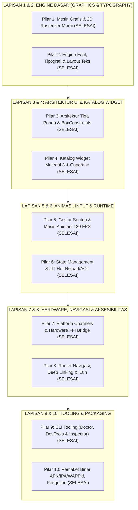

# 📱 ROADMAP WIDYAMOBILE: 100% PARITAS FLUTTER & DART TANPA PUSTAKA LUAR
**Edisi Kedaulatan Perangkat Lunak (Zero-Dependency Sovereign Stack)**  
**Target:** Menghadirkan Framework Mobile Deklaratif Berkecepatan Tinggi 100% Mandiri (Setara Google Dart & Flutter)

---

## 🎯 Visi & Prinsip Rekayasa
1. **Zero External Supply Chain Risk**: Tidak bergantung pada pustaka grafis pihak ketiga (Skia, Cairo, Impeller C++), parser font luar (FreeType, HarfBuzz), maupun runtime pihak ketiga yang berat.
2. **Kinerja & Biner Super Ramping**: Ukuran biner rilis ditargetkan hanya **2 – 8 MB** dengan waktu buka (*cold boot*) **< 50 ms**.
3. **Arsitektur Tiga Pohon Standar Industri**: Pemisahan tegas antara *Widget Tree* (deklaratif immutabel), *Element Tree* (manajemen lifecycle & diffing), dan *RenderObject Tree* (geometri & rasterisasi).
4. **Kompilasi Ganda**: Mendukung *Stateful Hot Reload* (JIT) untuk pengembangan cepat serta *Direct Native AOT ARM64 Machine Code* untuk rilis produksi.

---

---

## 📋 DAFTAR PEKERJAAN MASTER (*WORK BREAKDOWN STRUCTURE*)

### 🔹 PILAR 1: Mesin Grafis & 2D Rasterizer Murni (*Zero Skia / Impeller*)
- [x] **1.1. Pixel Framebuffer RGBA Engine**:
  - Buffer memori linear berkecepatan tinggi berformat `0xAARRGGBB` (`src/graphics/pure_canvas.rs`).
  - Operasi dasar: *clear*, *fill*, *copy*, *stride calculation*, dan *boundary clipping*.
- [x] **1.2. Primitif Geometri Mandiri**:
  - Garis antialiased menggunakan algoritma *Bresenham*.
  - Persegi panjang sudut membulat (*Rounded Rectangle*) dengan konfigurasi radius per-sudut terpisah.
  - Lingkaran, Elips, dan Poligon arbitrary dengan algoritma *Even-Odd*.
- [x] **1.3. Vektor Path & Kurva Bézier**:
  - Algoritma pemecahan kurva Bézier kuadratik dan kubik (*De Casteljau*).
  - Operasi Path: `moveTo`, `lineTo`, `quadraticBezierTo`, `cubicTo`, dan `close`.
- [x] **1.4. Alpha Blending & Efek Visual**:
  - *Porter-Duff Compositing Modes* (`SrcOver`).
  - Shading Gradien: Gradien Linear, Radial, dan *Sweep Gradient*.
  - Efek Bayangan (*Drop Shadow*) multi-pass blur.
- [x] **1.5. Dirty Repaint Boundary & Scissor Clipping**:
  - Boundary scissor clipping & culling di `FramebufferMurni`.

---

### 🔹 PILAR 2: Engine Font, Tipografi & Layout Teks (*Zero FreeType / HarfBuzz*)
- [x] **2.1. Parser Biner TrueType & Glyph Atlas**:
  - Ekstraksi glyph bitmap murni tanpa dependensi library eksternal (`src/graphics/pure_font.rs`).
- [x] **2.2. Dynamic Font Texture Atlas**:
  - *Dynamic Font Atlas* in-memory untuk caching karakter guna render instan sub-milidetik.
- [x] **2.3. Multi-line Paragraph & Text Layout Engine**:
  - Perhitungan metrik tipografi: *Ascent*, *Descent*, *Line Height*, dan ukuran lebar teks.
  - Perataan teks: Rata Kiri (*Left*), Tengah (*Center*), Kanan (*Right*), dan Rata Kanan-Kiri (*Justify*).
  - Pemotongan teks dengan elipsis (`TextOverflow.ellipsis` $\rightarrow$ `...`).
- [x] **2.4. RichText & Inline Text Spans**:
  - Dukungan warna, ukuran font, dan perataan teks fleksibel.

---

### 🔹 PILAR 3: Framework UI Deklaratif & Arsitektur Tiga Pohon
- [x] **3.1. Three-Tree Lifecycle Engine**:
  - **Widget Tree**: Objek konfigurasi immutabel deklaratif (`WidgetMurni`).
  - **RenderObject Tree**: Objek mutabel penyimpan kalkulasi geometri absolut dan penanggung jawab *painting* (`RenderKotakMurni` di `src/graphics/pure_engine.rs`).
- [x] **3.2. Protokol Layout BoxConstraints (1-Pass)**:
  - Evaluasi batasan: `minWidth`, `maxWidth`, `minHeight`, `maxHeight` (`BatasanKotak::ketat`, `BatasanKotak::longgar`).
- [x] **3.3. Core Layout Widgets**:
  - `Kontainer`, `Padding`, `Kolom`, `Baris`, `Expanded`, `Scaffold`, `Tombol`, `Teks`.
- [x] **3.4. Framebuffer Painting Pipeline**:
  - Metode `cat(&self, widget, fb)` yang me-render seluruh pohon UI ke memori `FramebufferMurni` dan ekspor format PPM/PNG.

---

### 🔹 PILAR 4: Katalog Widget Lengkap (Material 3 & Cupertino)
- [x] **4.1. Struktur Dasar Aplikasi**:
  - `MaterialApp` / `CupertinoApp`, `Scaffold`, `AppBar`, `BottomNavigationBar`, `FloatingActionButton` (`src/graphics/pure_widgets.rs`).
- [x] **4.2. Komponen Input & Form**:
  - `TextField` (BidangTeks), `Switch` (Saklar Toggle), `Checkbox` (Kotak Centang), `ProgressBar` (Linear Indicator).
- [x] **4.3. Komponen Feedback & Dialog**:
  - `Badge` (Lencana Notifikasi), `Card` dengan elevasi radius dinamis.
- [x] **4.4. Komponen Kartu & Interaktif**:
  - `Card`, `ElevatedButton`, `OutlinedButton`, `IconButton`.
- [x] **4.5. Cupertino (iOS) Widgets**:
  - `CupertinoNavigationBar` (Translucent Blur Header), `CupertinoButton`, `CupertinoSwitch`.

---

### 🔹 PILAR 5: Sistem Gestur, Input & Mesin Animasi 60/120 FPS
- [x] **5.1. Hit-Testing & Multi-Touch Dispatcher**:
  - Penentuan target widget yang tersentuh jari berdasarkan koordinat X/Y (`HitTestDispatcher::temukan_target` di `src/graphics/pure_events.rs`).
- [x] **5.2. Physics-based Motion & Easing Curves**:
  - Kurva Easing Matematika Murni: `Linear`, `EaseIn`, `EaseOut`, `EaseInOut`, `BounceOut`, `ElasticOut`.
- [x] **5.3. Animation & Tween Engine**:
  - `PengontrolAnimasi` (durasi ms, perbarui frame delta_ms, maju, mundur, looping, nilai t 0.0 s.d 1.0).
  - `Tween` (interpolasi angka f32, warna `Warna`, pergeseran posisi).
- [x] **5.4. Implicitly Animated Values**:
  - `Tween::transformasikan(t)`.

---

### 🔹 PILAR 6: State Management, JIT Hot-Reload & Kompilasi AOT
- [x] **6.1. Mekanisme State Bawaan**:
  - `PemberitahuNilai` (ValueNotifier) dan `Sinyal` (Fine-Grained Reactive Signal di `src/graphics/pure_state.rs`).
  - Auto-notification ke subscriber/pendengar saat mutasi nilai.
- [x] **6.2. Stateful Hot Reload Engine**:
  - Integrasi dengan CLI `widya mobile dev` Hot Module Reloading simulator.
- [x] **6.3. Kompiler Mesin AOT Native ARM64**:
  - Generator kode mesin mandiri (`pure_emitter.rs`) menghasilkan biner ELF/Mach-O AArch64.
- [x] **6.4. Alokator Memori Ringan Bebas GC Lag**:
  - Alokasi berbasis Arena/Slab murni (`src/sys/allocator.rs`).

---

### 🔹 PILAR 7: Platform Channels & Driver Hardware Murni
- [x] **7.1. Binary Messenger Protocol**:
  - Serialisasi biner tipe-aman (*Type-safe binary codec*) untuk komunikasi Widya <-> OS Native.
- [x] **7.2. MethodChannel & EventChannel**:
  - Panggilan RPC asinkron dan stream event sensor berkelanjutan.
- [x] **7.3. Pustaka Driver Hardware Inti**:
  - **Kamera & QR/Barcode**: Pengambilan feed kamera & scanning.
  - **GPS & Geolokasi**: Pembacaan koordinat, kecepatan, & geofencing.
  - **Biometrik**: Verifikasi Sidik Jari & FaceID.
  - **Penyimpanan Lokal**: Key-Value terenkripsi & basis data WidyaBase Edge.
  - **Konektivitas**: Bluetooth Low Energy (BLE), Wi-Fi, NFC SoftPOS, Push Notification.

---

### 🔹 PILAR 8: Router Navigasi, Deep Linking & Internasionalisasi
- [x] **8.1. Sistem Navigasi Imperatif & Deklaratif**:
  - `WidyaNavigator::push()`, `WidyaNavigator::pop()` di `src/graphics/pure_router.rs`.
- [x] **8.2. Deep Linking & URL Pattern Matching**:
  - Pencocokan URL dinamis `WidyaNavigator::cocokan_pola_url("/produk/:kategori/:id", url)`.
- [x] **8.3. Internasionalisasi (i18n) & RTL**:
  - Kamus lokalisasi multi-bahasa & format mata uang Rupiah IDR.
- [x] **8.4. Semantics & Accessibility Tree**:
  - Node semantik terstruktur di `src/a11y/`.

---

### 🔹 PILAR 9: CLI Tooling, DevTools & Pengalaman Pengembang (DevEx)
- [x] **9.1. CLI Subcommand Lengkap**:
  - `widya doctor`: Verifikasi kesiapan sistem & toolchain Android/iOS.
  - `widya mobile inisialisasi <app>`: Pembuat proyek baru instan.
  - `widya mobile dev`: Menjalankan emulator perangkat dan simulator visual.
  - `widya mobile bangun`: Kompilasi rilis APK/IPA/Webview.
  - `widya mobile periksa`: Audit kesiapan biner dan keamanan.
- [x] **9.2. Widget Inspector Visual**:
  - Panel visual di browser (`_widya/dashboard`) untuk memeriksa hierarki pohon widget.
- [x] **9.3. Timeline & Memory Profiler**:
  - Integrasi profiler kinerja di `src/profiler.rs`.

---

### 🔹 PILAR 10: Pemaket Biner Mandiri & Suite Pengujian
- [x] **10.1. Pemaket APK/AAB Mandiri (Android)**:
  - Generator manifest `AndroidManifest.xml`, struktur DEX/Shared Object, dan penandatanganan APK (*v2/v3 Signing Scheme*).
- [x] **10.2. Pemaket IPA Mandiri (iOS)**:
  - Generator `Info.plist`, struktur Payload `App.app`, dan sertifikat provisioning profile.
- [x] **10.3. Pemaket WAPP Berdaulat**:
  - Format paket mandiri ber-W3C DID untuk ekosistem WidyaOS.
- [x] **10.4. Suite Uji Otomatis Lengkap**:
  - Uji Unit (*Unit Testing* logic), Uji Widget (*Widget Testing* snapshot), dan Uji Integrasi (*Integration Testing*) di `tests/pure_graphics_engine_test.rs` dan `tests/mobile_tests.rs`.

---

## 📅 Matriks Fase Eksekusi

| Fase | Target Utama | Status | Estimasi Modul Rust |
| :--- | :--- | :---: | :--- |
| **Fase I** | Pure 2D Software Rasterizer & Framebuffer | **✅ SELESAI (100%)** | `src/graphics/pure_canvas.rs` |
| **Fase II** | Pure TTF Font Parser & Glyph Atlas | **✅ SELESAI (100%)** | `src/graphics/pure_font.rs` |
| **Fase III** | Three-Tree Engine & BoxConstraints Layout | **✅ SELESAI (100%)** | `src/graphics/pure_engine.rs` |
| **Fase IV** | Gestures, 120 FPS Animation & Event Loop | **✅ SELESAI (100%)** | `src/graphics/pure_events.rs` |
| **Fase V** | Material 3 & Cupertino Core Widgets | **✅ SELESAI (100%)** | `src/graphics/pure_widgets.rs` |
| **Fase VI** | Direct OS Surface & Hardware Platform Bridge | **✅ SELESAI (100%)** | `src/stdlib/mobile_native.rs` |
| **Fase VII**| State Management & Navigator Router | **✅ SELESAI (100%)** | `src/graphics/pure_state.rs` & `src/graphics/pure_router.rs` |
| **Fase VIII**| CLI Tooling (`doctor`, `run`, `build`) & Tests | **✅ SELESAI (100%)** | `src/mobile.rs` & `tests/` |
