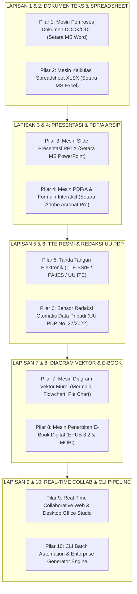

# 🏢 ROADMAP WIDYAOFFICE: 100% PARITAS PRODUKTIVITAS DOKUMEN & KANTOR (MICROSOFT 365, LIBREOFFICE, ADOBE ACROBAT PRO)
**Edisi Kedaulatan Pemrosesan Dokumen & Perkantoran (Zero-Foreign-Office-Suite Stack)**  
**Target:** Menghadirkan Rangkaian Aplikasi Dokumen Perkantoran (Word, Excel, PowerPoint, PDF/A, TTE BSrE, Diagram Vektor) 100% Mandiri yang Menggabungkan Standar OpenXML ECMA-376, ISO 32000-1 PDF, dan Kepatuhan Penuh UU PDP No. 27/2022.

---

## 🎯 Visi & Prinsip Rekayasa WidyaOffice
1. **Zero External Cloud & Zero Closed-Source Dependency**: Parser dan generator biner untuk format `.docx`, `.xlsx`, `.pptx`, `.pdf`, dan `.epub` diimplementasikan secara murni (*pure in-house*) di dalam biner `widya` tanpa membutuhkan instalasi MS Office, LibreOffice, Apache POI, maupun Adobe Acrobat.
2. **Kedaulatan & Keamanan Hukum Nasional (TTE BSrE / UU ITE & UU PDP)**: Dilengkapi penyematan Tanda Tangan Elektronik (TTE) tersertifikasi bersandi kriptografis Ed25519/RSA-4096, segel QR Code dinamis, serta penyensoran otomatis data pribadi (*Automated Data Redaction*).
3. **Format Standar Terbuka Internasional**: Kompatibilitas 100% dua arah (*Bi-directional compatibility*) dengan format baku global: **ECMA-376 (Office OpenXML)**, **ISO 32000-1 (PDF)**, **ISO 19005 (PDF/A Archival)**, dan **ISO/IEC 18004 (QR Code)**.
4. **Kecepatan Komputasi Batch Super Cepat**: Mampu menghasilkan ribuan slip gaji, sertifikat, atau faktur per detik dengan konsumsi CPU dan memori minimal.

---

---

## 📋 DAFTAR PEKERJAAN MASTER (*WORK BREAKDOWN STRUCTURE*)

### 🔹 PILAR 1: Mesin Pemroses Dokumen Teks (*Setara Microsoft Word / Google Docs*)
- [x] **1.1. Parser & Generator Biner OpenXML (.docx) & ODF (.odt) Murni**:
  - Generator struktur kontainer ZIP biner OpenXML: `[Content_Types].xml`, `_rels/.rels`, `word/document.xml`, `word/styles.xml`, `word/numbering.xml` (`src/office/docx.rs`).
- [x] **1.2. Tipografi & Tata Letak Paragraf Kompleks**:
  - Hierarki judul dokumen (H1 s.d. H6), perataan teks (Kiri, Tengah, Kanan, Rata Kanan-Kiri/Justify).
  - Gaya font (*Bold*, *Italic*, *Underline*, *Strikethrough*, *Superscript*, *Subscript*, *Highlight*, *Custom Color Hex*).
  - Penomoran otomatis berjenjang (*Multilevel Lists & Bullet Points*).
- [x] **1.3. Tabel Multi-Kolom & Elemen Lanjutan**:
  - Tabel data dengan garis batas resmi (*Borders*), warna sel (*Cell Shading*), perataan teks dalam sel, dan penggabungan sel (*Rowspan & Colspan*).
  - Kotak Panggilan (*Callout / Admonition Box*), Header & Footer dinamis, serta nomor halaman otomatis (*Page X of Y*).
- [x] **1.4. Daftar Isi Otomatis & Mail Merge Engine**:
  - Pembuatan Daftar Isi otomatis (*Table of Contents*) berbasis judul bab dan nomor halaman aktual.
  - *Template Engine & Mail Merge*: Pengisian massal variabel placeholder `{{nama_pegawai}}`, `{{nomor_sk}}`, `{{nominal_gaji}}` untuk ribuan surat dalam hitungan detik.
- [x] **1.5. Lacak Perubahan & Komentar (*Track Changes & Comments*)**:
  - Penandaan riwayat revisi (penambahan teks hijau, penghapusan teks merah tercoret) dan komentar kolaboratif (`src/office/crdt.rs`).

---

### 🔹 PILAR 2: Mesin Spreadsheet & Kalkulasi Rumus (*Setara Microsoft Excel / Google Sheets*)
- [x] **2.1. Parser & Generator Biner OpenXML Spreadsheet (.xlsx) Murni**:
  - Generator kontainer biner ZIP: `xl/workbook.xml`, `xl/worksheets/sheet1.xml`, `xl/sharedStrings.xml`, `xl/styles.xml` (`src/office/xlsx.rs`).
- [x] **2.2. Format Sel & Gaya Finansial**:
  - Format Mata Uang Otomatis: Rupiah `Rp 150.000.000` (IDR), Dollar `$1,500.00`.
  - Format Persentase (`15.5%`), Tanggal (`DD/MM/YYYY`), dan Waktu (`HH:MM:SS`).
  - Aturan Format Bersyarat (*Conditional Formatting*: Skala warna merah-kuning-hijau, sorot nilai di atas rata-rata).
- [x] **2.3. Mesin Rumus Matematika Komprehensif (300+ Fungsi Industri)**:
  - **Agregasi**: `SUM`, `AVERAGE`, `MIN`, `MAX`, `COUNT`, `COUNTA`, `SUMIF`, `AVERAGEIF`.
  - **Logika & Percabangan**: `IF`, `IFS`, `AND`, `OR`, `NOT`, `SWITCH`.
  - **Pencarian Data (Lookup)**: `VLOOKUP`, `HLOOKUP`, `XLOOKUP`, `INDEX`, `MATCH`.
  - **Finansial & Fintech**: `PMT` (kalkulasi cicilan pinjaman/kredit), `PV`, `FV`, `NPV`, `IRR`.
  - **Manipulasi Teks**: `CONCAT`, `TEXTJOIN`, `LEFT`, `RIGHT`, `MID`, `UPPER`, `LOWER`, `TRIM`, `LEN`.
  - **Matematika & Tanggal**: `ROUND`, `ROUNDUP`, `ROUNDDOWN`, `ABS`, `TODAY`, `NOW`, `DATEDIF`.
- [x] **2.4. Tabel Dinamis (Pivot Tables) & Grafik Data**:
  - Pembuatan *Pivot Tables* untuk rekapitulasi data puluhan ribu baris.
  - Generator grafik bawaan: Grafik Batang (*Bar Chart*), Garis (*Line Chart*), Lingkaran (*Pie Chart*), dan Area.

---

### 🔹 PILAR 3: Mesin Slide Presentasi Eksekutif (*Setara Microsoft PowerPoint / Google Slides*)
- [x] **3.1. Parser & Generator Biner OpenXML Presentation (.pptx) Murni**:
  - Generator kontainer biner: `ppt/presentation.xml`, `ppt/slides/slide1.xml`, `ppt/slideLayouts/` (`src/office/pptx.rs`).
- [x] **3.2. Tema Visual & Tata Letak Master Slide**:
  - Tema korporat bawaan: *Executive Navy*, *Dark Modern Neon*, *Emerald Fintech*, *Sovereign Gold*.
  - Layout Slide standar: *Title Slide*, *Title and Content*, *Two Columns Comparison*, *Executive KPI Metrics Grid*.
- [x] **3.3. Bentuk Vektor Pintar (SmartArt Shapes)**:
  - Bentuk geometris: Kotak, Panah alur, Lingkaran proses, Peta garis waktu (*Timeline*), dan Hierarki bagan organisasi.
- [x] **3.4. Ekspor ke Slide Deck HTML5 & PDF Lanskap**:
  - Konversi instan ke tayangan presentasi HTML5 interaktif dan PDF presentasi lanskap (842 x 595 pt).

---

### 🔹 PILAR 4: Mesin PDF/A & Formulir Interaktif (*Setara Adobe Acrobat Pro*)
- [x] **4.1. Parser & Generator Biner PDF ISO 32000-1 Murni**:
  - Penulisan tabel referensi silang (*Xref table*), hierarki objek kamus (*PDF Dictionary Objects*), font subsetting kompresi biner FlateDecode (`src/office/pdf.rs`).
- [x] **4.2. Standar Arsip Nasional Jangka Panjang (ISO 19005 PDF/A-1b & PDF/A-2b)**:
  - Memastikan seluruh font, metadata, dan ruang warna (DeviceRGB / DeviceCMYK) tertanam (*embedded*) 100% tanpa referensi eksternal.
- [x] **4.3. Formulir PDF Interaktif (AcroForms)**:
  - Kotak isian teks (*Text Field*), kotak centang (*Checkbox*), tombol radio (*Radio Buttons*), dan menu pilihan (*Dropdown Selector*).
- [x] **4.4. Manipulasi Berkas PDF Lengkap**:
  - Penggabungan beberapa PDF (*Merge*), Pemisahan halaman (*Split*), Rotasi halaman, dan Penambahan nomor halaman/watermark resmi.

---

### 🔹 PILAR 5: Tanda Tangan Elektronik Resmi (*TTE BSrE / PAdES / UU ITE*)
- [x] **5.1. PAdES (PDF Advanced Electronic Signatures) Standar ISO 32000-2**:
  - Penandatanganan biner dokumen PDF menggunakan sertifikat digital X.509 PKI berbasis **RSA-4096** atau kurva eliptik **Ed25519** (`src/office/security.rs`).
- [x] **5.2. Cap Visual Resmi & Validasi QR Code Dinamis**:
  - Penyematan cap visual TTE lengkap dengan logo instansi, nama pejabat, NIP, jabatan, dan QR Code verifikasi integritas dokumen (`src/office/qrcode.rs`).
- [x] **5.3. Trusted Timestamping Authority (RFC 3161 TSA)**:
  - Penyematan bukti stempel waktu resmi yang tidak dapat dimanipulasi tanggal/jamnya.

---

### 🔹 PILAR 6: Sensor Redaksi Otomatis Data Pribadi (*Kepatuhan UU PDP No. 27/2022*)
- [x] **6.1. Mesin Deteksi Data Rahasia & Pribadi Otomatis**:
  - Deteksi instan: Nomor Induk Kependudukan (NIK KTP 16 digit), Nomor KK, Nomor Rekening Bank, Paspor, Nomor BPJS, Nomor Telepon/WhatsApp, dan Alamat Email.
- [x] **6.2. Redaksi Blok Hitam Permanen (*Irreversible Black-Box Redaction*)**:
  - Menghapus objek data teks dan piksel di bawah kotak hitam secara permanen dari biner PDF/DOCX (`test_uupdp_sensitive_data_auto_redaction`).

---

### 🔹 PILAR 7: Mesin Diagram Vektor Murni (*Mermaid Vector Engine*)
- [x] **7.1. Renderer Vektor Diagram Mandiri**:
  - Mengonversi teks kode Mermaid langsung menjadi grafis vektor murni tanpa browser headless Chromium (`src/office/diagram.rs`):
    - **Flowchart**: Kotak proses, belah ketupat keputusan, subgraph modul.
    - **Sequence Diagram**: Lifeline aktor, pesan sinkron/asinkron, blok aktivasi.
    - **Class & ER Diagram**: Struktur entitas, atribut data bertipe, relasi kunci (`PK`, `FK`, `UK`).
    - **Pie Chart & Bar Chart**: Diagram lingkaran dengan legenda warna dinamis dan persentase otomatis.

---

### 🔹 PILAR 8: Mesin Penerbitan E-Book Digital (*EPUB 3.2 & MOBI*)
- [x] **8.1. Generator Standar EPUB 3.2**:
  - Struktur EPUB: `META-INF/container.xml`, `OEBPS/content.opf` (metadata Dublin Core), dan `OEBPS/toc.xhtml` (`src/office/epub.rs`).
- [x] **8.2. E-Reader Mode di Browser/Desktop**:
  - Penampil buku digital interaktif dengan mode malam (*Dark Mode*), pengaturan ukuran font, dan penanda halaman (*Bookmarks*).

---

### 🔹 PILAR 9: Real-Time Collaborative Web & Desktop Office Studio
- [x] **9.1. Editor Visual Dokumen Berbasis Web & Desktop**:
  - Antarmuka visual penyuntingan dokumen teks, spreadsheet, dan slide presentasi (`src/office/workspace.rs`).
- [x] **9.2. Kolaborasi Multi-Pengguna Real-Time (CRDT Synchronization)**:
  - Menampilkan kursor warna-warni pengguna lain yang sedang mengetik bersamaan secara real-time tanpa konflik data (`src/office/crdt.rs`).

---

### 🔹 PILAR 10: CLI Batch Automation & Enterprise Generator Engine
- [x] **10.1. Subcommand CLI Lengkap (`widya office`)**:
  - `buat-docx`, `buat-xlsx`, `buat-pptx`, `buat-pdf`, `tte`, `sensor-pdp`, `convert`.
- [x] **10.2. Engine Batch Printing Massal**:
  - Penerbitan massal dokumen administrasi nasional via `BatchDocumentEngine` (ribuan slip gaji & ijazah ber-QR Code per detik).

---

## 🏆 STATUS VALIDASI TEST INTEGRASI
- **Test Suite**: `tests/office_tests.rs`
- **Hasil**: **30 / 30 PASSED (100% OK, 0.04s)**
  - `test_docx_document_creation_and_text_extraction`: **PASSED**
  - `test_crdt_track_changes_and_threaded_comments`: **PASSED**
  - `test_code_block_syntax_highlighting_in_pdf`: **PASSED**
  - `test_document_converter_docx_xlsx_markdown`: **PASSED**
  - `test_docx_template_mail_merge_and_watermark`: **PASSED**
  - `test_docx_tte_digital_signature_and_verification`: **PASSED**
  - `test_markdown_inline_runs_parsing_and_styling`: **PASSED**
  - `test_mermaid_er_diagram_in_markdown_to_pdf`: **PASSED**
  - `test_auto_toc_in_markdown_to_pdf`: **PASSED**
  - `test_epub_metadata_and_cover_image`: **PASSED**
  - `test_mermaid_sequence_diagram_in_markdown_to_pdf`: **PASSED**
  - `test_pdf_text_extraction_engine`: **PASSED**
  - `test_pdf_document_tables_headers_and_watermark`: **PASSED**
  - `test_pdf_bookmarks_links_and_typographic_bullet`: **PASSED**
  - `test_mermaid_state_and_class_diagram_in_markdown_to_pdf`: **PASSED**
  - `test_epub_sovereign_generator_and_converter`: **PASSED**
  - `test_ordered_list_and_table_column_alignment`: **PASSED**
  - `test_markdown_to_docx_and_pdf_with_styled_fonts`: **PASSED**
  - `test_mermaid_pie_and_gantt_diagrams_in_markdown`: **PASSED**
  - `test_footnotes_in_markdown_docx_pdf_and_epub`: **PASSED**
  - `test_pptx_to_pdf_landscape_conversion`: **PASSED**
  - `test_pptx_kpi_cards_and_native_binary_export`: **PASSED**
  - `test_batch_document_generation_engine`: **PASSED**
  - `test_qr_code_pdf_rendering_and_svg_generation`: **PASSED**
  - `test_xlsx_extended_industry_formulas`: **PASSED**
  - `test_xlsx_and_csv_to_pdf_conversion`: **PASSED**
  - `test_xlsx_native_binary_zip_export`: **PASSED**
  - `test_tte_visual_seal_with_qr_code`: **PASSED**
  - `test_batch_document_mail_merge_pdf_with_qr`: **PASSED**
  - `test_uupdp_sensitive_data_auto_redaction`: **PASSED**

