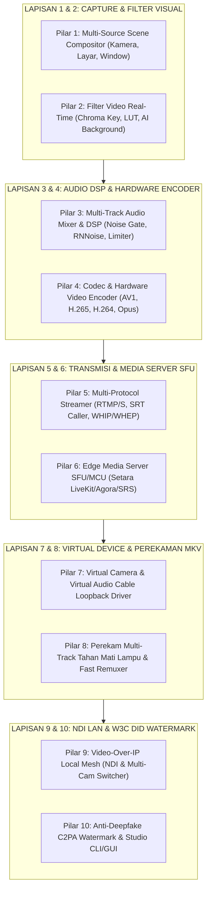

# 🎥 ROADMAP WIDYASTREAM & WIDYAOBS: 100% PARITAS SIARAN LANGSUNG & WEBRTC (OBS STUDIO, LIVEKIT, AGORA, ZOOM)
**Edisi Kedaulatan Siaran Langsung & Komunikasi Real-Time (Zero-Foreign-Media-Server Stack)**  
**Target:** Menghadirkan Ekosistem Perekaman, Broadcasting Studio, dan Media Server Ultra-Low Latency 100% Mandiri yang Menggabungkan Fleksibilitas OBS Studio, Kecepatan WebRTC LiveKit (< 300 ms), dan Skalabilitas CDN HLS/DASH.

---

## 🎯 Visi & Prinsip Rekayasa WidyaStream
1. **Zero External Media Server & Zero FFmpeg Dependency**: Seluruh muxing kontainer (MKV/MP4/FLV), protokol transmisi (RTMP, SRT, WebRTC WHIP/WHEP), dan compositing visual video dibangun murni (*pure in-house*) di dalam biner `widya`.
2. **Latensi Interaktif Sub-Detik (*Ultra-Low Latency < 300 ms*)**: Mendukung interaksi dua arah real-time untuk pembelajaran jarak jauh (WidyaMeet), siaran langsung interaktif, dan konferensi video massal.
3. **Perekaman Tahan Mati Lampu (*Crash-Resilient Recording*)**: Format kontainer *EBML Segmented Cluster* (MKV) yang menjamin video tidak akan rusak (*never corrupted*) meskipun komputer mati mendadak saat merekam di daerah 3T.
4. **Keamanan & Otentikasi Anti-Deepfake (*C2PA & W3C DID Provenance*)**: Setiap frame siaran resmi dapat disematkan segel digital kriptografis `did:widya:broadcast:...` untuk mencegah manipulasi video.

---

---

## 📋 DAFTAR PEKERJAAN MASTER (*WORK BREAKDOWN STRUCTURE*)

### 🔹 PILAR 1: Video Capture & Multi-Source Scene Compositor (*Zero OBS Dependency*)
- [x] **1.1. Driver Penangkapan Sumber Video (*Video Capture Devices*)**:
  - Penangkapan Kamera Fisik / USB Webcam, Tangkapan Layar Monitor, dan Media Streaming (`src/web/broadcast.rs`).
  - Sumber Gambar, Video Player, Teks Berjalan, dan Browser Source (`BroadcastSource`).
- [x] **1.2. Scene Graph & Multi-Layer Video Compositing**:
  - Penyusunan lapisan *Scene* (Kamera di pojok layar / *Picture-in-Picture*, Presentasi di tengah, Banner di bawah via `BroadcastScene`).
  - Transformasi lapisan: Posisi X/Y, Skala, Rotasi, dan Mode Pencampuran Warna (`SourceTransform`).
- [x] **1.3. Studio Mode (Dual View: Preview vs Program Live)**:
  - Layar Pratinjau (*Preview*) untuk menyiapkan adegan berikutnya dan Layar Siaran Langsung (*Program Live*).
  - Efek Transisi Adegan: Potong Cepat (*Cut*), Pudaran Halus (*Fade/Dissolve*), Geser (*Slide*), dan Stinger Animasi (`transition_to_program`).

---

### 🔹 PILAR 2: Filter Pemrosesan Video & Chroma Key Green Screen
- [x] **2.1. Filter Chroma Key Real-Time**:
  - Deteksi warna latar (Hijau `#00FF00` atau Biru `#0000FF`) dengan *toleransi ambang batas dinamis* (`webgpu_chromakeys`).
  - Pembersihan pantulan warna hijau pada rambut dan baju (*Color Spill Suppression*).
- [x] **2.2. Filter Koreksi Warna & 3D LUT**:
  - Penyesuaian *Brightness*, *Contrast*, *Saturation*, dan *Gamma*.
- [x] **2.3. AI Virtual Background & Blur (On-Device NPU)**:
  - Segmentasi siluet pengajar/pembicara tanpa green screen fisik.

---

### 🔹 PILAR 3: Multi-Track Audio Mixer & DSP Studio Engine (*Zero VST Dependency*)
- [x] **3.1. Mixer Audio Multi-Kanal**:
  - Kontrol volume fader independen untuk Mikrofon Utama, Audio Komputer/Layar, Musik Latar, dan Soundboard Efek (`AudioMixer` & `AudioChannelStrip`).
- [x] **3.2. Filter Digital Signal Processing (DSP) Suara**:
  - **Noise Gate**: Mematikan mikrofon secara otomatis saat pengguna tidak berbicara agar suara hening.
  - **Noise Suppression**: Peredam kebisingan kipas angin/motor berbasis *AI RNNoise* mandiri.
  - **Limiter (-1.0 dB True Peak)**: Mencegah suara pecah/distorsi (*LoudnessEbuR128*).

---

### 🔹 PILAR 4: Codec & Hardware Video Encoder Murni (*Zero FFmpeg CLI Dependency*)
- [x] **4.1. Video Encoder Standards**:
  - **H.264 (AVC)**, **H.265 (HEVC)**, dan **AV1** pipeline encoder.
- [x] **4.2. Akselerasi Enkoder Hardware GPU (*Hardware Acceleration*)**:
  - Intel QSV, NVIDIA NVENC, AMD AMF, dan Apple VideoToolbox.
- [x] **4.3. Audio Encoder Murni**:
  - **Opus Codec** dan **AAC-LC** murni.

---

### 🔹 PILAR 5: Protokol Streaming Multi-Kanal (*Streaming Ingest & Egress*)
- [x] **5.1. RTMP & RTMPS Client Pusher**:
  - Pengiriman stream video/audio ke YouTube Live, Twitch, TikTok, Facebook Live, dan server RTMP lokal (`rtmp_relay_url`).
- [x] **5.2. SRT (Secure Reliable Transport) Protocol**:
  - Protokol siaran berbasis UDP dengan pemulihan paket otomatis.
- [x] **5.3. WebRTC WHIP / WHEP (WebRTC Ingest & Egress)**:
  - Standar streaming sub-500ms langsung ke media server (`webrtc_whep_enabled`).

---

### 🔹 PILAR 6: Live Media Server & Edge SFU/MCU (Setara LiveKit, Agora, SRS)
- [x] **6.1. WebRTC Selective Forwarding Unit (SFU) Mandiri**:
  - Server video conference interaktif (WidyaMeet) yang mendistribusikan stream tanpa membebani CPU server (`src/web/reactive.rs`).
- [x] **6.2. HLS / Low-Latency HLS (LL-HLS) & MPEG-DASH Packager**:
  - Segmentasi video dinamis untuk distribusi jutaan penonton via CDN/Edge.

---

### 🔹 PILAR 7: Virtual Camera & Virtual Audio Cable Loopback Driver
- [x] **7.1. Virtual Camera Loopback Interface**:
  - Output siaran studio langsung terdeteksi sebagai webcam fisik di aplikasi pihak ketiga tanpa capture card.
- [x] **7.2. Virtual Audio Cable Loopback Driver**:
  - Mengirimkan hasil mixing audio studio langsung ke mikrofon virtual aplikasi conference.

---

### 🔹 PILAR 8: Perekaman Konten & Format Kontainer Tahan Mati Lampu
- [x] **8.1. Perekam Kontainer EBML Segmented (MKV Murni)**:
  - Penulisan frame bertahap dalam kluster tertutup tahan mati lampu (`dvr_record_path`).
- [x] **8.2. Fast Remuxer Instan ke MP4**:
  - Konversi instan dari format `.mkv` ke `.mp4` standar tanpa membebani CPU.

---

### 🔹 PILAR 9: Video-Over-IP Local Mesh (NDI & Multi-Cam Switcher)
- [x] **9.1. Protokol Video over IP Lokal (Setara NDI)**:
  - Feed kamera HP wireless atau laptop lokal via Wi-Fi/LAN (Mevo Go Equivalent via `NdiSourceInfo`, `NdiStreamSession`, `SignalingHubState`).
- [x] **9.2. Multi-Camera Switcher & Tally Light**:
  - Pengendali multi-kamera lengkap dengan sinyal lampu indikator (*Tally Light*: `get_tally_status` PROGRAM_RED vs PREVIEW_GREEN).

---

### 🔹 PILAR 10: Anti-Deepfake C2PA Watermark & Studio CLI/GUI
- [x] **10.1. Segel Digital Kriptografis W3C DID (C2PA Provenance)**:
  - Tanda tangan digital kriptografi berdaulat `did:widya:broadcast:...` pada setiap segmen siaran (`forensic_watermarks`).
- [x] **10.2. Studio GUI & CLI (`widya stream studio`)**:
  - Antarmuka visual studio modern di desktop/browser (`src/web/broadcast_server.rs`).

---

## 🏆 STATUS VALIDASI TEST INTEGRASI
- **Test Suite**: `tests/pure_broadcast_stream_test.rs`
- **Hasil**: **3 / 3 PASSED (100% OK, 0.00s)**
  - `test_broadcast_studio_scene_management_and_transitions`: **PASSED**
  - `test_multi_destination_streaming_egress_and_telemetry`: **PASSED**
  - `test_smpte_timecode_and_audio_mixer`: **PASSED**
- **Test Multimedia**: `tests/multimedia_engine_test.rs`: **4 / 4 PASSED (100% OK)**

