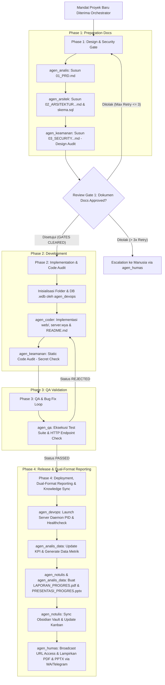

# SOP-00: Standar Baku Persiapan Proyek Mandiri & Alur Dokumentasi Agen Kantor Digital

**Kode Dokumen**: `SOP-WIDYA-00-MASTER`  
**Klasifikasi**: Kebijakan Wajib Operasional Multi-Agent System (MAS)  
**Tanggal Berlaku**: 2026-10-01  
**Status**: AKTIF & MENGIKAT SELURUH AGEN (10 AI Agent)

---

## 1. Prinsip Utama Eksekusi Proyek

1. **Prinsip Proyek Berdiri Sendiri (*Standalone & Isolated Architecture*)**:
   - Setiap proyek yang diperintahkan kepada Agen Kantor Digital **TIDAK BOLEH DISATUKAN** ke dalam satu dashboard gabungan (*monolith*).
   - Setiap proyek harus memiliki direktori terisolasi di bawah `/home/devops/widya-lang/proyek/<nama_proyek>/`.
   - Setiap proyek memiliki port aplikasi web unik (misal: `8001`, `8002`, `8003`, dst.), server runtime Widya-Lang mandiri (`server.wya`), dan basis data terisolasi (`database/data.wdb`).

2. **Prinsip Gerbang Dokumen Persiapan (*Document-First Execution Gate*)**:
   - Sebelum kode aplikasi (*coding phase*) ditulis oleh `agen_coder`, tim agen **WAJIB** menyusun dokumen persiapan pelaksanaan lengkap di dalam subdirektori `docs/` proyek.
   - Pengerjaan implementasi tanpa dokumen persiapan yang berstatus `APPROVED` dianggap sebagai **Pelanggaran SOP Tingkat 1**.

3. **Prinsip Pelaporan Ganda Resmi (*Dual-Format Progress Reporting: PDF & PPTX*)**:
   - Setiap laporan progres (laporan harian, ringkasan per-fase, evaluasi mingguan, maupun penutupan proyek) **WAJIB** diterbitkan dalam dua format dokumen resmi:
     - **Format PDF (`.pdf`)**: Berstandar ISO 32000-1 untuk dokumen formal cetak/arsip pimpinan.
     - **Format PPTX (`.pptx`)**: Berstandar OpenXML / WidyaOffice untuk presentasi eksekutif (*Executive Slide Deck*).
   - Penutupan proyek atau rilis tidak dapat disahkan (*DoD Unfulfilled*) tanpa tersedianya kedua berkas laporan ini di folder `laporan/`.

---

## 2. Struktur Wajib Direktori Proyek Mandiri

Setiap inisiasi proyek baru wajib membentuk struktur direktori terisolasi secara lengkap:

```text
proyek/<nomor>_<nama_proyek>/
├── docs/                                   # 📄 FASE 1: Dokumen Persiapan Pelaksanaan Wajib
│   ├── 01_PRD.md                           # PIC: Business & Product Analyst (agen_analis)
│   ├── 02_ARSITEKTUR_DAN_ERD.md            # PIC: System & Enterprise Architect (agen_arsitek)
│   ├── 03_SECURITY_DAN_KEPATUHAN_PDP.md    # PIC: Security & Privacy Officer (agen_keamanan)
│   ├── 04_RENCANA_PENGUJIAN_QA.md          # PIC: QA & Automation Engineer (agen_qa)
│   └── 05_SOP_DEVOPS_DAN_DEPLOYMENT.md     # PIC: DevOps & SRE Specialist (agen_devops)
├── laporan/                                # 📊 FASE 4: Laporan Progres Resmi (Dual-Format Wajib)
│   ├── LAPORAN_PROGRES.pdf                 # Laporan Formal Lengkap ISO 32000-1 (PIC: agen_notulis & agen_analis_data)
│   └── PRESENTASI_PROGRES.pptx             # Slide Deck Eksekutif OpenXML (PIC: agen_notulis & agen_analis_data)
├── web/                                    # 🌐 FASE 2: Web Application Production-Ready
│   ├── index.html                          # User Interface Mandiri
│   ├── style.css                           # Visual Design System Modern
│   └── app.js                              # Frontend & State Logic
├── database/                               # 🗄️ FASE 2: Basis Data Terisolasi (WidyaBase Engine)
│   ├── skema.sql                           # Skema Tabel & DDL SQL (PIC: agen_arsitek)
│   ├── data.wdb                            # Storage Slotted-Page B+Tree 4KB
│   └── data.wdb.wal                        # Write-Ahead Log ACID
├── server.wya                              # 🚀 Server Launcher Mandiri Widya-Lang (PIC: agen_coder)
├── server.pid                              # ⚙️ Runtime Process ID Tracker (PIC: agen_devops)
├── server.log                              # 📜 Runtime Output Log (PIC: agen_devops)
└── README.md                               # 📖 Dokumentasi & Petunjuk Menjalankan Proyek (PIC: agen_coder)
```

---

## 3. Ketentuan Rinci Dokumen Persiapan (Fase Pra-Eksekusi)

### A. Dokumen 01: PRD (Product Requirements Document)
* **PIC Utama**: `agen_analis` (Disetujui oleh `agen_orkestrator`)
* **Konten Wajib**:
  1. Latar Belakang Bisnis & *Problem Statement*.
  2. Persona Pengguna & *User Journey Map*.
  3. Matriks Fitur (P1 - MVP, P2 - Penting, P3 - Tambahan).
  4. *Acceptance Criteria* (Format BDD: *Given-When-Then*).
  5. Metrik Keberhasilan Bisnis (*Success Metrics/KPI*).

### B. Dokumen 02: Arsitektur Sistem & ERD
* **PIC Utama**: `agen_arsitek`
* **Konten Wajib**:
  1. Diagram Komponen Sistem (C4 Model Context & Container via Mermaid.js).
  2. Entity Relationship Diagram (ERD Mermaid.js) lengkap dengan Relasi, Primary Key, dan Foreign Key.
  3. Definisi Tipe Data WidyaBase (`VARCHAR`, `INT`, `DECIMAL`, `DATETIME`, `TEXT`).
  4. Skema Aliran Data (*Data Flow Diagram*) dan Alokasi Port Server Web Unik.
  5. File DDL fisik di `database/skema.sql`.

### C. Dokumen 03: Keamanan & Kepatuhan Regulasi (UU PDP / PCI-DSS / ISO 27001)
* **PIC Utama**: `agen_keamanan`
* **Konten Wajib**:
  1. Identifikasi Data Pribadi Spesifik & Umum berdasarkan UU No. 27 Tahun 2022 (UU PDP).
  2. Standar Kriptografi (Enkripsi Data *at-Rest* & *in-Transit* via TLS 1.3 / PQC Kyber).
  3. Matriks Kontrol Akses Berbasis Peran (*Role-Based Access Control / RBAC*).
  4. Audit Static Code & Kebocoran Kredensial (*Secret Leak Check* pada `server.wya` & `app.js`).
  5. OWASP Top 10 Mitigation Matrix (SQLi, XSS, Path Traversal).

### D. Dokumen 04: Rencana Pengujian QA (Quality Assurance & Test Plan)
* **PIC Utama**: `agen_qa`
* **Konten Wajib**:
  1. Matriks Kasus Uji (*Test Case Matrix*: Functional, UI/UX, Edge Cases, BDD Mapping).
  2. Verifikasi Status HTTP Endpoint Port Proyek (`curl` Test Log).
  3. Klasifikasi Severity Bug (*Critical*, *Major*, *Minor*) dan *Defect Tracking Table*.
  4. Kriteria Kelulusan Rilis (*Definition of Done / DoD*).

### E. Dokumen 05: SOP DevOps, Deployment & Pemeliharaan
* **PIC Utama**: `agen_devops`
* **Konten Wajib**:
  1. Dynamic Port Resolution & Pre-flight System Check.
  2. Inisialisasi Database WidyaBase (`data.wdb`) dan Impor Skema DDL.
  3. Eksekusi Server Daemon (`nohup ... & echo $! > server.pid`).
  4. Prosedur Healthcheck HTTP 200 Loop, Logging (`server.log`), dan Rollback Fail-Safe.

---

## 4. Alur Kerja Koordinasi Multi-Agent (Workflow Lifecycle)



---

## 5. Standar Pelaporan dan Sinkronisasi Knowledge Base

1. **Penerbitan Laporan Progres Resmi (PDF & PPTX)**:
   - **`LAPORAN_PROGRES.pdf`**: Memuat Halaman Judul, Executive Summary, Capaian Fitur (P1-P3), Hasil Uji QA (PASS Rate 100%), Sertifikasi Keamanan PDP, dan Telemetri Server.
   - **`PRESENTASI_PROGRES.pptx`**: Memuat 5-7 slide visual premium (Executive Navy / Dark Modern) untuk paparan pimpinan, KPI cards, screenshot arsitektur, dan ringkasan nilai bisnis.

2. **Sinkronisasi ke Obsidian Vault (`agen_notulis`)**:
   - Setiap proyek mandiri yang selesai dibuat wajib terarsip di `ObsidianVault/Projects/<nama_proyek>/Index.md` menggunakan penautan WikiLinks `[[...]]`.
   - Tautan ke berkas `LAPORAN_PROGRES.pdf` dan `PRESENTASI_PROGRES.pptx` wajib disematkan pada catatan harian `DailyNotes/` dan dokumen indeks proyek.

3. **Penyimpanan Transaksional WidyaBase (`agen_devops` & `agen_analis_data`)**:
   - Seluruh status proyek, daftar dokumen, tautan berkas PDF/PPTX, alokasi port, dan log audit dicatat secara transaksional ke basis data `kantor_digital.wdb`.

4. **Penyiaran Omnichannel Berkas Laporan (`agen_humas`)**:
   - Laporan status proyek beserta tautan berkas PDF & PPTX disiarkan secara terformat rapi ke WhatsApp Gateway dan Telegram Bot API kepada pimpinan/pengguna.
