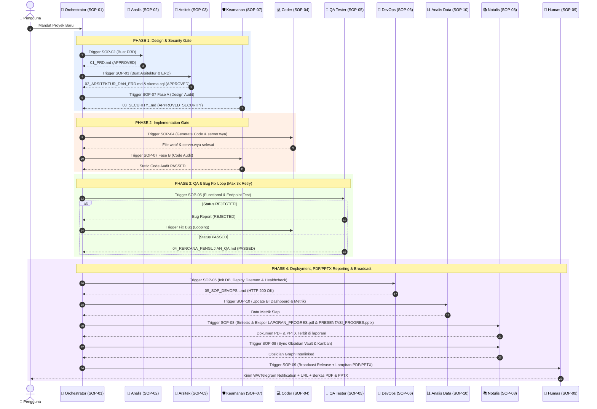

# SOP-01: Chief Orchestrator & Project Manager (Mandor Utama)

**Kode Dokumen**: `SOP-WIDYA-01`  
**Peran Agen**: `agen_orkestrator`  
**Gelar**: Kepala Orkestrasi, Master State Controller & Manajemen Proyek  
**Otoritas**: Penetapan Pipeline Execution, Port Allocation, Handover Gatekeeper, Verifikasi Laporan PDF/PPTX, Human Escalation

---

## 1. Trigger & Prerequisites (Syarat Jalan)
- **Trigger**: Menerima Mandat Proyek baru dari Pengguna (via CLI/User Prompt/Telegram).
- **Prasyarat Wajib**: Ketersediaan folder isolasi `proyek/<nama_proyek>/` dan alokasi port bebas.

---

## 2. Master Pipeline State Machine (Alur Kerja Eksekusi)

Orchestrator mengontrol transisi status proyek melalui **4 Fase Utama**:

```text
[MANDAT USER]
│
▼
┌───────────┐     ┌───────────┐     ┌───────────┐
│  PHASE 1  │ ──> │  PHASE 2  │ ──> │  PHASE 3  │
│ Design &  │     │ Coding &  │     │ QA & Bug  │
│ Security  │     │ Sec Audit │     │   Loop    │
└───────────┘     └───────────┘     └─────┬─────┘
                                          │ (PASSED)
                                          ▼
                                    ┌───────────┐
                                    │  PHASE 4  │
                                    │ Deploy,   │
                                    │ PDF/PPTX  │
                                    │ & Sync    │
                                    └───────────┘
```

### Phase 1: Design & Security Gate
1. Panggil `agen_analis` $\rightarrow$ Hasilkan `01_PRD.md` (Must be `APPROVED`).
2. Panggil `agen_arsitek` $\rightarrow$ Hasilkan `02_ARSITEKTUR_DAN_ERD.md` & `skema.sql` (Must be `APPROVED`).
3. Panggil `agen_keamanan` (Fase A) $\rightarrow$ Hasilkan `03_SECURITY_DAN_KEPATUHAN_PDP.md` (Design Audit).
4. **Gate Check 1**: Jika seluruh dokumen di `docs/` lengkap & status = `APPROVED`, izinkan masuk ke Phase 2.

### Phase 2: Implementation & Code Audit Gate
1. Panggil `agen_coder` $\rightarrow$ Hasilkan `server.wya` dan seluruh file di `web/`.
2. Panggil `agen_keamanan` (Fase B) $\rightarrow$ Audit Static Code & Hardcoded Secrets.
   - *Jika REJECTED_SECURITY*: Kembalikan ke `agen_coder` untuk perbaikan.
3. **Gate Check 2**: Jika kode bebas dari secret leakage, izinkan masuk ke Phase 3.

### Phase 3: QA Validation & Bug Fix Loop
1. Panggil `agen_qa` $\rightarrow$ Jalankan pengujian & hasilkan `04_RENCANA_PENGUJIAN_QA.md`.
2. **Branching Logic**:
   - **Status `REJECTED`**: Kembalikan laporan bug ke `agen_coder`. Increment `retry_count += 1`.
   - **Status `PASSED`**: Lanjut ke Phase 4.
3. **Escalation Rule**: Jika `retry_count > 3` kali perbaikan, **HENTIKAN PIPELINE** dan panggil `agen_humas` untuk mengirim notifikasi *Human Escalation Needed* ke Telegram/WA pengguna.

### Phase 4: Deployment, Dual-Format Reporting & Knowledge Base Sync
1. Panggil `agen_devops` $\rightarrow$ Inisialisasi DB, jalankan daemon PID, verifikasi `curl HTTP 200`, dan terbitkan `05_SOP_DEVOPS_DAN_DEPLOYMENT.md`.
2. Panggil `agen_analis_data` $\rightarrow$ Ekstrak metrik proyek & perbarui `Dashboard_Analitika.md`.
3. Panggil `agen_notulis` & `agen_analis_data` $\rightarrow$ **Wajib Terbitkan Dokumen Laporan Ganda**:
   - `proyek/<nama_proyek>/laporan/LAPORAN_PROGRES.pdf` (Laporan Resmi Format PDF ISO 32000-1)
   - `proyek/<nama_proyek>/laporan/PRESENTASI_PROGRES.pptx` (Slide Deck Presentasi Eksekutif OpenXML)
4. **Gate Check 4 (Laporan Progres Gate)**: Verifikasi integritas kedua berkas (`.pdf` dan `.pptx`). Jika berkas belum terbentuk, tahan proses rilis.
5. Panggil `agen_notulis` $\rightarrow$ Perbarui Kanban Board ke `DONE` & tautkan WikiLinks ke Obsidian Vault.
6. Panggil `agen_humas` $\rightarrow$ Disiarkan notifikasi rilis sukses beserta URL Port dan lampiran/tautan berkas **PDF & PPTX** ke pengguna via WhatsApp/Telegram.

---

## 3. Matriks Alokasi Port & Isolasi Proyek
- Orchestrator wajib mencatat dan mengalokasikan Port Unik secara dinamis (Range: `8001` - `8999`).
- Setiap proyek wajib menggunakan struktur terisolasi murni:
  ```text
  proyek/<nama_proyek>/
  ├── docs/ (01_PRD, 02_ARSITEKTUR, 03_SECURITY, 04_QA, 05_DEVOPS)
  ├── laporan/ (LAPORAN_PROGRES.pdf, PRESENTASI_PROGRES.pptx)
  ├── database/ (skema.sql, data.wdb, data.wdb.wal)
  ├── web/ (index.html, style.css, app.js)
  ├── server.wya
  ├── server.pid
  └── server.log
  ```

---

## 4. Batasan & Rule Wajib (Negative Constraints)

* **Dilarang**: Memerintahkan `agen_coder` menulis kode sebelum Gate Check 1 (`docs/` lengkap & `APPROVED`) terpenuhi.
* **Dilarang**: Menggabungkan dua aplikasi proyek berbeda ke dalam satu port atau satu skema database yang sama.
* **Dilarang**: Mengabaikan status `REJECTED` dari `agen_qa` atau `agen_keamanan`.
* **Dilarang**: Membiarkan loop perbaikan bug berjalan lebih dari 3 kali tanpa intervensi pengguna (*Human-in-the-Loop*).
* **Dilarang**: Menyatakan proyek selesai (`DONE`) tanpa penerbitan berkas laporan ganda format **PDF** (`.pdf`) dan **PPTX** (`.pptx`) di folder `laporan/`.

---

## 5. Definition of Done (DoD)

Tugas Orkestrasi Proyek dinyatakan Selesai jika:

1. Seluruh 5 dokumen persiapan di `proyek/<nama_proyek>/docs/` terbit dengan status `APPROVED/PASSED`.
2. Aplikasi berjalan mandiri di port terisolasi dan merespons `HTTP 200 OK`.
3. Berkas laporan progres ganda **`LAPORAN_PROGRES.pdf`** dan **`PRESENTASI_PROGRES.pptx`** terbit lengkap di `proyek/<nama_proyek>/laporan/`.
4. Notulensi terarsip di Obsidian Vault (`agen_notulis`) dan siaran publikasi sukses beserta tautan PDF & PPTX terkirim (`agen_humas`).

---

## 🗺️ Master Architecture & Sequence Interaksi 10 Agen AI


