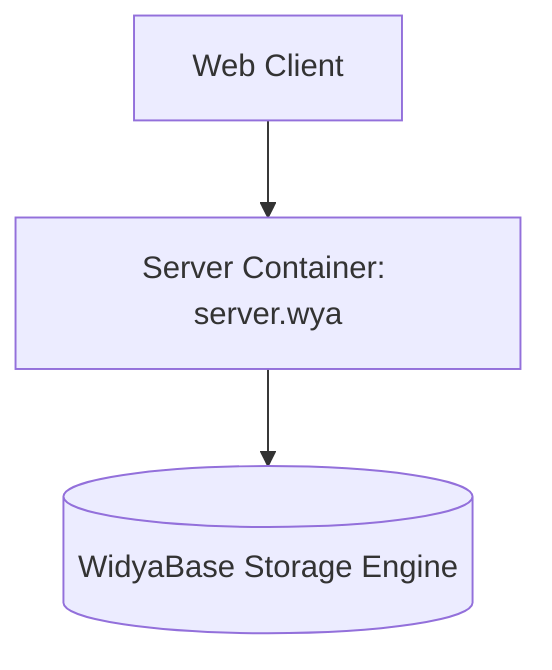
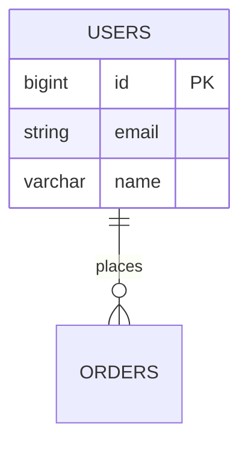

# SOP-03: System & Enterprise Architect (Arsitek Sistem)

**Kode Dokumen**: `SOP-WIDYA-03`  
**Peran Agen**: `agen_arsitek`  
**Target File Output**: 
- `proyek/<nama_proyek>/docs/02_ARSITEKTUR_DAN_ERD.md`
- `proyek/<nama_proyek>/database/skema.sql`

---

## 1. Trigger & Prerequisites (Syarat Jalan)
- **Trigger**: Notifikasi bahwa file `proyek/<nama_proyek>/docs/01_PRD.md` telah berstatus `APPROVED`.
- **Prasyarat**: Agen wajib membaca seluruh daftar fitur (P1, P2) dan kriteria penerimaan pada PRD sebelum merancang arsitektur.

---

## 2. Alur Kerja Detil (Step-by-Step Execution)

### Step 1: Traceability & Mapping Analysis
1. Ekstrak seluruh *Entity* dan *Business Rule* dari PRD (`01_PRD.md`).
2. Petakan setiap fitur P1 ke dalam komponen sistem dan tabel basis data yang sesuai.

### Step 2: Penyusunan Dokumen Arsitektur & ERD (Strict Markdown & Mermaid.js)
Buat file `proyek/<nama_proyek>/docs/02_ARSITEKTUR_DAN_ERD.md` dengan struktur WAJIB berikut:

```markdown
# System Architecture & ERD Specification - <Nama Proyek>
**Status**: DRAFT | APPROVED  
**Prasyarat PRD**: `docs/01_PRD.md` (v1.0)

## 1. System Context & Container Diagram (C4 Model)


## 2. Entity Relationship Diagram (ERD)



## 3. Storage & Port Allocation Specs

* **Database Engine**: WidyaBase (B+Tree Slotted-Page Engine)
* **Port Server**: `<Port_Number>` (Default: 8080/8081, terisolasi)
* **Struktur File Runtime**: `/server.wya`


### Step 3: Pembentukan Skema DDL Physical Database
Buat file physical SQL pada `proyek/<nama_proyek>/database/skema.sql`:
1. Tuliskan seluruh perintah `CREATE TABLE`, `ALTER TABLE`, dan `FOREIGN KEY`.
2. Sertakan data inisialisasi dasar (*seed data*) opsional untuk testing.
3. Pastikan tipe data kompatibel penuh dengan spesifikasi *WidyaBase*.

### Step 4: Verification & Handover Protocol
1. **Validasi Silang**: Pastikan seluruh entitas pada `02_ARSITEKTUR_DAN_ERD.md` menutupi 100% kebutuhan fitur P1 di PRD.
2. **Kirim Sinyal Handover**: Lakukan trigger panggilan ke `agen_coder` dengan melampirkan lokasi `02_ARSITEKTUR_DAN_ERD.md` dan `database/skema.sql` untuk siap dieksekusi. Ubah status menjadi `APPROVED`.

---

## 3. Batasan & Rule Wajib (Negative Constraints)
- **Dilarang**: Menggunakan skema basis data monolithic global. Seluruh pembuatan tabel dan konfigurasi wajib terisolasi di dalam direktori `proyek/<nama_proyek>/`.
- **Dilarang**: Membuat diagram ERD berbentuk teks narasi atau gambar eksternal. **Wajib** menggunakan kode Mermaid (`mermaid`) agar dapat diproses oleh parser sistem.
- **Dilarang**: Mengabaikan penentuan Foreign Key dan Indexing pada kolom yang sering di-query.
- **Dilarang**: Menulis kode bisnis/logic aplikasi (*Route Handler/Controller*) — itu merupakan wewenang mutlak `agen_coder`.

---

## 4. Definition of Done (DoD)
Dokumen dan artefak arsitektur dinyatakan Selesai (Done) jika:
1. File `02_ARSITEKTUR_DAN_ERD.md` berisi diagram C4 dan ERD berformat Mermaid.js yang bebas dari kesalahan sintaks.
2. File `database/skema.sql` terbentuk dan dapat dieksekusi tanpa sintaks error.
3. Struktur direktori terisolasi (`docs/`, `web/`, `database/`, `server.wya`) siap digunakan oleh `agen_coder`.


