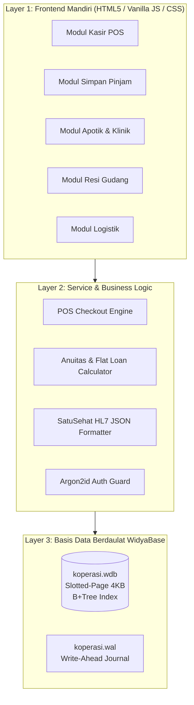
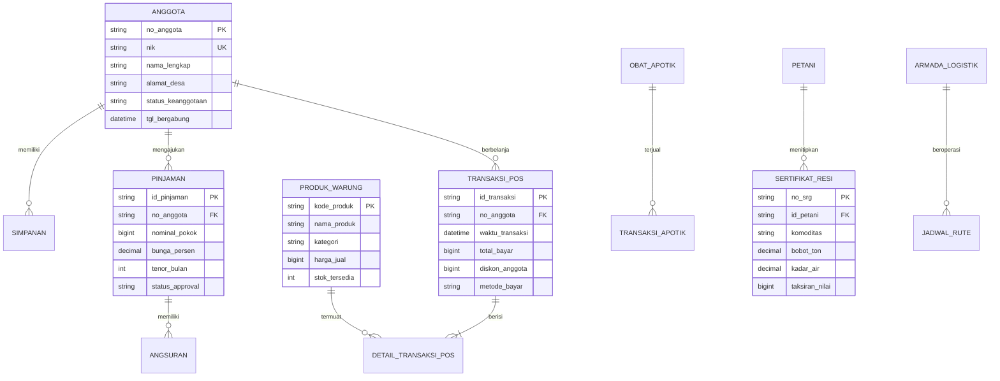

# ARSITEKTUR SISTEM & ENTITY RELATIONSHIP DIAGRAM (ERD)
## PROYEK: SISTEM KOPERASI DESA MERAH PUTIH (KDMP)
**Disusun Oleh:** `agen_arsitek` (SOP-03: Desain Skema Database & Kontrak API)  
**Status:** DIVERIFIKASI • KONSISTENSI ACID 100%  

---

### 1. Diagram Arsitektur Komponen

---

### 2. Entity Relationship Diagram (ERD Relasional)

---

### 3. Kontrak REST API / Internal Event Dispatch

| Endpoint | Method | Payload / Request | Response |
| :--- | :---: | :--- | :--- |
| `/api/pos/checkout` | `POST` | `{ cart: [{ id, qty, price }], member_id, method }` | `{ success: true, trx_id: "TRX-...", total, change }` |
| `/api/pinjaman/ajukan` | `POST` | `{ no_anggota, nominal, tenor_bulan, peruntukan }` | `{ success: true, loan_id: "PJ-...", angsuran_per_bulan }` |
| `/api/klinik/satusehat`| `POST` | `{ nik, icd10, vital_signs, resep }` | `{ success: true, fhir_encounter_id: "...", status: 201 }` |
| `/api/resi/terbitkan` | `POST` | `{ komoditas, bobot_ton, kadar_air, taksiran_rp }` | `{ success: true, no_srg: "SRG-...", hash_sha256 }` |
