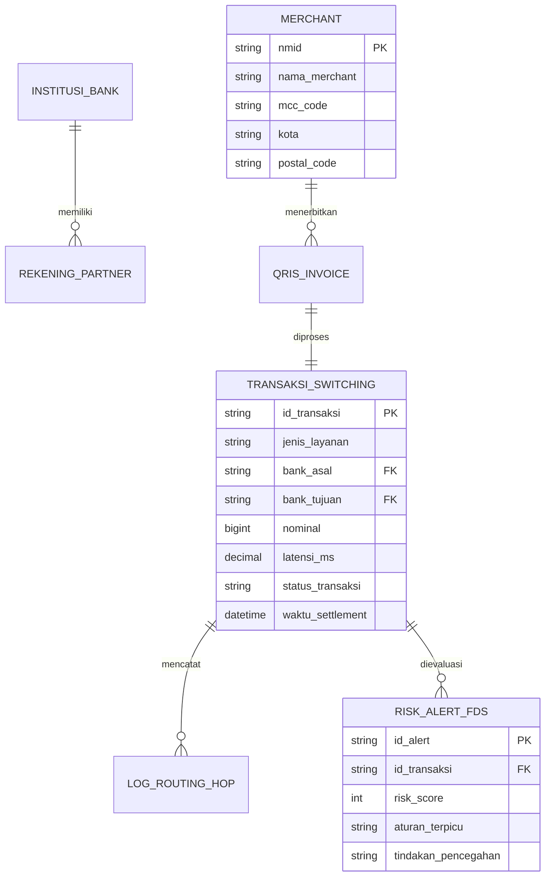

# ARSITEKTUR SWITCHING & ENTITY RELATIONSHIP DIAGRAM (ERD)
## PROYEK: WIDYAPAY ULTRA-FAST PAYMENT SWITCHER
**Disusun Oleh:** `agen_arsitek` (SOP-03)  
**Status:** DIVERIFIKASI • ISO 20022 & EMVCo COMPLIANT  

---

### 1. Topologi Switching Engine

```mermaid
graph LR
    subgraph Inbound["Inbound Gateways"]
        QR[QRIS Dynamic Client]
        BF[BI-FAST Partner Bank]
        POS[Card Terminal ISO 8583]
    end

    subgraph Core["WidyaPay Switching Core (Rust Native)"]
        Parser[Zero-Copy TLV/XML Parser]
        FDS[AI Fraud Detection System]
        HSM[HSM PIN Translation Engine]
        Router[Sub-ms Routing Matrix]
    end

    subgraph Outbound["Settlement & Clearing"]
        BI[Bank Indonesia BI-FAST Core]
        ASPI[ASPI QRIS Switcher Network]
        BPD[Core Banking BPD / BPR]
    end

    Inbound --> Parser
    Parser --> FDS
    FDS --> HSM
    HSM --> Router
    Router --> Outbound
```

---

### 2. Skema ERD Relasional Basis Data

