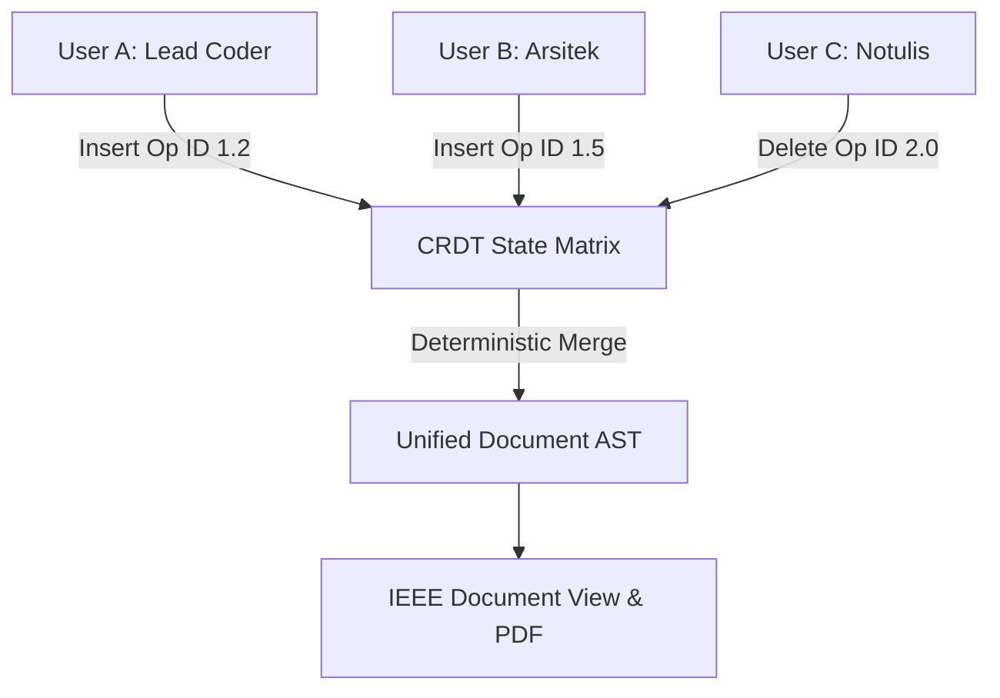

# ARSITEKTUR CRDT & ENTITY RELATIONSHIP DIAGRAM (ERD)
## PROYEK: WIDYA WORKSPACE COLLABORATIVE CRDT
**Disusun Oleh:** `agen_arsitek` (SOP-03)  

---

### 1. Model State Machine CRDT (Logoot / LWW)



### 2. Skema Basis Data Workspace
```sql
BUAT_TABEL JIKA_TIDAK_ADA dokumen_workspace (
    id_dokumen TEKS KUNCI_UTAMA,
    judul TEKS,
    konten_markdown TEKS,
    penulis_terakhir TEKS,
    versi INT,
    waktu_update TEKS
);
```
