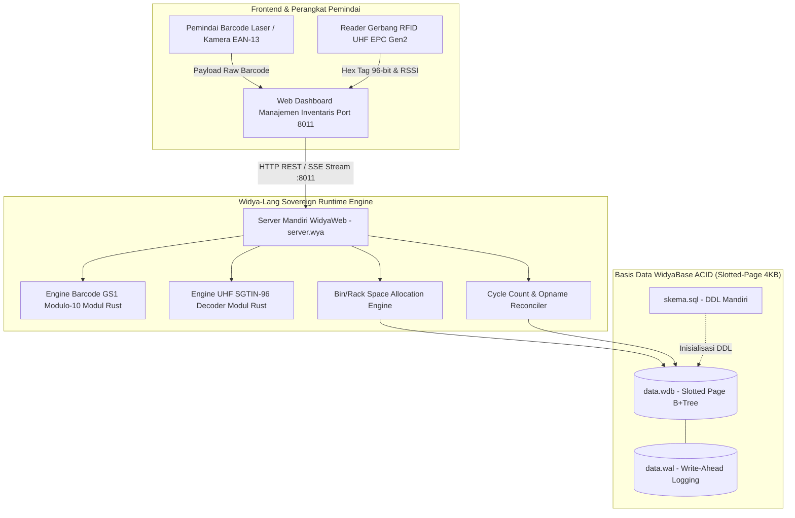
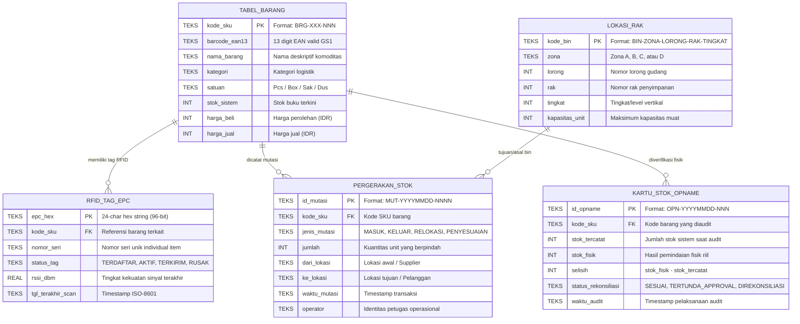

# DOKUMEN ARSITEKTUR SISTEM & ERD (02_ARSITEKTUR_DAN_ERD)
## PROYEK: SISTEM MANAJEMEN INVENTARIS UMKM NUSANTARA (PRJ-WIDYA-INV-02)
**Kode Proyek**: `PRJ-WIDYA-INV-02`  
**Disusun Oleh**: `agen_arsitek` (SOP-03: Perancangan Arsitektur Basis Data & Sistem)  
**Disetujui Oleh**: `agen_orkestrator` & `agen_keamanan`  
**Status**: RESMI • STANDARISASI MULTI-AGENT WIDYA  

---

### 1. Diagram Komponen Sistem (C4 Container Model)

---

### 2. Entity Relationship Diagram (ERD WidyaBase)

---

### 3. Definisi Tipe Data & Kompatibilitas WidyaBase
Sesuai arsitektur penyimpanan WidyaBase (B+Tree Slotted-Page 4KB):
- `TEKS`: String UTF-8 variable length (disimpan dalam slotted record offset).
- `INT`: Integer 64-bit bertanda (2's complement).
- `REAL`: Floating point 64-bit IEEE-754 (digunakan untuk RSSI dBm dan desimal).
- `KUNCI_UTAMA`: Indeks primer otomatis menggunakan pohon B+Tree terurut untuk pencarian O(log N).

---

### 4. Alokasi Port Jaringan & Skema Aliran Data
- **Port Layanan Web & Dashboard**: `http://localhost:8011`
- **Port Cadangan / Failover**: `http://localhost:8012`
- **Direktori Berkas Web**: `agen_kantor_digital/proyek/PRJ-WIDYA-INV-02/web/`
- **Berkas Basis Data**: `agen_kantor_digital/proyek/PRJ-WIDYA-INV-02/database/data.wdb`
- **Write-Ahead Log**: `agen_kantor_digital/proyek/PRJ-WIDYA-INV-02/database/data.wal`
- **Berkas DDL Skema**: `agen_kantor_digital/proyek/PRJ-WIDYA-INV-02/database/skema.sql`

---

### 5. DDL Fisik Terdaftar
Skema fisik database disimpan secara mandiri dan terisolasi pada `database/skema.sql`, siap dieksekusi oleh mesin runtime tanpa dependensi eksternal.
