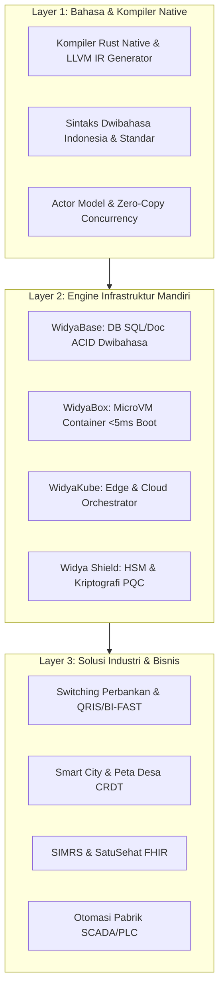
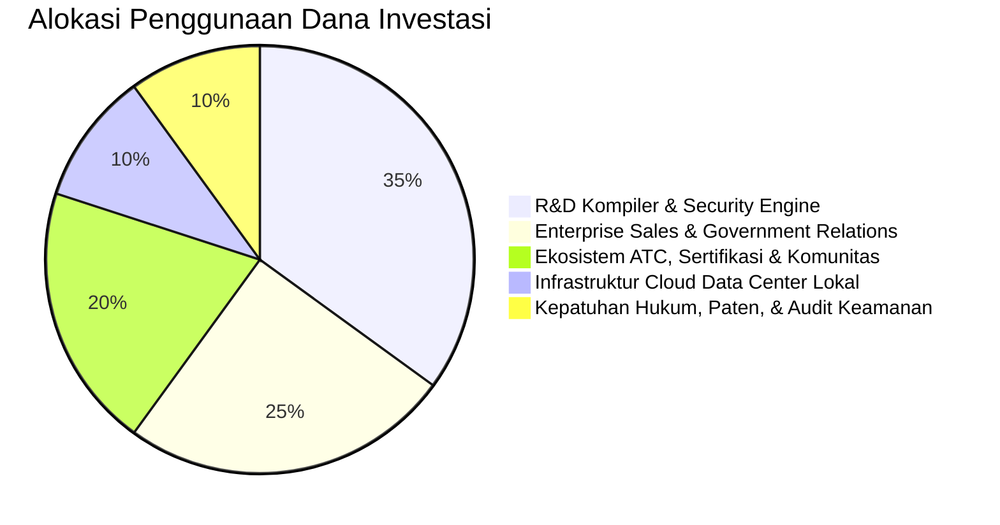

# PANDUAN EKSEKUTIF DAN PITCH DECK KOMERSIAL WIDYA-LANG
**PT Widya Ekosistem Digital Indonesia (Widya-Lang Corporation)**
*Dokumen Rencana Strategis Eksekutif, Nilai Valuasi, dan Peluang Investasi 2026–2030*

---

## 1. RINGKASAN EKSEKUTIF (EXECUTIVE SUMMARY)

Widya-Lang adalah ekosistem komputasi dan bahasa pemrograman berdaulat pertama di Asia Tenggara yang dirancang dari nol menggunakan bahasa Rust berkinerja tinggi. Widya-Lang menggabungkan sintaks natural bahasa Indonesia dengan kemampuan dwibahasa internasional, mesin basis data terdistribusi ACID ([WidyaBase](file:///c:/widya-lang/DOKUMENTASI_WIDYABASE.md)), orkestrator kontainer mini ([WidyaBox](file:///c:/widya-lang/DOKUMENTASI_WIDYABOX_CONTAINER.md) & [WidyaKube](file:///c:/widya-lang/DOKUMENTASI_WIDYAKUBE_ORCHESTRATOR.md)), serta modul kepatuhan standar industri nasional (QRIS, BI-FAST, SNAP OpenAPI BI, SatuSehat HL7/FHIR, Peta Geospasial Desa Kemendagri, dan Dapodik Kemdikbudristek).

```
+-----------------------------------------------------------------------------+
|                              CORE METRICS & VALUE                           |
|  • Valuasi Pasar Total (TAM Indonesia & ASEAN): USD 4.2 Miliar               |
|  • Target ARR Tahun ke-3 (2028): Rp 120 Miliar (USD 8 Juta)                 |
|  • Gross Margin Software: 88.5% | LTV / CAC Ratio: 18.0x                     |
|  • Efisiensi Komputasi: 4x lebih cepat dari Java, 10x lebih hemat memori    |
|  • Komitmen Edukasi: Subsidi Sertifikasi 70% untuk Pelajar & Guru           |
+-----------------------------------------------------------------------------+
```

---

## 2. PERMASALAHAN BESAR INDUSTRI (THE PROBLEM)

1. **Ketergantungan Ekstrem pada Vendor Asing & Biaya Lisensi Selangit**:
   - Lembaga perbankan, BUMN, dan pemerintahan di Indonesia menghabiskan triliunan Rupiah setiap tahun untuk lisensi middleware komersial asing (Oracle, IBM, Microsoft, VMware) dengan biaya pemeliharaan tahunan (*maintenance fee*) yang terus meningkat 15-20% per tahun.
2. **Kesenjangan Kepatuhan Regulasi Nasional**:
   - Bahasa pemrograman dan framework global (Java, Go, Python, Node.js) tidak memiliki pustaka bawaan untuk standar wajib Indonesia seperti QRIS MPM/CPM, BI-FAST ISO 20022, SNAP OpenAPI BI, integrasi BPJS V-Claim, dan SatuSehat Kemenkes. Pengembang harus membangun integrasi rumit dari nol yang rentan galat dan audit keamanan.
3. **Krisis Kedaulatan Data & Infrastruktur Cloud Asing**:
   - Ancaman kebocoran data lintas batas dan kepatuhan UU Pelindungan Data Pribadi (UU PDP No. 27/2022) menuntut infrastruktur perangkat lunak yang beroperasi 100% di dalam yurisdiksi Republik Indonesia dengan audit kode sumber terbuka (*verifiable source code*).
4. **Kesenjangan Talenta Digital**:
   - Indonesia membutuhkan 9 juta talenta digital pada tahun 2030, namun kurva belajar pemrograman berbahasa asing menjadi hambatan besar bagi jutaan siswa SMK, mahasiswa daerah, dan pengembang pemula di tanah air.

---

## 3. SOLUSI WIDYA-LANG (THE SOLUTION)

Widya-Lang menawarkan **"Sovereign Industrial Computing Stack"** terintegrasi:



---

## 4. ANALISIS PELUANG PASAR (TAM / SAM / SOM)

```
===============================================================================
TAM: TOTAL ADDRESSABLE MARKET (Pasar Perangkat Lunak Enterprise & Cloud ASEAN)
USD 4.200.000.000 (Rp 67,2 Triliun)
===============================================================================
       ▲
       │
===============================================================================
SAM: SERVICEABLE ADDRESSABLE MARKET (Enterprise Stack, DB, & Edukasi Indonesia)
USD 850.000.000 (Rp 13,6 Triliun)
===============================================================================
       ▲
       │
===============================================================================
SOM: SERVICEABLE OBTAINABLE MARKET (Target Widya-Lang dalam 5 Tahun)
USD 25.000.000 (Rp 405 Miliar / Tahun pada 2030)
===============================================================================
```

---

## 5. STRATEGI BISNIS & MONETISASI (THE 5 GROWTH ENGINES)

1. **Lisensi On-Premise & Distributed Cluster (B2B & B2G)**:
   - Rp 150 Jt - Rp 1,5 Miliar per cluster/tahun dengan garansi SLA 99.999% dan dukungan 24/7.
2. **Standardisasi Sertifikasi Nasional (BOS-WL)**:
   - Voucher Ujian Mandiri WCA, WCP, WCE, dan 7 Spesialisasi Industri.
   - **Subsidi Diskon 70% Khusus Pelajar/Guru/Dosen** (WCA hanya Rp 225.000).
   - Lisensi Authorized Training Center (ATC) Rp 14 Jt - Rp 35 Jt/tahun untuk 500+ kampus dan SMK.
3. **Widya Cloud DBaaS & Serverless PaaS**:
   - Layanan cloud terkelola berbasis data center lokal Indonesia (Rp 450 Ribu - Rp 18 Jt/bulan).
4. **Marketplace Modul Industri & Driver Ekosistem**:
   - Model revenue share 80% (Mitra Pengembang) / 20% (Platform Widya).
5. **Jasa Konsultasi Migrasi Arsitektur Legacy**:
   - Modernisasi sistem perbankan lama COBOL/Java ke Widya-Lang Enterprise.

---

## 6. TIM KEPEMIMPINAN & GOVERNANSI (MANAGEMENT & ADVISORY)

- **Chief Executive Officer (CEO)**: Memimpin visi komersialisasi enterprise, relasi pembuat kebijakan, dan ekspansi pasar.
- **Chief Technology Officer (CTO)**: Mengawal arsitektur compiler Rust, riset performa low-level, dan keamanan siber berdaulat.
- **Head of Certification & Academy (BOS-WL)**: Mengelola standardisasi kurikulum, bank soal, dan jaringan 500+ ATC kampus.
- **VP of Enterprise Sales & Government Relations**: Bertanggung jawab atas pengadaan E-Katalog LKPP, tender BUMN, dan lisensi B2B.

---

## 7. KEBUTUHAN PENDANAAN & PENGGUNAAN DANA (FUNDING ALLOCATION)

Widya-Lang membuka putaran pendanaan strategis **Seed / Series-A sebesar Rp 15 Miliar**:



---
*Dokumen Rahasia & Hak Cipta Terlindungi — PT Widya Ekosistem Digital Indonesia.*
