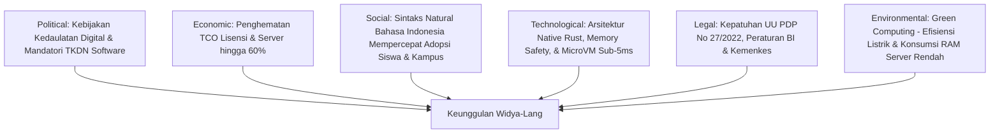

# ANALISIS PASAR, LANSKAP KOMPETITOR, DAN STRATEGI POSITIONING
**PT Widya Ekosistem Digital Indonesia (Widya-Lang Corporation)**
*Kajian Komprehensif Pasar Komputasi Enterprise, Analisis Kompetisi, Porter 5 Forces, & PESTLE*

---

## 1. STRUKTUR & POTENSI PASAR SEKTORAL (INDONESIA & ASEAN)

Pasar perangkat lunak dan infrastruktur enterprise di Indonesia sedang mengalami akselerasi masif yang didorong oleh tiga katalis utama:
1. **Regulasi Kedaulatan Data & TKDN (Tingkat Komponen Dalam Negeri)**: Kewajiban instansi pemerintah, BUMN, dan industri perbankan memprioritaskan software dan basis data berlisensi dalam negeri.
2. **Kebutuhan Standardisasi Integrasi Nasional**: Penerapan mandatori QRIS MPM/CPM, BI-FAST ISO 20022, SNAP OpenAPI BI, dan SatuSehat Kemenkes (HL7/FHIR).
3. **Efisiensi Anggaran Infrastruktur Cloud**: Dorongan korporasi memangkas biaya server hyperscaler asing (AWS, Azure, GCP) yang membengkak akibat konsumsi RAM/CPU framework lama.

### Rincian Potensi Pasar per Sektor (SAM Indonesia: USD 850 Juta):

```
+------------------------------------+------------------+---------------------+
| Sektor Industri Target             | Potensi Pasar    | Pangsa Target 2030  |
+------------------------------------+------------------+---------------------+
| Perbankan, Fintech & Switching     | USD 280 Juta     | USD 10.5 Juta (3.7%)|
| Pemerintahan, Smart City & B2G     | USD 220 Juta     | USD 8.0 Juta (3.6%) |
| Manufaktur & Energi (Industri 4.0) | USD 160 Juta     | USD 3.5 Juta (2.2%) |
| Rumah Sakit & HealthTech           | USD 110 Juta     | USD 2.0 Juta (1.8%) |
| Pendidikan & Pelatihan Sertifikasi | USD 80 Juta      | USD 1.0 Juta (1.2%) |
+------------------------------------+------------------+---------------------+
| TOTAL                              | USD 850 Juta     | USD 25.0 Juta (~Rp 405 Miliar)|
+------------------------------------+------------------+---------------------+
```

---

## 2. MATRIKS ANALISIS KOMPETITOR MENDALAM

Widya-Lang berhadapan dengan tiga kelompok kompetitor:

```
                          PERFORMA TINGGI (LOW MEMORY)
                                       │
                                       │        ★ WIDYA-LANG ENTERPRISE
                                       │        (Native Rust, Built-in QRIS/BI-FAST/
                         Go / Rust OSS │         WidyaBase ACID, Indonesia Syntax)
                                       │
             ──────────────────────────┼──────────────────────────
             OPEN SOURCE UMUM          │          ENTERPRISE PROPRIETARY
                                       │
                  Python / Node.js     │        Oracle / IBM / Microsoft .NET
                  (Tinggi Ekosistem    │        (Sangat Mahal, Heavy Footprint,
                   namun Boros Memori) │         Lock-in Asing, No Indo-Standards)
                                       │
                          BOROS MEMORI & RUNTIME BERAT
```

### Tabel Perbandingan Fitur Kompetitif:

| Parameter Evaluasi | Widya-Lang Enterprise | Oracle Cloud / Java Stack | Microsoft .NET / SQL Server | Go / Node.js Stack |
| :--- | :---: | :---: | :---: | :---: |
| **Kompilasi Biner & Kecepatan Booting** | Native Rust (<5ms) | JVM Bytecode (1-5 detik) | CLR Bytecode (0.5-2 detik) | Go Native / V8 JIT |
| **Konsumsi Memori Idle Server** | **< 15 MB** | 500 MB – 2 GB | 200 MB – 800 MB | 30 MB – 150 MB |
| **Integrasi Standar Keuangan Nasional** | **Native Built-in** (QRIS, BI-FAST, SNAP) | ❌ Kustom Pihak Ketiga | ❌ Kustom Pihak Ketiga | ❌ Kustom Pihak Ketiga |
| **Integrasi Standar Kesehatan SatuSehat** | **Native Built-in** (FHIR HL7 Validator) | ❌ Kustom Pihak Ketiga | ❌ Kustom Pihak Ketiga | ❌ Kustom Pihak Ketiga |
| **Engine Basis Data Terdistribusi Bawaan** | **WidyaBase ACID** (SQL Dwibahasa) | Bayar Terpisah (Oracle DB Mahal) | Bayar Terpisah (MS SQL Mahal) | Perlu DB Eksternal (PostgreSQL) |
| **Orkestrator & Kontainer Ringan Bawaan** | **WidyaBox & WidyaKube** | Memerlukan Docker/K8s/VMware | Memerlukan Hyper-V/Azure | Memerlukan Docker/K8s |
| **Sintaks Bahasa Indonesia Idiomatis** | **Tersedia Penuh** | ❌ Bahasa Asing Saja | ❌ Bahasa Asing Saja | ❌ Bahasa Asing Saja |
| **Biaya Lisensi per Node / Tahun** | **Rp 150 Jt (Terjangkau)** | > Rp 1 Miliar / Core | > Rp 600 Jt / Core | Open Source (Tanpa SLA) |

---

## 3. ANALISIS PORTER'S FIVE FORCES

1. **Ancaman Pendatang Baru (*Threat of New Entrants*) — RENDAH**:
   - Membangun kompiler native dari nol berbasis Rust, engine basis data ACID distributed, orkestrator kontainer, dan bank soal bersertifikasi membutuhkan investasi R&D multi-tahun dan keahlian low-level engineering yang sangat langka.
2. **Daya Tawar Pembeli (*Bargaining Power of Buyers*) — SEDANG**:
   - Korporasi besar memiliki proses pengadaan ketat, namun tingginya biaya vendor legacy asing membuat Widya-Lang menjadi alternatif yang sangat menarik secara finansial (TCO turun 60%).
3. **Daya Tawar Pemasok (*Bargaining Power of Suppliers*) — SANGAT RENDAH**:
   - Widya-Lang tidak bergantung pada proprietary runtime pihak ketiga. Seluruh teknologi inti dibangun mandiri (*zero external commercial dependencies*).
4. **Ancaman Produk Pengganti (*Threat of Substitutes*) — SEDANG**:
   - Kombinasi stack open source (Linux + Go + Postgres + K8s) adalah alternatif gratis, tetapi tidak menyediakan sertifikasi resmi, SLA 99.999%, konektor standar perbankan/kesehatan lokal siap pakai, dan perlindungan hukum berlisensi.
5. **Intensitas Persaingan Industri (*Competitive Rivalry*) — SEDANG MENUJU TINGGI**:
   - Pasar enterprise didominasi pemain global, namun belum ada satu pun pemain global yang berfokus melayani kedaulatan digital Indonesia dengan fitur spesifik regulasi nasional.

---

## 4. ANALISIS PESTLE (MACRO-ENVIRONMENTAL ANALYSIS)



---
*Dokumen Analisis Pasar Widya-Lang — Divalidasi oleh Divisi Strategi Korporat.*
