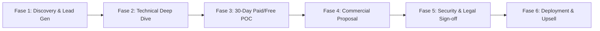

# STRATEGI DAN PLAYBOOK PENJUALAN B2B ENTERPRISE WIDYA-LANG
**Pedoman Tim Sales Enterprise, Solution Architect, & Customer Success**

---

## 1. KERANGKA KERJA KUALIFIKASI PELUANG (MEDDPICC PLAYBOOK)

Setiap prospek enterprise wajib dikualifikasikan menggunakan metodologi MEDDPICC:

| Elemen MEDDPICC | Pertanyaan Kunci Evaluasi | Kriteria Lulus Kualifikasi |
| :--- | :--- | :--- |
| **M - Metrics** | Apa metrik bisnis terpenting bagi klien? (misal: pangkas biaya cloud 50%, throughput 100k TPS, kepatuhan BI-FAST). | Target terukur dalam angka finansial/teknis yang disetujui CIO/CTO. |
| **E - Economic Buyer** | Siapakah pemegang anggaran resmi? (Direktur IT / CFO / Kepala Divisi Pengadaan). | Tim sales telah berinteraksi langsung dengan pembuat keputusan akhir. |
| **D - Decision Criteria** | Apa kriteria teknis & komersial yang digunakan? (Latensi <1ms, SLA 99.999%, TKDN > 40%, Sertifikasi ISO 27001). | Kriteria formal terdokumentasi dalam dokumen RFP. |
| **D - Decision Process** | Bagaimana proses persetujuan dan alur tender internal mereka? | Tahapan komite IT, komite risiko, hingga persetujuan legal terpetakan. |
| **P - Paper Process** | Bagaimana alur dokumen legal, NDA, DPA, PO, dan penagihan invoice? | Memahami tahapan administrasi procurement klien. |
| **I - Identify Pain** | Apa kerugian finansial/operasional jika mereka tidak berganti vendor? | Klien merasakan beban biaya lisensi legacy atau downtime transaksi. |
| **C - Champion** | Siapakah internal advocate (Tech Lead / VP Eng) yang membela Widya-Lang? | Ada technical leader yang aktif memperjuangkan Widya-Lang di rapat direksi. |
| **C - Competitors** | Vendor mana lagi yang diundang? (Oracle, Red Hat, in-house open source). | Strategi diferensiasi telah dipersiapkan untuk mematikan keunggulan lawan. |

---

## 2. 6 FASE SIKLUS PENJUALAN ENTERPRISE (ENTERPRISE SALES CYCLE)

### Rincian Pelaksanaan per Fase:
1. **Fase 1 (Discovery & Executive Pitch - 1-2 Minggu)**:
   - Paparan 15 menit kepada CTO/CIO mengenai penghematan TCO 60% dan kepatuhan standar lokal.
   - Penandatanganan Mutual NDA (Non-Disclosure Agreement).
2. **Fase 2 (Technical Workshop & Architecture Mapping - 1 Minggu)**:
   - Solution Architect Widya-Lang memetakan topologi sistem eksisting klien (misal: transisi database SQL lama ke WidyaBase distributed cluster).
3. **Fase 3 (Proof of Concept / POC 30 Hari)**:
   - Uji beban performa nyata: 50.000 Transaksi per Detik (TPS) dengan latensi rata-rata < 0.8 milidetik.
   - Simulasi failover cluster Raft saat salah satu node dimatikan paksa (Zero-Downtime Verification).
4. **Fase 4 (Pengajuan Proposal Finansial & Negosiasi Tiers - 2 Minggu)**:
   - Penerbitan penawaran resmi berdasarkan jumlah node cluster dan paket SLA 24/7.
5. **Fase 5 (Legal, Compliance & Security Sign-off - 2-4 Minggu)**:
   - Peninjauan kontrak SLA, Data Processing Agreement (DPA), dan jaminan kepatuhan UU PDP.
6. **Fase 6 (Deployment, Training Karyawan, & Go-Live - 1 Bulan)**:
   - Pelaksanaan In-House Bootcamp sertifikasi WCP/WCE bagi insinyur klien dan penyerahan sistem produksi.

---

## 3. STRATEGI PENANGANAN KEBERATAN KLIEN (OBJECTION HANDLING)

### Keberatan 1: *"Kami sudah nyaman menggunakan Java/Oracle selama 15 tahun, kenapa harus ganti?"*
- **Jawaban Solutif**: "Kami sangat memahami kenyamanan tersebut. Namun, biaya perpanjangan lisensi Oracle/Java terus naik setiap tahun dan konsumsi servernya sangat tinggi. Widya-Lang bukan hanya memangkas biaya lisensi hingga 60%, tetapi juga memberikan modul bawaan QRIS, BI-FAST, dan SatuSehat tanpa perlu integrasi manual berbulan-bulan. Kami siap mendemonstrasikan ini lewat POC 30 hari tanpa risiko bagi operasional Anda."

### Keberatan 2: *"Bagaimana ketersediaan tenaga kerja / programmer Widya-Lang di pasaran?"*
- **Jawaban Solutif**: "Widya-Lang didukung oleh jaringan **Authorized Training Center (ATC)** di lebih dari 100 universitas dan SMK di seluruh Indonesia dengan program subsidi ujian 70% untuk mahasiswa. Selain itu, karena sintaksnya dwibahasa dan sangat intuitif, programmer JavaScript, Python, maupun Java di tim Anda dapat mahir menulis Widya-Lang dalam waktu kurang dari 3 hari."

### Keberatan 3: *"Apakah Widya-Lang aman dari serangan siber perbankan?"*
- **Jawaban Solutif**: "Widya-Lang dibangun di atas bahasa Rust yang memiliki garansi *memory safety* (bebas serangan buffer overflow dan null pointer dereference). Engine kami juga dilengkapi modul *Sovereign Security Shield* dengan dukungan enkripsi Hardware Security Module (HSM) standar perbankan dan Kriptografi Pasca-Kuantum (PQC)."

---
