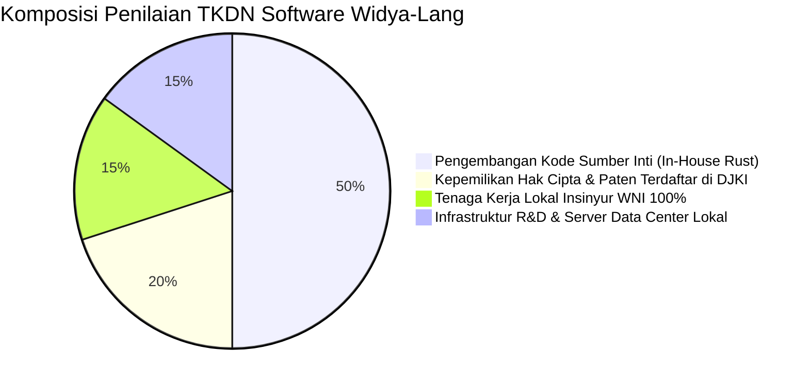

# STRATEGI PENGADAAN PEMERINTAH (B2G), E-KATALOG LKPP, DAN TKDN
**Pedoman Advokasi Kebijakan, Kepatuhan Regulasi SPBE, & Penetrasi Sektor Publik**

---

## 1. LANDASAN HUKUM & KESELARASAN REGULASI NASIONAL

Widya-Lang dirancang secara spesifik untuk memenuhi seluruh regulasi utama Republik Indonesia:

```
+-------------------------------------------------------------------------------+
|                      REGULASI NASIONAL YANG DIPENUHI                          |
|  1. Perpres No. 95/2018 tentang Sistem Pemerintahan Berbasis Elektronik (SPBE)|
|  2. Perpres No. 39/2019 tentang Satu Data Indonesia (Interoperabilitas Data)  |
|  3. UU No. 27/2022 tentang Pelindungan Data Pribadi (UU PDP)                  |
|  4. PP No. 71/2019 tentang Penyelenggaraan Sistem & Transaksi Elektronik      |
|  5. Permen Perindustrian No. 22/2020 tentang Sertifikasi TKDN Software        |
+-------------------------------------------------------------------------------+
```

---

## 2. STRATEGI TINGKAT KOMPONEN DALAM NEGERI (TKDN SOFTWARE > 85%)

Sebagai produk yang 100% dikembangkan oleh insinyur perangkat lunak Indonesia di bawah PT Widya Ekosistem Digital Indonesia, Widya-Lang memenuhi seluruh indikator audit TKDN Software Kemenperin:



---

## 3. STRATEGI MASUK ETALASE E-KATALOG LKPP

Untuk mempermudah instansi kementerian, lembaga negara, dan pemerintah daerah (Pemprov, Pemkab, Pemkot) melakukan pembelian langsung (*e-purchasing*) tanpa proses tender lelang yang rumit, produk Widya-Lang didaftarkan pada etalase berikut:

| Etalase E-Katalog LKPP | Paket Produk yang Didaftarkan | Instansi Pembeli Utama |
| :--- | :--- | :--- |
| **Etalase Software & Lisensi Kominfo** | Lisensi Widya Enterprise Core & WidyaBase Cluster | Diskominfo Provinsi/Kabupaten, Kementerian Teknis |
| **Etalase Infrastruktur Siber BSSN** | Widya Sovereign Security Shield (HSM & PQC Suite) | BSSN, TNI, Polri, Lembaga Sandi Negara |
| **Etalase Alat Peraga & Kurikulum Kemdikbud** | Voucher Sertifikasi WCA/WCP + Lab Kit ATC | SMK RPL se-Indonesia, Politeknik, Kampus Negeri |
| **Etalase Smart City & Perangkat Desa Kemendagri** | Engine Peta Geospasial Desa GPKG & CRDT Node | Dinas PMD, Kantor Desa, Bappeda |

---

## 4. PEMETAAN SIKLUS ANGGARAN APBN / APBD

Tim Government Relations (B2G) wajib menyelaraskan aktivitas penjualan dengan kalender penganggaran pemerintah:

```
[ Jan - Mar (Q1) ]: Musrenbang & Pengesahan DIPA
  └── Aktivitas: Sosialisasi teknis, workshop SPBE, dan penyusunan usulan RKA-KL/DIPA dinas.

[ Apr - Jun (Q2) ]: Penayangan Rencana Umum Pengadaan (RUP) di SiRUP LKPP
  └── Aktivitas: Memastikan paket produk Widya-Lang masuk ke daftar belanja e-purchasing.

[ Jul - Sep (Q3) ]: Eksekusi E-Purchasing E-Katalog
  └── Aktivitas: Penandatanganan Surat Pesanan (SP) dan penyerahan lisensi / voucher pelatihan.

[ Okt - Des (Q4) ]: Implementasi Teknis, BAST (Berita Acara Serah Terima), & Penagihan
  └── Aktivitas: Deployment cluster server daerah, sertifikasi ASN/Guru, dan pelunasan SP2D.
```

---

## 5. STUDI KASUS IMPLEMENTASI B2G: SMART CITY & SATU DATA DESA

- **Kondisi Awal**: Banyak desa di wilayah 3T (Tertinggal, Terdepan, Terluar) mengalami kesulitan mengirim data kependudukan dan pemetaan tanah desa ke server pusat akibat koneksi internet yang sering putus (*intermittent*).
- **Solusi Widya-Lang**: Pemanfaatan arsitektur [DOKUMENTASI_SMARTCITY_CRDT.md](file:///c:/widya-lang/DOKUMENTASI_SMARTCITY_CRDT.md). Operator kantor desa dapat menginput data kependudukan dan batas wilayah tanah desa (`.gpkg`) secara offline di server mini kantor desa. Saat sinyal internet kembali aktif, engine CRDT Widya-Lang otomatis melakukan sinkronisasi dua arah tanpa konflik ke pusat data Kemendagri.

---
