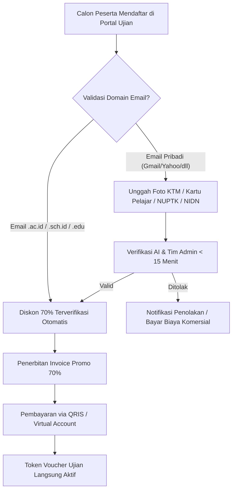

# PANDUAN OPERASIONAL AUTHORIZED TRAINING CENTER (ATC) & SERTIFIKASI
**Standar Operasional Prosedur (SOP) Dewan Standarisasi & Sertifikasi Widya-Lang (BOS-WL)**

---

## 1. STRUKTUR ORGANISASI & TATA KELOLA BOS-WL

Dewan Standarisasi & Sertifikasi Widya-Lang (*Board of Standardization Widya-Lang* / BOS-WL) adalah badan independen yang bertanggung jawab atas:
1. Pemeliharaan dan pembaruan berkala Bank Soal Kuis dan Tantangan Koding ([BANK_SOAL_KUIS_DAN_UJIAN_SERTIFIKASI.md](file:///c:/widya-lang/BANK_SOAL_KUIS_DAN_UJIAN_SERTIFIKASI.md)).
2. Akreditasi laboratorium komputer dan pengajar resmi di institusi Authorized Training Center (ATC).
3. Pengawasan integritas ujian dan penerbitan Sertifikat Digital Kriptografis ISO 32000-1.

---

## 2. SOP PENDAFTARAN & VERIFIKASI DISKON PENDIDIKAN 70%

Untuk memastikan subsidi diskon 70% tepat sasaran kepada dunia pendidikan:

### Tabel Harga Final Ujian Pendidikan (Diskon 70%):
- **WCA (Associate)**: Dari Rp 750.000 menjadi **Rp 225.000**
- **WCP (Professional)**: Dari Rp 1.750.000 menjadi **Rp 525.000**
- **WCE (Expert)**: Dari Rp 3.500.000 menjadi **Rp 1.050.000**
- **Spesialisasi (WCWD - WCEI)**: Dari Rp 2.250.000 menjadi **Rp 675.000**

---

## 3. MEKANISME PELAKSANAAN UJIAN & ANTI-CHEAT SYSTEM

Ujian sertifikasi Widya-Lang dilaksanakan dengan pengawasan ketat berbasis teknologi:

1. **Komposisi Soal & Bobot Nilai**:
   - **40% Teori Arsitektur & Pilihan Ganda**: Soal diacak secara dinamis dari bank soal BOS-WL.
   - **60% Tantangan Kode Praktik (Hands-on Coding)**: Kode kandidat dieksekusi secara real-time di sandbox [src/certification.rs](file:///c:/widya-lang/src/certification.rs) melawan hidden test cases otomatis.
2. **Proctoring & Pencegahan Kecurangan (Anti-Cheat)**:
   - Penguncian layar penuh (*Full-screen Lockdown Browser*).
   - Deteksi otomatis perpindahan tab, copy-paste eksternal, dan perekaman sesi kamera pengawas.
   - Analisis kemiripan kode (*Code Plagiarism Engine*) untuk mendeteksi kesamaan solusi antar peserta.
3. **Penerbitan Sertifikat Digital Instan**:
   - Peserta yang memperoleh nilai di atas passing grade (WCA: 70%, WCP: 75%, WCE: 85%) akan langsung menerima sertifikat PDF resmi bertanda tangan digital SHA-256 dan hash verifikasi unik `https://verify.widya.dev/cert/WIDYA-<LEVEL>-<UUID>`.

---

## 4. BAGI HASIL FINANSIAL & ROYALTI MITRA ATC (20% REVENUE SHARE)

Mitra institusi ATC berhak atas bagi hasil finansial dari setiap siswa yang mengikuti ujian:

| Skenario Penjualan Voucher | Biaya Peserta | Komisi Mitra ATC (20%) | Pendapatan Bersih BOS-WL (80%) |
| :--- | :--- | :--- | :--- |
| **Voucher Promo WCA (Pendidikan)** | Rp 225.000 | **Rp 45.000 / siswa** | Rp 180.000 / siswa |
| **Voucher Promo WCP (Pendidikan)** | Rp 525.000 | **Rp 105.000 / siswa** | Rp 420.000 / siswa |
| **Voucher Normal WCA (Umum/Komersial)**| Rp 750.000 | **Rp 150.000 / peserta**| Rp 600.000 / peserta |
| **Voucher Normal WCP (Umum/Komersial)**| Rp 1.750.000 | **Rp 350.000 / peserta**| Rp 1.400.000 / peserta |

*Pencairan komisi dilakukan secara otomatis setiap tanggal 5 awal bulan melalui sistem Settlement Mitra ATC.*

---
