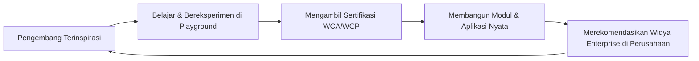

# STRATEGI MARKETING, DEVELOPER RELATIONS (DEVREL), DAN KOMUNITAS
**Membangun Ekosistem Pengembang Terbesar & Paling Aktif di Asia Tenggara**

---

## 1. VISI DEVREL WIDYA-LANG

Tujuan utama divisi Developer Relations (DevRel) adalah menciptakan efek jaringan (*network effect*) di mana pengembang menyukai sintaks natural, kecepatan eksekusi native Rust, dan ekosistem komputasi Widya-Lang sehingga mereka secara aktif merekomendasikan Widya-Lang di tempat mereka bekerja.

---

## 2. 4 PILAR PROGRAM MARKETING & DEVREL

### Pilar 1: Program Duta Kampus (Widya Campus Ambassador / Leads)
- Memilih 1-2 mahasiswa berprestasi per universitas terkemuka untuk menjadi ketua komunitas lokal *Widya Developer Club (WDC)*.
- **Fasilitas Duta Kampus**: Gratis seluruh sertifikasi WCA/WCP/WCE, tunjangan kegiatan bulanan, swag eksklusif, dan akses mentoring langsung dengan Core Architect Widya-Lang.

### Pilar 2: Kompetisi Nasional & Hackathon Kedaulatan Digital
- **Nama Acara**: *Widya National Hackathon: Piala Kedaulatan Digital Indonesia*.
- **Hadiah Total**: Rp 500.000.000 + Fasilitas Inkubasi & Pendanaan Komersial.
- **Kategori Lomba**:
  1. *Fintech Revolution*: Aplikasi pembayaran masa depan dengan QRIS MPM/CPM & BI-FAST.
  2. *Smart City & Village Resilience*: Sistem tanggap bencana dan Satu Data Desa berbasis CRDT.
  3. *Industrial IoT & Healthcare*: Integrasi rekam medis SatuSehat & otomasi pabrik ramah lingkungan.

### Pilar 3: Media Edukasi Interaktif & Web Playground
- Penyediaan portal online gratis [https://play.widya.dev](https://play.widya.dev) yang memungkinkan siapa pun mencoba menulis kode Widya-Lang dan mengeksekusinya langsung di browser berbasis WebAssembly (Wasm).
- Serial Video Tutorial *"Mastering Widya-Lang dari Nol sampai Mahir"* di kanal YouTube resmi.

### Pilar 4: Konferensi Tahunan *WidyaCon*
- Konferensi teknologi tahunan yang dihadiri oleh 5.000+ developer, akademisi, pimpinan BUMN, dan CTO perbankan terkemuka.

---

## 3. KALENDER KAMPANYE PEMASARAN & METRIK KESUKSESAN

| Indikator Kinerja DevRel | Target 2026 | Target 2027 | Target 2028 |
| :--- | :---: | :---: | :---: |
| **Bintang GitHub (GitHub Stars)** | 5.000+ | 15.000+ | 35.000+ |
| **Anggota Komunitas Aktif (Discord/Telegram)** | 10.000 | 40.000 | 100.000 |
| **Pengembang Terdaftar di Playground Online** | 50.000 | 150.000 | 400.000 |
| **Kampus Mitra Resmi (ATC & Komunitas)** | 50 Kampus | 200 Kampus | 500 Kampus |
| **Jumlah Pustaka/Modul di Widya Package Registry (WPM)** | 100 Modul | 500 Modul | 2.000 Modul |

---
