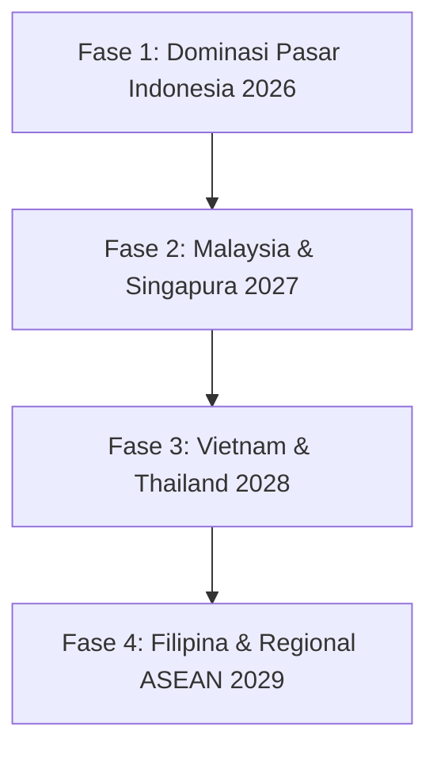

# STRATEGI EKSPANSI REGIONAL ASIA TENGGARA (ASEAN EXPANSION)
**Peta Jalan Internasionalisasi dan Interoperabilitas Pembayaran Lintas Batas (2027–2030)**

---

## 1. VISI EKSPANSI ASEAN (THE SOUTHEAST ASIAN VISION)

Setelah memantapkan posisi sebagai pemimpin ekosistem komputasi berdaulat di Indonesia (2026), Widya-Lang akan memperluas penetrasi ke kawasan Asia Tenggara yang memiliki kemiripan kebutuhan regulasi kedaulatan data dan konektivitas pembayaran regional (*ASEAN Cross-Border Payment Linkage*).



---

## 2. DUKUNGAN NATIVE PEMBAYARAN LINTAS BATAS (CROSS-BORDER QR & SWITCHING)

Widya-Lang Enterprise menyediakan konektor native untuk seluruh jaringan pembayaran instan nasional ASEAN:

| Negara | Sistem Pembayaran Nasional | Integrasi Native di Widya-Lang |
| :--- | :--- | :--- |
| **Indonesia** | QRIS MPM/CPM & BI-FAST | ✅ Built-in Native Parser & ISO 20022 |
| **Malaysia** | DuitNow QR & PayNet RPP | ✅ Modul Interoperabilitas DuitNow-QRIS |
| **Singapura** | NETS QR & PayNow FAST | ✅ Modul Switching PayNow-QRIS |
| **Thailand** | PromptPay & Thai QR Payment | ✅ Modul PromptPay Cross-Border |
| **Filipina** | QR Ph & InstaPay | ✅ Modul EMVCo QR Ph Generator |
| **Vietnam** | VietQR & NAPAS 247 | ✅ Modul NAPAS Switching Engine |

---

## 3. STRATEGI LOKALISASI BAHASA PEMROGRAMAN MULTI-LINGUAL

Kompiler Widya-Lang dirancang dengan arsitektur *Lexer Keyword Aliasing* yang memudahkan adaptasi bahasa serumpun di kawasan ASEAN tanpa merusak kompatibilitas biner:

```widya
// Bahasa Indonesia
fungsi hitung_total(harga, pajak) {
    kembalikan harga + (harga * pajak)
}

// Bahasa Melayu (Malaysia & Brunei)
fungsi kira_jumlah(harga, cukai) {
    pulangkan harga + (harga * cukai)
}

// Bahasa Tagalog (Filipina)
tungkulin kalkulahin_kabuuan(presyo, buwis) {
    ibalik presyo + (presyo * buwis)
}

// Bahasa Standar Internasional (Inggris)
fn calculate_total(price, tax) {
    return price + (price * tax)
}
```

*Seluruh variasi bahasa di atas menghasilkan Abstract Syntax Tree (AST) dan biner LLVM yang 100% identik dan dapat saling berkolaborasi dalam satu proyek yang sama.*

---

## 4. MODEL PENETRASI PASAR DI SETIAP NEGARA TARGET

1. **Malaysia & Singapura (Pintu Masuk FinTech Hub)**:
   - Pembentukan kantor representatif di Kuala Lumpur & Singapura untuk melayani korporasi perbankan cross-border remittance dan sertifikasi ATC politeknik vokasi.
2. **Vietnam & Thailand (Pusat Otomasi Manufaktur & Smart Factory)**:
   - Kemitraan dengan System Integrator lokal pabrik elektronik dan otomotif memanfaatkan modul SCADA/Modbus/OPC UA Widya-Lang.
3. **Filipina (Sektor BPO & Fintech Desa / Island Logistics)**:
   - Pemanfaatan engine database sinkronisasi offline-first CRDT untuk mengatasi masalah jaringan antar pulau terluar di kepulauan Filipina.

---
