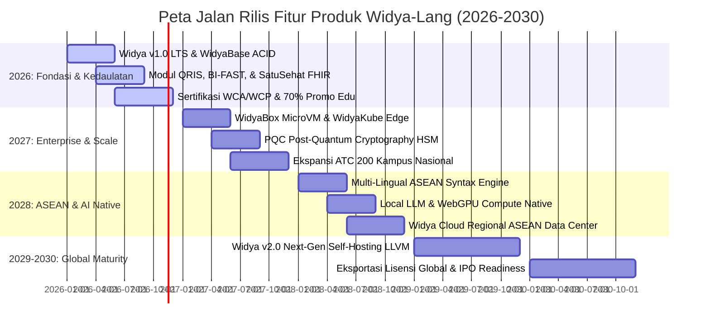

# PANDUAN PENGEMBANGAN PRODUK DAN ROADMAP KOMERSIAL (2026–2030)
**PT Widya Ekosistem Digital Indonesia (Widya-Lang Corporation)**
*Peta Jalan Rilis Fitur Komersial, Feature Gating, Strategi LTS, & Siklus Siklus Produk*

---

## 1. PETA JALAN PRODUK KOMERSIAL 5 TAHUN (2026–2030)

---

## 2. MATRIKS FEATURE GATING (COMMUNITY VS ENTERPRISE TIERS)

Untuk menjaga keberlangsungan ekosistem open-source sekaligus memaksimalkan pendapatan komersial:

| Fitur Produk | Community Edition (MIT) | Standard Enterprise | Mission-Critical Banking / B2G |
| :--- | :---: | :---: | :---: |
| **Kompiler & Bahasa Inti Widya** | ✅ Penuh | ✅ Penuh | ✅ Penuh |
| **WidyaBase Storage Engine** | ✅ Single-Node | ✅ Master-Slave Replikasi | ✅ Multi-Master Active-Active Raft |
| **Batas Throughput Transaksi (TPS)** | Bebas (Unthrottled) | Bebas (Unthrottled) | Bebas + Hardware Accelerated FFI |
| **Konektor Standar Nasional (QRIS/FHIR)**| Pustaka Dasar | ✅ Full Compliance Validator | ✅ Certified Production Switcher |
| **WidyaBox MicroVM Containerization** | ❌ | ✅ Maks. 10 Node | ✅ Unlimited Multi-Region Cluster |
| **Sovereign Security Shield (HSM/PQC)** | ❌ | ❌ | ✅ Native Enclave Protection |
| **Garansi SLA & 24/7 Hotfix Support** | Komunitas (Forum) | ✅ SLA 99.9% (8x5) | ✅ SLA 99.999% (24/7 Dedicated TAM) |
| **Hak Audit & Source Code Escrow** | ❌ | ❌ | ✅ Notarized Escrow Agreement |

---

## 3. KEBIJAKAN SIKLUS RILIS DAN DUKUNGAN LTS (LONG-TERM SUPPORT)

- **Rilis Minor (Setiap 3 Bulan)**: Penambahan fitur baru, peningkatan performa, dan pembaruan bank soal kuis tanpa memutus kompatibilitas kode lama (*backward compatibility guaranteed*).
- **Rilis Long-Term Support / LTS (Setiap 2 Tahun)**:
  - Dijamin menerima patch perbaikan keamanan dan stabilitas selama **5 Tahun Penuh**.
  - Versi LTS pertama: **Widya-Lang 1.0 LTS (Tahun Rilis: 2026, Dukungan Aktif hingga 2031)**.

---

## 4. LINGKARAN UMPAN BALIK PENGGUNA (CUSTOMER FEEDBACK LOOP)

1. **Komite Penasehat Arsitektur Enterprise (EAC)**: Pertemuan triwulanan dengan para CTO perbankan dan pimpinan BUMN untuk menyelaraskan roadmap pengembangan produk.
2. **Dewan Pendidik Vokasi & Dosen (BAC)**: Forum bulanan bersama para trainer ATC kampus untuk memperbarui kurikulum dan silabus sertifikasi sesuai perkembangan kebutuhan industri terkini.

---
