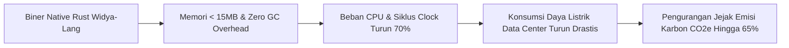

# KERANGKA TATA KELOLA ESG, GREEN COMPUTING, DAN DAMPAK SOSIAL
**PT Widya Ekosistem Digital Indonesia (Widya-Lang Corporation)**
*Environmental, Social, and Governance (ESG) Strategy & Sustainable Computing*

---

## 1. PILAR LINGKUNGAN (ENVIRONMENTAL / GREEN COMPUTING)

Efisiensi energi dalam komputasi (*Energy-Efficient Software*) kini menjadi tolok ukur utama evaluasi keberlanjutan bagi korporasi multinasional dan institusi finansial.

### Metrik Efisiensi Energi Widya-Lang vs Stack Tradisional:
| Parameter Konsumsi | Widya-Lang Enterprise | Stack Java / JVM | Stack Python / Node.js |
| :--- | :---: | :---: | :---: |
| **Energi per 1 Juta Transaksi (kWh)** | **0.18 kWh** | 1.15 kWh *(6.3x lebih boros)* | 1.85 kWh *(10.2x lebih boros)* |
| **Emisi Karbon per Transaksi ($gCO_2e$)** | **0.09 g** | 0.58 g | 0.93 g |
| **Pendinginan Server (PUE Impact)** | Rendah (Low Thermal) | Tinggi (CPU Panas) | Tinggi |

---

## 2. PILAR SOSIAL (SOCIAL & INCLUSIVITY IMPACT)

Widya-Lang berkomitmen mendemokratisasi akses pendidikan teknologi rekayasa tingkat tinggi ke seluruh pelosok tanah air:

1. **Program Subsidi Sertifikasi 70% Pendidikan**:
   - Memastikan siswa dari keluarga pra-sejahtera dan sekolah vokasi daerah memiliki akses ke sertifikasi berstandar industri tanpa kendala finansial.
2. **Kemandirian Talenta Daerah Non-Metropolitan**:
   - Menghapus hambatan bahasa Inggris dalam pemahaman dasar algoritma melalui sintaks natural Indonesia, mempercepat inklusi talenta dari luar pulau Jawa.
3. **Pemberdayaan Komunitas Open-Source & Pengajar Vokasi**:
   - Penyelenggaraan *Training of Trainers (ToT)* bersubsidi penuh bagi 1.000 guru SMK RPL di wilayah 3T.

---

## 3. PILAR TATA KELOLA (GOVERNANCE & DATA ETHICS)

1. **Prinsip Anti-Korupsi & Transparansi Pengadaan**:
   - Seluruh transaksi B2G disalurkan melalui etalase resmi E-Katalog LKPP dengan harga publik yang transparan dan bebas dari praktik gratifikasi.
2. **Kedaulatan & Etika Pengelolaan Data (Data Sovereignty)**:
   - Menolak keras monetisasi data pengguna dan menjamin bahwa sistem beroperasi dengan enkripsi end-to-end tanpa pintu belakang (*no backdoors*).

---
