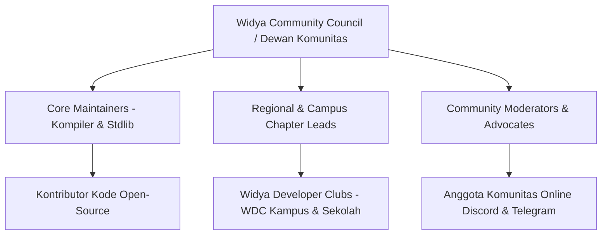
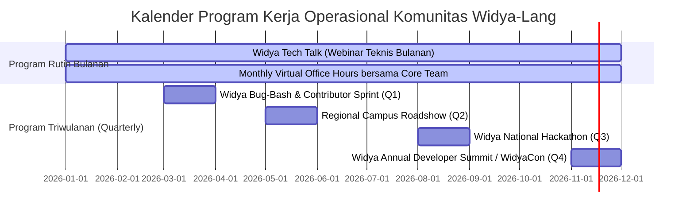

# STRATEGI PENGELOLAAN KOMUNITAS, TATA KELOLA KONTRIBUTOR, DAN PROGRAM KERJA OPERASIONAL
**PT Widya Ekosistem Digital Indonesia (Widya-Lang Corporation)**
*Blueprint Manajemen Komunitas Pengembang, Struktur Chapter Daerah, Kalender Program Kerja, & Skema Insentif*

---

## 1. VISI & STRUKTUR TATA KELOLA KOMUNITAS (COMMUNITY GOVERNANCE)

Komunitas Widya-Lang dikelola dengan prinsip **keterbukaan, meritokrasi, inklusivitas, dan kedaulatan teknologi**:



### Tingkatan Peran Anggota Komunitas (*Community Hierarchy*):

| Tingkatan Peran | Kriteria & Tanggung Jawab | Hak Istimewa & Insentif |
| :--- | :--- | :--- |
| **1. Pengguna Baru (*Novice Explorer*)** | Baru mulai belajar, mencoba Web Playground, bertanya di forum. | Akses seluruh materi panduan, modul gratis, dan webinar umum. |
| **2. Pengembang Aktif (*Active Builder*)** | Telah menyelesaikan sertifikasi WCA/WCP, membuat repositori proyek Widya. | Badge khusus di Discord/GitHub, undangan private workshop bulanan. |
| **3. Duta Kampus (*Campus Ambassador*)** | Memimpin klub kampus (WDC), menyelenggarakan workshop lokal bagi mahasiswa. | Subsidi kegiatan operasional, gratis ujian WCE, swag eksklusif, mentoring langsung. |
| **4. Kontributor Terverifikasi (*Verified Contributor*)** | Telah mengirimkan minimal 3 Pull Request yang disetujui pada repositori resmi. | Dicantumkan di daftar Hall of Fame, hak voting RFC (*Request for Comments*) fitur bahasa. |
| **5. Core Maintainer / Community Hero** | Bertanggung jawab atas modul inti, review kode, dan bimbingan kontributor baru. | Honorarium bulanan (*Open-Source Grant*), akses private repository, tiket VIP WidyaCon. |

---

## 2. ARSITEKTUR SALURAN KOMUNIKASI RESMI (COMMUNITY PLATFORMS)

```
[ DISCORD OFFICIAL SERVER ] ────► Diskusi Teknis Mendalam, Suara/Voice Lab, & Forum Koding
  ├── #pengumuman-resmi (Pemberitahuan rilis, update security patch)
  ├── #tanya-jawab-pemula (Bantuan belajar sintaks dasar & debug error)
  ├── #spesialisasi-web-mobile (Diskusi WidyaWeb, GPU Canvas, Android/iOS)
  ├── #spesialisasi-fintech-industri (Diskusi QRIS, BI-FAST, SCADA PLC, SatuSehat)
  └── #lowongan-kerja-proyek (Job board khusus lowongan insinyur Widya-Lang)

[ TELEGRAM SUPERGROUPS ] ──────► Komunikasi Cepat & Komunitas Chapter Wilayah
  ├── Grup Utama Nasional (@widyalang_id)
  └── Grup Regional (Jabodetabek, Jawa Barat, Jawa Tengah, Jatim, Sumatera, Bali-Nusra, Kalimantan, Sulawesi, Papua)

[ GITHUB DISCUSSIONS & RFC ] ──► Perancangan Fitur Bahasa, Syntax Proposal, & Standarisasi Modul
```

---

## 3. KALENDER PROGRAM KERJA TAHUNAN (ANNUAL WORK PROGRAM 2026–2027)



### Rincian 4 Program Kerja Utama:

1. **Widya Tech Talk & Virtual Office Hours (Setiap Akhir Bulan)**:
   - Webinar teknis 90 menit membedah arsitektur sistem nyata (contoh: *"Membangun Gateway QRIS Sub-Milidetik dengan Widya-Lang"*).
   - Sesi tanya jawab santai langsung bersama tim perekayasa inti kompiler.
2. **Widya Campus Roadshow (Triwulan II)**:
   - Tur fisik & daring ke 30 universitas dan politeknik vokasi di seluruh Indonesia.
   - Pelaksanaan workshop koding gratis dan aktivasi diskon sertifikasi 70% untuk mahasiswa/guru.
3. **Piala Kedaulatan Digital: Widya National Hackathon (Triwulan III)**:
   - Kompetisi pengembangan software berskala nasional dengan total hadiah **Rp 500.000.000**.
   - Kategori: FinTech Berdaulat, Smart City & Desa Tangguh, serta Rekam Medis SatuSehat.
4. **WidyaCon: Annual Developer Conference (Triwulan IV)**:
   - Konferensi akbar tahunan yang mempertemukan pimpinan BUMN, perbankan, pengembang, dan akademisi untuk merayakan pencapaian ekosistem dan mengumumkan roadmap tahun berikutnya.

---

## 4. SISTEM GAMIFIKASI, INSENTIF, DAN REVENUE SHARE KONTRIBUTOR

Untuk menjaga antusiasme dan komitmen kontributor jangka panjang:

```
+------------------------------------+---------------------------------------+
| Bentuk Kontribusi                  | Apresiasi & Insentif Finansial/Swag   |
+------------------------------------+---------------------------------------+
| Merge 1 Bug Fix / Typo Docs        | Digital Contributor Badge + LinkedIn  |
| Merge 1 Modul / Standard Library   | Paket Merchandise Eksklusif (Hoodie)  |
| Juara 1-3 Hackathon Nasional       | Uang Pembinaan Rp 50 Jt - Rp 150 Jt   |
| Menerbitkan Modul di WPM / Marketplace | Bagi Hasil Penjualan 80% (ISV Royalty)|
| Pemeliharaan Modul Kritis (Hero)   | Hibah Bulanan Rp 5.000.000 - Rp 15 Jt |
+------------------------------------+---------------------------------------+
```

---

## 5. PANDUAN MODERASI, CODE OF CONDUCT, DAN KEAMANAN KOMUNITAS

1. **Kode Etik (*Code of Conduct*)**: Mengadopsi standar internasional yang mewajibkan lingkungan diskusi yang ramah pemula, bebas diskriminasi, dan saling menghormati perbedaan latar belakang.
2. **Kebijakan Anti-Spam & Keamanan**:
   - Sistem auto-moderation bot untuk memfilter tautan berbahaya (*phishing*), penipuan crypto, dan promosi ilegal.
   - Verifikasi nomor telepon atau akun GitHub untuk mencegah akun bot liar.
3. **Protokol Eskalasi Konflik**:
   - Teguran privat (*Warning 1*) -> Pembatasan kirim pesan 24 jam (*Mute*) -> Pemblokiran permanen (*Ban*) bagi pelanggaran berat.

---

## 6. INDIKATOR KINERJA UTAMA (KPI) PENGELOLAAN KOMUNITAS

- **Retensi Pengembang Aktif 90 Hari**: Target > 45%.
- **Kecepatan Respon Pertanyaan Pemula**: Rata-rata < 15 menit terjawab di forum/Discord.
- **Jumlah Repositori GitHub Berbasis Widya-Lang**: > 1.000 repositori independen pada akhir 2026.
- **Tingkat Kepuasan Peserta Event (CSAT)**: > 92% rating bintang 5.

---
