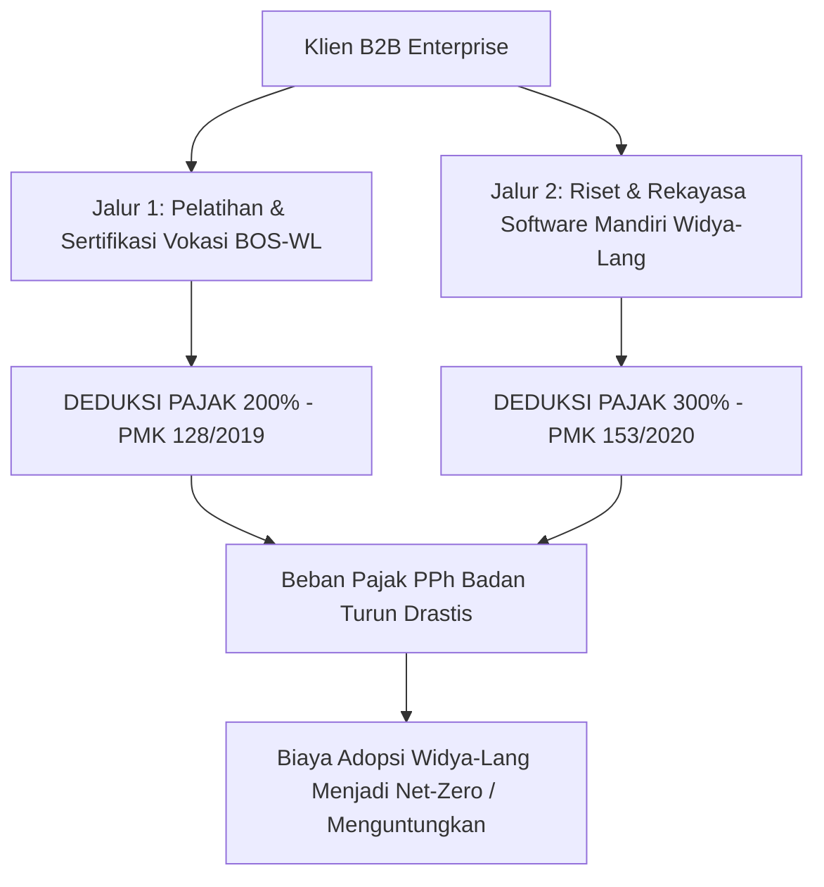

# STRATEGI INSENTIF PAJAK SUPER TAX DEDUCTION (PP NO. 45/2019)
**PT Widya Ekosistem Digital Indonesia (Widya-Lang Corporation)**
*Panduan Pemanfaatan Insentif Pajak Vokasi 200% & Litbang 300% sebagai Nilai Tambah B2B Enterprise*

---

## 1. LANDASAN HUKUM DAN KEBIJAKAN FISKAL NASIONAL

Pemerintah Republik Indonesia memberikan fasilitas insentif perpajakan super (*Super Tax Deduction*) bagi wajib pajak badan dalam negeri yang berinvestasi pada peningkatan kualitas sumber daya manusia dan penelitian teknologi lokal:

```
+-------------------------------------------------------------------------------+
|                    PAYUNG HUKUM SUPER TAX DEDUCTION RI                        |
|  1. Peraturan Pemerintah (PP) No. 45 Tahun 2019                               |
|  2. PMK No. 128/PMK.010/2019 tentang Pengurangan Penghasilan Bruto atas       |
|     Penyelenggaraan Kegiatan Praktik Kerja, Pemagangan, dan/atau Pembelajaran |
|     (Insentif Vokasi Maksimal 200%)                                           |
|  3. PMK No. 153/PMK.010/2020 tentang Pengurangan Penghasilan Bruto atas       |
|     Kegiatan Penelitian dan Pengembangan Tertentu di Indonesia                |
|     (Insentif Litbang / R&D Maksimal 300%)                                    |
+-------------------------------------------------------------------------------+
```

---

## 2. DUA JALUR SUPER DEDUCTION WIDYA-LANG UNTUK KLIEN B2B



### Jalur 1: Insentif Vokasi 200% (Pelatihan, Magang, & Sertifikasi Resmi)
- **Cakupan Pengeluaran**:
  - Biaya pembelian voucher ujian sertifikasi (WCA, WCP, WCE, Spesialisasi) untuk karyawan, tenaga magang, dan siswa SMK/kampus mitra binaan korporasi.
  - Biaya penyelenggaraan in-house bootcamp atau kerjasama laboratorium Authorized Training Center (ATC).
- **Manfaat**: Pengurangan penghasilan bruto sebesar **200%** (100% biaya riil yang dikeluarkan + 100% tambahan deduksi pajak).

### Jalur 2: Insentif Litbang & R&D 300% (Inovasi Software Berdaulat)
- **Cakupan Pengeluaran**:
  - Biaya riset bersama (*joint research*) dan pengembangan modul otomasi pabrik, switching perbankan sub-milidetik, atau AI lokal di atas ekosistem Widya-Lang.
- **Manfaat**: Pengurangan penghasilan bruto sebesar **hingga 300%** (100% biaya riil + 200% tambahan deduksi pajak).

---

## 3. SIMULASI FINANSIAL PENGHEMATAN PAJAK KLIEN ENTERPRISE

Berikut adalah contoh perhitungan dampak finansial bagi Klien B2B (misal: Bank Swasta atau Pabrik Manufaktur) dengan Penghasilan Kena Pajak Rp 50 Miliar per tahun:

```text
================================================================================
          SIMULASI FINANSIAL DEDUKSI PAJAK VOKASI 200% (PMK 128/2019)
================================================================================
Investasi Sertifikasi & Pelatihan Karyawan Widya-Lang  : Rp  1.000.000.000
Tambahan Fasilitas Pengurang Pajak 100% (Super Tax)     : Rp  1.000.000.000
Total Pengurang Penghasilan Bruto (200%)                : Rp  2.000.000.000

Tarif PPh Badan Efektif (22%)
Penghematan Pembayaran Pajak Riil (22% x Rp 2 Miliar)   : Rp    440.000.000

Biaya Riil Bersih Pelatihan (Net Effective Cost):
= Biaya Investasi Awal (Rp 1 Miliar) - Penghematan Pajak (Rp 440 Juta)
= Rp 560.000.000 (KORPORASI MENDAPAT DISKON FISKAL EFEKTIF 44%)
================================================================================
```

```text
================================================================================
          SIMULASI FINANSIAL DEDUKSI LITBANG 300% (PMK 153/2020)
================================================================================
Investasi Riset Modul Switching QRIS/BI-FAST Widya-Lang : Rp  2.000.000.000
Tambahan Fasilitas Pengurang Pajak 200%                 : Rp  4.000.000.000
Total Pengurang Penghasilan Bruto (300%)                : Rp  6.000.000.000

Tarif PPh Badan Efektif (22%)
Penghematan Pembayaran Pajak Riil (22% x Rp 6 Miliar)   : Rp  1.320.000.000

Biaya Riil Bersih Litbang (Net Effective Cost):
= Biaya Investasi Awal (Rp 2 Miliar) - Penghematan Pajak (Rp 1.32 Miliar)
= Rp 680.000.000 (PENGHEMATAN FISKAL EFEKTIF 66%)
================================================================================
```

---

## 4. ALUR PROSEDUR PENGAJUAN & DUKUNGAN ADMINISTRASI DARI WIDYA

PT Widya Ekosistem Digital Indonesia menyediakan layanan pendampingan administratif lengkap (*End-to-End Compliance Support*) agar klien enterprise dapat mengklaim insentif pajak tanpa risiko audit:

```
[ 1. Penandatanganan PKS Kerjasama Vokasi / Litbang ]
  └── Perjanjian Kerja Sama terdaftar antara Klien, Widya-Lang, dan Kampus/SMK Mitra.
         │
         ▼
[ 2. Pendaftaran Rencana Kegiatan melalui Sistem OSS (Online Single Submission) ]
  └── Pengunggahan proposal kurikulum pelatihan atau roadmap riset teknologi.
         │
         ▼
[ 3. Pelaksanaan Pelatihan / Sertifikasi / Riset ]
  └── Pencatatan presensi, logbook riset, dan penerbitan sertifikat digital resmi BOS-WL.
         │
         ▼
[ 4. Penerbitan Laporan Realisasi & Berita Acara (BAST) ]
  └── Dokumen audit keuangan formal disiapkan oleh tim akuntansi Widya-Lang.
         │
         ▼
[ 5. Pelaporan SPT Tahunan PPh Badan melalui DJP Online ]
  └── Klien melampirkan SK Persetujuan OSS dan Laporan Realisasi pada Lampiran Khusus 3A.
```

---

## 5. STRATEGI SALES PITCH B2B: *"MENGUBAH BIAYA SOFTWARE MENJADI TAX SAVINGS"*

Dalam setiap penawaran ke jajaran direksi (CFO & Direktur Keuangan Klien), tim sales Widya-Lang menyajikan proposisi nilai yang tidak tertandingi oleh vendor asing:

> *"Dengan memilih Widya-Lang Enterprise, perusahaan Anda bukan hanya memangkas biaya lisensi server hingga 60%, tetapi seluruh pengeluaran pelatihan insinyur dan riset integrasi lokal dapat diklaim sebagai Super Tax Deduction hingga 300% sesuai PP No. 45/2019. Vendor perangkat lunak luar negeri seperti Oracle atau Microsoft tidak memiliki fasilitas insentif fiskal Republik Indonesia ini."*

---
