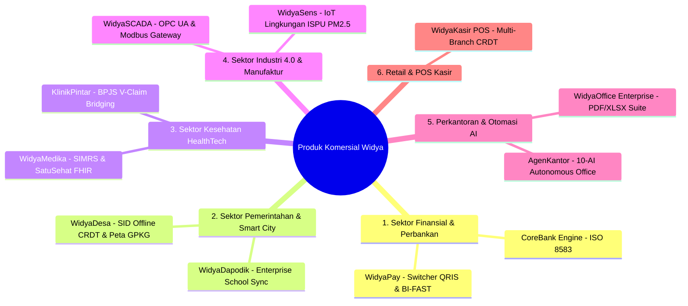

# KATALOG PRODUK DAN APLIKASI KOMERSIAL SIAP RILIS BERBASIS WIDYA-LANG
**PT Widya Ekosistem Digital Indonesia (Widya-Lang Corporation)**
*Daftar Solusi Perangkat Lunak B2B, B2G, SaaS, dan On-Premise Siap Jual & Potensi Monetisasi*

---

## 🧭 IKHTISAR SOLUSI KOMERSIAL

Berkat arsitektur native Rust, mesin basis data [WidyaBase](file:///c:/widya-lang/DOKUMENTASI_WIDYABASE.md), penyimpanan objek [WidyaStore](file:///c:/widya-lang/DOKUMENTASI_DATA_PLATFORM.md), isolasi [WidyaBox](file:///c:/widya-lang/DOKUMENTASI_WIDYABOX_CONTAINER.md), serta pustaka industri nasional, berikut adalah **10 Kategori Aplikasi Komersial Siap Rilis**:

---

## 1. SEKTOR FINANSIAL, FINTECH & PERBANKAN

### A. **WidyaPay: Ultra-Fast Payment Switcher (QRIS & BI-FAST Engine)**
- **Deskripsi**: Gateway switching pembayaran berkecepatan tinggi yang memproses transaksi QRIS Dinamis/Statis (EMVCo) dan BI-FAST (ISO 20022) dengan latensi sub-milidetik.
- **Target Klien**: Bank Pembangunan Daerah (BPD), Bank Perkreditan Rakyat (BPR), Perusahaan Payment Gateway, Dompet Digital (E-Wallet).
- **Keunggulan**: Memproses 50.000+ Transaksi per Detik (TPS) dengan konsumsi RAM < 100MB tanpa perlu lisensi switching asing yang mahal.
- **Skema Harga Komersial**:
  - *Lisensi On-Premise*: Rp 350.000.000 - Rp 1.200.000.000 per bank/tahun.
  - *Fee per Transaksi*: Rp 50 - Rp 150 per transaksi sukses.

### B. **WidyaCore: Modern Core Banking Micro-Engine**
- **Deskripsi**: Engine pemrosesan rekening simpanan, pinjaman, dan buku besar (*General Ledger*) berbasis ISO 8583 dengan garansi konsistensi transaksi ACID penuh di WidyaBase.
- **Target Klien**: Koperasi Simpan Pinjam (KSP) Modern, BPR/BPRS, Lembaga Keuangan Mikro.
- **Skema Harga**: SaaS Rp 5.000.000 - Rp 25.000.000 / bulan atau On-Premise Rp 250.000.000.

---

## 2. SEKTOR PEMERINTAHAN, DESA & SMART CITY (B2G)

### A. **WidyaDesa: Sistem Informasi Desa (SID) Berdaulat & Offline-First CRDT**
- **Deskripsi**: Aplikasi administrasi desa lengkap dengan pembaca peta geospasial batas tanah Kemendagri (`.gpkg`), buku register kependudukan, dan surat-menyurat online.
- **Target Klien**: 75.000+ Kantor Desa & Dinas Pemberdayaan Masyarakat Desa (DPMD) Kabupaten di seluruh Indonesia.
- **Keunggulan Unik**: Tetap bisa digunakan mencatat data warga saat mati lampu atau internet padam di wilayah 3T, dan otomatis sinkron saat ada sinyal internet menggunakan teknologi CRDT.
- **Skema Harga**:
  - Paket Desa Mandiri (SaaS Cloud): Rp 3.500.000 / desa / tahun.
  - Paket Kabupaten Terpadu (100 Desa): Rp 250.000.000 / tahun melalui E-Katalog LKPP.

### B. **WidyaDapodik: Sinkronisasi & Rekapitulasi Data Pendidikan Sekolah**
- **Deskripsi**: Sistem manajemen data pokok pendidikan terintegrasi formulir excel dinamis (`FORMULIR_PD_DAPODIK.xlsx` & `FORMULIR_PTK_DAPODIK.xlsx`).
- **Target Klien**: Yayasan Pendidikan Swasta, Dinas Pendidikan Provinsi/Kota.
- **Skema Harga**: Rp 15.000.000 - Rp 75.000.000 per yayasan/dinas per tahun.

---

## 3. SEKTOR KESEHATAN (HEALTHTECH & RUMAH SAKIT)

### A. **WidyaMedika: SIMRS & Engine Kepatuhan SatuSehat (HL7/FHIR Native)**
- **Deskripsi**: Sistem Informasi Manajemen Rumah Sakit (SIMRS) yang menjembatani Rekam Medis Elektronik (RME) langsung ke platform SatuSehat Kemenkes dan klaim BPJS Kesehatan V-Claim.
- **Target Klien**: Rumah Sakit Umum Daerah (RSUD), Rumah Sakit Swasta, Klinik Pratama.
- **Keunggulan**: Validasi schema JSON FHIR native berkecepatan tinggi dengan enkripsi data medis pasien sesuai standar UU PDP.
- **Skema Harga**:
  - Klinik Pratama (SaaS): Rp 750.000 - Rp 2.500.000 / bulan.
  - RSUD Tipe B / C (On-Premise): Rp 150.000.000 - Rp 450.000.000 / tahun.

---

## 4. SEKTOR INDUSTRI 4.0, OTOMASI PABRIK & ENERGI

### A. **WidyaSCADA: Industrial Edge Gateway & Monitoring Pabrik**
- **Deskripsi**: Gateway telemetri industri yang membaca register PLC (Siemens, Omron, Mitsubishi, Modbus TCP/RTU) dan OPC UA untuk visualisasi kinerja mesin (*OEE - Overall Equipment Effectiveness*).
- **Target Klien**: Pabrik Manufaktur Otomotif, Tekstil, Makanan & Minuman, Pembangkit Listrik PLN.
- **Keunggulan**: Waktu boot <5 milidetik, tahan dipasang pada mini-PC industri tanpa kipas (*fanless*) di lingkungan pabrik bersuhu tinggi.
- **Skema Harga**: Rp 45.000.000 / lini produksi pabrik + Rp 15.000.000 / tahun maintenance.

### B. **WidyaSens: Telemetri Smart City & Pemantauan Kualitas Udara (ISPU PM2.5)**
- **Deskripsi**: Server pemantau sensor lingkungan udara dan air yang menghitung Indeks Standar Pencemar Udara (ISPU Permen LHK No. 14/2020) secara real-time.
- **Target Klien**: Dinas Lingkungan Hidup (DLH), Kawasan Industri Terpadu (KIT).
- **Skema Harga**: Rp 85.000.000 - Rp 250.000.000 per implementasi kawasan.

---

## 5. SEKTOR PERKANTORAN, DOKUMEN & AGEN AI DIGITAL

### A. **WidyaOffice Suite: Headless Document Generator Enterprise**
- **Deskripsi**: Server pembangkit dokumen resmi otomatis (**PDF**, **XLSX**, **DOCX**, **PPTX**) berkecepatan ribuan berkas per detik tanpa membutuhkan dependensi Microsoft Office atau LibreOffice yang berat.
- **Target Klien**: Perusahaan Asuransi (Polis Otomatis), Perbankan (Billing Statement), HR Enterprise (Slip Gaji Massal).
- **Skema Harga**: Rp 75.000.000 / server / tahun.

### B. **AgenKantor: Multi-Agent Digital Workforce Platform**
- **Deskripsi**: Ekosistem 10 Agen AI otonom (*Shared Blackboard Architecture*) yang bertindak sebagai staf virtual: verifikator dokumen, asisten hukum, analis keuangan, dan auditor kepatuhan internal.
- **Target Klien**: Kantor Konsultan Hukum, KAP Akuntan Publik, Korporasi Multinasional.
- **Skema Harga**: SaaS Rp 15.000.000 - Rp 50.000.000 / bulan.

---

## 6. SEKTOR RETAIL, UMKM & KASIR VISUAL (POS)

### A. **WidyaKasir Pro: Software Kasir Desktop Ringan Multi-Cabang**
- **Deskripsi**: Aplikasi POS kasir visual berbasis GPU Canvas ultra-ringan (konsumsi RAM < 15MB) yang dapat berjalan di komputer jadul / mini PC kasir Windows & Linux.
- **Target Klien**: Minimarket, Restoran, Kafe, Rantai Toko Retail Waralaba.
- **Fitur**: Cetak struk termal, barcode scanner, QRIS Dinamis di layar kasir, dan sinkronisasi stok inventaris antar cabang via WidyaBase.
- **Skema Harga**:
  - UMKM Mandiri: Rp 49.000 / bulan / outlet.
  - Retail Enterprise (100+ Cabang): Rp 3.500.000 / outlet / lisensi seumur hidup (*lifetime license*).

---

## 7. SEKTOR CLOUD, STORAGE & DATABASE (INFRASTRUKTUR DATA)

### A. **WidyaStore Managed S3 & Object Storage Service**
- **Deskripsi**: Layanan penyimpanan berkas biner (S3 / MinIO compatible) berdaulat di server lokal dengan deduplikasi data hemat disk (*Content-Addressable Storage / CAS*).
- **Target Klien**: Software House, Pengembang Aplikasi Mobile, Penyedia CCTV Cloud.
- **Skema Harga**: Rp 150 / GB / bulan (30% lebih murah dari AWS S3) + Rp 0 biaya transfer data lokal.

---

## 📊 MATRIKS POTENSI OMZET TAHUN PERTAMA (COMMERCIAL PRODUCT PIPELINE)

| Nama Produk Komersial | Target Klien Tahun 1 | Model Bisnis | Potensi Pendapatan Tahun 1 (IDR) |
| :--- | :--- | :--- | :--- |
| **WidyaPay (Switching QRIS/BI-FAST)** | 10 Bank BPD & Fintech | Lisensi Cluster + Fee | **Rp 4.500.000.000** |
| **WidyaDesa (Satu Data Desa CRDT)** | 500 Kantor Desa (5 Kab.) | E-Katalog LKPP / APBD | **Rp 1.750.000.000** |
| **WidyaMedika (SatuSehat SIMRS)** | 25 RSUD & Klinik | On-Premise + SaaS | **Rp 2.250.000.000** |
| **WidyaOffice Generator** | 30 Korporasi Finansial | Lisensi Per-Node | **Rp 2.250.000.000** |
| **WidyaKasir Pro (Retail POS)** | 2.500 Merchant UMKM | Langganan SaaS | **Rp 1.470.000.000** |
| **WidyaSCADA & Industri Gateway** | 15 Pabrik Manufaktur | Lisensi per Lini | **Rp 900.000.000** |
| **WidyaStore S3 & WidyaBase Cloud** | 200 Startup / ISV | Pay-as-you-go Cloud | **Rp 1.800.000.000** |
| **TOTAL ESTIMASI PENDAPATAN PRODUK** | | | **Rp 14.920.000.000 (~$1M USD)** |

---
