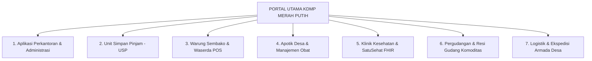

# SISTEM INFORMASI TERPADU KOPERASI DESA/KELURAHAN MERAH PUTIH (KDMP)
**Platform Digital 7 Pilar Usaha Desa Berbasis Ekosistem Widya-Lang & WidyaBase**
*Perkantoran, Simpan Pinjam, Warung, Apotik, Klinik, Pergudangan, & Logistik*

---

## 🏛️ 1. VISI & ARSITEKTUR 7 PILAR USAHA KDMP

**Koperasi Desa/Kelurahan Merah Putih (KDMP)** dirancang sebagai pusat penggerak ekonomi, kesehatan, dan logistik mandiri di tingkat desa dan kelurahan. 

Aplikasi ini menggabungkan **7 unit usaha vital desa** ke dalam satu basis data terdistribusi terpadu ([WidyaBase](file:///c:/widya-lang/DOKUMENTASI_WIDYABASE.md)) dengan kemampuan **Offline-First CRDT** (tetap beroperasi normal tanpa internet dan otomatis sinkron saat jaringan aktif):



---

## 🧩 2. RINCIAN MODUL DAN FITUR 7 PILAR USAHA KDMP

### 🏢 Pilar 1: Aplikasi Perkantoran & Tata Kelola Administrasi (Office Suite)
- **Fitur Utama**:
  - **Buku Induk Anggota Koperasi**: Pencatatan NIK, KK, alamat dusun/RT/RW, dan status keaktifan anggota.
  - **Generator Dokumen Otomatis ([WidyaOffice](file:///c:/widya-lang/DOKUMENTASI_OFFICE.md))**: Pembuatan surat resmi desa, undangan Rapat Anggota Tahunan (RAT), notulen rapat, dan laporan pertanggungjawaban dalam format **PDF, DOCX, XLSX, dan PPTX** native tanpa perlu lisensi Microsoft Office.
  - **Buku Kas & Jurnal Keuangan**: Pencatatan arus kas masuk/keluar, buku besar umum (*General Ledger*), neraca saldo, dan laporan laba-rugi otomatis.
  - **Kalkulator Sisa Hasil Usaha (SHU)**: Penghitungan otomatis SHU jasa modal dan jasa anggota sesuai AD/ART.

### 💰 Pilar 2: Unit Simpan Pinjam (USP Syariah & Konvensional)
- **Fitur Utama**:
  - **Manajemen Simpanan**: Simpanan Pokok, Simpanan Wajib bulanan, dan Simpanan Sukarela/Berjangka (Deposito Desa).
  - **Manajemen Pinjaman Mikro**: Pengajuan pinjaman modal usaha tani/UMKM, verifikasi agunan, simulasi plafon, dan jadwal angsuran (harian/mingguan/bulanan).
  - **Otomasi Bagi Hasil / Bunga & Denda**: Skema bagi hasil syariah (Mudharabah/Musyarakah) atau flat konvensional.
  - **Buku Tabungan Digital & Notifikasi WhatsApp/SMS**: Cetak mutasi buku tabungan fisik dan notifikasi tagihan angsuran ke nomor HP anggota.

### 🛒 Pilar 3: Warung Sembako & Waserda (Retail POS Kasir)
- **Fitur Utama**:
  - **Kasir Visual Super Ringan**: Antarmuka kasir berbasis GPU Canvas (<15MB RAM), respons kilat < 1 milidetik.
  - **Pemindai Barcode & Cetak Struk Termal**: Kompatibel dengan semua printer Bluetooth/USB 58mm & 80mm.
  - **Tiering Harga Khusus**: Harga beli anggota koperasi lebih murah dibanding pembeli umum non-anggota.
  - **Fitur Kasbon Belanja Anggota**: Fasilitas belanja sembako bayar tempo yang otomatis memotong saldo simpanan atau ditagih saat panen/gajian.
  - **Pembayaran QRIS Terintegrasi**: QRIS Dinamis langsung muncul di layar kasir untuk pembayaran non-tunai.

### 💊 Pilar 4: Apotik Desa & Farmasi Terpadu
- **Fitur Utama**:
  - **Katalog Obat Lengkap**: Klasifikasi obat bebas (hijau), obat bebas terbatas (biru), obat keras (merah/K), fitofarmaka/herbal, dan alat kesehatan (alkes).
  - **Peringatan Tanggal Kadaluarsa (Expired Date Alert)**: Notifikasi otomatis 90/60/30 hari sebelum obat expired agar tidak merugikan kas koperasi.
  - **Manajemen Resep Dokter & Salinan Resep**: Penjualan obat racikan puyer/kapsul dan pencatatan riwayat alergi obat pasien.
  - **Audit Stok Fisik (Stock Opname)**: Penyesuaian stok batch, nomor lot pabrik, dan kartu stok digital.

### 🏥 Pilar 5: Klinik Desa & Poskesdes (HealthTech Native)
- **Fitur Utama**:
  - **Rekam Medis Elektronik (RME)**: Pencatatan anamnesa, pemeriksaan fisik (tensi, gula darah, asam urat), diagnosis ICD-10, dan tindakan medis pasien warga.
  - **Integrasi SatuSehat Kemenkes (HL7/FHIR)**: Data kunjungan dan diagnosa pasien otomatis tervalidasi dan terkirim ke platform SatuSehat nasional secara native.
  - **Bridging BPJS Kesehatan (V-Claim / P-Care)**: Pengecekan status kepesertaan BPJS warga dan pencatatan kapitasi klinik tingkat pertama.
  - **Buku Kesehatan Ibu & Anak (KIA) / Imunisasi**: Jadwal posyandu balita dan pemantauan stunting desa.

### 🏬 Pilar 6: Pergudangan & Resi Gudang Komoditas Desa
- **Fitur Utama**:
  - **Penerimaan & Timbangan Digital**: Integrasi timbangan USB/Serial untuk pencatatan tonase hasil bumi (gabah, jagung, kelapa sawit, kopi, cengkeh, atau hasil tangkapan ikan nelayan).
  - **Pencatatan Parameter Kualitas**: Kadar air, kadar hampa/kotoran, dan grading kualitas komoditas.
  - **Sistem Resi Gudang (Warehouse Receipt)**: Penerbitan sertifikat tanda terima barang di gudang yang dapat dijadikan jaminan agunan pinjaman di unit Simpan Pinjam KDMP.
  - **Manajemen Lokasi Rak & Suhu Cold Storage**: Kontrol inventaris FIFO/LIFO dan pencatatan sewa space gudang oleh kelompok tani.

### 🚚 Pilar 7: Logistik & Ekspedisi Armada Desa
- **Fitur Utama**:
  - **Manajemen Armada Desa**: Penjadwalan kendaraan pick-up, truk engkel, motor roda tiga kargo, dan perahu motor milik koperasi desa.
  - **Layanan Kurir Antar-Jemput Warga (Desa Express)**: Pengantaran sembako warung dan obat apotik langsung ke rumah warga, serta pengiriman paket antar-dusun.
  - **Distribusi Hasil Panen ke Pasar Induk / Pabrik**: Pembuatan Surat Jalan Elektronik (Delivery Order / DO), manifest muatan, dan pencatatan biaya bahan bakar/supir.
  - **Kalkulator Ongkos Kirim Wilayah**: Perhitungan tarif kirim otomatis berdasarkan zona dusun atau jarak kilometer.

---

## 💰 3. SKEMA TARIF BERLANGGANAN MODULAR KDMP (PAY-PER-MODULE)

Koperasi Desa/Kelurahan bebas memilih dan mengaktifkan modul sesuai unit usaha yang siap dijalankan:

```
+----------------------------------------------------+-----------------------+-----------------------+
| PILAR MODUL USAHA KDMP                             | TARIF BULANAN (SAAS)  | TARIF TAHUNAN (HEMAT) |
+----------------------------------------------------+-----------------------+-----------------------+
| 🏢 1. Perkantoran & Administrasi (Core Office)     | Rp  99.000 / bulan    | Rp    990.000 / tahun |
| 💰 2. Unit Simpan Pinjam (USP Syariah/Konvensional)| + Rp 75.000 / bulan   | + Rp  750.000 / tahun |
| 🛒 3. Warung Sembako / Waserda POS Kasir           | + Rp 50.000 / bulan   | + Rp  500.000 / tahun |
| 💊 4. Apotik Desa & Manajemen Obat                 | + Rp 50.000 / bulan   | + Rp  500.000 / tahun |
| 🏥 5. Klinik Kesehatan & SatuSehat Kemenkes        | + Rp 75.000 / bulan   | + Rp  750.000 / tahun |
| 🏬 6. Pergudangan & Resi Gudang Komoditas          | + Rp 65.000 / bulan   | + Rp  650.000 / tahun |
| 🚚 7. Logistik & Ekspedisi Armada Desa             | + Rp 50.000 / bulan   | + Rp  500.000 / tahun |
+----------------------------------------------------+-----------------------+-----------------------+
| 🌟 PAKET LENGKAP 7 PILAR KDMP MERAH PUTIH          | RP 399.000 / BULAN    | RP  3.990.000 / TAHUN |
|    (DISKON HEMAT 16% DIBANDING SATUAN)             |                       | (GRATIS 2 BULAN LISENSI)
+----------------------------------------------------+-----------------------+-----------------------+
```

---

## 🚀 4. KEUNGGULAN KOMPETITIF KDMP BERBASIS WIDYA-LANG

1. **Satu Data Terintegrasi (Single Source of Truth)**:
   - Pasien di **Klinik** yang menebus obat di **Apotik** dapat membayar via saldo tabungan **Simpan Pinjam** atau mencatat kasbon yang terhubung langsung ke **Perkantoran**.
   - Petani yang menyimpan gabah di **Pergudangan** dan mengirim via **Logistik Desa** dapat langsung mencairkan dana di unit **Simpan Pinjam** dan berbelanja di **Warung Sembako**.
2. **Kemandirian Infrastruktur Desa**:
   - Berjalan pada mini-PC / laptop kantor koperasi desa dengan penyimpanan data berdaulat lokal menggunakan [WidyaStore](file:///c:/widya-lang/DOKUMENTASI_DATA_PLATFORM.md) dan [WidyaBase](file:///c:/widya-lang/DOKUMENTASI_WIDYABASE.md).
3. **Pemberdayaan Pemuda & Afiliator Lapangan**:
   - Didukung jaringan mitra Tech Sales lokal (Karang Taruna & Pendamping Desa) dengan komisi bagi hasil 25% seumur hidup sebagaimana diatur dalam [25_STRATEGI_TECH_SALES_DAN_PROGRAM_AFILIATOR_DESA.md](./25_STRATEGI_TECH_SALES_DAN_PROGRAM_AFILIATOR_DESA.md).

---
