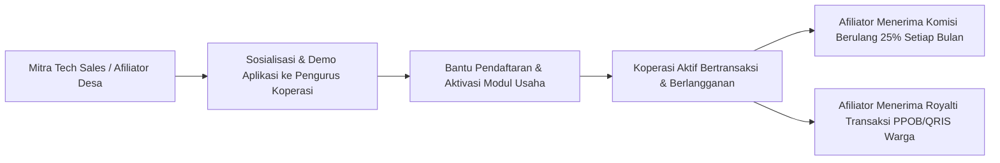

# STRATEGI TECH SALES, PROGRAM AFILIATOR LAPANGAN, DAN KOMISI BERULANG DESA
**PT Widya Ekosistem Digital Indonesia (Widya-Lang Corporation)**
*Skema Kemitraan Afiliator Koperasi Merah Putih, Struktur Bagi Hasil Berulang (MRR), & Strategi Akuisisi Lapangan*

---

## 🎯 1. VISI PROGRAM TECH SALES & AFILIATOR MERAH PUTIH

Untuk mendigitalisasi puluhan ribu Koperasi Desa/Kelurahan Merah Putih di seluruh pelosok Indonesia, Widya-Lang memberdayakan kekuatan pemuda lokal, sarjana penggerak desa, dan pendamping masyarakat sebagai **Mitra Tech Sales & Afiliator Resmi Desa**.



---

## 👥 2. TARGET PROFIL MITRA TECH SALES & AFILIATOR

1. **Pendamping Lokal Desa (PLD / PD) Kemendesa**: Memiliki relasi erat dengan kepala desa dan pengurus BUMDes/Koperasi.
2. **Pemuda Karang Taruna & Komunitas IT Desa**: Fasih menggunakan gadget dan mampu memberikan bantuan teknis langsung di lokasi.
3. **Guru / Dosen Vokasi & Mahasiswa KKN**: Menjadikan digitalisasi koperasi sebagai proyek pengabdian masyarakat sekaligus sumber penghasilan.
4. **Teknisi Komputer & Pemilik Konter Pulsa/Warnet**: Menjadi pusat bantuan teknis perangkat keras (printer struk, barcode scanner) di tingkat kecamatan.

---

## 💰 3. STRUKTUR 3 LAYER KOMISI PENDAPATAN AFILIATOR

Afiliator mendapatkan 3 sumber pemasukan sekaligus:

```
+-------------------------------------------------------------------------------+
|                       3 LAYER KOMISI MITRA AFILIATOR                          |
|                                                                               |
|  [ LAYER 1: KOMISI AKTIVASI AWAL (ONE-TIME SETUP BOUNTY) ]                    |
|  • Rp 250.000 per Koperasi saat pertama kali aktivasi & go-live.              |
|                                                                               |
|  [ LAYER 2: KOMISI BERULANG BULANAN (MONTHLY RECURRING SHARE 25%) ]           |
|  • 25% DARI SELURUH BIAYA LANGGANAN MODUL KOPERASI SETIAP BULAN (SEUMUR HIDUP)|
|  • Paket Komplit (Rp 349.000/bln) -> Afiliator menerima Rp 87.250 / bln / kop |
|                                                                               |
|  [ LAYER 3: KOMISI MIKRO TRANSAKSI PPOB & QRIS WARGA ]                        |
|  • Rp 50 per transaksi pembayaran token PLN, BPJS, PDAM, & transfer warga.    |
+-------------------------------------------------------------------------------+
```

---

## 📈 4. SIMULASI POTENSI PENGHASILAN BULANAN AFILIATOR (PASSIVE INCOME)

Jika seorang Afiliator berhasil mendampingi koperasi di wilayah 1 atau 2 kecamatan:

| Jumlah Koperasi Dikelola | Komisi Langganan Bulanan (25%) | Estimasi Fee PPOB (500 trx/kop) | **TOTAL PENGHASILAN PASIF / BULAN** |
| :---: | :---: | :---: | :---: |
| **5 Koperasi** | Rp 436.250 | Rp 125.000 | **Rp 561.250 / bulan** |
| **15 Koperasi** (1 Kecamatan) | Rp 1.308.750 | Rp 375.000 | **Rp 1.683.750 / bulan** |
| **30 Koperasi** (2 Kecamatan) | Rp 2.617.500 | Rp 750.000 | **Rp 3.367.500 / bulan** |
| **50 Koperasi** (Tingkat Kabupaten) | **Rp 4.362.500** | **Rp 1.250.000** | **Rp 5.612.500 / bulan** *(Di atas UMR)* |

*Ditambah bonus tunai langsung aktivasi awal sebesar Rp 250.000 x 50 Koperasi = **Rp 12.500.000** saat onboarding.*

---

## 📱 5. FASILITAS & DASHBOARD AFILIATOR TERPADU

Setiap mitra afiliator diberikan akses ke aplikasi mobile / portal khusus:
- **Tautan Referral & Kode Unik Afiliator**: Memastikan setiap koperasi yang mendaftar langsung terhubung ke ID afiliator secara otomatis.
- **Monitoring Real-Time Status Koperasi**: Melihat modul apa saja yang aktif, masa aktif langganan, dan volume transaksi harian.
- **Pencairan Komisi Instan (Instant Withdrawal)**: Saldo komisi dapat ditarik kapan saja ke rekening bank (BCA, BRI, Mandiri, BNI, BPD) atau e-wallet (GoPay, OVO, DANA) melalui scan QRIS.
- **Materi Pemasaran Siap Pakai**: Disediakan brosur digital, video tutorial cara pakai modul, dan proposal formal permohonan ke pengurus koperasi.

---

## 🎓 6. SERTIFIKASI & PELATIHAN GRATIS BAGI TECH SALES

Untuk menjaga kualitas pendampingan:
1. Seluruh mitra tech sales berhak mengikuti pelatihan online intensif **"Widya Certified Digital Village Facilitator"**.
2. Diberikan voucher ujian sertifikasi **WCA (Associate)** secara **gratis 100%**.
3. Diberikan sertifikat resmi dan Surat Tugas Kemitraan dari PT Widya Ekosistem Digital Indonesia untuk ditunjukkan kepada Kepala Desa dan Pengurus Koperasi.

---
