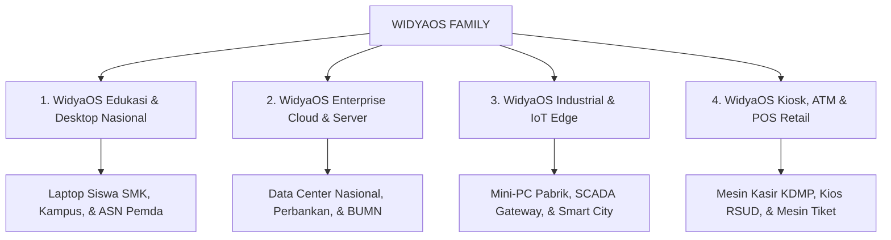
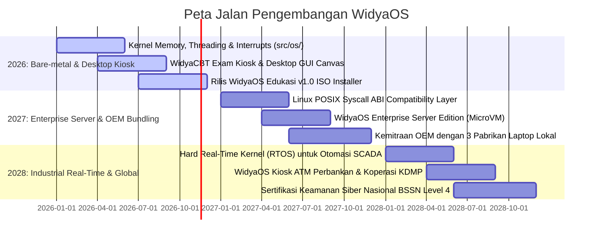

# STRATEGI PENGEMBANGAN, ARSITEKTUR, DAN KOMERSIALISASI WIDYAOS
**PT Widya Ekosistem Digital Indonesia (Widya-Lang Corporation)**
*Sistem Operasi Berdaulat Berkinerja Tinggi Berbasis Rust Native & Ekosistem Aplikasi Terpadu*

---

## 🏛️ 1. VISI STRATEGIS WIDYAOS (THE SOVEREIGN OPERATING SYSTEM)

**WidyaOS** adalah sistem operasi berdaulat nasional yang dibangun dari nol menggunakan bahasa **Rust berkinerja tinggi** untuk menjamin keamanan memori (*memory safety*), efisiensi daya komputasi (*green computing*), dan kemandirian teknologi 100% dari ketergantungan OS asing (Windows, Red Hat RHEL, macOS).

```
+-------------------------------------------------------------------------------+
|                      ARSITEKTUR UTAMA WIDYAOS NATIVE                          |
|                                                                               |
|  [ LAYER 4: EKOSISTEM APLIKASI DESA, PERBANKAN & EDUKASI ]                    |
|  • WidyaOffice (PDF/XLSX/DOCX), WidyaBrowser, WidyaCBT Kiosk, KDMP 7 Pilar    |
|                                                                               |
|  [ LAYER 3: DESKTOP GUI & GRAPHICS CANVAS (GPU ACCELERATED) ]                 |
|  • Antarmuka visual ringan (<250MB RAM), WebGPU Shaders, Canvas Engine        |
|                                                                               |
|  [ LAYER 2: SYSTEM SERVICES & SOVEREIGN DATA ENGINE ]                         |
|  • WidyaBase ACID Engine, WidyaStore S3 Object Storage, WidyaBox MicroVM      |
|                                                                               |
|  [ LAYER 1: BARE-METAL RUST KERNEL (src/os/) ]                                |
|  • Preemptive Multi-Threading, 4KB Page Memory Manager, IDT/IRQ, POSIX ABI    |
+-------------------------------------------------------------------------------+
```

---

## 💻 2. 4 EDISI KOMERSIAL WIDYAOS (EDITIONS & PACKAGING)



### 1. WidyaOS Edukasi & Desktop Nasional
- **Target**: Laptop Bantuan Sekolah (Kemendikbudristek), Laboratorium SMK RPL, Komputer ASN Pemerintah Daerah, dan Laptop Siswa/Mahasiswa.
- **Keunggulan**: Waktu booting < 3 detik, konsumsi RAM idle hanya **200 MB** (sangat lancar di laptop jadul/murah), built-in aplikasi [WidyaOffice](file:///c:/widya-lang/DOKUMENTASI_OFFICE.md), browser aman [WidyaBrowser](file:///c:/widya-lang/widyaos/simulasi_widyabrowser_engine.wya), dan simulator koding Widya-Lang offline.
- **Fitur Kiosk Ujian (WidyaCBT)**: Kunci layar penuh anti-contek (*Anti-Cheat Lockdown*) untuk pelaksanaan Ujian Nasional / Asesmen Nasional Berbasis Komputer (ANBK).

### 2. WidyaOS Enterprise Cloud & Server (Pengganti RHEL / Linux Server)
- **Target**: Data Center Perbankan (Bank BUKU 3/4 & BPD), Pusat Data Nasional (PDN Kominfo), dan Server BUMN.
- **Keunggulan**: Kernel *hardened* dengan garansi bebas kerentanan *Buffer Overflow* (Rust memory safety), built-in clustering [WidyaBase](file:///c:/widya-lang/DOKUMENTASI_WIDYABASE.md) Active-Active, isolasi serverless [WidyaBox](file:///c:/widya-lang/DOKUMENTASI_WIDYABOX_CONTAINER.md) MicroVM (<5ms boot), dan enkripsi kriptografi pasca-kuantum (PQC).

### 3. WidyaOS Industrial & IoT Edge (Embedded RTOS)
- **Target**: Mini-PC Pabrik Manufaktur, Panel SCADA/PLC PLN, Smart Metering PDAM/Listrik, dan Gateway Sensor ISPU PM2.5.
- **Keunggulan**: Deterministic real-time scheduling (RTOS), konsumsi daya rendah (*Green Computing*), dan kompatibilitas native protokol industri (Modbus TCP/RTU, OPC UA).

### 4. WidyaOS Kiosk, ATM & POS Retail
- **Target**: Mesin Kasir Koperasi Merah Putih (KDMP), Mesin Antrean RSUD/Puskesmas, Mesin Tiket Wisata, dan Terminal ATM Perbankan.
- **Keunggulan**: Mode kios terkunci (*Single-Application Mode*), tahan mati lampu mendadak berkat arsitektur filesystem *Copy-on-Write (CoW)* dan WAL database yang bebas korupsi data.

---

## 💰 3. MODEL MONETISASI & STRATEGI BISNIS WIDYAOS

### A. Pengadaan Massal Sektor Pendidikan & B2G (E-Katalog LKPP)
- **Peluang**: Penggantian sistem operasi laptop pengadaan pemerintah (ratusan ribu unit laptop sekolah tiap tahun) dengan sistem operasi berlisensi lokal.
- **Skema Harga**:
  - Lisensi OEM Edukasi: Rp 150.000 / unit laptop (Hemat 90% dibanding lisensi OS asing).
  - Paket Komputer Kantor ASN Pemda: Rp 450.000 / unit (Termasuk suite WidyaOffice).

### B. Bundling Lisensi OEM dengan Pabrikan Laptop Lokal (Axioo, Advan, Zyrex)
- **Value Proposition bagi Pabrikan**: Meningkatkan nilai **TKDN (Tingkat Komponen Dalam Negeri) Hardware + Software hingga > 50%**, memenangkan tender belanja pengadaan barang pemerintah (LKPP).
- **Skema Royalti**: Rp 75.000 - Rp 120.000 per unit laptop yang diproduksi pabrikan.

### C. Kontrak Pemeliharaan Enterprise & LTS Server (10 Tahun SLA)
- **Target**: Sektor Perbankan, Telekomunikasi, dan BUMN.
- **Skema Biaya**: Rp 75.000.000 - Rp 250.000.000 per cluster server/tahun dengan garansi hot-patch security 24/7/365.

---

## 🗺️ 4. PETA JALAN PENGEMBANGAN TEKNIS WIDYAOS (2026–2028)



---

## 🚀 5. INTEGRASI WIDYAOS DENGAN KOPERASI DESA MERAH PUTIH (KDMP)

Untuk mengoptimalkan pengoperasian 7 Pilar Usaha KDMP (Perkantoran, Simpan Pinjam, Warung, Apotik, Klinik, Pergudangan, Logistik):
- Komputer kasir dan administrasi desa dapat diinstal biner **WidyaOS Kiosk & Desktop Edition**.
- Seluruh 7 pilar aplikasi KDMP langsung terpasang dan berjalan secara *native* tanpa perlu instalasi rumit (*Zero-Configuration Plug & Play*), memberikan keamanan total dari virus/ransomware dan performa tanpa tanding.

---
