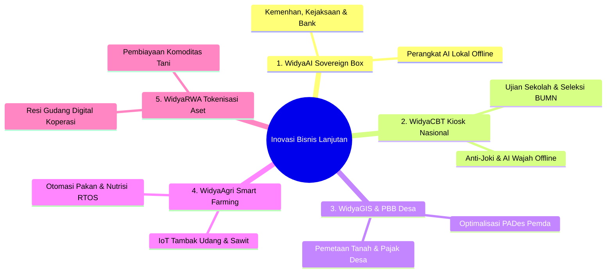

# EKSPLORASI IDE BISNIS & INOVASI KOMERSIAL LANJUTAN WIDYA-LANG
**PT Widya Ekosistem Digital Indonesia (Widya-Lang Corporation)**
*5 Peluang Bisnis Terobosan: AI Berdaulat, CBT Ujian Nasional, GIS Pajak Bumi, Smart Farming, & RWA Koperasi*

---

## 🧭 IKHTISAR 5 PELUANG BISNIS TEROBOSAN (BREAKTHROUGH VENTURES)



---

## 1. WIDYA-AI SOVEREIGN APPLIANCE (KOTAK AI MANDIRI TANPA INTERNET)

### A. Latar Belakang & Masalah Kedaulatan AI:
Banyak instansi strategis (Kementerian Pertahanan, Kejaksaan Agung, Mabes Polri, Lembaga Intelijen, Rumah Sakit, dan Bank Sentral) **dilarang keras** mengunggah dokumen rahasia negara ke server AI luar negeri (seperti OpenAI ChatGPT, Claude, atau Gemini Cloud) karena ancaman spionase dan pelanggaran kerahasiaan data.

### B. Solusi Widya-AI Sovereign Box:
- **Perangkat Keras & Lunak Siap Pakai (*Plug & Play AI Appliance*)**: Mini-server hardware khusus yang di dalamnya sudah terpasang biner native Rust inference engine ([widya_ai_local](file:///c:/widya-lang/widya_ai_local)) dan model AI terkuantisasi 4-bit (`qwen2.5-coder-7b-instruct.Q4_K_M.gguf`).
- **100% Offline (Air-Gapped)**: Mampu meringkas dokumen intelijen, menganalisis pasal hukum, menyusun surat dakwaan, dan audit keuangan tanpa kabel LAN/Internet sama sekali.
- **Model Bisnis & Harga**:
  - Penjualan Perangkat Keras Box AI: Rp 85.000.000 - Rp 250.000.000 per unit (Termasuk Mini-Server GPU/NPU + Lisensi WidyaOS AI).
  - Kontrak Pembaruan Pengetahuan Model AI: Rp 35.000.000 / tahun.

---

## 2. WIDYACBT: PLATFORM SELEKSI & ASESMEN NASIONAL ANTI-KECURANGAN

### A. Latar Belakang:
Pelaksanaan seleksi Calon Pegawai Negeri Sipil (CPNS), Rekrutmen Bersama BUMN, Ujian Masuk Perguruan Tinggi, dan Asesmen Nasional Berbasis Komputer (ANBK) sering terkendala server *down*, kebocoran soal, dan biaya lisensi platform ujian luar negeri.

### B. Solusi WidyaCBT Enterprise:
- **Kiosk Lockdown Browser Native**: Mengunci komputer ujian secara total sehingga peserta tidak bisa membuka Google, ChatGPT, atau aplikasi contek lainnya.
- **Deteksi AI Pengawas Wajah Offline**: Kamera mendeteksi kehadiran peserta dan gerak-gerik mencurigakan langsung di memori lokal laptop tanpa membebani bandwidth internet sekolah.
- **Model Bisnis & Harga**:
  - Sewa Platform per Peserta Ujian: Rp 5.000 - Rp 15.000 per sesi ujian siswa.
  - Lisensi Lembaga Pemerintah (Kemendikbud / BKN): Rp 1.500.000.000 / tahun (Kapasitas Jutaan Peserta Serentak).

---

## 3. WIDYAGIS: DIGITALISASI TANAH & OPTIMALISASI PBB DESA (GEO-TAX ENGINE)

### A. Latar Belakang:
Pemerintah Daerah (Bapenda Kabupaten/Kota) dan Pemerintah Desa kehilangan potensi Pendapatan Asli Daerah (PAD) ratusan miliar rupiah karena data PBB-P2 tidak akurat dan peta batas tanah masih berupa kertas manual.

### B. Solusi WidyaGIS Geo-Tax:
- Membaca dan memvisualisasikan peta polygon geospasial desa (`peta_desa_indonesia_kemendagri.gpkg`) secara native di browser.
- Menghitung otomatis Nilai Jual Objek Pajak (NJOP) berdasarkan zonasi jalan, luas tanah, dan jenis bangunan secara presisi.
- **Model Bisnis & Harga**:
  - Paket Pemetaan per Desa: Rp 15.000.000 - Rp 25.000.000 per desa (Pengadaan Dana Desa / APBD).
  - Skema Bagi Hasil Kenaikan Pajak (*Success-Fee Model*): 5% dari kenaikan realisasi pendapatan PBB desa.

---

## 4. WIDYAAGRI SMART FARMING & IOT TAMBAK PERIKANAN

### A. Latar Belakang:
Petani tambak udang vaname dan perkebunan hortikultura sering mengalami gagal panen akibat perubahan mendadak kadar oksigen terlarut (DO), salinitas air, dan kelembaban tanah yang terlambat diantisipasi.

### B. Solusi WidyaAgri Controller:
- Memanfaatkan **WidyaOS RTOS Real-Time** pada mini-controller bertenaga surya untuk membaca sensor air/tanah setiap 5 detik.
- Mengaktifkan aerator/kincir air dan mesin pelontar pakan otomatis (*auto-feeder*) jika sensor mendeteksi kadar oksigen turun.
- **Model Bisnis & Harga**:
  - Paket Starter Kit 1 Kolam Tambak: Rp 7.500.000 (Hardware Sensor + Box Controller Widya).
  - Langganan Aplikasi Dashboard Pantau HP: Rp 99.000 / kolam / bulan.

---

## 5. WIDYA-RWA: TOKENISASI HASIL PANEN & RESI GUDANG DIGITAL KOPERASI

### A. Latar Belakang:
Petani sering terpaksa menjual gabah atau kopi ke tengkulak dengan harga murah saat panen raya karena butuh uang tunai cepat untuk kebutuhan keluarga sehari-hari.

### B. Solusi WidyaRWA Digital Ledger:
- Hasil panen yang disimpan di **Pergudangan Koperasi KDMP** diterbitkan sertifikat digital berbasis ledger terdistribusi [WidyaBase](file:///c:/widya-lang/DOKUMENTASI_WIDYABASE.md).
- Sertifikat ini menjadi aset jaminan likuid (*Real World Asset / RWA*) yang dapat dicairkan sebagian menjadi modal kerja di unit Simpan Pinjam Koperasi tanpa harus menjual gabah saat harga anjlok.
- **Model Bisnis & Harga**:
  - Biaya Administrasi Penerbitan Sertifikat Digital: 0.5% dari nilai komoditas yang diagunkan.

---

## 📊 ESTIMASI POTENSI TAMBAHAN OMZET DARI 5 INOVASI LANJUTAN

```
+------------------------------------+-----------------------+-----------------------+
| Inovasi Bisnis Baru                | Target Klien Tahun 1  | Estimasi Omzet (IDR)  |
+------------------------------------+-----------------------+-----------------------+
| 1. WidyaAI Sovereign Box Appliance | 20 Instansi Pertahanan| Rp  3.500.000.000     |
| 2. WidyaCBT Kiosk Ujian Seleksi    | 500.000 Peserta Ujian | Rp  3.750.000.000     |
| 3. WidyaGIS Pajak PBB & Peta Desa  | 150 Desa / 3 Pemkab   | Rp  2.250.000.000     |
| 4. WidyaAgri Smart Tambak & Tani   | 300 Kolam / Mitra Tani| Rp  1.800.000.000     |
| 5. WidyaRWA Digital Resi Gudang    | 50 Koperasi Komoditas | Rp    750.000.000     |
+------------------------------------+-----------------------+-----------------------+
| 🚀 TOTAL POTENSI TAMBAHAN PENDAPATAN                       | RP 12.050.000.000     |
+------------------------------------------------------------+-----------------------+
```

---
