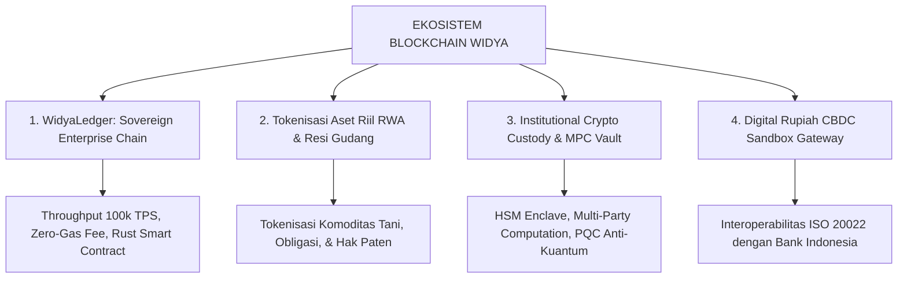

# STRATEGI EKOSISTEM BLOCKCHAIN, ASET KRIPTO, DAN RUPIAH DIGITAL
**PT Widya Ekosistem Digital Indonesia (Widya-Lang Corporation)**
*Arsitektur Sovereign Distributed Ledger, Tokenisasi Real World Asset (RWA), Kepatuhan OJK/Bappebti, & Kesiapan CBDC*

---

## 🏛️ 1. KERANGKA REGULASI NASIONAL (UU P2SK & BANK INDONESIA)

Pemanfaatan teknologi Blockchain dan Aset Kripto di ekosistem Widya-Lang dirancang 100% patuh terhadap regulasi Republik Indonesia:

```
+-------------------------------------------------------------------------------+
|                       KERANGKA HUKUM NASIONAL INDONESIA                       |
|                                                                               |
|  1. UU No. 4/2023 tentang Pengembangan & Penguatan Sektor Keuangan (UU P2SK): |
|     • Pengawasan Inovasi Teknologi Sektor Keuangan (ITSK) & Aset Keuangan     |
|       Digital/Kripto berada di bawah Otoritas Jasa Keuangan (OJK).            |
|                                                                               |
|  2. Peraturan Bank Indonesia tentang Kedaulatan Mata Uang:                    |
|     • Rupiah adalah SATU-SATUNYA alat pembayaran yang sah di wilayah NKRI.    |
|     • Aset Kripto diperlakukan sebagai ASET INVESTASI / KOMODITAS DIGITAL     |
|       dan sarana pencatatan kepemilikan aset riil (Bukan Alat Pembayaran).    |
|                                                                               |
|  3. Proyek Garuda Bank Indonesia (Central Bank Digital Currency / CBDC):      |
|     • Kesiapan arsitektur integrasi Rupiah Digital Grosir & Ritel (w-CBDC).   |
+-------------------------------------------------------------------------------+
```

---

## 🔗 2. 4 PILAR TEKNOLOGI BLOCKCHAIN & KRIPTO WIDYA-LANG



### 1. WidyaLedger: Sovereign High-Throughput Layer-1 / Layer-2
- **Arsitektur**: Dibangun di atas bahasa Rust dengan konsensus *Byzantine Fault Tolerant (BFT)* dan penyimpanan [WidyaBase](file:///c:/widya-lang/DOKUMENTASI_WIDYABASE.md) ACID.
- **Kinerja**: Mampu memproses **100.000+ Transaksi per Detik (TPS)** dengan latensi finalitas blok **< 500 milidetik** dan konsumsi energi 99% lebih hemat dibanding Proof-of-Work (Green Blockchain).
- **Smart Contract Dwibahasa**: Mendukung penulisan kontrak pintar menggunakan sintaks Widya-Lang maupun kompilasi biner WebAssembly (Wasm).

### 2. Tokenisasi Real World Asset (RWA) & Komoditas Riil
- **Fungsi**: Mengubah kepemilikan aset fisik bernilai tinggi menjadi sertifikat digital terverifikasi (*Asset-Backed Tokens*):
  - Resi Gudang Gabah/Kopi/Sawit Koperasi Desa Merah Putih (KDMP).
  - Sertifikat Hak Atas Tanah Desa & Hutan Lindung (*Carbon Credit Offset*).
  - Surat Utang Jangka Pendek & Efek Beragun Aset UMKM terdaftar OJK.

### 3. Institutional Crypto Custody & MPC Vault (Perlindungan Bursa Kripto)
- **Target**: Pedagang Fisik Aset Kripto (PFAK) resmi Bappebti/OJK (Indodax, Tokocrypto, Reku, Pintu) dan Lembaga Kustodian Nasional.
- **Teknologi**: Menggunakan *Multi-Party Computation (MPC)* dan enkripsi *Post-Quantum Cryptography (PQC)* pada modul [Sovereign Security Shield](file:///c:/widya-lang/DOKUMENTASI_SOVEREIGN_SECURITY_SHIELD.md) untuk mencegah pencurian aset digital dari ancaman peretasan komputer kuantum.

### 4. Digital Rupiah (CBDC) Readiness Gateway
- **Fungsi**: Modul jembatan siap pakai yang kompatibel dengan protokol *Proyek Garuda Bank Indonesia* untuk transaksi transfer antar-bank berdenominasi Rupiah Digital secara instan dan aman.

---

## 💰 3. MODEL BISNIS & MONETISASI BLOCKCHAIN ENTERPRISE

```
+------------------------------------+-----------------------+-----------------------+
| Lini Layanan Blockchain            | Target Klien          | Skema Monetisasi      |
+------------------------------------+-----------------------+-----------------------+
| 1. Lisensi Private Blockchain Node | Bank BUKU 4, BUMN     | Rp  450.000.000 / thn |
| 2. Platform Tokenisasi RWA Desa    | Koperasi KDMP, Pemda  | Fee 0.3% - 0.5% Nilai |
| 3. Enterprise MPC Custody Vault    | Bursa Kripto Resmi    | Rp  180.000.000 / thn |
| 4. Audit Keamanan Smart Contract   | Proyek Web3 / Startup | Rp   35.000.000 / audit|
+------------------------------------+-----------------------+-----------------------+
```

---

## 🛡️ 4. PERLINDUNGAN DARI ANCAMAN KOMPUTER KUANTUM (POST-QUANTUM CRYPTO)

Banyak blockchain generasi lama (Bitcoin, Ethereum standar) rentan terhadap ancaman algoritma Shor pada komputer kuantum di masa depan yang dapat membongkar kunci privat ECDSA/Secp256k1.

Widya-Lang mengantisipasi ini dengan mengintegrasikan algoritma kriptografi pasca-kuantum berstandar NIST:
- **Kyber-1024 / ML-KEM**: Untuk pertukaran kunci rahasia (*Key Encapsulation*).
- **Dilithium / Falcon / ML-DSA**: Untuk tanda tangan digital transaksi kripto yang tahan dekripsi superkomputer kuantum seumur hidup.

---
