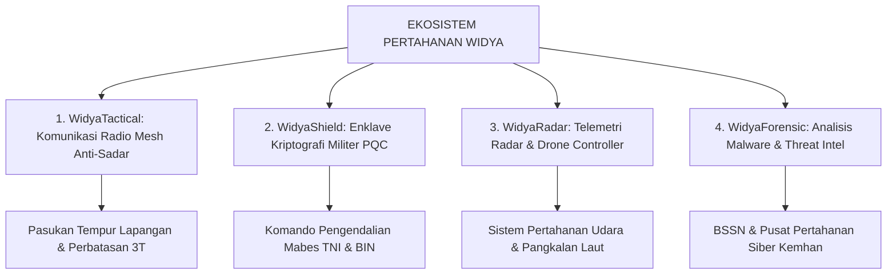

# STRATEGI PERTAHANAN SIBER, INTELIJEN, DAN TEKNOLOGI TAKTIS MILITER
**PT Widya Ekosistem Digital Indonesia (Widya-Lang Corporation)**
*Solusi Komputasi Berdaulat Sektor Pertahanan, Komunikasi Taktis Anti-Sadar, & Audit Keamanan BSSN/TNI*

---

## 🏛️ 1. VISI KEDAULATAN PERTAHANAN SIBER NASIONAL

Ketergantungan infrastruktur militer dan pertahanan pada perangkat keras serta sistem operasi luar negeri membuka celah ancaman pintu belakang (*hardware/software backdoor*), penyadapan sinyal intelijen, dan sabotase embargo teknologi saat krisis geopolitik.

Widya-Lang menyediakan **Sovereign Defense Computing Stack** yang 100% diaudit secara mandiri di dalam negeri:



---

## 🛡️ 2. 4 PILAR PRODUK KOMERSIAL SEKTOR PERTAHANAN

### 1. WidyaTactical: Komunikasi Mesh Taktis & Offline Battlefield Map
- **Fungsi**: Jaringan komunikasi suara terenkripsi dan peta pergerakan pasukan (*Blue Force Tracking*) antar-prajurit di daerah blank-spot perbatasan tanpa butuh sinyal seluler atau GPS asing.
- **Teknologi**: Protokol Radio Mesh Ad-Hoc di atas kernel bare-metal [WidyaOS RTOS](file:///c:/widya-lang/bisnis/26_PANDUAN_PENGEMBANGAN_DAN_KOMERSIALISASI_WIDYAOS.md) yang sangat hemat baterai pada radio handy-talkie (HT) digital militer.

### 2. WidyaShield: Enklave Kriptografi Pasca-Kuantum (PQC Military Grade)
- **Fungsi**: Modul enkripsi fisik untuk jalur komunikasi sandi rahasia negara antara Presiden, Panglima TNI, dan Kepala BIN.
- **Standar**: Menggunakan algoritma tahan komputer kuantum (Kyber-1024 dan Dilithium-5) yang diverifikasi bebas dari campur tangan NSA/badan intelijen asing.

### 3. WidyaRadar: Pengolahan Sinyal Radar & Pengendali Drone Otonom
- **Fungsi**: Engine komputasi berlatensi mikrodetik untuk menyaring kebisingan sinyal radar (*Signal Noise Filtering*) dan sistem kendali terbang wahana tanpa awak (*Unmanned Aerial Vehicle / UAV Drone*).
- **Keunggulan**: Waktu eksekusi deterministik tanpa *Garbage Collection pause* (Zero-GC Rust).

### 4. WidyaForensic: Alat Investigasi Siber & Deteksi Kebocoran Data
- **Fungsi**: Sandbox dekompilasi dan analisis perilaku malware/ransomware untuk tim *Computer Security Incident Response Team (CSIRT)* instansi vital nasional.

---

## 💰 3. SKEMA PENGADAAN & NILAI KONTRAK STRATEGIS B2G DEFENSE

```
+------------------------------------+-----------------------+-----------------------+
| Paket Solusi Pertahanan            | Instansi Pembeli      | Nilai Kontrak Lisensi |
+------------------------------------+-----------------------+-----------------------+
| 1. WidyaTactical Mesh Suite (1 Bat)| Kostrad, Kopassus     | Rp  2.500.000.000     |
| 2. Enklave Sandi Negara WidyaShield| Kemhan, BSSN, BIN     | Rp  5.000.000.000     |
| 3. Radar Signal Processing Engine  | TNI AL, TNI AU        | Rp  3.800.000.000     |
| 4. CSIRT Forensic Platform Lab     | Puspen TNI, Mabes AL  | Rp  1.200.000.000     |
+------------------------------------+-----------------------+-----------------------+
| 🎖️ TOTAL POTENSI PASAR SEKTOR PERTAHANAN                   | RP 12.500.000.000     |
+------------------------------------------------------------+-----------------------+
```

---
