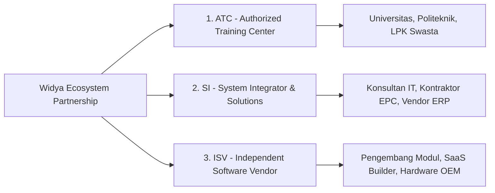

# PROGRAM KEMITRAAN DAN AKREDITASI RESMI WIDYA-LANG
**Kerangka Kerja Kolaborasi Mitra Bisnis, Lembaga Pelatihan, dan System Integrator**

---

## 1. Kategori Kemitraan Resmi (Partner Categories)

Ekosistem Widya-Lang membuka 3 jalur kolaborasi komersial strategis:



---

## 2. Jenjang Kemitraan & Manfaat (Partner Tiers & Benefits)

| Manfaat & Hak Istimewa | Registered Partner | Silver Partner | Gold Partner | Platinum Premier |
| :--- | :---: | :---: | :---: | :---: |
| **Diskon Lisensi Software (Margin Penjualan)** | 15% | 25% | 35% | **45%** |
| **Lisensi NFR (Not For Resale) Internal Lab** | 1 Node | 3 Node Cluster | 10 Node Cluster | **Unlimited Lab** |
| **Diskon Voucher Sertifikasi Resmi** | 10% | 20% | 30% | **40%** |
| **Pencantuman Logo di Direktori Resmi Widya** | ✅ | ✅ | ✅ | ✅ (Featured) |
| **Akses Pre-Release & Beta Feature** | ❌ | ✅ | ✅ | ✅ |
| **Dedicated Technical Partner Manager** | ❌ | ❌ | ✅ | ✅ |
| **Joint Marketing Fund (JMF) & Co-Branding** | ❌ | ❌ | Rp 25 Jt / Thn | **Rp 100 Jt / Thn** |
| **Referral Penjualan Enterprise dari Widya Core** | ❌ | ❌ | Tier 2 Prioritas | **Tier 1 Prioritas Utama** |

---

## 3. Program Authorized Training Center (ATC)

Program khusus untuk universitas, fakultas ilmu komputer, politeknik vokasi, SMK RPL, dan lembaga kursus profesional:

### A. Persyaratan Menjadi ATC Resmi:
1. Memiliki minimal **2 Pengajar Tetap** yang memegang sertifikasi minimal **WCP (Widya Certified Professional)** atau **WCE (Expert)**.
2. Memiliki laboratorium komputer dengan spesifikasi minimal dual-core CPU, 4GB RAM, terpasang biner `widya` dan `widyabase`.
3. Membayar iuran akreditasi tahunan sebesar Rp 35.000.000 (khusus institusi pendidikan tinggi negeri/swasta nirlaba berhak atas **subsidi 60%** menjadi Rp 14.000.000).

### B. Fasilitas yang Diperoleh ATC:
- Akses penuh ke slide presentasi, bank soal kuis berkala, modul lab praktik, dan silabus kurikulum resmi.
- Hak menerbitkan sertifikat pelatihan internal dengan lencana akreditasi *"Official Widya Accredited Course"*.
- Pembagian royalti voucher ujian sertifikasi (ATC memperoleh komisi langsung 20% dari setiap siswa yang mengambil sertifikasi resmi).

---

## 4. Program Mitra System Integrator (SI) & Konsultan Solusi

Ditujukan bagi perusahaan konsultan IT yang mengimplementasikan sistem di sektor perbankan, manufaktur, kesehatan, dan pemerintahan:

- **Sertifikasi Tenaga Ahli Proyek**: Perusahaan mitra wajib memiliki minimal 3 orang *Certified Industrial Architect (WCEI)* untuk menangani proyek switching perbankan atau otomasi SCADA.
- **Dukungan Eskalasi Arsitektur Tingkat 3**: Tim core engineer Widya-Lang akan memberikan pendampingan langsung selama fase implementasi kritis (Go-Live) di lokasi klien (*on-site standby*).
- **Proteksi Deal Registrasi**: Melindungi mitra yang pertama kali mendaftarkan prospek klien korporat dari persaingan internal.

---

## 5. Alur Pendaftaran & Akreditasi Mitra (Onboarding Process)

```
[ Pengajuan Formulir Kemitraan Online ]
  └── Formulir Profil Perusahaan & Portofolio Proyek
         │
         ▼
[ Verifikasi Kelayakan & Wawancara Strategis ]
  └── Peninjauan Kompetensi Teknis & Target Pasar Bersama
         │
         ▼
[ Penandatanganan MoU & Perjanjian Kemitraan ]
  └── Penetapan Target Kuota Lisensi / Siswa & SLA
         │
         ▼
[ Pelatihan Training of Trainers (ToT) & Sertifikasi Insinyur ]
  └── Program Intensif 5 Hari Bersama Tim Inti Widya-Lang
         │
         ▼
[ Penyerahan Sertifikat Akreditasi & Akses Portal Mitra ]
  └── Penerimaan Partner Kit, Lisensi NFR, & Hak Penjualan Resmi
```

---
*Hubungi Divisi Kemitraan & Ekosistem: partner@widya.dev*
