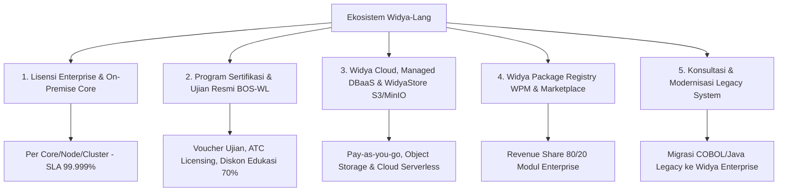

# PUSAT DOKUMENTASI STRATEGI & PENGEMBANGAN BISNIS WIDYA-LANG
**PT Widya Ekosistem Digital Indonesia (Widya-Lang Corporation)**
*Dokumen Rencana Bisnis, Monetisasi, Strategi Pasar, SOP Operasional, & Proyeksi Finansial 2026–2030*

---

## 🎯 Visi & Misi Bisnis

### Visi
Menjadikan **Widya-Lang** sebagai ekosistem bahasa pemrograman dan komputasi kedaulatan digital nomor satu di Indonesia dan Asia Tenggara, memberdayakan industri perbankan, manufaktur, smart city, kesehatan, serta sektor pemerintahan dengan teknologi lokal berstandar global.

### Misi
1. **Kemandirian Teknologi Nasional**: Menyediakan infrastruktur bahasa, database engine ([WidyaBase](file:///c:/widya-lang/DOKUMENTASI_WIDYABASE.md)), containerization ([WidyaBox](file:///c:/widya-lang/DOKUMENTASI_WIDYABOX_CONTAINER.md)), dan orkestrasi ([WidyaKube](file:///c:/widya-lang/DOKUMENTASI_WIDYAKUBE_ORCHESTRATOR.md)) yang bebas dari vendor lock-in asing.
2. **Standardisasi Talenta Digital**: Menjadi tolok ukur kompetensi rekayasa perangkat lunak melalui program sertifikasi resmi (WCA, WCP, WCE, hingga Spesialisasi Industri) dengan komitmen subsidi diskon 70% untuk dunia pendidikan.
3. **Penyedia Solusi Enterprise & Industri 4.0**: Menyediakan platform siap pakai untuk integrasi SCADA/PLC, switching core banking, integrasi SatuSehat/FHIR, dan Smart City CRDT.
4. **Keberlanjutan Finansial (Sustainable High Growth)**: Membangun model bisnis multi-revenue stream yang terbukti menghasilkan *recurring revenue* (ARR), lisensi enterprise, dan ekosistem marketplace yang sehat.

---

## 📂 Master Index Dokumen Bisnis & Strategi Komersial (`/bisnis`)

Seluruh dokumen di bawah ini disusun secara sistematis, komprehensif, dan siap dipedomani oleh seluruh jajaran pimpinan, tim penjualan, tim operasional, mitra ATC, hingga investor:

| No | File Dokumen | Topik & Cakupan Utama | Target Audiens |
| :---: | :--- | :--- | :--- |
| **01** | [**01_PANDUAN_EKSEKUTIF_DAN_PITCH_DECK.md**](./01_PANDUAN_EKSEKUTIF_DAN_PITCH_DECK.md) | Ringkasan Eksekutif, Masalah Industri, Solusi Unik, Valuasi Pasar (TAM USD 4.2B), & Alokasi Penggunaan Dana Investasi. | Investor, Board of Directors, C-Level |
| **02** | [**02_ANALISIS_PASAR_DAN_KOMPETITOR.md**](./02_ANALISIS_PASAR_DAN_KOMPETITOR.md) | Analisis Pasar Sektoral, Matriks Komparasi Lawan (vs Oracle, Microsoft, Go/Node), Porter's 5 Forces, & Analisis PESTLE. | Strategy Team, Product Lead, Analysts |
| **03** | [**03_STRATEGI_PENJUALAN_B2B_ENTERPRISE.md**](./03_STRATEGI_PENJUALAN_B2B_ENTERPRISE.md) | Enterprise Sales Playbook, Kualifikasi MEDDPICC, Siklus 6 Fase Penjualan, Panduan POC 30-Hari, & *Objection Handling*. | Enterprise Sales, Account Executives |
| **04** | [**04_STRATEGI_PENGADAAN_PEMERINTAH_B2G_DAN_E_KATALOG.md**](./04_STRATEGI_PENGADAAN_PEMERINTAH_B2G_DAN_E_KATALOG.md) | Penetrasi B2G & BUMN, Etalase LKPP E-Katalog, Kepatuhan SPBE, Audit TKDN Software >85%, & Pemetaan Kalender DIPA/APBD. | Gov-Rel, Tender/Bidding Manager |
| **05** | [**05_PANDUAN_OPERASIONAL_ATC_DAN_SERTIFIKASI.md**](./05_PANDUAN_OPERASIONAL_ATC_DAN_SERTIFIKASI.md) | SOP Authorized Training Center, Alur Verifikasi Promo Pendidikan 70%, Pengawasan Ujian Anti-Cheat, & Royalti ATC 20%. | Head of Academy, ATC Partners, Guru/Dosen |
| **06** | [**06_STRATEGI_MARKETING_DAN_DEVREL.md**](./06_STRATEGI_MARKETING_DAN_DEVREL.md) | Developer Relations (DevRel), Duta Kampus (Campus Leads), Hackathon Nasional Piala Kedaulatan Digital, Web Playground & WidyaCon. | Marketing, DevRel, Community Lead |
| **07** | [**07_MANAJEMEN_RISIKO_DAN_MITIGASI.md**](./07_MANAJEMEN_RISIKO_DAN_MITIGASI.md) | Matriks 6 Kategori Risiko Utama (Teknis, Adopsi Pasar, Arus Kas B2G, Pembajakan SDM, Keamanan Siber) & Solusi Mitigasinya. | Risk & Compliance, Legal, CTO |
| **08** | [**08_STANDAR_LAYANAN_SLA_DAN_KONTRAK_ENTERPRISE.md**](./08_STANDAR_LAYANAN_SLA_DAN_KONTRAK_ENTERPRISE.md) | Perjanjian SLA Tingkat Layanan (99.9% s/d 99.999%), Matriks Respon P1-P4, Service Credit Penalty, & Klausul Source Code Escrow OJK. | Legal Counsel, Customer Support Lead |
| **09** | [**09_STRATEGI_EKSPANSI_REGIONAL_ASEAN.md**](./09_STRATEGI_EKSPANSI_REGIONAL_ASEAN.md) | Rencana Ekspansi Regional 2027-2030 (MY, SG, VN, TH, PH), Pembayaran Lintas Batas (QRIS, DuitNow, PayNow, PromptPay), & Sintaks Multi-Lingual. | International Business, VP Expansion |
| **10** | [**10_PANDUAN_PENGEMBANGAN_PRODUK_DAN_ROADMAP_KOMERSIAL.md**](./10_PANDUAN_PENGEMBANGAN_PRODUK_DAN_ROADMAP_KOMERSIAL.md) | Peta Jalan Rilis 5 Tahun (2026-2030), Feature Gating (Community vs Enterprise), Siklus Long-Term Support (LTS 5 Tahun), & Customer Feedback. | Product Managers, Engineering Leads |
| **11** | [**11_KERANGKA_TATA_KELOLA_ESG_DAN_KEBERLANJUTAN.md**](./11_KERANGKA_TATA_KELOLA_ESG_DAN_KEBERLANJUTAN.md) | Tata Kelola ESG, Green Computing (Efisiensi Energi Biner Rust Hemat Listrik 70%), Inklusi Sosial Pendidikan, & Etika Data Kedaulatan. | Sustainability Lead, ESG Investors |
| **12** | [**12_PANDUAN_AUDIT_KEPATUHAN_HUKUM_DAN_HAKI.md**](./12_PANDUAN_AUDIT_KEPATUHAN_HUKUM_DAN_HAKI.md) | Pendaftaran Merek DJKI, Hak Cipta Kompiler, Paten Invensi, Perjanjian Kontributor (CLA), & Penegakan Lisensi Komersial Dual-Licensing. | Legal Officer, IP Attorney |
| **13** | [**13_PANDUAN_REKRUTMEN_DAN_STANDAR_KOMPENSASI_SDM.md**](./13_PANDUAN_REKRUTMEN_DAN_STANDAR_KOMPENSASI_SDM.md) | Struktur Banding Gaji Insinyur Low-Level Rust & Sales, Kebijakan Alokasi Saham ESOP (Pool 10% 4-Yr Vesting), & Retensi Talenta Inti. | Head of HR, People Operations |
| **14** | [**14_TEMPLATE_PROPOSAL_DAN_KONTRAK_PENGADAAN_B2B.md**](./14_TEMPLATE_PROPOSAL_DAN_KONTRAK_PENGADAAN_B2B.md) | Template Siap Pakai Surat Penawaran Resmi, Format Statement of Work (SOW) Migrasi Perbankan, & Order Form Pengadaan Lisensi. | Sales Ops, Proposal Managers |
| **15** | [**15_ANALISIS_TOTAL_COST_OF_OWNERSHIP_TCO.md**](./15_ANALISIS_TOTAL_COST_OF_OWNERSHIP_TCO.md) | Whitepaper Komparasi Finansial 3 Tahun: Stack Legacy Oracle/Java (Rp 6.95M) vs Widya Enterprise (Rp 1.38M), Penghematan 80.1%, & ROI 1.491%. | CIO, CFO, IT Finance Committee |
| **16** | [**16_STRATEGI_PENGELOLAAN_KOMUNITAS_DAN_PROGRAM_KERJA.md**](./16_STRATEGI_PENGELOLAAN_KOMUNITAS_DAN_PROGRAM_KERJA.md) | Tata Kelola Komunitas, Struktur Chapter Kampus/Daerah, Kalender Kerja Tahunan, Sistem Insentif/Gamifikasi, & SOP Moderasi. | Community Manager, DevRel, Campus Leads |
| **17** | [**17_PERJANJIAN_KERAHASIAAN_NDA.md**](./17_PERJANJIAN_KERAHASIAAN_NDA.md) | Template Perjanjian Kerahasiaan Bersama (*Mutual Non-Disclosure Agreement*) Standar Hukum RI untuk Penjajakan Klien B2B & B2G. | Legal Counsel, Enterprise Sales |
| **18** | [**18_PERJANJIAN_INDUK_LAYANAN_MSA.md**](./18_PERJANJIAN_INDUK_LAYANAN_MSA.md) | Template Kontrak Induk Layanan & Lisensi Perangkat Lunak (*Master Services Agreement*) mencakup Node Server, SLA 99.999%, & Escrow. | Legal Counsel, Corporate Procurement |
| **19** | [**19_PERJANJIAN_KEMITRAAN_ATC.md**](./19_PERJANJIAN_KEMITRAAN_ATC.md) | Template Perjanjian Kemitraan Resmi *Authorized Training Center* (ATC) BOS-WL bersama Perguruan Tinggi/SMK/LPK + Klausul Diskon 70%. | Head of Academy, ATC Partners |
| **20** | [**20_PERJANJIAN_DATA_PROCESSING_AGREEMENT_DPA.md**](./20_PERJANJIAN_DATA_PROCESSING_AGREEMENT_DPA.md) | Template Perjanjian Pemrosesan Data Pribadi (DPA) Kepatuhan UU No. 27/2022 (UU PDP), Standar Enkripsi AES-256-GCM, & Audit BSSN. | Data Protection Officer (DPO), Legal |
| **21** | [**21_PERJANJIAN_KONTRIBUTOR_KODE_CLA.md**](./21_PERJANJIAN_KONTRIBUTOR_KODE_CLA.md) | Template Perjanjian Lisensi Kontributor Kode Sumber (*Contributor License Agreement* / CLA) untuk Perlindungan Hak Cipta & Paten Proyek. | Open Source Lead, Core Maintainers |
| **22** | [**22_STRATEGI_INSENTIF_SUPER_TAX_DEDUCTION_PP45.md**](./22_STRATEGI_INSENTIF_SUPER_TAX_DEDUCTION_PP45.md) | Panduan Insentif Fiskal *Super Tax Deduction* PP No. 45/2019 (Vokasi 200% & Litbang 300%), Simulasi Finansial Penghematan Pajak Badan, & Alur OSS. | CFO, Tax Director, Enterprise Sales |
| **23** | [**23_KATALOG_APLIKASI_KOMERSIAL_SIAP_RILIS.md**](./23_KATALOG_APLIKASI_KOMERSIAL_SIAP_RILIS.md) | Katalog 10 Kategori Produk & Aplikasi Komersial Siap Rilis (WidyaPay, WidyaDesa, WidyaMedika, WidyaSCADA, WidyaOffice, WidyaKasir POS). | Product Managers, Sales Leads, Investors |
| **24** | [**24_ARSITEKTUR_DAN_PRICING_KOPERASI_MERAH_PUTIH.md**](./24_ARSITEKTUR_DAN_PRICING_KOPERASI_MERAH_PUTIH.md) | Arsitektur Aplikasi Koperasi Desa/Kelurahan Merah Putih (KDMP) dengan 7 Pilar Usaha Terpadu (Perkantoran, Simpan Pinjam, Warung, Apotik, Klinik SatuSehat, Pergudangan Resi Gudang, & Logistik Armada) & Skema Modular Pricing. | Product Lead, Koperasi Managers, B2G |
| **25** | [**25_STRATEGI_TECH_SALES_DAN_PROGRAM_AFILIATOR_DESA.md**](./25_STRATEGI_TECH_SALES_DAN_PROGRAM_AFILIATOR_DESA.md) | Ekosistem Mitra Tech Sales & Afiliator Lapangan Desa (Pendamping Desa, Karang Taruna), 3 Layer Komisi (MRR 25% Seumur Hidup + PPOB Fee), & Dashboard Mitra. | Field Sales Director, Affiliators, Pemuda Desa |
| **26** | [**26_PANDUAN_PENGEMBANGAN_DAN_KOMERSIALISASI_WIDYAOS.md**](./26_PANDUAN_PENGEMBANGAN_DAN_KOMERSIALISASI_WIDYAOS.md) | Arsitektur Sistem Operasi Berdaulat WidyaOS (Rust Bare-Metal Kernel, 4 Edisi: Edukasi, Server, Industri, Kiosk/POS), Monetisasi OEM Laptop Lokal (Axioo/Advan), & Peta Jalan 2026-2028. | Systems Architects, OEM Partners, B2G |
| **27** | [**27_EKSPLORASI_IDE_BISNIS_INOVASI_LANJUTAN.md**](./27_EKSPLORASI_IDE_BISNIS_INOVASI_LANJUTAN.md) | 5 Peluang Bisnis Terobosan: WidyaAI Box Offline (Militer/Kejaksaan), WidyaCBT Platform Seleksi CPNS/BUMN, WidyaGIS PBB Desa, WidyaAgri Smart Tambak/IoT, & WidyaRWA Resi Gudang Koperasi. | Chief Innovation Officer, Strategy, Investors |
| **28** | [**28_STRATEGI_BLOCKCHAIN_KRIPTO_DAN_DIGITAL_RUPIAH.md**](./28_STRATEGI_BLOCKCHAIN_KRIPTO_DAN_DIGITAL_RUPIAH.md) | Ekosistem Blockchain Berdaulat (WidyaLedger 100k TPS, Tokenisasi Real World Asset RWA Desa/Komoditas, MPC Custody Vault Anti-Kuantum, & Kesiapan Rupiah Digital Proyek Garuda BI). | FinTech Lead, Crypto Custody, Web3 Architects |
| **29** | [**29_STRATEGI_PERTAHANAN_DAN_CYBER_INTELLIGENCE.md**](./29_STRATEGI_PERTAHANAN_DAN_CYBER_INTELLIGENCE.md) | Solusi Pertahanan Siber & Taktis Militer (WidyaTactical Radio Mesh, Enklave Sandi PQC Kemhan/BSSN, Radar Telemetry, & Forensic Lab). | Defense Lead, Military Procurement, BSSN |
| **30** | [**30_BLUEPRINT_SINERGI_EKOSISTEM_LENGKAP_2026_2030.md**](./30_BLUEPRINT_SINERGI_EKOSISTEM_LENGKAP_2026_2030.md) | Grand Synthesis: Peta Konglomerasi Teknologi Digital Berdaulat, Konsolidasi P&L 5 Tahun (Rp 600 Miliar), & Roadmap Menuju IPO Bursa Efek Indonesia (IDX: WIDY). | CEO, Board of Directors, Venture Capitalists |
| **31** | [**MODEL_BISNIS_DAN_MONETISASI.md**](./MODEL_BISNIS_DAN_MONETISASI.md) | Detail 5 Pilar Monetisasi (Lisensi Enterprise, Sertifikasi, Cloud DBaaS / WidyaStore S3, Marketplace Add-ons, Jasa Migrasi Legacy). | Executive Board, Finance, Product |
| **32** | [**PROYEKSI_KEUANGAN_DAN_PRICING.md**](./PROYEKSI_KEUANGAN_DAN_PRICING.md) | Pro-Forma Laba Rugi 5 Tahun (2026-2030), Unit Economics (CAC, LTV, Margin 88.5%), Titik Impas (BEP Bln-7), & Rate Card Resmi + Promo 70% Edukasi. | CFO, Finance, Procurement |
| **33** | [**STRATEGI_GO_TO_MARKET_B2B_B2G.md**](./STRATEGI_GO_TO_MARKET_B2B_B2G.md) | Panduan Go-To-Market per Sektor (Fintech, Manufaktur, Rumah Sakit, Desa, Kemdikbud) & Kalender Eksekusi 12 Bulan. | Sales Director, Marketing Lead |
| **34** | [**PROGRAM_KEMITRAAN_DAN_AKREDITASI.md**](./PROGRAM_KEMITRAAN_DAN_AKREDITASI.md) | Kerangka Kerja Kemitraan (ATC, System Integrator, ISV), Jenjang Mitra (Registered s/d Platinum), & Margin Diskon Penjualan s/d 45%. | Partner Manager, System Integrators |

---

## 🏢 5 Pilar Model Bisnis (The 5 Engines of Growth)

---

## 📈 Indikator Kinerja Utama Bisnis (Key Business Metrics)

- **Target ARR (Annual Recurring Revenue) 2026**: Rp 16.000.000.000 (~$1M USD)
- **Target ARR 2028**: Rp 120.000.000.000 (~$8M USD)
- **Target ARR 2030**: Rp 405.000.000.000 (~$25M USD)
- **Target Talenta Tersertifikasi**: 50.000 Insinyur pada akhir 2027
- **Net Revenue Retention (NRR)**: Target > 130%
- **Gross Margin Software & Cloud**: > 88.5%
- **Rasio LTV / CAC**: 18.0x

---
*Dikelola oleh Divisi Strategi Bisnis, Komersial, & Hubungan Korporasi — PT Widya Ekosistem Digital Indonesia.*
