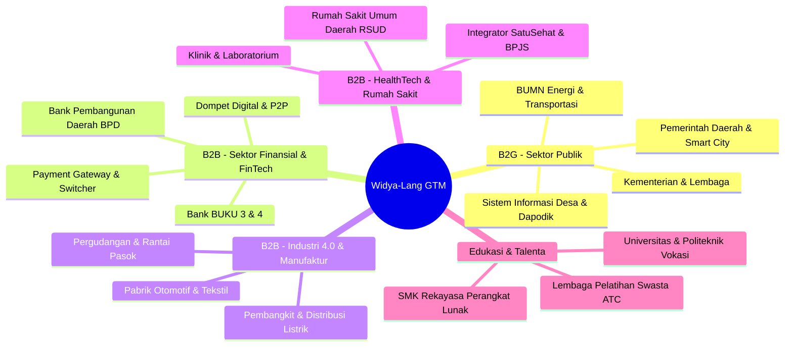

# STRATEGI GO-TO-MARKET (GTM) B2B & B2G WIDYA-LANG
**Rencana Penetrasi Pasar Enterprise, Lembaga Keuangan, Industri, dan Pemerintahan Indonesia**

---

## 1. Segmentasi Pasar & Nilai Tambah Spesifik (Value Propositions)



---

## 2. Analisis Segmen & Strategi Penetrasi

### A. Segmen B2B Finansial & Perbankan (Fintech / Banking Switcher)
- **Pain Point**: Lisensi software legacy switching (AS400, mainframe, vendor luar) yang sangat mahal dan lambat beradaptasi dengan regulasi Bank Indonesia (SNAP, QRIS, BI-FAST).
- **Solusi Widya-Lang**: Modul Native [DOKUMENTASI_ENTERPRISE_STACK.md](file:///c:/widya-lang/DOKUMENTASI_ENTERPRISE_STACK.md) dan [DOKUMENTASI_PAYMENT_GATEWAY.md](file:///c:/widya-lang/DOKUMENTASI_PAYMENT_GATEWAY.md) dengan latensi sub-milidetik, pemenuhan standar EMVCo QRIS, ISO 8583, dan BI-FAST ISO 20022 tanpa ketergantungan pustaka luar.
- **Strategi Penetrasi**:
  1. Menawarkan *Proof of Concept (POC)* gratis 30 hari untuk simulasi load testing 50.000 TPS.
  2. Bekerja sama dengan asosiasi fintech (AFTECH, ASPI).
  3. Menyediakan paket migrasi zero-downtime dari stack lama ke Widya Enterprise.

### B. Segmen B2B Industri 4.0 & Manufaktur (SCADA/PLC Integration)
- **Pain Point**: Keterbatasan konektivitas antara sistem IT (ERP/Cloud) dan OT (*Operational Technology* seperti PLC pabrik Siemens, Omron, Mitsubishi) yang mahal serta rawan downtime.
- **Solusi Widya-Lang**: Modul [DOKUMENTASI_INDUSTRI.md](file:///c:/widya-lang/DOKUMENTASI_INDUSTRI.md) dan [DOKUMENTASI_INTEROPERABILITAS_INDUSTRI.md](file:///c:/widya-lang/DOKUMENTASI_INTEROPERABILITAS_INDUSTRI.md) dengan protokol OPC UA dan Modbus TCP/RTU native berjejak memori sangat rendah.
- **Strategi Penetrasi**:
  1. Masuk melalui System Integrator (SI) otomasi industri terkemuka.
  2. Paket bundling biner Widya-Lang dengan perangkat mini-PC / industrial edge gateway.

### C. Segmen B2B Kesehatan (HealthTech & Rumah Sakit)
- **Pain Point**: Kewajiban Kemenkes untuk integrasi Rekam Medis Elektronik (RME) ke platform SatuSehat (HL7/FHIR) dan bridging BPJS V-Claim yang rumit.
- **Solusi Widya-Lang**: Modul siap pakai FHIR JSON Schema validator dan enkripsi data medis lokal berstandar ISO 27001 / PDP.
- **Strategi Penetrasi**:
  1. Kemitraan dengan vendor SIMRS (Sistem Informasi Manajemen Rumah Sakit).
  2. Program sertifikasi modul SatuSehat Compliance untuk RSUD di seluruh Indonesia.

### D. Segmen B2G (Pemerintahan, BUMN, Pemda, & Kemendikbudristek)
- **Pain Point**: Kebutuhan Tingkat Komponen Dalam Negeri (TKDN) bidang software, kedaulatan data (Data Sovereignty), sinkronisasi data wilayah 3T tanpa internet stabil.
- **Solusi Widya-Lang**:
  - Peta Geospasial Desa Kemendagri (`.gpkg`) native parser.
  - Formulir Dapodik Sekolah & Tenaga Kependidikan terintegrasi (`FORMULIR_PD_DAPODIK.xlsx`).
  - Arsitektur Offline-First CRDT Smart City [DOKUMENTASI_SMARTCITY_CRDT.md](file:///c:/widya-lang/DOKUMENTASI_SMARTCITY_CRDT.md) yang mampu bekerja tanpa internet dan otomatis sinkron saat jaringan online.
- **Strategi Penetrasi**:
  1. Mendaftarkan produk Widya-Lang Enterprise & WidyaBase ke **E-Katalog LKPP Sektoral Kominfo/BSSN**.
  2. Advokasi standar kurikulum kurikulum merdeka SMK RPL & Kampus Merdeka.

---

## 3. Saluran Penjualan & Siklus Pengadaan (Procurement Funnel)

```
[ Lead Generation ]
  ├── Seminar Nasional & Hackathon Kedaulatan Digital
  ├── E-Katalog Pemerintah (LKPP)
  └── Jaringan Mitra System Integrator (SI)
         │
         ▼
[ Technical POC & Validation (14-30 Hari) ]
  ├── Uji Beban (Benchmarking TPS & Latensi)
  └── Simulasi Keamanan & Enkripsi Kriptografis
         │
         ▼
[ Commercial Proposal & Procurement ]
  ├── Pengadaan Lisensi Tahunan / Multi-Tahun
  ├── Paket SLA Support 24/7
  └── Voucher Pelatihan & Sertifikasi Karyawan
         │
         ▼
[ Onboarding, Delivery, & Customer Success ]
  ├── Deployment ke Node On-Premise / Hybrid Cloud
  └── Dedicated Technical Account Manager (TAM)
```

---

## 4. Rencana Kerja Taktis 12 Bulan (12-Month Execution Roadmap)

- **Q1 (Fondasi & Kemitraan Awal)**:
  - Peluncuran program Authorized Training Center (ATC) untuk 10 kampus ternama.
  - Pendaftaran resmi sertifikasi produk ke LKPP E-Katalog.
- **Q2 (Penetrasi Fintech & BPD)**:
  - Roadshow implementasi QRIS & BI-FAST native engine ke 15 Bank Pembangunan Daerah (BPD).
  - Rilis program diskon voucher sertifikasi WCA/WCP untuk 5.000 mahasiswa Indonesia.
- **Q3 (Ekspansi Manufaktur & Kesehatan)**:
  - Penandatanganan MoU kemitraan dengan 5 System Integrator Otomasi Industri.
  - Implementasi pilot project SatuSehat FHIR di 20 Rumah Sakit Umum.
- **Q4 (Evaluasi & Skala Enterprise)**:
  - Pelaksanaan Konferensi Tahunan *Widya Developer & Enterprise Summit 2026*.
  - Pencapaian target 200+ klien korporasi berbayar dan 20.000 peserta sertifikasi.

---
