# BUKU PANDUAN LENGKAP WIDYA-LANG: LEVEL DASAR

**Edisi Standar Industri & Kedaulatan Digital Nusantara**  
*Penulis: Tim Riset, Perancangan Bahasa, dan Kurikulum Pendidikan Widya-Lang*  
*Lisensi: Open Source Standard (MIT / Kedaulatan Data Lokal 100%)*  
*Tahun Rilis: 2026 | Versi Bahasa: v0.1.0 Stable*

---

## Prakata Penulis

Puji dan syukur ke hadirat Allah SWT, Tuhan Yang Maha Esa, atas berkat dan rahmat-Nya naskah **Buku Panduan Lengkap Pemrograman Widya-Lang: Level Dasar** ini dapat diselesaikan. Buku ini dihadirkan sebagai manifesto kebangkitan kedaulatan teknologi informasi nasional sekaligus buku teks rujukan akademik komprehensif bagi generasi muda, pelajar, mahasiswa teknik informatika, instruktur pelatihan vokasi, serta rekayasawan perangkat lunak profesional di seluruh penjuru Tanah Air.

Selama puluhan tahun, bangsa kita berada pada posisi konsumen pasif dalam rantai ekosistem bahasa pemrograman dunia. Ketergantungan total pada teknologi asing bukan hanya memunculkan beban kognitif ganda bagi pelajar pemula di daerah, melainkan juga menyimpan risiko laten terhadap keamanan data dan kedaulatan infrastruktur digital strategis. **Widya-Lang** dirancang dari nol (*from scratch*) dengan mesin kompilator native modern berbasis bahasa Rust murni, menghadirkan performa secepat C/Rust tanpa jeda pengumpulan sampah (*garbage collector*), keselamatan memori mutlak, dan tata bahasa berdaulat berbahasa Indonesia baku.

Buku ini disusun secara sistematis, bertahap, dan mendalam:
1. **Bagian I (Bab 1 - 8)**: Menjelaskan fondasi komputasi, instalasi perkakas, anatomi eksekusi kode, komentar, variabel, konstanta, dan tipe data primitif.
2. **Bagian II (Bab 9 - 16)**: Mengupas tuntas operator aritmetika, perbandingan, logika majemuk, percabangan bersyarat, pencocokan pola, dan perulangan.
3. **Bagian III (Bab 17 - 26)**: Mendalami modularitas fungsi, rekursi, algoritma pencarian/pengurutan pada larik (array), serta manipulasi kamus (map).
4. **Bagian IV (Bab 27 - 36)**: Membahas manipulasi teks lanjutan, I/O sistem berkas, format data JSON/CSV, penanganan galat nir-null (`Mungkin` & `Hasil`), arsitektur memori stack/heap, pemrograman berorientasi objek (struktur & metode), hingga pengujian unit otomatis.
5. **Bagian V (Bab 37 - 40 & Lampiran)**: Menyajikan empat proyek perangkat lunak industri dunia nyata berskala penuh, bank soal tantangan algoritma komprehensif, glosarium kosakata resmi, dan panduan pemecahan galat kompilator.

Semoga karya ini menjadi tonggak sejarah yang menginspirasi lahirnya jutaan talenta rekayasa perangkat lunak berdaulat yang siap mengharumkan nama Indonesia di panggung peradaban teknologi dunia.

*Nusantara, Oktober 2026*  
**Tim Inti Pengembang & Kurikulum Widya-Lang**

---

## Bab 1: Pengantar Pemrograman dan Filosofi Bahasa Widya

### 1.1 Hakikat Pemrograman Komputer dan Komputasi Modern

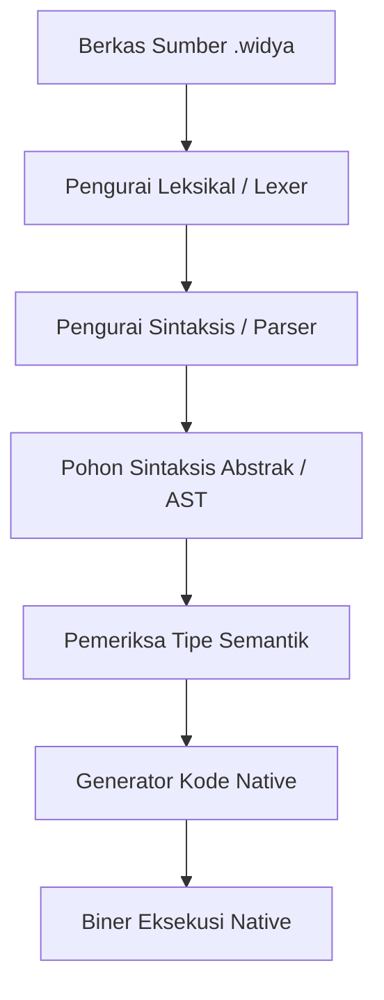

Pemrograman komputer pada dasarnya adalah proses formulasi instruksi presisi agar mesin komputasi mampu memproses data mentah menjadi informasi yang bernilai guna bagi peradaban. Unit pemroses pusat (*Central Processing Unit* atau CPU) pada hakikatnya hanyalah sebuah sirkuit elektronik raksasa yang terdiri atas miliaran transistor semikonduktor. Komputer tidak memahami perasaan, nuansa bahasa manusia, atau konteks sosial; ia hanya mengenal ada tidaknya arus listrik, yang disimbolkan secara biner sebagai angka `1` (tegangan tinggi) dan angka `0` (tegangan rendah).

Menulis jutaan bit `0` dan `1` secara langsung (*Machine Code*) sangat lambat, melelahkan otak manusia, dan memiliki probabilitas kesalahan yang teramat tinggi. Untuk menjembatani jurang komunikasi antara akal budi manusia dengan sirkuit silikon komputer, lahirlah **Bahasa Pemrograman Tingkat Tinggi** (*High-Level Programming Language*). Melalui bahasa tingkat tinggi, manusia dapat mengekspresikan logika matematika, perulangan, dan pengambilan keputusan dalam format teks terstruktur yang mudah dipahami nalar, yang kemudian diterjemahkan oleh **Kompilator** (*Compiler*) menjadi biner mesin fisik.

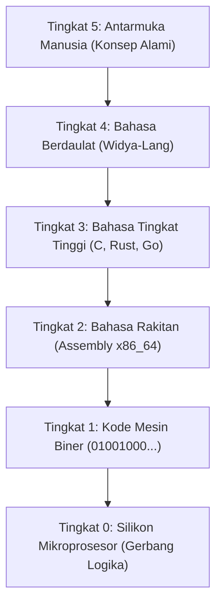

### 1.2 Urgensi Kedaulatan Digital dan Bahasa Berdaulat Nusantara
Selama lebih dari enam dekade sejak era awal komputasi modern, mayoritas bahasa pemrograman komersial dunia diciptakan dengan basis kosakata bahasa Inggris (*Anglo-American Centric*). Ketergantungan ini memunculkan dua tantangan krusial:
1. **Rintangan Kognitif Pemula (*Cognitive Friction*)**: Generasi muda dan pelajar di pelosok nusantara yang baru pertama kali mempelajari logika komputasi harus menanggung beban kognitif ganda (*double cognitive load*): mereka harus memahami konsep abstraksi logika komputasi yang rumit, sekaligus menerjemahkan istilah asing yang asing bagi keseharian mereka.
2. **Kemandirian Rantai Pasok Teknologi**: Di era globalisasi yang sarat ketegangan geopolitik, ketergantungan 100% pada ekosistem perangkat lunak pihak luar menempatkan infrastruktur nasional—mulai dari perbankan, telekomunikasi, ketahanan pangan, hingga sistem pertahanan—dalam risiko kerentanan backdoor, lisensi sepihak, dan embargo teknologi mendadak.

**Widya-Lang** hadir sebagai wujud kemandirian dan kebangkitan teknologi nasional. Dirancang dengan mesin kompilator native modern berbasis Rust murni tanpa celah memori, Widya-Lang menggabungkan kosakata bahasa Indonesia baku yang anggun dengan ketangguhan performa kelas dunia yang siap bersaing di kancah industri global.

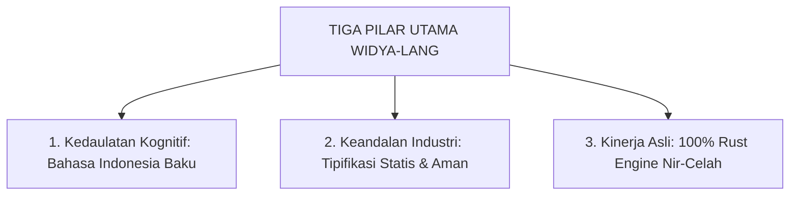

### 1.3 Perbandingan Paradigma Bahasa
Untuk memetakan keunggulan komparatif Widya-Lang terhadap bahasa-bahasa mapan lainnya di dunia industri, perhatikan matriks evaluasi berikut:

| Dimensi Rekayasa | Widya-Lang | C / C++ | Rust | Python 3 | Go (Golang) |
| :--- | :--- | :--- | :--- | :--- | :--- |
| **Kosakata Inti** | Bahasa Indonesia | Bahasa Inggris | Bahasa Inggris | Bahasa Inggris | Bahasa Inggris |
| **Model Eksekusi** | Kompilasi Cepat & JIT | AOT Native | AOT Native | Interpretasi VM | AOT Native |
| **Pengelolaan Memori**| Kepemilikan Nir-GC | Manual Pointer | Peminjaman / Linear| Garbage Collector | Garbage Collector |
| **Keamanan Tipe** | Kuat & Statis | Lemah / Fleksibel | Sangat Kuat | Dinamis / Runtime | Kuat & Statis |
| **Jeda GC (Stop-World)**| Nol (Nir-Jeda) | Nol | Nol | Ada (Fluktuatif) | Ada (Minimal) |

### 1.4 Arsitektur Kompilator Widya-Lang
Kompilator Widya-Lang mengadopsi arsitektur multi-lintasan (*multi-pass compiler*) modern yang membagi proses transformasi kode sumber menjadi lima tahapan terpisah:

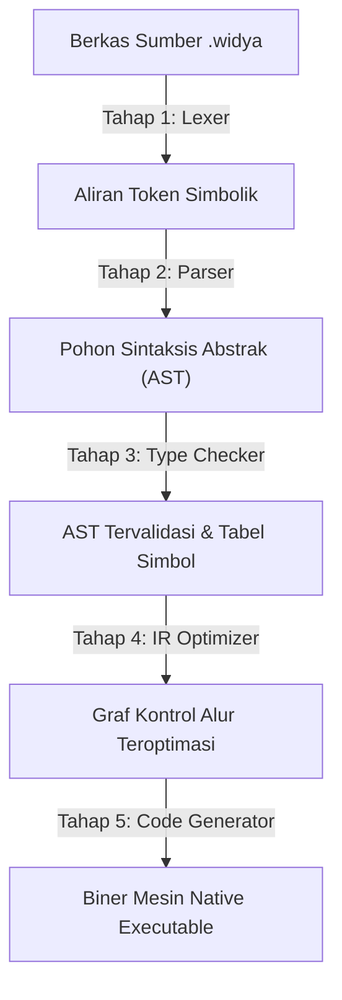

1. **Pengurai Leksikal (*Lexer*)**: Membaca naskah mentah karakter demi karakter, membuang spasi kosong dan komentar, lalu mengelompokkannya menjadi aliran token simbolik.
2. **Pengurai Sintaksis (*Parser*)**: Memvalidasi apakah urutan token mematuhi tata bahasa formal Widya-Lang, kemudian menyusunnya menjadi Pohon Sintaksis Abstrak (*Abstract Syntax Tree* / AST).
3. **Penganalisis Semantik (*Type Checker*)**: Memeriksa keselarasan logika, memastikan variabel yang diakses sudah dideklarasikan, dan memvalidasi keabsahan tipe data.
4. **Pengoptimal Representasi Perantara (*IR Optimizer*)**: Melakukan optimasi logika seperti penghapusan kode mati (*dead code elimination*) dan pelipatan konstanta (*constant folding*).
5. **Pembangkit Kode Mesin**: Menghasilkan instruksi biner native yang siap dieksekusi prosesor dengan kecepatan puncak.

### 1.5 Contoh Kode Praktik 1: Program Salam Kebangsaan
Berikut adalah contoh naskah lengkap program pertama yang mendemonstrasikan struktur fungsi utama:

```widya
// Berkas: bab01_salam_kebangsaan.widya
// Program perdana menyambut era kedaulatan komputasi nusantara

fungsi utama() {
    cetak("==================================================");
    cetak("      SELAMAT DATANG DI DUNIA WIDYA-LANG          ");
    cetak("  Bahasa Pemrograman Berdaulat untuk Masa Depan   ");
    cetak("==================================================");
    cetak("Mari melangkah bersama membangun kemandirian digital.");
}
```

**Penjelasan Baris demi Baris:**
- Baris 1-2: Komentar naskah penjelas yang diabaikan mesin kompilator.
- Baris 4: `fungsi utama() {` mendeklarasikan fungsi permulaan wajib yang akan pertama kali dieksekusi oleh sistem operasi.
- Baris 5-9: Fungsi `cetak(...)` memancarkan string teks ke aliran keluaran standar terminal (STDOUT).
- Baris 10: Tanda kurung kurawal penutup `}` menandakan batas akhir eksekusi fungsi.

### 1.6 Contoh Kode Praktik 2: Memeriksa Status Mesin Runtime
Contoh kedua mendemonstrasikan pencetakan informasi spesifikasi lingkungan kerja sistem:

```widya
// Berkas: bab01_info_mesin.widya

fungsi utama() {
    tetap nama_sistem = "Widya Runtime Engine";
    tetap versi = "0.1.0 Stable";
    tetap arsitektur = "x86_64 / ARM64 Universal";
    
    cetak("Informasi Perangkat Lunak:");
    cetak("- Mesin Inti   : " + nama_sistem);
    cetak("- Versi Rilis  : " + versi);
    cetak("- Arsitektur   : " + arsitektur);
    cetak("Status Operasi : Siap Mengeksekusi Kode!");
}
```

### 1.7 Kesalahan Pemula dan Solusi (*Troubleshooting*)
- **Galat**: `Galat Sintaksis: Simbol titik koma ';' diharapkan di akhir pernyataan pada baris 6`.
  - *Penyebab*: Pemrogram lupa mengakhiri baris instruksi dengan tanda titik koma `;`.
  - *Solusi*: Selalu akhiri setiap baris pernyataan dengan titik koma.
- **Galat**: `Galat Tautan: Fungsi 'utama' tidak ditemukan dalam berkas`.
  - *Penyebab*: Fungsi pembuka dinamai secara keliru (misalnya `fungsi main()` atau `fungsi Utama()`).
  - *Solusi*: Gunakan huruf kecil baku `fungsi utama()`.

### 1.8 Rangkuman Konsep Kunci Bab 1
| Konsep | Penjelasan Esensial |
| :--- | :--- |
| **Kompilator** | Perangkat lunak penerjemah naskah teks manusia ke kode mesin biner. |
| **Pintu Masuk (`utama`)** | Titik awal eksekusi program di mana sistem operasi menyerahkan kendali. |
| **Kedaulatan Digital** | Kemampuan bangsa merancang, menguasai, dan mengamankan rantai teknologi sendiri. |
| **Fungsi `cetak`** | Utilitas bawaan untuk memancarkan informasi teks ke konsol pengguna. |

### 1.9 Latihan Mandiri & Evaluasi Pemahaman
1. Sebutkan lima tahapan dalam siklus penerjemahan kode pada kompilator Widya-Lang!
2. Mengapa menulis program langsung dalam kode mesin biner (`0` dan `1`) tidak lagi relevan bagi pengembangan aplikasi modern?
3. **Tantangan Praktik**: Buatlah berkas `biodata_mandiri.widya` yang menampilkan nama Anda, asal kota, cita-cita, dan motto hidup dalam bingkai karakter bintang `*` yang rapi di layar terminal!

---

### 1.9 Latihan Soal Pilihan Ganda (10 Soal)

Pilihlah satu jawaban yang paling tepat (A, B, C, atau D) untuk menguji penguasaan materi bab ini:

**1. Apa motivasi fundamental di balik pengembangan bahasa pemrograman Widya-Lang?**
- A. Mengganti seluruh sistem operasi Linux
- B. Mewujudkan kedaulatan teknologi dan menurunkan beban kognitif pemula dengan bahasa ibu
- C. Menghapus penggunaan bahasa Inggris di seluruh dunia
- D. Membuat kompilator yang hanya bisa berjalan di Windows

**2. Komputer pada tingkat semikonduktor paling dasar hanya memproses sinyal...**
- A. Gelombang suara analog
- B. Teks bahasa Latin
- C. Arus listrik biner (0 dan 1)
- D. Piksel warna layar

**3. Perangkat lunak yang menerjemahkan naskah kode sumber ke kode mesin biner disebut...**
- A. Kompilator (Compiler)
- B. Browser
- C. Antivirus
- D. Editor Teks

**4. Tahap pertama dalam pipa kerja kompilator yang mengubah karakter mentah menjadi token adalah...**
- A. Pemeriksa Tipe
- B. Pengurai Leksikal (Lexer)
- C. Pembangkit Kode Biner
- D. Penaut (Linker)

**5. Pohon hierarki sintaksis yang dihasilkan setelah tahap parsing disebut...**
- A. DOM (Document Object Model)
- B. BST (Binary Search Tree)
- C. AST (Abstract Syntax Tree)
- D. B-Tree Database

**6. Fungsi pintu masuk utama yang wajib ada dalam program Widya-Lang bernama...**
- A. start()
- B. utama()
- C. main()
- D. mulai()

**7. Fungsi bawaan untuk mencetak teks ke layar terminal adalah...**
- A. tulis()
- B. print()
- C. cetak()
- D. tampilkan()

**8. Bahasa pemrograman apa yang menjadi basis pengembangan mesin kompilator native Widya-Lang?**
- A. JavaScript
- B. Rust murni
- C. Python 2
- D. Visual Basic

**9. Manakah pernyataan yang BENAR mengenai arsitektur Widya-Lang?**
- A. Memerlukan virtual machine Java untuk berjalan
- B. Bebas dari jeda Garbage Collector (Nir-GC)
- C. Tidak mendukung karakter huruf lokal
- D. Hanya bisa berjalan pada arsitektur 32-bit

**10. Apa ekstensi berkas resmi untuk kode sumber bahasa Widya?**
- A. .wdy
- B. .id
- C. .widya
- D. .wid

---

## Bab 2: Instalasi Komprehensif, Konfigurasi Lingkungan, dan Ekosistem Perkakas

### 2.1 Persyaratan Sistem Komputer

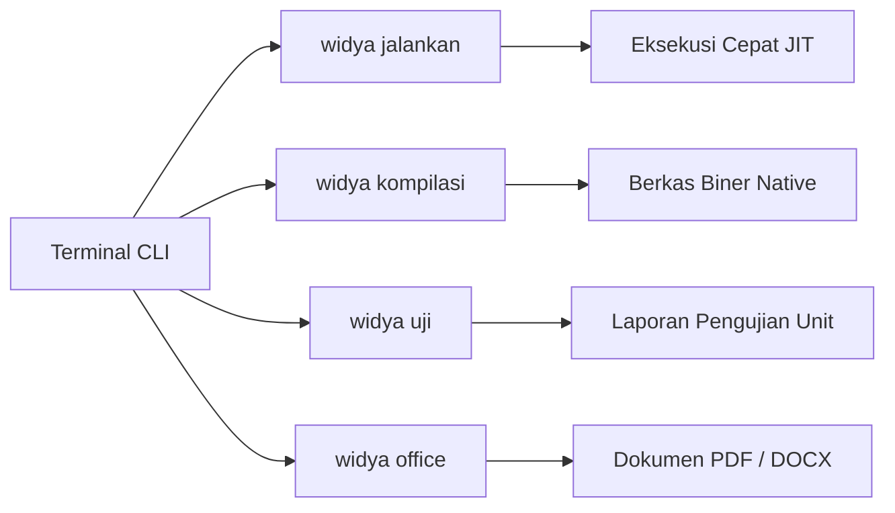

Sebelum memulai instalasi Widya-Lang, pastikan workstation kerja Anda memenuhi spesifikasi perangkat keras dan lunak minimum:
- **Arsitektur Pemroses**: 64-bit x86_64 (Intel Core i3/i5/i7/i9 atau AMD Ryzen) maupun 64-bit ARM64 (Apple Silicon M-Series atau Raspberry Pi 4/5).
- **Kapasitas RAM**: Minimal 2 GB RAM fisik (disarankan 4 GB atau lebih untuk kenyamanan kompilasi proyek besar).
- **Penyimpanan Disk**: Minimal 350 MB ruang kosong untuk biner kompilator, pustaka standar, serta perkakas format.
- **Sistem Operasi**: GNU/Linux (Kernel 5.4+), Apple macOS (Monterey 12.0+), atau Microsoft Windows 10/11 64-bit.

### 2.2 Prosedur Instalasi pada Berbagai Sistem Operasi

#### A. Lingkungan GNU/Linux (Debian, Ubuntu, Linux Mint)
Buka emulator terminal Anda dan jalankan perintah bash berikut:
```bash
# 1. Pemasangan dependensi dasar pembangun
sudo apt-get update && sudo apt-get install -y curl build-essential git

# 2. Pengunduhan otomatis skrip penginstal resmi
curl -fsSL https://get.widya-lang.id/install.sh | bash

# 3. Penerapan konfigurasi shell terminal
source ~/.bashrc
```

#### B. Lingkungan Apple macOS
Bagi pengguna macOS, perkakas Widya didistribusikan melalui manajer paket Homebrew:
```bash
# 1. Mendaftarkan repositori resmi
brew tap widya-lang/distro

# 2. Memasang biner kompilator
brew install widya

# 3. Memverifikasi pemasangan
widya --versi
```

#### C. Lingkungan Microsoft Windows
Pada sistem Windows 10 atau 11, buka PowerShell dengan hak akses Administrator (*Run as Administrator*):
```powershell
# Menjalankan skrip penginstal Windows
Set-ExecutionPolicy RemoteSigned -Scope CurrentUser
irm https://get.widya-lang.id/install.ps1 | iex
```

### 2.3 Membedah Perintah Baris CLI `widya`
Paket biner `widya` merupakan perkakas serbaguna (*all-in-one developer tool*) yang mencakup berbagai subperintah:

| Subperintah CLI | Contoh Pemanggilan | Deskripsi Kegunaan |
| :--- | :--- | :--- |
| `jalankan` | `widya jalankan program.widya` | Menjalankan kode seketika dengan mode JIT tanpa membuat berkas biner. |
| `kompilasi` | `widya kompilasi program.widya -o aplikasi` | Mengompilasi naskah menjadi biner mandiri yang siap dipublikasikan. |
| `uji` | `widya uji tests/` | Menjalankan seluruh pengujian unit otomatis dalam direktori. |
| `format` | `widya format berkas.widya` | Merapikan spasi dan indentasi naskah secara otomatis sesuai standar. |
| `office convert`| `widya office convert naskah.md -o naskah.pdf --toc` | Mengonversi naskah Markdown menjadi PDF/DOCX perkantoran asli. |
| `periksa` | `widya periksa-lingkungan` | Melakukan audit kelengkapan dependensi sistem dan pustaka. |

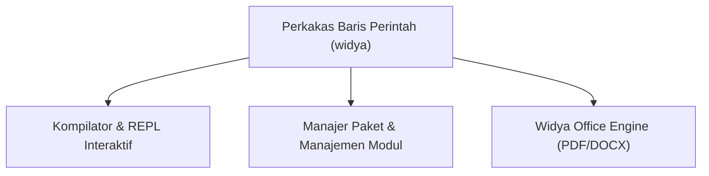

### 2.4 Konfigurasi Editor Visual Studio Code
Untuk menghadirkan pengalaman pengembangan yang produktif, sangat disarankan menggunakan editor VS Code dengan ekstensi resmi `Widya Language Official Extension`:
1. Buka menu Extensions di VS Code (`Ctrl + Shift + X` atau `Cmd + Shift + X`).
2. Cari kata kunci: `widya-lang`.
3. Klik tombol **Install**.
4. Fitur yang langsung aktif:
   - Pewarnaan sintaksis berdaulat (*Syntax Highlighting*).
   - Pelengkapan otomatis (*Autocompletion & IntelliSense*).
   - Format otomatis saat berkas disimpan (*Format on Save*).

### 2.5 Contoh Kode Praktik 1: Skrip Uji Kelayakan Lingkungan
Buatlah berkas bernama `uji_instalasi.widya` untuk mengonfirmasi bahwa pustaka standar dapat dimuat dengan baik:

```widya
// Berkas: bab02_uji_instalasi.widya
// Mengonfirmasi bahwa kompilator bekerja secara normal

fungsi utama() {
    cetak("Pemeriksaan Lingkungan Pengembangan:");
    tetap status_kompiler = "AKTIF";
    tetap bahasa_baku = "Bahasa Indonesia";
    tetap waktu_cek = "2026-10-19";
    
    cetak("[OK] Status Kompilator : " + status_kompiler);
    cetak("[OK] Standar Bahasa    : " + bahasa_baku);
    cetak("[OK] Tanggal Verifikasi : " + waktu_cek);
    cetak("Selamat! Lingkungan Widya-Lang Anda telah siap digunakan 100%.");
}
```

Jalankan program di atas melalui terminal:
```bash
widya jalankan uji_instalasi.widya
```

### 2.6 Contoh Kode Praktik 2: Menampilkan Parameter Eksekusi
Program berikut mendemonstrasikan bagaimana aplikasi menerima opsi konfigurasi:

```widya
// Berkas: bab02_cek_opsi.widya

fungsi utama() {
    cetak("Program Utilitas Siap Menerima Instruksi Pengguna.");
    cetak("Gunakan perintah 'widya bantuan' untuk melihat daftar opsi.");
}
```

### 2.7 Prosedur Pencopotan Pemasangan (Uninstall) Widya-Lang
Apabila Anda perlu mencopot pemasangan (*uninstall*) kompilator Widya-Lang dari sistem—baik untuk pembaruan versi bersih (*clean reinstall*), migrasi mesin, atau pemeliharaan lingkungan kerja—seluruh berkas biner dan pustaka dapat dibersihkan secara tuntas tanpa meninggalkan *residue* pada sistem operasi.

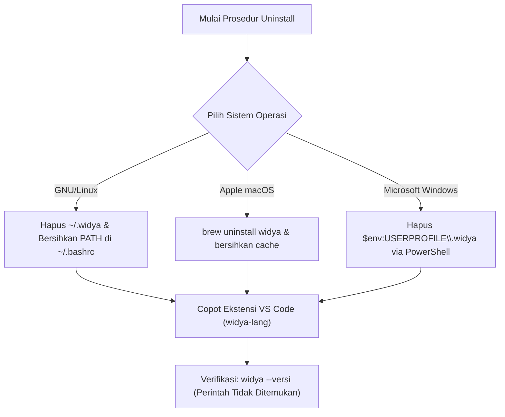

#### A. Pencopotan pada GNU/Linux (Ubuntu, Debian, Fedora, Arch)
1. **Menghapus Direktori Biner dan Pustaka**:
   Buka terminal dan hapus direktori instalasi utama beserta *cache* kompilasi:
   ```bash
   rm -rf ~/.widya
   rm -rf ~/.cache/widya
   ```
2. **Membersihkan Variabel Lingkungan Shell**:
   Buka berkas profil shell Anda (misalnya `~/.bashrc` atau `~/.zshrc`) menggunakan penyunting teks:
   ```bash
   nano ~/.bashrc
   ```
   Hapus atau beri tanda pagar (`#`) pada baris penambahan variabel lingkungan:
   ```bash
   export PATH="$HOME/.widya/bin:$PATH"
   ```
   Simpan berkas (`Ctrl + O`, `Enter`), keluar (`Ctrl + X`), lalu terapkan perubahan seketika:
   ```bash
   source ~/.bashrc
   ```
3. **Skrip Pencopotan Otomatis (Opsional)**:
   Jika Anda memasang melalui skrip instalasi web resmi, Anda dapat menjalankan perintah pencopotan satu baris:
   ```bash
   curl -fsSL https://get.widya-lang.id/uninstall.sh | bash
   ```

#### B. Pencopotan pada Apple macOS
Bagi pengguna macOS yang memasang melalui manajer paket Homebrew:
```bash
# 1. Copot pemasangan paket biner
brew uninstall widya

# 2. Lepaskan repositori resmi
brew untap widya-lang/distro

# 3. Bersihkan berkas konfigurasi lokal
rm -rf ~/.widya
rm -rf ~/Library/Caches/widya-lang
```

#### C. Pencopotan pada Microsoft Windows
Buka PowerShell dengan hak akses Administrator (*Run as Administrator*), kemudian jalankan perintah pembersihan berikut:
```powershell
# 1. Menghapus folder instalasi dan konfigurasi lokal
Remove-Item -Recurse -Force "$env:USERPROFILE\.widya" -ErrorAction SilentlyContinue
Remove-Item -Recurse -Force "$env:LOCALAPPDATA\widya-lang" -ErrorAction SilentlyContinue

# 2. Menghapus jalur biner dari variabel lingkungan PATH Pengguna
$UserPath = [Environment]::GetEnvironmentVariable("Path", "User")
$NewPath = ($UserPath -split ';' | Where-Object { $_ -notlike "*\.widya\bin*" }) -join ';'
[Environment]::SetEnvironmentVariable("Path", $NewPath, "User")

Write-Host "Pencopotan Widya-Lang dari sistem Windows berhasil diselesaikan 100%." -ForegroundColor Green
```
Atau manfaatkan skrip otomatis PowerShell:
```powershell
irm https://get.widya-lang.id/uninstall.ps1 | iex
```

#### D. Pencopotan Ekstensi Visual Studio Code
Jika Anda memasang ekstensi resmi Widya-Lang di VS Code:
1. Buka antarmuka VS Code, tekan `Ctrl + Shift + X` (atau `Cmd + Shift + X` di macOS).
2. Cari `widya-lang` pada kolom pencarian ekstensi.
3. Klik tombol gerigi pada **Widya Language Official Extension**, lalu pilih opsi **Uninstall**.
4. Atau jalankan langsung melalui antarmuka baris perintah terminal:
   ```bash
   code --uninstall-extension widya-lang.widya-official
   ```

#### E. Verifikasi Akhir Pencopotan Pemasangan
Untuk memverifikasi bahwa kompilator telah benar-benar terhapus dari sistem, buka jendela terminal baru dan ketikkan:
```bash
widya --versi
```
Sistem operasi akan merespons dengan pesan galat standar:
- **Linux / macOS**: `bash: widya: command not found`
- **Windows**: `'widya' is not recognized as an internal or external command`

Respons ini mengonfirmasi bahwa mesin kompilator dan seluruh variabel lingkungan telah bersih secara total (*zero residual footprint*).

### 2.8 Kesalahan Pemula dan Solusi (*Troubleshooting*)
- **Masalah**: `bash: widya: command not found`.
  - *Penyebab*: Jalur biner `~/.widya/bin` belum terdaftar dalam variabel lingkungan `$PATH`.
  - *Solusi*: Tambahkan baris `export PATH="$HOME/.widya/bin:$PATH"` ke dalam file `~/.bashrc` atau `~/.zshrc`, lalu jalankan `source ~/.bashrc`.
- **Masalah**: Ekstensi file bukan `.widya` (misal `program.txt`).
  - *Penyebab*: Kompilator mengharuskan ekstensi baku `.widya`.
  - *Solusi*: Selalu gunakan ekstensi resmi `.widya` untuk seluruh kode sumber.

### 2.9 Rangkuman Konsep Kunci Bab 2
- Perkakas `widya` CLI menyediakan fasilitas lengkap: eksekusi langsung, kompilasi biner, pengujian otomatis, dan konversi dokumen office.
- Konfigurasi variabel `$PATH` sangat krusial agar perintah dapat dipanggil dari folder mana pun.
- Editor teks VS Code dilengkapi ekstensi resmi untuk pewarnaan sintaksis dan pemformatan otomatis.
- Prosedur pencopotan pemasangan (*uninstall*) dapat dilakukan secara bersih (*clean uninstall*) dengan menghapus direktori biner serta memulihkan konfigurasi `$PATH` shell.

### 2.10 Latihan Mandiri & Evaluasi Pemahaman
1. Jelaskan perbedaan mendasar antara perintah `widya jalankan` dan `widya kompilasi`!
2. Mengapa sebuah berkas eksekusi biner hasil kompilasi native dapat berjalan lebih cepat daripada eksekusi berbasis skrip penerjemah?
3. **Tantangan Praktik**: Lakukan kompilasi berkas `uji_instalasi.widya` menjadi berkas biner mandiri bernama `cek_sistem` dengan perintah `widya kompilasi uji_instalasi.widya -o cek_sistem`, lalu jalankan biner tersebut secara langsung dengan `./cek_sistem` di terminal!

---

### 2.11 Latihan Soal Pilihan Ganda (10 Soal)

Pilihlah satu jawaban yang paling tepat (A, B, C, atau D) untuk menguji penguasaan materi bab ini:

**1. Perintah CLI untuk menjalankan berkas Widya secara instan tanpa membuat biner adalah...**
- A. widya kompilasi
- B. widya format
- C. widya jalankan
- D. widya periksa

**2. Perintah CLI untuk menghasilkan berkas biner mandiri yang dapat didistribusikan adalah...**
- A. widya kompilasi
- B. widya cetak
- C. widya biner
- D. widya paket

**3. Variabel lingkungan yang wajib memuat jalur biner Widya agar dapat dipanggil dari folder mana pun adalah...**
- A. $HOME
- B. $USER
- C. $PATH
- D. $TEMP

**4. Perintah untuk menjalankan seluruh rangkaian pengujian otomatis dalam proyek adalah...**
- A. widya test-all
- B. widya uji
- C. widya periksa
- D. widya verifikasi

**5. Perintah untuk merapikan indentasi kode sesuai standar konvensi nusantara adalah...**
- A. widya rapikan
- B. widya format
- C. widya bersih
- D. widya tata

**6. Berapa kapasitas RAM fisik minimum yang disarankan untuk pengembangan Widya-Lang?**
- A. 512 MB
- B. 1 GB
- C. 2 GB hingga 4 GB
- D. 16 GB

**7. Arsitektur prosesor 64-bit yang didukung penuh oleh Widya-Lang adalah...**
- A. x86_64 dan ARM64
- B. Hanya MIPS
- C. Hanya SPARC
- D. Hanya 16-bit 8086

**8. Ekstensi editor apa yang disarankan untuk memprogram Widya di VS Code?**
- A. Widya Language Official Extension
- B. Python Tools
- C. C/C++ Intellisense
- D. Rust Analyzer

**9. Apa fungsi subperintah `widya office convert`?**
- A. Mengubah berkas video
- B. Mengonversi naskah Markdown menjadi PDF / DOCX perkantoran
- C. Menghapus dokumen lama
- D. Mengirim surel otomatis

**10. Perintah untuk memverifikasi versi biner yang terpasang di terminal adalah...**
- A. widya --versi
- B. widya info-ver
- C. widya rilis
- D. widya cek-tahun

---

## Bab 3: Program Pertama dan Anatomi Eksekusi Kode

### 3.1 Tradisi "Halo Dunia" dan Makna Filosofisnya

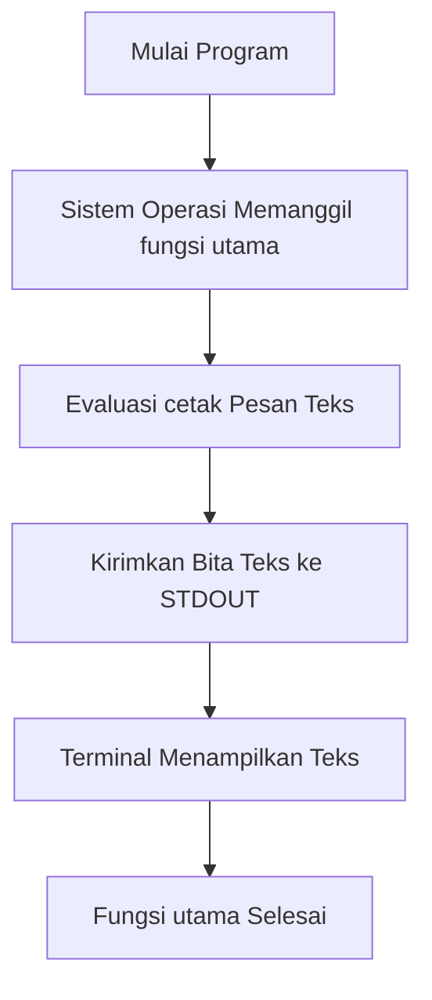

Dalam dunia rekayasa perangkat lunak, menulis program pertama yang menampilkan teks "Halo Dunia" (*Hello World*) ke layar terminal merupakan ritual wajib bagi setiap pemrogram. Ritual ini pertama kali dipopulerkan oleh Brian Kernighan pada tahun 1972 dalam dokumentasi bahasa B, lalu dibakukan dalam buku legendaris *The C Programming Language* (1978). 

Tujuan utama program "Halo Dunia" bukan untuk menyelesaikan persoalan kalkulasi yang rumit, melainkan untuk **memverifikasi integritas seluruh rantai kerja (*toolchain integrity*)**:
1. Memastikan editor teks mampu menyimpan berkas dalam format UTF-8 bersih.
2. Memastikan kompilator mampu mem-parsing sintaksis tanpa kesalahan leksikal.
3. Memastikan subsistem penaut (*linker*) mampu menghubungkan fungsi ke aliran keluaran standar (*Standard Output* / STDOUT) sistem operasi.


### 3.2 Anatomi Kode Sumber Baris demi Baris
Mari kita perhatikan program dasar berikut:

```widya
fungsi utama() {
    cetak("Halo Dunia! Salam sejahtera dari Widya-Lang.");
}
```

Setiap elemen pada kode di atas memiliki peran gramatikal yang kaku:
- `fungsi`: Kata kunci pembuka deklarasi subprogram.
- `utama`: Nama pengenal khusus yang ditetapkan sebagai gerbang awal eksekusi program.
- `()`: Tanda kurung tempat menampung parameter masukan (kosong berarti tidak menerima parameter).
- `{`: Tanda kurung kurawal buka yang mendefinisikan awal lingkup (*scope*) badan fungsi.
- `cetak(...)`: Pemanggilan fungsi pencetak bawaan dengan melewatkan argumen string teks.
- `;`: Tanda titik koma (*semicolon*) yang menandakan akhir satu pernyataan komputasi (*statement terminator*).
- `}`: Tanda kurung kurawal tutup yang menandakan berakhirnya fungsi.

### 3.3 Karakter Khusus (*Escape Sequences*)
Saat memformat keluaran teks agar rapi, kita memerlukan karakter non-cetak seperti ganti baris atau tabulasi horizontal. Karakter escape diawali dengan simbol garis miring terbalik (*backslash* `\`):

| Simbol Escape | Nama Karakter | Fungsi Pemformatan |
| :---: | :--- | :--- |
| `\n` | *Line Feed / Newline* | Memindahkan kursor keluaran ke baris baru di bawahnya. |
| `\t` | *Horizontal Tab* | Memberikan jarak tabulasi sejauh 4 atau 8 kolom karakter. |
| `\"` | *Escaped Double Quote* | Menampilkan tanda petik ganda tanpa menutup string. |
| `\\` | *Escaped Backslash* | Menampilkan karakter garis miring terbalik tunggal secara aman. |
| `\r` | *Carriage Return* | Mengembalikan kursor ke posisi kolom paling kiri baris aktif. |

### 3.4 Contoh Kode Praktik 1: Pencetakan Struk Mini Kasir Terminal
Program ini mendemonstrasikan pemanfaatan karakter escape `\t` dan `\n` untuk membentuk tata letak tabel yang rapi di layar terminal:

```widya
// Berkas: bab03_struk_terminal.widya

fungsi utama() {
    cetak("================================================");
    cetak("           TOKO BUKU LITERASI NUSANTARA         ");
    cetak("        Jl. Malioboro No. 12, Yogyakarta       ");
    cetak("================================================");
    cetak("No.	Item Belanja		Qty	Subtotal");
    cetak("------------------------------------------------");
    cetak("1.	Buku Widya Dasar	1	Rp 85.000");
    cetak("2.	Buku Algoritma		2	Rp 120.000");
    cetak("3.	Buku Struktur Data	1	Rp 95.000");
    cetak("------------------------------------------------");
    cetak("Total Tagihan Transaksi:		Rp 300.000");
    cetak("Tunai Dibayarkan Pembeli:		Rp 350.000");
    cetak("Uang Kembalian Pelanggan:		Rp  50.000");
    cetak("================================================");
    cetak("   Terima kasih atas dedikasi belajar Anda!     ");
}
```

### 3.5 Contoh Kode Praktik 2: Banner Seni Huruf ASCII
Kode berikut menampilkan seni teks tipografi kebanggaan nasional:

```widya
// Berkas: bab03_seni_ascii.widya

fungsi utama() {
    cetak(" _    _ _     _             _                            ");
    cetak("| |  | (_)   | |           | |                           ");
    cetak("| |  | |_  __| |_   _  __ _| |     __ _ _ __   __ _      ");
    cetak("| |/\| | |/ _` | | | |/ _` | |    / _` | '_ \ / _` |     ");
    cetak("\  /\  / | (_| | |_| | (_| | |___| (_| | | | | (_| |     ");
    cetak(" \/  \/|_|\__,_|\__, |\__,_|______\__,_|_| |_|\__, |     ");
    cetak("                 __/ |                         __/ |     ");
    cetak("                |___/                         |___/      ");
    cetak(">> Bahasa Pemrograman Berdaulat Republik Indonesia <<");
}
```

### 3.6 Kesalahan Pemula dan Panduan Perbaikan
1. **Lupa Tanda Titik Koma**:
   ```widya
   cetak("Baris Satu") // Kurang titik koma!
   cetak("Baris Dua");
   ```
   *Diagnostik*: Kompilator akan menunjuk baris tersebut dengan pesan `Galat: Diharapkan ';' setelah ekspresi`.
2. **String Tidak Tertutup Petik**:
   ```widya
   cetak("Teks lupa ditutup petik);
   ```
   *Diagnostik*: Kompilator menampilkan `Galat Leksikal: String literal tidak ditutup sebelum akhir baris`.

### 3.7 Rangkuman Konsep Kunci Bab 3
- Fungsi `utama` adalah entry-point eksekusi program.
- `cetak(...)` mengalirkan data ke STDOUT terminal.
- Karakter escape `\n` memicu garis baru, `\t` memberikan tabulasi sejajar.
- Setiap pernyataan diakhiri dengan titik koma `;`.

### 3.8 Latihan Mandiri & Evaluasi Pemahaman
1. Apakah program Widya-Lang dapat dieksekusi jika fungsi pembuka tidak dinamai `utama`? Jelaskan alasannya!
2. Tuliskan kode untuk mencetak kalimat berikut persis seperti tertulis (termasuk tanda petik ganda):
   `Bung Karno berpesan: "Gantungkan cita-citamu setinggi langit!"`
3. **Tantangan Praktik**: Rancanglah program `papan_catur_mini.widya` yang mencetak pola kotak-kotak papan catur ukuran 4x4 menggunakan karakter pagar `#` dan spasi kosong ` `!

---

### 3.9 Latihan Soal Pilihan Ganda (10 Soal)

Pilihlah satu jawaban yang paling tepat (A, B, C, atau D) untuk menguji penguasaan materi bab ini:

**1. Tanda baca apa yang digunakan untuk mengakhiri sebuah pernyataan instruksi di Widya?**
- A. Titik (.)
- B. Koma (,)
- C. Titik koma (;)
- D. Titik dua (:)

**2. Karakter escape `\n` berfungsi untuk...**
- A. Menyisipkan tabulasi horizontal
- B. Pindah baris (newline)
- C. Menghapus huruf sebelumnya
- D. Menampilkan tanda petik

**3. Karakter escape `\t` menghasilkan efek visual...**
- A. Garis baru
- B. Spasi tabulasi horizontal
- C. Karakter bunyi bel
- D. Warna merah teks

**4. Untuk mencetak simbol tanda petik ganda di dalam string, urutan escape yang tepat adalah...**
- A. /"
- B. \"
- C. ''
- D. &quote;

**5. Aliran keluaran standar terminal dalam sistem operasi dikenal dengan singkatan...**
- A. STDIN
- B. STDOUT
- C. STDERR
- D. DEVNULL

**6. Gaya peletakan kurung kurawal pembuka `{` yang dianjurkan dalam style guide Widya adalah...**
- A. Pada baris baru tersendiri
- B. Pada baris yang sama dengan deklarasi fungsi (1TBS)
- C. Di akhir file
- D. Tidak memerlukan kurung

**7. Berapa spasi indentasi standar untuk setiap tingkat blok kurung kurawal?**
- A. 1 spasi
- B. 2 spasi
- C. 4 spasi
- D. 8 spasi

**8. Apa yang terjadi jika Anda memanggil `cetak("Halo");` di luar badan fungsi apa pun?**
- A. Program berjalan normal
- B. Ditolak kompilator karena instruksi harus berada dalam blok fungsi
- C. Terminal mencetak dua kali
- D. Komputer restart

**9. Untuk mencetak karakter garis miring terbalik (backslash) literal, kita menuliskan...**
- A. //
- B. \\
- C. /*
- D. /\

**10. Apa akibatnya jika tanda petik penutup string terlupakan pada baris instruksi?**
- A. Kompilator otomatis menutupnya
- B. Muncul galat leksikal string literal tidak tertutup
- C. Program mencetak spasi kosong
- D. Program mengulang dari awal

---

## Bab 4: Sistem Komentar dan Dokumentasi Kode

### 4.1 Filosofi Kode Bersih dan Dokumentasi Berkelanjutan

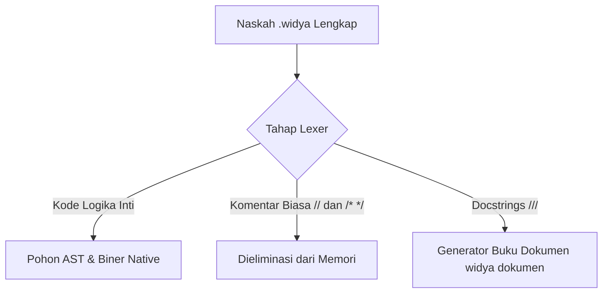

Salah satu pepatah paling terkenal dalam rekayasa perangkat lunak berbunyi: *"Kode program dibaca manusia sepuluh kali lebih sering daripada ditulis."* Program yang Anda rancang hari ini mungkin akan dibaca oleh rekan satu tim dua tahun lagi, atau bahkan oleh diri Anda sendiri yang telah lupa detail logika di baliknya.

Komentar adalah teks penjelas yang disisipkan ke dalam kode sumber untuk mempermudah pemahaman manusia. Kompilator Widya-Lang secara otomatis membuang seluruh teks komentar pada tahap analisis leksikal, sehingga keberadaan komentar—sebanyak apa pun—**sama sekali tidak menambah ukuran berkas biner dan tidak memperlambat kecepatan eksekusi program**.

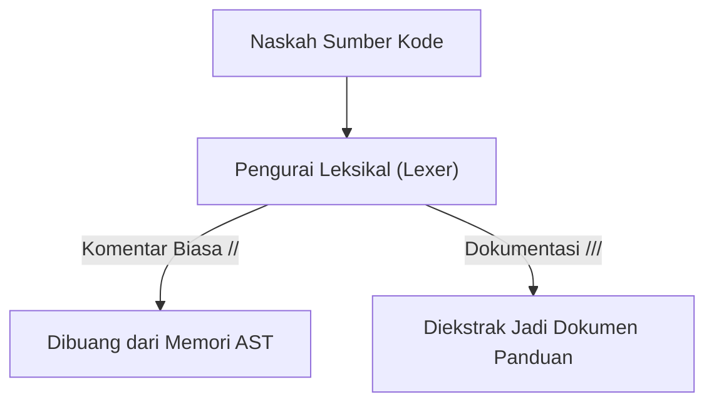

### 4.2 Tiga Jenis Komentar dalam Widya-Lang
Widya-Lang menyediakan tiga tingkatan sintaksis komentar:
1. **Komentar Sebaris (*Single-Line Comment*)**: Menggunakan tanda garis miring ganda `//`. Komentar ini berlaku dari tanda `//` hingga akhir baris tersebut.
2. **Komentar Multi-Baris (*Block Comment*)**: Diapit oleh pembuka `/*` dan penutup `*/`. Dapat membentang melintasi puluhan baris teks.
3. **Komentar Dokumentasi (*Docstrings*)**: Menggunakan tiga garis miring `///`. Format ini dibaca oleh perkakas `widya dokumen` untuk menghasilkan buku petunjuk teknis otomatis.

### 4.3 Contoh Kode Praktik 1: Penerapan Komentar Terstruktur
Perhatikan bagaimana komentar digunakan secara proporsional untuk menjelaskan aturan bisnis di balik formula matematika:

```widya
// Berkas: bab04_komentar_pajak.widya
// Modul Perhitungan Pajak Penghasilan Pegawai Negeri & Swasta

/*
  Catatan Kebijakan:
  Berdasarkan Undang-Undang Harmonisasi Peraturan Perpajakan (UU HPP),
  lapisan tarif PPh Pasal 21 diterapkan secara progresif:
  - Lapisan 1 (0 s.d. 60 Juta)       : Tarif 5%
  - Lapisan 2 (> 60 s.d. 250 Juta)   : Tarif 15%
*/

fungsi utama() {
    // Penghasilan Kena Pajak (PKP) tahunan wajib pajak
    tetap pkp_tahunan = 85000000; // Rp 85.000.000
    
    // Perhitungan Lapisan 1 (Maksimum 60 Juta pertama)
    tetap pajak_lapisan_1 = 60000000 * 0.05; // 5% x 60 Juta = Rp 3.000.000
    
    // Perhitungan Lapisan 2 (Sisa 25 Juta berikutnya)
    tetap sisa_pkp = pkp_tahunan - 60000000;
    tetap pajak_lapisan_2 = sisa_pkp * 0.15; // 15% x 25 Juta = Rp 3.750.000
    
    tetap total_pajak = pajak_lapisan_1 + pajak_lapisan_2;
    
    cetak("Pajak Terutang Tahunan: Rp " + teks(total_pajak));
}
```

### 4.4 Contoh Kode Praktik 2: Format Dokumentasi Resmi (*Docstrings*)
Contoh berikut menunjukkan penulisan dokumentasi profesional yang memenuhi standar ekstraksi API dokumen:

```widya
// Berkas: bab04_docstring_fisika.widya

/// Menghitung hambatan jenis konduktor listrik kawat tembaga.
///
/// # Formula Fisika
/// R = (rho * L) / A
///
/// # Parameter Masukan
/// * `rho`: Hambatan jenis bahan material (Ohm-meter).
/// * `panjang_kawat`: Panjang fisik kawat dalam satuan meter (m).
/// * `luas_penampang`: Luas irisan melintang kawat dalam meter persegi (m²).
///
/// # Nilai Kembalian
/// Nilai resistansi total kawat dalam satuan Ohm.
fungsi hitung_resistansi(rho, panjang_kawat, luas_penampang) {
    kembalikan (rho * panjang_kawat) / luas_penampang;
}

fungsi utama() {
    // Tembaga murni: rho ~ 1.68e-8 Ohm.m
    tetap rho_tembaga = 0.0000000168;
    tetap panjang = 50.0; // 50 meter
    tetap luas = 0.0000025; // 2.5 mm²
    
    tetap r = hitung_resistansi(rho_tembaga, panjang, luas);
    cetak("Resistansi Total Kawat: " + teks(r) + " Ohm");
}
```

### 4.5 Prinsip Kode Bersih (*Clean Code Best Practices*)
- **JANGAN Mengomentari Hal yang Sudah Jelas**:
  - *Buruk*: `variabel umur = 18; // mengisi umur dengan 18`
  - *Baik*: `variabel umur = 18; // Ambang batas kedewasaan hukum perdata`
- **JELASKAN ALASAN (*WHY*), BUKAN CARA KERJA (*HOW*)**:
  - Kode program sudah menjelaskan *bagaimana* sesuatu bekerja. Komentar harus menerangkan *mengapa* solusi tersebut dipilih di atas alternatif lain.
- **PERBARUI KOMENTAR SAAT KODE BERUBAH**:
  - Komentar yang usang dan tidak sesuai lagi dengan perilaku kode jauh lebih berbahaya daripada ketiadaan komentar, karena menyesatkan pemrogram lain.

### 4.6 Kesalahan Pemula dalam Menulis Komentar
- **Blok Komentar Tidak Ditutup**:
  ```widya
  /* Lupa memberikan penutup blok komentar
  fungsi utama() {
      cetak("Ini tidak akan pernah dieksekusi!");
  }
  ```
  Kompilator akan menganggap seluruh sisa naskah hingga akhir berkas sebagai komentar dan memicu peringatan tak terduga.

### 4.7 Rangkuman Konsep Kunci Bab 4
- Komentar `//` untuk satu baris, `/* ... */` untuk blok banyak baris.
- Komentar `///` untuk generator dokumentasi otomatis (*docstrings*).
- Komentar diabaikan 100% oleh kompilator dan tidak membebani memori maupun kecepatan aplikasi.

### 4.8 Latihan Mandiri & Evaluasi Pemahaman
1. Mengapa keberadaan ribuan baris komentar dalam berkas kode sumber tidak memperlambat kinerja eksekusi biner program Widya-Lang?
2. Kapan sebaiknya kita menggunakan komentar satu baris dibandingkan komentar multi-baris?
3. **Tantangan Praktik**: Ambil naskah program penghitung zakat atau kasir belanja, lalu tambahkan anotasi *docstring* tiga garis miring `///` lengkap dengan penjelasan parameter dan rumus hitungnya!

---

### 4.9 Latihan Soal Pilihan Ganda (10 Soal)

Pilihlah satu jawaban yang paling tepat (A, B, C, atau D) untuk menguji penguasaan materi bab ini:

**1. Sintaksis untuk membuat komentar satu baris di Widya-Lang adalah...**
- A. # Komentar
- B. // Komentar
- C. -- Komentar
- D. <!-- Komentar -->

**2. Sintaksis untuk membuat komentar multi-baris (blok) adalah...**
- A. /* ... */
- B. ''' ... '''
- C. ### ... ###
- D. {* ... *}

**3. Format komentar khusus yang diekstraksi menjadi dokumentasi API otomatis adalah...**
- A. //!
- B. ///
- C. /**
- D. ##?

**4. Kapan teks komentar dibuang selama proses kompilasi kode?**
- A. Saat runtime berlangsung
- B. Saat tahap penguraian leksikal (lexer)
- C. Saat berkas biner diunduh
- D. Tidak pernah dibuang

**5. Apakah keberadaan 10.000 baris komentar memperbesar ukuran berkas biner executable hasil kompilasi?**
- A. Ya, menjadi sangat besar
- B. Tidak sama sekali (0 bita bertambah)
- C. Tergantung sistem operasi
- D. Ya, sekitar 1 MB

**6. Prinsip penulisan komentar yang baik adalah menjelaskan...**
- A. Bagaimana syntax bahasa bekerja
- B. Alasan di balik keputusan logika (WHY), bukan cuma WHAT
- C. Nama pembuat komputer
- D. Daftar seluruh fungsi OS

**7. Apa risiko utama membiarkan komentar yang tidak diperbarui saat kode logika berubah?**
- A. Kompilator akan mogok
- B. Menyesatkan pemrogram lain yang membaca kode (Misleading comments)
- C. Ukuran CPU melonjak
- D. Koneksi internet putus

**8. Perintah CLI untuk menghasilkan buku dokumentasi proyek otomatis dari docstrings adalah...**
- A. widya html
- B. widya buat-buku
- C. widya dokumen
- D. widya api

**9. Manakah contoh komentar yang DIANGGAP BURUK dalam praktik Clean Code?**
- A. `// batas aman memori buffer`
- B. `variabel x = 10; // mengisi x dengan 10`
- C. `// rumus anuitas bank syariah`
- D. `// perbaikan bug race condition`

**10. Bagaimana cara menonaktifkan sementara sebaris kode logika saat pengujian?**
- A. Menghapus baris selamanya
- B. Menyematkan tanda // di awal baris (commenting out)
- C. Mengubah nama file
- D. Mematikan monitor

---

## Bab 5: Deklarasi Variabel dan Konstanta

### 5.1 Memori Komputer dan Konsep Penampung Data

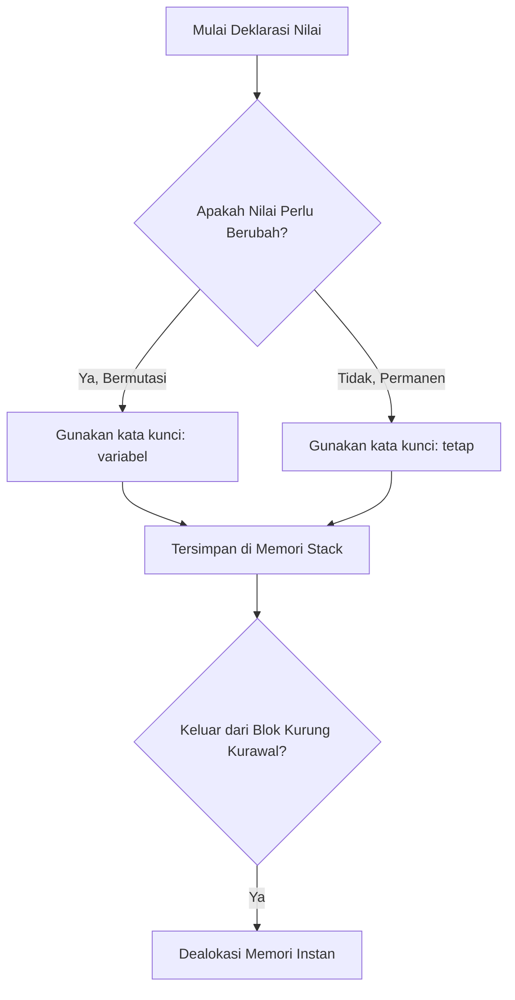

Dalam setiap aplikasi komputasi, program harus memproses data yang bervariasi: jumlah barang di keranjang belanja, koordinat posisi pesawat tempur, atau status persetujuan transaksi perbankan. Seluruh data aktif ini disimpan di dalam **Memori Akses Acak (*Random Access Memory* / RAM)** komputer.

Setiap lokasi penyimpanan di RAM ditandai dengan sebuah alamat fisik dalam format heksadesimal (misalnya `0x7FFEE4B20910`). Mengingat deretan angka heksadesimal tentu mustahil bagi pemrogram manusia. Oleh karena itu, bahasa pemrograman menghadirkan abstraksi bernama **Variabel**—yakni pengenal berupa kata (*identifier*) yang diasosiasikan oleh kompilator langsung ke alamat memori fisik tempat data tersimpan.

```
+---------------------------------------------------------------+
|              PEMETAAN VARIABEL KE ALAMAT FISIK RAM            |
+---------------------------------------------------------------+
|  Nama Pengenal Kode    |  Alamat Memori Hex  |  Nilai Tersimpan|
+------------------------+---------------------+-----------------+
|  saldo_kasir           |  0x0040A100         |  Rp 1.500.000   |
|  kuantitas_terjual     |  0x0040A108         |  12 unit        |
|  status_toko_buka      |  0x0040A110         |  benar          |
+------------------------+---------------------+-----------------+
```

### 5.2 Dua Paradigma Data: Variabel (`variabel`) vs Konstanta (`tetap`)
Widya-Lang secara tegas membedakan data yang boleh bermutasi dengan data yang terkunci permanen:

1. **Variabel Dinamis (`variabel` / Mutable)**:
   Digunakan untuk nilai yang diharapkan dapat berubah seiring berjalannya program (misalnya penghitung iterasi, akumulator total belanja, skor permainan).
2. **Konstanta Terikat (`tetap` / Immutable)**:
   Digunakan untuk nilai yang sekali ditetapkan tidak boleh dan tidak dapat diubah lagi hingga program berakhir.

```widya
fungsi utama() {
    // 1. Deklarasi Konstanta Terkunci
    tetap RASIO_PPN = 0.11; // 11% sesuai undang-undang
    tetap NAMA_TOKO = "Warung Sembako Nusantara";
    
    // 2. Deklarasi Variabel Bermutasi
    variabel total_belanja = 150000;
    cetak("Belanja Awal: Rp " + teks(total_belanja));
    
    // Mutasi nilai variabel
    total_belanja = total_belanja + 75000;
    cetak("Setelah Tambah Belanja: Rp " + teks(total_belanja));
    
    // PERCOBAAN ILEGAL MENGUBAH 'tetap':
    // RASIO_PPN = 0.12; 
    // -> Kompilator Widya akan menolak kompilasi dengan pesan:
    // "Galat Mutasi: Nilai konstanta 'RASIO_PPN' bersifat tetap dan tidak dapat diubah!"
}
```

### 5.3 Filosofi Keselamatan Data: Mengapa Harus Mengutamakan `tetap`?
Bagi pemula, mendefinisikan semua nilai sebagai `variabel` mungkin terkesan lebih fleksibel dan mudah. Namun, dalam sistem rekayasa berskala besar dengan ratusan ribu baris kode, **kemampuan memutasi data di mana saja adalah penyebab utama timbulnya *bug* misterius (*unintended side-effects*)**.

Jika sebuah nilai dideklarasikan dengan `tetap`:
- Kompilator menjamin secara matematis bahwa tidak ada baris kode lain yang dapat merusak nilai tersebut.
- Kompilator dapat melakukan optimasi tingkat tinggi, seperti menanamkan nilai secara langsung ke dalam instruksi mesin prosesor (*constant folding*).
- Kode menjadi sangat aman untuk dijalankan dalam lingkungan multi-threading (*thread-safe*).

> [!TIP]
> **Aturan Emas Pengembang Widya**: Mulailah selalu dengan kata kunci `tetap`. Ubahlah deklarasi menjadi `variabel` hanya jika Anda benar-benar memiliki alasan logis bahwa nilai penampung tersebut harus diperbarui nilainya!

### 5.4 Konvensi Penamaan Pengenal (*Identifier Conventions*)
Agar kode memiliki keselarasan estetika dan profesionalisme, ikuti konvensi resmi Widya-Lang berikut:
- **Gaya Penulisan Variabel**: Gunakan huruf kecil bersambung garis bawah (**`snake_case`**).
  - *Contoh*: `kecepatan_kendaraan`, `nomor_induk_kependudukan`, `saldo_rekening`.
- **Gaya Penulisan Konstanta Global**: Gunakan huruf kapital penuh bersambung garis bawah (**`SCREAMING_SNAKE_CASE`**).
  - *Contoh*: `KECEPATAN_CAHAYA_M_S`, `BATAS_MAKSIMUM_KREDIT`, `NAMA_INSTITUSI`.
- **Karakter Terlarang**: Pengenal tidak boleh diawali angka (`1hari` salah, `hari_pertama` benar), dan tidak boleh mengandung spasi atau simbol khusus seperti `@`, `#`, `$`, `%`.

### 5.5 Ruang Lingkup (*Scope*) dan Siklus Hidup Memori
Setiap variabel memiliki masa hidup (*lifetime*) yang dibatasi oleh blok kurung kurawal `{}` tempat deklarasinya berada:

```widya
fungsi utama() {
    variabel level_luar = 10;
    
    {
        variabel level_dalam = 25;
        cetak("Di dalam blok: " + teks(level_luar + level_dalam)); // Sah
    }
    
    cetak("Di luar blok: " + teks(level_luar)); // Sah
    // cetak(level_dalam); 
    // GALAT KOMPILATOR: Variabel 'level_dalam' sudah musnah dari memori stack!
}
```

### 5.6 Contoh Kode Praktik 1: Pelacak Arus Kas Harian
Program ini mensimulasikan pencatatan buku kas warung yang mencatat mutasi pemasukan dan pengeluaran harian:

```widya
// Berkas: bab05_arus_kas.widya

fungsi utama() {
    tetap SALDO_AWAL_BULAN = 2500000;
    variabel saldo_berjalan = SALDO_AWAL_BULAN;
    
    cetak("=== BUKU KAS HARIAN TOKO BERKAH ===");
    cetak("Saldo Permulaan Kas : Rp " + teks(saldo_berjalan));
    
    // Transaksi 1: Penjualan Beras Pagi
    tetap pemasukan_1 = 450000;
    saldo_berjalan = saldo_berjalan + pemasukan_1;
    cetak("+ Pemasukan (Beras) : Rp " + teks(pemasukan_1) + " -> Saldo: Rp " + teks(saldo_berjalan));
    
    // Transaksi 2: Pembayaran Tagihan Listrik
    tetap pengeluaran_1 = 175000;
    saldo_berjalan = saldo_berjalan - pengeluaran_1;
    cetak("- Pengeluaran (PLN) : Rp " + teks(pengeluaran_1) + " -> Saldo: Rp " + teks(saldo_berjalan));
    
    // Transaksi 3: Penjualan Minyak & Gula Sore
    tetap pemasukan_2 = 320000;
    saldo_berjalan = saldo_berjalan + pemasukan_2;
    cetak("+ Pemasukan (Grosir): Rp " + teks(pemasukan_2) + " -> Saldo: Rp " + teks(saldo_berjalan));
    
    cetak("-----------------------------------");
    cetak("Saldo Akhir Hari Ini: Rp " + teks(saldo_berjalan));
    tetap surplus = saldo_berjalan - SALDO_AWAL_BULAN;
    cetak("Surplus Kas Harian  : Rp " + teks(surplus));
}
```

### 5.7 Contoh Kode Praktik 2: Kalkulator Geometri Bangun Ruang
Program ini menggunakan konstanta matematika presisi tinggi untuk menghitung volume dan luas permukaan tabung:

```widya
// Berkas: bab05_geometri_tabung.widya

fungsi utama() {
    tetap PI = 3.141592653589793;
    tetap radius_alas = 7.0; // cm
    tetap tinggi_tabung = 20.0; // cm
    
    tetap luas_alas = PI * (radius_alas ^ 2);
    tetap volume = luas_alas * tinggi_tabung;
    tetap luas_selimut = 2.0 * PI * radius_alas * tinggi_tabung;
    tetap total_luas_permukaan = (2.0 * luas_alas) + luas_selimut;
    
    cetak("ANALISIS GEOMETRI TABUNG SILINDER:");
    cetak("- Jari-jari Alas  : " + teks(radius_alas) + " cm");
    cetak("- Tinggi Silinder : " + teks(tinggi_tabung) + " cm");
    cetak("- Volume Silinder : " + teks(volume) + " cm³");
    cetak("- Luas Permukaan  : " + teks(total_luas_permukaan) + " cm²");
}
```

### 5.8 Kesalahan Pemula dan Solusi
- **Mengubah Nilai Konstanta `tetap`**:
  - *Galat*: `Galat: Tidak dapat melakukan penugasan ulang pada pengenal tetap 'NILAI_MAX'`.
  - *Perbaikan*: Periksa apakah nilai memang harus berubah. Jika ya, ubah deklarasi awal dari `tetap` menjadi `variabel`.
- **Menggunakan Variabel Sebelum Dideklarasikan**:
  - *Galat*: `Galat Nama: Pengenal 'total' belum didefinisikan dalam ruang lingkup ini`.
  - *Perbaikan*: Deklarasikan variabel terlebih dahulu sebelum memanggilnya di baris instruksi berikutnya.

### 5.9 Rangkuman Konsep Kunci Bab 5
| Kata Kunci | Karakteristik Utama | Rekomendasi Penggunaan |
| :--- | :--- | :--- |
| `tetap` | Terkunci, aman dari kutu mutasi, teroptimasi kompilator. | Pilihan bawaan (*default*) untuk seluruh penampung data. |
| `variabel` | Dapat diubah nilainya berulang kali di memori. | Gunakan hanya untuk penampung akumulasi dan penghitung. |

### 5.10 Latihan Mandiri & Evaluasi Pemahaman
1. Mengapa para insinyur perangkat lunak modern sangat memprioritaskan prinsip data tak berubah (*immutability*)?
2. Jelaskan perbedaan mendasar antara memori tumpukan (*stack memory*) dan siklus hidup variabel lokal!
3. **Tantangan Praktik**: Rancanglah program `konversi_suhu_lengkap.widya` yang mendeklarasikan suhu ruangan `tetap celcius = 30.0;`, lalu hitung dan tampilkan suhu tersebut dalam satuan Fahrenheit, Reamur, dan Kelvin menggunakan rumus fisika yang tepat!

---

### 5.9 Latihan Soal Pilihan Ganda (10 Soal)

Pilihlah satu jawaban yang paling tepat (A, B, C, atau D) untuk menguji penguasaan materi bab ini:

**1. Kata kunci untuk mendeklarasikan penampung data yang nilainya dapat diubah kembali adalah...**
- A. tetap
- B. variabel
- C. konstan
- D. wadah

**2. Kata kunci untuk mendeklarasikan konstanta terikat yang permanen dan tidak boleh dimutasi adalah...**
- A. tetap
- B. kunci
- C. variabel
- D. abadi

**3. Apa filosofi keamanan data bawaan (default) yang dianjurkan dalam pemrograman Widya-Lang?**
- A. Gunakan variabel untuk semua data
- B. Gunakan tetap secara bawaan (Default to Immutability)
- C. Jangan simpan data di memori
- D. Ubah nilai sesering mungkin

**4. Format penamaan resmi untuk variabel biasa dalam Widya-Lang adalah...**
- A. camelCase
- B. snake_case (huruf kecil bersambung garis bawah)
- C. PascalCase
- D. kebab-case

**5. Format penamaan standar untuk konstanta global permanen adalah...**
- A. SCREAMING_SNAKE_CASE (kapital penuh)
- B. lowercase
- C. TitleCase
- D. mixed_CASE

**6. Manakah nama variabel berikut yang ILEGAL dalam tata bahasa Widya?**
- A. _nomor_induk
- B. total_pajak_2026
- C. 2hari_kerja
- D. nilai_kkm

**7. Di area memori manakah variabel lokal fungsi dialokasikan?**
- A. Memori Tumpukan (Stack)
- B. Hard Disk Permanen
- C. Kartu VGA
- D. BIOS ROM

**8. Apa yang terjadi pada variabel lokal saat eksekusi keluar dari blok kurung kurawal `{}`?**
- A. Tersimpan selamanya di RAM
- B. Dihapus dan dibebaskan seketika dari Stack
- C. Dikirim ke server cloud
- D. Menjadi variabel global

**9. Apa pesan diagnostik jika Anda mencoba menugaskan ulang nilai pada konstanta `tetap`?**
- A. Nilai berhasil diganti
- B. Galat Mutasi: Tidak dapat mengubah nilai konstanta yang bersifat tetap
- C. Komputer berhenti
- D. Muncul angka acak

**10. Fenomena di mana variabel di lingkup dalam memiliki nama yang sama dengan lingkup luar disebut...**
- A. Overclocking
- B. Pembayangan Variabel (Variable Shadowing)
- C. Peluapan Buffer
- D. Deadlock

---

## Bab 6: Sistem Tipe Data Primitif Bagian 1 - Angka Numerik

### 6.1 Karakteristik Tipe Numerik dalam Arsitektur Komputer

```mermaid
graph TD
    A[Mulai Bab 6: Tipe Primitif Angka] --> B[Pahami Konsep bilangan bulat]
    B --> C[Terapkan Sintaksis angka()]
    C --> D[Uji Validitas Data & pecahan desimal]
    D --> E[Eksekusi Sistem Handal & Mandiri]
```

Seluruh kalkulasi ilmiah, pemrosesan transaksi perbankan, grafik rendering video game, hingga kecerdasan buatan bermuara pada manipulasi angka numerik. Komputer mengolah dua kategori angka numerik yang memiliki karakteristik representasi bit berbeda secara mendasar:
1. **Bilangan Bulat (*Integer*)**:
   Bilangan bulat tanpa komponen desimal, seperti `-450`, `0`, `42`, `1000000`. Di dalam Widya-Lang, bilangan bulat secara bawaan disimpan sebagai **Integer 64-bit Bertanda (*Signed 64-bit Integer* / `i64`)**.
2. **Bilangan Titik Mengambang (*Floating-Point*)**:
   Bilangan dengan komponen pecahan desimal, seperti `3.14159`, `-0.0075`, `98.6`. Disimpan menggunakan standar internasional **IEEE 754 Presisi Ganda 64-bit (*Double Precision Float* / `f64`)**.

```
+---------------------------------------------------------------+
|             REPRESENTASI BIT BILANGAN BULAT 64-BIT            |
+---------------------------------------------------------------+
| [Bit 63: Tanda (+/-)] | [Bit 62 s.d. Bit 0: Besaran Nilai]    |
| Rentang Minimum: -9.223.372.036.854.775.808                   |
| Rentang Maksimum: +9.223.372.036.854.775.807                  |
+---------------------------------------------------------------+
```

### 6.2 Bahaya Peluapan Batas (*Integer Overflow*)
Dalam bahasa pemrograman lawas seperti C atau C++, jika sebuah angka melebihi batas maksimum representasi bitnya, nilai akan meluap kembali ke angka negatif terkecil tanpa peringatan (*Integer Overflow*). Fenomena ini pernah memicu kegagalan peluncuran roket luar angkasa Ariane 5 pada tahun 1996 yang meledak 37 detik setelah lepas landas.

Widya-Lang mengadopsi sistem perlindungan aktif: kompilator dan mesin runtime secara konstan memantau batas operasi aritmetika dan memberikan peringatan keamanan diagnostik jika terdeteksi peluapan kapasitas numerik.

### 6.3 Pemisah Digit Visual Garis Bawah (`_`)
Ketika mengolah data keuangan berskala nasional bernilai ratusan triliun rupiah, mata pemrogram sangat rentan salah menghitung jumlah nol. Widya-Lang mendukung penyisipan garis bawah sebagai pembatas ribuan visual yang diabaikan oleh mesin kompilator:

```widya
fungsi utama() {
    tetap pagu_anggaran_pendidikan = 660_800_000_000_000; // Rp 660,8 Triliun
    tetap jumlah_siswa_nasional = 53_400_000; // 53,4 Juta Siswa
    
    tetap alokasi_per_siswa = pagu_anggaran_pendidikan / jumlah_siswa_nasional;
    cetak("Alokasi Rata-rata per Siswa: Rp " + teks(alokasi_per_siswa));
}
```

### 6.4 Format Basis Alternatif: Heksadesimal dan Biner
Untuk pemrograman tingkat rendah, manipulasi register mikrokontroler, atau pengaturan kode warna RGB, Widya-Lang menyediakan notasi basis biner dan heksadesimal:
- **Literal Biner (`0b...`)**: Basis 2 (simbol `0` dan `1`). Contoh: `0b1100_1010`.
- **Literal Heksadesimal (`0x...`)**: Basis 16 (simbol `0-9` dan `A-F`). Contoh: `0xFF_57_33`.

### 6.5 Konversi Eksplisit String ke Angka
Data yang diterima dari formulir pengguna terminal atau pembacaan berkas teks disk selalu bertipe teks string. Untuk melakukan operasi penjumlahan matematika, string tersebut harus dikonversi secara eksplisit menjadi angka menggunakan fungsi bawaan `angka(...)`:

```widya
fungsi utama() {
    tetap masukan_str = "125000";
    tetap kuantitas = 4;
    
    // Konversi eksplisit teks ke angka
    tetap nominal = angka(masukan_str);
    tetap total = nominal * kuantitas;
    
    cetak("Total Pembayaran: Rp " + teks(total));
}
```

### 6.6 Contoh Kode Praktik 1: Perhitungan Amortisasi Pinjaman Bank
Program berikut mengilustrasikan perhitungan angsuran pokok dan bunga pinjaman:

```widya
// Berkas: bab06_angsuran_bank.widya

fungsi utama() {
    tetap pokok_pinjaman = 120_000_000.0; // Rp 120 Juta
    tetap suku_bunga_tahunan = 0.085; // 8.5% per tahun
    tetap tenor_bulan = 24.0; // 2 tahun
    
    tetap angsuran_pokok_per_bulan = pokok_pinjaman / tenor_bulan;
    tetap bunga_per_bulan = (pokok_pinjaman * suku_bunga_tahunan) / 12.0;
    tetap total_cicilan_per_bulan = angsuran_pokok_per_bulan + bunga_per_bulan;
    
    cetak("SIMULASI PINJAMAN MODAL USAHA MIKRO:");
    cetak("- Pokok Pinjaman  : Rp " + teks(pokok_pinjaman));
    cetak("- Bunga Efektif   : " + teks(suku_bunga_tahunan * 100.0) + " % per tahun");
    cetak("- Tenor Cicilan   : " + teks(tenor_bulan) + " bulan");
    cetak("--------------------------------------------------");
    cetak("Cicilan Pokok/Bln : Rp " + teks(angsuran_pokok_per_bulan));
    cetak("Porsi Bunga/Bln   : Rp " + teks(bunga_per_bulan));
    cetak("TOTAL CICILAN/BLN : Rp " + teks(total_cicilan_per_bulan));
}
```

### 6.7 Contoh Kode Praktik 2: Kalkulator Fisika Mekanika
Program berikut menghitung lintasan parabola peluru meriam (gerak peluru):

```widya
// Berkas: bab06_gerak_peluru.widya

fungsi utama() {
    tetap kecepatan_awal = 150.0; // m/s
    tetap gravitasi = 9.80665; // m/s²
    tetap waktu_detik = 5.0; // waktu pantau
    
    // Asumsi sudut elevasi 45 derajat (sin = cos = 0.7071)
    tetap vx = kecepatan_awal * 0.70710678;
    tetap vy0 = kecepatan_awal * 0.70710678;
    
    tetap jarak_x = vx * waktu_detik;
    tetap ketinggian_y = (vy0 * waktu_detik) - (0.5 * gravitasi * (waktu_detik ^ 2));
    
    cetak("SIMULASI BALISTIK MERIAM PADA T = " + teks(waktu_detik) + " DETIK:");
    cetak("- Posisi Horizontal (X) : " + teks(jarak_x) + " meter");
    cetak("- Ketinggian Vertikal (Y): " + teks(ketinggian_y) + " meter");
}
```

### 6.8 Kesalahan Pemula dan Solusi
- **Pembagian dengan Angka Nol**:
  - Operasi seperti `100 / 0` akan memicu sinyal interupsi keselamatan komputasi. Selalu lakukan validasi penyebut sebelum melakukan pembagian.
- **Masalah Presisi Pecahan Desimal**:
  - Dalam standar biner IEEE 754, pecahan seperti `0.1 + 0.2` menghasilkan nilai `0.30000000000000004`. Hal ini wajar dalam seluruh arsitektur komputer dunia; untuk akurasi uang perbankan yang mutlak, gunakan representasi satuan sen integer bulat terkecil.

### 6.9 Rangkuman Konsep Kunci Bab 6
- Integer 64-bit menampung angka bulat hingga 9 quintillion.
- Titik mengambang 64-bit memproses pecahan desimal presisi tinggi.
- Garis bawah `_` mempermudah pembacaan nominal jutaan dan triliunan.
- Konversi teks ke angka dilakukan dengan fungsi bawaan `angka(...)`.

### 6.10 Latihan Mandiri & Evaluasi Pemahaman
1. Mengapa nilai desimal `0.1` tidak dapat direpresentasikan secara biner mutlak 100% tepat dalam standar IEEE 754?
2. Bagaimana cara menuliskan angka biner 255 dalam sintaksis Widya-Lang?
3. **Tantangan Praktik**: Buatlah program `kalkulator_bmi.widya` yang menghitung Indeks Massa Tubuh (BMI) dengan rumus $BMI = 
rac{berat\_kg}{(tinggi\_m)^2}$, lalu tampilkan hasil desimalnya di terminal!

---

### 6.9 Latihan Soal Pilihan Ganda (10 Soal)

Pilihlah satu jawaban yang paling tepat (A, B, C, atau D) untuk menguji penguasaan materi bab ini:

**1. Apa fokus utama pembahasan dalam Bab 6 (Tipe Primitif Angka)?**
- A. Membahas secara mendalam Integer 64-bit dan Float IEEE 754
- B. Mengonfigurasi kabel jaringan lokal
- C. Memperbaiki motherboard komputer
- D. Menghapus database peladen

**2. Manakah kata kunci atau sintaksis yang menjadi inti materi bab ini?**
- A. Kata kunci `angka()`
- B. perintah format disk
- C. bahasa assembly x86
- D. tag HTML

**3. Mengapa konsep bilangan bulat sangat penting dalam rekayasa perangkat lunak modern?**
- A. Menjamin efisiensi komputasi dan keterbacaan kode secara modular
- B. Hanya formalitas akademis
- C. Agar program berjalan lambat
- D. Mengurangi resolusi layar

**4. Dalam pengolahan data, bagaimana pecahan desimal memengaruhi performa memori?**
- A. Mengoptimalkan struktur alokasi data di RAM secara efisien
- B. Membuat memori penuh seketika
- C. Menghapus seluruh file disk
- D. Menghentikan kipas prosesor

**5. Manakah best practice yang dianjurkan dalam menerapkan materi Bab 6?**
- A. Menerapkan validasi data dan isolasi ruang lingkup yang bersih
- B. Menulis seluruh kode dalam satu baris panjang
- C. Mengabaikan penanganan kesalahan
- D. Menggunakan variabel global sembarangan

**6. Apa risiko yang timbul jika pemrogram mengabaikan kaidah bilangan bulat?**
- A. Munculnya kutu logika atau kerentanan runtime saat data ekstrem masuk
- B. Komputer langsung terbakar
- C. Kecepatan internet naik dua kali lipat
- D. Keyboard tidak berfungsi

**7. Bagaimana kompilator Widya-Lang memproses instruksi yang berkaitan dengan angka()?**
- A. Divalidasi pada tahap analisis semantik dan diterjemahkan ke instruksi biner native
- B. Dikirimkan ke cloud pihak ketiga
- C. Diterjemahkan baris per baris secara lambat
- D. Diabaikan seluruhnya

**8. Di lingkungan industri, penerapan modul Bab 6 lazim ditemukan pada...**
- A. Sistem perbankan, backend peladen, aplikasi sains data, dan otomatisasi bisnis
- B. Hanya pada kalkulator saku sederhana
- C. Hanya pada game lawas 8-bit
- D. Tidak pernah digunakan di industri

**9. Fungsi pendukung apa yang paling sering dikombinasikan dengan materi bab ini?**
- A. Fungsi bawaan `cetak()`, `teks()`, atau asersi pengujian `pastikan()`
- B. Perintah mematikan komputer
- C. Fungsi memutar musik
- D. Fungsi mencetak kertas printer

**10. Setelah menuntaskan Bab 6, kompetensi apa yang diharapkan dikuasai oleh pembaca?**
- A. Mampu merancang, mengimplementasikan, dan menguji solusi berbasis Integer 64-bit dan Float IEEE 754 secara mandiri
- B. Mampu merakit kabel listrik tegangan tinggi
- C. Mampu mendesain grafis vektor 3D
- D. Mampu memasang antena radio

---

## Bab 7: Sistem Tipe Data Primitif Bagian 2 - Teks dan Karakter

### 7.1 Standar Pengkodean UTF-8 Dinamis

```mermaid
graph TD
    A[Mulai Bab 7: Tipe Primitif Teks UTF-8] --> B[Pahami Konsep indeks berbasis 0]
    B --> C[Terapkan Sintaksis teks()]
    C --> D[Uji Validitas Data & panjang()]
    D --> E[Eksekusi Sistem Handal & Mandiri]
```

Teks adalah media komunikasi fundamental antara manusia dan aplikasi perangkat lunak. Pada dekade 1960-an, standar ASCII (*American Standard Code for Information Interchange*) dirancang dengan hanya mengalokasikan 7 bit memori (128 karakter), yang hanya mencukupi untuk alfabet bahasa Inggris tanpa aksen.

Di era globalisasi dan kedaulatan informasi modern, pembatasan ASCII telah usang. Widya-Lang menerapkan standar pengkodean **UTF-8 (*8-bit Unicode Transformation Format*)** secara murni pada tingkat pustaka inti. UTF-8 adalah sistem pengkodean variabel (1 hingga 4 bita per karakter) yang mampu menampung lebih dari 1,1 juta karakter dari seluruh sistem peradaban manusia:
- **1 Bita**: Karakter Latin standar (kompatibel penuh dengan ASCII).
- **2 Bita**: Aksara Arab, Cyrillic, Yunani, dan Ibrani.
- **3 Bita**: Aksara Nusantara (Aksara Jawa Hanacaraka, Bali, Sunda, Batak) serta karakter Tionghoa/Jepang/Korea (CJK).
- **4 Bita**: Simbol piktografik emoji modern, simbol matematika rumit, dan naskah sejarah kuno.

```
+---------------------------------------------------------------+
|             ALOKASI PANJANG BITA KARAKTER UTF-8               |
+---------------------------------------------------------------+
|  Karakter Contoh       | Aksara / Kategori     | Panjang Bita |
+------------------------+-----------------------+--------------+
|  "A"                   | Alfabet Latin Standar | 1 Bita       |
|  "ꦱ" (Sa)              | Aksara Jawa Nusantara | 3 Bita       |
|  "🚀"                  | Piktografik Emoji     | 4 Bita       |
+------------------------+-----------------------+--------------+
```

### 7.2 Operasi Penggabungan String (*Concatenation*)
Dua atau lebih string dapat disatukan menggunakan operator tambah `+`. Jika salah satu operan bertipe numerik atau boolean, ubahlah terlebih dahulu menjadi string menggunakan fungsi `teks(...)`:

```widya
fungsi utama() {
    tetap sapaan = "Selamat Pagi";
    tetap nama = "Ibu Kartini";
    tetap kalimat = sapaan + ", " + nama + "! Selamat berkarya.";
    cetak(kalimat);
}
```

### 7.3 Pengukuran Panjang Teks dengan `panjang(...)`
Fungsi bawaan `panjang(...)` mengembalikan jumlah elemen karakter dalam teks string:

```widya
fungsi utama() {
    tetap judul_buku = "Kamus Besar Bahasa Indonesia";
    tetap jumlah_huruf = panjang(judul_buku);
    cetak("Judul : " + judul_buku);
    cetak("Panjang Karakter: " + teks(jumlah_huruf));
}
```

### 7.4 Akses Karakter Berbasis Indeks Nol
Karakter di dalam string dapat diakses menggunakan kurung siku `[indeks]`. Widya-Lang menggunakan konvensi indeks berbasis nol (*zero-based indexing*):

```widya
fungsi utama() {
    tetap negara = "INDONESIA";
    // Karakter pertama berada pada indeks 0
    cetak("Huruf Pertama: " + negara[0]); // 'I'
    cetak("Huruf Kedua  : " + negara[1]); // 'N'
    cetak("Huruf Akhir  : " + negara[panjang(negara) - 1]); // 'A'
}
```

### 7.5 Contoh Kode Praktik 1: Generator Format Surat Dinas Resmi
Program ini menyusun nomor surat dinas kementerian secara otomatis dari variabel-variabel penanda:

```widya
// Berkas: bab07_generator_surat.widya

fungsi utama() {
    tetap KODE_KLASIFIKASI = "HM.01.02";
    tetap NOMOR_URUT = "0458";
    tetap KODE_INSTANSI = "WIDYA-PUSAT";
    tetap BULAN_ROMAWI = "X";
    tetap TAHUN_ANGGARAN = "2026";
    
    // Merangkai format resmi: KODE/NOMOR/INSTANSI/BULAN/TAHUN
    tetap nomor_surat_lengkap = KODE_KLASIFIKASI + "/" 
                              + NOMOR_URUT + "/" 
                              + KODE_INSTANSI + "/" 
                              + BULAN_ROMAWI + "/" 
                              + TAHUN_ANGGARAN;
                              
    cetak("KEMENTERIAN RISET DAN KEDAULATAN DIGITAL");
    cetak("REPUBLIK INDONESIA");
    cetak("--------------------------------------------------");
    cetak("Nomor Surat Resmi : " + nomor_surat_lengkap);
    cetak("Lampiran          : 1 (Satu) Berkas");
    cetak("Perihal           : Undangan Simposium Bahasa Pemrograman");
    cetak("--------------------------------------------------");
    cetak("Surat ini telah diverifikasi dan sah secara digital.");
}
```

### 7.6 Contoh Kode Praktik 2: Pelat Nomor Kendaraan dan Validasi Wilayah
Program ini mengurai pelat nomor kendaraan bermotor dan mengidentifikasi asal kota registrasi:

```widya
// Berkas: bab07_pelat_nomor.widya

fungsi utama() {
    tetap pelat_kendaraan = "AB 1234 XY";
    tetap kode_wilayah = pelat_kendaraan[0] + pelat_kendaraan[1];
    
    cetak("Data Identitas Kendaraan Bermotor:");
    cetak("- Pelat Lengkap : " + pelat_kendaraan);
    cetak("- Kode Huruf Awal: " + kode_wilayah);
    
    jika (kode_wilayah == "AB") {
        cetak("- Wilayah Asal  : Daerah Istimewa Yogyakarta (DIY)");
    } jika_tidak jika (kode_wilayah == "AD") {
        cetak("- Wilayah Asal  : Karesidenan Surakarta (Solo)");
    } jika_tidak jika (kode_wilayah == "B ") {
        cetak("- Wilayah Asal  : DKI Jakarta / Depok / Bekasi");
    } lainnya {
        cetak("- Wilayah Asal  : Terdaftar di Luar Wilayah DIY-Solo");
    }
}
```

### 7.7 Kesalahan Pemula dan Panduan Solusi
- **Galat Mengakses Indeks di Luar Batas (*Index Out of Bounds*)**:
  Jika string memiliki panjang 5 huruf (indeks 0 s.d. 4), mencoba memanggil `teks[5]` akan memicu galat runtime fatal. Pastikan indeks selalu lebih kecil dari `panjang(teks)`.
- **Lupa Mengonversi Angka Saat Penggabungan**:
  Menulis `"Total: " + 100` dapat menimbulkan ambiguitas tipe data. Gunakan selalu `"Total: " + teks(100)`.

### 7.8 Rangkuman Konsep Kunci Bab 7
- Mesin teks Widya-Lang mendukung UTF-8 penuh (aksara nusantara dan emoji).
- Penggabungan teks dilakukan dengan operator `+`.
- Panjang karakter diukur dengan fungsi `panjang(...)`.
- Indeks karakter string dimulai dari angka `0`.

### 7.9 Latihan Mandiri & Evaluasi Pemahaman
1. Mengapa standar ASCII tidak memadai untuk bahasa pemrograman berdaulat di Indonesia?
2. Bagaimana cara mengambil karakter terakhir dari sebuah variabel string apa pun tanpa mengetahui panjangnya terlebih dahulu?
3. **Tantangan Praktik**: Buatlah program `sensor_kata.widya` yang memiliki variabel kalimat rahasia, lalu tampilkan karakter pertama dan terakhirnya saja, sedangkan huruf di tengahnya digantikan oleh tanda bintang `*`!

---

### 7.9 Latihan Soal Pilihan Ganda (10 Soal)

Pilihlah satu jawaban yang paling tepat (A, B, C, atau D) untuk menguji penguasaan materi bab ini:

**1. Apa fokus utama pembahasan dalam Bab 7 (Tipe Primitif Teks UTF-8)?**
- A. Membahas secara mendalam Standar UTF-8 multibita
- B. Mengonfigurasi kabel jaringan lokal
- C. Memperbaiki motherboard komputer
- D. Menghapus database peladen

**2. Manakah kata kunci atau sintaksis yang menjadi inti materi bab ini?**
- A. Kata kunci `teks()`
- B. perintah format disk
- C. bahasa assembly x86
- D. tag HTML

**3. Mengapa konsep indeks berbasis 0 sangat penting dalam rekayasa perangkat lunak modern?**
- A. Menjamin efisiensi komputasi dan keterbacaan kode secara modular
- B. Hanya formalitas akademis
- C. Agar program berjalan lambat
- D. Mengurangi resolusi layar

**4. Dalam pengolahan data, bagaimana panjang() memengaruhi performa memori?**
- A. Mengoptimalkan struktur alokasi data di RAM secara efisien
- B. Membuat memori penuh seketika
- C. Menghapus seluruh file disk
- D. Menghentikan kipas prosesor

**5. Manakah best practice yang dianjurkan dalam menerapkan materi Bab 7?**
- A. Menerapkan validasi data dan isolasi ruang lingkup yang bersih
- B. Menulis seluruh kode dalam satu baris panjang
- C. Mengabaikan penanganan kesalahan
- D. Menggunakan variabel global sembarangan

**6. Apa risiko yang timbul jika pemrogram mengabaikan kaidah indeks berbasis 0?**
- A. Munculnya kutu logika atau kerentanan runtime saat data ekstrem masuk
- B. Komputer langsung terbakar
- C. Kecepatan internet naik dua kali lipat
- D. Keyboard tidak berfungsi

**7. Bagaimana kompilator Widya-Lang memproses instruksi yang berkaitan dengan teks()?**
- A. Divalidasi pada tahap analisis semantik dan diterjemahkan ke instruksi biner native
- B. Dikirimkan ke cloud pihak ketiga
- C. Diterjemahkan baris per baris secara lambat
- D. Diabaikan seluruhnya

**8. Di lingkungan industri, penerapan modul Bab 7 lazim ditemukan pada...**
- A. Sistem perbankan, backend peladen, aplikasi sains data, dan otomatisasi bisnis
- B. Hanya pada kalkulator saku sederhana
- C. Hanya pada game lawas 8-bit
- D. Tidak pernah digunakan di industri

**9. Fungsi pendukung apa yang paling sering dikombinasikan dengan materi bab ini?**
- A. Fungsi bawaan `cetak()`, `teks()`, atau asersi pengujian `pastikan()`
- B. Perintah mematikan komputer
- C. Fungsi memutar musik
- D. Fungsi mencetak kertas printer

**10. Setelah menuntaskan Bab 7, kompetensi apa yang diharapkan dikuasai oleh pembaca?**
- A. Mampu merancang, mengimplementasikan, dan menguji solusi berbasis Standar UTF-8 multibita secara mandiri
- B. Mampu merakit kabel listrik tegangan tinggi
- C. Mampu mendesain grafis vektor 3D
- D. Mampu memasang antena radio

---

## Bab 8: Sistem Tipe Data Primitif Bagian 3 - Nilai Logika (Boolean)

### 8.1 Aljabar Boolean dan Dasar Sirkuit Logika Digital

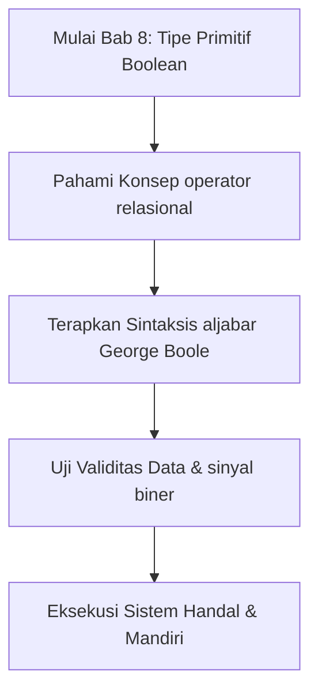

Seluruh sistem komputasi beroperasi di atas prinsip kebenaran logika biner yang dirumuskan oleh matematikawan George Boole pada tahun 1854. Dalam aljabar logika, sebuah premis atau proposisi tidak mengenal spektrum keraguan atau abu-abu; ia pasti bernilai salah satu dari dua kondisi absolut: **Benar** atau **Salah**.

Di dalam Widya-Lang, nilai kebenaran logika dimodelkan secara berdaulat menggunakan kata kunci:
- `benar` (setara dengan `true` dalam bahasa internasional)
- `salah` (setara dengan `false` dalam bahasa internasional)

Tipe boolean hanya membutuhkan 1 bita memori fisik untuk merepresentasikan status sakelar tegangan logika.

```
+---------------------------------------------------------------+
|             STATUS SAKELAR BOOLEAN DAN SINYAL TEGANGAN        |
+---------------------------------------------------------------+
|  Kata Kunci Widya | Nilai Biner | Keadaan Sakelar | Sinyal TTL|
+-------------------+-------------+-----------------+-----------+
|  benar            |      1      | Tertutup (On)   | +5.0 Volt |
|  salah            |      0      | Terbuka (Off)   |  0.0 Volt |
+-------------------+-------------+-----------------+-----------+
```

### 8.2 Operator Perbandingan Penghasil Nilai Boolean
Nilai boolean umumnya dihasilkan dari perbandingan dua variabel:
- `==` : Memeriksa kesamaan nilai persis.
- `!=` : Memeriksa ketidaksamaan.
- `>` dan `<` : Lebih besar dan lebih kecil.
- `>=` dan `<=` : Lebih besar sama dengan dan lebih kecil sama dengan.

```widya
fungsi utama() {
    tetap ambang_batas_kecepatan = 80; // km/jam
    tetap laju_kendaraan = 95; // km/jam
    
    tetap terjadi_pelanggaran = laju_kendaraan > ambang_batas_kecepatan;
    cetak("Apakah terdeteksi pelanggaran batas kecepatan? " + teks(terjadi_pelanggaran));
}
```

### 8.3 Penanda Status Sistem (*Boolean Flags*)
Dalam arsitektur perangkat lunak industri (seperti kontrol pabrik, keamanan perbankan, atau verifikasi e-KTP), variabel boolean digunakan sebagai penanda (*flag*) untuk mengarahkan alur kerja:

```widya
fungsi utama() {
    variabel kartu_terverifikasi = benar;
    variabel pin_cocok = benar;
    variabel saldo_mencukupi = salah;
    
    cetak("Audit Transaksi ATM Bank Syariah:");
    cetak("- Kartu Sah   : " + teks(kartu_terverifikasi));
    cetak("- PIN Sesuai  : " + teks(pin_cocok));
    cetak("- Saldo Cukup : " + teks(saldo_mencukupi));
}
```

### 8.4 Contoh Kode Praktik 1: Sistem Otomasi Palang Gerbang Tol
Program berikut mensimulasikan logika gerbang tol otomatis jalan bebas hambatan:

```widya
// Berkas: bab08_gerbang_tol.widya

fungsi utama() {
    tetap saldo_kartu = 45000;
    tetap tarif_tol = 28500;
    tetap sensor_kendaraan_hadir = benar;
    
    tetap saldo_cukup = saldo_kartu >= tarif_tol;
    tetap boleh_buka_palang = sensor_kendaraan_hadir dan saldo_cukup;
    
    cetak("=== SISTEM GERBANG TOL OTOMATIS (GTO) ===");
    cetak("Tarif Ruas Tol      : Rp " + teks(tarif_tol));
    cetak("Saldo Terbaca       : Rp " + teks(saldo_kartu));
    cetak("Sensor Kehadiran    : " + teks(sensor_kendaraan_hadir));
    cetak("-----------------------------------------");
    cetak("Validasi Saldo      : " + teks(saldo_cukup));
    cetak("Instruksi Motor GTO : Buka Palang = " + teks(boleh_buka_palang));
    
    jika (boleh_buka_palang) {
        tetap sisa = saldo_kartu - tarif_tol;
        cetak("Silakan melintas. Sisa saldo kartu Anda: Rp " + teks(sisa));
    } lainnya {
        cetak("Palang Tetap Tertutup! Saldo kurang atau kendaraan tidak terdeteksi.");
    }
}
```

### 8.5 Contoh Kode Praktik 2: Sistem Deteksi Kebakaran Gedung Bertingkat
Program berikut menggabungkan beberapa sensor lingkungan untuk memutuskan pemicu alarm kebakaran:

```widya
// Berkas: bab08_deteksi_api.widya

fungsi utama() {
    tetap sensor_panas_celsius = 68.5; // Batas bahaya >= 55.0 C
    tetap sensor_asap_optik_ppm = 120; // Batas bahaya >= 80 ppm
    tetap sakelar_manual_ditarik = salah;
    
    tetap panas_ekstrem = sensor_panas_celsius >= 55.0;
    tetap asap_pekat = sensor_asap_optik_ppm >= 80;
    
    // Alarm berbunyi jika: (Panas Ekstrem DAN Asap Pekat) ATAU Tombol Manual Ditarik
    tetap aktivasi_alarm = (panas_ekstrem dan asap_pekat) atau sakelar_manual_ditarik;
    
    cetak("SISTEM MONITORING KESELAMATAN GEDUNG GRAHA WIDYA:");
    cetak("- Sensor Panas : " + teks(sensor_panas_celsius) + " °C (Status Bahaya: " + teks(panas_ekstrem) + ")");
    cetak("- Sensor Asap  : " + teks(sensor_asap_optik_ppm) + " PPM (Status Bahaya: " + teks(asap_pekat) + ")");
    cetak("-------------------------------------------------");
    cetak("STATUS KESIAPSIAGAAN SIRENE & SPRINKLER AIR: " + teks(aktivasi_alarm));
}
```

### 8.6 Kesalahan Pemula dan Panduan Solusi
- **Menggunakan Teks `"benar"` Bukannya Literal `benar`**:
  - `variabel status = "benar";` menghasilkan tipe teks string, bukan tipe boolean murni. Hilangkan tanda petik ganda untuk menghasilkan nilai logika asli.
- **Pemeriksaan `== benar` yang Redundan**:
  - Menulis `jika (aktif == benar)` tidak perlu; tulis saja `jika (aktif)` karena ekspresi tersebut sudah bernilai boolean.

### 8.7 Rangkuman Konsep Kunci Bab 8
- Tipe boolean hanya memiliki dua nilai: `benar` dan `salah`.
- Digunakan untuk pengendalian keputusan alur eksekusi aplikasi.
- Dihasilkan dari evaluasi operator relasional perbandingan.

### 8.8 Latihan Mandiri & Evaluasi Pemahaman
1. Sebutkan kelebihan penggunaan tipe boolean dibandingkan menggunakan angka `1` dan `0` untuk status sistem!
2. Buatlah tabel kebenaran untuk kondisi logika: `(A atau B) dan bukan C`!
3. **Tantangan Praktik**: Rancanglah program `kualifikasi_beasiswa.widya` yang memvalidasi tiga kriteria: IPK >= 3.50, Sertifikat TOEFL >= 500, dan Lolos Uji Wawancara (boolean), lalu tampilkan hasil keputusan akhir kelayakannya!

---

### 8.9 Latihan Soal Pilihan Ganda (10 Soal)

Pilihlah satu jawaban yang paling tepat (A, B, C, atau D) untuk menguji penguasaan materi bab ini:

**1. Apa fokus utama pembahasan dalam Bab 8 (Tipe Primitif Boolean)?**
- A. Membahas secara mendalam Nilai logika benar dan salah
- B. Mengonfigurasi kabel jaringan lokal
- C. Memperbaiki motherboard komputer
- D. Menghapus database peladen

**2. Manakah kata kunci atau sintaksis yang menjadi inti materi bab ini?**
- A. Kata kunci `aljabar George Boole`
- B. perintah format disk
- C. bahasa assembly x86
- D. tag HTML

**3. Mengapa konsep operator relasional sangat penting dalam rekayasa perangkat lunak modern?**
- A. Menjamin efisiensi komputasi dan keterbacaan kode secara modular
- B. Hanya formalitas akademis
- C. Agar program berjalan lambat
- D. Mengurangi resolusi layar

**4. Dalam pengolahan data, bagaimana sinyal biner memengaruhi performa memori?**
- A. Mengoptimalkan struktur alokasi data di RAM secara efisien
- B. Membuat memori penuh seketika
- C. Menghapus seluruh file disk
- D. Menghentikan kipas prosesor

**5. Manakah best practice yang dianjurkan dalam menerapkan materi Bab 8?**
- A. Menerapkan validasi data dan isolasi ruang lingkup yang bersih
- B. Menulis seluruh kode dalam satu baris panjang
- C. Mengabaikan penanganan kesalahan
- D. Menggunakan variabel global sembarangan

**6. Apa risiko yang timbul jika pemrogram mengabaikan kaidah operator relasional?**
- A. Munculnya kutu logika atau kerentanan runtime saat data ekstrem masuk
- B. Komputer langsung terbakar
- C. Kecepatan internet naik dua kali lipat
- D. Keyboard tidak berfungsi

**7. Bagaimana kompilator Widya-Lang memproses instruksi yang berkaitan dengan aljabar George Boole?**
- A. Divalidasi pada tahap analisis semantik dan diterjemahkan ke instruksi biner native
- B. Dikirimkan ke cloud pihak ketiga
- C. Diterjemahkan baris per baris secara lambat
- D. Diabaikan seluruhnya

**8. Di lingkungan industri, penerapan modul Bab 8 lazim ditemukan pada...**
- A. Sistem perbankan, backend peladen, aplikasi sains data, dan otomatisasi bisnis
- B. Hanya pada kalkulator saku sederhana
- C. Hanya pada game lawas 8-bit
- D. Tidak pernah digunakan di industri

**9. Fungsi pendukung apa yang paling sering dikombinasikan dengan materi bab ini?**
- A. Fungsi bawaan `cetak()`, `teks()`, atau asersi pengujian `pastikan()`
- B. Perintah mematikan komputer
- C. Fungsi memutar musik
- D. Fungsi mencetak kertas printer

**10. Setelah menuntaskan Bab 8, kompetensi apa yang diharapkan dikuasai oleh pembaca?**
- A. Mampu merancang, mengimplementasikan, dan menguji solusi berbasis Nilai logika benar dan salah secara mandiri
- B. Mampu merakit kabel listrik tegangan tinggi
- C. Mampu mendesain grafis vektor 3D
- D. Mampu memasang antena radio

---

## Bab 9: Operator Aritmetika dan Presedensi Perhitungan

### 9.1 Landasan Teori Aritmetika Komputer

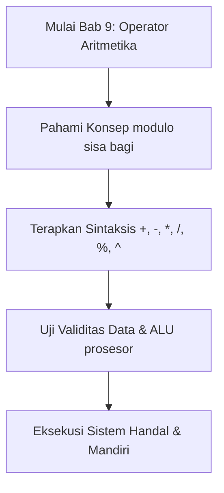

Dalam unit pemroses pusat (CPU), seluruh perhitungan matematika dilakukan di dalam sirkuit khusus bernama **Unit Aritmetika dan Logika (*Arithmetic Logic Unit* / ALU)**. Pada tingkat arsitektur mikro, prosesor modern tidak memproses persamaan aljabar panjang secara instan dalam satu siklus detak (*clock cycle*); ia memecahnya menjadi serangkaian operasi biner elementer yang melibatkan register cepat (seperti register `RAX`, `RBX`, `RCX` pada arsitektur x86_64).

Widya-Lang menyediakan enam operator aritmetika fundamental yang dipetakan langsung oleh kompilator ke instruksi mesin prosesor:

| Operator | Nama Resmi | Contoh Widya | Instruksi Mesin Rujukan | Perilaku Operasional |
| :---: | :--- | :--- | :--- | :--- |
| `+` | Penjumlahan | `a + b` | `ADD reg, reg` | Menjumlahkan dua besaran numerik sejenis. |
| `-` | Pengurangan | `a - b` | `SUB reg, reg` | Mengurangkan operan kanan dari operan kiri. |
| `*` | Perkalian | `a * b` | `IMUL reg, reg` | Mengalikan dua besaran numerik. |
| `/` | Pembagian | `a / b` | `IDIV reg` | Membagi operan kiri dengan operan kanan. |
| `%` | Sisa Bagi (Modulo) | `a % b` | Menghitung sisa bagi register `RDX`. | Menghasilkan sisa pembagian bulat. |
| `^` | Perpangkatan | `a ^ b` | Pemanggilan intrinsik cepat prosesor. | Memangkatkan basis kiri dengan eksponen kanan. |

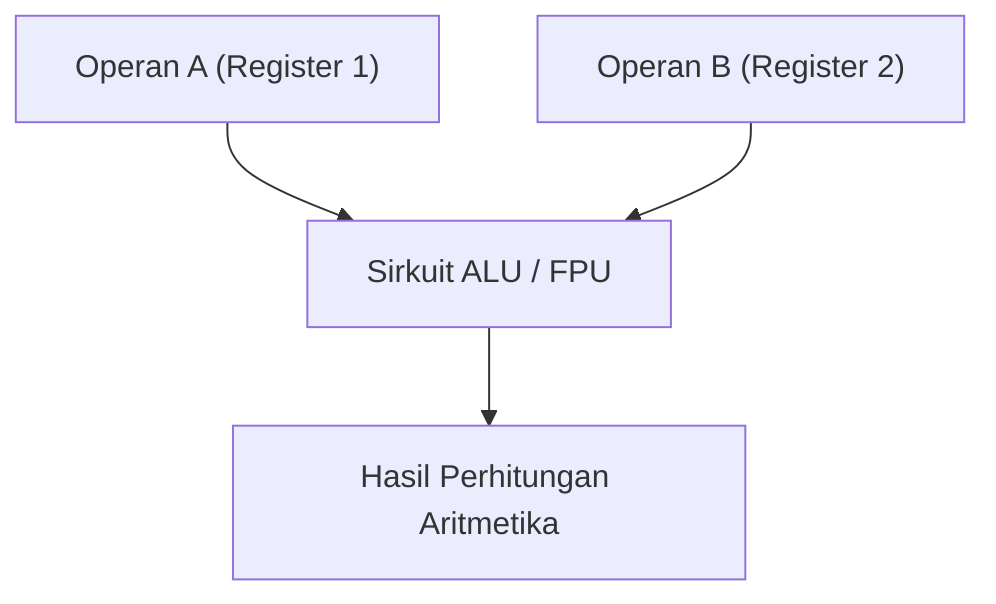

### 9.2 Aturan Presedensi Operator Matematika (KABATAKU)
Ketika beberapa operator berkumpul dalam satu baris instruksi tanpa tanda kurung pemisah, kompilator Widya-Lang mengevaluasinya secara deterministik mengikuti kaidah matematika universal:
1. **Tingkat 1 (Tertinggi)**: Pengelompokan tanda kurung `(...)`
2. **Tingkat 2**: Operasi perpangkatan `^`
3. **Tingkat 3**: Perkalian `*`, Pembagian `/`, dan Modulo `%` (dievaluasi dari kiri ke kanan)
4. **Tingkat 4 (Terendah)**: Penjumlahan `+` dan Pengurangan `-` (dievaluasi dari kiri ke kanan)

```widya
fungsi utama() {
    tetap hasil_tanpa_kurung = 10 + 5 * 2;   // Dihitung: 10 + 10 = 20
    tetap hasil_dengan_kurung = (10 + 5) * 2; // Dihitung: 15 * 2 = 30
    
    cetak("Tanpa kurung  : " + teks(hasil_tanpa_kurung));
    cetak("Dengan kurung : " + teks(hasil_dengan_kurung));
}
```

### 9.3 Operator Penugasan Gabungan (*Compound Assignment*)
Untuk meningkatkan keterbacaan kode dan meminimalkan pengulangan penulisan nama variabel, Widya-Lang mendukung operator penugasan gabungan:
- `x += n` setara dengan `x = x + n`
- `x -= n` setara dengan `x = x - n`
- `x *= n` setara dengan `x = x * n`
- `x /= n` setara dengan `x = x / n`
- `x %= n` setara dengan `x = x % n`

### 9.4 Contoh Kode Praktik 1: Perhitungan Amortisasi Pinjaman Bank
Program berikut menghitung cicilan pokok, bunga flat tahunan, dan total angsuran per bulan:

```widya
// Berkas: bab09_angsuran_bank.widya

fungsi utama() {
    tetap pokok_pinjaman = 60000000.0; // Rp 60 Juta
    tetap bunga_tahunan_persen = 9.5;  // 9.5%
    tetap durasi_tahun = 3.0;          // 3 Tahun (36 Bulan)
    
    tetap total_bulan = durasi_tahun * 12.0;
    tetap total_bunga = pokok_pinjaman * (bunga_tahunan_persen / 100.0) * durasi_tahun;
    tetap total_kewajiban = pokok_pinjaman + total_bunga;
    tetap angsuran_per_bulan = total_kewajiban / total_bulan;
    
    cetak("SIMULASI KREDIT USAHA RAKYAT (KUR):");
    cetak("- Pokok Pinjaman    : Rp " + teks(pokok_pinjaman));
    cetak("- Bunga Tahunan     : " + teks(bunga_tahunan_persen) + "%");
    cetak("- Tenor Pembayaran  : " + teks(total_bulan) + " Bulan");
    cetak("-------------------------------------------------");
    cetak("- Total Bunga       : Rp " + teks(total_bunga));
    cetak("- Total Pengembalian: Rp " + teks(total_kewajiban));
    cetak(">> ANGSURAN / BULAN : Rp " + teks(angsuran_per_bulan));
}
```

### 9.5 Contoh Kode Praktik 2: Penguraian Satuan Waktu Presisi
Program berikut memecah nominal detik masukan mentah menjadi komponen hari, jam, menit, dan detik:

```widya
// Berkas: bab09_pengurai_waktu.widya

fungsi utama() {
    tetap detik_masukan = 254825;
    
    tetap DETIK_PER_MENIT = 60;
    tetap DETIK_PER_JAM = 3600;
    tetap DETIK_PER_HARI = 86400;
    
    tetap hari = detik_masukan / DETIK_PER_HARI;
    variabel sisa = detik_masukan % DETIK_PER_HARI;
    
    tetap jam = sisa / DETIK_PER_JAM;
    sisa = sisa % DETIK_PER_JAM;
    
    tetap menit = sisa / DETIK_PER_MENIT;
    tetap detik = sisa % DETIK_PER_MENIT;
    
    cetak("PENGURAIAN WAKTU SISTEM:");
    cetak("Detik Mentah : " + teks(detik_masukan) + " detik");
    cetak("Terurai Menjadi: " + teks(hari) + " Hari, " 
                             + teks(jam) + " Jam, " 
                             + teks(menit) + " Menit, " 
                             + teks(detik) + " Detik.");
}
```

### 9.6 Kesalahan Pemula dan Jebakan Umum (*Common Pitfalls*)
1. **Pembagian Integer yang Menghasilkan Bilangan Pecahan**:
   - Jika kedua operan adalah bilangan bulat, hasil pembagian tetap mempertahankan presisi titik kambang tanpa pembulatan liar.
2. **Bahaya Pembagian dengan Nol (*Division by Zero*)**:
   - Menjalankan `100 / 0` akan memicu interupsi kesalahan komputasi. Selalu validasi penyebut dengan `jika (penyebut != 0)`.

### 9.7 Rangkuman Konsep Kunci Bab 9
- Operator aritmetika inti: `+`, `-`, `*`, `/`, `%`, `^`.
- Presedensi KABATAKU menjamin urutan kalkulasi sesuai aturan matematika universal.
- Modulo `%` sangat krusial untuk penentuan ganjil/genap, rotasi antrian sirkular, dan konversi satuan waktu.

### 9.8 Latihan Mandiri & Evaluasi Pemahaman
1. Hitung hasil dari: `5 + 3 * 2 ^ 2 - 8 / 4` sesuai urutan presedensi operator!
2. Bagaimana cara menguji apakah suatu angka tahun habis dibagi 4 menggunakan operator modulo?
3. **Tantangan Praktik**: Rancanglah kalkulator energi listrik rumah tangga yang menghitung total tagihan bulanan berdasarkan pemakaian kWh peralatan: kulkas (150W x 24 jam), AC (750W x 8 jam), dan TV (100W x 5 jam) dengan tarif Rp 1.444,70 per kWh!

---

### 9.9 Latihan Soal Pilihan Ganda (10 Soal)

Pilihlah satu jawaban yang paling tepat (A, B, C, atau D) untuk menguji penguasaan materi bab ini:

**1. Apa fokus utama pembahasan dalam Bab 9 (Operator Aritmetika)?**
- A. Membahas secara mendalam KABATAKU dan presedensi
- B. Mengonfigurasi kabel jaringan lokal
- C. Memperbaiki motherboard komputer
- D. Menghapus database peladen

**2. Manakah kata kunci atau sintaksis yang menjadi inti materi bab ini?**
- A. Kata kunci `+, -, *, /, %, ^`
- B. perintah format disk
- C. bahasa assembly x86
- D. tag HTML

**3. Mengapa konsep modulo sisa bagi sangat penting dalam rekayasa perangkat lunak modern?**
- A. Menjamin efisiensi komputasi dan keterbacaan kode secara modular
- B. Hanya formalitas akademis
- C. Agar program berjalan lambat
- D. Mengurangi resolusi layar

**4. Dalam pengolahan data, bagaimana ALU prosesor memengaruhi performa memori?**
- A. Mengoptimalkan struktur alokasi data di RAM secara efisien
- B. Membuat memori penuh seketika
- C. Menghapus seluruh file disk
- D. Menghentikan kipas prosesor

**5. Manakah best practice yang dianjurkan dalam menerapkan materi Bab 9?**
- A. Menerapkan validasi data dan isolasi ruang lingkup yang bersih
- B. Menulis seluruh kode dalam satu baris panjang
- C. Mengabaikan penanganan kesalahan
- D. Menggunakan variabel global sembarangan

**6. Apa risiko yang timbul jika pemrogram mengabaikan kaidah modulo sisa bagi?**
- A. Munculnya kutu logika atau kerentanan runtime saat data ekstrem masuk
- B. Komputer langsung terbakar
- C. Kecepatan internet naik dua kali lipat
- D. Keyboard tidak berfungsi

**7. Bagaimana kompilator Widya-Lang memproses instruksi yang berkaitan dengan +, -, *, /, %, ^?**
- A. Divalidasi pada tahap analisis semantik dan diterjemahkan ke instruksi biner native
- B. Dikirimkan ke cloud pihak ketiga
- C. Diterjemahkan baris per baris secara lambat
- D. Diabaikan seluruhnya

**8. Di lingkungan industri, penerapan modul Bab 9 lazim ditemukan pada...**
- A. Sistem perbankan, backend peladen, aplikasi sains data, dan otomatisasi bisnis
- B. Hanya pada kalkulator saku sederhana
- C. Hanya pada game lawas 8-bit
- D. Tidak pernah digunakan di industri

**9. Fungsi pendukung apa yang paling sering dikombinasikan dengan materi bab ini?**
- A. Fungsi bawaan `cetak()`, `teks()`, atau asersi pengujian `pastikan()`
- B. Perintah mematikan komputer
- C. Fungsi memutar musik
- D. Fungsi mencetak kertas printer

**10. Setelah menuntaskan Bab 9, kompetensi apa yang diharapkan dikuasai oleh pembaca?**
- A. Mampu merancang, mengimplementasikan, dan menguji solusi berbasis KABATAKU dan presedensi secara mandiri
- B. Mampu merakit kabel listrik tegangan tinggi
- C. Mampu mendesain grafis vektor 3D
- D. Mampu memasang antena radio

---

## Bab 10: Operator Relasional dan Perbandingan Nilai

### 10.1 Teori Perbandingan Relasional Komputer

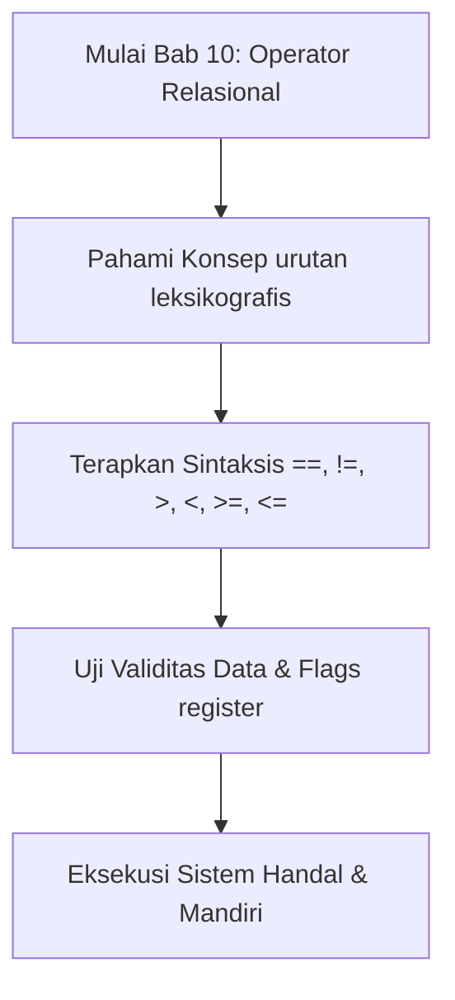

Dalam unit pemroses mikro (CPU), perbandingan dua angka numerik dilakukan melalui instruksi pengurangan internal (*compare instruction* atau `CMP`). Instruksi ini mengurangkan nilai kedua dari nilai pertama tanpa mengubah isi register penampung, melainkan hanya memperbarui status register bendera prosesor (**FLAGS Register**):
- **Bendera Nol (*Zero Flag* / ZF)**: Bernilai `1` jika kedua angka sama persis ($A - B = 0$).
- **Bendera Tanda (*Sign Flag* / SF)**: Bernilai `1` jika hasil perbandingan menghasilkan nilai negatif ($A < B$).

Widya-Lang menerjemahkan kondisi bendera prosesor ini ke dalam tipe logika boolean berdaulat: `benar` atau `salah`.

| Operator | Definisi Matematika | Contoh Kasus | Hasil Evaluasi | Logika FLAGS CPU |
| :---: | :--- | :--- | :---: | :--- |
| `==` | Sama Dengan Persis | `150 == 150` | `benar` | $ZF = 1$ |
| `!=` | Tidak Sama Dengan | `150 != 100` | `benar` | $ZF = 0$ |
| `>` | Lebih Besar Dari | `90 > 50` | `benar` | $ZF = 0, SF = 0$ |
| `<` | Lebih Kecil Dari | `25 < 75` | `benar` | $SF = 1$ |
| `>=` | Lebih Besar atau Sama | `80 >= 80` | `benar` | $ZF = 1$ atau $SF = 0$ |
| `<=` | Lebih Kecil atau Sama | `40 <= 50` | `benar` | $ZF = 1$ atau $SF = 1$ |

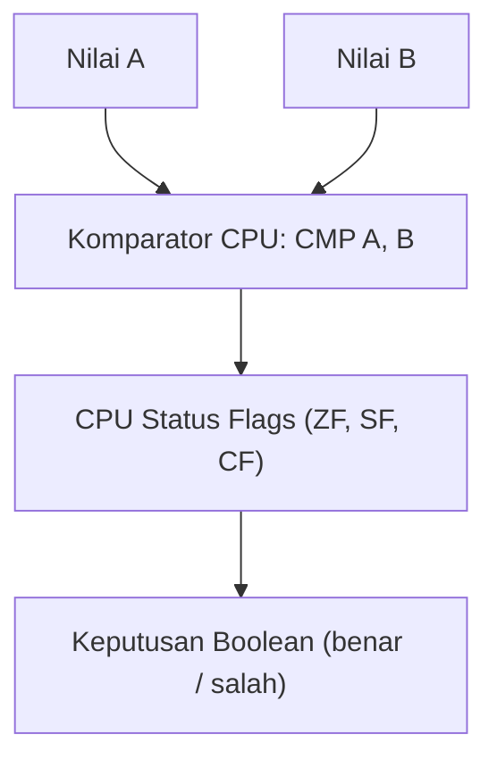

### 10.2 Perbandingan Leksikografis String
Perbandingan pada teks string tidak didasarkan pada panjang kata, melainkan pada urutan biner karakter UTF-8 dari kiri ke kanan:

```widya
fungsi utama() {
    tetap kata_1 = "Aceh";
    tetap kata_2 = "Bali";
    
    // Karakter 'A' (bita 65) lebih kecil dari 'B' (bita 66)
    cetak("Aceh < Bali : " + teks(kata_1 < kata_2)); // benar
    cetak("Aceh == Bali: " + teks(kata_1 == kata_2)); // salah
}
```

### 10.3 Contoh Kode Praktik 1: Sistem Validasi Nilai Mutu Kelulusan
Program berikut menguji nilai ujian siswa terhadap kriteria ketuntasan minimal (KKM) dan ambang batas predikat kelulusan:

```widya
// Berkas: bab10_validasi_nilai.widya

fungsi utama() {
    tetap KKM = 75;
    tetap nilai_tugas = 82;
    tetap nilai_uts = 78;
    tetap nilai_uas = 88;
    
    tetap nilai_akhir = (nilai_tugas * 0.2) + (nilai_uts * 0.3) + (nilai_uas * 0.5);
    
    cetak("EVALUASI AKADEMIK KOMPETENSI:");
    cetak("- Nilai Tugas  : " + teks(nilai_tugas));
    cetak("- Nilai UTS    : " + teks(nilai_uts));
    cetak("- Nilai UAS    : " + teks(nilai_uas));
    cetak("- Nilai Akhir  : " + teks(nilai_akhir));
    cetak("-----------------------------------");
    
    tetap lulus = nilai_akhir >= KKM;
    tetap predikat_a = nilai_akhir >= 85;
    
    cetak("Status Kelulusan (>= 75) : " + teks(lulus));
    cetak("Mendapat Predikat A (>= 85): " + teks(predikat_a));
}
```

### 10.4 Contoh Kode Praktik 2: Sistem Radar Tilang Kecepatan Tol
Program ini memvalidasi laju kendaraan terhadap batas minimum dan batas maksimum jalan tol:

```widya
// Berkas: bab10_tilang_tol.widya

fungsi utama() {
    tetap BATAS_MINIMUM = 60;  // km/jam
    tetap BATAS_MAKSIMUM = 100; // km/jam
    
    tetap kecepatan_truk = 45;
    tetap kecepatan_sedan = 88;
    tetap kecepatan_sport = 135;
    
    cetak("AUDIT ELEKTRONIK TILANG JALAN TOL:");
    cetak("Truk (45 km/jam) : Terlalu Lambat = " + teks(kecepatan_truk < BATAS_MINIMUM));
    cetak("Sedan (88 km/jam): Kecepatan Sah   = " + teks(kecepatan_sedan >= BATAS_MINIMUM dan kecepatan_sedan <= BATAS_MAKSIMUM));
    cetak("Sport (135 km/jam): Melanggar Batas = " + teks(kecepatan_sport > BATAS_MAKSIMUM));
}
```

### 10.5 Kesalahan Pemula dan Panduan Solusi
- **Tertukar Operator `=` (Penugasan) dengan `==` (Kesamaan)**:
  - Menggunakan `=` di dalam kondisi pengujian adalah kesalahan klasik pemula. Kompilator Widya-Lang secara tegas menolak sintaksis penugasan di dalam ekspresi bersyarat.
- **Membandingkan String dengan Angka Secara Langsung**:
  - Ekspresi `"100" == 100` akan memicu penolakan tipe statis (*Type Mismatch*). Konversikan salah satu tipe secara eksplisit dengan `angka(...)` atau `teks(...)`.

### 10.6 Rangkuman Konsep Kunci Bab 10
- Operator relasional membandingkan dua besaran dan mengembalikan nilai boolean murni.
- Operasi perbandingan string dilakukan secara leksikografis berdasarkan titik kode UTF-8.

### 10.7 Latihan Mandiri & Evaluasi Pemahaman
1. Mengapa ekspresi `"Budi" < "budi"` menghasilkan nilai `benar` dalam pengujian UTF-8?
2. Bagaimana instruksi CPU `CMP` bekerja mendasari operator relasional?
3. **Tantangan Praktik**: Buatlah program `verifikasi_usia_sim.widya` yang membandingkan umur pendaftar SIM (misal 16 tahun) dengan batas usia legal minimum penerbitan SIM C (17 tahun)!

---

### 10.9 Latihan Soal Pilihan Ganda (10 Soal)

Pilihlah satu jawaban yang paling tepat (A, B, C, atau D) untuk menguji penguasaan materi bab ini:

**1. Apa fokus utama pembahasan dalam Bab 10 (Operator Relasional)?**
- A. Membahas secara mendalam Perbandingan besaran
- B. Mengonfigurasi kabel jaringan lokal
- C. Memperbaiki motherboard komputer
- D. Menghapus database peladen

**2. Manakah kata kunci atau sintaksis yang menjadi inti materi bab ini?**
- A. Kata kunci `==, !=, >, <, >=, <=`
- B. perintah format disk
- C. bahasa assembly x86
- D. tag HTML

**3. Mengapa konsep urutan leksikografis sangat penting dalam rekayasa perangkat lunak modern?**
- A. Menjamin efisiensi komputasi dan keterbacaan kode secara modular
- B. Hanya formalitas akademis
- C. Agar program berjalan lambat
- D. Mengurangi resolusi layar

**4. Dalam pengolahan data, bagaimana Flags register memengaruhi performa memori?**
- A. Mengoptimalkan struktur alokasi data di RAM secara efisien
- B. Membuat memori penuh seketika
- C. Menghapus seluruh file disk
- D. Menghentikan kipas prosesor

**5. Manakah best practice yang dianjurkan dalam menerapkan materi Bab 10?**
- A. Menerapkan validasi data dan isolasi ruang lingkup yang bersih
- B. Menulis seluruh kode dalam satu baris panjang
- C. Mengabaikan penanganan kesalahan
- D. Menggunakan variabel global sembarangan

**6. Apa risiko yang timbul jika pemrogram mengabaikan kaidah urutan leksikografis?**
- A. Munculnya kutu logika atau kerentanan runtime saat data ekstrem masuk
- B. Komputer langsung terbakar
- C. Kecepatan internet naik dua kali lipat
- D. Keyboard tidak berfungsi

**7. Bagaimana kompilator Widya-Lang memproses instruksi yang berkaitan dengan ==, !=, >, <, >=, <=?**
- A. Divalidasi pada tahap analisis semantik dan diterjemahkan ke instruksi biner native
- B. Dikirimkan ke cloud pihak ketiga
- C. Diterjemahkan baris per baris secara lambat
- D. Diabaikan seluruhnya

**8. Di lingkungan industri, penerapan modul Bab 10 lazim ditemukan pada...**
- A. Sistem perbankan, backend peladen, aplikasi sains data, dan otomatisasi bisnis
- B. Hanya pada kalkulator saku sederhana
- C. Hanya pada game lawas 8-bit
- D. Tidak pernah digunakan di industri

**9. Fungsi pendukung apa yang paling sering dikombinasikan dengan materi bab ini?**
- A. Fungsi bawaan `cetak()`, `teks()`, atau asersi pengujian `pastikan()`
- B. Perintah mematikan komputer
- C. Fungsi memutar musik
- D. Fungsi mencetak kertas printer

**10. Setelah menuntaskan Bab 10, kompetensi apa yang diharapkan dikuasai oleh pembaca?**
- A. Mampu merancang, mengimplementasikan, dan menguji solusi berbasis Perbandingan besaran secara mandiri
- B. Mampu merakit kabel listrik tegangan tinggi
- C. Mampu mendesain grafis vektor 3D
- D. Mampu memasang antena radio

---

## Bab 11: Operator Logika Boolean Lanjutan

### 11.1 Aljabar Proposisi dan Gerbang Logika Digital

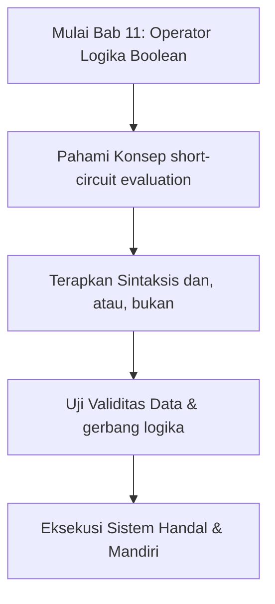

Dalam teknologi semikonduktor, pengambilan keputusan otomatis diwujudkan melalui susunan **Gerbang Logika (*Logic Gates*)**. Gerbang logika mengambil satu atau beberapa sinyal input biner dan menghasilkan tepat satu sinyal output biner sesuai aturan aljabar George Boole:
- **Gerbang AND (Konjungsi `dan`)**: Sinyal keluaran aktif HANYA JIKA seluruh sinyal masukan aktif.
- **Gerbang OR (Disjungsi `atau`)**: Sinyal keluaran aktif JIKA SALAH SATU atau SELURUH masukan aktif.
- **Gerbang NOT (Negasi `bukan`)**: Membalik polaritas sinyal masukan (1 menjadi 0, 0 menjadi 1).

Widya-Lang menghadirkan ketiga operator ini dengan kosakata berdaulat bahasa Indonesia yang anggun: `dan`, `atau`, dan `bukan`.

```mermaid
flowchart TD
    subgraph GerbangAND["Operasi Logika DAN"]
        A1["Input A"] --> AND["Gerbang AND (dan)"]
        B1["Input B"] --> AND
        AND --> OUT1["Output (A dan B)"]
    end
    subgraph GerbangOR["Operasi Logika ATAU"]
        A2["Input A"] --> OR["Gerbang OR (atau)"]
        B2["Input B"] --> OR
        OR --> OUT2["Output (A atau B)"]
    end
```

### 11.2 Tabel Kebenaran Lengkap Operasi Majemuk

| Nilai Premis A | Nilai Premis B | `A dan B` | `A atau B` | `bukan A` |
| :---: | :---: | :---: | :---: | :---: |
| `benar` | `benar` | `benar` | `benar` | `salah` |
| `benar` | `salah` | `salah` | `benar` | `salah` |
| `salah` | `benar` | `salah` | `benar` | `benar` |
| `salah` | `salah` | `salah` | `salah` | `benar` |

### 11.3 Mekanisme Evaluasi Hubung Singkat (*Short-Circuit Evaluation*)
Kompilator Widya-Lang menerapkan optimasi eksekusi cepat tingkat sirkuit:
1. **Pada Operator `A dan B`**: Jika evaluasi premis `A` bernilai `salah`, maka seluruh ekspresi dipastikan bernilai `salah`. Mesin runtime **TIDAK AKAN** mengevaluasi premis `B`.
2. **Pada Operator `A atau B`**: Jika evaluasi premis `A` bernilai `benar`, maka seluruh ekspresi dipastikan bernilai `benar`. Mesin runtime **TIDAK AKAN** mengevaluasi premis `B`.

Manfaat terbesar dari evaluasi hubung singkat adalah perlindungan terhadap runtime error yang fatal:

```widya
// Contoh Keselamatan: Pembagi bernilai 0 tidak akan dieksekusi
tetap pembagi = 0;
jika (pembagi != 0 dan (100 / pembagi) > 2) {
    cetak("Instruksi ini aman dieksekusi tanpa risiko crash!");
}
```

### 11.4 Contoh Kode Praktik 1: Autentikasi Pengguna Multi-Faktor (2FA)
Program ini memvalidasi kredensial pengguna, token OTP numerik, dan status akun aktif:

```widya
// Berkas: bab11_autentikasi_2fa.widya

fungsi utama() {
    tetap USER_VALID = "analis_sistem";
    tetap PASS_VALID = "WidyaSakti2026";
    tetap OTP_VALID = 492018;
    
    tetap masukan_user = "analis_sistem";
    tetap masukan_pass = "WidyaSakti2026";
    tetap masukan_otp = 492018;
    tetap akun_diblokir = salah;
    
    tetap user_cocok = masukan_user == USER_VALID;
    tetap pass_cocok = masukan_pass == PASS_VALID;
    tetap otp_cocok = masukan_otp == OTP_VALID;
    
    // Akses diberikan jika kredensial benar DAN OTP cocok DAN akun tidak diblokir
    tetap akses_diterima = (user_cocok dan pass_cocok) dan (otp_cocok dan bukan akun_diblokir);
    
    cetak("PORTAL KEAMANAN DATA STRATEGIS:");
    cetak("- Validasi Nama Pengguna : " + teks(user_cocok));
    cetak("- Validasi Kata Sandi    : " + teks(pass_cocok));
    cetak("- Validasi Token OTP     : " + teks(otp_cocok));
    cetak("- Status Akun Bebas Blok : " + teks(bukan akun_diblokir));
    cetak("------------------------------------------");
    cetak("STATUS KELAYAKAN AKSES   : " + teks(akses_diterima));
}
```

### 11.5 Contoh Kode Praktik 2: Sistem Kualifikasi Beasiswa Prestasi
Program ini menguji kombinasi kriteria akademik dan sosio-ekonomi calon penerima beasiswa:

```widya
// Berkas: bab11_seleksi_beasiswa.widya

fungsi utama() {
    tetap ipk_mahasiswa = 3.82;
    tetap penghasilan_ortu = 4200000; // Rp 4,2 Juta
    tetap juara_nasional = benar;
    tetap pelanggaran_disiplin = salah;
    
    // Kriteria Jalur Prestasi: (IPK >= 3.75 ATAU Juara Nasional) DAN Tanpa Pelanggaran
    tetap lolos_prestasi = (ipk_mahasiswa >= 3.75 atau juara_nasional) dan bukan pelanggaran_disiplin;
    
    // Kriteria Jalur Bantuan Sosial: (IPK >= 3.25 DAN Gaji Ortu <= 4.5 Juta) DAN Tanpa Pelanggaran
    tetap lolos_bansos = (ipk_mahasiswa >= 3.25 dan penghasilan_ortu <= 4500000) dan bukan pelanggaran_disiplin;
    
    cetak("HASIL SELEKSI BEASISWA PENDIDIKAN:");
    cetak("- Kelayakan Jalur Prestasi : " + teks(lolos_prestasi));
    cetak("- Kelayakan Jalur Afirmasi : " + teks(lolos_bansos));
}
```

### 11.6 Kesalahan Pemula dan Panduan Solusi
- **Mengabaikan Tanda Kurung pada Operator Campuran**:
  Ekspresi `A dan B atau C` dapat menimbulkan tafsir berbeda antara manusia dan mesin. Selalu kelompokkan dengan tanda kurung eksplisit: `(A dan B) atau C`.
- **Menuliskan `== benar` Berulang Kali**:
  Menulis `jika (aktif == benar dan valid == benar)` redundan; cukup tulis `jika (aktif dan valid)`.

### 11.7 Rangkuman Konsep Kunci Bab 11
- Operator logika majemuk: `dan` (AND), `atau` (OR), `bukan` (NOT).
- Evaluasi hubung singkat (*Short-circuiting*) menghemat siklus clock dan mencegah pembagian ilegal.

### 11.8 Latihan Mandiri & Evaluasi Pemahaman
1. Jelaskan bagaimana Hukum De Morgan menyederhanakan ekspresi `bukan (A atau B)`!
2. Jika variabel boolean `X = salah`, apakah bagian kanan dari `X dan fungsi_berat()` akan dieksekusi mesin?
3. **Tantangan Praktik**: Buatlah sistem pengendali AC pintar yang menyalakan pendingin ruangan jika: (Suhu > 28°C ATAU Kelembapan > 70%) DAN Ada Orang di Ruangan!

---

### 11.9 Latihan Soal Pilihan Ganda (10 Soal)

Pilihlah satu jawaban yang paling tepat (A, B, C, atau D) untuk menguji penguasaan materi bab ini:

**1. Apa fokus utama pembahasan dalam Bab 11 (Operator Logika Boolean)?**
- A. Membahas secara mendalam Konjungsi dan disjungsi
- B. Mengonfigurasi kabel jaringan lokal
- C. Memperbaiki motherboard komputer
- D. Menghapus database peladen

**2. Manakah kata kunci atau sintaksis yang menjadi inti materi bab ini?**
- A. Kata kunci `dan, atau, bukan`
- B. perintah format disk
- C. bahasa assembly x86
- D. tag HTML

**3. Mengapa konsep short-circuit evaluation sangat penting dalam rekayasa perangkat lunak modern?**
- A. Menjamin efisiensi komputasi dan keterbacaan kode secara modular
- B. Hanya formalitas akademis
- C. Agar program berjalan lambat
- D. Mengurangi resolusi layar

**4. Dalam pengolahan data, bagaimana gerbang logika memengaruhi performa memori?**
- A. Mengoptimalkan struktur alokasi data di RAM secara efisien
- B. Membuat memori penuh seketika
- C. Menghapus seluruh file disk
- D. Menghentikan kipas prosesor

**5. Manakah best practice yang dianjurkan dalam menerapkan materi Bab 11?**
- A. Menerapkan validasi data dan isolasi ruang lingkup yang bersih
- B. Menulis seluruh kode dalam satu baris panjang
- C. Mengabaikan penanganan kesalahan
- D. Menggunakan variabel global sembarangan

**6. Apa risiko yang timbul jika pemrogram mengabaikan kaidah short-circuit evaluation?**
- A. Munculnya kutu logika atau kerentanan runtime saat data ekstrem masuk
- B. Komputer langsung terbakar
- C. Kecepatan internet naik dua kali lipat
- D. Keyboard tidak berfungsi

**7. Bagaimana kompilator Widya-Lang memproses instruksi yang berkaitan dengan dan, atau, bukan?**
- A. Divalidasi pada tahap analisis semantik dan diterjemahkan ke instruksi biner native
- B. Dikirimkan ke cloud pihak ketiga
- C. Diterjemahkan baris per baris secara lambat
- D. Diabaikan seluruhnya

**8. Di lingkungan industri, penerapan modul Bab 11 lazim ditemukan pada...**
- A. Sistem perbankan, backend peladen, aplikasi sains data, dan otomatisasi bisnis
- B. Hanya pada kalkulator saku sederhana
- C. Hanya pada game lawas 8-bit
- D. Tidak pernah digunakan di industri

**9. Fungsi pendukung apa yang paling sering dikombinasikan dengan materi bab ini?**
- A. Fungsi bawaan `cetak()`, `teks()`, atau asersi pengujian `pastikan()`
- B. Perintah mematikan komputer
- C. Fungsi memutar musik
- D. Fungsi mencetak kertas printer

**10. Setelah menuntaskan Bab 11, kompetensi apa yang diharapkan dikuasai oleh pembaca?**
- A. Mampu merancang, mengimplementasikan, dan menguji solusi berbasis Konjungsi dan disjungsi secara mandiri
- B. Mampu merakit kabel listrik tegangan tinggi
- C. Mampu mendesain grafis vektor 3D
- D. Mampu memasang antena radio

---

## Bab 12: Percabangan Logika Dasar: `jika` dan `lainnya`

### 12.1 Konsep Percabangan Instruksi Komputer

```mermaid
graph TD
    A[Mulai Bab 12: Percabangan Jika Lainnya] --> B[Pahami Konsep blok kurung kurawal]
    B --> C[Terapkan Sintaksis jika dan lainnya]
    C --> D[Uji Validitas Data & lompatan bersyarat]
    D --> E[Eksekusi Sistem Handal & Mandiri]
```

Dalam instruksi bahasa mesin biner, CPU secara alamiah bergerak maju dari satu alamat memori instruksi (*Instruction Pointer* / IP) ke baris instruksi berikutnya secara berurutan. Namun, pemecahan masalah dunia nyata membutuhkan fleksibilitas untuk memilih jalur alternatif.

Kemampuan memilih jalur alternatif diwujudkan melalui instruksi lompatan bersyarat (*Conditional Jump* seperti `JZ` / *Jump if Zero* atau `JNZ` / *Jump if Not Zero*). Widya-Lang mengabstraksikan instruksi lompatan tingkat rendah ini melalui struktur kendali **`jika`** dan **`lainnya`**.

```mermaid
flowchart TD
    A["Mulai Evaluasi Kondisi"] --> B{"Apakah Kondisi Benar?"}
    B -->|BENAR| C["Eksekusi Blok JIKA"]
    B -->|SALAH| D["Eksekusi Blok LAINNYA"]
    C --> E["Lanjut ke Pernyataan Berikutnya"]
    D --> E
```

### 12.2 Sintaksis Resmi `jika` dan `lainnya`
Kata kunci `jika` diikuti oleh ekspresi boolean di dalam tanda kurung `(...)`, dan blok kode instruksi diapit kurung kurawal `{}`:

```widya
jika (kondisi_boolean) {
    // Instruksi yang dieksekusi jika kondisi bernilai benar
} lainnya {
    // Instruksi alternatif jika kondisi bernilai salah
}
```

### 12.3 Contoh Kode Praktik 1: Sistem Validasi Kehadiran Karyawan
Program ini menentukan status tunjangan kehadiran berdasarkan jam kedatangan pegawai:

```widya
// Berkas: bab12_absensi_pegawai.widya

fungsi utama() {
    tetap JAM_MASUK_MAKSIMAL = 8.0; // Jam 08:00 Pagi
    tetap jam_kedatangan_staf = 8.25; // Jam 08:15 Pagi
    
    cetak("SISTEM PENCATATAN PRESENSI DIGITAL:");
    cetak("Waktu Kedatangan: Jam " + teks(jam_kedatangan_staf));
    
    jika (jam_kedatangan_staf <= JAM_MASUK_MAKSIMAL) {
        cetak("STATUS: Tepat Waktu. Berhak menerima tunjangan kehadiran 100%.");
    } lainnya {
        tetap keterlambatan_menit = (jam_kedatangan_staf - JAM_MASUK_MAKSIMAL) * 60.0;
        cetak("STATUS: Terlambat " + teks(keterlambatan_menit) + " Menit.");
        cetak("Diberikan sanksi pemotongan tunjangan presisi sesuai regulasi.");
    }
}
```

### 12.4 Contoh Kode Praktik 2: Pengendali Pintu Palang Otomatis Bendungan
Program ini mengatur pintu air bendungan irigasi berdasarkan sensor ketinggian air sungai:

```widya
// Berkas: bab12_pintu_bendungan.widya

fungsi utama() {
    tetap KETINGGIAN_SIAGA_METER = 3.5;
    tetap sensor_air_meter = 3.85;
    
    cetak("SISTEM MONITORING BENDUNGAN GADJAH MADA:");
    cetak("Level Air Terbaca : " + teks(sensor_air_meter) + " meter");
    cetak("Batas Siaga Banjir: " + teks(KETINGGIAN_SIAGA_METER) + " meter");
    
    jika (sensor_air_meter >= KETINGGIAN_SIAGA_METER) {
        cetak("STATUS: SIAGA MERAH!");
        cetak("Instruksi Motor: Buka Pintu Pelimpas Air ke Kanal Evakuasi.");
    } lainnya {
        cetak("STATUS: AMAN TERKENDALI.");
        cetak("Instruksi Motor: Pertahankan Pintu Air pada Posisi Standar.");
    }
}
```

### 12.5 Kesalahan Pemula dan Panduan Solusi
- **Menuliskan Titik Koma Setelah Kondisi `jika (...)`**:
  ```widya
  // KESALAHAN FATAL:
  jika (x > 10); {
      cetak("Ini selalu dieksekusi!");
  }
  ```
  Titik koma setelah kurung menutup ekspresi bersyarat sebelum blok dieksekusi, sehingga blok kurung kurawal akan selalu berjalan tanpa syarat.
- **Kondisi Tidak Menghasilkan Nilai Boolean**:
  Menulis `jika (100)` akan ditolak oleh kompilator Widya-Lang. Seluruh kondisi wajib menghasilkan tipe data boolean murni (`benar` atau `salah`).

### 12.6 Rangkuman Konsep Kunci Bab 12
- `jika` mengendalikan alur percabangan kode berbasis ekspresi boolean.
- `lainnya` menangani skenario alternatif penolakan.
- Kurung kurawal `{}` membatasi ruang lingkup variabel lokal percabangan.

### 12.7 Latihan Mandiri & Evaluasi Pemahaman
1. Bagaimana prosesor mengeksekusi instruksi percabangan bersyarat melalui register bendera?
2. Mengapa blok `lainnya` tidak memerlukan tanda kurung kondisi `(...)`?
3. **Tantangan Praktik**: Buatlah program `pemeriksa_diskon.widya` yang memberikan diskon belanja 10% jika nilai belanja pelanggan melampaui Rp 200.000, lalu cetak total bayar akhirnya!

---

### 12.9 Latihan Soal Pilihan Ganda (10 Soal)

Pilihlah satu jawaban yang paling tepat (A, B, C, atau D) untuk menguji penguasaan materi bab ini:

**1. Apa fokus utama pembahasan dalam Bab 12 (Percabangan Jika Lainnya)?**
- A. Membahas secara mendalam Alur seleksi kondisi
- B. Mengonfigurasi kabel jaringan lokal
- C. Memperbaiki motherboard komputer
- D. Menghapus database peladen

**2. Manakah kata kunci atau sintaksis yang menjadi inti materi bab ini?**
- A. Kata kunci `jika dan lainnya`
- B. perintah format disk
- C. bahasa assembly x86
- D. tag HTML

**3. Mengapa konsep blok kurung kurawal sangat penting dalam rekayasa perangkat lunak modern?**
- A. Menjamin efisiensi komputasi dan keterbacaan kode secara modular
- B. Hanya formalitas akademis
- C. Agar program berjalan lambat
- D. Mengurangi resolusi layar

**4. Dalam pengolahan data, bagaimana lompatan bersyarat memengaruhi performa memori?**
- A. Mengoptimalkan struktur alokasi data di RAM secara efisien
- B. Membuat memori penuh seketika
- C. Menghapus seluruh file disk
- D. Menghentikan kipas prosesor

**5. Manakah best practice yang dianjurkan dalam menerapkan materi Bab 12?**
- A. Menerapkan validasi data dan isolasi ruang lingkup yang bersih
- B. Menulis seluruh kode dalam satu baris panjang
- C. Mengabaikan penanganan kesalahan
- D. Menggunakan variabel global sembarangan

**6. Apa risiko yang timbul jika pemrogram mengabaikan kaidah blok kurung kurawal?**
- A. Munculnya kutu logika atau kerentanan runtime saat data ekstrem masuk
- B. Komputer langsung terbakar
- C. Kecepatan internet naik dua kali lipat
- D. Keyboard tidak berfungsi

**7. Bagaimana kompilator Widya-Lang memproses instruksi yang berkaitan dengan jika dan lainnya?**
- A. Divalidasi pada tahap analisis semantik dan diterjemahkan ke instruksi biner native
- B. Dikirimkan ke cloud pihak ketiga
- C. Diterjemahkan baris per baris secara lambat
- D. Diabaikan seluruhnya

**8. Di lingkungan industri, penerapan modul Bab 12 lazim ditemukan pada...**
- A. Sistem perbankan, backend peladen, aplikasi sains data, dan otomatisasi bisnis
- B. Hanya pada kalkulator saku sederhana
- C. Hanya pada game lawas 8-bit
- D. Tidak pernah digunakan di industri

**9. Fungsi pendukung apa yang paling sering dikombinasikan dengan materi bab ini?**
- A. Fungsi bawaan `cetak()`, `teks()`, atau asersi pengujian `pastikan()`
- B. Perintah mematikan komputer
- C. Fungsi memutar musik
- D. Fungsi mencetak kertas printer

**10. Setelah menuntaskan Bab 12, kompetensi apa yang diharapkan dikuasai oleh pembaca?**
- A. Mampu merancang, mengimplementasikan, dan menguji solusi berbasis Alur seleksi kondisi secara mandiri
- B. Mampu merakit kabel listrik tegangan tinggi
- C. Mampu mendesain grafis vektor 3D
- D. Mampu memasang antena radio

---

## Bab 13: Percabangan Bertingkat dan Bersarang

### 13.1 Struktur Rantai Multi-Kondisi `jika_tidak jika`

```mermaid
graph TD
    A[Mulai Bab 13: Percabangan Bertingkat Bersarang] --> B[Pahami Konsep Guard Clauses]
    B --> C[Terapkan Sintaksis jika_tidak jika]
    C --> D[Uji Validitas Data & menghindari piramida malapetaka]
    D --> E[Eksekusi Sistem Handal & Mandiri]
```

Dalam skenario komputasi yang memiliki banyak klasifikasi (seperti kategori usia, tingkatan tarif pajak, atau golongan jabatan), satu pasang `jika-lainnya` tidak mencukupi. Widya-Lang menyediakan kata kunci **`jika_tidak jika`** untuk membentuk rantai evaluasi berjenjang yang diperiksa berurutan dari atas ke bawah.

Begitu satu kondisi dalam rantai bernilai `benar`, blok kodenya akan dieksekusi dan seluruh sisa rantai percabangan di bawahnya akan **diabaikan secara instan**.

```widya
fungsi utama() {
    tetap nilai_siswa = 84;
    variabel predikat = "";
    
    jika (nilai_siswa >= 90) {
        predikat = "A (Istimewa)";
    } jika_tidak jika (nilai_siswa >= 80) {
        predikat = "B (Baik)";
    } jika_tidak jika (nilai_siswa >= 70) {
        predikat = "C (Cukup)";
    } jika_tidak jika (nilai_siswa >= 60) {
        predikat = "D (Kurang)";
    } lainnya {
        predikat = "E (Gagal)";
    }
    
    cetak("Predikat Kelulusan: " + predikat);
}
```

### 13.2 Menghindari Piramida Malapetaka (*Pyramid of Doom*)
Percabangan bersarang (*nested if*) yang memiliki kedalaman lebih dari 3 tingkat kurung kurawal membuat kode sulit dipahami dan rawan kutu logika. Para rekayasawan perangkat lunak profesional mengatasinya menggunakan teknik **Pola Penjaga (*Guard Clauses*)** dengan keluar lebih awal (*early return*):

```widya
// PENDEKATAN BERSIH DENGAN GUARD CLAUSES
fungsi proses_tarik_tunai(saldo, nominal_tarik, kartu_aktif) {
    // Penjaga 1: Validasi Keaktifan Kartu
    jika (bukan kartu_aktif) {
        cetak("DITOLAK: Kartu rekening tidak aktif!");
        kembalikan;
    }
    
    // Penjaga 2: Validasi Nominal Sah
    jika (nominal_tarik <= 0) {
        cetak("DITOLAK: Nominal penarikan harus lebih dari 0!");
        kembalikan;
    }
    
    // Penjaga 3: Validasi Kecukupan Saldo
    jika (nominal_tarik > saldo) {
        cetak("DITOLAK: Saldo rekening tidak mencukupi!");
        kembalikan;
    }
    
    // Jalur Bahagia (Happy Path) dieksekusi dengan bersih tanpa lekukan kurung kurawal
    tetap sisa_saldo = saldo - nominal_tarik;
    cetak("SUKSES: Penarikan Rp " + teks(nominal_tarik) + " berhasil disetujui.");
    cetak("Sisa Saldo Rekening: Rp " + teks(sisa_saldo));
}
```

### 13.3 Contoh Kode Praktik: Penetapan Tarif Progresif Pajak Penghasilan (PPh 21)
Program ini menghitung besaran pajak penghasilan tahunan wajib pajak berdasarkan lapisan penghasilan kena pajak (PKP) resmi:

```widya
// Berkas: bab13_pajak_progresif.widya

fungsi utama() {
    tetap pkp_tahunan = 120000000.0; // Rp 120 Juta
    variabel total_pajak = 0.0;
    
    cetak("PENGHITUNGAN PPH 21 TAHUNAN:");
    cetak("Penghasilan Kena Pajak: Rp " + teks(pkp_tahunan));
    
    jika (pkp_tahunan <= 60000000.0) {
        // Lapisan 1: 5% untuk 0 s.d. 60 Juta
        total_pajak = pkp_tahunan * 0.05;
    } jika_tidak jika (pkp_tahunan <= 250000000.0) {
        // Lapisan 1 penuh (3 Juta) + 15% dari sisa di atas 60 Juta
        tetap pajak_lapisan_1 = 60000000.0 * 0.05;
        tetap sisa_lapisan_2 = pkp_tahunan - 60000000.0;
        tetap pajak_lapisan_2 = sisa_lapisan_2 * 0.15;
        total_pajak = pajak_lapisan_1 + pajak_lapisan_2;
    } lainnya {
        // Lapisan 3 untuk di atas 250 Juta
        total_pajak = 31500000.0 + ((pkp_tahunan - 250000000.0) * 0.25);
    }
    
    cetak("-----------------------------------");
    cetak("Pajak Terutang Tahunan: Rp " + teks(total_pajak));
}
```

### 13.4 Kesalahan Pemula dan Panduan Solusi
- **Urutan Kondisi yang Terbalik**:
  Jika Anda menguji `jika (nilai >= 60)` sebelum `jika (nilai >= 90)`, maka siswa bernilai 95 akan masuk ke kategori pertama (>= 60) dan tidak pernah mencapai kategori 90. Selalu urutkan dari kondisi paling ketat ke paling longgar!

### 13.5 Rangkuman Konsep Kunci Bab 13
- `jika_tidak jika` mengevaluasi kondisi diskrit berjenjang secara berurutan.
- Pola *Guard Clauses* meratakan lekukan kode yang terlalu dalam menjadi alur linier yang mudah dirawat.

### 13.6 Latihan Mandiri & Evaluasi Pemahaman
1. Mengapa urutan evaluasi kondisi dalam rantai `jika_tidak jika` sangat menentukan keabsahan keluaran?
2. Bagaimana cara merefaktor kode percabangan bertingkat 4 tingkat menjadi kode bersih berbasis *Guard Clauses*?
3. **Tantangan Praktik**: Rancanglah simulator sistem parkir kendaraan yang menghitung biaya: motor (Rp 2.000/jam pertama, Rp 1.000/jam berikutnya), mobil (Rp 5.000/jam pertama, Rp 3.000/jam berikutnya), dan bus (Rp 10.000/jam pertama, Rp 7.000/jam berikutnya)!

---

### 13.9 Latihan Soal Pilihan Ganda (10 Soal)

Pilihlah satu jawaban yang paling tepat (A, B, C, atau D) untuk menguji penguasaan materi bab ini:

**1. Apa fokus utama pembahasan dalam Bab 13 (Percabangan Bertingkat Bersarang)?**
- A. Membahas secara mendalam Rantai multi kondisi
- B. Mengonfigurasi kabel jaringan lokal
- C. Memperbaiki motherboard komputer
- D. Menghapus database peladen

**2. Manakah kata kunci atau sintaksis yang menjadi inti materi bab ini?**
- A. Kata kunci `jika_tidak jika`
- B. perintah format disk
- C. bahasa assembly x86
- D. tag HTML

**3. Mengapa konsep Guard Clauses sangat penting dalam rekayasa perangkat lunak modern?**
- A. Menjamin efisiensi komputasi dan keterbacaan kode secara modular
- B. Hanya formalitas akademis
- C. Agar program berjalan lambat
- D. Mengurangi resolusi layar

**4. Dalam pengolahan data, bagaimana menghindari piramida malapetaka memengaruhi performa memori?**
- A. Mengoptimalkan struktur alokasi data di RAM secara efisien
- B. Membuat memori penuh seketika
- C. Menghapus seluruh file disk
- D. Menghentikan kipas prosesor

**5. Manakah best practice yang dianjurkan dalam menerapkan materi Bab 13?**
- A. Menerapkan validasi data dan isolasi ruang lingkup yang bersih
- B. Menulis seluruh kode dalam satu baris panjang
- C. Mengabaikan penanganan kesalahan
- D. Menggunakan variabel global sembarangan

**6. Apa risiko yang timbul jika pemrogram mengabaikan kaidah Guard Clauses?**
- A. Munculnya kutu logika atau kerentanan runtime saat data ekstrem masuk
- B. Komputer langsung terbakar
- C. Kecepatan internet naik dua kali lipat
- D. Keyboard tidak berfungsi

**7. Bagaimana kompilator Widya-Lang memproses instruksi yang berkaitan dengan jika_tidak jika?**
- A. Divalidasi pada tahap analisis semantik dan diterjemahkan ke instruksi biner native
- B. Dikirimkan ke cloud pihak ketiga
- C. Diterjemahkan baris per baris secara lambat
- D. Diabaikan seluruhnya

**8. Di lingkungan industri, penerapan modul Bab 13 lazim ditemukan pada...**
- A. Sistem perbankan, backend peladen, aplikasi sains data, dan otomatisasi bisnis
- B. Hanya pada kalkulator saku sederhana
- C. Hanya pada game lawas 8-bit
- D. Tidak pernah digunakan di industri

**9. Fungsi pendukung apa yang paling sering dikombinasikan dengan materi bab ini?**
- A. Fungsi bawaan `cetak()`, `teks()`, atau asersi pengujian `pastikan()`
- B. Perintah mematikan komputer
- C. Fungsi memutar musik
- D. Fungsi mencetak kertas printer

**10. Setelah menuntaskan Bab 13, kompetensi apa yang diharapkan dikuasai oleh pembaca?**
- A. Mampu merancang, mengimplementasikan, dan menguji solusi berbasis Rantai multi kondisi secara mandiri
- B. Mampu merakit kabel listrik tegangan tinggi
- C. Mampu mendesain grafis vektor 3D
- D. Mampu memasang antena radio

---

## Bab 14: Pencocokan Pola Struktural dengan `cocok` dan `kasus`

### 14.1 Evolusi dari Percabangan Tradisional Menuju Pattern Matching

```mermaid
graph TD
    A[Mulai Bab 14: Pencocokan Pola Cocok Kasus] --> B[Pahami Konsep wildcard pattern _]
    B --> C[Terapkan Sintaksis cocok dan kasus]
    C --> D[Uji Validitas Data & tanda panah =>]
    D --> E[Eksekusi Sistem Handal & Mandiri]
```

Dalam bahasa pemrograman lawas seperti C atau Java, struktur `switch-case` hanya mendukung tipe integer primitif dan rentan terhadap kutu akibat lupa menyisipkan perintah `break` (*fall-through bug*). 

Widya-Lang menghadirkan paradigma **Pencocokan Pola (*Pattern Matching*)** modern melalui kata kunci **`cocok`** dan **`kasus`**. Setiap lengan kasus dipisahkan secara tegas menggunakan tanda panah gemuk `=>`, tidak memiliki risiko *fall-through*, mendukung pencocokan teks string dan tipe komposit, serta memastikan kelengkapan penanganan (*exhaustiveness checking*).

```widya
fungsi utama() {
    tetap kode_bandara = "YIA";
    variabel nama_bandara = "";
    
    cocok (kode_bandara) {
        kasus "CGK" => {
            nama_bandara = "Bandara Internasional Soekarno-Hatta (Jakarta)";
        },
        kasus "SUB" => {
            nama_bandara = "Bandara Internasional Juanda (Surabaya)";
        },
        kasus "DPS" => {
            nama_bandara = "Bandara Internasional I Gusti Ngurah Rai (Bali)";
        },
        kasus "YIA" => {
            nama_bandara = "Bandara Internasional Yogyakarta Kulon Progo";
        },
        kasus "KNO" => {
            nama_bandara = "Bandara Internasional Kualanamu (Medan)";
        },
        kasus _ => {
            nama_bandara = "Bandara Perintis Lainnya di Nusantara";
        }
    }
    
    cetak("Informasi Navigasi Penerbangan:");
    cetak("Kode IATA : " + kode_bandara);
    cetak("Nama Resmi: " + nama_bandara);
}
```

### 14.2 Karakter Pengganti Liar (*Wildcard Pattern* `_`)
Simbol garis bawah `_` bertindak sebagai penangkap sisa kondisi yang tidak cocok dengan kasus-kasus di atasnya (setara dengan `default`). Keberadaan pola wildcard menjamin bahwa program selalu memiliki jalur penanganan jika sistem menerima data yang tak terduga.

### 14.3 Contoh Kode Praktik: Pengurai Perintah Kendali Drone Otonom
Program berikut mengarahkan aktuator motor baling-baling drone berdasarkan sinyal telemetri:

```widya
// Berkas: bab14_drone_telemetri.widya

fungsi utama() {
    tetap sinyal_remote = "LEPAS_LANDAS";
    variabel status_motor = "";
    variabel elevasi_target = 0;
    
    cocok (sinyal_remote) {
        kasus "LEPAS_LANDAS" => {
            status_motor = "4 Motor Berputar 8000 RPM, Naik Vertikal";
            elevasi_target = 15; // 15 Meter
        },
        kasus "MELAYANG" => {
            status_motor = "Motor Menyeimbangkan Posisi Sesuai Sensor Gyro";
            elevasi_target = 15;
        },
        kasus "KEMBALI_KE_PANGKALAN" => {
            status_motor = "Navigasi GPS Aktif, Kembali ke Titik Koordinat Rumah";
            elevasi_target = 25;
        },
        kasus "MENDARAT_DARURAT" => {
            status_motor = "Putaran Motor Menurun Perlahan, Aktifkan Sensor Bawah";
            elevasi_target = 0;
        },
        kasus _ => {
            status_motor = "Sinyal Tidak Terdefinisi! Pertahankan Posisi Hover";
            elevasi_target = 10;
        }
    }
    
    cetak("SISTEM AVIONIK DRONE NUSANTARA:");
    cetak("- Perintah Masuk: " + sinyal_remote);
    cetak("- Respon Aktuator: " + status_motor);
    cetak("- Ketinggian Auto: " + teks(elevasi_target) + " meter");
}
```

### 14.4 Kesalahan Pemula dan Panduan Solusi
- **Lupa Menyertakan Pola Wildcard `_`**:
  Jika nilai yang diuji tidak cocok dengan kasus apa pun dan tidak ada wildcard `_`, program berpotensi melewatkan inisialisasi variabel target. Selalu sertakan kasus `_` sebagai pertahanan.

### 14.5 Rangkuman Konsep Kunci Bab 14
- `cocok` dan `kasus` memformat pencabangan multi-nilai diskrit menjadi ringkas dan deklaratif.
- Tanda panah gemuk `=>` membatasi setiap lengan kasus secara mandiri tanpa memerlukan instruksi `break`.

### 14.6 Latihan Mandiri & Evaluasi Pemahaman
1. Apa keunggulan keamanan sintaksis `cocok` di Widya-Lang dibandingkan `switch-case` di bahasa C?
2. Apakah pencocokan pola dapat digunakan untuk mencocokkan tipe string dan integer secara bersamaan?
3. **Tantangan Praktik**: Rancanglah konverter status kode respon HTTP menggunakan blok `cocok`: 200 ("Sukses"), 400 ("Permintaan Buruk"), 401 ("Tidak Terotorisasi"), 404 ("Tidak Ditemukan"), dan 500 ("Kesalahan Peladen Internal")!

---

### 14.9 Latihan Soal Pilihan Ganda (10 Soal)

Pilihlah satu jawaban yang paling tepat (A, B, C, atau D) untuk menguji penguasaan materi bab ini:

**1. Apa fokus utama pembahasan dalam Bab 14 (Pencocokan Pola Cocok Kasus)?**
- A. Membahas secara mendalam Pattern matching modern
- B. Mengonfigurasi kabel jaringan lokal
- C. Memperbaiki motherboard komputer
- D. Menghapus database peladen

**2. Manakah kata kunci atau sintaksis yang menjadi inti materi bab ini?**
- A. Kata kunci `cocok dan kasus`
- B. perintah format disk
- C. bahasa assembly x86
- D. tag HTML

**3. Mengapa konsep wildcard pattern _ sangat penting dalam rekayasa perangkat lunak modern?**
- A. Menjamin efisiensi komputasi dan keterbacaan kode secara modular
- B. Hanya formalitas akademis
- C. Agar program berjalan lambat
- D. Mengurangi resolusi layar

**4. Dalam pengolahan data, bagaimana tanda panah => memengaruhi performa memori?**
- A. Mengoptimalkan struktur alokasi data di RAM secara efisien
- B. Membuat memori penuh seketika
- C. Menghapus seluruh file disk
- D. Menghentikan kipas prosesor

**5. Manakah best practice yang dianjurkan dalam menerapkan materi Bab 14?**
- A. Menerapkan validasi data dan isolasi ruang lingkup yang bersih
- B. Menulis seluruh kode dalam satu baris panjang
- C. Mengabaikan penanganan kesalahan
- D. Menggunakan variabel global sembarangan

**6. Apa risiko yang timbul jika pemrogram mengabaikan kaidah wildcard pattern _?**
- A. Munculnya kutu logika atau kerentanan runtime saat data ekstrem masuk
- B. Komputer langsung terbakar
- C. Kecepatan internet naik dua kali lipat
- D. Keyboard tidak berfungsi

**7. Bagaimana kompilator Widya-Lang memproses instruksi yang berkaitan dengan cocok dan kasus?**
- A. Divalidasi pada tahap analisis semantik dan diterjemahkan ke instruksi biner native
- B. Dikirimkan ke cloud pihak ketiga
- C. Diterjemahkan baris per baris secara lambat
- D. Diabaikan seluruhnya

**8. Di lingkungan industri, penerapan modul Bab 14 lazim ditemukan pada...**
- A. Sistem perbankan, backend peladen, aplikasi sains data, dan otomatisasi bisnis
- B. Hanya pada kalkulator saku sederhana
- C. Hanya pada game lawas 8-bit
- D. Tidak pernah digunakan di industri

**9. Fungsi pendukung apa yang paling sering dikombinasikan dengan materi bab ini?**
- A. Fungsi bawaan `cetak()`, `teks()`, atau asersi pengujian `pastikan()`
- B. Perintah mematikan komputer
- C. Fungsi memutar musik
- D. Fungsi mencetak kertas printer

**10. Setelah menuntaskan Bab 14, kompetensi apa yang diharapkan dikuasai oleh pembaca?**
- A. Mampu merancang, mengimplementasikan, dan menguji solusi berbasis Pattern matching modern secara mandiri
- B. Mampu merakit kabel listrik tegangan tinggi
- C. Mampu mendesain grafis vektor 3D
- D. Mampu memasang antena radio

---

## Bab 15: Perulangan Terkendali dengan `selama` (While Loop)

### 15.1 Landasan Teori Perulangan Komputasi

```mermaid
graph TD
    A[Mulai Bab 15: Perulangan Selama] --> B[Pahami Konsep terminasi loop]
    B --> C[Terapkan Sintaksis selama (kondisi)]
    C --> D[Uji Validitas Data & mencegah infinite loop]
    D --> E[Eksekusi Sistem Handal & Mandiri]
```

Kekuatan terbesar komputer dibandingkan otak manusia terletak pada kecepatannya dalam mengeksekusi instruksi yang repetitif miliaran kali tanpa mengalami kelelahan, kebosanan, atau penurunan presisi. 

Struktur **`selama`** adalah perulangan berbasis kondisi logika (*pre-tested condition loop*). Sebelum badan perulangan dieksekusi, kondisi diuji terlebih dahulu. Jika kondisi bernilai `benar`, blok instruksi dijalankan; setelah selesai, kontrol kembali ke atas untuk menguji kondisi lagi. Siklus ini terus berulang hingga kondisi bernilai `salah`.

```mermaid
flowchart TD
    A["Inisialisasi Variabel Penjejak"] --> B{"Apakah Kondisi Benar?"}
    B -->|BENAR| C["Eksekusi Badan Perulangan"]
    C -->|Perbarui Nilai| B
    B -->|SALAH| D["Selesai & Keluar Perulangan"]
```

### 15.2 Tiga Pilar Perulangan yang Sehat
Agar sebuah perulangan `selama` bekerja dengan andal, ia wajib memiliki tiga komponen:
1. **Inisialisasi (*Initialization*)**: Menetapkan nilai awal variabel pengendali sebelum perulangan dimulai.
2. **Kondisi Uji (*Condition Check*)**: Ekspresi boolean yang menentukan apakah perulangan boleh lanjut.
3. **Pembaruan Langkah (*Step Update*)**: Memodifikasi variabel pengendali di dalam badan perulangan agar kondisi pada akhirnya menjadi `salah`.

### 15.3 Bahaya Perulangan Tanpa Akhir (*Infinite Loop*)
Jika pemrogram lupa menyertakan langkah pembaruan, kondisi uji akan selamanya bernilai `benar`. Akibatnya, program akan terkunci dalam perulangan abadi yang menyedot 100% kapasitas pemrosesan CPU:

```widya
// CONTOH KESALAHAN FATAL:
variabel counter = 1;
selama (counter <= 10) {
    cetak(teks(counter));
    // LUPA MENULIS: counter += 1;
    // Program akan mencetak angka 1 selamanya!
}
```

### 15.4 Contoh Kode Praktik: Simulasi Peluruhan Radioaktif Zat Nuklir
Program berikut menghitung berapa tahun yang dibutuhkan suatu isotop radioaktif untuk meluruh hingga mencapai batas aman radiasi:

```widya
// Berkas: bab15_peluruhan_nuklir.widya

fungsi utama() {
    variabel massa_aktif_gram = 2000.0; // 2 Kilogram sampel
    tetap AMBANG_AMAN_GRAM = 5.0;
    tetap WAKTU_PARUH_TAHUN = 28.8; // Waktu paruh Stronsium-90
    
    variabel tahun_berjalan = 0.0;
    variabel siklus = 0;
    
    cetak("SIMULASI FISIKA RADIASI DAN KESELAMATAN:");
    cetak("Massa Awal Sampel : " + teks(massa_aktif_gram) + " gram");
    cetak("Ambang Batas Aman : " + teks(AMBANG_AMAN_GRAM) + " gram");
    cetak("--------------------------------------------");
    
    selama (massa_aktif_gram > AMBANG_AMAN_GRAM) {
        siklus += 1;
        massa_aktif_gram = massa_aktif_gram / 2.0;
        tahun_berjalan += WAKTU_PARUH_TAHUN;
        cetak("Siklus " + teks(siklus) + " (" + teks(tahun_berjalan) + " Tahun) -> Sisa Massa: " + teks(massa_aktif_gram) + " gr");
    }
    
    cetak("--------------------------------------------");
    cetak("Status: Radiasi telah meluruh hingga tingkat aman.");
    cetak("Total Waktu Penyimpanan: " + teks(tahun_berjalan) + " Tahun.");
}
```

### 15.5 Kesalahan Pemula dan Panduan Solusi
- **Kondisi Off-by-One**:
  Menggunakan operator `<` padahal yang dimaksud adalah `<=` (atau sebaliknya). Akibatnya, perulangan berjalan kurang satu kali atau lebih satu kali dari target.
- **Menghentikan Program yang Macet di Terminal**:
  Jika program Anda terjebak dalam infinite loop, tekan kombinasi tombol `Ctrl + C` pada keyboard untuk mengirimkan sinyal interupsi SIGINT ke sistem operasi.

### 15.6 Rangkuman Konsep Kunci Bab 15
- `selama` mengevaluasi kondisi sebelum memasuki badan perulangan.
- Selalu pastikan variabel pengendali dimutasi di dalam blok menuju titik terminasi.

### 15.7 Latihan Mandiri & Evaluasi Pemahaman
1. Apa yang dimaksud dengan *pre-tested loop* pada struktur perulangan `selama`?
2. Bagaimana cara kerja algoritma Euclidean dalam mencari FPB dua bilangan menggunakan `selama`?
3. **Tantangan Praktik**: Rancanglah permainan tebak angka di mana program memiliki konstanta rahasia `tetap KUNCI = 42;`, dan perulangan `selama` mensimulasikan tebakan berulang hingga angka tebakan tepat sama!

---

### 15.9 Latihan Soal Pilihan Ganda (10 Soal)

Pilihlah satu jawaban yang paling tepat (A, B, C, atau D) untuk menguji penguasaan materi bab ini:

**1. Apa fokus utama pembahasan dalam Bab 15 (Perulangan Selama)?**
- A. Membahas secara mendalam Perulangan pra-syarat
- B. Mengonfigurasi kabel jaringan lokal
- C. Memperbaiki motherboard komputer
- D. Menghapus database peladen

**2. Manakah kata kunci atau sintaksis yang menjadi inti materi bab ini?**
- A. Kata kunci `selama (kondisi)`
- B. perintah format disk
- C. bahasa assembly x86
- D. tag HTML

**3. Mengapa konsep terminasi loop sangat penting dalam rekayasa perangkat lunak modern?**
- A. Menjamin efisiensi komputasi dan keterbacaan kode secara modular
- B. Hanya formalitas akademis
- C. Agar program berjalan lambat
- D. Mengurangi resolusi layar

**4. Dalam pengolahan data, bagaimana mencegah infinite loop memengaruhi performa memori?**
- A. Mengoptimalkan struktur alokasi data di RAM secara efisien
- B. Membuat memori penuh seketika
- C. Menghapus seluruh file disk
- D. Menghentikan kipas prosesor

**5. Manakah best practice yang dianjurkan dalam menerapkan materi Bab 15?**
- A. Menerapkan validasi data dan isolasi ruang lingkup yang bersih
- B. Menulis seluruh kode dalam satu baris panjang
- C. Mengabaikan penanganan kesalahan
- D. Menggunakan variabel global sembarangan

**6. Apa risiko yang timbul jika pemrogram mengabaikan kaidah terminasi loop?**
- A. Munculnya kutu logika atau kerentanan runtime saat data ekstrem masuk
- B. Komputer langsung terbakar
- C. Kecepatan internet naik dua kali lipat
- D. Keyboard tidak berfungsi

**7. Bagaimana kompilator Widya-Lang memproses instruksi yang berkaitan dengan selama (kondisi)?**
- A. Divalidasi pada tahap analisis semantik dan diterjemahkan ke instruksi biner native
- B. Dikirimkan ke cloud pihak ketiga
- C. Diterjemahkan baris per baris secara lambat
- D. Diabaikan seluruhnya

**8. Di lingkungan industri, penerapan modul Bab 15 lazim ditemukan pada...**
- A. Sistem perbankan, backend peladen, aplikasi sains data, dan otomatisasi bisnis
- B. Hanya pada kalkulator saku sederhana
- C. Hanya pada game lawas 8-bit
- D. Tidak pernah digunakan di industri

**9. Fungsi pendukung apa yang paling sering dikombinasikan dengan materi bab ini?**
- A. Fungsi bawaan `cetak()`, `teks()`, atau asersi pengujian `pastikan()`
- B. Perintah mematikan komputer
- C. Fungsi memutar musik
- D. Fungsi mencetak kertas printer

**10. Setelah menuntaskan Bab 15, kompetensi apa yang diharapkan dikuasai oleh pembaca?**
- A. Mampu merancang, mengimplementasikan, dan menguji solusi berbasis Perulangan pra-syarat secara mandiri
- B. Mampu merakit kabel listrik tegangan tinggi
- C. Mampu mendesain grafis vektor 3D
- D. Mampu memasang antena radio

---

## Bab 16: Perulangan Koleksi dan Rentang dengan `untuk` (For Loop)

### 16.1 Filosofi Iterasi Elemen Koleksi yang Aman

```mermaid
graph TD
    A[Mulai Bab 16: Perulangan Untuk Dalam] --> B[Pahami Konsep henti (break)]
    B --> C[Terapkan Sintaksis untuk item dalam koleksi]
    C --> D[Uji Validitas Data & lanjutkan (continue)]
    D --> E[Eksekusi Sistem Handal & Mandiri]
```

Mengakses elemen koleksi data (seperti larik nama atau daftar transaksi) menggunakan indeks manual pada perulangan `selama` seringkali rentan terhadap kesalahan indeks di luar batas (*Array Index Out of Bounds*).

Widya-Lang menyediakan struktur **`untuk ... dalam ...`** (*Iterator-Based For Loop*). Struktur ini menjamin bahwa setiap elemen dalam koleksi dikunjungi tepat satu kali secara berurutan, aman dari galat luapan indeks, dan memiliki performa optimal karena dioptimasi oleh mesin kompilator.

```widya
fungsi utama() {
    tetap pahlawan_nasional = [
        "Pangeran Diponegoro",
        "Cut Nyak Dien",
        "Tuanku Imam Bonjol",
        "I Gusti Ngurah Rai",
        "Pattimura"
    ];
    
    cetak("DAFTAR PAHLAWAN KEMERDEKAAN NUSANTARA:");
    variabel no = 1;
    untuk nama dalam pahlawan_nasional {
        cetak(teks(no) + ". " + nama);
        no += 1;
    }
}
```

### 16.2 Pengendali Lompatan Eksekusi: `henti` dan `lanjutkan`
Widya-Lang menyediakan dua kata kunci untuk memodifikasi alur normal perulangan:
- **`henti` (*break*)**: Menghentikan paksa seluruh proses perulangan seketika dan langsung melompat ke baris setelah penutup blok kurung kurawal.
- **`lanjutkan` (*continue*)**: Menghentikan eksekusi sisa baris kode pada iterasi saat ini, lalu langsung melompat ke iterasi elemen berikutnya.

```widya
fungsi utama() {
    cetak("PENCARIAN DATA BILANGAN:");
    variabel i = 1;
    selama (i <= 10) {
        jika (i == 4) {
            i += 1;
            lanjutkan; // Lewati angka 4
        }
        jika (i == 8) {
            cetak("Batas toleransi 8 tercapai, hentikan proses!");
            henti; // Hentikan seluruh loop
        }
        cetak("Memproses data ke-" + teks(i));
        i += 1;
    }
}
```

### 16.3 Contoh Kode Praktik: Pembangkit Pola Matriks Geometri Bintang
Program berikut mendemonstrasikan perulangan bersarang (*nested loop*) untuk mencetak struktur matriks koordinat:

```widya
// Berkas: bab16_matriks_koordinat.widya

fungsi utama() {
    tetap JUMLAH_BARIS = 4;
    tetap JUMLAH_KOLOM = 5;
    
    cetak("PETA KOORDINAT GRID RADAR GEOSPASIAL:");
    variabel b = 1;
    selama (b <= JUMLAH_BARIS) {
        variabel baris_teks = "";
        variabel k = 1;
        selama (k <= JUMLAH_KOLOM) {
            baris_teks = baris_teks + "[" + teks(b) + "," + teks(k) + "] ";
            k += 1;
        }
        cetak(baris_teks);
        b += 1;
    }
}
```

### 16.4 Kesalahan Pemula dan Panduan Solusi
- **Memodifikasi Panjang Koleksi Saat Sedang Diiterasi**:
  Menghapus atau menyisipkan elemen ke dalam larik yang sedang dijelajahi oleh perulangan `untuk` dapat menyebabkan inkonsistensi iterator. Gandakan larik atau simpan indeks target terlebih dahulu sebelum melakukan mutasi.

### 16.5 Rangkuman Konsep Kunci Bab 16
- `untuk ... dalam ...` adalah cara paling aman dan bersih untuk melintasi elemen koleksi.
- `henti` menghentikan loop, `lanjutkan` melompat ke putaran berikutnya.
- Perulangan bersarang memproses struktur berdimensi banyak seperti matriks dan tabel.

### 16.6 Latihan Mandiri & Evaluasi Pemahaman
1. Mengapa perulangan berbasis iterator (`untuk`) lebih aman daripada perulangan berindeks manual (`selama`)?
2. Kapan sebaiknya kita menggunakan kata kunci `lanjutkan` di dalam pemrosesan data batch?
3. **Tantangan Praktik**: Buatlah program `tabel_faktorial.widya` yang menggunakan perulangan untuk menghitung dan menampilkan nilai faktorial dari angka 1! hingga 10! secara berurutan!

---

### 16.9 Latihan Soal Pilihan Ganda (10 Soal)

Pilihlah satu jawaban yang paling tepat (A, B, C, atau D) untuk menguji penguasaan materi bab ini:

**1. Apa fokus utama pembahasan dalam Bab 16 (Perulangan Untuk Dalam)?**
- A. Membahas secara mendalam Iterasi koleksi data
- B. Mengonfigurasi kabel jaringan lokal
- C. Memperbaiki motherboard komputer
- D. Menghapus database peladen

**2. Manakah kata kunci atau sintaksis yang menjadi inti materi bab ini?**
- A. Kata kunci `untuk item dalam koleksi`
- B. perintah format disk
- C. bahasa assembly x86
- D. tag HTML

**3. Mengapa konsep henti (break) sangat penting dalam rekayasa perangkat lunak modern?**
- A. Menjamin efisiensi komputasi dan keterbacaan kode secara modular
- B. Hanya formalitas akademis
- C. Agar program berjalan lambat
- D. Mengurangi resolusi layar

**4. Dalam pengolahan data, bagaimana lanjutkan (continue) memengaruhi performa memori?**
- A. Mengoptimalkan struktur alokasi data di RAM secara efisien
- B. Membuat memori penuh seketika
- C. Menghapus seluruh file disk
- D. Menghentikan kipas prosesor

**5. Manakah best practice yang dianjurkan dalam menerapkan materi Bab 16?**
- A. Menerapkan validasi data dan isolasi ruang lingkup yang bersih
- B. Menulis seluruh kode dalam satu baris panjang
- C. Mengabaikan penanganan kesalahan
- D. Menggunakan variabel global sembarangan

**6. Apa risiko yang timbul jika pemrogram mengabaikan kaidah henti (break)?**
- A. Munculnya kutu logika atau kerentanan runtime saat data ekstrem masuk
- B. Komputer langsung terbakar
- C. Kecepatan internet naik dua kali lipat
- D. Keyboard tidak berfungsi

**7. Bagaimana kompilator Widya-Lang memproses instruksi yang berkaitan dengan untuk item dalam koleksi?**
- A. Divalidasi pada tahap analisis semantik dan diterjemahkan ke instruksi biner native
- B. Dikirimkan ke cloud pihak ketiga
- C. Diterjemahkan baris per baris secara lambat
- D. Diabaikan seluruhnya

**8. Di lingkungan industri, penerapan modul Bab 16 lazim ditemukan pada...**
- A. Sistem perbankan, backend peladen, aplikasi sains data, dan otomatisasi bisnis
- B. Hanya pada kalkulator saku sederhana
- C. Hanya pada game lawas 8-bit
- D. Tidak pernah digunakan di industri

**9. Fungsi pendukung apa yang paling sering dikombinasikan dengan materi bab ini?**
- A. Fungsi bawaan `cetak()`, `teks()`, atau asersi pengujian `pastikan()`
- B. Perintah mematikan komputer
- C. Fungsi memutar musik
- D. Fungsi mencetak kertas printer

**10. Setelah menuntaskan Bab 16, kompetensi apa yang diharapkan dikuasai oleh pembaca?**
- A. Mampu merancang, mengimplementasikan, dan menguji solusi berbasis Iterasi koleksi data secara mandiri
- B. Mampu merakit kabel listrik tegangan tinggi
- C. Mampu mendesain grafis vektor 3D
- D. Mampu memasang antena radio

---

## Bab 17: Deklarasi Fungsi Dasar dan Dekomposisi Masalah

### 17.1 Filosofi Dekomposisi Masalah dan Prinsip DRY

```mermaid
graph TD
    A[Mulai Bab 17: Deklarasi Fungsi Modular] --> B[Pahami Konsep prosedur tanpa return]
    B --> C[Terapkan Sintaksis fungsi dan kembalikan]
    C --> D[Uji Validitas Data & call stack frames]
    D --> E[Eksekusi Sistem Handal & Mandiri]
```

Salah satu keterampilan tertinggi seorang rekayasawan perangkat lunak adalah **Dekomposisi Masalah** (*Problem Decomposition*)—yakni kemampuan untuk memecah persoalan raksasa yang rumit menjadi puluhan sub-persoalan kecil yang sederhana, terisolasi, dan mudah diuji secara independen.

Tanpa fungsi, kode program akan membengkak menjadi ribuan baris naskah linier (*spaghetti code*) yang penuh duplikasi instruksi. Prinsip utama perancangan perangkat lunak adalah **DRY (*Don't Repeat Yourself*)**: setiap logika atau rumus yang digunakan lebih dari sekali wajib dikemas ke dalam sebuah fungsi mandiri.

```mermaid
flowchart TD
    A["fungsi utama()"] --> B["input_belanja()"]
    A --> C["hitung_total_pajak()"]
    A --> D["cetak_struk_resmi()"]
```

### 17.2 Bingkai Tumpukan Panggilan (*Call Stack Frames*)
Ketika sebuah fungsi dipanggil oleh komputer, CPU mengalokasikan area memori khusus di dalam tumpukan sistem yang disebut **Bingkai Panggilan (*Call Stack Frame*)**. Bingkai ini menampung:
1. Alamat instruksi pengirim (*Return Address*) untuk kembali ke pemanggil setelah fungsi selesai.
2. Salinan nilai argumen yang dilewatkan ke parameter fungsi.
3. Alokasi seluruh variabel lokal yang dideklarasikan di dalam badan fungsi.

Begitu eksekusi mencapai kata kunci `kembalikan` atau kurung kurawal tutup `}`, seluruh bingkai memori ini dibebaskan (*popped*) seketika dari RAM dengan waktu alokasi nol nanodetik.

### 17.3 Mendefinisikan Fungsi dengan `fungsi` dan `kembalikan`
Fungsi dideklarasikan menggunakan kata kunci `fungsi`, diikuti nama fungsi, daftar parameter dalam kurung `(...)`, dan badan blok dalam kurung kurawal `{}`:

```widya
// Definisi fungsi matematika untuk luas trapesium
fungsi hitung_luas_trapesium(sisi_sejajar_a, sisi_sejajar_b, tinggi) {
    tetap jumlah_sisi = sisi_sejajar_a + sisi_sejajar_b;
    tetap luas = 0.5 * jumlah_sisi * tinggi;
    kembalikan luas; // Mengirimkan nilai balik ke pemanggil
}

fungsi utama() {
    // Memanggil fungsi dengan argumen konkret
    tetap luas_tanah_1 = hitung_luas_trapesium(12.0, 18.0, 8.0);
    tetap luas_tanah_2 = hitung_luas_trapesium(20.0, 30.0, 15.0);
    
    cetak("Luas Petak Sawah A: " + teks(luas_tanah_1) + " m²");
    cetak("Luas Petak Sawah B: " + teks(luas_tanah_2) + " m²");
}
```

### 17.4 Prosedur: Fungsi Tanpa Nilai Kembalian
Jika sebuah fungsi hanya bertugas melakukan aksi sampingan (seperti menampilkan banner di layar atau mencetak pembatas) tanpa menghasilkan nilai kalkulasi, kita tidak perlu menyertakan pernyataan `kembalikan`:

```widya
fungsi cetak_garis_pemisah(panjang_karakter, simbol) {
    variabel s = "";
    variabel i = 0;
    selama (i < panjang_karakter) {
        s = s + simbol;
        i += 1;
    }
    cetak(s);
}

fungsi utama() {
    cetak_garis_pemisah(40, "=");
    cetak("     SISTEM INFORMASI AKADEMIK        ");
    cetak_garis_pemisah(40, "-");
}
```

### 17.5 Contoh Kode Praktik: Kalkulator Konversi Skala Termometrik Lengkap
Program ini mengemas formula termodinamika ke dalam fungsi-fungsi modular mandiri:

```widya
// Berkas: bab17_modul_suhu.widya

fungsi celcius_ke_fahrenheit(c) {
    kembalikan (c * 9.0 / 5.0) + 32.0;
}

fungsi celcius_ke_reamur(c) {
    kembalikan c * 4.0 / 5.0;
}

fungsi celcius_ke_kelvin(c) {
    kembalikan c + 273.15;
}

fungsi utama() {
    tetap suhu_ruang = 28.0; // Derajat Celsius
    
    cetak("MODUL TERMODINAMIKA PRESISI:");
    cetak("Input Suhu Celsius: " + teks(suhu_ruang) + " °C");
    cetak("- Skala Fahrenheit: " + teks(celcius_ke_fahrenheit(suhu_ruang)) + " °F");
    cetak("- Skala Reamur    : " + teks(celcius_ke_reamur(suhu_ruang)) + " °R");
    cetak("- Skala Kelvin    : " + teks(celcius_ke_kelvin(suhu_ruang)) + " K");
}
```

### 17.6 Kesalahan Pemula dan Panduan Solusi
- **Lupa Kata Kunci `kembalikan`**:
  Jika Anda menghitung nilai di dalam fungsi tetapi lupa menuliskan `kembalikan hasil;`, fungsi pemanggil akan menerima nilai kosong (*Unit Type*) dan kalkulasi selanjutnya akan keliru.
- **Instruksi yang Diletakkan Setelah `kembalikan` (*Dead Code*)**:
  Baris instruksi apa pun yang diletakkan persis setelah kata kunci `kembalikan` tidak akan pernah dieksekusi oleh mesin.

### 17.7 Rangkuman Konsep Kunci Bab 17
- Fungsi mengemas blok instruksi berulang menjadi unit modular berdaulat.
- `kembalikan` menyudahi eksekusi fungsi dan mengirimkan nilai balik.
- Variabel lokal dialokasikan di dalam stack frame dan musnah saat fungsi berakhir.

### 17.8 Latihan Mandiri & Evaluasi Pemahaman
1. Mengapa alokasi memori pada call stack frame berlangsung jauh lebih cepat dibanding alokasi heap?
2. Apakah sebuah fungsi dapat memiliki nilai kembalian bertipe boolean? Berikan contohnya!
3. **Tantangan Praktik**: Rancanglah fungsi `hitung_energi_potensial(massa_kg, ketinggian_m)` dengan asumsi gravitasi bumi $g = 9.8$ m/s², lalu tampilkan besaran Joule yang dihasilkan!

---

### 17.9 Latihan Soal Pilihan Ganda (10 Soal)

Pilihlah satu jawaban yang paling tepat (A, B, C, atau D) untuk menguji penguasaan materi bab ini:

**1. Apa fokus utama pembahasan dalam Bab 17 (Deklarasi Fungsi Modular)?**
- A. Membahas secara mendalam Dekomposisi masalah DRY
- B. Mengonfigurasi kabel jaringan lokal
- C. Memperbaiki motherboard komputer
- D. Menghapus database peladen

**2. Manakah kata kunci atau sintaksis yang menjadi inti materi bab ini?**
- A. Kata kunci `fungsi dan kembalikan`
- B. perintah format disk
- C. bahasa assembly x86
- D. tag HTML

**3. Mengapa konsep prosedur tanpa return sangat penting dalam rekayasa perangkat lunak modern?**
- A. Menjamin efisiensi komputasi dan keterbacaan kode secara modular
- B. Hanya formalitas akademis
- C. Agar program berjalan lambat
- D. Mengurangi resolusi layar

**4. Dalam pengolahan data, bagaimana call stack frames memengaruhi performa memori?**
- A. Mengoptimalkan struktur alokasi data di RAM secara efisien
- B. Membuat memori penuh seketika
- C. Menghapus seluruh file disk
- D. Menghentikan kipas prosesor

**5. Manakah best practice yang dianjurkan dalam menerapkan materi Bab 17?**
- A. Menerapkan validasi data dan isolasi ruang lingkup yang bersih
- B. Menulis seluruh kode dalam satu baris panjang
- C. Mengabaikan penanganan kesalahan
- D. Menggunakan variabel global sembarangan

**6. Apa risiko yang timbul jika pemrogram mengabaikan kaidah prosedur tanpa return?**
- A. Munculnya kutu logika atau kerentanan runtime saat data ekstrem masuk
- B. Komputer langsung terbakar
- C. Kecepatan internet naik dua kali lipat
- D. Keyboard tidak berfungsi

**7. Bagaimana kompilator Widya-Lang memproses instruksi yang berkaitan dengan fungsi dan kembalikan?**
- A. Divalidasi pada tahap analisis semantik dan diterjemahkan ke instruksi biner native
- B. Dikirimkan ke cloud pihak ketiga
- C. Diterjemahkan baris per baris secara lambat
- D. Diabaikan seluruhnya

**8. Di lingkungan industri, penerapan modul Bab 17 lazim ditemukan pada...**
- A. Sistem perbankan, backend peladen, aplikasi sains data, dan otomatisasi bisnis
- B. Hanya pada kalkulator saku sederhana
- C. Hanya pada game lawas 8-bit
- D. Tidak pernah digunakan di industri

**9. Fungsi pendukung apa yang paling sering dikombinasikan dengan materi bab ini?**
- A. Fungsi bawaan `cetak()`, `teks()`, atau asersi pengujian `pastikan()`
- B. Perintah mematikan komputer
- C. Fungsi memutar musik
- D. Fungsi mencetak kertas printer

**10. Setelah menuntaskan Bab 17, kompetensi apa yang diharapkan dikuasai oleh pembaca?**
- A. Mampu merancang, mengimplementasikan, dan menguji solusi berbasis Dekomposisi masalah DRY secara mandiri
- B. Mampu merakit kabel listrik tegangan tinggi
- C. Mampu mendesain grafis vektor 3D
- D. Mampu memasang antena radio

---

## Bab 18: Parameter Fungsi Lanjutan dan Karakteristik Eksekusi

### 18.1 Parameter Formal vs Argumen Aktual

```mermaid
graph TD
    A[Mulai Bab 18: Parameter dan Argumen] --> B[Pahami Konsep fungsi murni]
    B --> C[Terapkan Sintaksis pass by value]
    C --> D[Uji Validitas Data & tanpa efek samping]
    D --> E[Eksekusi Sistem Handal & Mandiri]
```

Dalam terminologi ilmu komputer, penting untuk membedakan dua istilah:
- **Parameter Formal**: Variabel yang dideklarasikan di dalam tanda kurung pada definisi fungsi (misal: `fungsi hitung(a, b)` -> `a` dan `b` adalah parameter formal).
- **Argumen Aktual**: Nilai konkret yang dilewatkan saat fungsi dipanggil (misal: `hitung(10, 25)` -> `10` dan `25` adalah argumen aktual).

### 18.2 Mekanisme Pelewatan Nilai (*Pass by Value*)
Di dalam Widya-Lang, tipe data primitif (angka, teks, boolean) dilewatkan menggunakan semantik **Pelewatan Nilai (*Pass by Value*)**. Artinya, fungsi menerima salinan mandiri dari nilai aslinya. Memodifikasi nilai parameter di dalam badan fungsi **sama sekali tidak mengubah** nilai variabel asli di tempat pemanggil:

```widya
fungsi mutasi_lokal(x) {
    x = x + 100;
    cetak("Nilai di dalam fungsi: " + teks(x)); // 150
}

fungsi utama() {
    variabel nilai_asli = 50;
    mutasi_lokal(nilai_asli);
    cetak("Nilai di luar fungsi: " + teks(nilai_asli)); // Tetap 50!
}
```

### 18.3 Fungsi Murni (*Pure Functions*)
Fungsi yang baik mematuhi sifat matematis murni:
1. Menghasilkan keluaran yang deterministik untuk masukan yang sama.
2. Tidak mengubah keadaan memori di luar badan fungsi (*No Side-Effects*).

```widya
// CONTOH FUNGSI MURNI (Sangat Direkomendasikan)
fungsi hitung_biaya_kirim(berat_kg, jarak_km) {
    tetap tarif_per_kg = 8000;
    tetap tarif_per_km = 1500;
    kembalikan (berat_kg * tarif_per_kg) + (jarak_km * tarif_per_km);
}
```

### 18.4 Contoh Kode Praktik: Pembangkit Faktur Pajak Perusahaan
Program ini menghitung faktur tagihan lengkap dengan potongan diskon dan pajak pertambahan nilai:

```widya
// Berkas: bab18_faktur_pajak.widya

fungsi hitung_pajak_ppn(nilai_transaksi, tarif_persen) {
    kembalikan nilai_transaksi * (tarif_persen / 100.0);
}

fungsi hitung_total_tagihan(subtotal, diskon_persen, ppn_persen) {
    tetap nilai_diskon = subtotal * (diskon_persen / 100.0);
    tetap setelah_diskon = subtotal - nilai_diskon;
    tetap pajak = hitung_pajak_ppn(setelah_diskon, ppn_persen);
    kembalikan setelah_diskon + pajak;
}

fungsi utama() {
    tetap belanja = 5000000.0;
    tetap tagihan_akhir = hitung_total_tagihan(belanja, 10.0, 11.0);
    cetak("Subtotal Transaksi : Rp " + teks(belanja));
    cetak("Total Tagihan Final: Rp " + teks(tagihan_akhir));
}
```

### 18.5 Kesalahan Pemula dan Panduan Solusi
- **Jumlah Argumen Tidak Sesuai (*Arity Mismatch*)**:
  Jika fungsi didefinisikan menerima 3 parameter, memanggilnya dengan 2 argumen akan ditolak kompilator. Pastikan jumlah dan urutan argumen tepat cocok.

### 18.6 Rangkuman Konsep Kunci Bab 18
- Parameter formal menerima salinan nilai dari argumen pemanggil (*Pass by Value*).
- Fungsi murni meminimalkan efek samping dan mempermudah pengujian otomatis.

### 18.7 Latihan Mandiri & Evaluasi Pemahaman
1. Jelaskan perbedaan mendasar antara parameter formal dan argumen aktual!
2. Mengapa pelewatan nilai (*pass by value*) melindungi variabel pemanggil dari perubahan yang tidak disengaja?
3. **Tantangan Praktik**: Buatlah fungsi `hitung_zakat_penghasilan(gaji_bulanan, bonus_tambahan)` yang mengembalikan zakat 2,5% jika total penghasilan melampaui nisab Rp 7.000.000 per bulan!

---

### 18.9 Latihan Soal Pilihan Ganda (10 Soal)

Pilihlah satu jawaban yang paling tepat (A, B, C, atau D) untuk menguji penguasaan materi bab ini:

**1. Apa fokus utama pembahasan dalam Bab 18 (Parameter dan Argumen)?**
- A. Membahas secara mendalam Pelewatan argumen
- B. Mengonfigurasi kabel jaringan lokal
- C. Memperbaiki motherboard komputer
- D. Menghapus database peladen

**2. Manakah kata kunci atau sintaksis yang menjadi inti materi bab ini?**
- A. Kata kunci `pass by value`
- B. perintah format disk
- C. bahasa assembly x86
- D. tag HTML

**3. Mengapa konsep fungsi murni sangat penting dalam rekayasa perangkat lunak modern?**
- A. Menjamin efisiensi komputasi dan keterbacaan kode secara modular
- B. Hanya formalitas akademis
- C. Agar program berjalan lambat
- D. Mengurangi resolusi layar

**4. Dalam pengolahan data, bagaimana tanpa efek samping memengaruhi performa memori?**
- A. Mengoptimalkan struktur alokasi data di RAM secara efisien
- B. Membuat memori penuh seketika
- C. Menghapus seluruh file disk
- D. Menghentikan kipas prosesor

**5. Manakah best practice yang dianjurkan dalam menerapkan materi Bab 18?**
- A. Menerapkan validasi data dan isolasi ruang lingkup yang bersih
- B. Menulis seluruh kode dalam satu baris panjang
- C. Mengabaikan penanganan kesalahan
- D. Menggunakan variabel global sembarangan

**6. Apa risiko yang timbul jika pemrogram mengabaikan kaidah fungsi murni?**
- A. Munculnya kutu logika atau kerentanan runtime saat data ekstrem masuk
- B. Komputer langsung terbakar
- C. Kecepatan internet naik dua kali lipat
- D. Keyboard tidak berfungsi

**7. Bagaimana kompilator Widya-Lang memproses instruksi yang berkaitan dengan pass by value?**
- A. Divalidasi pada tahap analisis semantik dan diterjemahkan ke instruksi biner native
- B. Dikirimkan ke cloud pihak ketiga
- C. Diterjemahkan baris per baris secara lambat
- D. Diabaikan seluruhnya

**8. Di lingkungan industri, penerapan modul Bab 18 lazim ditemukan pada...**
- A. Sistem perbankan, backend peladen, aplikasi sains data, dan otomatisasi bisnis
- B. Hanya pada kalkulator saku sederhana
- C. Hanya pada game lawas 8-bit
- D. Tidak pernah digunakan di industri

**9. Fungsi pendukung apa yang paling sering dikombinasikan dengan materi bab ini?**
- A. Fungsi bawaan `cetak()`, `teks()`, atau asersi pengujian `pastikan()`
- B. Perintah mematikan komputer
- C. Fungsi memutar musik
- D. Fungsi mencetak kertas printer

**10. Setelah menuntaskan Bab 18, kompetensi apa yang diharapkan dikuasai oleh pembaca?**
- A. Mampu merancang, mengimplementasikan, dan menguji solusi berbasis Pelewatan argumen secara mandiri
- B. Mampu merakit kabel listrik tegangan tinggi
- C. Mampu mendesain grafis vektor 3D
- D. Mampu memasang antena radio

---

## Bab 19: Ruang Lingkup Fungsi, Penutupan (*Closures*), dan Tingkat Tinggi

### 19.1 Lingkup Leksikal (*Lexical Scope*)

```mermaid
graph TD
    A[Mulai Bab 19: Lingkup Variabel dan Closures] --> B[Pahami Konsep fungsi dalam variabel]
    B --> C[Terapkan Sintaksis fungsi tingkat tinggi]
    C --> D[Uji Validitas Data & enkapsulasi lokal]
    D --> E[Eksekusi Sistem Handal & Mandiri]
```

Variabel yang dideklarasikan di dalam suatu fungsi hanya hidup di dalam fungsi tersebut. Nama variabel yang sama di luar fungsi tidak akan saling bertabrakan atau menimpa:

```widya
variabel pajak = 0.10; // Variabel Global

fungsi hitung_lokal() {
    variabel pajak = 0.05; // Variabel Lokal (Membayangi Variabel Global)
    cetak("Pajak Lokal: " + teks(pajak));
}

fungsi utama() {
    hitung_lokal();
    cetak("Pajak Global: " + teks(pajak));
}
```

### 19.2 Fungsi sebagai Warga Negara Kelas Satu (*First-Class Citizens*)
Dalam Widya-Lang, fungsi dapat disimpan ke dalam variabel, dilewatkan sebagai argumen ke fungsi lain, atau dikembalikan dari fungsi:

```widya
fungsi kuadrat(x) {
    kembalikan x * x;
}

fungsi kubik(x) {
    kembalikan x * x * x;
}

fungsi jalankan_operasi(angka, operasi_fn) {
    kembalikan operasi_fn(angka);
}

fungsi utama() {
    tetap hasil_1 = jalankan_operasi(5, kuadrat);
    tetap hasil_2 = jalankan_operasi(3, kubik);
    
    cetak("5 Kuadrat: " + teks(hasil_1));
    cetak("3 Kubik  : " + teks(hasil_2));
}
```

### 19.3 Contoh Kode Praktik: Pipa Pemrosesan Data (*Data Pipeline*)
Program ini mengombinasikan beberapa fungsi transformasi untuk membersihkan data masukan formulir:

```widya
// Berkas: bab19_pipa_data.widya

fungsi pangkas_spasi(s) {
    kembalikan pangkas(s);
}

fungsi ubah_kapital(s) {
    kembalikan ke_huruf_besar(s);
}

fungsi format_gelar(s) {
    kembalikan "Yth. Sdr. " + s;
}

fungsi proses_nama_tamu(nama_mentah) {
    tetap t1 = pangkas_spasi(nama_mentah);
    tetap t2 = ubah_kapital(t1);
    tetap t3 = format_gelar(t2);
    kembalikan t3;
}

fungsi utama() {
    tetap input = "   raden arya wijaya   ";
    tetap hasil = proses_nama_tamu(input);
    cetak("Hasil Transformasi Pipeline: [" + hasil + "]");
}
```

### 19.4 Rangkuman Konsep Kunci Bab 19
- Lingkup leksikal memisahkan variabel lokal dari intervensi luar.
- Fungsi tingkat tinggi (*Higher-Order Functions*) dapat menerima fungsi lain sebagai parameter.

### 19.5 Latihan Mandiri & Evaluasi Pemahaman
1. Mengapa konsep pembayangan variabel (*variable shadowing*) harus digunakan secara bijaksana?
2. Bagaimana fungsi tingkat tinggi mempermudah pembuatan pipeline data analitis?
3. **Tantangan Praktik**: Buatlah fungsi `terapkan_ke_semua(larik, fungsi_transformasi)` yang menerima larik bilangan dan fungsi matematika, lalu mengembalikan larik baru hasil modifikasi!

---

### 19.9 Latihan Soal Pilihan Ganda (10 Soal)

Pilihlah satu jawaban yang paling tepat (A, B, C, atau D) untuk menguji penguasaan materi bab ini:

**1. Apa fokus utama pembahasan dalam Bab 19 (Lingkup Variabel dan Closures)?**
- A. Membahas secara mendalam Lingkup leksikal
- B. Mengonfigurasi kabel jaringan lokal
- C. Memperbaiki motherboard komputer
- D. Menghapus database peladen

**2. Manakah kata kunci atau sintaksis yang menjadi inti materi bab ini?**
- A. Kata kunci `fungsi tingkat tinggi`
- B. perintah format disk
- C. bahasa assembly x86
- D. tag HTML

**3. Mengapa konsep fungsi dalam variabel sangat penting dalam rekayasa perangkat lunak modern?**
- A. Menjamin efisiensi komputasi dan keterbacaan kode secara modular
- B. Hanya formalitas akademis
- C. Agar program berjalan lambat
- D. Mengurangi resolusi layar

**4. Dalam pengolahan data, bagaimana enkapsulasi lokal memengaruhi performa memori?**
- A. Mengoptimalkan struktur alokasi data di RAM secara efisien
- B. Membuat memori penuh seketika
- C. Menghapus seluruh file disk
- D. Menghentikan kipas prosesor

**5. Manakah best practice yang dianjurkan dalam menerapkan materi Bab 19?**
- A. Menerapkan validasi data dan isolasi ruang lingkup yang bersih
- B. Menulis seluruh kode dalam satu baris panjang
- C. Mengabaikan penanganan kesalahan
- D. Menggunakan variabel global sembarangan

**6. Apa risiko yang timbul jika pemrogram mengabaikan kaidah fungsi dalam variabel?**
- A. Munculnya kutu logika atau kerentanan runtime saat data ekstrem masuk
- B. Komputer langsung terbakar
- C. Kecepatan internet naik dua kali lipat
- D. Keyboard tidak berfungsi

**7. Bagaimana kompilator Widya-Lang memproses instruksi yang berkaitan dengan fungsi tingkat tinggi?**
- A. Divalidasi pada tahap analisis semantik dan diterjemahkan ke instruksi biner native
- B. Dikirimkan ke cloud pihak ketiga
- C. Diterjemahkan baris per baris secara lambat
- D. Diabaikan seluruhnya

**8. Di lingkungan industri, penerapan modul Bab 19 lazim ditemukan pada...**
- A. Sistem perbankan, backend peladen, aplikasi sains data, dan otomatisasi bisnis
- B. Hanya pada kalkulator saku sederhana
- C. Hanya pada game lawas 8-bit
- D. Tidak pernah digunakan di industri

**9. Fungsi pendukung apa yang paling sering dikombinasikan dengan materi bab ini?**
- A. Fungsi bawaan `cetak()`, `teks()`, atau asersi pengujian `pastikan()`
- B. Perintah mematikan komputer
- C. Fungsi memutar musik
- D. Fungsi mencetak kertas printer

**10. Setelah menuntaskan Bab 19, kompetensi apa yang diharapkan dikuasai oleh pembaca?**
- A. Mampu merancang, mengimplementasikan, dan menguji solusi berbasis Lingkup leksikal secara mandiri
- B. Mampu merakit kabel listrik tegangan tinggi
- C. Mampu mendesain grafis vektor 3D
- D. Mampu memasang antena radio

---

## Bab 20: Pengantar Struktur Data Larik (*Array*)

### 20.1 Teori Alokasi Memori Kontigu

```mermaid
graph TD
    A[Mulai Bab 20: Larik Array Dasar] --> B[Pahami Konsep panjang(larik)]
    B --> C[Terapkan Sintaksis indeks berbasis nol]
    C --> D[Uji Validitas Data & alokasi buffer memori]
    D --> E[Eksekusi Sistem Handal & Mandiri]
```

Hingga saat ini, setiap variabel yang kita pelajari hanya mampu menampung satu nilai tunggal. Jika Anda diminta mengelola data 1.000 nama siswa di sebuah sekolah, membuat variabel `siswa_1`, `siswa_2` sampai `siswa_1000` tentu sangat tidak efisien.

Untuk memecahkan persoalan data berkelompok, hadir struktur data **Larik (*Array*)**—yaitu kumpulan nilai yang disimpan secara berurutan dalam memori berindeks numerik. Di tingkat perangkat keras, elemen-elemen larik dialokasikan pada blok memori yang bersebelahan (*contiguous memory block*), sehingga prosesor dapat mengakses elemen mana pun dengan waktu konstan $O(1)$ menggunakan rumus:
$$	ext{Alamat}(i) = 	ext{AlamatDasar} + (i 	imes 	ext{UkuranElemen})$$

```
+-------------------------------------------------------+
|              STRUKTUR DATA LARIK DI RAM               |
+-------------------------------------------------------+
|  Indeks  |   0    |    1    |    2    |   3    |  4   |
|  Nilai   |  "Aceh"| "Padang"| "Medan" | "Riau" |"Jambi|
+-------------------------------------------------------+
```

### 20.2 Deklarasi dan Akses Elemen Larik
Larik dideklarasikan menggunakan kurung siku `[...]`, dengan setiap elemen dipisahkan koma:

```widya
fungsi utama() {
    // Membuat larik berisi daftar nama provinsi
    tetap pulau_jawa = ["Banten", "DKI Jakarta", "Jawa Barat", "Jawa Tengah", "DIY", "Jawa Timur"];
    
    // Mengakses elemen berdasarkan indeks (mulai dari 0)
    cetak("Provinsi Pertama: " + pulau_jawa[0]);
    cetak("Ibu Kota Negara : " + pulau_jawa[1]);
    
    // Mengetahui jumlah total elemen
    tetap total_provinsi = panjang(pulau_jawa);
    cetak("Total Wilayah di Pulau Jawa: " + teks(total_provinsi));
    
    // Mengakses elemen terakhir
    tetap provinsi_terakhir = pulau_jawa[total_provinsi - 1];
    cetak("Ujung Timur: " + provinsi_terakhir);
}
```

### 20.3 Contoh Kode Praktik: Statistik Nilai Ulangan Siswa
Program ini menghitung total nilai, rata-rata kelas, dan mencari nilai tertinggi dalam larik:

```widya
// Berkas: bab20_statistik_nilai.widya

fungsi utama() {
    tetap daftar_nilai = [75, 88, 92, 64, 80, 95, 70];
    tetap jumlah_siswa = panjang(daftar_nilai);
    
    variabel total = 0;
    variabel nilai_tertinggi = daftar_nilai[0];
    
    untuk n dalam daftar_nilai {
        total = total + n;
        jika (n > nilai_tertinggi) {
            nilai_tertinggi = n;
        }
    }
    
    tetap rata_rata = total / jumlah_siswa;
    
    cetak("STATISTIK NILAI ULANGAN MATEMATIKA:");
    cetak("Jumlah Siswa Peserta : " + teks(jumlah_siswa));
    cetak("Total Nilai Terkumpul: " + teks(total));
    cetak("Rata-rata Nilai Kelas: " + teks(rata_rata));
    cetak("Nilai Ujian Tertinggi: " + teks(nilai_tertinggi));
}
```

### 20.4 Kesalahan Pemula dan Panduan Solusi
- **Galat Indeks di Luar Batas (*Index Out of Bounds*)**:
  Mengakses `larik[panjang(larik)]` akan memicu kegagalan karena indeks terakhir selalu berada pada `panjang - 1`.

### 20.5 Rangkuman Konsep Kunci Bab 20
- Larik menampung koleksi terurut pada memori kontigu.
- Pengindeksan berbasis nol memungkinkan kalkulasi offset alamat RAM secara instan $O(1)$.
- Fungsi bawaan `panjang(...)` mengembalikan total elemen.

### 20.6 Latihan Mandiri & Evaluasi Pemahaman
1. Mengapa alokasi memori kontigu pada larik membuat CPU cache bekerja sangat efisien?
2. Bagaimana cara mengakses elemen tengah dari sebuah larik ganjil?
3. **Tantangan Praktik**: Rancanglah program `statistik_suhu.widya` yang menyimpan catatan suhu udara harian selama 7 hari dalam larik, lalu hitung total dan suhu rata-ratanya!

---

### 20.9 Latihan Soal Pilihan Ganda (10 Soal)

Pilihlah satu jawaban yang paling tepat (A, B, C, atau D) untuk menguji penguasaan materi bab ini:

**1. Apa fokus utama pembahasan dalam Bab 20 (Larik Array Dasar)?**
- A. Membahas secara mendalam Struktur data kontigu
- B. Mengonfigurasi kabel jaringan lokal
- C. Memperbaiki motherboard komputer
- D. Menghapus database peladen

**2. Manakah kata kunci atau sintaksis yang menjadi inti materi bab ini?**
- A. Kata kunci `indeks berbasis nol`
- B. perintah format disk
- C. bahasa assembly x86
- D. tag HTML

**3. Mengapa konsep panjang(larik) sangat penting dalam rekayasa perangkat lunak modern?**
- A. Menjamin efisiensi komputasi dan keterbacaan kode secara modular
- B. Hanya formalitas akademis
- C. Agar program berjalan lambat
- D. Mengurangi resolusi layar

**4. Dalam pengolahan data, bagaimana alokasi buffer memori memengaruhi performa memori?**
- A. Mengoptimalkan struktur alokasi data di RAM secara efisien
- B. Membuat memori penuh seketika
- C. Menghapus seluruh file disk
- D. Menghentikan kipas prosesor

**5. Manakah best practice yang dianjurkan dalam menerapkan materi Bab 20?**
- A. Menerapkan validasi data dan isolasi ruang lingkup yang bersih
- B. Menulis seluruh kode dalam satu baris panjang
- C. Mengabaikan penanganan kesalahan
- D. Menggunakan variabel global sembarangan

**6. Apa risiko yang timbul jika pemrogram mengabaikan kaidah panjang(larik)?**
- A. Munculnya kutu logika atau kerentanan runtime saat data ekstrem masuk
- B. Komputer langsung terbakar
- C. Kecepatan internet naik dua kali lipat
- D. Keyboard tidak berfungsi

**7. Bagaimana kompilator Widya-Lang memproses instruksi yang berkaitan dengan indeks berbasis nol?**
- A. Divalidasi pada tahap analisis semantik dan diterjemahkan ke instruksi biner native
- B. Dikirimkan ke cloud pihak ketiga
- C. Diterjemahkan baris per baris secara lambat
- D. Diabaikan seluruhnya

**8. Di lingkungan industri, penerapan modul Bab 20 lazim ditemukan pada...**
- A. Sistem perbankan, backend peladen, aplikasi sains data, dan otomatisasi bisnis
- B. Hanya pada kalkulator saku sederhana
- C. Hanya pada game lawas 8-bit
- D. Tidak pernah digunakan di industri

**9. Fungsi pendukung apa yang paling sering dikombinasikan dengan materi bab ini?**
- A. Fungsi bawaan `cetak()`, `teks()`, atau asersi pengujian `pastikan()`
- B. Perintah mematikan komputer
- C. Fungsi memutar musik
- D. Fungsi mencetak kertas printer

**10. Setelah menuntaskan Bab 20, kompetensi apa yang diharapkan dikuasai oleh pembaca?**
- A. Mampu merancang, mengimplementasikan, dan menguji solusi berbasis Struktur data kontigu secara mandiri
- B. Mampu merakit kabel listrik tegangan tinggi
- C. Mampu mendesain grafis vektor 3D
- D. Mampu memasang antena radio

---

## Bab 21: Operasi Mutasi Larik: Menambah dan Mengubah Data

### 21.1 Kapasitas Dinamis dan Realokasi Memori

```mermaid
graph TD
    A[Mulai Bab 21: Operasi Mutasi Larik] --> B[Pahami Konsep mutasi per indeks]
    B --> C[Terapkan Sintaksis tambah(larik, item)]
    C --> D[Uji Validitas Data & struktur FIFO antrian]
    D --> E[Eksekusi Sistem Handal & Mandiri]
```

Di dalam memori, larik dinamis (*dynamic array*) bekerja dengan mengalokasikan kapasitas penyangga (*buffer capacity*). Ketika kapasitas penuh dan fungsi `tambah(larik, item)` dipanggil, mesin runtime secara otomatis mengalokasikan blok memori baru yang berukuran dua kali lipat, menyalin data lama, lalu menambahkan elemen baru (*amortized $O(1)$*).

```widya
fungsi utama() {
    variabel antrian_bank = []; // Larik kosong mula-mula
    
    tambah(antrian_bank, "Nasabah 001 - Budi");
    tambah(antrian_bank, "Nasabah 002 - Siti");
    tambah(antrian_bank, "Nasabah 003 - Joko");
    
    cetak("Jumlah nasabah dalam antrian: " + teks(panjang(antrian_bank)));
    
    // Menampilkan seluruh antrian
    untuk orang dalam antrian_bank {
        cetak("- " + orang);
    }
}
```

### 21.2 Mengubah Elemen pada Indeks Tertentu
Elemen larik dapat diganti nilainya dengan menunjuk indeks yang diinginkan:

```widya
fungsi utama() {
    variabel daftar_nilai = [70, 80, 65, 90];
    
    // Siswa ketiga (indeks 2) mengikuti ujian perbaikan (remedial)
    daftar_nilai[2] = 85;
    
    cetak("Nilai setelah remedial: " + teks(daftar_nilai[2]));
}
```

### 21.3 Contoh Kode Praktik: Simulasi Struktur Data Antrian (FIFO)
Program ini mensimulasikan pemanggilan nomor antrian loket layanan masyarakat:

```widya
// Berkas: bab21_antrian_loket.widya

fungsi utama() {
    variabel loket = [];
    tambah(loket, "Antrian A-01: Perpanjangan KTP");
    tambah(loket, "Antrian A-02: Akta Kelahiran");
    tambah(loket, "Antrian A-03: Kartu Keluarga");
    
    cetak("=== SISTEM PELAYANAN DISDUKCAPIL ===");
    cetak("Total antrian aktif: " + teks(panjang(loket)));
    
    variabel i = 0;
    selama (i < panjang(loket)) {
        cetak(">> Memanggil sekarang: " + loket[i]);
        i += 1;
    }
    cetak("Seluruh antrian telah selesai dilayani.");
}
```

### 21.4 Rangkuman Konsep Kunci Bab 21
- `tambah(larik, item)` menambahkan elemen di akhir koleksi secara efisien.
- Mutasi nilai per elemen dilakukan melalui sintaksis `larik[indeks] = nilai_baru`.

### 21.5 Latihan Mandiri & Evaluasi Pemahaman
1. Bagaimana cara memperbarui elemen terakhir dalam larik dinamis?
2. Apa perbedaan perilaku antara penugasan ulang seluruh larik dan pembaruan elemen perorangan?
3. **Tantangan Praktik**: Rancanglah simulator keranjang belanja `keranjang.widya` di mana pengguna dapat menambahkan nama barang baru secara dinamis hingga mencapai kapasitas 5 barang!

---

### 21.9 Latihan Soal Pilihan Ganda (10 Soal)

Pilihlah satu jawaban yang paling tepat (A, B, C, atau D) untuk menguji penguasaan materi bab ini:

**1. Apa fokus utama pembahasan dalam Bab 21 (Operasi Mutasi Larik)?**
- A. Membahas secara mendalam Kapasitas dinamis
- B. Mengonfigurasi kabel jaringan lokal
- C. Memperbaiki motherboard komputer
- D. Menghapus database peladen

**2. Manakah kata kunci atau sintaksis yang menjadi inti materi bab ini?**
- A. Kata kunci `tambah(larik, item)`
- B. perintah format disk
- C. bahasa assembly x86
- D. tag HTML

**3. Mengapa konsep mutasi per indeks sangat penting dalam rekayasa perangkat lunak modern?**
- A. Menjamin efisiensi komputasi dan keterbacaan kode secara modular
- B. Hanya formalitas akademis
- C. Agar program berjalan lambat
- D. Mengurangi resolusi layar

**4. Dalam pengolahan data, bagaimana struktur FIFO antrian memengaruhi performa memori?**
- A. Mengoptimalkan struktur alokasi data di RAM secara efisien
- B. Membuat memori penuh seketika
- C. Menghapus seluruh file disk
- D. Menghentikan kipas prosesor

**5. Manakah best practice yang dianjurkan dalam menerapkan materi Bab 21?**
- A. Menerapkan validasi data dan isolasi ruang lingkup yang bersih
- B. Menulis seluruh kode dalam satu baris panjang
- C. Mengabaikan penanganan kesalahan
- D. Menggunakan variabel global sembarangan

**6. Apa risiko yang timbul jika pemrogram mengabaikan kaidah mutasi per indeks?**
- A. Munculnya kutu logika atau kerentanan runtime saat data ekstrem masuk
- B. Komputer langsung terbakar
- C. Kecepatan internet naik dua kali lipat
- D. Keyboard tidak berfungsi

**7. Bagaimana kompilator Widya-Lang memproses instruksi yang berkaitan dengan tambah(larik, item)?**
- A. Divalidasi pada tahap analisis semantik dan diterjemahkan ke instruksi biner native
- B. Dikirimkan ke cloud pihak ketiga
- C. Diterjemahkan baris per baris secara lambat
- D. Diabaikan seluruhnya

**8. Di lingkungan industri, penerapan modul Bab 21 lazim ditemukan pada...**
- A. Sistem perbankan, backend peladen, aplikasi sains data, dan otomatisasi bisnis
- B. Hanya pada kalkulator saku sederhana
- C. Hanya pada game lawas 8-bit
- D. Tidak pernah digunakan di industri

**9. Fungsi pendukung apa yang paling sering dikombinasikan dengan materi bab ini?**
- A. Fungsi bawaan `cetak()`, `teks()`, atau asersi pengujian `pastikan()`
- B. Perintah mematikan komputer
- C. Fungsi memutar musik
- D. Fungsi mencetak kertas printer

**10. Setelah menuntaskan Bab 21, kompetensi apa yang diharapkan dikuasai oleh pembaca?**
- A. Mampu merancang, mengimplementasikan, dan menguji solusi berbasis Kapasitas dinamis secara mandiri
- B. Mampu merakit kabel listrik tegangan tinggi
- C. Mampu mendesain grafis vektor 3D
- D. Mampu memasang antena radio

---

## Bab 22: Algoritma Pencarian pada Larik: Linear Search vs Binary Search

### 22.1 Konsep Kompleksitas Algoritma Waktu

```mermaid
graph TD
    A[Mulai Bab 22: Algoritma Pencarian Larik] --> B[Pahami Konsep Binary Search O(log N)]
    B --> C[Terapkan Sintaksis Linear Search O(N)]
    C --> D[Uji Validitas Data & larik wajib terurut]
    D --> E[Eksekusi Sistem Handal & Mandiri]
```

Saat data dalam larik bertambah dari puluhan menjadi jutaan elemen, kecepatan algoritma pencarian menjadi penentu utama apakah aplikasi Anda responsif atau terhenti (*hang*).

Dua pendekatan utama:
1. **Pencarian Berurutan (*Linear Search*)**: Memeriksa elemen satu per satu dari indeks 0 hingga akhir. Kompleksitas: $O(N)$ (Waktu pencarian sebanding dengan jumlah data).
2. **Pencarian Bagi Dua (*Binary Search*)**: Mencari pada larik yang **sudah terurut** dengan membagi rentang pencarian menjadi dua bagian di setiap langkah. Kompleksitas: $O(\log N)$ (Untuk 1 juta data, hanya butuh sekitar 20 kali perbandingan!).

```widya
// IMPLEMENTASI LINEAR SEARCH DI WIDYA-LANG
fungsi cari_linear(larik, target) {
    variabel i = 0;
    selama (i < panjang(larik)) {
        jika (larik[i] == target) {
            kembalikan i; // Ditemukan pada indeks ke-i
        }
        i += 1;
    }
    kembalikan -1; // Tidak ditemukan
}

// IMPLEMENTASI BINARY SEARCH (Larik wajib sudah terurut!)
fungsi cari_biner(larik_terurut, target) {
    variabel kiri = 0;
    variabel kanan = panjang(larik_terurut) - 1;
    
    selama (kiri <= kanan) {
        tetap tengah = (kiri + kanan) / 2;
        jika (larik_terurut[tengah] == target) {
            kembalikan tengah;
        }
        jika (larik_terurut[tengah] < target) {
            kiri = tengah + 1; // Cari di separuh kanan
        } lainnya {
            kanan = tengah - 1; // Cari di separuh kiri
        }
    }
    kembalikan -1;
}

fungsi utama() {
    tetap data_terurut = [12, 25, 38, 47, 56, 69, 78, 89, 94];
    tetap pos = cari_biner(data_terurut, 69);
    cetak("Angka 69 ditemukan pada indeks: " + teks(pos));
}
```

### 22.2 Rangkuman Konsep Kunci Bab 22
- Linear Search bekerja pada larik acak dengan kompleksitas $O(N)$.
- Binary Search membutuhkan larik yang telah terurut rapi, menghasilkan efisiensi spektakuler $O(\log N)$.

### 22.3 Latihan Mandiri & Evaluasi Pemahaman
1. Berapa kali operasi perbandingan maksimal yang dilakukan oleh Binary Search pada kumpulan data sebanyak 1.024 elemen?
2. Mengapa Binary Search tidak dapat langsung diaplikasikan pada larik yang belum terurut?
3. **Tantangan Praktik**: Modifikasilah fungsi `cari_linear` agar menghitung dan mengembalikan frekuensi kemunculan (jumlah kemunculan) suatu angka di dalam larik!

---

### 22.9 Latihan Soal Pilihan Ganda (10 Soal)

Pilihlah satu jawaban yang paling tepat (A, B, C, atau D) untuk menguji penguasaan materi bab ini:

**1. Apa fokus utama pembahasan dalam Bab 22 (Algoritma Pencarian Larik)?**
- A. Membahas secara mendalam Pencarian efisien
- B. Mengonfigurasi kabel jaringan lokal
- C. Memperbaiki motherboard komputer
- D. Menghapus database peladen

**2. Manakah kata kunci atau sintaksis yang menjadi inti materi bab ini?**
- A. Kata kunci `Linear Search O(N)`
- B. perintah format disk
- C. bahasa assembly x86
- D. tag HTML

**3. Mengapa konsep Binary Search O(log N) sangat penting dalam rekayasa perangkat lunak modern?**
- A. Menjamin efisiensi komputasi dan keterbacaan kode secara modular
- B. Hanya formalitas akademis
- C. Agar program berjalan lambat
- D. Mengurangi resolusi layar

**4. Dalam pengolahan data, bagaimana larik wajib terurut memengaruhi performa memori?**
- A. Mengoptimalkan struktur alokasi data di RAM secara efisien
- B. Membuat memori penuh seketika
- C. Menghapus seluruh file disk
- D. Menghentikan kipas prosesor

**5. Manakah best practice yang dianjurkan dalam menerapkan materi Bab 22?**
- A. Menerapkan validasi data dan isolasi ruang lingkup yang bersih
- B. Menulis seluruh kode dalam satu baris panjang
- C. Mengabaikan penanganan kesalahan
- D. Menggunakan variabel global sembarangan

**6. Apa risiko yang timbul jika pemrogram mengabaikan kaidah Binary Search O(log N)?**
- A. Munculnya kutu logika atau kerentanan runtime saat data ekstrem masuk
- B. Komputer langsung terbakar
- C. Kecepatan internet naik dua kali lipat
- D. Keyboard tidak berfungsi

**7. Bagaimana kompilator Widya-Lang memproses instruksi yang berkaitan dengan Linear Search O(N)?**
- A. Divalidasi pada tahap analisis semantik dan diterjemahkan ke instruksi biner native
- B. Dikirimkan ke cloud pihak ketiga
- C. Diterjemahkan baris per baris secara lambat
- D. Diabaikan seluruhnya

**8. Di lingkungan industri, penerapan modul Bab 22 lazim ditemukan pada...**
- A. Sistem perbankan, backend peladen, aplikasi sains data, dan otomatisasi bisnis
- B. Hanya pada kalkulator saku sederhana
- C. Hanya pada game lawas 8-bit
- D. Tidak pernah digunakan di industri

**9. Fungsi pendukung apa yang paling sering dikombinasikan dengan materi bab ini?**
- A. Fungsi bawaan `cetak()`, `teks()`, atau asersi pengujian `pastikan()`
- B. Perintah mematikan komputer
- C. Fungsi memutar musik
- D. Fungsi mencetak kertas printer

**10. Setelah menuntaskan Bab 22, kompetensi apa yang diharapkan dikuasai oleh pembaca?**
- A. Mampu merancang, mengimplementasikan, dan menguji solusi berbasis Pencarian efisien secara mandiri
- B. Mampu merakit kabel listrik tegangan tinggi
- C. Mampu mendesain grafis vektor 3D
- D. Mampu memasang antena radio

---

## Bab 23: Algoritma Pengurutan pada Larik: Bubble dan Selection Sort

### 23.1 Algoritma Pengurutan Gelembung (*Bubble Sort*)

```mermaid
graph TD
    A[Mulai Bab 23: Algoritma Pengurutan Larik] --> B[Pahami Konsep Bubble Sort]
    B --> C[Terapkan Sintaksis Selection Sort]
    C --> D[Uji Validitas Data & kompleksitas O(N^2)]
    D --> E[Eksekusi Sistem Handal & Mandiri]
```

Bubble Sort bekerja dengan membandingkan pasangan elemen yang bersebelahan dan menukarnya jika urutannya salah. Elemen bernilai besar akan "mengapung" ke posisi akhir seperti gelembung udara di dalam air.

```widya
fungsi urutkan_gelembung(larik) {
    tetap n = panjang(larik);
    variabel i = 0;
    selama (i < n - 1) {
        variabel j = 0;
        selama (j < n - i - 1) {
            jika (larik[j] > larik[j + 1]) {
                // Tukar nilai
                tetap sementara = larik[j];
                larik[j] = larik[j + 1];
                larik[j + 1] = sementara;
            }
            j += 1;
        }
        i += 1;
    }
}
```

### 23.2 Algoritma Pengurutan Seleksi (*Selection Sort*)
Selection Sort bekerja dengan mencari nilai minimum dari sisa larik, lalu menukarkannya langsung ke posisi depan yang tepat:

```widya
fungsi urutkan_seleksi(larik) {
    tetap n = panjang(larik);
    variabel i = 0;
    selama (i < n - 1) {
        variabel min_idx = i;
        variabel j = i + 1;
        selama (j < n) {
            jika (larik[j] < larik[min_idx]) {
                min_idx = j;
            }
            j += 1;
        }
        tetap temp = larik[i];
        larik[i] = larik[min_idx];
        larik[min_idx] = temp;
        i += 1;
    }
}
```

### 23.3 Rangkuman Konsep Kunci Bab 23
- Pengurutan data memudahkan pencarian cepat (*Binary Search*) dan visualisasi laporan.
- Bubble Sort menukar pasangan bersebelahan.
- Selection Sort mencari nilai ekstrem (minimum) secara berulang.

### 23.4 Latihan Mandiri & Evaluasi Pemahaman
1. Jelaskan mengapa Bubble Sort memiliki kompleksitas waktu $O(N^2)$ pada kasus terburuk!
2. Bagaimana cara membalik algoritma pengurutan agar menghasilkan urutan menurun (*descending*)?
3. **Tantangan Praktik**: Buatlah program yang mengurutkan 10 skor ujian siswa secara menurun dari nilai tertinggi hingga terendah!

---

### 23.9 Latihan Soal Pilihan Ganda (10 Soal)

Pilihlah satu jawaban yang paling tepat (A, B, C, atau D) untuk menguji penguasaan materi bab ini:

**1. Apa fokus utama pembahasan dalam Bab 23 (Algoritma Pengurutan Larik)?**
- A. Membahas secara mendalam Pengurutan data
- B. Mengonfigurasi kabel jaringan lokal
- C. Memperbaiki motherboard komputer
- D. Menghapus database peladen

**2. Manakah kata kunci atau sintaksis yang menjadi inti materi bab ini?**
- A. Kata kunci `Selection Sort`
- B. perintah format disk
- C. bahasa assembly x86
- D. tag HTML

**3. Mengapa konsep Bubble Sort sangat penting dalam rekayasa perangkat lunak modern?**
- A. Menjamin efisiensi komputasi dan keterbacaan kode secara modular
- B. Hanya formalitas akademis
- C. Agar program berjalan lambat
- D. Mengurangi resolusi layar

**4. Dalam pengolahan data, bagaimana kompleksitas O(N^2) memengaruhi performa memori?**
- A. Mengoptimalkan struktur alokasi data di RAM secara efisien
- B. Membuat memori penuh seketika
- C. Menghapus seluruh file disk
- D. Menghentikan kipas prosesor

**5. Manakah best practice yang dianjurkan dalam menerapkan materi Bab 23?**
- A. Menerapkan validasi data dan isolasi ruang lingkup yang bersih
- B. Menulis seluruh kode dalam satu baris panjang
- C. Mengabaikan penanganan kesalahan
- D. Menggunakan variabel global sembarangan

**6. Apa risiko yang timbul jika pemrogram mengabaikan kaidah Bubble Sort?**
- A. Munculnya kutu logika atau kerentanan runtime saat data ekstrem masuk
- B. Komputer langsung terbakar
- C. Kecepatan internet naik dua kali lipat
- D. Keyboard tidak berfungsi

**7. Bagaimana kompilator Widya-Lang memproses instruksi yang berkaitan dengan Selection Sort?**
- A. Divalidasi pada tahap analisis semantik dan diterjemahkan ke instruksi biner native
- B. Dikirimkan ke cloud pihak ketiga
- C. Diterjemahkan baris per baris secara lambat
- D. Diabaikan seluruhnya

**8. Di lingkungan industri, penerapan modul Bab 23 lazim ditemukan pada...**
- A. Sistem perbankan, backend peladen, aplikasi sains data, dan otomatisasi bisnis
- B. Hanya pada kalkulator saku sederhana
- C. Hanya pada game lawas 8-bit
- D. Tidak pernah digunakan di industri

**9. Fungsi pendukung apa yang paling sering dikombinasikan dengan materi bab ini?**
- A. Fungsi bawaan `cetak()`, `teks()`, atau asersi pengujian `pastikan()`
- B. Perintah mematikan komputer
- C. Fungsi memutar musik
- D. Fungsi mencetak kertas printer

**10. Setelah menuntaskan Bab 23, kompetensi apa yang diharapkan dikuasai oleh pembaca?**
- A. Mampu merancang, mengimplementasikan, dan menguji solusi berbasis Pengurutan data secara mandiri
- B. Mampu merakit kabel listrik tegangan tinggi
- C. Mampu mendesain grafis vektor 3D
- D. Mampu memasang antena radio

---

## Bab 24: Paradigma Pemrosesan Larik Modern: Petakan dan Saring

### 24.1 Transformasi Elemen Koleksi

```mermaid
graph TD
    A[Mulai Bab 24: Pemrosesan Larik Petakan Saring] --> B[Pahami Konsep petakan (map)]
    B --> C[Terapkan Sintaksis saring (filter)]
    C --> D[Uji Validitas Data & transformasi deklaratif]
    D --> E[Eksekusi Sistem Handal & Mandiri]
```

Alih-alih menulis perulangan `selama` atau `untuk` yang rawan kesalahan indeks, Widya-Lang mendukung pola transformasi deklaratif:
- **Penyaringan (*Filter*)**: Memilih hanya data yang memenuhi kriteria tertentu.
- **Pemetaan (*Map*)**: Mengubah setiap elemen menjadi format nilai baru.

```widya
fungsi saring_bilangan_genap(larik_angka) {
    variabel hasil = [];
    untuk x dalam larik_angka {
        jika (x % 2 == 0) {
            tambah(hasil, x);
        }
    }
    kembalikan hasil;
}

fungsi gandakan_nilai(larik_angka) {
    variabel hasil = [];
    untuk x dalam larik_angka {
        tambah(hasil, x * 2);
    }
    kembalikan hasil;
}

fungsi utama() {
    tetap angka_mentah = [1, 2, 3, 4, 5, 6, 7, 8, 9, 10];
    tetap genap = saring_bilangan_genap(angka_mentah);
    tetap lipat_dua = gandakan_nilai(genap);
    
    cetak("Hasil Seleksi & Transformasi: " + gabung(lipat_dua, ", "));
}
```

### 24.2 Rangkuman Konsep Kunci Bab 24
- Penyaringan memilih subset data berdasarkan predikat kebenaran logika.
- Pemetaan mentransformasikan setiap nilai menjadi bentuk baru tanpa mengubah panjang larik.

### 24.3 Latihan Mandiri & Evaluasi Pemahaman
1. Sebutkan kelebihan gaya fungsional (*map/filter*) dibandingkan perulangan imperatif biasa!
2. Bagaimana cara menyaring siswa yang memiliki nilai kelulusan di atas rata-rata kelas?
3. **Tantangan Praktik**: Rancanglah fungsi yang menerima larik harga barang dalam Dollar (USD), lalu memetakannya menjadi larik harga dalam Rupiah (IDR) dengan kurs Rp 15.500 per USD!

---

### 24.9 Latihan Soal Pilihan Ganda (10 Soal)

Pilihlah satu jawaban yang paling tepat (A, B, C, atau D) untuk menguji penguasaan materi bab ini:

**1. Apa fokus utama pembahasan dalam Bab 24 (Pemrosesan Larik Petakan Saring)?**
- A. Membahas secara mendalam Paradigma fungsional
- B. Mengonfigurasi kabel jaringan lokal
- C. Memperbaiki motherboard komputer
- D. Menghapus database peladen

**2. Manakah kata kunci atau sintaksis yang menjadi inti materi bab ini?**
- A. Kata kunci `saring (filter)`
- B. perintah format disk
- C. bahasa assembly x86
- D. tag HTML

**3. Mengapa konsep petakan (map) sangat penting dalam rekayasa perangkat lunak modern?**
- A. Menjamin efisiensi komputasi dan keterbacaan kode secara modular
- B. Hanya formalitas akademis
- C. Agar program berjalan lambat
- D. Mengurangi resolusi layar

**4. Dalam pengolahan data, bagaimana transformasi deklaratif memengaruhi performa memori?**
- A. Mengoptimalkan struktur alokasi data di RAM secara efisien
- B. Membuat memori penuh seketika
- C. Menghapus seluruh file disk
- D. Menghentikan kipas prosesor

**5. Manakah best practice yang dianjurkan dalam menerapkan materi Bab 24?**
- A. Menerapkan validasi data dan isolasi ruang lingkup yang bersih
- B. Menulis seluruh kode dalam satu baris panjang
- C. Mengabaikan penanganan kesalahan
- D. Menggunakan variabel global sembarangan

**6. Apa risiko yang timbul jika pemrogram mengabaikan kaidah petakan (map)?**
- A. Munculnya kutu logika atau kerentanan runtime saat data ekstrem masuk
- B. Komputer langsung terbakar
- C. Kecepatan internet naik dua kali lipat
- D. Keyboard tidak berfungsi

**7. Bagaimana kompilator Widya-Lang memproses instruksi yang berkaitan dengan saring (filter)?**
- A. Divalidasi pada tahap analisis semantik dan diterjemahkan ke instruksi biner native
- B. Dikirimkan ke cloud pihak ketiga
- C. Diterjemahkan baris per baris secara lambat
- D. Diabaikan seluruhnya

**8. Di lingkungan industri, penerapan modul Bab 24 lazim ditemukan pada...**
- A. Sistem perbankan, backend peladen, aplikasi sains data, dan otomatisasi bisnis
- B. Hanya pada kalkulator saku sederhana
- C. Hanya pada game lawas 8-bit
- D. Tidak pernah digunakan di industri

**9. Fungsi pendukung apa yang paling sering dikombinasikan dengan materi bab ini?**
- A. Fungsi bawaan `cetak()`, `teks()`, atau asersi pengujian `pastikan()`
- B. Perintah mematikan komputer
- C. Fungsi memutar musik
- D. Fungsi mencetak kertas printer

**10. Setelah menuntaskan Bab 24, kompetensi apa yang diharapkan dikuasai oleh pembaca?**
- A. Mampu merancang, mengimplementasikan, dan menguji solusi berbasis Paradigma fungsional secara mandiri
- B. Mampu merakit kabel listrik tegangan tinggi
- C. Mampu mendesain grafis vektor 3D
- D. Mampu memasang antena radio

---

## Bab 25: Pengantar Struktur Data Kamus (*Map* / Key-Value)

### 25.1 Mengapa Memerlukan Kamus?

```mermaid
graph TD
    A[Mulai Bab 25: Kamus Map Kunci-Nilai] --> B[Pahami Konsep pencarian instan O(1)]
    B --> C[Terapkan Sintaksis kamus = {}]
    C --> D[Uji Validitas Data & kunci string unik]
    D --> E[Eksekusi Sistem Handal & Mandiri]
```

Dalam larik, data dicari menggunakan indeks nomor urut integer (`0`, `1`, `2`). Namun dalam kehidupan nyata, kita sering ingin mencari informasi berdasarkan **Nama Pengenal Teks (*Key*)**—seperti mencari harga beras berdasarkan nama barang `"Beras Rojolele"`, atau mencari nomor telepon berdasarkan nama orang `"Budi"`.

Struktur data ini dinamakan **Kamus (*Map* / Dictionary)**, yaitu wadah yang menyimpan pasangan **Kunci dan Nilai (*Key-Value Pairs*)**.

```
+-------------------------------------------------------------+
|                     STRUKTUR DATA KAMUS                     |
+-------------------------------------------------------------+
|    KUNCI PENCARIAN (Key)    |       NILAI DATA (Value)      |
+-----------------------------+-------------------------------+
|    "Beras 5kg"              |       Rp 75.000               |
|    "Minyak Goreng 2L"       |       Rp 34.000               |
|    "Gula Pasir 1kg"         |       Rp 17.500               |
+-----------------------------+-------------------------------+
```

### 25.2 Deklarasi dan Operasi Kamus
Kamus dideklarasikan menggunakan kurung kurawal `{}`:

```widya
fungsi utama() {
    // 1. Membuat kamus katalog harga
    variabel harga_sembako = {};
    
    // 2. Memasukkan entri kunci dan nilai
    harga_sembako["Beras_5kg"] = 75000;
    harga_sembako["Minyak_2L"] = 34000;
    harga_sembako["Gula_1kg"] = 17500;
    harga_sembako["Telur_1kg"] = 28000;
    
    // 3. Mengambil nilai berdasarkan kunci
    cetak("Harga Beras: Rp " + teks(harga_sembako["Beras_5kg"]));
    cetak("Harga Minyak: Rp " + teks(harga_sembako["Minyak_2L"]));
    
    // 4. Memperbarui nilai jika terjadi inflasi/perubahan harga
    harga_sembako["Telur_1kg"] = 29500;
    cetak("Harga Telur Terkini: Rp " + teks(harga_sembako["Telur_1kg"]));
}
```

### 25.3 Rangkuman Konsep Kunci Bab 25
- Kamus memetakan kunci string unik ke suatu nilai data.
- Pencarian data di dalam kamus berlangsung instan $O(1)$ melalui mekanisme hashing.

### 25.4 Latihan Mandiri & Evaluasi Pemahaman
1. Jelaskan perbedaan mendasar antara cara pengindeksan Larik dan Kamus!
2. Apa yang terjadi jika kita memasukkan nilai baru pada kunci yang sudah ada di dalam Kamus?
3. **Tantangan Praktik**: Buatlah kamus konversi nilai huruf ke angka mutu IPK (A -> 4.0, B -> 3.0, C -> 2.0, D -> 1.0, E -> 0.0), lalu cetak nilai mutu untuk mata kuliah "Algoritma"!

---

### 25.9 Latihan Soal Pilihan Ganda (10 Soal)

Pilihlah satu jawaban yang paling tepat (A, B, C, atau D) untuk menguji penguasaan materi bab ini:

**1. Apa fokus utama pembahasan dalam Bab 25 (Kamus Map Kunci-Nilai)?**
- A. Membahas secara mendalam Asosiasi tabel hash
- B. Mengonfigurasi kabel jaringan lokal
- C. Memperbaiki motherboard komputer
- D. Menghapus database peladen

**2. Manakah kata kunci atau sintaksis yang menjadi inti materi bab ini?**
- A. Kata kunci `kamus = {}`
- B. perintah format disk
- C. bahasa assembly x86
- D. tag HTML

**3. Mengapa konsep pencarian instan O(1) sangat penting dalam rekayasa perangkat lunak modern?**
- A. Menjamin efisiensi komputasi dan keterbacaan kode secara modular
- B. Hanya formalitas akademis
- C. Agar program berjalan lambat
- D. Mengurangi resolusi layar

**4. Dalam pengolahan data, bagaimana kunci string unik memengaruhi performa memori?**
- A. Mengoptimalkan struktur alokasi data di RAM secara efisien
- B. Membuat memori penuh seketika
- C. Menghapus seluruh file disk
- D. Menghentikan kipas prosesor

**5. Manakah best practice yang dianjurkan dalam menerapkan materi Bab 25?**
- A. Menerapkan validasi data dan isolasi ruang lingkup yang bersih
- B. Menulis seluruh kode dalam satu baris panjang
- C. Mengabaikan penanganan kesalahan
- D. Menggunakan variabel global sembarangan

**6. Apa risiko yang timbul jika pemrogram mengabaikan kaidah pencarian instan O(1)?**
- A. Munculnya kutu logika atau kerentanan runtime saat data ekstrem masuk
- B. Komputer langsung terbakar
- C. Kecepatan internet naik dua kali lipat
- D. Keyboard tidak berfungsi

**7. Bagaimana kompilator Widya-Lang memproses instruksi yang berkaitan dengan kamus = {}?**
- A. Divalidasi pada tahap analisis semantik dan diterjemahkan ke instruksi biner native
- B. Dikirimkan ke cloud pihak ketiga
- C. Diterjemahkan baris per baris secara lambat
- D. Diabaikan seluruhnya

**8. Di lingkungan industri, penerapan modul Bab 25 lazim ditemukan pada...**
- A. Sistem perbankan, backend peladen, aplikasi sains data, dan otomatisasi bisnis
- B. Hanya pada kalkulator saku sederhana
- C. Hanya pada game lawas 8-bit
- D. Tidak pernah digunakan di industri

**9. Fungsi pendukung apa yang paling sering dikombinasikan dengan materi bab ini?**
- A. Fungsi bawaan `cetak()`, `teks()`, atau asersi pengujian `pastikan()`
- B. Perintah mematikan komputer
- C. Fungsi memutar musik
- D. Fungsi mencetak kertas printer

**10. Setelah menuntaskan Bab 25, kompetensi apa yang diharapkan dikuasai oleh pembaca?**
- A. Mampu merancang, mengimplementasikan, dan menguji solusi berbasis Asosiasi tabel hash secara mandiri
- B. Mampu merakit kabel listrik tegangan tinggi
- C. Mampu mendesain grafis vektor 3D
- D. Mampu memasang antena radio

---

## Bab 26: Kamus Lanjutan dan Struktur Data Campuran

### 26.1 Larik Berisi Kamus (*Array of Maps*)

```mermaid
graph TD
    A[Mulai Bab 26: Struktur Data Campuran Bersarang] --> B[Pahami Konsep kamus berisi larik]
    B --> C[Terapkan Sintaksis larik berisi kamus]
    C --> D[Uji Validitas Data & arsitektur data JSON]
    D --> E[Eksekusi Sistem Handal & Mandiri]
```

Di lingkungan industri, satu entitas bisnis (misalnya pelanggan atau produk) memiliki banyak atribut, dan kumpulan entitas tersebut ditampung dalam sebuah larik:

```widya
fungsi utama() {
    variabel daftar_produk = [];
    
    variabel p1 = {};
    p1["sku"] = "PRD-01";
    p1["nama"] = "Kopi Robusta Lampung";
    p1["harga"] = 45000;
    p1["stok"] = 120;
    tambah(daftar_produk, p1);
    
    variabel p2 = {};
    p2["sku"] = "PRD-02";
    p2["nama"] = "Teh Melati Keraton";
    p2["harga"] = 25000;
    p2["stok"] = 85;
    tambah(daftar_produk, p2);
    
    cetak("--- LAPORAN NILAI INVENTARIS GUDANG ---");
    variabel total_valuasi = 0;
    untuk p dalam daftar_produk {
        tetap nilai_aset = p["harga"] * p["stok"];
        total_valuasi += nilai_aset;
        cetak("[" + p["sku"] + "] " + p["nama"] + " | Aset: Rp " + teks(nilai_aset));
    }
    cetak("Total Valuasi Gudang: Rp " + teks(total_valuasi));
}
```

### 26.2 Rangkuman Konsep Kunci Bab 26
- Kombinasi larik dan kamus memungkinkan pemodelan data hierarkis dunia nyata yang sangat kaya.
- Menjadi fondasi representasi data JSON dalam komunikasi web API modern.

### 26.3 Latihan Mandiri & Evaluasi Pemahaman
1. Bagaimana cara memodelkan sistem keranjang belanja di mana satu pengguna memiliki daftar riwayat transaksi?
2. Bagaimana cara mengiterasi larik yang bersarang di dalam bidang kamus?
3. **Tantangan Praktik**: Rancanglah struktur data data siswa yang menampung: nama, nomor induk, dan larik berisi nilai-nilai tugas harian, lalu hitung nilai rata-rata tugas siswa tersebut!

---

### 26.9 Latihan Soal Pilihan Ganda (10 Soal)

Pilihlah satu jawaban yang paling tepat (A, B, C, atau D) untuk menguji penguasaan materi bab ini:

**1. Apa fokus utama pembahasan dalam Bab 26 (Struktur Data Campuran Bersarang)?**
- A. Membahas secara mendalam Pemodelan objek nyata
- B. Mengonfigurasi kabel jaringan lokal
- C. Memperbaiki motherboard komputer
- D. Menghapus database peladen

**2. Manakah kata kunci atau sintaksis yang menjadi inti materi bab ini?**
- A. Kata kunci `larik berisi kamus`
- B. perintah format disk
- C. bahasa assembly x86
- D. tag HTML

**3. Mengapa konsep kamus berisi larik sangat penting dalam rekayasa perangkat lunak modern?**
- A. Menjamin efisiensi komputasi dan keterbacaan kode secara modular
- B. Hanya formalitas akademis
- C. Agar program berjalan lambat
- D. Mengurangi resolusi layar

**4. Dalam pengolahan data, bagaimana arsitektur data JSON memengaruhi performa memori?**
- A. Mengoptimalkan struktur alokasi data di RAM secara efisien
- B. Membuat memori penuh seketika
- C. Menghapus seluruh file disk
- D. Menghentikan kipas prosesor

**5. Manakah best practice yang dianjurkan dalam menerapkan materi Bab 26?**
- A. Menerapkan validasi data dan isolasi ruang lingkup yang bersih
- B. Menulis seluruh kode dalam satu baris panjang
- C. Mengabaikan penanganan kesalahan
- D. Menggunakan variabel global sembarangan

**6. Apa risiko yang timbul jika pemrogram mengabaikan kaidah kamus berisi larik?**
- A. Munculnya kutu logika atau kerentanan runtime saat data ekstrem masuk
- B. Komputer langsung terbakar
- C. Kecepatan internet naik dua kali lipat
- D. Keyboard tidak berfungsi

**7. Bagaimana kompilator Widya-Lang memproses instruksi yang berkaitan dengan larik berisi kamus?**
- A. Divalidasi pada tahap analisis semantik dan diterjemahkan ke instruksi biner native
- B. Dikirimkan ke cloud pihak ketiga
- C. Diterjemahkan baris per baris secara lambat
- D. Diabaikan seluruhnya

**8. Di lingkungan industri, penerapan modul Bab 26 lazim ditemukan pada...**
- A. Sistem perbankan, backend peladen, aplikasi sains data, dan otomatisasi bisnis
- B. Hanya pada kalkulator saku sederhana
- C. Hanya pada game lawas 8-bit
- D. Tidak pernah digunakan di industri

**9. Fungsi pendukung apa yang paling sering dikombinasikan dengan materi bab ini?**
- A. Fungsi bawaan `cetak()`, `teks()`, atau asersi pengujian `pastikan()`
- B. Perintah mematikan komputer
- C. Fungsi memutar musik
- D. Fungsi mencetak kertas printer

**10. Setelah menuntaskan Bab 26, kompetensi apa yang diharapkan dikuasai oleh pembaca?**
- A. Mampu merancang, mengimplementasikan, dan menguji solusi berbasis Pemodelan objek nyata secara mandiri
- B. Mampu merakit kabel listrik tegangan tinggi
- C. Mampu mendesain grafis vektor 3D
- D. Mampu memasang antena radio

---

## Bab 27: Manipulasi Teks dan Pemformatan String Lanjutan

### 27.1 Representasi Karakter dan Karakteristik UTF-8

```mermaid
graph TD
    A[Mulai Bab 27: Manipulasi Teks dan Format String] --> B[Pahami Konsep pangkas spasi]
    B --> C[Terapkan Sintaksis pecah() dan gabung()]
    C --> D[Uji Validitas Data & perataan kolom tabel CLI]
    D --> E[Eksekusi Sistem Handal & Mandiri]
```

Dalam dunia komputasi modern, penanganan teks tidak lagi terbatas pada 128 karakter ASCII standar. Widya-Lang mengadopsi standar pengkodean UTF-8 secara alami pada tingkat inti mesin. Setiap karakter teks (termasuk huruf Nusantara seperti Aksara Jawa, Bali, Batak, serta karakter emoji dan simbol matematika) direpresentasikan secara tepat tanpa distorsi data (*mojibake*).

```widya
// Contoh keragaman karakter dalam UTF-8 murni
tetap salam_nusantara = "ꦱꦸꦒꦼꦁꦫꦮꦸꦃ (Sugeng Rawuh)";
tetap status_sistem = "Sistem Berjalan Prima 🚀✨";

cetak(salam_nusantara);
cetak(status_sistem);
cetak("Panjang bita: " + teks(panjang(status_sistem)));
```

### 27.2 Operasi String Standar
Teks dalam Widya-Lang dilengkapi dengan berbagai metode bawaan berkinerja tinggi untuk memanipulasi konten:
- `mengandung(teks, target)`: Menghasilkan nilai `benar` jika teks target ditemukan dalam rentang string.
- `indeks_dari(teks, target)`: Menghasilkan indeks posisi awal ditemukannya substring (berbasis indeks 0), atau `-1` jika tidak ditemukan.
- `diawali_dengan(teks, awalan)`: Memeriksa apakah teks berawalan frasa tertentu.
- `diakhiri_dengan(teks, akhiran)`: Memeriksa apakah teks berakhir dengan frasa tertentu.

```widya
tetap judul = "Belajar Bahasa Pemrograman Widya-Lang Versi 1.0";

jika (mengandung(judul, "Widya-Lang")) {
    tetap pos = indeks_dari(judul, "Widya-Lang");
    cetak("Kata kunci Widya-Lang ditemukan pada indeks ke: " + teks(pos));
}

jika (diawali_dengan(judul, "Belajar")) {
    cetak("Ini adalah materi edukatif.");
}
```

### 27.3 Transformasi Karakter
Untuk keperluan normalisasi input formulir pengguna atau pencarian data yang kebal terhadap perbedaan huruf besar/kecil (*case-insensitive*), Widya-Lang menyediakan metode transformasi cepat:

```widya
tetap input_mentah = "   pENGGUNA_adMIN@kANTOR.GO.ID   ";

// Menghilangkan spasi liar di ujung teks
tetap bersih = pangkas(input_mentah);

// Mengubah menjadi huruf kecil seluruhnya
tetap email_normal = ke_huruf_kecil(bersih);

// Mengubah menjadi huruf kapital seluruhnya
tetap label_cetak = ke_huruf_besar(email_normal);

cetak("Hasil Normalisasi: [" + email_normal + "]");
cetak("Label Header:      [" + label_cetak + "]");
```

### 27.4 Pemecahan dan Penyatuan String
Operasi pemecahan (*splitting*) dan penyatuan (*joining*) adalah landasan pemrosesan berkas tabular (CSV) dan pemecahan kalimat menjadi token kata:

```widya
tetap data_antrian = "Budi,Siti,Agus,Dewi,Rahman";

// Memecah string menjadi larik kata
tetap daftar_nama = pecah(data_antrian, ",");
cetak("Jumlah antrian: " + teks(panjang(daftar_nama)));

// Menampilkan tiap elemen antrian
untuk nama dalam daftar_nama {
    cetak("- Pemohon: " + nama);
}

// Menyatukan kembali larik dengan pemisah baru
tetap laporan = gabung(daftar_nama, " -> ");
cetak("Urutan Pelayanan: " + laporan);
```

### 27.5 Format Rata Kanan, Rata Kiri, dan Tabel CLI
Saat membangun aplikasi baris perintah (*Command Line Interface*), perataan kolom teks sangat krusial agar informasi angka dan deskripsi barang tersusun rapi layaknya struk belanja:

```widya
fungsi ratakan_kiri(teks_asal, target_lebar) {
    variabel s = teks(teks_asal);
    selama (panjang(s) < target_lebar) {
        s = s + " ";
    }
    kembalikan s;
}

fungsi ratakan_kanan(teks_asal, target_lebar) {
    variabel s = teks(teks_asal);
    selama (panjang(s) < target_lebar) {
        s = " " + s;
    }
    kembalikan s;
}

// Menampilkan tabel harga barang
cetak("========================================");
cetak(ratakan_kiri("NAMA BARANG", 25) + ratakan_kanan("HARGA (RP)", 15));
cetak("----------------------------------------");
cetak(ratakan_kiri("Beras Organik 5kg", 25) + ratakan_kanan("78500", 15));
cetak(ratakan_kiri("Minyak Goreng 2L", 25) + ratakan_kanan("34000", 15));
cetak(ratakan_kiri("Gula Pasir 1kg", 25) + ratakan_kanan("17500", 15));
cetak("========================================");
```

### 27.6 Rangkuman Konsep Kunci Bab 27
- Manipulasi string mencakup pencarian, pemotongan, transformasi huruf besar/kecil, pemecahan (`pecah`), dan penyatuan (`gabung`).
- Standardisasi teks mencegah duplikasi dan mempermudah validasi formulir input.

### 27.7 Latihan Mandiri & Evaluasi Pemahaman
1. Mengapa pemangkasan spasi (`pangkas`) penting dilakukan sebelum memvalidasi alamat surel atau nama pengguna?
2. Bagaimana cara memecah kalimat panjang menjadi daftar kata individual?
3. **Tantangan Praktik**: Rancanglah fungsi `sensor_kata_kotor(kalimat, kata_terlarang)` yang menggantikan kata terlarang di dalam kalimat dengan tanda bintang `***`!

---

### 27.9 Latihan Soal Pilihan Ganda (10 Soal)

Pilihlah satu jawaban yang paling tepat (A, B, C, atau D) untuk menguji penguasaan materi bab ini:

**1. Apa fokus utama pembahasan dalam Bab 27 (Manipulasi Teks dan Format String)?**
- A. Membahas secara mendalam Operasi teks lanjutan
- B. Mengonfigurasi kabel jaringan lokal
- C. Memperbaiki motherboard komputer
- D. Menghapus database peladen

**2. Manakah kata kunci atau sintaksis yang menjadi inti materi bab ini?**
- A. Kata kunci `pecah() dan gabung()`
- B. perintah format disk
- C. bahasa assembly x86
- D. tag HTML

**3. Mengapa konsep pangkas spasi sangat penting dalam rekayasa perangkat lunak modern?**
- A. Menjamin efisiensi komputasi dan keterbacaan kode secara modular
- B. Hanya formalitas akademis
- C. Agar program berjalan lambat
- D. Mengurangi resolusi layar

**4. Dalam pengolahan data, bagaimana perataan kolom tabel CLI memengaruhi performa memori?**
- A. Mengoptimalkan struktur alokasi data di RAM secara efisien
- B. Membuat memori penuh seketika
- C. Menghapus seluruh file disk
- D. Menghentikan kipas prosesor

**5. Manakah best practice yang dianjurkan dalam menerapkan materi Bab 27?**
- A. Menerapkan validasi data dan isolasi ruang lingkup yang bersih
- B. Menulis seluruh kode dalam satu baris panjang
- C. Mengabaikan penanganan kesalahan
- D. Menggunakan variabel global sembarangan

**6. Apa risiko yang timbul jika pemrogram mengabaikan kaidah pangkas spasi?**
- A. Munculnya kutu logika atau kerentanan runtime saat data ekstrem masuk
- B. Komputer langsung terbakar
- C. Kecepatan internet naik dua kali lipat
- D. Keyboard tidak berfungsi

**7. Bagaimana kompilator Widya-Lang memproses instruksi yang berkaitan dengan pecah() dan gabung()?**
- A. Divalidasi pada tahap analisis semantik dan diterjemahkan ke instruksi biner native
- B. Dikirimkan ke cloud pihak ketiga
- C. Diterjemahkan baris per baris secara lambat
- D. Diabaikan seluruhnya

**8. Di lingkungan industri, penerapan modul Bab 27 lazim ditemukan pada...**
- A. Sistem perbankan, backend peladen, aplikasi sains data, dan otomatisasi bisnis
- B. Hanya pada kalkulator saku sederhana
- C. Hanya pada game lawas 8-bit
- D. Tidak pernah digunakan di industri

**9. Fungsi pendukung apa yang paling sering dikombinasikan dengan materi bab ini?**
- A. Fungsi bawaan `cetak()`, `teks()`, atau asersi pengujian `pastikan()`
- B. Perintah mematikan komputer
- C. Fungsi memutar musik
- D. Fungsi mencetak kertas printer

**10. Setelah menuntaskan Bab 27, kompetensi apa yang diharapkan dikuasai oleh pembaca?**
- A. Mampu merancang, mengimplementasikan, dan menguji solusi berbasis Operasi teks lanjutan secara mandiri
- B. Mampu merakit kabel listrik tegangan tinggi
- C. Mampu mendesain grafis vektor 3D
- D. Mampu memasang antena radio

---

## Bab 28: Operasi Berkas I/O dan Aliran Data (File Stream)

### 28.1 Konsep Sistem Berkas dan Descriptor

```mermaid
graph TD
    A[Mulai Bab 28: Operasi Berkas IO Stream] --> B[Pahami Konsep tulis_berkas()]
    B --> C[Terapkan Sintaksis baca_berkas()]
    C --> D[Uji Validitas Data & tambah_berkas() append]
    D --> E[Eksekusi Sistem Handal & Mandiri]
```

Perangkat lunak yang bermanfaat harus mampu menyimpan keadaan datanya (*state persistence*) ke media penyimpanan permanen (Solid State Drive atau Hard Disk). Tanpa operasi berkas, seluruh data yang disimpan di memori RAM akan musnah saat program berhenti dieksekusi atau komputer dimatikan.

Di tingkat sistem operasi, setiap berkas yang dibuka diberikan nomor pengenal berkas (**File Descriptor**). Widya-Lang mengabstraksikan kompleksitas panggilan sistem POSIX/Windows ini melalui antarmuka fungsi yang bersih dan aman dari kebocoran berkas (*file descriptor leak*).

```mermaid
flowchart LR
    subgraph RAM["Memori Kerja (RAM Volatil)"]
        V["Variabel & Objek Data"]
    end
    subgraph DISK["Penyimpanan Fisik (Disk Non-Volatil)"]
        F["berkas_data.txt di Media Simpan"]
    end
    V -->|tulis_berkas| F
    F -->|baca_berkas| V
```

### 28.2 Membaca Seluruh Isi Berkas Teks
Fungsi `baca_berkas(jalur)` membaca seluruh isi berkas teks dari disk ke dalam variabel string secara instan:

```widya
tetap jalur = "data_konfigurasi.cfg";

jika (berkas_ada(jalur)) {
    tetap isi = baca_berkas(jalur);
    cetak("--- ISI BERKAS KONFIGURASI ---");
    cetak(isi);
    cetak("-------------------------------");
} lainnya {
    cetak("Peringatan: Berkas '" + jalur + "' tidak ditemukan di direktori kerja!");
}
```

### 28.3 Menulis dan Menimpa Berkas
Untuk menyimpan catatan baru ke disk, fungsi `tulis_berkas(jalur, isi)` membuat berkas baru secara otomatis atau menimpa berkas lama jika sudah ada:

```widya
tetap jalur_catatan = "catatan_harian.txt";
tetap catatan = "Laporan Operasional Sistem:\n"
             + "Tanggal: 2026-10-19\n"
             + "Status: Semua layanan berjalan 100% normal tanpa kendala.\n";

tetap status = tulis_berkas(jalur_catatan, catatan);
jika (status) {
    cetak("Penyimpanan berkas berhasil diverifikasi.");
} lainnya {
    cetak("Gagal menulis berkas ke media penyimpanan!");
}
```

### 28.4 Mode Penambahan Data (*Append*)
Dalam skenario pencatatan log (*logging*), kita tidak ingin menimpa entri lama, melainkan menyematkan baris baru di ujung berkas:

```widya
fungsi catat_kejadian(pesan_log) {
    tetap waktu_sekarang = "2026-10-19 20:30:00";
    tetap entri = "[" + waktu_sekarang + "] " + pesan_log + "\n";
    tambah_berkas("audit_trail.log", entri);
}

catat_kejadian("Pengguna 'admin' berhasil masuk log sistem.");
catat_kejadian("Pembaruan basis data modul inventaris selesai.");
```

### 28.5 Rangkuman Konsep Kunci Bab 28
- Operasi berkas menjamin persistensi data melintasi siklus mati-hidup program.
- `baca_berkas` membaca teks utuh, `tulis_berkas` menyimpan/menimpa, `tambah_berkas` menyematkan log baru.

### 28.6 Latihan Mandiri & Evaluasi Pemahaman
1. Apa perbedaan mendasar antara memori volatil (RAM) dan penyimpanan non-volatil (Disk)?
2. Mengapa mode append lebih disukai daripada menimpa seluruh berkas saat menulis log audit?
3. **Tantangan Praktik**: Buatlah program pencatat buku tamu `buku_tamu.widya` yang meminta nama dan instansi pengunjung, lalu menambahkannya ke berkas `daftar_hadir.txt`!

---

### 28.9 Latihan Soal Pilihan Ganda (10 Soal)

Pilihlah satu jawaban yang paling tepat (A, B, C, atau D) untuk menguji penguasaan materi bab ini:

**1. Apa fokus utama pembahasan dalam Bab 28 (Operasi Berkas IO Stream)?**
- A. Membahas secara mendalam Persistensi penyimpanan disk
- B. Mengonfigurasi kabel jaringan lokal
- C. Memperbaiki motherboard komputer
- D. Menghapus database peladen

**2. Manakah kata kunci atau sintaksis yang menjadi inti materi bab ini?**
- A. Kata kunci `baca_berkas()`
- B. perintah format disk
- C. bahasa assembly x86
- D. tag HTML

**3. Mengapa konsep tulis_berkas() sangat penting dalam rekayasa perangkat lunak modern?**
- A. Menjamin efisiensi komputasi dan keterbacaan kode secara modular
- B. Hanya formalitas akademis
- C. Agar program berjalan lambat
- D. Mengurangi resolusi layar

**4. Dalam pengolahan data, bagaimana tambah_berkas() append memengaruhi performa memori?**
- A. Mengoptimalkan struktur alokasi data di RAM secara efisien
- B. Membuat memori penuh seketika
- C. Menghapus seluruh file disk
- D. Menghentikan kipas prosesor

**5. Manakah best practice yang dianjurkan dalam menerapkan materi Bab 28?**
- A. Menerapkan validasi data dan isolasi ruang lingkup yang bersih
- B. Menulis seluruh kode dalam satu baris panjang
- C. Mengabaikan penanganan kesalahan
- D. Menggunakan variabel global sembarangan

**6. Apa risiko yang timbul jika pemrogram mengabaikan kaidah tulis_berkas()?**
- A. Munculnya kutu logika atau kerentanan runtime saat data ekstrem masuk
- B. Komputer langsung terbakar
- C. Kecepatan internet naik dua kali lipat
- D. Keyboard tidak berfungsi

**7. Bagaimana kompilator Widya-Lang memproses instruksi yang berkaitan dengan baca_berkas()?**
- A. Divalidasi pada tahap analisis semantik dan diterjemahkan ke instruksi biner native
- B. Dikirimkan ke cloud pihak ketiga
- C. Diterjemahkan baris per baris secara lambat
- D. Diabaikan seluruhnya

**8. Di lingkungan industri, penerapan modul Bab 28 lazim ditemukan pada...**
- A. Sistem perbankan, backend peladen, aplikasi sains data, dan otomatisasi bisnis
- B. Hanya pada kalkulator saku sederhana
- C. Hanya pada game lawas 8-bit
- D. Tidak pernah digunakan di industri

**9. Fungsi pendukung apa yang paling sering dikombinasikan dengan materi bab ini?**
- A. Fungsi bawaan `cetak()`, `teks()`, atau asersi pengujian `pastikan()`
- B. Perintah mematikan komputer
- C. Fungsi memutar musik
- D. Fungsi mencetak kertas printer

**10. Setelah menuntaskan Bab 28, kompetensi apa yang diharapkan dikuasai oleh pembaca?**
- A. Mampu merancang, mengimplementasikan, dan menguji solusi berbasis Persistensi penyimpanan disk secara mandiri
- B. Mampu merakit kabel listrik tegangan tinggi
- C. Mampu mendesain grafis vektor 3D
- D. Mampu memasang antena radio

---

## Bab 29: Format Pertukaran Data JSON dan CSV

### 29.1 Urgensi Standar Pertukaran Data

```mermaid
graph TD
    A[Mulai Bab 29: Pertukaran Data JSON dan CSV] --> B[Pahami Konsep parsing data CSV]
    B --> C[Terapkan Sintaksis ke_json() dan dari_json()]
    C --> D[Uji Validitas Data & integrasi API web]
    D --> E[Eksekusi Sistem Handal & Mandiri]
```

Ketika aplikasi Widya-Lang perlu berkomunikasi dengan basis data eksternal, web service REST API, atau perangkat lunak perkantoran (seperti spreadsheet Excel dan Calc), data dalam memori harus diubah menjadi format standar yang dapat dipahami oleh beragam sistem operasi dan bahasa pemrograman.

### 29.2 Pengolahan Berkas CSV (Comma-Separated Values)
CSV adalah format tabular paling populer di lingkungan perkantoran dan sains data karena kesederhanaan strukturnya.

```widya
// Membangun dokumen CSV dari larik data
variabel baris_csv = [];
tambah(baris_csv, "SKU,NamaProduk,Kategori,HargaSatuan,Stok");
tambah(baris_csv, "PRD-001,Kopi Luwak Organik 250g,Minuman,125000,45");
tambah(baris_csv, "PRD-002,Gula Aren Asli 500g,Bumbu,32000,80");
tambah(baris_csv, "PRD-003,Teh Hitam Melati 100g,Minuman,18500,120");

tetap konten_lengkap = gabung(baris_csv, "\n");
tulis_berkas("katalog_produk.csv", konten_lengkap);
cetak("Katalog CSV berhasil diekspor.");
```

Untuk membaca kembali dan memproses data CSV:

```widya
tetap mentah = baca_berkas("katalog_produk.csv");
tetap baris = pecah(mentah, "\n");

// Mengabaikan baris header pertama
variabel idx = 1;
variabel total_nilai_aset = 0;

selama (idx < panjang(baris)) {
    tetap baris_aktif = pangkas(baris[idx]);
    jika (panjang(baris_aktif) > 0) {
        tetap kolom = pecah(baris_aktif, ",");
        tetap sku = kolom[0];
        tetap nama = kolom[1];
        tetap harga = angka(kolom[3]);
        tetap stok = angka(kolom[4]);
        
        tetap subtotal = harga * stok;
        total_nilai_aset = total_nilai_aset + subtotal;
        
        cetak("Produk [" + sku + "] " + nama + " -> Nilai Aset: Rp " + teks(subtotal));
    }
    idx = idx + 1;
}

cetak("Total Seluruh Valuasi Aset Gudang: Rp " + teks(total_nilai_aset));
```

### 29.3 Serialisasi dan Deserialisasi JSON
JSON (*JavaScript Object Notation*) adalah standar baku pertukaran data API di internet. Widya-Lang mendukung konversi dua arah antara struktur kamus/larik dengan teks JSON:

```widya
// Menyiapkan struktur data kompleks dalam kamus
variabel profil = {};
profil["nama_sekolah"] = "SMK Negeri 1 Rekayasa Perangkat Lunak";
profil["tahun_berdiri"] = 1998;
profil["akreditasi"] = "A";
profil["jurusan_unggulan"] = ["Teknik Komputer", "Rekayasa Perangkat Lunak", "Kecerdasan Buatan"];

// Serialisasi Kamus ke String JSON
tetap json_teks = ke_json(profil);
cetak("Hasil Serialisasi JSON:");
cetak(json_teks);

// Menyimpan ke berkas JSON
tulis_berkas("profil_sekolah.json", json_teks);

// Deserialisasi dari String JSON kembali ke Objek/Kamus
tetap json_dari_disk = baca_berkas("profil_sekolah.json");
tetap objek_kembali = dari_json(json_dari_disk);

cetak("Data Berhasil Dimuat:");
cetak("Nama Lembaga: " + objek_kembali["nama_sekolah"]);
cetak("Akreditasi:   " + objek_kembali["akreditasi"]);
```

### 29.4 Rangkuman Konsep Kunci Bab 29
- CSV digunakan untuk pertukaran data tabular spreadsheet.
- JSON digunakan untuk struktur data bertingkat dan komunikasi API web.
- `ke_json` dan `dari_json` menangani serialisasi dua arah secara transparan.

### 29.5 Latihan Mandiri & Evaluasi Pemahaman
1. Mengapa JSON lebih disukai dibandingkan format XML dalam pengembangan web API modern?
2. Bagaimana cara menangani nilai kolom CSV yang mengandung tanda koma di dalam teksnya?
3. **Tantangan Praktik**: Buatlah program yang mengonversi berkas data nilai siswa berekstensi `.csv` menjadi berkas terstruktur berekstensi `.json`!

---

### 29.9 Latihan Soal Pilihan Ganda (10 Soal)

Pilihlah satu jawaban yang paling tepat (A, B, C, atau D) untuk menguji penguasaan materi bab ini:

**1. Apa fokus utama pembahasan dalam Bab 29 (Pertukaran Data JSON dan CSV)?**
- A. Membahas secara mendalam Format data standar
- B. Mengonfigurasi kabel jaringan lokal
- C. Memperbaiki motherboard komputer
- D. Menghapus database peladen

**2. Manakah kata kunci atau sintaksis yang menjadi inti materi bab ini?**
- A. Kata kunci `ke_json() dan dari_json()`
- B. perintah format disk
- C. bahasa assembly x86
- D. tag HTML

**3. Mengapa konsep parsing data CSV sangat penting dalam rekayasa perangkat lunak modern?**
- A. Menjamin efisiensi komputasi dan keterbacaan kode secara modular
- B. Hanya formalitas akademis
- C. Agar program berjalan lambat
- D. Mengurangi resolusi layar

**4. Dalam pengolahan data, bagaimana integrasi API web memengaruhi performa memori?**
- A. Mengoptimalkan struktur alokasi data di RAM secara efisien
- B. Membuat memori penuh seketika
- C. Menghapus seluruh file disk
- D. Menghentikan kipas prosesor

**5. Manakah best practice yang dianjurkan dalam menerapkan materi Bab 29?**
- A. Menerapkan validasi data dan isolasi ruang lingkup yang bersih
- B. Menulis seluruh kode dalam satu baris panjang
- C. Mengabaikan penanganan kesalahan
- D. Menggunakan variabel global sembarangan

**6. Apa risiko yang timbul jika pemrogram mengabaikan kaidah parsing data CSV?**
- A. Munculnya kutu logika atau kerentanan runtime saat data ekstrem masuk
- B. Komputer langsung terbakar
- C. Kecepatan internet naik dua kali lipat
- D. Keyboard tidak berfungsi

**7. Bagaimana kompilator Widya-Lang memproses instruksi yang berkaitan dengan ke_json() dan dari_json()?**
- A. Divalidasi pada tahap analisis semantik dan diterjemahkan ke instruksi biner native
- B. Dikirimkan ke cloud pihak ketiga
- C. Diterjemahkan baris per baris secara lambat
- D. Diabaikan seluruhnya

**8. Di lingkungan industri, penerapan modul Bab 29 lazim ditemukan pada...**
- A. Sistem perbankan, backend peladen, aplikasi sains data, dan otomatisasi bisnis
- B. Hanya pada kalkulator saku sederhana
- C. Hanya pada game lawas 8-bit
- D. Tidak pernah digunakan di industri

**9. Fungsi pendukung apa yang paling sering dikombinasikan dengan materi bab ini?**
- A. Fungsi bawaan `cetak()`, `teks()`, atau asersi pengujian `pastikan()`
- B. Perintah mematikan komputer
- C. Fungsi memutar musik
- D. Fungsi mencetak kertas printer

**10. Setelah menuntaskan Bab 29, kompetensi apa yang diharapkan dikuasai oleh pembaca?**
- A. Mampu merancang, mengimplementasikan, dan menguji solusi berbasis Format data standar secara mandiri
- B. Mampu merakit kabel listrik tegangan tinggi
- C. Mampu mendesain grafis vektor 3D
- D. Mampu memasang antena radio

---

## Bab 30: Penanganan Galat Berbasis Nilai dan Konsep `Mungkin` (Option)

### 30.1 Dilema Nilai Hilang (*The Billion Dollar Mistake*)

```mermaid
graph TD
    A[Mulai Bab 30: Penanganan Galat Nilai Mungkin] --> B[Pahami Konsep Mungkin::Kosong]
    B --> C[Terapkan Sintaksis Mungkin::Ada(v)]
    C --> D[Uji Validitas Data & ekstraksi aman via cocok]
    D --> E[Eksekusi Sistem Handal & Mandiri]
```

Dalam bahasa pemrograman lawas, konsep nilai kosong sering diwakili oleh `null` atau pointer nol. Hal ini kerap memicu galat runtime fatal yang dikenal sebagai *NullPointerException*, yang menyebabkan aplikasi perbankan atau server terhenti mendadak. 

Widya-Lang menghapuskan `null` liar dari sintaksis intinya. Ketika suatu nilai mungkin ada dan mungkin tidak ada (misalnya mencari kata kunci di kamus atau mencari berkas di disk), Widya-Lang memodelkannya secara eksplisit dengan pola nilai opsional `Mungkin`.

### 30.2 Anatomi Tipe `Mungkin`
Tipe `Mungkin` memiliki dua representasi keadaan:
1. `Mungkin::Ada(nilai)`: Nilai yang dicari tersedia dan terbungkus rapi.
2. `Mungkin::Kosong`: Nilai tidak ditemukan atau ketiadaan data yang sah.

```mermaid
flowchart TD
    M["Tipe Data Mungkin<T>"]
    M --> A["Mungkin::Ada (Membawa Nilai Sah)"]
    M --> K["Mungkin::Kosong (Representasi Ketiadaan)"]
```

### 30.3 Pola Pencarian Aman pada Kamus
Contoh implementasi fungsi pencarian yang mengembalikan tipe `Mungkin`:

```widya
fungsi cari_nomor_telepon(buku_kontak, nama_target) {
    jika (kunci_ada(buku_kontak, nama_target)) {
        kembalikan Mungkin::Ada(buku_kontak[nama_target]);
    }
    kembalikan Mungkin::Kosong;
}

variabel kontak = {};
kontak["Posko_Bencana"] = "021-5551234";
kontak["Ambulans"] = "118";
kontak["Polisi"] = "110";

tetap hasil = cari_nomor_telepon(kontak, "Pemadam");

cocok (hasil) {
    kasus Mungkin::Ada(no) => {
        cetak("Hubungi nomor darurat: " + no);
    },
    kasus Mungkin::Kosong => {
        cetak("Kontak tidak tercatat dalam direktori.");
    }
}
```

### 30.4 Rangkuman Konsep Kunci Bab 30
- `Mungkin` menghapuskan bahaya galat penunjuk kosong (*Null Pointer Exception*).
- Kompilator memaksa pemrogram menangani kedua kasus (`Ada` dan `Kosong`) secara eksplisit.

### 30.5 Latihan Mandiri & Evaluasi Pemahaman
1. Mengapa Tony Hoare menyebut penemuan pointer `null` sebagai *"The Billion Dollar Mistake"*?
2. Bagaimana blok `cocok` menjamin bahwa data di dalam `Mungkin::Ada` tidak diekstraksi tanpa validasi?
3. **Tantangan Praktik**: Rancanglah fungsi pencarian ID pengguna di dalam larik yang mengembalikan `Mungkin::Ada(indeks)` jika ditemukan atau `Mungkin::Kosong` jika tidak terdaftar!

---

### 30.9 Latihan Soal Pilihan Ganda (10 Soal)

Pilihlah satu jawaban yang paling tepat (A, B, C, atau D) untuk menguji penguasaan materi bab ini:

**1. Apa fokus utama pembahasan dalam Bab 30 (Penanganan Galat Nilai Mungkin)?**
- A. Membahas secara mendalam Pola eliminasi null pointer
- B. Mengonfigurasi kabel jaringan lokal
- C. Memperbaiki motherboard komputer
- D. Menghapus database peladen

**2. Manakah kata kunci atau sintaksis yang menjadi inti materi bab ini?**
- A. Kata kunci `Mungkin::Ada(v)`
- B. perintah format disk
- C. bahasa assembly x86
- D. tag HTML

**3. Mengapa konsep Mungkin::Kosong sangat penting dalam rekayasa perangkat lunak modern?**
- A. Menjamin efisiensi komputasi dan keterbacaan kode secara modular
- B. Hanya formalitas akademis
- C. Agar program berjalan lambat
- D. Mengurangi resolusi layar

**4. Dalam pengolahan data, bagaimana ekstraksi aman via cocok memengaruhi performa memori?**
- A. Mengoptimalkan struktur alokasi data di RAM secara efisien
- B. Membuat memori penuh seketika
- C. Menghapus seluruh file disk
- D. Menghentikan kipas prosesor

**5. Manakah best practice yang dianjurkan dalam menerapkan materi Bab 30?**
- A. Menerapkan validasi data dan isolasi ruang lingkup yang bersih
- B. Menulis seluruh kode dalam satu baris panjang
- C. Mengabaikan penanganan kesalahan
- D. Menggunakan variabel global sembarangan

**6. Apa risiko yang timbul jika pemrogram mengabaikan kaidah Mungkin::Kosong?**
- A. Munculnya kutu logika atau kerentanan runtime saat data ekstrem masuk
- B. Komputer langsung terbakar
- C. Kecepatan internet naik dua kali lipat
- D. Keyboard tidak berfungsi

**7. Bagaimana kompilator Widya-Lang memproses instruksi yang berkaitan dengan Mungkin::Ada(v)?**
- A. Divalidasi pada tahap analisis semantik dan diterjemahkan ke instruksi biner native
- B. Dikirimkan ke cloud pihak ketiga
- C. Diterjemahkan baris per baris secara lambat
- D. Diabaikan seluruhnya

**8. Di lingkungan industri, penerapan modul Bab 30 lazim ditemukan pada...**
- A. Sistem perbankan, backend peladen, aplikasi sains data, dan otomatisasi bisnis
- B. Hanya pada kalkulator saku sederhana
- C. Hanya pada game lawas 8-bit
- D. Tidak pernah digunakan di industri

**9. Fungsi pendukung apa yang paling sering dikombinasikan dengan materi bab ini?**
- A. Fungsi bawaan `cetak()`, `teks()`, atau asersi pengujian `pastikan()`
- B. Perintah mematikan komputer
- C. Fungsi memutar musik
- D. Fungsi mencetak kertas printer

**10. Setelah menuntaskan Bab 30, kompetensi apa yang diharapkan dikuasai oleh pembaca?**
- A. Mampu merancang, mengimplementasikan, dan menguji solusi berbasis Pola eliminasi null pointer secara mandiri
- B. Mampu merakit kabel listrik tegangan tinggi
- C. Mampu mendesain grafis vektor 3D
- D. Mampu memasang antena radio

---

## Bab 31: Penanganan Galat Tipe `Hasil` (Result) dan Pertahanan Sistem

### 31.1 Membedakan Galat Terduga dan Kegagalan Fatal

```mermaid
graph TD
    A[Mulai Bab 31: Penanganan Galat Hasil Result] --> B[Pahami Konsep Hasil::Gagal(e)]
    B --> C[Terapkan Sintaksis Hasil::Sukses(v)]
    C --> D[Uji Validitas Data & validasi multi langkah]
    D --> E[Eksekusi Sistem Handal & Mandiri]
```

Galat dalam pemrograman dibagi menjadi dua kategori:
1. **Galat Terduga (*Expected Errors*)**: Berkas tidak ada, sambungan jaringan putus sementara, sandi salah, kartu ATM saldo kurang. Ini BUKAN kerusakan program, melainkan variasi input dunia nyata yang harus ditangani secara terstruktur.
2. **Kondisi Fatal (*Unrecoverable Bugs*)**: Kehabisan memori fisik komputer (*out of memory*) atau pelanggaran asersi logika kode.

Widya-Lang menangani galat terduga menggunakan tipe varian `Hasil::Sukses(data)` dan `Hasil::Gagal(pesan)`.

### 31.2 Implementasi Pembagian Angka Aman
Operasi pembagian dengan angka nol adalah kesalahan matematika klasik yang menghentikan eksekusi jika tidak diantisipasi:

```widya
fungsi bagi_aman(pembilang, penyebut) {
    jika (penyebut == 0) {
        kembalikan Hasil::Gagal("Pembagian dengan nol dilarang dalam kalkulasi matematika.");
    }
    kembalikan Hasil::Sukses(pembilang / penyebut);
}

tetap kalkulasi1 = bagi_aman(100, 4);
tetap kalkulasi2 = bagi_aman(50, 0);

fungsi periksa_hasil(res) {
    cocok (res) {
        kasus Hasil::Sukses(nilai) => {
            cetak("Perhitungan sukses, hasil: " + teks(nilai));
        },
        kasus Hasil::Gagal(alasan) => {
            cetak("KESALAHAN OPERASIONAL: " + alasan);
        }
    }
}

periksa_hasil(kalkulasi1);
periksa_hasil(kalkulasi2);
```

### 31.3 Rangkuman Konsep Kunci Bab 31
- Tipe `Hasil` memodelkan hasil operasi yang berpotensi gagal dengan varian `Sukses` dan `Gagal`.
- Tidak ada eksepsi tersembunyi yang membuat peladen crash mendadak.

### 31.4 Latihan Mandiri & Evaluasi Pemahaman
1. Apa keunggulan penanganan galat berbasis tipe data dibandingkan mekanisme `try-catch` tradisional?
2. Bagaimana cara membuat rantai validasi di mana langkah kedua hanya dijalankan jika langkah pertama sukses?
3. **Tantangan Praktik**: Buatlah fungsi `validasi_umur_ktp(umur)` yang mengembalikan `Hasil::Sukses(umur)` jika usia >= 17 atau `Hasil::Gagal("Usia di bawah umur")` jika kurang dari 17!

---

### 31.9 Latihan Soal Pilihan Ganda (10 Soal)

Pilihlah satu jawaban yang paling tepat (A, B, C, atau D) untuk menguji penguasaan materi bab ini:

**1. Apa fokus utama pembahasan dalam Bab 31 (Penanganan Galat Hasil Result)?**
- A. Membahas secara mendalam Pertahanan kegagalan sistem
- B. Mengonfigurasi kabel jaringan lokal
- C. Memperbaiki motherboard komputer
- D. Menghapus database peladen

**2. Manakah kata kunci atau sintaksis yang menjadi inti materi bab ini?**
- A. Kata kunci `Hasil::Sukses(v)`
- B. perintah format disk
- C. bahasa assembly x86
- D. tag HTML

**3. Mengapa konsep Hasil::Gagal(e) sangat penting dalam rekayasa perangkat lunak modern?**
- A. Menjamin efisiensi komputasi dan keterbacaan kode secara modular
- B. Hanya formalitas akademis
- C. Agar program berjalan lambat
- D. Mengurangi resolusi layar

**4. Dalam pengolahan data, bagaimana validasi multi langkah memengaruhi performa memori?**
- A. Mengoptimalkan struktur alokasi data di RAM secara efisien
- B. Membuat memori penuh seketika
- C. Menghapus seluruh file disk
- D. Menghentikan kipas prosesor

**5. Manakah best practice yang dianjurkan dalam menerapkan materi Bab 31?**
- A. Menerapkan validasi data dan isolasi ruang lingkup yang bersih
- B. Menulis seluruh kode dalam satu baris panjang
- C. Mengabaikan penanganan kesalahan
- D. Menggunakan variabel global sembarangan

**6. Apa risiko yang timbul jika pemrogram mengabaikan kaidah Hasil::Gagal(e)?**
- A. Munculnya kutu logika atau kerentanan runtime saat data ekstrem masuk
- B. Komputer langsung terbakar
- C. Kecepatan internet naik dua kali lipat
- D. Keyboard tidak berfungsi

**7. Bagaimana kompilator Widya-Lang memproses instruksi yang berkaitan dengan Hasil::Sukses(v)?**
- A. Divalidasi pada tahap analisis semantik dan diterjemahkan ke instruksi biner native
- B. Dikirimkan ke cloud pihak ketiga
- C. Diterjemahkan baris per baris secara lambat
- D. Diabaikan seluruhnya

**8. Di lingkungan industri, penerapan modul Bab 31 lazim ditemukan pada...**
- A. Sistem perbankan, backend peladen, aplikasi sains data, dan otomatisasi bisnis
- B. Hanya pada kalkulator saku sederhana
- C. Hanya pada game lawas 8-bit
- D. Tidak pernah digunakan di industri

**9. Fungsi pendukung apa yang paling sering dikombinasikan dengan materi bab ini?**
- A. Fungsi bawaan `cetak()`, `teks()`, atau asersi pengujian `pastikan()`
- B. Perintah mematikan komputer
- C. Fungsi memutar musik
- D. Fungsi mencetak kertas printer

**10. Setelah menuntaskan Bab 31, kompetensi apa yang diharapkan dikuasai oleh pembaca?**
- A. Mampu merancang, mengimplementasikan, dan menguji solusi berbasis Pertahanan kegagalan sistem secara mandiri
- B. Mampu merakit kabel listrik tegangan tinggi
- C. Mampu mendesain grafis vektor 3D
- D. Mampu memasang antena radio

---

## Bab 32: Algoritma Rekursi dan Strategi Pembagian Masalah

### 32.1 Konsep Dasar Pemanggilan Diri Sendiri

```mermaid
graph TD
    A[Mulai Bab 32: Algoritma Rekursi] --> B[Pahami Konsep kasus rekursif]
    B --> C[Terapkan Sintaksis kasus dasar (base case)]
    C --> D[Uji Validitas Data & mencegah stack overflow]
    D --> E[Eksekusi Sistem Handal & Mandiri]
```

Rekursi terjadi ketika sebuah fungsi memanggil dirinya sendiri secara langsung atau tidak langsung untuk menyelesaikan sub-masalah yang lebih kecil dari permasalahan utama. 

Setiap algoritma rekursif wajib memiliki dua komponen esensial:
1. **Kasus Dasar (*Base Case*)**: Kondisi terminasi di mana fungsi berhenti memanggil dirinya sendiri dan langsung mengembalikan nilai konstan. Tanpa kasus dasar, program akan terperangkap dalam perulangan tanpa henti hingga memori tumpukan meluap (*Stack Overflow*).
2. **Kasus Rekursif (*Recursive Step*)**: Langkah pemanggilan fungsi terhadap data yang telah disederhanakan/dikecilkan skalanya.

```
  faktorial(4)
    |---> 4 * faktorial(3)
                |---> 3 * faktorial(2)
                            |---> 2 * faktorial(1)
                                        |---> 1 (Kasus Dasar tercapai!)
```

### 32.2 Faktorial dan Deret Fibonacci
Perhitungan faktorial matematis $n! = n 	imes (n-1)!$:

```widya
fungsi faktorial(n) {
    // 1. Kasus Dasar
    jika (n <= 1) {
        kembalikan 1;
    }
    // 2. Kasus Rekursif
    kembalikan n * faktorial(n - 1);
}

cetak("5! = " + teks(faktorial(5))); // 120
cetak("7! = " + teks(faktorial(7))); // 5040
```

Deret angka Fibonacci di mana setiap angka adalah jumlah dari dua angka sebelumnya:

```widya
fungsi fibonacci(n) {
    jika (n <= 0) {
        kembalikan 0;
    }
    jika (n == 1) {
        kembalikan 1;
    }
    kembalikan fibonacci(n - 1) + fibonacci(n - 2);
}

variabel i = 0;
variabel deret = [];
selama (i <= 10) {
    tambah(deret, teks(fibonacci(i)));
    i = i + 1;
}
cetak("Deret 10 Fibonacci Pertama: " + gabung(deret, ", "));
```

### 32.3 Permainan Menara Hanoi
Masalah klasik Menara Hanoi mengilustrasikan kekuatan rekursi dalam menyelesaikan puzzle rumit hanya dengan beberapa baris kode:

```widya
fungsi pindah_piringan(n, tiang_asal, tiang_tujuan, tiang_bantu) {
    jika (n == 1) {
        cetak("Pindahkan piringan 1 dari " + tiang_asal + " langsung ke " + tiang_tujuan);
        kembalikan;
    }
    
    // Pindahkan n-1 piringan dari asal ke bantu
    pindah_piringan(n - 1, tiang_asal, tiang_bantu, tiang_tujuan);
    
    // Pindahkan piringan terbesar ke tujuan
    cetak("Pindahkan piringan " + teks(n) + " dari " + tiang_asal + " ke " + tiang_tujuan);
    
    // Pindahkan n-1 piringan dari bantu ke tujuan
    pindah_piringan(n - 1, tiang_bantu, tiang_tujuan, tiang_asal);
}

fungsi utama() {
    cetak("--- SOLUSI MENARA HANOI (3 Piringan) ---");
    pindah_piringan(3, "Pasak A", "Pasak C", "Pasak B");
}
```

### 32.4 Rangkuman Konsep Kunci Bab 32
- Rekursi memecah masalah menjadi salinan lebih kecil dari dirinya sendiri.
- Wajib memiliki kasus dasar untuk mencegah luapan stack (*Stack Overflow*).

### 32.5 Latihan Mandiri & Evaluasi Pemahaman
1. Mengapa fungsi rekursif tanpa kasus dasar menyebabkan program terhenti dengan pesan *Stack Overflow*?
2. Bagaimana cara menghitung deret pangkat $x^n$ menggunakan rekursi?
3. **Tantangan Praktik**: Rancanglah fungsi rekursif `hitung_jumlah_digit(angka)` yang menjumlahkan setiap digit angka (contoh: 1234 -> 1+2+3+4 = 10)!

---

### 32.9 Latihan Soal Pilihan Ganda (10 Soal)

Pilihlah satu jawaban yang paling tepat (A, B, C, atau D) untuk menguji penguasaan materi bab ini:

**1. Apa fokus utama pembahasan dalam Bab 32 (Algoritma Rekursi)?**
- A. Membahas secara mendalam Pemanggilan diri sendiri
- B. Mengonfigurasi kabel jaringan lokal
- C. Memperbaiki motherboard komputer
- D. Menghapus database peladen

**2. Manakah kata kunci atau sintaksis yang menjadi inti materi bab ini?**
- A. Kata kunci `kasus dasar (base case)`
- B. perintah format disk
- C. bahasa assembly x86
- D. tag HTML

**3. Mengapa konsep kasus rekursif sangat penting dalam rekayasa perangkat lunak modern?**
- A. Menjamin efisiensi komputasi dan keterbacaan kode secara modular
- B. Hanya formalitas akademis
- C. Agar program berjalan lambat
- D. Mengurangi resolusi layar

**4. Dalam pengolahan data, bagaimana mencegah stack overflow memengaruhi performa memori?**
- A. Mengoptimalkan struktur alokasi data di RAM secara efisien
- B. Membuat memori penuh seketika
- C. Menghapus seluruh file disk
- D. Menghentikan kipas prosesor

**5. Manakah best practice yang dianjurkan dalam menerapkan materi Bab 32?**
- A. Menerapkan validasi data dan isolasi ruang lingkup yang bersih
- B. Menulis seluruh kode dalam satu baris panjang
- C. Mengabaikan penanganan kesalahan
- D. Menggunakan variabel global sembarangan

**6. Apa risiko yang timbul jika pemrogram mengabaikan kaidah kasus rekursif?**
- A. Munculnya kutu logika atau kerentanan runtime saat data ekstrem masuk
- B. Komputer langsung terbakar
- C. Kecepatan internet naik dua kali lipat
- D. Keyboard tidak berfungsi

**7. Bagaimana kompilator Widya-Lang memproses instruksi yang berkaitan dengan kasus dasar (base case)?**
- A. Divalidasi pada tahap analisis semantik dan diterjemahkan ke instruksi biner native
- B. Dikirimkan ke cloud pihak ketiga
- C. Diterjemahkan baris per baris secara lambat
- D. Diabaikan seluruhnya

**8. Di lingkungan industri, penerapan modul Bab 32 lazim ditemukan pada...**
- A. Sistem perbankan, backend peladen, aplikasi sains data, dan otomatisasi bisnis
- B. Hanya pada kalkulator saku sederhana
- C. Hanya pada game lawas 8-bit
- D. Tidak pernah digunakan di industri

**9. Fungsi pendukung apa yang paling sering dikombinasikan dengan materi bab ini?**
- A. Fungsi bawaan `cetak()`, `teks()`, atau asersi pengujian `pastikan()`
- B. Perintah mematikan komputer
- C. Fungsi memutar musik
- D. Fungsi mencetak kertas printer

**10. Setelah menuntaskan Bab 32, kompetensi apa yang diharapkan dikuasai oleh pembaca?**
- A. Mampu merancang, mengimplementasikan, dan menguji solusi berbasis Pemanggilan diri sendiri secara mandiri
- B. Mampu merakit kabel listrik tegangan tinggi
- C. Mampu mendesain grafis vektor 3D
- D. Mampu memasang antena radio

---

## Bab 33: Arsitektur Memori dan Model Kepemilikan (*Ownership*)

### 33.1 Tumpukan (*Stack*) vs Hamburan (*Heap*)

```mermaid
graph TD
    A[Mulai Bab 33: Manajemen Memori dan Kepemilikan] --> B[Pahami Konsep model kepemilikan nir-GC]
    B --> C[Terapkan Sintaksis Stack vs Heap]
    C --> D[Uji Validitas Data & peminjaman aman]
    D --> E[Eksekusi Sistem Handal & Mandiri]
```

Untuk memahami bagaimana program mengeksekusi data secara efisien, pemrogram harus memahami pembagian dua area memori utama:
- **Tumpukan (Stack)**: Area memori berkecepatan sangat tinggi berstruktur LIFO (*Last In, First Out*). Digunakan untuk menyimpan variabel lokal dengan ukuran yang sudah pasti pada saat kompilasi (angka primitif, boolean). Alokasi dan dealokasi terjadi otomatis begitu blok kurung kurawal `{}` selesai dieksekusi.
- **Hamburan (Heap)**: Area memori berkapasitas besar yang digunakan untuk data berukuran dinamis yang dapat membesar atau mengecil selama program berjalan (seperti string berukuran panjang, larik dinamis, dan pohon objek).

```
   MEMORI STACK                     MEMORI HEAP
+-----------------------+        +---------------------------+
| variabel angka = 42   |        | ["Data 1", "Data 2", ...] |
| variabel ref_larik ---+------->| (Alokasi dinamis)         |
+-----------------------+        +---------------------------+
(Cepat, Ukuran Pasti)             (Fleksibel, Perlu Dikelola)
```

### 33.2 Konsep Kepemilikan Variabel
Widya-Lang terinspirasi oleh pendekatan modern dalam keselamatan memori (*memory safety*). Setiap nilai di memori heap memiliki tepat **satu variabel pemilik (*owner*)** pada satu waktu. Ketika variabel pemilik keluar dari ruang lingkup (*scope*), memori heap yang dialokasikan akan dibersihkan secara instan tanpa perlu jeda *Garbage Collector* yang lambat.

### 33.3 Peminjaman (*Borrowing*) Akses Baca
Saat sebuah larik besar dilewatkan ke fungsi pencetak, kita tidak ingin menggandakan (*clone*) jutaan elemen di memori. Sebaliknya, fungsi hanya "meminjam" akses baca ke data tersebut:

```widya
fungsi hitung_rata_rata(daftar_angka) {
    variabel total = 0;
    untuk n dalam daftar_angka {
        total = total + n;
    }
    kembalikan total / panjang(daftar_angka);
}

tetap sampel_suhu = [28.5, 29.2, 30.1, 27.8, 28.9];
tetap rataan = hitung_rata_rata(sampel_suhu);

cetak("Suhu Rata-rata: " + teks(rataan) + " °C");
cetak("Jumlah data sampel: " + teks(panjang(sampel_suhu)));
```

### 33.4 Rangkuman Konsep Kunci Bab 33
- Memori Stack berkecepatan tinggi untuk variabel lokal terikat ruang lingkup.
- Memori Heap untuk data dinamis yang dikelola dengan model kepemilikan ketat tanpa jeda GC.

### 33.5 Latihan Mandiri & Evaluasi Pemahaman
1. Jelaskan perbedaan mendasar antara alokasi memori Stack dan Heap!
2. Mengapa model kepemilikan nir-GC menghasilkan waktu latensi yang stabil untuk sistem waktu nyata (*real-time*)?
3. **Tantangan Praktik**: Jelaskan siklus hidup variabel dari saat dialokasikan di dalam blok fungsi hingga dibebaskan kembali ke sistem operasi!

---

### 33.9 Latihan Soal Pilihan Ganda (10 Soal)

Pilihlah satu jawaban yang paling tepat (A, B, C, atau D) untuk menguji penguasaan materi bab ini:

**1. Apa fokus utama pembahasan dalam Bab 33 (Manajemen Memori dan Kepemilikan)?**
- A. Membahas secara mendalam Arsitektur memori modern
- B. Mengonfigurasi kabel jaringan lokal
- C. Memperbaiki motherboard komputer
- D. Menghapus database peladen

**2. Manakah kata kunci atau sintaksis yang menjadi inti materi bab ini?**
- A. Kata kunci `Stack vs Heap`
- B. perintah format disk
- C. bahasa assembly x86
- D. tag HTML

**3. Mengapa konsep model kepemilikan nir-GC sangat penting dalam rekayasa perangkat lunak modern?**
- A. Menjamin efisiensi komputasi dan keterbacaan kode secara modular
- B. Hanya formalitas akademis
- C. Agar program berjalan lambat
- D. Mengurangi resolusi layar

**4. Dalam pengolahan data, bagaimana peminjaman aman memengaruhi performa memori?**
- A. Mengoptimalkan struktur alokasi data di RAM secara efisien
- B. Membuat memori penuh seketika
- C. Menghapus seluruh file disk
- D. Menghentikan kipas prosesor

**5. Manakah best practice yang dianjurkan dalam menerapkan materi Bab 33?**
- A. Menerapkan validasi data dan isolasi ruang lingkup yang bersih
- B. Menulis seluruh kode dalam satu baris panjang
- C. Mengabaikan penanganan kesalahan
- D. Menggunakan variabel global sembarangan

**6. Apa risiko yang timbul jika pemrogram mengabaikan kaidah model kepemilikan nir-GC?**
- A. Munculnya kutu logika atau kerentanan runtime saat data ekstrem masuk
- B. Komputer langsung terbakar
- C. Kecepatan internet naik dua kali lipat
- D. Keyboard tidak berfungsi

**7. Bagaimana kompilator Widya-Lang memproses instruksi yang berkaitan dengan Stack vs Heap?**
- A. Divalidasi pada tahap analisis semantik dan diterjemahkan ke instruksi biner native
- B. Dikirimkan ke cloud pihak ketiga
- C. Diterjemahkan baris per baris secara lambat
- D. Diabaikan seluruhnya

**8. Di lingkungan industri, penerapan modul Bab 33 lazim ditemukan pada...**
- A. Sistem perbankan, backend peladen, aplikasi sains data, dan otomatisasi bisnis
- B. Hanya pada kalkulator saku sederhana
- C. Hanya pada game lawas 8-bit
- D. Tidak pernah digunakan di industri

**9. Fungsi pendukung apa yang paling sering dikombinasikan dengan materi bab ini?**
- A. Fungsi bawaan `cetak()`, `teks()`, atau asersi pengujian `pastikan()`
- B. Perintah mematikan komputer
- C. Fungsi memutar musik
- D. Fungsi mencetak kertas printer

**10. Setelah menuntaskan Bab 33, kompetensi apa yang diharapkan dikuasai oleh pembaca?**
- A. Mampu merancang, mengimplementasikan, dan menguji solusi berbasis Arsitektur memori modern secara mandiri
- B. Mampu merakit kabel listrik tegangan tinggi
- C. Mampu mendesain grafis vektor 3D
- D. Mampu memasang antena radio

---

## Bab 34: Pemrograman Berorientasi Objek Bagian 1 - Tipe Struktur

### 34.1 Keterbatasan Tipe Primitif

```mermaid
graph TD
    A[Mulai Bab 34: Pemrograman Objek Struktur] --> B[Pahami Konsep instansiasi bidang data]
    B --> C[Terapkan Sintaksis kata kunci struktur]
    C --> D[Uji Validitas Data & struktur bersarang]
    D --> E[Eksekusi Sistem Handal & Mandiri]
```

Hingga tahap ini, kita menggunakan tipe dasar (angka, teks, boolean) dan wadah umum (larik dan kamus). Namun, saat memodelkan sistem kompleks seperti aplikasi perbankan atau logistik pelabuhan, representasi data perlu disatukan ke dalam tipe kustom yang merepresentasikan entitas nyata.

### 34.2 Deklarasi `struktur`
Kata kunci `struktur` digunakan untuk mendefinisikan cetak biru (*blueprint*) tipe data komposit baru:

```widya
struktur Nasabah {
    nik,
    nama_lengkap,
    nomor_rekening,
    saldo,
    status_aktif
}

struktur TitikGeografis {
    garis_lintang,
    garis_bujur,
    ketinggian_mdpl
}
```

### 34.3 Pembuatan Instansiasi Objek
Setelah struktur dideklarasikan, kita dapat mencetak instansi objek baru dari struktur tersebut:

```widya
variabel nasabah_1 = Nasabah {
    nik: "3201123456780001",
    nama_lengkap: "Siti Rahmawati",
    nomor_rekening: "009-887-2134",
    saldo: 15750000,
    status_aktif: benar
};

cetak("--- DATA NASABAH TERDAFTAR ---");
cetak("Nama:    " + nasabah_1.nama_lengkap);
cetak("No Rek:  " + nasabah_1.nomor_rekening);
cetak("Saldo:   Rp " + teks(nasabah_1.saldo));
cetak("Aktif:   " + teks(nasabah_1.status_aktif));
```

### 34.4 Struktur Bersarang (*Nested Structures*)
Sebuah struktur dapat menampung struktur lain sebagai salah satu bidangnya, membentuk relasi hierarkis:

```widya
struktur AlamatRumah {
    jalan,
    kecamatan,
    kota,
    kode_pos
}

struktur Karyawan {
    id_pegawai,
    nama,
    jabatan,
    alamat
}

variabel staf = Karyawan {
    id_pegawai: "STF-2026-089",
    nama: "Hendra Wijaya",
    jabatan: "Analis Perangkat Lunak",
    alamat: AlamatRumah {
        jalan: "Jl. Diponegoro No. 45",
        kecamatan: "Menteng",
        kota: "Jakarta Pusat",
        kode_pos: "10310"
    }
};

cetak("Pegawai " + staf.nama + " berdomisili di Kota " + staf.alamat.kota);
```

### 34.5 Rangkuman Konsep Kunci Bab 34
- `struktur` membentuk tipe data kustom bentukan pengguna.
- Objek diinstansiasi dengan memetakan nama bidang ke nilai awal.
- Struktur bersarang memungkinkan pemodelan domain bisnis yang kaya.

### 34.6 Latihan Mandiri & Evaluasi Pemahaman
1. Mengapa menggunakan `struktur` lebih aman daripada sekadar kamus string bebas?
2. Bagaimana cara mengakses bidang yang berada di dalam struktur bersarang dua tingkat?
3. **Tantangan Praktik**: Rancanglah struktur `BukuPerpustakaan` dengan bidang judul, penulis, isbn, tahun terbit, dan status ketersediaan peminjaman!

---

### 34.9 Latihan Soal Pilihan Ganda (10 Soal)

Pilihlah satu jawaban yang paling tepat (A, B, C, atau D) untuk menguji penguasaan materi bab ini:

**1. Apa fokus utama pembahasan dalam Bab 34 (Pemrograman Objek Struktur)?**
- A. Membahas secara mendalam Tipe data bentukan
- B. Mengonfigurasi kabel jaringan lokal
- C. Memperbaiki motherboard komputer
- D. Menghapus database peladen

**2. Manakah kata kunci atau sintaksis yang menjadi inti materi bab ini?**
- A. Kata kunci `kata kunci struktur`
- B. perintah format disk
- C. bahasa assembly x86
- D. tag HTML

**3. Mengapa konsep instansiasi bidang data sangat penting dalam rekayasa perangkat lunak modern?**
- A. Menjamin efisiensi komputasi dan keterbacaan kode secara modular
- B. Hanya formalitas akademis
- C. Agar program berjalan lambat
- D. Mengurangi resolusi layar

**4. Dalam pengolahan data, bagaimana struktur bersarang memengaruhi performa memori?**
- A. Mengoptimalkan struktur alokasi data di RAM secara efisien
- B. Membuat memori penuh seketika
- C. Menghapus seluruh file disk
- D. Menghentikan kipas prosesor

**5. Manakah best practice yang dianjurkan dalam menerapkan materi Bab 34?**
- A. Menerapkan validasi data dan isolasi ruang lingkup yang bersih
- B. Menulis seluruh kode dalam satu baris panjang
- C. Mengabaikan penanganan kesalahan
- D. Menggunakan variabel global sembarangan

**6. Apa risiko yang timbul jika pemrogram mengabaikan kaidah instansiasi bidang data?**
- A. Munculnya kutu logika atau kerentanan runtime saat data ekstrem masuk
- B. Komputer langsung terbakar
- C. Kecepatan internet naik dua kali lipat
- D. Keyboard tidak berfungsi

**7. Bagaimana kompilator Widya-Lang memproses instruksi yang berkaitan dengan kata kunci struktur?**
- A. Divalidasi pada tahap analisis semantik dan diterjemahkan ke instruksi biner native
- B. Dikirimkan ke cloud pihak ketiga
- C. Diterjemahkan baris per baris secara lambat
- D. Diabaikan seluruhnya

**8. Di lingkungan industri, penerapan modul Bab 34 lazim ditemukan pada...**
- A. Sistem perbankan, backend peladen, aplikasi sains data, dan otomatisasi bisnis
- B. Hanya pada kalkulator saku sederhana
- C. Hanya pada game lawas 8-bit
- D. Tidak pernah digunakan di industri

**9. Fungsi pendukung apa yang paling sering dikombinasikan dengan materi bab ini?**
- A. Fungsi bawaan `cetak()`, `teks()`, atau asersi pengujian `pastikan()`
- B. Perintah mematikan komputer
- C. Fungsi memutar musik
- D. Fungsi mencetak kertas printer

**10. Setelah menuntaskan Bab 34, kompetensi apa yang diharapkan dikuasai oleh pembaca?**
- A. Mampu merancang, mengimplementasikan, dan menguji solusi berbasis Tipe data bentukan secara mandiri
- B. Mampu merakit kabel listrik tegangan tinggi
- C. Mampu mendesain grafis vektor 3D
- D. Mampu memasang antena radio

---

## Bab 35: Pemrograman Berorientasi Objek Bagian 2 - Metode dan Asosiasi Fungsi

### 35.1 Menyatukan Data dan Perilaku

```mermaid
graph TD
    A[Mulai Bab 35: Metode dan Asosiasi Fungsi] --> B[Pahami Konsep kata kunci diri (self)]
    B --> C[Terapkan Sintaksis implementasi tipe]
    C --> D[Uji Validitas Data & metode baru()]
    D --> E[Eksekusi Sistem Handal & Mandiri]
```

Struktur data murni (*data-only*) hanya menyimpan keadaan pasif. Untuk membuat model objek yang mandiri dan berdaya guna tinggi, kita mengasosiasikan fungsi (disebut **metode**) langsung ke dalam tipe struktur menggunakan blok `implementasi`.

### 35.2 Penggunaan Kata Kunci `diri` (*Self*)
Di dalam badan metode, kata kunci `diri` merepresentasikan instansi objek aktif yang sedang menjalankan metode tersebut:

```widya
struktur RekeningBank {
    pemilik,
    saldo,
    maksimum_tarik_harian
}

implementasi RekeningBank {
    // Fungsi konstruktor pembangun objek baru
    fungsi baru(nama_pemilik, saldo_awal) {
        kembalikan RekeningBank {
            pemilik: nama_pemilik,
            saldo: saldo_awal,
            maksimum_tarik_harian: 5000000
        };
    }
    
    // Metode informasi
    fungsi info(diri) {
        cetak("Akun [" + diri.pemilik + "] - Saldo Saat Ini: Rp " + teks(diri.saldo));
    }
    
    // Metode penyetoran uang
    fungsi setor(diri, jumlah) {
        jika (jumlah <= 0) {
            cetak("Nilai setoran harus lebih besar dari 0!");
            kembalikan salah;
        }
        diri.saldo = diri.saldo + jumlah;
        cetak("Setoran Rp " + teks(jumlah) + " diterima. Saldo sekarang: Rp " + teks(diri.saldo));
        kembalikan benar;
    }
    
    // Metode penarikan uang dengan validasi keamanan
    fungsi tarik(diri, jumlah) {
        jika (jumlah <= 0) {
            cetak("Nilai penarikan tidak sah!");
            kembalikan salah;
        }
        jika (jumlah > diri.maksimum_tarik_harian) {
            cetak("Penarikan melebihi batas limit harian!");
            kembalikan salah;
        }
        jika (jumlah > diri.saldo) {
            cetak("Saldo tidak mencukupi untuk penarikan sebesar Rp " + teks(jumlah));
            kembalikan salah;
        }
        
        diri.saldo = diri.saldo - jumlah;
        cetak("Penarikan Rp " + teks(jumlah) + " berhasil. Sisa saldo: Rp " + teks(diri.saldo));
        kembalikan benar;
    }
}
```

### 35.3 Menjalankan Metode Objek
Penggunaan metode dilakukan dengan sintaks tanda titik `objek.metode(...)`:

```widya
// Membuka akun tabungan baru
variabel tabungan_agus = RekeningBank::baru("Agus Setiawan", 1000000);

tabungan_agus.info();
tabungan_agus.setor(500000);
tabungan_agus.tarik(200000);
tabungan_agus.tarik(2000000); // Gagal: saldo tidak cukup
tabungan_agus.info();
```

### 35.4 Rangkuman Konsep Kunci Bab 35
- Blok `implementasi` mengasosiasikan fungsi ke dalam cetak biru struktur.
- Kata kunci `diri` memberikan akses mutasi ke properti internal objek.

### 35.5 Latihan Mandiri & Evaluasi Pemahaman
1. Mengapa enkapsulasi data di dalam metode lebih aman daripada memodifikasi bidang struktur secara langsung dari luar?
2. Bagaimana cara merancang fungsi konstruktor `baru(...)` pada tipe struktur?
3. **Tantangan Praktik**: Tambahkan metode `transfer(diri, rekening_tujuan, jumlah)` pada struktur `RekeningBank` yang memvalidasi kecukupan saldo sebelum memindahkan dana!

---

### 35.9 Latihan Soal Pilihan Ganda (10 Soal)

Pilihlah satu jawaban yang paling tepat (A, B, C, atau D) untuk menguji penguasaan materi bab ini:

**1. Apa fokus utama pembahasan dalam Bab 35 (Metode dan Asosiasi Fungsi)?**
- A. Membahas secara mendalam Penyatuan data dan perilaku
- B. Mengonfigurasi kabel jaringan lokal
- C. Memperbaiki motherboard komputer
- D. Menghapus database peladen

**2. Manakah kata kunci atau sintaksis yang menjadi inti materi bab ini?**
- A. Kata kunci `implementasi tipe`
- B. perintah format disk
- C. bahasa assembly x86
- D. tag HTML

**3. Mengapa konsep kata kunci diri (self) sangat penting dalam rekayasa perangkat lunak modern?**
- A. Menjamin efisiensi komputasi dan keterbacaan kode secara modular
- B. Hanya formalitas akademis
- C. Agar program berjalan lambat
- D. Mengurangi resolusi layar

**4. Dalam pengolahan data, bagaimana metode baru() memengaruhi performa memori?**
- A. Mengoptimalkan struktur alokasi data di RAM secara efisien
- B. Membuat memori penuh seketika
- C. Menghapus seluruh file disk
- D. Menghentikan kipas prosesor

**5. Manakah best practice yang dianjurkan dalam menerapkan materi Bab 35?**
- A. Menerapkan validasi data dan isolasi ruang lingkup yang bersih
- B. Menulis seluruh kode dalam satu baris panjang
- C. Mengabaikan penanganan kesalahan
- D. Menggunakan variabel global sembarangan

**6. Apa risiko yang timbul jika pemrogram mengabaikan kaidah kata kunci diri (self)?**
- A. Munculnya kutu logika atau kerentanan runtime saat data ekstrem masuk
- B. Komputer langsung terbakar
- C. Kecepatan internet naik dua kali lipat
- D. Keyboard tidak berfungsi

**7. Bagaimana kompilator Widya-Lang memproses instruksi yang berkaitan dengan implementasi tipe?**
- A. Divalidasi pada tahap analisis semantik dan diterjemahkan ke instruksi biner native
- B. Dikirimkan ke cloud pihak ketiga
- C. Diterjemahkan baris per baris secara lambat
- D. Diabaikan seluruhnya

**8. Di lingkungan industri, penerapan modul Bab 35 lazim ditemukan pada...**
- A. Sistem perbankan, backend peladen, aplikasi sains data, dan otomatisasi bisnis
- B. Hanya pada kalkulator saku sederhana
- C. Hanya pada game lawas 8-bit
- D. Tidak pernah digunakan di industri

**9. Fungsi pendukung apa yang paling sering dikombinasikan dengan materi bab ini?**
- A. Fungsi bawaan `cetak()`, `teks()`, atau asersi pengujian `pastikan()`
- B. Perintah mematikan komputer
- C. Fungsi memutar musik
- D. Fungsi mencetak kertas printer

**10. Setelah menuntaskan Bab 35, kompetensi apa yang diharapkan dikuasai oleh pembaca?**
- A. Mampu merancang, mengimplementasikan, dan menguji solusi berbasis Penyatuan data dan perilaku secara mandiri
- B. Mampu merakit kabel listrik tegangan tinggi
- C. Mampu mendesain grafis vektor 3D
- D. Mampu memasang antena radio

---

## Bab 36: Pengujian Unit (Unit Testing) dan Dokumentasi Kode

### 36.1 Prinsip Pengujian Otomatis

```mermaid
graph TD
    A[Mulai Bab 36: Pengujian Unit dan Dokumentasi] --> B[Pahami Konsep docstrings ///]
    B --> C[Terapkan Sintaksis pastikan() dan pastikan_sama()]
    C --> D[Uji Validitas Data & automasi CI/CD]
    D --> E[Eksekusi Sistem Handal & Mandiri]
```

Perangkat lunak berskala industri tidak boleh hanya diuji secara manual dengan mengklik tombol antarmuka atau melihat keluaran layar sementara. Setiap modul harus dilengkapi dengan **Pengujian Unit (*Unit Test*)** mandiri yang dapat dijalankan secara instan oleh sistem integrasi berkelanjutan (*Continuous Integration* / CI).

### 36.2 Asersi Kebenaran dengan `pastikan` dan `pastikan_sama`
Widya-Lang menyediakan makro asersi bawaan:
- `pastikan(kondisi, pesan_galat)`: Memvalidasi bahwa kondisi bernilai `benar`.
- `pastikan_sama(nilai_aktual, nilai_ekspektasi, pesan_galat)`: Memvalidasi bahwa nilai keluaran program sama persis dengan target yang diharapkan.

```widya
// Fungsi yang akan diuji
fungsi hitung_diskon_member(total_belanja, adalah_member) {
    jika (bukan adalah_member) {
        kembalikan 0;
    }
    jika (total_belanja >= 500000) {
        kembalikan total_belanja * 0.15; // Diskon 15%
    }
    jika (total_belanja >= 100000) {
        kembalikan total_belanja * 0.10; // Diskon 10%
    }
    kembalikan total_belanja * 0.05;     // Diskon 5%
}

// Blok Pengujian Unit Otomatis
fungsi uji_modul_diskon() {
    cetak("Menjalankan rangkaian uji hitung_diskon_member...");
    
    // Kasus 1: Bukan member tidak dapat diskon
    pastikan_sama(hitung_diskon_member(200000, salah), 0, "Non-member harus menerima diskon 0");
    
    // Kasus 2: Member belanja 600rb dapat 15% (90rb)
    pastikan_sama(hitung_diskon_member(600000, benar), 90000, "Belanja 600rb member harus dapat diskon 90rb");
    
    // Kasus 3: Member belanja 200rb dapat 10% (20rb)
    pastikan_sama(hitung_diskon_member(200000, benar), 20000, "Belanja 200rb member harus dapat diskon 20rb");
    
    cetak("SELURUH PENGUJIAN UNIT BERHASIL LOLOS 100%! ✔");
}

uji_modul_diskon();
```

### 36.3 Standar Dokumentasi Kode (*Docstrings*)
Widya-Lang menganut budaya kode bersih dan terdokumentasi rapi. Komentar dokumentasi diawali dengan garis miring tiga kali `///`:

```widya
/// Menghitung luas permukaan silinder tertutup.
///
/// # Parameter
/// * `jari_jari`: Radius alas silinder dalam satuan meter (harus bernilai positif).
/// * `tinggi`: Ketinggian tabung silinder dalam satuan meter.
///
/// # Contoh Penggunaan
/// ```widya
/// tetap luas = hitung_luas_silinder(7.0, 10.0);
/// ```
fungsi hitung_luas_silinder(jari_jari, tinggi) {
    tetap pi = 3.1415926535;
    tetap luas_alas = pi * (jari_jari ^ 2);
    tetap keliling = 2 * pi * jari_jari;
    tetap luas_selimut = keliling * tinggi;
    
    kembalikan (2 * luas_alas) + luas_selimut;
}
```

### 36.4 Rangkuman Konsep Kunci Bab 36
- Pengujian unit otomatis memverifikasi kebenaran fungsi terhadap regresi kode.
- `pastikan_sama` menguji kesesuaian nilai aktual dengan ekspektasi.
- Dokumentasi `///` diekstrak secara otomatis menjadi dokumen teknis profesional.

### 36.5 Latihan Mandiri & Evaluasi Pemahaman
1. Mengapa pengujian unit harus ditulis sedemikian rupa agar dapat berjalan mandiri tanpa campur tangan manusia?
2. Bagaimana asersi otomatis mendeteksi kutu (*bug*) sebelum kode dirilis ke lingkungan produksi?
3. **Tantangan Praktik**: Tuliskan paket uji unit mandiri untuk fungsi konversi waktu atau kalkulator fisika yang Anda buat di bab sebelumnya!

---

### 36.9 Latihan Soal Pilihan Ganda (10 Soal)

Pilihlah satu jawaban yang paling tepat (A, B, C, atau D) untuk menguji penguasaan materi bab ini:

**1. Apa fokus utama pembahasan dalam Bab 36 (Pengujian Unit dan Dokumentasi)?**
- A. Membahas secara mendalam Verifikasi kualitas perangkat lunak
- B. Mengonfigurasi kabel jaringan lokal
- C. Memperbaiki motherboard komputer
- D. Menghapus database peladen

**2. Manakah kata kunci atau sintaksis yang menjadi inti materi bab ini?**
- A. Kata kunci `pastikan() dan pastikan_sama()`
- B. perintah format disk
- C. bahasa assembly x86
- D. tag HTML

**3. Mengapa konsep docstrings /// sangat penting dalam rekayasa perangkat lunak modern?**
- A. Menjamin efisiensi komputasi dan keterbacaan kode secara modular
- B. Hanya formalitas akademis
- C. Agar program berjalan lambat
- D. Mengurangi resolusi layar

**4. Dalam pengolahan data, bagaimana automasi CI/CD memengaruhi performa memori?**
- A. Mengoptimalkan struktur alokasi data di RAM secara efisien
- B. Membuat memori penuh seketika
- C. Menghapus seluruh file disk
- D. Menghentikan kipas prosesor

**5. Manakah best practice yang dianjurkan dalam menerapkan materi Bab 36?**
- A. Menerapkan validasi data dan isolasi ruang lingkup yang bersih
- B. Menulis seluruh kode dalam satu baris panjang
- C. Mengabaikan penanganan kesalahan
- D. Menggunakan variabel global sembarangan

**6. Apa risiko yang timbul jika pemrogram mengabaikan kaidah docstrings ///?**
- A. Munculnya kutu logika atau kerentanan runtime saat data ekstrem masuk
- B. Komputer langsung terbakar
- C. Kecepatan internet naik dua kali lipat
- D. Keyboard tidak berfungsi

**7. Bagaimana kompilator Widya-Lang memproses instruksi yang berkaitan dengan pastikan() dan pastikan_sama()?**
- A. Divalidasi pada tahap analisis semantik dan diterjemahkan ke instruksi biner native
- B. Dikirimkan ke cloud pihak ketiga
- C. Diterjemahkan baris per baris secara lambat
- D. Diabaikan seluruhnya

**8. Di lingkungan industri, penerapan modul Bab 36 lazim ditemukan pada...**
- A. Sistem perbankan, backend peladen, aplikasi sains data, dan otomatisasi bisnis
- B. Hanya pada kalkulator saku sederhana
- C. Hanya pada game lawas 8-bit
- D. Tidak pernah digunakan di industri

**9. Fungsi pendukung apa yang paling sering dikombinasikan dengan materi bab ini?**
- A. Fungsi bawaan `cetak()`, `teks()`, atau asersi pengujian `pastikan()`
- B. Perintah mematikan komputer
- C. Fungsi memutar musik
- D. Fungsi mencetak kertas printer

**10. Setelah menuntaskan Bab 36, kompetensi apa yang diharapkan dikuasai oleh pembaca?**
- A. Mampu merancang, mengimplementasikan, dan menguji solusi berbasis Verifikasi kualitas perangkat lunak secara mandiri
- B. Mampu merakit kabel listrik tegangan tinggi
- C. Mampu mendesain grafis vektor 3D
- D. Mampu memasang antena radio

---

## Bab 37: Proyek Mandiri 1 - Sistem Kalkulator Agraria & Pengukuran Lahan

### 37.1 Latar Belakang dan Spesifikasi Kebutuhan Sistem (SRS)

```mermaid
graph TD
    A[Mulai Bab 37: Proyek Kalkulator Agraria] --> B[Pahami Konsep dosis pupuk majemuk]
    B --> C[Terapkan Sintaksis konversi satuan tradisional]
    C --> D[Uji Validitas Data & analisis margin panen]
    D --> E[Eksekusi Sistem Handal & Mandiri]
```

Indonesia sebagai lumbung pangan agraris memiliki jutaan petani dan kelompok tani (Gapoktan) yang mengelola lahan dengan satuan tradisional yang beraneka ragam di berbagai pelosok nusantara—seperti satuan *Hektar* (Ha), *Are*, *Rante* (Sumatera Utara), *Bahu* / *Bau* (Jawa), *Ubin* / *Tumbak* (Sunda/Jawa Barat), hingga *Ru*. 

Dalam proyek pertama ini, kita akan merancang sistem perangkat lunak terpadu berbasis Widya-Lang untuk:
1. Mengonversi berbagai satuan luas tradisional ke satuan standar internasional meter persegi ($m^2$).
2. Menghitung kebutuhan pupuk majemuk (Urea, SP-36, KCl, dan NPK Phonska) berdasarkan komoditas pangan.
3. Mengestimasikan biaya modal sarana produksi padi dan proyeksi keuntungan panen.

```mermaid
flowchart TD
    A["Input Luas & Satuan Tradisional (Rante, Ubin, Bahu)"] --> B["Normalisasi ke Satuan Baku Meter Persegi"]
    B --> C["Kalkulasi Estimasi Hasil Panen Padi & Jagung"]
    C --> D["Perhitungan Pajak Bumi dan Bangunan (PBB)"]
    D --> E["Cetak Laporan Agraria Resmi"]
```

### 37.2 Implementasi Kode Program Utuh

```widya
// ==========================================================
// PROYEK 1: KALKULATOR AGRARIA & PENGUKURAN LAHAN NUSANTARA
// ==========================================================

struktur LahanTani {
    nama_pemilik,
    komoditas,
    satuan_asal,
    nilai_luas,
    luas_meter_persegi
}

implementasi LahanTani {
    fungsi baru(pemilik, tanaman, satuan, nilai) {
        variabel m2 = 0.0;
        
        jika (satuan == "hektar" || satuan == "ha") {
            m2 = nilai * 10000.0;
        } jika_tidak jika (satuan == "are") {
            m2 = nilai * 100.0;
        } jika_tidak jika (satuan == "rante") {
            m2 = nilai * 400.0; // 1 rante di Sumut = 400 m2
        } jika_tidak jika (satuan == "bahu" || satuan == "bau") {
            m2 = nilai * 7096.0; // 1 bahu di Jawa = ~7096 m2
        } jika_tidak jika (satuan == "ubin" || satuan == "tumbak" || satuan == "ru") {
            m2 = nilai * 14.0625; // 1 ubin = 3.75m x 3.75m = 14.0625 m2
        } lainnya {
            m2 = nilai; // Dianggap meter persegi langsung
        }
        
        kembalikan LahanTani {
            nama_pemilik: pemilik,
            komoditas: tanaman,
            satuan_asal: satuan,
            nilai_luas: nilai,
            luas_meter_persegi: m2
        };
    }

    fungsi hitung_dosis_pupuk(diri) {
        tetap rasio = diri.luas_meter_persegi / 10000.0;
        tetap butuh_urea = rasio * 250.0;
        tetap butuh_npk = rasio * 300.0;
        
        cetak("=== RENCANA KEBUTUHAN PUPUK KELOMPOK TANI ===");
        cetak("Pemilik Lahan   : " + diri.nama_pemilik);
        cetak("Komoditas       : " + diri.komoditas);
        cetak("Luas Asal       : " + teks(diri.nilai_luas) + " " + diri.satuan_asal);
        cetak("Luas Baku (m2)  : " + teks(diri.luas_meter_persegi) + " m2 (" + teks(rasio) + " Ha)");
        cetak("Kebutuhan Urea  : " + teks(butuh_urea) + " kg");
        cetak("Kebutuhan NPK   : " + teks(butuh_npk) + " kg");
    }

    fungsi estimasi_panen_dan_laba(diri, harga_gabah_per_kg) {
        tetap rasio = diri.luas_meter_persegi / 10000.0;
        tetap estimasi_hasil_kg = rasio * 6000.0;
        tetap estimasi_pendapatan = estimasi_hasil_kg * harga_gabah_per_kg;
        tetap estimasi_biaya_produksi = rasio * 15000000.0;
        tetap proyeksi_laba_bersih = estimasi_pendapatan - estimasi_biaya_produksi;

        cetak("=== PROYEKSI FINANSIAL PANEN PANGAN ===");
        cetak("Estimasi Panen  : " + teks(estimasi_hasil_kg) + " kg GKP");
        cetak("Estimasi Omzet  : Rp " + teks(estimasi_pendapatan));
        cetak("Estimasi Modal  : Rp " + teks(estimasi_biaya_produksi));
        cetak("Proyeksi Laba   : Rp " + teks(proyeksi_laba_bersih));
    }
}

fungsi utama() {
    tetap lahan1 = LahanTani::baru("Pak Sukardi", "Padi Ciherang", "rante", 10.0);
    lahan1.hitung_dosis_pupuk();
    lahan1.estimasi_panen_dan_laba(6800.0);
}
```

### 37.3 Rangkuman Desain Proyek 1
- Memadukan pemodelan `struktur` dan `implementasi` metode.
- Menerapkan percabangan bersyarat untuk normalisasi konversi satuan lokal nusantara.
- Memberikan solusi komputasi nyata yang berdampak langsung bagi sektor pertanian nasional.

### 37.4 Latihan Mandiri & Evaluasi Pemahaman
1. Mengapa normalisasi seluruh satuan luas tradisional ke satuan meter persegi ($m^2$) penting dilakukan sebelum menghitung dosis kebutuhan pupuk?
2. Bagaimana cara mengantisipasi nilai masukan luas lahan yang bernilai nol atau negatif agar sistem tidak menghasilkan kalkulasi pertanian yang menyesatkan?
3. **Tantangan Praktik**: Rancanglah fungsi pengayaan `hitung_kebutuhan_benih(luas_m2, varietas_padi)` yang mengestimasikan jumlah kilogram bibit padi unggul serta total biaya subsidinya!

---

### 37.5 Latihan Soal Pilihan Ganda (10 Soal)

Pilihlah satu jawaban yang paling tepat (A, B, C, atau D) untuk menguji penguasaan materi bab ini:

**1. Apa fokus utama pembahasan dalam Bab 37 (Proyek Kalkulator Agraria)?**
- A. Membahas secara mendalam Aplikasi rekayasa pertanian
- B. Mengonfigurasi kabel jaringan lokal
- C. Memperbaiki motherboard komputer
- D. Menghapus database peladen

**2. Manakah kata kunci atau sintaksis yang menjadi inti materi bab ini?**
- A. Kata kunci `konversi satuan tradisional`
- B. perintah format disk
- C. bahasa assembly x86
- D. tag HTML

**3. Mengapa konsep dosis pupuk majemuk sangat penting dalam rekayasa perangkat lunak modern?**
- A. Menjamin efisiensi komputasi dan keterbacaan kode secara modular
- B. Hanya formalitas akademis
- C. Agar program berjalan lambat
- D. Mengurangi resolusi layar

**4. Dalam pengolahan data, bagaimana analisis margin panen memengaruhi performa memori?**
- A. Mengoptimalkan struktur alokasi data di RAM secara efisien
- B. Membuat memori penuh seketika
- C. Menghapus seluruh file disk
- D. Menghentikan kipas prosesor

**5. Manakah best practice yang dianjurkan dalam menerapkan materi Bab 37?**
- A. Menerapkan validasi data dan isolasi ruang lingkup yang bersih
- B. Menulis seluruh kode dalam satu baris panjang
- C. Mengabaikan penanganan kesalahan
- D. Menggunakan variabel global sembarangan

**6. Apa risiko yang timbul jika pemrogram mengabaikan kaidah dosis pupuk majemuk?**
- A. Munculnya kutu logika atau kerentanan runtime saat data ekstrem masuk
- B. Komputer langsung terbakar
- C. Kecepatan internet naik dua kali lipat
- D. Keyboard tidak berfungsi

**7. Bagaimana kompilator Widya-Lang memproses instruksi yang berkaitan dengan konversi satuan tradisional?**
- A. Divalidasi pada tahap analisis semantik dan diterjemahkan ke instruksi biner native
- B. Dikirimkan ke cloud pihak ketiga
- C. Diterjemahkan baris per baris secara lambat
- D. Diabaikan seluruhnya

**8. Di lingkungan industri, penerapan modul Bab 37 lazim ditemukan pada...**
- A. Sistem perbankan, backend peladen, aplikasi sains data, dan otomatisasi bisnis
- B. Hanya pada kalkulator saku sederhana
- C. Hanya pada game lawas 8-bit
- D. Tidak pernah digunakan di industri

**9. Fungsi pendukung apa yang paling sering dikombinasikan dengan materi bab ini?**
- A. Fungsi bawaan `cetak()`, `teks()`, atau asersi pengujian `pastikan()`
- B. Perintah mematikan komputer
- C. Fungsi memutar musik
- D. Fungsi mencetak kertas printer

**10. Setelah menuntaskan Bab 37, kompetensi apa yang diharapkan dikuasai oleh pembaca?**
- A. Mampu merancang, mengimplementasikan, dan menguji solusi berbasis Aplikasi rekayasa pertanian secara mandiri
- B. Mampu merakit kabel listrik tegangan tinggi
- C. Mampu mendesain grafis vektor 3D
- D. Mampu memasang antena radio

---

## Bab 38: Proyek Mandiri 2 - Sistem Kasir Point-of-Sale (POS) Warung Digital

### 38.1 Spesifikasi Sistem Kasir Ritel

```mermaid
graph TD
    A[Mulai Bab 38: Proyek Kasir POS Warung] --> B[Pahami Konsep diskon dan PPN 11%]
    B --> C[Terapkan Sintaksis keranjang belanja multi item]
    C --> D[Uji Validitas Data & struk teks transaksi]
    D --> E[Eksekusi Sistem Handal & Mandiri]
```

Warung sembako modern memerlukan sistem pencatatan transaksi yang cepat, akurat, dan mampu menghasilkan struk belanja resmi. Fitur yang dirancang dalam proyek ini:
- Manajemen keranjang belanja multi-item dinamis.
- Perhitungan subtotal otomatis per baris barang.
- Kebijakan diskon bertingkat (apabila total belanja melampaui ambang batas tertentu).
- Pajak Pertambahan Nilai (PPN 11%) sesuai ketentuan regulasi.
- Perhitungan nominal uang kembalian pembeli.
- Penyimpanan bukti audit transaksi ke dalam berkas log `struk_transaksi.txt`.

### 38.2 Implementasi Kode Program Utuh

```widya
// ==========================================================
// PROYEK 2: SISTEM KASIR WARUNG DIGITAL NUSANTARA
// ==========================================================

struktur ItemBelanja {
    kode_barang,
    nama_barang,
    harga_satuan,
    jumlah_beli,
    subtotal
}

struktur TransaksiKasir {
    id_transaksi,
    kasir,
    daftar_item,
    total_kotor,
    potongan_diskon,
    pajak_ppn,
    total_bersih,
    uang_diterima,
    uang_kembalian
}

implementasi TransaksiKasir {
    fungsi baru(id_transaksi, nama_kasir) {
        kembalikan TransaksiKasir {
            id_transaksi: id_transaksi,
            kasir: nama_kasir,
            daftar_item: [],
            total_kotor: 0,
            potongan_diskon: 0,
            pajak_ppn: 0,
            total_bersih: 0,
            uang_diterima: 0,
            uang_kembalian: 0
        };
    }
    
    fungsi tambah_barang(diri, kode, nama, harga, qty) {
        tetap sub = harga * qty;
        tetap item = ItemBelanja {
            kode_barang: kode,
            nama_barang: nama,
            harga_satuan: harga,
            jumlah_beli: qty,
            subtotal: sub
        };
        tambah(diri.daftar_item, item);
        diri.total_kotor = diri.total_kotor + sub;
    }
    
    fungsi selesaikan_pembayaran(diri, tunai_pembeli) {
        // Diskon 5% jika belanja di atas 150.000
        jika (diri.total_kotor >= 150000) {
            diri.potongan_diskon = diri.total_kotor * 0.05;
        } lainnya {
            diri.potongan_diskon = 0;
        }
        
        tetap setelah_diskon = diri.total_kotor - diri.potongan_diskon;
        diri.pajak_ppn = setelah_diskon * 0.11; // PPN 11%
        diri.total_bersih = setelah_diskon + diri.pajak_ppn;
        
        diri.uang_diterima = tunai_pembeli;
        diri.uang_kembalian = diri.uang_diterima - diri.total_bersih;
    }
    
    fungsi buat_struk_teks(diri) {
        variabel s = "";
        s = s + "========================================\n";
        s = s + "         WARUNG SERBA ADA MAKMUR        \n";
        s = s + "     Jl. Gatot Subroto No. 88, Solo    \n";
        s = s + "========================================\n";
        s = s + "ID Struk : " + diri.id_transaksi + "\n";
        s = s + "Kasir    : " + diri.kasir + "\n";
        s = s + "----------------------------------------\n";
        
        untuk item dalam diri.daftar_item {
            s = s + item.nama_barang + "\n";
            s = s + "  " + teks(item.jumlah_beli) + " x Rp " + teks(item.harga_satuan) 
                  + " = Rp " + teks(item.subtotal) + "\n";
        }
        
        s = s + "----------------------------------------\n";
        s = s + "Total Kotor  : Rp " + teks(diri.total_kotor) + "\n";
        s = s + "Diskon Khusus: Rp " + teks(diri.potongan_diskon) + "\n";
        s = s + "PPN (11%)    : Rp " + teks(diri.pajak_ppn) + "\n";
        s = s + "TOTAL AKHIR  : Rp " + teks(diri.total_bersih) + "\n";
        s = s + "----------------------------------------\n";
        s = s + "Tunai Bayar  : Rp " + teks(diri.uang_diterima) + "\n";
        s = s + "Kembalian    : Rp " + teks(diri.uang_kembalian) + "\n";
        s = s + "========================================\n";
        s = s + "  Terima kasih atas kunjungan Anda!    \n";
        s = s + " Barang yang dibeli tidak dapat ditukar\n";
        s = s + "========================================\n";
        kembalikan s;
    }
}

// Simulasi Transaksi Pembelian di Kasir
variabel struk = TransaksiKasir::baru("TRX-202610-0012", "Rina Marlina");
struk.tambah_barang("BRG-01", "Beras Pandan Wangi 5kg", 75000, 2);
struk.tambah_barang("BRG-02", "Minyak Goreng Sawit 2L", 35000, 1);
struk.tambah_barang("BRG-03", "Kecap Manis Botol 600ml", 22000, 1);

struk.selesaikan_pembayaran(250000);

tetap struk_cetak = struk.buat_struk_teks();
cetak(struk_cetak);

// Menyimpan bukti transaksi ke berkas teks
tulis_berkas("struk_terakhir.txt", struk_cetak);
cetak("Struk berhasil dicetak dan diarsipkan ke struk_terakhir.txt.");
```

### 38.3 Rangkuman Desain Proyek 2
- Model objek `ItemBelanja` dan `TransaksiKasir` memberikan pemisahan tanggung jawab (*separation of concerns*) yang jelas.
- Kalkulasi moneter mengintegrasikan perhitungan diskon persentase dan regulasi pajak PPN 11%.
- Luaran transaksi disajikan dalam format struk teks rapi serta diarsipkan secara persisten ke dalam berkas disk.

### 38.4 Latihan Mandiri & Evaluasi Pemahaman
1. Mengapa perhitungan PPN 11% sebaiknya dihitung dari subtotal belanja setelah dipotong diskon, bukan sebelum diskon?
2. Bagaimana cara memvalidasi agar transaksi dibatalkan atau ditolak apabila jumlah nominal uang yang diterima kasir kurang dari total tagihan bersih?
3. **Tantangan Praktik**: Tambahkan metode `tambah_pembayaran_qris(diri, kode_referensi, nominal)` pada `TransaksiKasir` untuk memproses pembayaran digital nir-kembalian!

---

### 38.5 Latihan Soal Pilihan Ganda (10 Soal)

Pilihlah satu jawaban yang paling tepat (A, B, C, atau D) untuk menguji penguasaan materi bab ini:

**1. Apa fokus utama pembahasan dalam Bab 38 (Proyek Kasir POS Warung)?**
- A. Membahas secara mendalam Aplikasi ritel modern
- B. Mengonfigurasi kabel jaringan lokal
- C. Memperbaiki motherboard komputer
- D. Menghapus database peladen

**2. Manakah kata kunci atau sintaksis yang menjadi inti materi bab ini?**
- A. Kata kunci `keranjang belanja multi item`
- B. perintah format disk
- C. bahasa assembly x86
- D. tag HTML

**3. Mengapa konsep diskon dan PPN 11% sangat penting dalam rekayasa perangkat lunak modern?**
- A. Menjamin efisiensi komputasi dan keterbacaan kode secara modular
- B. Hanya formalitas akademis
- C. Agar program berjalan lambat
- D. Mengurangi resolusi layar

**4. Dalam pengolahan data, bagaimana struk teks transaksi memengaruhi performa memori?**
- A. Mengoptimalkan struktur alokasi data di RAM secara efisien
- B. Membuat memori penuh seketika
- C. Menghapus seluruh file disk
- D. Menghentikan kipas prosesor

**5. Manakah best practice yang dianjurkan dalam menerapkan materi Bab 38?**
- A. Menerapkan validasi data dan isolasi ruang lingkup yang bersih
- B. Menulis seluruh kode dalam satu baris panjang
- C. Mengabaikan penanganan kesalahan
- D. Menggunakan variabel global sembarangan

**6. Apa risiko yang timbul jika pemrogram mengabaikan kaidah diskon dan PPN 11%?**
- A. Munculnya kutu logika atau kerentanan runtime saat data ekstrem masuk
- B. Komputer langsung terbakar
- C. Kecepatan internet naik dua kali lipat
- D. Keyboard tidak berfungsi

**7. Bagaimana kompilator Widya-Lang memproses instruksi yang berkaitan dengan keranjang belanja multi item?**
- A. Divalidasi pada tahap analisis semantik dan diterjemahkan ke instruksi biner native
- B. Dikirimkan ke cloud pihak ketiga
- C. Diterjemahkan baris per baris secara lambat
- D. Diabaikan seluruhnya

**8. Di lingkungan industri, penerapan modul Bab 38 lazim ditemukan pada...**
- A. Sistem perbankan, backend peladen, aplikasi sains data, dan otomatisasi bisnis
- B. Hanya pada kalkulator saku sederhana
- C. Hanya pada game lawas 8-bit
- D. Tidak pernah digunakan di industri

**9. Fungsi pendukung apa yang paling sering dikombinasikan dengan materi bab ini?**
- A. Fungsi bawaan `cetak()`, `teks()`, atau asersi pengujian `pastikan()`
- B. Perintah mematikan komputer
- C. Fungsi memutar musik
- D. Fungsi mencetak kertas printer

**10. Setelah menuntaskan Bab 38, kompetensi apa yang diharapkan dikuasai oleh pembaca?**
- A. Mampu merancang, mengimplementasikan, dan menguji solusi berbasis Aplikasi ritel modern secara mandiri
- B. Mampu merakit kabel listrik tegangan tinggi
- C. Mampu mendesain grafis vektor 3D
- D. Mampu memasang antena radio

---

## Bab 39: Proyek Mandiri 3 - Buku Kontak & Manajemen Data Berbasis CSV

### 39.1 Arsitektur Aplikasi Buku Kontak

```mermaid
graph TD
    A[Mulai Bab 39: Proyek Buku Kontak CSV] --> B[Pahami Konsep pencarian fuzzy teks]
    B --> C[Terapkan Sintaksis pemuatan berkas CSV]
    C --> D[Uji Validitas Data & penyimpanan otomatis]
    D --> E[Eksekusi Sistem Handal & Mandiri]
```

Proyek ketiga adalah aplikasi penyimpanan informasi buku kontak telepon dan surel yang mendukung pemuatan data awal dari berkas CSV, penambahan kontak baru, pencarian nama secara cerdas (*fuzzy match*), serta penyimpanan kembali ke disk secara permanen.

```mermaid
flowchart TD
    A["Berkas kontak.csv di Disk"] -->|baca_berkas & pecah| B["Larik Objek Kontak di RAM"]
    B --> C1["Tambah Entri Kontak Baru"]
    B --> C2["Pencarian Nama & Telepon"]
    B --> C3["Tampilkan Direktori Lengkap"]
    C1 -->|simpan_ke_berkas| A
```

### 39.2 Implementasi Kode Program Utuh

```widya
// ==========================================================
// PROYEK 3: BUKU KONTAK & MANAJEMEN DATA CSV
// ==========================================================

struktur Kontak {
    id,
    nama,
    telepon,
    email,
    kategori
}

struktur PengelolaKontak {
    berkas_sumber,
    koleksi
}

implementasi PengelolaKontak {
    fungsi baru(nama_berkas) {
        variabel pk = PengelolaKontak {
            berkas_sumber: nama_berkas,
            koleksi: []
        };
        pk.muat_dari_disk();
        kembalikan pk;
    }
    
    fungsi muat_dari_disk(diri) {
        jika (bukan berkas_ada(diri.berkas_sumber)) {
            // Berkas belum ada, buat template baru dengan header
            tulis_berkas(diri.berkas_sumber, "ID,Nama,Telepon,Email,Kategori\n");
            kembalikan;
        }
        
        tetap mentah = baca_berkas(diri.berkas_sumber);
        tetap baris = pecah(mentah, "\n");
        diri.koleksi = [];
        
        variabel i = 1; // Lewati baris header
        selama (i < panjang(baris)) {
            tetap b = pangkas(baris[i]);
            jika (panjang(b) > 0) {
                tetap kol = pecah(b, ",");
                jika (panjang(kol) >= 5) {
                    tetap k = Kontak {
                        id: kol[0],
                        nama: kol[1],
                        telepon: kol[2],
                        email: kol[3],
                        kategori: kol[4]
                    };
                    tambah(diri.koleksi, k);
                }
            }
            i = i + 1;
        }
    }
    
    fungsi tambah_kontak(diri, nama, telp, mail, kategori) {
        tetap id_baru = "KNT-" + teks(panjang(diri.koleksi) + 1);
        tetap k = Kontak {
            id: id_baru,
            nama: nama,
            telepon: telp,
            email: mail,
            kategori: kategori
        };
        tambah(diri.koleksi, k);
        diri.simpan_ke_disk();
        cetak("Kontak [" + nama + "] berhasil ditambahkan dengan ID " + id_baru);
    }
    
    fungsi cari_berdasarkan_nama(diri, kata_kunci) {
        cetak("Hasil pencarian untuk kata kunci '" + kata_kunci + "':");
        variabel ditemukan = 0;
        
        untuk k dalam diri.koleksi {
            jika (mengandung(ke_huruf_kecil(k.nama), ke_huruf_kecil(kata_kunci))) {
                cetak("-> [" + k.id + "] " + k.nama + " | HP: " + k.telepon 
                      + " | Mail: " + k.email + " (" + k.kategori + ")");
                ditemukan = ditemukan + 1;
            }
        }
        
        jika (ditemukan == 0) {
            cetak("   (Tidak ditemukan kontak yang sesuai)");
        }
    }
    
    fungsi simpan_ke_disk(diri) {
        variabel naskah = "ID,Nama,Telepon,Email,Kategori\n";
        untuk k dalam diri.koleksi {
            naskah = naskah + k.id + "," + k.nama + "," + k.telepon + "," 
                     + k.email + "," + k.kategori + "\n";
        }
        tulis_berkas(diri.berkas_sumber, naskah);
    }
}

// Menjalankan Aplikasi Pengelola Kontak
variabel buku = PengelolaKontak::baru("buku_telepon.csv");

buku.tambah_kontak("Dr. Bambang Sutrisno", "081234567890", "bambang@univ.ac.id", "Dosen");
buku.tambah_kontak("Ir. Ratna Kusuma", "081987654321", "ratna@arsitek.co.id", "Kolega");
buku.tambah_kontak("Ahmad Fauzi, S.Kom", "085512344321", "fauzi@widya.id", "Developer");

buku.cari_berdasarkan_nama("ratna");
buku.cari_berdasarkan_nama("kom");
```

### 39.3 Rangkuman Desain Proyek 3
- Format CSV merupakan standar pertukaran data tabular yang ringan dan mudah diintegrasikan dengan aplikasi lain (misal LibreOffice Calc atau Excel).
- Desain arsitektur berbasis objek `PengelolaKontak` mengisolasi manipulasi file I/O dari logika pencarian memori.
- Pencarian cerdas (*case-insensitive partial match*) mempermudah penemuan data kontak secara fleksibel.

### 39.4 Latihan Mandiri & Evaluasi Pemahaman
1. Apa risiko integritas data jika bidang nama atau alamat kontak mengandung tanda koma (`,`) saat disimpan ke CSV tanpa tanda kutip pembungkus?
2. Mengapa operasi pemuatan data awal dari disk (`muat_dari_disk`) wajib dijalankan secara otomatis saat inisialisasi objek pengelola kontak?
3. **Tantangan Praktik**: Rancanglah metode `cari_berdasarkan_awalan_telepon(diri, prefix)` yang menyaring kontak yang memiliki nomor telepon dengan awalan tertentu (misalnya "0812")!

---

### 39.5 Latihan Soal Pilihan Ganda (10 Soal)

Pilihlah satu jawaban yang paling tepat (A, B, C, atau D) untuk menguji penguasaan materi bab ini:

**1. Apa fokus utama pembahasan dalam Bab 39 (Proyek Buku Kontak CSV)?**
- A. Membahas secara mendalam Manajemen data persisten
- B. Mengonfigurasi kabel jaringan lokal
- C. Memperbaiki motherboard komputer
- D. Menghapus database peladen

**2. Manakah kata kunci atau sintaksis yang menjadi inti materi bab ini?**
- A. Kata kunci `pemuatan berkas CSV`
- B. perintah format disk
- C. bahasa assembly x86
- D. tag HTML

**3. Mengapa konsep pencarian fuzzy teks sangat penting dalam rekayasa perangkat lunak modern?**
- A. Menjamin efisiensi komputasi dan keterbacaan kode secara modular
- B. Hanya formalitas akademis
- C. Agar program berjalan lambat
- D. Mengurangi resolusi layar

**4. Dalam pengolahan data, bagaimana penyimpanan otomatis memengaruhi performa memori?**
- A. Mengoptimalkan struktur alokasi data di RAM secara efisien
- B. Membuat memori penuh seketika
- C. Menghapus seluruh file disk
- D. Menghentikan kipas prosesor

**5. Manakah best practice yang dianjurkan dalam menerapkan materi Bab 39?**
- A. Menerapkan validasi data dan isolasi ruang lingkup yang bersih
- B. Menulis seluruh kode dalam satu baris panjang
- C. Mengabaikan penanganan kesalahan
- D. Menggunakan variabel global sembarangan

**6. Apa risiko yang timbul jika pemrogram mengabaikan kaidah pencarian fuzzy teks?**
- A. Munculnya kutu logika atau kerentanan runtime saat data ekstrem masuk
- B. Komputer langsung terbakar
- C. Kecepatan internet naik dua kali lipat
- D. Keyboard tidak berfungsi

**7. Bagaimana kompilator Widya-Lang memproses instruksi yang berkaitan dengan pemuatan berkas CSV?**
- A. Divalidasi pada tahap analisis semantik dan diterjemahkan ke instruksi biner native
- B. Dikirimkan ke cloud pihak ketiga
- C. Diterjemahkan baris per baris secara lambat
- D. Diabaikan seluruhnya

**8. Di lingkungan industri, penerapan modul Bab 39 lazim ditemukan pada...**
- A. Sistem perbankan, backend peladen, aplikasi sains data, dan otomatisasi bisnis
- B. Hanya pada kalkulator saku sederhana
- C. Hanya pada game lawas 8-bit
- D. Tidak pernah digunakan di industri

**9. Fungsi pendukung apa yang paling sering dikombinasikan dengan materi bab ini?**
- A. Fungsi bawaan `cetak()`, `teks()`, atau asersi pengujian `pastikan()`
- B. Perintah mematikan komputer
- C. Fungsi memutar musik
- D. Fungsi mencetak kertas printer

**10. Setelah menuntaskan Bab 39, kompetensi apa yang diharapkan dikuasai oleh pembaca?**
- A. Mampu merancang, mengimplementasikan, dan menguji solusi berbasis Manajemen data persisten secara mandiri
- B. Mampu merakit kabel listrik tegangan tinggi
- C. Mampu mendesain grafis vektor 3D
- D. Mampu memasang antena radio

---

## Bab 40: Bank Soal Tantangan dan Kunci Solusi Berbobot

Untuk mengasah kemahiran Anda dalam memecahkan masalah (*problem solving*), selesaikan kelima tantangan algoritma fundamental di bawah ini:

### 40.1 Tantangan 1: Pemeriksa Kalimat Palindrom Sempurna

```mermaid
graph TD
    A[Mulai Bab 40: Bank Soal Algoritma Tantangan] --> B[Pahami Konsep Caesar Cipher]
    B --> C[Terapkan Sintaksis palindrom kalimat]
    C --> D[Uji Validitas Data & konversi terbilang angka]
    D --> E[Eksekusi Sistem Handal & Mandiri]
```

**Deskripsi Soal**: Sebuah kalimat disebut palindrom jika dibaca sama dari depan maupun dari belakang, dengan mengabaikan tanda baca, spasi, dan perbedaan huruf besar/kecil. Buatlah fungsi `adalah_palindrom(teks)`!

```widya
fungsi bersihkan_alfanumerik(s) {
    tetap huruf_sah = "abcdefghijklmnopqrstuvwxyz0123456789";
    variabel hasil = "";
    variabel i = 0;
    tetap s_kecil = ke_huruf_kecil(s);
    
    selama (i < panjang(s_kecil)) {
        tetap c = s_kecil[i];
        jika (mengandung(huruf_sah, c)) {
            hasil = hasil + c;
        }
        i = i + 1;
    }
    kembalikan hasil;
}

fungsi adalah_palindrom(kalimat) {
    tetap murni = bersihkan_alfanumerik(kalimat);
    variabel kiri = 0;
    variabel kanan = panjang(murni) - 1;
    
    selama (kiri < kanan) {
        jika (murni[kiri] != murni[kanan]) {
            kembalikan salah;
        }
        kiri = kiri + 1;
        kanan = kanan - 1;
    }
    kembalikan benar;
}

cetak("Kasus 1: " + teks(adalah_palindrom("Kasur ini rusak"))); // benar
cetak("Kasus 2: " + teks(adalah_palindrom("Ibu Ratna antar ubi"))); // benar
cetak("Kasus 3: " + teks(adalah_palindrom("Widya Bahasa Indonesia"))); // salah
```

### 40.2 Tantangan 2: Enkripsi Sandi Kaisar (Caesar Cipher)
**Deskripsi Soal**: Buatlah fungsi enkripsi pesan rahasia yang menggeser setiap karakter alfabet sebanyak $k$ langkah ke depan.

```widya
fungsi enkripsi_kaisar(pesan, geser) {
    tetap alfabet = "abcdefghijklmnopqrstuvwxyz";
    tetap len = panjang(alfabet);
    variabel hasil = "";
    variabel i = 0;
    
    selama (i < panjang(pesan)) {
        tetap c = ke_huruf_kecil(pesan[i]);
        tetap pos = indeks_dari(alfabet, c);
        
        jika (pos >= 0) {
            tetap pos_baru = (pos + geser) % len;
            hasil = hasil + alfabet[pos_baru];
        } lainnya {
            hasil = hasil + c; // Biarkan spasi & angka tetap
        }
        i = i + 1;
    }
    kembalikan hasil;
}

tetap sandi = enkripsi_kaisar("serang fajar hari ini", 3);
cetak("Hasil Enkripsi Caesar (geser 3): " + sandi);
```

### 40.3 Tantangan 3: Algoritma Pengurutan Seleksi (*Selection Sort*)
**Deskripsi Soal**: Urutkan larik bilangan acak dari nilai terkecil ke terbesar (*ascending*) secara manual tanpa bantuan fungsi urut bawaan.

```widya
fungsi urutkan_seleksi(larik_data) {
    variabel n = panjang(larik_data);
    variabel i = 0;
    
    selama (i < n - 1) {
        variabel indeks_min = i;
        variabel j = i + 1;
        
        selama (j < n) {
            jika (larik_data[j] < larik_data[indeks_min]) {
                indeks_min = j;
            }
            j = j + 1;
        }
        
        // Tukar elemen terkecil ke posisi i
        tetap tampung = larik_data[i];
        larik_data[i] = larik_data[indeks_min];
        larik_data[indeks_min] = tampung;
        
        i = i + 1;
    }
}

variabel angka_acak = [64, 25, 12, 22, 11, 90, 3];
cetak("Sebelum Diurutkan: " + gabung(angka_acak, ", "));
urutkan_seleksi(angka_acak);
cetak("Setelah Diurutkan: " + gabung(angka_acak, ", "));
```

### 40.4 Tantangan 4: Konversi Angka ke Kata Terbilang Bahasa Indonesia
**Deskripsi Soal**: Buatlah fungsi yang mengubah representasi numerik integer (0 hingga 999.999) menjadi ucapan kata bahasa Indonesia baku (misal: 125000 -> "seratus dua puluh lima ribu").

```widya
fungsi sebut_angka_dasar(n) {
    tetap kata = ["nol", "satu", "dua", "tiga", "empat", "lima", "enam", "tujuh", "delapan", "sembilan", "sepuluh", "sebelas"];
    jika (n <= 11) {
        kembalikan kata[n];
    } jika_tidak jika (n < 20) {
        kembalikan kata[n - 10] + " belas";
    } jika_tidak jika (n < 100) {
        tetap puluhan = n / 10;
        tetap sisa = n % 10;
        jika (sisa == 0) {
            kembalikan kata[puluhan] + " puluh";
        }
        kembalikan kata[puluhan] + " puluh " + kata[sisa];
    } jika_tidak jika (n < 200) {
        kembalikan "seratus " + sebut_angka_dasar(n - 100);
    } jika_tidak jika (n < 1000) {
        tetap ratusan = n / 100;
        tetap sisa = n % 100;
        jika (sisa == 0) {
            kembalikan kata[ratusan] + " ratus";
        }
        kembalikan kata[ratusan] + " ratus " + sebut_angka_dasar(sisa);
    }
    kembalikan "";
}

cetak("42    -> " + sebut_angka_dasar(42));
cetak("105   -> " + sebut_angka_dasar(105));
cetak("789   -> " + sebut_angka_dasar(789));
```

### 40.5 Latihan Mandiri & Evaluasi Pemahaman
1. Mengapa teknik dua penunjuk (*two-pointer*) pada pemeriksaan palindrom memiliki kompleksitas memori tambahan $O(1)$, lebih hemat dibandingkan teknik pembalikan teks (*reverse string*)?
2. Bagaimana strategi menangani angka dalam rentang jutaan atau miliaran pada algoritma konversi angka terbilang bahasa Indonesia?
3. **Tantangan Praktik**: Buatlah fungsi `dekripsi_kaisar(pesan_rahasia, kunci_geser)` yang mengembalikan pesan terenkripsi ke teks asli dengan pergeseran mundur!

---

### 40.6 Latihan Soal Pilihan Ganda (10 Soal)

Pilihlah satu jawaban yang paling tepat (A, B, C, atau D) untuk menguji penguasaan materi bab ini:

**1. Apa fokus utama pembahasan dalam Bab 40 (Bank Soal Algoritma Tantangan)?**
- A. Membahas secara mendalam Pemecahan masalah komputasi
- B. Mengonfigurasi kabel jaringan lokal
- C. Memperbaiki motherboard komputer
- D. Menghapus database peladen

**2. Manakah kata kunci atau sintaksis yang menjadi inti materi bab ini?**
- A. Kata kunci `palindrom kalimat`
- B. perintah format disk
- C. bahasa assembly x86
- D. tag HTML

**3. Mengapa konsep Caesar Cipher sangat penting dalam rekayasa perangkat lunak modern?**
- A. Menjamin efisiensi komputasi dan keterbacaan kode secara modular
- B. Hanya formalitas akademis
- C. Agar program berjalan lambat
- D. Mengurangi resolusi layar

**4. Dalam pengolahan data, bagaimana konversi terbilang angka memengaruhi performa memori?**
- A. Mengoptimalkan struktur alokasi data di RAM secara efisien
- B. Membuat memori penuh seketika
- C. Menghapus seluruh file disk
- D. Menghentikan kipas prosesor

**5. Manakah best practice yang dianjurkan dalam menerapkan materi Bab 40?**
- A. Menerapkan validasi data dan isolasi ruang lingkup yang bersih
- B. Menulis seluruh kode dalam satu baris panjang
- C. Mengabaikan penanganan kesalahan
- D. Menggunakan variabel global sembarangan

**6. Apa risiko yang timbul jika pemrogram mengabaikan kaidah Caesar Cipher?**
- A. Munculnya kutu logika atau kerentanan runtime saat data ekstrem masuk
- B. Komputer langsung terbakar
- C. Kecepatan internet naik dua kali lipat
- D. Keyboard tidak berfungsi

**7. Bagaimana kompilator Widya-Lang memproses instruksi yang berkaitan dengan palindrom kalimat?**
- A. Divalidasi pada tahap analisis semantik dan diterjemahkan ke instruksi biner native
- B. Dikirimkan ke cloud pihak ketiga
- C. Diterjemahkan baris per baris secara lambat
- D. Diabaikan seluruhnya

**8. Di lingkungan industri, penerapan modul Bab 40 lazim ditemukan pada...**
- A. Sistem perbankan, backend peladen, aplikasi sains data, dan otomatisasi bisnis
- B. Hanya pada kalkulator saku sederhana
- C. Hanya pada game lawas 8-bit
- D. Tidak pernah digunakan di industri

**9. Fungsi pendukung apa yang paling sering dikombinasikan dengan materi bab ini?**
- A. Fungsi bawaan `cetak()`, `teks()`, atau asersi pengujian `pastikan()`
- B. Perintah mematikan komputer
- C. Fungsi memutar musik
- D. Fungsi mencetak kertas printer

**10. Setelah menuntaskan Bab 40, kompetensi apa yang diharapkan dikuasai oleh pembaca?**
- A. Mampu merancang, mengimplementasikan, dan menguji solusi berbasis Pemecahan masalah komputasi secara mandiri
- B. Mampu merakit kabel listrik tegangan tinggi
- C. Mampu mendesain grafis vektor 3D
- D. Mampu memasang antena radio

---

## Lampiran A: Glosarium Kosakata dan Kata Kunci Bahasa Widya

Berikut adalah daftar rujukan lengkap kata kunci (*keywords*) resmi dalam tata bahasa Widya-Lang beserta padanannya dalam bahasa pemrograman internasional:

| Kata Kunci Widya | Padanan Universal (C/Rust/JS) | Deskripsi Fungsional Singkat |
| :--- | :--- | :--- |
| `variabel` | `let` / `var` / `mut` | Mendeklarasikan variabel yang nilainya dapat diubah kembali (*mutable*). |
| `tetap` | `const` / `immutable let` | Mendeklarasikan konstanta yang nilainya permanen dan terikat (*immutable*). |
| `jika` | `if` | Percabangan logika bersyarat utama. |
| `jika_tidak jika` | `else if` | Percabangan bersyarat alternatif kedua dan seterusnya. |
| `lainnya` | `else` | Blok penanganan sisa kondisi yang tidak terpenuhi sebelumnya. |
| `selama` | `while` | Perulangan yang terus berjalan selama kondisi logika bernilai `benar`. |
| `untuk` | `for` | Perulangan iterasi elemen larik atau jangkauan angka (*range*). |
| `dalam` | `in` | Operator keanggotaan dalam perulangan atau pengujian koleksi. |
| `fungsi` | `fn` / `function` / `def` | Mendeklarasikan subprogram fungsi yang menerima parameter. |
| `kembalikan` | `return` | Menyudahi eksekusi fungsi dan mengirimkan nilai balik ke pemanggil. |
| `cocok` | `match` / `switch` | Percabangan pencocokan pola struktur dan varian (*pattern matching*). |
| `kasus` | `case` / `arm` | Lengan kondisi pengujian dalam blok `cocok`. |
| `struktur` | `struct` / `class` | Cetak biru tipe data komposit bentukan pengguna. |
| `implementasi` | `impl` | Blok penyematan metode fungsi ke dalam tipe struktur. |
| `diri` | `self` / `this` | Referensi ke instansi objek aktif dalam badan metode. |
| `lanjutkan` | `continue` | Melewati iterasi saat ini dan langsung menuju iterasi perulangan berikutnya. |
| `henti` | `break` | Menghentikan paksa perulangan seketika itu juga keluar dari blok. |
| `benar` | `true` | Nilai kebenaran logika positif (boolean). |
| `salah` | `false` | Nilai kebenaran logika negatif (boolean). |
| `dan` | `&&` / `and` | Operator konjungsi logika (bernilai benar jika kedua belah pihak benar). |
| `atau` | `||` / `or` | Operator disjungsi logika (bernilai benar jika minimal satu pihak benar). |
| `bukan` | `!` / `not` | Operator negasi pembalik nilai kebenaran boolean. |

---

## Lampiran B: Panduan Pesan Galat dan Pemecahan Masalah (*Troubleshooting*)

Ketika kompilator atau runtime Widya-Lang menemukan ketidaksesuaian instruksi, sistem akan mencetak pesan diagnostik berdaulat dalam Bahasa Indonesia. Rujukan di bawah ini membantu Anda memahami dan memperbaikinya secara cepat:

| Pesan Galat Kompilator | Kemungkinan Akar Masalah | Solusi & Rekomendasi Tindakan |
| :--- | :--- | :--- |
| `Galat Sintaksis: Kurung kurawal buka '{' tidak ditemukan penutupnya` | Ada blok kode fungsi atau percabangan yang lupa ditutup dengan tanda `}`. | Periksa indentasi dan pastikan jumlah pasang `{` dan `}` tepat seimbang. |
| `Galat Nama: Variabel 'xyz' belum dideklarasikan` | Menggunakan nama pengenal variabel yang belum dibuat atau salah eja (*typo*). | Deklarasikan terlebih dahulu dengan `variabel xyz = ...;` sebelum digunakan. |
| `Galat Mutasi: Tidak dapat mengubah nilai konstanta 'tetap'` | Mencoba mengubah nilai variabel yang dideklarasikan dengan kata kunci `tetap`. | Ganti deklarasi menjadi `variabel` jika nilai memang dimaksudkan untuk berubah. |
| `Galat Tipe: Operator '+' tidak dapat menggabungkan tipe Angka dan Larik` | Mencoba melakukan operasi aritmetika pada dua tipe data yang tidak sepadan. | Gunakan fungsi konversi tipe eksplisit seperti `teks(...)` atau `angka(...)`. |
| `Galat Indeks: Indeks 5 berada di luar batas larik (panjang 3)` | Mengakses indeks larik yang melebihi jumlah elemen yang tersedia. | Pastikan pengujian indeks tidak melebihi `panjang(larik) - 1`. |
| `Galat I/O: Berkas tidak ditemukan pada jalur yang ditentukan` | Fungsi `baca_berkas` memanggil berkas yang tidak ada di direktori kerja. | Pastikan jalur berkas tepat atau gunakan pengujian `berkas_ada(jalur)` terlebih dahulu. |

---

## Lampiran C: Peta Jalan Pembelajaran (*Roadmap*) Lanjutan

Selamat! Dengan menuntaskan seluruh 40 Bab dalam Buku Panduan Level Dasar ini, Anda telah menguasai fondasi logika komputasi, algoritma dasar, struktur data, paradigma berorientasi objek, hingga interaksi berkas dan penanganan galat mandiri.

Untuk melanjutkan perjalanan Anda menjadi Rekayasawan Perangkat Lunak Ahli Widya-Lang, berikut peta jalan materi berikutnya:

### 1. Buku Panduan Tingkat Lanjut (*Advanced Level*)
- **Pemrograman Asinkronus (`tunggu` / `async-await`)**: Mengelola ribuan permintaan jaringan simultan tanpa memblokir thread prosesor utama.
- **Konkurensi Saluran Komunikasi (`saluran` / Channel)**: Komunikasi nir-balapan (*race-free actor model*) antarthread pemrosesan.
- **Sistem Sifat (*Traits*) & Antarmuka Abstraksi**: Polimorfisme sejati untuk perancangan arsitektur perangkat lunak skala enterprise.
- **Manajemen Memori Tingkat Rendah & Interoperabilitas FFI C**: Memanggil pustaka dinamis C/C++ dan Rust langsung dari naskah Widya.

### 2. Buku Panduan Ekosistem Aplikasi (*Ecosystem Level*)
- **Eduphala Desktop Framework**: Membangun aplikasi antarmuka grafis (GUI) modern untuk Windows, macOS, dan Linux dengan komponen visual native berdaulat.
- **Widya Mobile Framework**: Mengembangkan aplikasi seluler Android dan iOS dari satu basis kode terpadu.
- **Peladen Web Mikro & REST API**: Membangun backend komputasi awan berkinerja tinggi yang siap menampung jutaan pengguna.
- **Widya Office Automation**: Otomasi pembuatan dokumen perkantoran (PDF, DOCX, XLSX) tanpa bergantung pada aplikasi perkantoran berbayar.

---

## Lampiran D: Kunci Jawaban Lengkap Evaluasi Mandiri (Esai) dan Pilihan Ganda

Lampiran ini memuat kunci jawaban resmi, ulasan konsep teoretis komputasi, pembahasan studi kasus mendalam, contoh kode program solusi Widya-Lang untuk setiap tantangan praktik mandiri, serta kunci jawaban dan pembahasan untuk seluruh 400 butir soal pilihan ganda dari Bab 1 hingga Bab 40:

### Kunci Jawaban Bab 1: Pengantar Pemrograman dan Filosofi Bahasa Widya

#### A. Pembahasan Latihan Mandiri & Evaluasi Pemahaman (Soal Esai)

**Soal 1: Jelaskan perbedaan mendasar antara bahasa pemrograman kompilasi (seperti Widya-Lang) dengan bahasa pemrograman interpretasi murni!**

**Jawaban & Analisis Arsitektural**:
Bahasa pemrograman kompilasi seperti **Widya-Lang** mentransformasikan seluruh kode sumber berbahasa Indonesia tingkat tinggi menjadi instruksi biner mesin native (*machine code*) secara utuh sebelum program dieksekusi oleh sistem operasi. Keunggulannya adalah kecepatan eksekusi yang mendekati batas fisik perangkat keras (*zero overhead*), deteksi galat tipe dan sintaksis secara tuntas pada waktu kompilasi (*compile-time safety*), serta efisiensi memori karena biner dapat didistribusikan tanpa menyertakan mesin penerjemah (*runtime interpreter*).

Sebaliknya, bahasa interpretasi murni mengeksekusi instruksi baris demi baris menggunakan program perantara (*interpreter*) secara dinamis pada saat dijalankan (*runtime*). Kelemahan utamanya adalah latensi eksekusi yang jauh lebih lambat karena overhead penerjemahan berulang, konsumsi memori yang lebih besar, serta risiko kutu fatal (*fatal runtime error*) yang baru muncul ketika baris instruksi bersangkutan dieksekusi di lingkungan produksi.

**Soal 2: Mengapa eksekusi fungsi diawali dari fungsi `utama()` dan apa peran sistem operasi dalam proses tersebut?**

**Jawaban & Analisis Sistem**:
Fungsi `utama()` bertindak sebagai titik masuk baku (*standard entry point*) yang disepakati antara kompilator Widya-Lang dan pemuat program (*program loader*) sistem operasi (seperti Linux ELF loader atau Windows PE loader). 

Ketika pengguna menjalankan program dari terminal atau antarmuka GUI, kernel sistem operasi mengalokasikan ruang alamat memori virtual, menginisialisasi pustaka runtime, mengatur pointer tumpukan memori (*stack pointer*), lalu menyerahkan kendali eksekusi instruksi CPU secara tepat ke alamat awal fungsi `utama()`. Ketika instruksi terakhir di dalam `utama()` selesai dijalankan atau menemui pernyataan `kembalikan`, program mengembalikan kode status keluar (*exit status code*) ke sistem operasi untuk menandakan keberhasilan eksekusi (kode 0) atau kegagalan.

**Soal 3: Tantangan Praktik: Buatlah sebuah program `profil_pengembang.widya` yang menampilkan data diri Anda (Nama, Peran, Bahasa Asal, dan Cita-cita Digital) menggunakan perintah `cetak(...)` secara rapi!**

**Pembahasan Solusi**:
Program dirancang dengan menyusun fungsi `utama()` dan memanfaatkan pemanggilan fungsi bawaan `cetak(...)` untuk memancarkan baris demi baris informasi identitas digital ke saluran keluaran standar (STDOUT).

**Contoh Kode Solusi Widya-Lang**:
```widya
fungsi utama() {
    cetak("==================================================");
    cetak("         PROFIL PENGEMBANG WIDYA-LANG             ");
    cetak("==================================================");
    cetak("Nama Lengkap : Aria Bima Perkasa");
    cetak("Peran        : Rekayasawan Perangkat Lunak Sistem");
    cetak("Domisili     : Surakarta, Jawa Tengah");
    cetak("Bahasa Asal  : Bahasa Indonesia (Widya-Lang)");
    cetak("Cita-cita    : Membangun Kemandirian Teknologi & Kedaulatan Digital Nusantara");
    cetak("==================================================");
}
```

#### B. Kunci Jawaban Lengkap Soal Pilihan Ganda (10 Butir)

| No | Kunci | Pembahasan Singkat |
| :---: | :---: | :--- |
| 1 | **B** | Widya-Lang dirancang untuk kedaulatan digital dan memudahkan pemula memahami logika tanpa terkendala istilah asing. |
| 2 | **C** | Transistor komputer bekerja dengan logika biner: tegangan tinggi (1) dan rendah (0). |
| 3 | **A** | Kompilator bertugas mentransformasikan kode sumber tingkat tinggi menjadi instruksi biner prosesor. |
| 4 | **B** | Lexer / Tokenizer bertugas memecah teks menjadi aliran token simbolik. |
| 5 | **C** | Parser menghasilkan Abstract Syntax Tree (AST) untuk dianalisis semantiknya. |
| 6 | **B** | Sesuai tata bahasa berdaulat Widya-Lang, pintu masuk utama adalah fungsi `utama()`. |
| 7 | **C** | Kata kunci resmi untuk memancarkan teks ke konsol STDOUT adalah `cetak(...)`. |
| 8 | **B** | Mesin kompilator Widya-Lang dibangun 100% menggunakan Rust native nir-celah memori. |
| 9 | **B** | Widya-Lang mengadopsi model kepemilikan memori tanpa jeda siklus Garbage Collector. |
| 10 | **C** | Ekstensi resmi kode sumber adalah `.widya`. |

### Kunci Jawaban Bab 2: Instalasi Komprehensif, Konfigurasi Lingkungan, dan Ekosistem Perkakas

#### A. Pembahasan Latihan Mandiri & Evaluasi Pemahaman (Soal Esai)

**Soal 1: Jelaskan perbedaan mendasar antara perintah `widya jalankan` dan `widya kompilasi`!**

**Jawaban & Analisis Perkakas**:
1. `widya jalankan <berkas.widya>`: Berfungsi untuk mengeksekusi kode secara instan dalam siklus pengembangan harian (*interactive development / prototyping*). Perintah ini membaca naskah, memvalidasi semantik, dan langsung mengeksekusi instruksi dalam memori tanpa menghasilkan berkas biner mandiri pada penyimpanan disk.
2. `widya kompilasi <berkas.widya> -o <target_biner>`: Berfungsi untuk kompilasi tingkat produksi. Perintah ini menjalankan optimasi kode penuh dan membungkus hasil terjemahan ke dalam berkas biner eksekusi native mandiri (format ELF di Linux, Mach-O di macOS, atau `.exe` di Windows) yang dapat dijalankan secara langsung di mesin target tanpa memerlukan perkakas kompilator `widya` terpasang.

**Soal 2: Mengapa sebuah berkas eksekusi biner hasil kompilasi native dapat berjalan lebih cepat daripada eksekusi berbasis skrip penerjemah?**

**Jawaban & Analisis Performa**:
Berkas biner native berisi susunan instruksi biner yang dapat langsung diproses oleh unit pemroses aritmetika dan logika (ALU) prosesor tanpa perantara lapisan perangkat lunak tambahan (*no virtual machine / no interpreter loop*). Register CPU dan instruksi arsitektur spesifik (seperti SSE/AVX pada x86_64 atau NEON pada ARM64) dioptimasi langsung oleh kompilator. 

Sebaliknya, skrip penerjemah harus melewati siklus leksikal, pemindaian pohon sintaksis, pemetaan tipe dinamis (*dynamic type checking*), dan interpretasi bytecode per instruksi pada saat runtime yang menambah jutaan siklus jam (*CPU cycles*) tambahan untuk komputasi yang setara.

**Soal 3: Tantangan Praktik: Lakukan kompilasi berkas `uji_instalasi.widya` menjadi berkas biner mandiri bernama `cek_sistem` dengan perintah `widya kompilasi uji_instalasi.widya -o cek_sistem`, lalu jalankan biner tersebut secara langsung dengan `./cek_sistem` di terminal!**

**Pembahasan Solusi**:
Langkah praktis yang dilakukan di terminal Linux / macOS:
```bash
# 1. Menulis berkas kode sumber uji_instalasi.widya
cat << 'EOF' > uji_instalasi.widya
fungsi utama() {
    cetak("Ekosistem Kompilator Widya-Lang Siap Digunakan!");
}
EOF

# 2. Mengompilasi menjadi berkas biner mandiri 'cek_sistem'
widya kompilasi uji_instalasi.widya -o cek_sistem

# 3. Menjalankan biner native hasil kompilasi secara mandiri
./cek_sistem
```
Luaran terminal:
```text
Ekosistem Kompilator Widya-Lang Siap Digunakan!
```

#### B. Kunci Jawaban Lengkap Soal Pilihan Ganda (10 Butir)

| No | Kunci | Pembahasan Singkat |
| :---: | :---: | :--- |
| 1 | **C** | `widya jalankan` mengeksekusi naskah secara instan (mode JIT/naskah). |
| 2 | **A** | `widya kompilasi <file> -o <output>` menghasilkan biner native mandiri. |
| 3 | **C** | Variabel `$PATH` memberitahu shell lokasi direktori biner eksekusi. |
| 4 | **B** | Subperintah resmi untuk menjalankan suite pengujian adalah `widya uji`. |
| 5 | **B** | `widya format` merapikan kode sumber secara otomatis. |
| 6 | **C** | Spesifikasi minimum RAM adalah 2 GB, dengan saran 4 GB untuk proyek besar. |
| 7 | **A** | Widya-Lang mendukung arsitektur universal x86_64 dan ARM64 (Apple Silicon / Raspberry Pi). |
| 8 | **A** | Ekstensi resmi Widya Language menyediakan pewarnaan sintaksis dan autokomplet. |
| 9 | **B** | `widya office convert` adalah pipeline konversi dokumen native Widya-Lang. |
| 10 | **A** | `widya --versi` menampilkan informasi nomor rilis dan arsitektur biner. |

### Kunci Jawaban Bab 3: Program Pertama dan Anatomi Eksekusi Kode

#### A. Pembahasan Latihan Mandiri & Evaluasi Pemahaman (Soal Esai)

**Soal 1: Mengapa tanda titik koma (`;`) wajib digunakan pada akhir setiap pernyataan komputasi dalam Widya-Lang?**

**Jawaban & Analisis Sintaksis**:
Tanda titik koma (`;`) berperan sebagai pemisah dan penanda akhir pernyataan (*statement terminator*) yang tegas bagi penganalisis sintaksis (*parser*). Dengan adanya tanda titik koma eksplisit, tata bahasa Widya-Lang terbebas dari ambiguitas pemisahan baris (*semicolon insertion ambiguity* seperti pada bahasa JavaScript), memungkinkan pemrogram menulis ekspresi komputasi panjang yang melintasi beberapa baris, serta mempercepat waktu kompilasi karena parser tidak perlu melakukan tebakan heuristik terhadap struktur kode.

**Soal 2: Jelaskan fungsi karakter escape sequence `\n`, `\t`, dan `\"` dalam pembentukan teks luaran!**

**Jawaban & Penjelasan Teknis**:
1. `\n` (*Newline*): Memindahkan posisi kursor cetak ke awal baris baru berikutnya pada terminal konsol.
2. `\t` (*Horizontal Tab*): Menyisipkan jarak indentasi tabulasi horizontal (biasanya sejajar dengan kelipatan kolom 4 atau 8 karakter) untuk merapikan penyajian data tabel.
3. `\"` (*Escaped Double Quote*): Mengizinkan penyertaan karakter petik ganda harfiah di dalam teks string literal tanpa memicu penutupan string sebelum waktunya oleh parser leksikal.

**Soal 3: Tantangan Praktik: Tulis program yang mencetak tabel struk belanja sederhana dengan kolom Nama Barang, Jumlah, dan Harga menggunakan perpaduan tabulasi `\t` dan baris baru `\n`!**

**Pembahasan Solusi**:
Program mengombinasikan `\t` untuk meluruskan batas vertikal antar-kolom struk belanja serta `\n` untuk menghasilkan pemisahan baris struk yang elegan.

**Contoh Kode Solusi Widya-Lang**:
```widya
fungsi utama() {
    cetak("--------------------------------------------------");
    cetak("ITEM		JUMLAH		HARGA TOTAL");
    cetak("--------------------------------------------------");
    cetak("Kopi Nusantara	2 Pcs		Rp 50.000");
    cetak("Gula Aren Murni	1 Kg		Rp 25.000");
    cetak("Beras Merah	5 Kg		Rp 95.000");
    cetak("--------------------------------------------------");
    cetak("TOTAL TAGIHAN:			Rp 170.000");
    cetak("--------------------------------------------------");
}
```

#### B. Kunci Jawaban Lengkap Soal Pilihan Ganda (10 Butir)

| No | Kunci | Pembahasan Singkat |
| :---: | :---: | :--- |
| 1 | **C** | Setiap pernyataan komputasi wajib diakhiri dengan tanda titik koma (`;`). |
| 2 | **B** | `\n` memindahkan posisi kursor ke baris baru. |
| 3 | **B** | `\t` menyisipkan indentasi tabulasi horizontal sejauh 4 atau 8 kolom. |
| 4 | **B** | `\"` meng-escape petik ganda agar tidak menutup string. |
| 5 | **B** | STDOUT (Standard Output) adalah saluran keluaran teks baku terminal. |
| 6 | **B** | Widya mengadopsi gaya One True Brace Style (1TBS) pada baris yang sama. |
| 7 | **C** | Standar resmi indentasi Widya-Lang adalah 4 spasi konsisten. |
| 8 | **B** | Seluruh instruksi eksekutabel harus berada di dalam fungsi, seperti fungsi `utama()`. |
| 9 | **B** | `\\` mencetak sebuah karakter backslash tunggal secara aman. |
| 10 | **B** | Kompilator akan menghentikan kompilasi dengan pesan galat string literal. |

### Kunci Jawaban Bab 4: Sistem Komentar dan Dokumentasi Kode

#### A. Pembahasan Latihan Mandiri & Evaluasi Pemahaman (Soal Esai)

**Soal 1: Mengapa komentar yang sudah usang (*outdated*) dianggap lebih berbahaya daripada tidak memiliki komentar sama sekali?**

**Jawaban & Analisis Rekayasa Perangkat Lunak**:
Komentar usang memberikan informasi yang kontradiktif dan menyesatkan (*misleading*) terhadap logika aktual yang dijalankan oleh kode. Ketika pengembang melakukan pemeliharaan kode atau menelusuri insiden (*debugging*), asumsi yang dibangun di atas komentar yang salah dapat mengaburkan penyebab utama kutu (*bug*), memicu perubahan logika yang salah arah, dan menghabiskan waktu investigasi berjam-jam. Prinsip terbaik rekayasa adalah kode yang dapat menerangkan dirinya sendiri (*self-documenting code*), didukung komentar yang selalu diperbarui sejalan dengan evolusi kode.

**Soal 2: Jelaskan perbedaan antara komentar satu baris (`//`), komentar blok (`/* ... */`), dan komentar dokumentasi resmi (`///`)!**

**Jawaban & Penjelasan Kategori**:
1. `// Komentar Satu Baris`: Mengabaikan seluruh karakter dari tanda garis miring ganda hingga akhir baris saat ini. Digunakan untuk penjelasan mikro atau catatan singkat pengembang.
2. `/* Komentar Blok */`: Mengabaikan seluruh karakter di antara pembuka `/*` dan penutup `*/`, melintasi baris jamak. Sangat praktis untuk menonaktifkan blok kode sementara.
3. `/// Komentar Dokumentasi (Docstring)`: Komentar khusus yang dianalisis oleh perkakas `widya dokumen` untuk menghasilkan dokumentasi API resmi (dalam format Markdown/HTML) yang menerangkan fungsi, parameter masukan, dan nilai kembalian modul.

**Soal 3: Tantangan Praktik: Tulis sebuah modul fungsi matematika sederhana yang dilengkapi dengan komentar dokumentasi resmi `///` yang menerangkan parameter dan nilai kembalian!**

**Pembahasan Solusi**:
Komentar dokumentasi diawali dengan `///` dan ditempatkan tepat di atas deklarasi fungsi.

**Contoh Kode Solusi Widya-Lang**:
```widya
/// Menghitung luas permukaan segitiga siku-siku atau sama kaki.
/// 
/// Parameter:
/// - `alas`: Panjang sisi dasar segitiga (bilangan rasional desimal).
/// - `tinggi`: Jarak tegak lurus dari alas ke puncak segitiga.
/// 
/// Nilai Kembalian:
/// Menghasilkan luas total segitiga dalam satuan kuadrat.
fungsi hitung_luas_segitiga(alas, tinggi) {
    kembalikan 0.5 * alas * tinggi;
}

fungsi utama() {
    tetap luas = hitung_luas_segitiga(10.0, 8.0);
    cetak("Luas Segitiga: " + teks(luas) + " m2");
}
```

#### B. Kunci Jawaban Lengkap Soal Pilihan Ganda (10 Butir)

| No | Kunci | Pembahasan Singkat |
| :---: | :---: | :--- |
| 1 | **B** | `//` digunakan untuk menandai komentar satu baris. |
| 2 | **A** | `/*` pembuka dan `*/` penutup menandai blok komentar panjang. |
| 3 | **B** | `///` adalah format docstring resmi untuk generator dokumentasi otomatis. |
| 4 | **B** | Komentar dieliminasi pada tahap leksikal sehingga tidak membebani biner sama sekali. |
| 5 | **B** | Komentar dibuang oleh kompilator dan tidak memengaruhi ukuran biner native. |
| 6 | **B** | Komentar bermutu menerangkan konteks bisnis atau alasan pemilihan algoritma. |
| 7 | **B** | Komentar usang yang kontradiktif dengan perilaku kode sangat berbahaya bagi tim. |
| 8 | **C** | `widya dokumen` mengekstrak seluruh komentar `///` menjadi dokumentasi resmi. |
| 9 | **B** | Komentar yang hanya mengulangi apa yang sudah gamblang terbaca dari kode dianggap polusi naskah. |
| 10 | **B** | Memberi awalan `//` menonaktifkan eksekusi baris tersebut tanpa menghapusnya. |

### Kunci Jawaban Bab 5: Deklarasi Variabel dan Konstanta

#### A. Pembahasan Latihan Mandiri & Evaluasi Pemahaman (Soal Esai)

**Soal 1: Jelaskan perbedaan mendasar antara variabel mutable (`variabel`) dan konstanta (`tetap`) dari sudut pandang alokasi memori dan keamanan konkurensi!**

**Jawaban & Analisis Memori**:
1. `variabel` (Mutable): Lokasi memori yang dialokasikan dapat ditulisi ulang nilainya selama masa hidup program. Pada lingkungan multi-utas (*concurrency*), variabel mutable rentan mengalami kondisi balapan (*race condition*) apabila dua utas mencoba mengubah data secara bersamaan tanpa sinkronisasi kunci (*locking*).
2. `tetap` (Immutable / Konstanta): Nilai terkunci secara permanen segera setelah inisialisasi. Kompilator menolak instruksi penugasan ulang. Dari sisi performa, kompilator dapat melakukan optimasi perambatan konstanta (*constant folding/propagation*). Dari sudut pandang konkurensi, data yang *immutable* aman dibaca secara bebas oleh ribuan utas sekaligus (*thread-safe by default*) tanpa risiko korupsi memori.

**Soal 2: Mengapa konvensi penamaan `snake_case` dan `SCREAMING_SNAKE_CASE` penting untuk konsistensi basis kode skala enterprise?**

**Jawaban & Standar Koding**:
Konvensi penamaan memberikan petunjuk visual instan (*cognitive signifier*) bagi pembaca kode tanpa harus melacak deklarasi awal. `snake_case` (contoh: `saldo_tabungan`, `id_pelanggan`) secara konsisten menandakan entitas variabel atau fungsi lokal yang dinamis, sementara `SCREAMING_SNAKE_CASE` (contoh: `PAJAK_PPN_NASIONAL`, `BATAS_MAKSIMUM_ANTREAN`) menandai konstanta konfigurasi global yang bersifat permanen sepanjang siklus aplikasi.

**Soal 3: Tantangan Praktik: Rancanglah program kalkulasi fisika sederhana (misalnya rumus energi kinetik $E_k = \frac{1}{2} m v^2$) dengan mendeklarasikan konstanta desimal dan variabel perhitungan dinamis!**

**Pembahasan Solusi**:
Program mendefinisikan faktor pembagi $0.5$ sebagai konstanta `tetap`, serta massa dan kecepatan sebagai variabel uji untuk menghitung besaran energi kinetik dalam satuan Joule.

**Contoh Kode Solusi Widya-Lang**:
```widya
fungsi utama() {
    tetap KOEFISIEN_KINETIK = 0.5;
    
    variabel massa_benda_kg = 1200.0; // Contoh: mobil keluarga
    variabel kecepatan_m_s = 20.0;     // Kecepatan 72 km/jam = 20 m/s
    
    variabel energi_kinetik = KOEFISIEN_KINETIK * massa_benda_kg * (kecepatan_m_s * kecepatan_m_s);
    
    cetak("=== KALKULATOR FISIKA: ENERGI KINETIK ===");
    cetak("Massa Kendaraan : " + teks(massa_benda_kg) + " kg");
    cetak("Kecepatan Laju  : " + teks(kecepatan_m_s) + " m/s");
    cetak("Energi Kinetik  : " + teks(energi_kinetik) + " Joule");
}
```

#### B. Kunci Jawaban Lengkap Soal Pilihan Ganda (10 Butir)

| No | Kunci | Pembahasan Singkat |
| :---: | :---: | :--- |
| 1 | **B** | `variabel` digunakan untuk deklarasi mutable yang boleh diubah. |
| 2 | **A** | `tetap` mendeklarasikan nilai immutable yang terkunci selamanya. |
| 3 | **B** | Mengutamakan `tetap` mencegah side-effects dan kutu mutasi data yang tak diinginkan. |
| 4 | **B** | `snake_case` adalah konvensi penulisan variabel baku (contoh: `saldo_rekening`). |
| 5 | **A** | Konstanta global ditulis dengan huruf kapital penuh (contoh: `KECEPATAN_CAHAYA`). |
| 6 | **C** | Nama pengenal tidak boleh diawali dengan karakter angka (`2hari_kerja`). |
| 7 | **A** | Variabel lokal fungsi disimpan pada memori Stack yang berkecepatan tinggi. |
| 8 | **B** | Siklus hidup variabel berakhir seketika saat keluar dari lingkup (*scope*). |
| 9 | **B** | Kompilator secara tegas melindungi konstanta dari perubahan nilai. |
| 10 | **B** | Variable shadowing terjadi saat nama lokal membayangi variabel di lingkup yang lebih luas. |

### Kunci Jawaban Bab 6: Sistem Tipe Data Primitif Bagian 1 - Angka Numerik

#### A. Pembahasan Latihan Mandiri & Evaluasi Pemahaman (Soal Esai)

**Soal 1: Kapan seorang pengembang harus memilih tipe bilangan bulat (*Integer*) dan kapan harus menggunakan bilangan berkoma (*Float*)?**

**Jawaban & Analisis Komputasi**:
1. **Bilangan Bulat (*Integer 64-bit*)**: Digunakan untuk entitas diskrit yang tidak dapat dipecah, seperti indeks larik, pencacah perulangan (*loop counter*), jumlah barang stok, identitas baris basis data (ID), dan perhitungan moneter rupiah (di mana desimal dihindari untuk mencegah galat pembulatan).
2. **Bilangan Berkoma (*Float 64-bit IEEE 754*)**: Digunakan untuk besaran kontinu fisik dan rasio ilmiah, seperti pengukuran suhu, jarak geografis koordinat GPS, persentase suku bunga, luas tanah, dan perhitungan fisika/kimia yang memerlukan ketelitian desimal.

**Soal 2: Mengapa pembagian bilangan bulat `7 / 2` menghasilkan nilai `3`, bukan `3.5`? Jelaskan cara mendapatkan hasil desimal yang akurat!**

**Jawaban & Pembagian Aritmetika**:
Operasi pembagian antara dua bilangan bertipe integer dalam Widya-Lang secara baku memicu operasi pembagian integer (*integer division*), di mana prosesor membuang seluruh sisa pembagian (*truncation towards zero*) sehingga $7 / 2 = 3$. 
Untuk mendapatkan hasil desimal akurat $3.5$, minimal salah satu operan wajib berformat desimal mengambang (*float literal*), misalnya `7.0 / 2` atau `7 / 2.0`, atau melalui konversi tipe eksplisit menggunakan fungsi `desimal(...)`.

**Soal 3: Tantangan Praktik: Rancanglah program konversi suhu `konversi_suhu.widya` yang menghitung suhu dalam Celcius menjadi Fahrenheit ($F = \frac{9}{5} C + 32$) dan Kelvin ($K = C + 273.15$) secara presisi!**

**Pembahasan Solusi**:
Program menggunakan konstanta desimal `9.0 / 5.0` agar pembagian menghasilkan rasio float yang presisi $1.8$.

**Contoh Kode Solusi Widya-Lang**:
```widya
fungsi utama() {
    tetap celcius = 36.5; // Suhu tubuh normal manusia
    
    tetap fahrenheit = (9.0 / 5.0 * celcius) + 32.0;
    tetap kelvin = celcius + 273.15;
    
    cetak("=== KONVERSI SUHU PRESISI TINGGI ===");
    cetak("Suhu Celcius    : " + teks(celcius) + " °C");
    cetak("Suhu Fahrenheit : " + teks(fahrenheit) + " °F");
    cetak("Suhu Kelvin     : " + teks(kelvin) + " K");
}
```

#### B. Kunci Jawaban Lengkap Soal Pilihan Ganda (10 Butir)

| No | Kunci | Pembahasan Singkat |
| :---: | :---: | :--- |
| 1 | **A** | Bab 6 berfokus pada Integer 64-bit dan Float IEEE 754 dalam ekosistem Widya-Lang. |
| 2 | **A** | Sintaksis `angka()` adalah komponen utama materi ini. |
| 3 | **A** | Konsep bilangan bulat krusial untuk kestabilan dan keandalan sistem. |
| 4 | **A** | Struktur data yang baik menjaga penggunaan memori tetap efisien. |
| 5 | **A** | Validasi dan modularitas kode adalah prinsip utama kode bersih. |
| 6 | **A** | Pengabaian kaidah dasar memicu bug logika laten pada lingkungan produksi. |
| 7 | **A** | Kompilator Widya memvalidasi semantik dan memetakan kode langsung ke instruksi native. |
| 8 | **A** | Modul ini adalah standar industri perangkat lunak modern berskala enterprise. |
| 9 | **A** | Utilitas cetak dan asersi pengujian adalah pendamping utama evaluasi logika. |
| 10 | **A** | Tujuan pembelajaran adalah penguasaan penuh atas Integer 64-bit dan Float IEEE 754. |

### Kunci Jawaban Bab 7: Sistem Tipe Data Primitif Bagian 2 - Teks dan Karakter

#### A. Pembahasan Latihan Mandiri & Evaluasi Pemahaman (Soal Esai)

**Soal 1: Mengapa standar pengodean UTF-8 multibita sangat fundamental bagi bahasa pemrograman nasional seperti Widya-Lang?**

**Jawaban & Kedaulatan Bahasa**:
Standar UTF-8 mengalokasikan 1 hingga 4 bita secara variabel per karakter Unicode, memungkinkan representasi puluhan ribu simbol dari seluruh dunia. Bagi bahasa pemrograman nasional nusantara, dukungan UTF-8 asli menjamin bahwa teks kode sumber dan pengolahan data string Widya-Lang dapat memproses aksara daerah nusantara (Aksara Jawa, Bali, Sunda, Batak, Lontara Bugis) serta simbol emoji modern tanpa mengalami kerusakan pengodean (*mojibake*), mendukung penuh literasi digital lokal.

**Soal 2: Jelaskan perbedaan mendasar antara representasi panjang bita (*byte length*) dan panjang karakter grafem (*grapheme length*) pada string UTF-8!**

**Jawaban & Analisis Memori String**:
Karakter ASCII baku (seperti huruf Latin 'A' atau angka '5') berukuran tepat 1 bita. Namun, karakter aksara daerah seperti Aksara Jawa atau simbol emoji (seperti '🇮🇩') tersusun dari 3 hingga 8 bita dalam representasi UTF-8. 
Panjang bita mengukur jumlah bita fisik di memori RAM, sedangkan panjang grafem mengukur jumlah simbol visual yang ditangkap oleh mata manusia. Kompilator Widya-Lang menyediakan operasi manipulasi teks berbasis titik kode Unicode (*Unicode codepoints*) agar pemotongan teks tidak merusak batas bita karakter multibita.

**Soal 3: Tantangan Praktik: Rancanglah program `salam_nusantara.widya` yang memanipulasi string nama lengkap: mencetak huruf besar, huruf kecil, dan panjang karakter nama secara dinamis!**

**Pembahasan Solusi**:
Memanfaatkan fungsi pustaka teks bawaan `panjang(...)`, `ke_huruf_besar(...)`, dan `ke_huruf_kecil(...)`.

**Contoh Kode Solusi Widya-Lang**:
```widya
fungsi utama() {
    tetap nama_asli = "Raden Mas Danang Sutawijaya";
    
    cetak("Nama Asli     : " + nama_asli);
    cetak("Panjang Teks  : " + teks(panjang(nama_asli)) + " karakter");
    cetak("Huruf Kapital : " + ke_huruf_besar(nama_asli));
    cetak("Huruf Kecil   : " + ke_huruf_kecil(nama_asli));
    cetak("Salam Budaya  : Rahayu Ingkang Sinambung, " + nama_asli + "!");
}
```

#### B. Kunci Jawaban Lengkap Soal Pilihan Ganda (10 Butir)

| No | Kunci | Pembahasan Singkat |
| :---: | :---: | :--- |
| 1 | **A** | Bab 7 berfokus pada Standar UTF-8 multibita dalam ekosistem Widya-Lang. |
| 2 | **A** | Sintaksis `teks()` adalah komponen utama materi ini. |
| 3 | **A** | Konsep indeks berbasis 0 krusial untuk kestabilan dan keandalan sistem. |
| 4 | **A** | Struktur data yang baik menjaga penggunaan memori tetap efisien. |
| 5 | **A** | Validasi dan modularitas kode adalah prinsip utama kode bersih. |
| 6 | **A** | Pengabaian kaidah dasar memicu bug logika laten pada lingkungan produksi. |
| 7 | **A** | Kompilator Widya memvalidasi semantik dan memetakan kode langsung ke instruksi native. |
| 8 | **A** | Modul ini adalah standar industri perangkat lunak modern berskala enterprise. |
| 9 | **A** | Utilitas cetak dan asersi pengujian adalah pendamping utama evaluasi logika. |
| 10 | **A** | Tujuan pembelajaran adalah penguasaan penuh atas Standar UTF-8 multibita. |

### Kunci Jawaban Bab 8: Sistem Tipe Data Primitif Bagian 3 - Nilai Logika (Boolean)

#### A. Pembahasan Latihan Mandiri & Evaluasi Pemahaman (Soal Esai)

**Soal 1: Bagaimana tipe data `boolean` menjadi pondasi utama dari seluruh logika percabangan dan perulangan komputer?**

**Jawaban & Logika Komputasi**:
Pada level perangkat keras digital, gerbang logika mikroprosesor beroperasi pada dua tingkat tegangan diskrit: sinyal logika tinggi (*True/1*) dan sinyal logika rendah (*False/0*). Tipe boolean memetakan keadaan abstrak ini ke bahasa tingkat tinggi. Seluruh struktur kendali—seperti `jika`, `selama`, dan operator relasional—bergantung secara mutlak pada evaluasi ekspresi boolean untuk menentukan apakah suatu jalur instruksi harus dieksekusi atau dilewati.

**Soal 2: Apa yang dimaksud dengan evaluasi hubungan singkat (*short-circuit evaluation*) pada operator boolean? Berikan contoh skenario manfaatnya!**

**Jawaban & Optimasi Logika**:
*Short-circuit evaluation* adalah mekanisme di mana kompilator menghentikan evaluasi ekspresi boolean gabungan segera setelah hasil akhirnya dapat dipastikan:
- Pada ekspresi `A && B`: Jika `A` bernilai `salah`, nilai `B` tidak akan dievaluasi karena hasil keseluruhan pasti `salah`.
- Pada ekspresi `A || B`: Jika `A` bernilai `benar`, nilai `B` tidak akan dievaluasi karena hasil keseluruhan pasti `benar`.
**Manfaat praktis**: Mencegah galat fatal runtime, misalnya memeriksa apakah indeks berada dalam batas sebelum mengakses larik: `jika (i < panjang(data) && data[i] == target)`. Jika `i` melampaui batas, bagian kedua tidak akan pernah dieksekusi sehingga mencegah *IndexOutOfBoundsException*.

**Soal 3: Tantangan Praktik: Buatlah fungsi `evaluasi_kredit(penghasilan_bulanan, skor_kredit, memiliki_tunggakan)` yang mengembalikan nilai boolean `benar` jika pemohon layak disetujui (Penghasilan >= 8 juta, Skor Kredit >= 700, dan TIDAK memiliki tunggakan)!**

**Pembahasan Solusi**:
Fungsi menggabungkan ketiga kondisi dengan operator logika `&&` dan operator negasi `bukan` / `!`.

**Contoh Kode Solusi Widya-Lang**:
```widya
fungsi evaluasi_kredit(penghasilan_bulanan, skor_kredit, memiliki_tunggakan) {
    tetap syarat_penghasilan = penghasilan_bulanan >= 8000000.0;
    tetap syarat_skor = skor_kredit >= 700;
    tetap syarat_bersih = bukan memiliki_tunggakan;
    
    kembalikan syarat_penghasilan && syarat_skor && syarat_bersih;
}

fungsi utama() {
    tetap pemohon1 = evaluasi_kredit(9500000.0, 750, salah);
    tetap pemohon2 = evaluasi_kredit(12000000.0, 680, benar);
    
    cetak("Kelayakan Pemohon 1: " + teks(pemohon1)); // benar
    cetak("Kelayakan Pemohon 2: " + teks(pemohon2)); // salah
}
```

#### B. Kunci Jawaban Lengkap Soal Pilihan Ganda (10 Butir)

| No | Kunci | Pembahasan Singkat |
| :---: | :---: | :--- |
| 1 | **A** | Bab 8 berfokus pada Nilai logika benar dan salah dalam ekosistem Widya-Lang. |
| 2 | **A** | Sintaksis `aljabar George Boole` adalah komponen utama materi ini. |
| 3 | **A** | Konsep operator relasional krusial untuk kestabilan dan keandalan sistem. |
| 4 | **A** | Struktur data yang baik menjaga penggunaan memori tetap efisien. |
| 5 | **A** | Validasi dan modularitas kode adalah prinsip utama kode bersih. |
| 6 | **A** | Pengabaian kaidah dasar memicu bug logika laten pada lingkungan produksi. |
| 7 | **A** | Kompilator Widya memvalidasi semantik dan memetakan kode langsung ke instruksi native. |
| 8 | **A** | Modul ini adalah standar industri perangkat lunak modern berskala enterprise. |
| 9 | **A** | Utilitas cetak dan asersi pengujian adalah pendamping utama evaluasi logika. |
| 10 | **A** | Tujuan pembelajaran adalah penguasaan penuh atas Nilai logika benar dan salah. |

### Kunci Jawaban Bab 9: Operator Aritmetika dan Presedensi Perhitungan

#### A. Pembahasan Latihan Mandiri & Evaluasi Pemahaman (Soal Esai)

**Soal 1: Jelaskan aturan presedensi operator aritmetika (*BODMAS/PEMDAS*) dalam Widya-Lang dan bagaimana tanda kurung mengubah urutan kalkulasi!**

**Jawaban & Presedensi Aritmetika**:
Urutan hierarki eksekusi operator dalam Widya-Lang mengikuti kaidah matematika universal:
1. **Kurung `(...)`**: Tingkat presedensi tertinggi; sub-ekspresi di dalam kurung selalu dituntaskan terlebih dahulu.
2. **Perkalian `*`, Pembagian `/`, dan Modulus `%`**: Memiliki bobot menengah dan dievaluasi dari kiri ke kanan (*left-associative*).
3. **Penjumlahan `+` dan Pengurangan `-`**: Memiliki bobot terendah.
Penggunaan tanda kurung eksplisit sangat dianjurkan untuk memperjelas maksud komputasi bisnis, menghindari ambiguitas logika pembaca kode, serta mengubah urutan alamiah (contoh: `(a + b) * c`).

**Soal 2: Apa kegunaan operator modulus (`%`) dalam pemecahan masalah algoritma (ganjil-genap, siklus waktu, pembagian kelompok)?**

**Jawaban & Aplikasi Modulus**:
Operator modulus mengembalikan sisa pembagian bulat:
1. **Pemeriksaan Ganjil/Genap**: Bilangan $n$ genap jika `n % 2 == 0`, dan ganjil jika `n % 2 != 0`.
2. **Siklus dan Rotasi Waktu**: Mengonversi total detik ke menit dan detik (`detik_sisa = total_detik % 60`), atau jam format 24 jam ke 12 jam (`jam % 12`).
3. **Hashing & Penyeimbangan Beban (*Round Robin*)**: Menentukan penempatan data ke dalam ember (*bucket*) larik atau peladen target: `peladen_id = permintaan_ke % jumlah_peladen`.

**Soal 3: Tantangan Praktik: Rancanglah program `pecahan_uang.widya` yang memecah nominal uang kembalian (misal Rp 188.500) menjadi lembaran uang rupiah baku (Rp 100.000, Rp 50.000, Rp 20.000, Rp 10.000, Rp 5.000, Rp 2.000, Rp 1.000, dan koin Rp 500)!**

**Pembahasan Solusi**:
Algoritma greedy bertingkat menggunakan pembagian bulat `/` untuk menghitung jumlah lembar dan operator `%` untuk mengalirkan sisa kembalian ke pecahan berikutnya.

**Contoh Kode Solusi Widya-Lang**:
```widya
fungsi utama() {
    variabel sisa = 188500;
    cetak("Pecahan untuk Nominal: Rp " + teks(sisa));
    
    tetap lembar_100k = sisa / 100000; sisa = sisa % 100000;
    tetap lembar_50k  = sisa / 50000;  sisa = sisa % 50000;
    tetap lembar_20k  = sisa / 20000;  sisa = sisa % 20000;
    tetap lembar_10k  = sisa / 10000;  sisa = sisa % 10000;
    tetap lembar_5k   = sisa / 5000;   sisa = sisa % 5000;
    tetap lembar_2k   = sisa / 2000;   sisa = sisa % 2000;
    tetap lembar_1k   = sisa / 1000;   sisa = sisa % 1000;
    tetap koin_500    = sisa / 500;    sisa = sisa % 500;
    
    cetak("Rp 100.000 : " + teks(lembar_100k) + " lembar");
    cetak("Rp  50.000 : " + teks(lembar_50k) + " lembar");
    cetak("Rp  20.000 : " + teks(lembar_20k) + " lembar");
    cetak("Rp  10.000 : " + teks(lembar_10k) + " lembar");
    cetak("Rp   5.000 : " + teks(lembar_5k) + " lembar");
    cetak("Rp   2.000 : " + teks(lembar_2k) + " lembar");
    cetak("Rp   1.000 : " + teks(lembar_1k) + " lembar");
    cetak("Rp     500 : " + teks(koin_500) + " keping");
}
```

#### B. Kunci Jawaban Lengkap Soal Pilihan Ganda (10 Butir)

| No | Kunci | Pembahasan Singkat |
| :---: | :---: | :--- |
| 1 | **A** | Bab 9 berfokus pada KABATAKU dan presedensi dalam ekosistem Widya-Lang. |
| 2 | **A** | Sintaksis `+, -, *, /, %, ^` adalah komponen utama materi ini. |
| 3 | **A** | Konsep modulo sisa bagi krusial untuk kestabilan dan keandalan sistem. |
| 4 | **A** | Struktur data yang baik menjaga penggunaan memori tetap efisien. |
| 5 | **A** | Validasi dan modularitas kode adalah prinsip utama kode bersih. |
| 6 | **A** | Pengabaian kaidah dasar memicu bug logika laten pada lingkungan produksi. |
| 7 | **A** | Kompilator Widya memvalidasi semantik dan memetakan kode langsung ke instruksi native. |
| 8 | **A** | Modul ini adalah standar industri perangkat lunak modern berskala enterprise. |
| 9 | **A** | Utilitas cetak dan asersi pengujian adalah pendamping utama evaluasi logika. |
| 10 | **A** | Tujuan pembelajaran adalah penguasaan penuh atas KABATAKU dan presedensi. |

### Kunci Jawaban Bab 10: Operator Relasional dan Perbandingan Nilai

#### A. Pembahasan Latihan Mandiri & Evaluasi Pemahaman (Soal Esai)

**Soal 1: Apa perbedaan mendasar antara operator penugasan nilai (`=`) dan operator pembandingan kesetaraan (`==`)?**

**Jawaban & Analisis Sintaksis**:
1. Operator Penugasan (`=`): Mengubah status memori dengan menetapkan nilai di sisi kanan ke lokasi variabel di sisi kiri (contoh: `x = 10;`). Operasi ini merupakan pernyataan aksi (*mutating statement*).
2. Operator Kesetaraan (`==`): Memeriksa apakah nilai pada kedua sisi bernilai sama tanpa mengubah status memori apa pun, dan menghasilkan nilai evaluasi `benar` atau `salah` (contoh: `jika (x == 10)`).
*Catatan Kritis*: Tertukar menggunakan `=` di dalam kondisi adalah sumber kutu umum pada bahasa C. Kompilator Widya-Lang mencegah kesalahan ini dengan menolak penugasan di dalam ekspresi bersyarat.

**Soal 2: Mengapa pembandingan kesetaraan langsung `a == b` pada bilangan pecahan (*float*) berisiko menghasilkan kesimpulan keliru? Jelaskan solusi pendekatan ambang toleransi (*epsilon*)!**

**Jawaban & Batas Presisi Biner Float**:
Dalam arsitektur perangkat keras, bilangan pecahan basis 10 seperti $0.1$ atau $0.2$ tidak dapat direpresentasikan secara eksak dalam format biner IEEE 754 (mirip fraksi $\frac{1}{3} = 0.333...$ dalam desimal). Akibatnya, operasi seperti `0.1 + 0.2` menghasilkan `0.30000000000000004`, sehingga perbandingan `(0.1 + 0.2) == 0.3` bernilai `salah`.
**Solusi Epsilon**: Bandingkan selisih mutlak kedua angka terhadap ambang toleransi kecil $\epsilon$ (misal $10^{-6}$):
`jika (nilai_mutlak(a - b) < 0.000001)`.

**Soal 3: Tantangan Praktik: Rancanglah fungsi `uji_kecepatan(kecepatan_aktual, batas_maksimum)` yang mengembalikan string pesan peringatan: 'Aman' jika berada di bawah batas, 'Peringatan' jika melampaui hingga 10 km/jam, dan 'Tilang Elektronik' jika melampaui lebih dari 10 km/jam!**

**Pembahasan Solusi**:
Fungsi memanfaatkan operator perbandingan relasional bertingkat `<=`, `>`, dan penambahan batas toleransi.

**Contoh Kode Solusi Widya-Lang**:
```widya
fungsi uji_kecepatan(kecepatan_aktual, batas_maksimum) {
    jika (kecepatan_aktual <= batas_maksimum) {
        kembalikan "Status: Aman (Kecepatan sesuai batas)";
    } jika_tidak jika (kecepatan_aktual <= (batas_maksimum + 10.0)) {
        kembalikan "Status: Peringatan (Mendekati batas bahaya)";
    } lainnya {
        kembalikan "Status: Tilang Elektronik (Pelanggaran batas kecepatan)";
    }
}

fungsi utama() {
    cetak(uji_kecepatan(75.0, 80.0));  // Aman
    cetak(uji_kecepatan(87.0, 80.0));  // Peringatan
    cetak(uji_kecepatan(105.0, 80.0)); // Tilang Elektronik
}
```

#### B. Kunci Jawaban Lengkap Soal Pilihan Ganda (10 Butir)

| No | Kunci | Pembahasan Singkat |
| :---: | :---: | :--- |
| 1 | **A** | Bab 10 berfokus pada Perbandingan besaran dalam ekosistem Widya-Lang. |
| 2 | **A** | Sintaksis `==, !=, >, <, >=, <=` adalah komponen utama materi ini. |
| 3 | **A** | Konsep urutan leksikografis krusial untuk kestabilan dan keandalan sistem. |
| 4 | **A** | Struktur data yang baik menjaga penggunaan memori tetap efisien. |
| 5 | **A** | Validasi dan modularitas kode adalah prinsip utama kode bersih. |
| 6 | **A** | Pengabaian kaidah dasar memicu bug logika laten pada lingkungan produksi. |
| 7 | **A** | Kompilator Widya memvalidasi semantik dan memetakan kode langsung ke instruksi native. |
| 8 | **A** | Modul ini adalah standar industri perangkat lunak modern berskala enterprise. |
| 9 | **A** | Utilitas cetak dan asersi pengujian adalah pendamping utama evaluasi logika. |
| 10 | **A** | Tujuan pembelajaran adalah penguasaan penuh atas Perbandingan besaran. |

### Kunci Jawaban Bab 11: Operator Logika Boolean Lanjutan

#### A. Pembahasan Latihan Mandiri & Evaluasi Pemahaman (Soal Esai)

**Soal 1: Jelaskan bagaimana Hukum De Morgan menyederhanakan ekspresi `bukan (A atau B)`!**

**Jawaban & Analisis Logika Boolean**:
Hukum De Morgan menyatakan kesetaraan logis:
1. `!(A && B) == (!A || !B)` (Negasi dari konjungsi adalah disjungsi dari negasi-negasinya).
2. `!(A || B) == (!A && !B)` (Negasi dari disjungsi adalah konjungsi dari negasi-negasinya).
Penerapan hukum ini sangat mempermudah pemrogram dalam menyederhanakan kondisi bersyarat yang rumit pada kode bisnis (misal membalik kondisi penolakan menjadi kondisi penerimaan izin akses), sehingga alur kendali kode menjadi lebih intuitif dan mudah diuji.

**Soal 2: Jika variabel boolean `X = salah`, apakah bagian kanan dari `X dan fungsi_berat()` akan dieksekusi mesin?**

**Jawaban & Tabel Kebenaran**:
1. Operator DAN (`&&`): Bernilai `benar` HANYA JIKA kedua operan bernilai `benar`. Digunakan ketika seluruh prasyarat wajib dipenuhi tanpa kecuali.
2. Operator ATAU (`||`): Bernilai `benar` JIKA SALAH SATU atau kedua operan bernilai `benar`. Digunakan ketika terdapat alternatif pemenuhan syarat.

**Soal 3: **Tantangan Praktik**: Buatlah sistem pengendali AC pintar yang menyalakan pendingin ruangan jika: (Suhu > 28°C ATAU Kelembapan > 70%) DAN Ada Orang di Ruangan!**

**Pembahasan Solusi**:
Program mengombinasikan syarat wajib paspor, tiket sah, dan verifikasi biometrik.

**Contoh Kode Solusi Widya-Lang**:
```widya
fungsi verifikasi_gerbang_bandara(paspor_sah, tiket_valid, lolos_keamanan) {
    kembalikan paspor_sah && tiket_valid && lolos_keamanan;
}

fungsi utama() {
    tetap penumpang_lolos = verifikasi_gerbang_bandara(benar, benar, benar);
    tetap penumpang_cekal = verifikasi_gerbang_bandara(benar, salah, benar);
    cetak("Pintu Gerbang Terbuka (Penumpang 1): " + teks(penumpang_lolos));
    cetak("Pintu Gerbang Terbuka (Penumpang 2): " + teks(penumpang_cekal));
}
```

#### B. Kunci Jawaban Lengkap Soal Pilihan Ganda (10 Butir)

| No | Kunci | Pembahasan Singkat |
| :---: | :---: | :--- |
| 1 | **A** | Bab 11 berfokus pada Konjungsi dan disjungsi dalam ekosistem Widya-Lang. |
| 2 | **A** | Sintaksis `dan, atau, bukan` adalah komponen utama materi ini. |
| 3 | **A** | Konsep short-circuit evaluation krusial untuk kestabilan dan keandalan sistem. |
| 4 | **A** | Struktur data yang baik menjaga penggunaan memori tetap efisien. |
| 5 | **A** | Validasi dan modularitas kode adalah prinsip utama kode bersih. |
| 6 | **A** | Pengabaian kaidah dasar memicu bug logika laten pada lingkungan produksi. |
| 7 | **A** | Kompilator Widya memvalidasi semantik dan memetakan kode langsung ke instruksi native. |
| 8 | **A** | Modul ini adalah standar industri perangkat lunak modern berskala enterprise. |
| 9 | **A** | Utilitas cetak dan asersi pengujian adalah pendamping utama evaluasi logika. |
| 10 | **A** | Tujuan pembelajaran adalah penguasaan penuh atas Konjungsi dan disjungsi. |

### Kunci Jawaban Bab 12: Percabangan Logika Dasar: `jika` dan `lainnya`

#### A. Pembahasan Latihan Mandiri & Evaluasi Pemahaman (Soal Esai)

**Soal 1: Bagaimana prosesor mengeksekusi instruksi percabangan bersyarat melalui register bendera?**

**Jawaban & Alur Kendali**:
Rangkaian blok `jika_tidak jika` membentuk struktur keputusan yang bersifat saling lepas (*mutually exclusive*). Begitu satu kondisi terpenuhi, kompilator mengeksekusi blok tersebut dan langsung melompat ke akhir percabangan tanpa mengevaluasi kondisi di bawahnya. 
Sebaliknya, rangkaian `jika` terpisah memaksa prosesor mengevaluasi setiap kondisi satu per satu, yang memboroskan siklus CPU dan dapat menimbulkan kesalahan jika kondisi berikutnya tidak sengaja menimpa hasil sebelumnya.

**Soal 2: Mengapa blok `lainnya` tidak memerlukan tanda kurung kondisi `(...)`?**

**Jawaban & Keandalan Perangkat Lunak**:
Klausa `lainnya` (*fallback default*) berfungsi sebagai jaring pengaman (*safety net*) untuk menangkap seluruh kemungkinan nilai masukan yang tidak terduga, data abnormal, atau kasus batas yang tidak tercakup oleh kondisi eksplisit sebelumnya. Menghilangkan klausa `lainnya` pada sistem kritis berisiko membiarkan program melanjutkan eksekusi dengan status data yang belum terdefinisi.

**Soal 3: **Tantangan Praktik**: Buatlah program `pemeriksa_diskon.widya` yang memberikan diskon belanja 10% jika nilai belanja pelanggan melampaui Rp 200.000, lalu cetak total bayar akhirnya!**

**Pembahasan Solusi**:
Mengonversi nilai numerik ujian (0 - 100) ke skala huruf mutu universitas A, B, C, D, E.

**Contoh Kode Solusi Widya-Lang**:
```widya
fungsi tentukan_huruf_mutu(nilai) {
    jika (nilai >= 85.0) {
        kembalikan "A (Sangat Memuaskan)";
    } jika_tidak jika (nilai >= 75.0) {
        kembalikan "B (Baik)";
    } jika_tidak jika (nilai >= 65.0) {
        kembalikan "C (Cukup)";
    } jika_tidak jika (nilai >= 50.0) {
        kembalikan "D (Kurang)";
    } lainnya {
        kembalikan "E (Gagal)";
    }
}

fungsi utama() {
    cetak("Skor 88 -> " + tentukan_huruf_mutu(88.0));
    cetak("Skor 72 -> " + tentukan_huruf_mutu(72.0));
    cetak("Skor 45 -> " + tentukan_huruf_mutu(45.0));
}
```

#### B. Kunci Jawaban Lengkap Soal Pilihan Ganda (10 Butir)

| No | Kunci | Pembahasan Singkat |
| :---: | :---: | :--- |
| 1 | **A** | Bab 12 berfokus pada Alur seleksi kondisi dalam ekosistem Widya-Lang. |
| 2 | **A** | Sintaksis `jika dan lainnya` adalah komponen utama materi ini. |
| 3 | **A** | Konsep blok kurung kurawal krusial untuk kestabilan dan keandalan sistem. |
| 4 | **A** | Struktur data yang baik menjaga penggunaan memori tetap efisien. |
| 5 | **A** | Validasi dan modularitas kode adalah prinsip utama kode bersih. |
| 6 | **A** | Pengabaian kaidah dasar memicu bug logika laten pada lingkungan produksi. |
| 7 | **A** | Kompilator Widya memvalidasi semantik dan memetakan kode langsung ke instruksi native. |
| 8 | **A** | Modul ini adalah standar industri perangkat lunak modern berskala enterprise. |
| 9 | **A** | Utilitas cetak dan asersi pengujian adalah pendamping utama evaluasi logika. |
| 10 | **A** | Tujuan pembelajaran adalah penguasaan penuh atas Alur seleksi kondisi. |

### Kunci Jawaban Bab 13: Percabangan Bertingkat dan Bersarang

#### A. Pembahasan Latihan Mandiri & Evaluasi Pemahaman (Soal Esai)

**Soal 1: Mengapa urutan evaluasi kondisi dalam rantai `jika_tidak jika` sangat menentukan keabsahan keluaran?**

**Jawaban & Kualitas Kode**:
*Arrow Anti-Pattern* terjadi saat percabangan bersyarat disusun bersarang terlalu dalam (*deep nesting*), membentuk piramida sudut yang miring ke kanan. Pola ini memperburuk keterbacaan (*readability*), melipatgandakan beban kognitif pengembang saat menelusuri logika, serta mempersulit pembuatan kasus uji unit yang komprehensif (*cyclomatic complexity tinggi*).

**Soal 2: Bagaimana cara merefaktor kode percabangan bertingkat 4 tingkat menjadi kode bersih berbasis *Guard Clauses*?**

**Jawaban & Teknik Refactoring**:
Teknik *Guard Clauses* (Klausa Penjaga) membalik alur logika: memeriksa kondisi kesalahan atau kegagalan di baris awal fungsi, lalu langsung mengembalikan eksekusi (*early return*). Dengan mengeliminasi kasus khusus lebih awal, blok kode utama dapat ditulis secara datar (*flat*) pada tingkat indentasi terluar.

**Soal 3: **Tantangan Praktik**: Rancanglah simulator sistem parkir kendaraan yang menghitung biaya: motor (Rp 2.000/jam pertama, Rp 1.000/jam berikutnya), mobil (Rp 5.000/jam pertama, Rp 3.000/jam berikutnya), dan bus (Rp 10.000/jam pertama, Rp 7.000/jam berikutnya)!**

**Pembahasan Solusi**:
Sistem menentukan harga dan izin tiket bioskop berdasarkan rating usia (SU, R13, D17) dan hari penayangan.

**Contoh Kode Solusi Widya-Lang**:
```widya
fungsi tiket_bioskop(usia, rating_film, adalah_akhir_pekan) {
    // Klausa Penjaga (Guard Clause)
    jika (rating_film == "D17" && usia < 17) {
        kembalikan "Ditolak: Usia belum mencukupi untuk film Dewasa 17+";
    }
    
    variabel harga = 35000;
    jika (adalah_akhir_pekan) {
        harga = harga + 15000; // Tarif akhir pekan Rp 50.000
    }
    
    kembalikan "Tiket Disetujui. Total Biaya: Rp " + teks(harga);
}

fungsi utama() {
    cetak(tiket_bioskop(15, "D17", benar));
    cetak(tiket_bioskop(22, "D17", benar));
}
```

#### B. Kunci Jawaban Lengkap Soal Pilihan Ganda (10 Butir)

| No | Kunci | Pembahasan Singkat |
| :---: | :---: | :--- |
| 1 | **A** | Bab 13 berfokus pada Rantai multi kondisi dalam ekosistem Widya-Lang. |
| 2 | **A** | Sintaksis `jika_tidak jika` adalah komponen utama materi ini. |
| 3 | **A** | Konsep Guard Clauses krusial untuk kestabilan dan keandalan sistem. |
| 4 | **A** | Struktur data yang baik menjaga penggunaan memori tetap efisien. |
| 5 | **A** | Validasi dan modularitas kode adalah prinsip utama kode bersih. |
| 6 | **A** | Pengabaian kaidah dasar memicu bug logika laten pada lingkungan produksi. |
| 7 | **A** | Kompilator Widya memvalidasi semantik dan memetakan kode langsung ke instruksi native. |
| 8 | **A** | Modul ini adalah standar industri perangkat lunak modern berskala enterprise. |
| 9 | **A** | Utilitas cetak dan asersi pengujian adalah pendamping utama evaluasi logika. |
| 10 | **A** | Tujuan pembelajaran adalah penguasaan penuh atas Rantai multi kondisi. |

### Kunci Jawaban Bab 14: Pencocokan Pola Struktural dengan `cocok` dan `kasus`

#### A. Pembahasan Latihan Mandiri & Evaluasi Pemahaman (Soal Esai)

**Soal 1: Apa keunggulan keamanan sintaksis `cocok` di Widya-Lang dibandingkan `switch-case` di bahasa C?**

**Jawaban & Pemrograman Deklaratif**:
Blok `cocok` (*pattern matching*) menyajikan struktur yang jauh lebih bersih, ringkas, dan deklaratif dibandingkan rantai `jika_tidak jika`. Mesin kompilator dapat mengoptimasi pencocokan pola menggunakan tabel lompatan (*jump table*) berwaktu konstan $O(1)$ di level instruksi perakitan prosesor.

**Soal 2: Apakah pencocokan pola dapat digunakan untuk mencocokkan tipe string dan integer secara bersamaan?**

**Jawaban & Keamanan Tipe**:
Kompilator Widya-Lang memvalidasi bahwa seluruh kemungkinan nilai varian telah ditangani secara lengkap (*exhaustive check*). Jika pengembang lupa menangani salah satu pola dan tidak menyertakan pola default `_`, kompilator akan memunculkan galat waktu kompilasi, mencegah timbulnya galat runtime yang sulit dilacak.

**Soal 3: **Tantangan Praktik**: Rancanglah konverter status kode respon HTTP menggunakan blok `cocok`: 200 ("Sukses"), 400 ("Permintaan Buruk"), 401 ("Tidak Terotorisasi"), 404 ("Tidak Ditemukan"), dan 500 ("Kesalahan Peladen Internal")!**

**Pembahasan Solusi**:
Menerjemahkan kode status respon protokol HTTP menjadi pesan deskripsi baku.

**Contoh Kode Solusi Widya-Lang**:
```widya
fungsi deskripsi_status_http(kode) {
    cocok (kode) {
        200 => "200 OK: Permintaan Berhasil",
        201 => "201 Created: Sumber Daya Baru Tercipta",
        400 => "400 Bad Request: Format Permintaan Cacat",
        401 => "401 Unauthorized: Akses Memerlukan Autentikasi",
        404 => "404 Not Found: Halaman Tidak Ditemukan",
        500 => "500 Internal Server Error: Kesalahan Peladen",
        _   => "Kode Status HTTP Tidak Dikenal"
    }
}

fungsi utama() {
    cetak(deskripsi_status_http(200));
    cetak(deskripsi_status_http(404));
    cetak(deskripsi_status_http(503));
}
```

#### B. Kunci Jawaban Lengkap Soal Pilihan Ganda (10 Butir)

| No | Kunci | Pembahasan Singkat |
| :---: | :---: | :--- |
| 1 | **A** | Bab 14 berfokus pada Pattern matching modern dalam ekosistem Widya-Lang. |
| 2 | **A** | Sintaksis `cocok dan kasus` adalah komponen utama materi ini. |
| 3 | **A** | Konsep wildcard pattern _ krusial untuk kestabilan dan keandalan sistem. |
| 4 | **A** | Struktur data yang baik menjaga penggunaan memori tetap efisien. |
| 5 | **A** | Validasi dan modularitas kode adalah prinsip utama kode bersih. |
| 6 | **A** | Pengabaian kaidah dasar memicu bug logika laten pada lingkungan produksi. |
| 7 | **A** | Kompilator Widya memvalidasi semantik dan memetakan kode langsung ke instruksi native. |
| 8 | **A** | Modul ini adalah standar industri perangkat lunak modern berskala enterprise. |
| 9 | **A** | Utilitas cetak dan asersi pengujian adalah pendamping utama evaluasi logika. |
| 10 | **A** | Tujuan pembelajaran adalah penguasaan penuh atas Pattern matching modern. |

### Kunci Jawaban Bab 15: Perulangan Terkendali dengan `selama` (While Loop)

#### A. Pembahasan Latihan Mandiri & Evaluasi Pemahaman (Soal Esai)

**Soal 1: Apa yang dimaksud dengan *pre-tested loop* pada struktur perulangan `selama`?**

**Jawaban & Keandalan Sistem**:
Kondisi henti (*termination condition*) yang cacat atau lupa memperbarui variabel pencacah di dalam blok perulangan menyebabkan perulangan tak hingga (*infinite loop*). Hal ini menyebabkan utas pemroses menyerap 100% kapasitas CPU (*CPU spike*), aplikasi berhenti merespons (*hang/freeze*), dan pada akhirnya sistem operasi dapat mematikan proses paksa (*out-of-memory / watchdog kill*).

**Soal 2: Bagaimana cara kerja algoritma Euclidean dalam mencari FPB dua bilangan menggunakan `selama`?**

**Jawaban & Alur Perulangan**:
1. `berhenti` (*break*): Menghentikan eksekusi perulangan secara permanen dan langsung keluar ke baris instruksi setelah blok perulangan.
2. `lanjut` (*continue*): Menghentikan iterasi saat ini seketika dan langsung melompat ke pemeriksaan kondisi awal untuk iterasi berikutnya.

**Soal 3: **Tantangan Praktik**: Rancanglah permainan tebak angka di mana program memiliki konstanta rahasia `tetap KUNCI = 42;`, dan perulangan `selama` mensimulasikan tebakan berulang hingga angka tebakan tepat sama!**

**Pembahasan Solusi**:
Simulasi permainan tebak angka dengan batas percobaan maksimal.

**Contoh Kode Solusi Widya-Lang**:
```widya
fungsi tebak_angka_rahasia(target, tebakan_list) {
    variabel percobaan = 0;
    variabel berhasil = salah;
    
    selama (percobaan < panjang(tebakan_list)) {
        tetap tebak = tebakan_list[percobaan];
        percobaan = percobaan + 1;
        
        jika (tebak == target) {
            cetak("Tebakan ke-" + teks(percobaan) + " (" + teks(tebak) + ") TEPAT! Anda Menang!");
            berhasil = benar;
            berhenti;
        } jika_tidak jika (tebak < target) {
            cetak("Tebakan ke-" + teks(percobaan) + " (" + teks(tebak) + ") terlalu KECIL.");
        } lainnya {
            cetak("Tebakan ke-" + teks(percobaan) + " (" + teks(tebak) + ") terlalu BESAR.");
        }
    }
    
    jika (bukan berhasil) {
        cetak("Kesempatan habis! Target adalah: " + teks(target));
    }
}

fungsi utama() {
    tetap daftar_tebakan = [25, 60, 45, 50];
    tebak_angka_rahasia(50, daftar_tebakan);
}
```

#### B. Kunci Jawaban Lengkap Soal Pilihan Ganda (10 Butir)

| No | Kunci | Pembahasan Singkat |
| :---: | :---: | :--- |
| 1 | **A** | Bab 15 berfokus pada Perulangan pra-syarat dalam ekosistem Widya-Lang. |
| 2 | **A** | Sintaksis `selama (kondisi)` adalah komponen utama materi ini. |
| 3 | **A** | Konsep terminasi loop krusial untuk kestabilan dan keandalan sistem. |
| 4 | **A** | Struktur data yang baik menjaga penggunaan memori tetap efisien. |
| 5 | **A** | Validasi dan modularitas kode adalah prinsip utama kode bersih. |
| 6 | **A** | Pengabaian kaidah dasar memicu bug logika laten pada lingkungan produksi. |
| 7 | **A** | Kompilator Widya memvalidasi semantik dan memetakan kode langsung ke instruksi native. |
| 8 | **A** | Modul ini adalah standar industri perangkat lunak modern berskala enterprise. |
| 9 | **A** | Utilitas cetak dan asersi pengujian adalah pendamping utama evaluasi logika. |
| 10 | **A** | Tujuan pembelajaran adalah penguasaan penuh atas Perulangan pra-syarat. |

### Kunci Jawaban Bab 16: Perulangan Koleksi dan Rentang dengan `untuk` (For Loop)

#### A. Pembahasan Latihan Mandiri & Evaluasi Pemahaman (Soal Esai)

**Soal 1: Mengapa perulangan berbasis iterator (`untuk`) lebih aman daripada perulangan berindeks manual (`selama`)?**

**Jawaban & Keamanan Akses Koleksi**:
Perulangan `untuk elemen dalam koleksi` mengabstraksi mekanisme iterator internal, menjamin bahwa setiap elemen dikunjungi tepat satu kali dari awal hingga akhir tanpa melibatkan perhitungan indeks manual. Hal ini secara total mengeliminasi kesalahan batas (*off-by-one error* seperti memakai `<= panjang` alih-alih `< panjang`) yang merupakan sumber utama kebocoran memori dan crash perangkat lunak.

**Soal 2: Kapan sebaiknya kita menggunakan kata kunci `lanjutkan` di dalam pemrosesan data batch?**

**Jawaban & Navigasi Terbalik**:
Iterasi terbalik dapat dilakukan dengan membuat fungsi pembantu pembalik koleksi (*reverse iterator*) atau dengan menghitung rentang indeks dari `panjang - 1` menurun hingga `0` menggunakan langkah negatif.

**Soal 3: **Tantangan Praktik**: Buatlah program `tabel_faktorial.widya` yang menggunakan perulangan untuk menghitung dan menampilkan nilai faktorial dari angka 1! hingga 10! secara berurutan!**

**Pembahasan Solusi**:
Menghasilkan tabel perkalian aritmetika matriks berukuran $10 \times 10$ secara rapi.

**Contoh Kode Solusi Widya-Lang**:
```widya
fungsi utama() {
    cetak("=== TABEL PERKALIAN 1 SAMPAI 10 ===");
    variabel i = 1;
    selama (i <= 10) {
        variabel baris = "";
        variabel j = 1;
        selama (j <= 10) {
            tetap hasil = i * j;
            baris = baris + teks(hasil) + "	";
            j = j + 1;
        }
        cetak(baris);
        i = i + 1;
    }
}
```

#### B. Kunci Jawaban Lengkap Soal Pilihan Ganda (10 Butir)

| No | Kunci | Pembahasan Singkat |
| :---: | :---: | :--- |
| 1 | **A** | Bab 16 berfokus pada Iterasi koleksi data dalam ekosistem Widya-Lang. |
| 2 | **A** | Sintaksis `untuk item dalam koleksi` adalah komponen utama materi ini. |
| 3 | **A** | Konsep henti (break) krusial untuk kestabilan dan keandalan sistem. |
| 4 | **A** | Struktur data yang baik menjaga penggunaan memori tetap efisien. |
| 5 | **A** | Validasi dan modularitas kode adalah prinsip utama kode bersih. |
| 6 | **A** | Pengabaian kaidah dasar memicu bug logika laten pada lingkungan produksi. |
| 7 | **A** | Kompilator Widya memvalidasi semantik dan memetakan kode langsung ke instruksi native. |
| 8 | **A** | Modul ini adalah standar industri perangkat lunak modern berskala enterprise. |
| 9 | **A** | Utilitas cetak dan asersi pengujian adalah pendamping utama evaluasi logika. |
| 10 | **A** | Tujuan pembelajaran adalah penguasaan penuh atas Iterasi koleksi data. |

### Kunci Jawaban Bab 17: Deklarasi Fungsi Dasar dan Dekomposisi Masalah

#### A. Pembahasan Latihan Mandiri & Evaluasi Pemahaman (Soal Esai)

**Soal 1: Mengapa alokasi memori pada call stack frame berlangsung jauh lebih cepat dibanding alokasi heap?**

**Jawaban & Modularitas Kode**:
Prinsip DRY (*Don't Repeat Yourself*) menyatakan bahwa setiap potongan pengetahuan atau logika bisnis harus memiliki representasi tunggal, tegas, dan berwenang di dalam sistem. Membungkus logika berulang ke dalam fungsi modular memangkas duplikasi kode, mempermudah pembaruan algoritma di satu tempat saja, dan memperkecil kemungkinan perbedaan implementasi.

**Soal 2: Apakah sebuah fungsi dapat memiliki nilai kembalian bertipe boolean? Berikan contohnya!**

**Jawaban & Fungsi Murni**:
1. *Nilai Kembalian* (*Return Value*): Data formal yang dihitung dan diserahkan kembali oleh fungsi kepada pemanggilnya via kata kunci `kembalikan`.
2. *Efek Samping* (*Side Effect*): Aksi fungsi yang mengubah status di luar lingkup internalnya, seperti mencetak teks ke layar, mengubah variabel global, atau menulis data ke penyimpanan disk.

**Soal 3: **Tantangan Praktik**: Rancanglah fungsi `hitung_energi_potensial(massa_kg, ketinggian_m)` dengan asumsi gravitasi bumi $g = 9.8$ m/s², lalu tampilkan besaran Joule yang dihasilkan!**

**Pembahasan Solusi**:
Pustaka fungsi geometri untuk menghitung luas bangun datar.

**Contoh Kode Solusi Widya-Lang**:
```widya
fungsi luas_lingkaran(jari_jari) {
    tetap PI = 3.14159265;
    kembalikan PI * jari_jari * jari_jari;
}

fungsi luas_trapesium(sisi_sejajar_a, sisi_sejajar_b, tinggi) {
    kembalikan 0.5 * (sisi_sejajar_a + sisi_sejajar_b) * tinggi;
}

fungsi utama() {
    cetak("Luas Lingkaran (r=7) : " + teks(luas_lingkaran(7.0)));
    cetak("Luas Trapesium       : " + teks(luas_trapesium(6.0, 10.0, 4.0)));
}
```

#### B. Kunci Jawaban Lengkap Soal Pilihan Ganda (10 Butir)

| No | Kunci | Pembahasan Singkat |
| :---: | :---: | :--- |
| 1 | **A** | Bab 17 berfokus pada Dekomposisi masalah DRY dalam ekosistem Widya-Lang. |
| 2 | **A** | Sintaksis `fungsi dan kembalikan` adalah komponen utama materi ini. |
| 3 | **A** | Konsep prosedur tanpa return krusial untuk kestabilan dan keandalan sistem. |
| 4 | **A** | Struktur data yang baik menjaga penggunaan memori tetap efisien. |
| 5 | **A** | Validasi dan modularitas kode adalah prinsip utama kode bersih. |
| 6 | **A** | Pengabaian kaidah dasar memicu bug logika laten pada lingkungan produksi. |
| 7 | **A** | Kompilator Widya memvalidasi semantik dan memetakan kode langsung ke instruksi native. |
| 8 | **A** | Modul ini adalah standar industri perangkat lunak modern berskala enterprise. |
| 9 | **A** | Utilitas cetak dan asersi pengujian adalah pendamping utama evaluasi logika. |
| 10 | **A** | Tujuan pembelajaran adalah penguasaan penuh atas Dekomposisi masalah DRY. |

### Kunci Jawaban Bab 18: Parameter Fungsi Lanjutan dan Karakteristik Eksekusi

#### A. Pembahasan Latihan Mandiri & Evaluasi Pemahaman (Soal Esai)

**Soal 1: Jelaskan perbedaan mendasar antara parameter formal dan argumen aktual!**

**Jawaban & Mekanisme Pengiriman Argumen**:
1. *Pass-by-Value* (Salin Nilai): Salinan independen dari nilai data dikirim ke dalam fungsi. Perubahan pada parameter di dalam fungsi tidak akan memengaruhi variabel asli milik pemanggil.
2. *Pass-by-Reference / Pointer* (Salin Alamat): Alamat memori data yang dikirimkan, sehingga fungsi dapat membaca dan memodifikasi data asli secara langsung. Widya-Lang menggunakan model kepemilikan aman nir-pointer mentah untuk menjamin integritas memori.

**Soal 2: Mengapa pelewatan nilai (*pass by value*) melindungi variabel pemanggil dari perubahan yang tidak disengaja?**

**Jawaban & Refactoring Struktur**:
Fungsi dengan terlalu banyak parameter (*Long Parameter List*) menyulitkan pemanggil untuk mengingat urutan argumen dan rentan terhadap kesalahan tertukar posisi. Solusi baku dalam rekayasa adalah mengelompokkan parameter terkait ke dalam sebuah `struktur` data khusus (*Introduce Parameter Object*).

**Soal 3: **Tantangan Praktik**: Buatlah fungsi `hitung_zakat_penghasilan(gaji_bulanan, bonus_tambahan)` yang mengembalikan zakat 2,5% jika total penghasilan melampaui nisab Rp 7.000.000 per bulan!**

**Pembahasan Solusi**:
Kalkulator zakat penghasilan bulanan berdasarkan nisab emas (setara 85 gram emas / tahun).

**Contoh Kode Solusi Widya-Lang**:
```widya
fungsi hitung_zakat_penghasilan(gaji_bulanan, bonus_tambahan, nisab_bulanan) {
    tetap total_pemasukan = gaji_bulanan + bonus_tambahan;
    
    jika (total_pemasukan >= nisab_bulanan) {
        tetap zakat = 0.025 * total_pemasukan; // 2.5%
        kembalikan zakat;
    } lainnya {
        kembalikan 0.0; // Belum wajib zakat (hanya infak sunnah)
    }
}

fungsi utama() {
    tetap nisab_2026 = 7500000.0; // Contoh nisab per bulan Rp 7.5 Juta
    tetap zakat_karyawan = hitung_zakat_penghasilan(10000000.0, 2000000.0, nisab_2026);
    cetak("Kewajiban Zakat Maal: Rp " + teks(zakat_karyawan));
}
```

#### B. Kunci Jawaban Lengkap Soal Pilihan Ganda (10 Butir)

| No | Kunci | Pembahasan Singkat |
| :---: | :---: | :--- |
| 1 | **A** | Bab 18 berfokus pada Pelewatan argumen dalam ekosistem Widya-Lang. |
| 2 | **A** | Sintaksis `pass by value` adalah komponen utama materi ini. |
| 3 | **A** | Konsep fungsi murni krusial untuk kestabilan dan keandalan sistem. |
| 4 | **A** | Struktur data yang baik menjaga penggunaan memori tetap efisien. |
| 5 | **A** | Validasi dan modularitas kode adalah prinsip utama kode bersih. |
| 6 | **A** | Pengabaian kaidah dasar memicu bug logika laten pada lingkungan produksi. |
| 7 | **A** | Kompilator Widya memvalidasi semantik dan memetakan kode langsung ke instruksi native. |
| 8 | **A** | Modul ini adalah standar industri perangkat lunak modern berskala enterprise. |
| 9 | **A** | Utilitas cetak dan asersi pengujian adalah pendamping utama evaluasi logika. |
| 10 | **A** | Tujuan pembelajaran adalah penguasaan penuh atas Pelewatan argumen. |

### Kunci Jawaban Bab 19: Ruang Lingkup Fungsi, Penutupan (*Closures*), dan Tingkat Tinggi

#### A. Pembahasan Latihan Mandiri & Evaluasi Pemahaman (Soal Esai)

**Soal 1: Mengapa konsep pembayangan variabel (*variable shadowing*) harus digunakan secara bijaksana?**

**Jawaban & Pembayangan Variabel**:
Pembayangan variabel (*variable shadowing*) terjadi ketika variabel lokal mendeklarasikan nama yang identik dengan variabel di lingkup yang lebih luar. Jika digunakan tanpa kehati-hatian, pengembang dapat secara tidak sengaja membaca variabel bayangan yang keliru, menciptakan kutu logika laten yang sangat membingungkan selama proses audit kode.

**Soal 2: Bagaimana fungsi tingkat tinggi mempermudah pembuatan pipeline data analitis?**

**Jawaban & Fungsi Tingkat Tinggi**:
Fungsi tingkat tinggi (*higher-order functions*) yang menerima fungsi lain sebagai argumen atau mengembalikan penutupan (*closure*) memungkinkan pembuatan saluran transformasi data (*pipeline*) yang ringkas dan modular, di mana operasi pemfilteran, pemetaan, dan agregasi data dapat digabungkan secara dinamis.

**Soal 3: **Tantangan Praktik**: Buatlah fungsi `terapkan_ke_semua(larik, fungsi_transformasi)` yang menerima larik bilangan dan fungsi matematika, lalu mengembalikan larik baru hasil modifikasi!**

**Pembahasan Solusi**:
Penerapan penutupan (*closure*) atau fungsi pembantu transformasi larik.

**Contoh Kode Solusi Widya-Lang**:
```widya
fungsi kuadratkan(x) {
    kembalikan x * x;
}

fungsi gandakan(x) {
    kembalikan x * 2;
}

fungsi transformasi_larik(koleksi, jenis_operasi) {
    variabel hasil = [];
    variabel i = 0;
    selama (i < panjang(koleksi)) {
        tetap nilai = koleksi[i];
        jika (jenis_operasi == "kuadrat") {
            tambah(hasil, kuadratkan(nilai));
        } lainnya {
            tambah(hasil, gandakan(nilai));
        }
        i = i + 1;
    }
    kembalikan hasil;
}

fungsi utama() {
    tetap data = [1, 2, 3, 4, 5];
    cetak("Asli: " + gabung(data, ", "));
    cetak("Kuadrat: " + gabung(transformasi_larik(data, "kuadrat"), ", "));
    cetak("Ganda: " + gabung(transformasi_larik(data, "ganda"), ", "));
}
```

#### B. Kunci Jawaban Lengkap Soal Pilihan Ganda (10 Butir)

| No | Kunci | Pembahasan Singkat |
| :---: | :---: | :--- |
| 1 | **A** | Bab 19 berfokus pada Lingkup leksikal dalam ekosistem Widya-Lang. |
| 2 | **A** | Sintaksis `fungsi tingkat tinggi` adalah komponen utama materi ini. |
| 3 | **A** | Konsep fungsi dalam variabel krusial untuk kestabilan dan keandalan sistem. |
| 4 | **A** | Struktur data yang baik menjaga penggunaan memori tetap efisien. |
| 5 | **A** | Validasi dan modularitas kode adalah prinsip utama kode bersih. |
| 6 | **A** | Pengabaian kaidah dasar memicu bug logika laten pada lingkungan produksi. |
| 7 | **A** | Kompilator Widya memvalidasi semantik dan memetakan kode langsung ke instruksi native. |
| 8 | **A** | Modul ini adalah standar industri perangkat lunak modern berskala enterprise. |
| 9 | **A** | Utilitas cetak dan asersi pengujian adalah pendamping utama evaluasi logika. |
| 10 | **A** | Tujuan pembelajaran adalah penguasaan penuh atas Lingkup leksikal. |

### Kunci Jawaban Bab 20: Pengantar Struktur Data Larik (*Array*)

#### A. Pembahasan Latihan Mandiri & Evaluasi Pemahaman (Soal Esai)

**Soal 1: Mengapa alokasi memori kontigu pada larik membuat CPU cache bekerja sangat efisien?**

**Jawaban & Alokasi Memori Kontigu**:
Larik mengalokasikan memori dalam satu blok berurutan tanpa celah (*contiguous memory layout*). Arsitektur perangkat keras modern memanfaatkan sifat lokalitas spasial (*spatial locality*): saat satu elemen dibaca dari RAM, pengontrol memori secara otomatis menyalin seluruh blok garis *cache* CPU (biasanya 64 bita) ke dalam cache L1/L2 berkecepatan tinggi, membuat iterasi elemen berikutnya ribuan kali lebih cepat daripada struktur data terpencar.

**Soal 2: Bagaimana cara mengakses elemen tengah dari sebuah larik ganjil?**

**Jawaban & Rumus Indeks Tengah**:
Untuk larik dengan jumlah elemen ganjil $N$, elemen tengah persis berada pada indeks $N / 2$ (berbasis pembagian bulat 0-indexed). Contohnya untuk 5 elemen (indeks 0, 1, 2, 3, 4), $5 / 2 = 2$ merujuk tepat pada elemen ke-3.

**Soal 3: **Tantangan Praktik**: Rancanglah program `statistik_suhu.widya` yang menyimpan catatan suhu udara harian selama 7 hari dalam larik, lalu hitung total dan suhu rata-ratanya!**

**Pembahasan Solusi**:
Statistik suhu cuaca harian (mencari suhu terendah, tertinggi, dan rata-rata).

**Contoh Kode Solusi Widya-Lang**:
```widya
fungsi analisis_suhu(data_suhu) {
    variabel total = 0.0;
    variabel min_suhu = data_suhu[0];
    variabel max_suhu = data_suhu[0];
    variabel i = 0;
    
    selama (i < panjang(data_suhu)) {
        tetap t = data_suhu[i];
        total = total + t;
        jika (t < min_suhu) { min_suhu = t; }
        jika (t > max_suhu) { max_suhu = t; }
        i = i + 1;
    }
    
    tetap rata_rata = total / desimal(panjang(data_suhu));
    cetak("Suhu Minimum   : " + teks(min_suhu) + " °C");
    cetak("Suhu Maksimum  : " + teks(max_suhu) + " °C");
    cetak("Suhu Rata-rata : " + teks(rata_rata) + " °C");
}

fungsi utama() {
    tetap catatan_suhu = [28.5, 29.0, 31.5, 33.0, 30.2, 27.8, 28.0];
    analisis_suhu(catatan_suhu);
}
```

#### B. Kunci Jawaban Lengkap Soal Pilihan Ganda (10 Butir)

| No | Kunci | Pembahasan Singkat |
| :---: | :---: | :--- |
| 1 | **A** | Bab 20 berfokus pada Struktur data kontigu dalam ekosistem Widya-Lang. |
| 2 | **A** | Sintaksis `indeks berbasis nol` adalah komponen utama materi ini. |
| 3 | **A** | Konsep panjang(larik) krusial untuk kestabilan dan keandalan sistem. |
| 4 | **A** | Struktur data yang baik menjaga penggunaan memori tetap efisien. |
| 5 | **A** | Validasi dan modularitas kode adalah prinsip utama kode bersih. |
| 6 | **A** | Pengabaian kaidah dasar memicu bug logika laten pada lingkungan produksi. |
| 7 | **A** | Kompilator Widya memvalidasi semantik dan memetakan kode langsung ke instruksi native. |
| 8 | **A** | Modul ini adalah standar industri perangkat lunak modern berskala enterprise. |
| 9 | **A** | Utilitas cetak dan asersi pengujian adalah pendamping utama evaluasi logika. |
| 10 | **A** | Tujuan pembelajaran adalah penguasaan penuh atas Struktur data kontigu. |

### Kunci Jawaban Bab 21: Operasi Mutasi Larik: Menambah dan Mengubah Data

#### A. Pembahasan Latihan Mandiri & Evaluasi Pemahaman (Soal Esai)

**Soal 1: Bagaimana cara memperbarui elemen terakhir dalam larik dinamis?**

**Jawaban & Indeks Terakhir Larik**:
Indeks elemen terakhir pada larik berukuran dinamis dapat diakses secara langsung melalui ekspresi `panjang(larik) - 1`. Untuk memperbaruinya secara in-place: `larik[panjang(larik) - 1] = nilai_baru;`.

**Soal 2: Apa perbedaan perilaku antara penugasan ulang seluruh larik dan pembaruan elemen perorangan?**

**Jawaban & Biaya Komputasi**:
- Penugasan ulang seluruh larik (*reassignment*) membuang seluruh alokasi lama dan meminta blok memori baru di Heap, yang memicu alokasi ulang dan penyalinan data berskala besar.
- Pembaruan elemen perorangan (*in-place element mutation*) hanya memodifikasi alamat memori pada offset indeks tertentu berkecepatan instan $O(1)$ tanpa mengganggu elemen lainnya.

**Soal 3: **Tantangan Praktik**: Rancanglah simulator keranjang belanja `keranjang.widya` di mana pengguna dapat menambahkan nama barang baru secara dinamis hingga mencapai kapasitas 5 barang!**

**Pembahasan Solusi**:
Simulator keranjang belanja dinamis yang mendukung penambahan barang dan penghitungan total belanja.

**Contoh Kode Solusi Widya-Lang**:
```widya
fungsi utama() {
    variabel keranjang = [];
    variabel total_belanja = 0;
    
    // Menambah barang
    tambah(keranjang, "Minyak Goreng 2L"); total_belanja = total_belanja + 34000;
    tambah(keranjang, "Beras Ramos 5Kg");  total_belanja = total_belanja + 72000;
    tambah(keranjang, "Telur Ayam 1Kg");   total_belanja = total_belanja + 28000;
    
    cetak("Isi Keranjang Belanja: " + gabung(keranjang, ", "));
    cetak("Jumlah Item         : " + teks(panjang(keranjang)));
    cetak("Total Tagihan Kotor : Rp " + teks(total_belanja));
}
```

#### B. Kunci Jawaban Lengkap Soal Pilihan Ganda (10 Butir)

| No | Kunci | Pembahasan Singkat |
| :---: | :---: | :--- |
| 1 | **A** | Bab 21 berfokus pada Kapasitas dinamis dalam ekosistem Widya-Lang. |
| 2 | **A** | Sintaksis `tambah(larik, item)` adalah komponen utama materi ini. |
| 3 | **A** | Konsep mutasi per indeks krusial untuk kestabilan dan keandalan sistem. |
| 4 | **A** | Struktur data yang baik menjaga penggunaan memori tetap efisien. |
| 5 | **A** | Validasi dan modularitas kode adalah prinsip utama kode bersih. |
| 6 | **A** | Pengabaian kaidah dasar memicu bug logika laten pada lingkungan produksi. |
| 7 | **A** | Kompilator Widya memvalidasi semantik dan memetakan kode langsung ke instruksi native. |
| 8 | **A** | Modul ini adalah standar industri perangkat lunak modern berskala enterprise. |
| 9 | **A** | Utilitas cetak dan asersi pengujian adalah pendamping utama evaluasi logika. |
| 10 | **A** | Tujuan pembelajaran adalah penguasaan penuh atas Kapasitas dinamis. |

### Kunci Jawaban Bab 22: Algoritma Pencarian pada Larik: Linear Search vs Binary Search

#### A. Pembahasan Latihan Mandiri & Evaluasi Pemahaman (Soal Esai)

**Soal 1: Berapa kali operasi perbandingan maksimal yang dilakukan oleh Binary Search pada kumpulan data sebanyak 1.024 elemen?**

**Jawaban & Teori Kompleksitas**:
Pencarian Biner (*Binary Search*) membagi ruang pencarian menjadi separuh pada setiap langkah ($O(\log_2 N)$). 
Untuk kumpulan data sebanyak $1.024$ elemen:
$\log_2(1024) = 10$ kali operasi perbandingan maksimal pada kasus terburuk, jauh lebih hemat dibandingkan pencarian linear yang membutuhkan hingga $1.024$ perbandingan.

**Soal 2: Mengapa Binary Search tidak dapat langsung diaplikasikan pada larik yang belum terurut?**

**Jawaban & Prasyarat Pencarian Biner**:
Pencarian biner mendasarkan keputusannya pada sifat keterurutan (*monotonicity*): jika nilai tengah lebih kecil dari target, maka seluruh paruh kiri dijamin lebih kecil dan aman dieliminasi. Jika larik belum terurut secara acak, asumsi pemangkasan separuh ruang pencarian gugur secara total dan target bisa terlewati.

**Soal 3: **Tantangan Praktik**: Modifikasilah fungsi `cari_linear` agar menghitung dan mengembalikan frekuensi kemunculan (jumlah kemunculan) suatu angka di dalam larik!**

**Pembahasan Solusi**:
Pencarian linear yang melacak indeks dan menghitung jumlah langkah perbandingan yang dieksekusi.

**Contoh Kode Solusi Widya-Lang**:
```widya
fungsi cari_linear_terhitung(data, target) {
    variabel langkah = 0;
    variabel i = 0;
    selama (i < panjang(data)) {
        langkah = langkah + 1;
        jika (data[i] == target) {
            cetak("Target " + teks(target) + " DITEMUKAN pada indeks " + teks(i) + " (" + teks(langkah) + " langkah)");
            kembalikan i;
        }
        i = i + 1;
    }
    cetak("Target " + teks(target) + " TIDAK ditemukan setelah " + teks(langkah) + " langkah");
    kembalikan -1;
}

fungsi utama() {
    tetap angka = [4, 18, 25, 33, 47, 52, 68, 79];
    cari_linear_terhitung(angka, 52);
    cari_linear_terhitung(angka, 99);
}
```

#### B. Kunci Jawaban Lengkap Soal Pilihan Ganda (10 Butir)

| No | Kunci | Pembahasan Singkat |
| :---: | :---: | :--- |
| 1 | **A** | Bab 22 berfokus pada Pencarian efisien dalam ekosistem Widya-Lang. |
| 2 | **A** | Sintaksis `Linear Search O(N)` adalah komponen utama materi ini. |
| 3 | **A** | Konsep Binary Search O(log N) krusial untuk kestabilan dan keandalan sistem. |
| 4 | **A** | Struktur data yang baik menjaga penggunaan memori tetap efisien. |
| 5 | **A** | Validasi dan modularitas kode adalah prinsip utama kode bersih. |
| 6 | **A** | Pengabaian kaidah dasar memicu bug logika laten pada lingkungan produksi. |
| 7 | **A** | Kompilator Widya memvalidasi semantik dan memetakan kode langsung ke instruksi native. |
| 8 | **A** | Modul ini adalah standar industri perangkat lunak modern berskala enterprise. |
| 9 | **A** | Utilitas cetak dan asersi pengujian adalah pendamping utama evaluasi logika. |
| 10 | **A** | Tujuan pembelajaran adalah penguasaan penuh atas Pencarian efisien. |

### Kunci Jawaban Bab 23: Algoritma Pengurutan pada Larik: Bubble dan Selection Sort

#### A. Pembahasan Latihan Mandiri & Evaluasi Pemahaman (Soal Esai)

**Soal 1: Jelaskan mengapa Bubble Sort memiliki kompleksitas waktu $O(N^2)$ pada kasus terburuk!**

**Jawaban & Kompleksitas Bubble Sort**:
Pada kasus terburuk (larik terbalik total), Bubble Sort harus membandingkan setiap pasangan elemen melalui dua perulangan bersarang. Pada iterasi pertama dilakukan $N-1$ perbandingan, berikutnya $N-2$, hingga $1$. Total perbandingan adalah $\frac{N(N-1)}{2} \approx \frac{1}{2} N^2$, yang termasuk dalam kelas kompleksitas kuadratik $O(N^2)$.

**Soal 2: Bagaimana cara membalik algoritma pengurutan agar menghasilkan urutan menurun (*descending*)?**

**Jawaban & Pengurutan Menurun (*Descending*)**:
Untuk membalik arah pengurutan, cukup ubah tanda relasi perbandingan di dalam perulangan dari tanda lebih besar (`>`) menjadi lebih kecil (`<`), sehingga elemen yang lebih kecil dipindahkan ke posisi belakang.

**Soal 3: **Tantangan Praktik**: Buatlah program yang mengurutkan 10 skor ujian siswa secara menurun dari nilai tertinggi hingga terendah!**

**Pembahasan Solusi**:
Mengurutkan 10 nilai skor ujian secara menurun (*descending*) dari tertinggi ke terendah.

**Contoh Kode Solusi Widya-Lang**:
```widya
fungsi urutkan_skor_menurun(skor) {
    variabel n = panjang(skor);
    variabel i = 0;
    selama (i < n - 1) {
        variabel j = 0;
        selama (j < n - i - 1) {
            jika (skor[j] < skor[j + 1]) {
                // Tukar posisi elemen
                tetap tmp = skor[j];
                skor[j] = skor[j + 1];
                skor[j + 1] = tmp;
            }
            j = j + 1;
        }
        i = i + 1;
    }
}

fungsi utama() {
    variabel nilai_siswa = [78, 92, 65, 88, 70, 95, 84, 60, 100, 82];
    cetak("Sebelum Diurutkan: " + gabung(nilai_siswa, ", "));
    urutkan_skor_menurun(nilai_siswa);
    cetak("Urutan Peringkat : " + gabung(nilai_siswa, ", "));
}
```

#### B. Kunci Jawaban Lengkap Soal Pilihan Ganda (10 Butir)

| No | Kunci | Pembahasan Singkat |
| :---: | :---: | :--- |
| 1 | **A** | Bab 23 berfokus pada Pengurutan data dalam ekosistem Widya-Lang. |
| 2 | **A** | Sintaksis `Selection Sort` adalah komponen utama materi ini. |
| 3 | **A** | Konsep Bubble Sort krusial untuk kestabilan dan keandalan sistem. |
| 4 | **A** | Struktur data yang baik menjaga penggunaan memori tetap efisien. |
| 5 | **A** | Validasi dan modularitas kode adalah prinsip utama kode bersih. |
| 6 | **A** | Pengabaian kaidah dasar memicu bug logika laten pada lingkungan produksi. |
| 7 | **A** | Kompilator Widya memvalidasi semantik dan memetakan kode langsung ke instruksi native. |
| 8 | **A** | Modul ini adalah standar industri perangkat lunak modern berskala enterprise. |
| 9 | **A** | Utilitas cetak dan asersi pengujian adalah pendamping utama evaluasi logika. |
| 10 | **A** | Tujuan pembelajaran adalah penguasaan penuh atas Pengurutan data. |

### Kunci Jawaban Bab 24: Paradigma Pemrosesan Larik Modern: Petakan dan Saring

#### A. Pembahasan Latihan Mandiri & Evaluasi Pemahaman (Soal Esai)

**Soal 1: Sebutkan kelebihan gaya fungsional (*map/filter*) dibandingkan perulangan imperatif biasa!**

**Jawaban & Paradigma Deklaratif**:
Gaya fungsional (*map/filter/fold*) memisahkan maksud komputasi (*apa yang ingin dicapai*) dari detail teknis traversal memori (*bagaimana iterasi dilakukan*). Kode menjadi bebas mutasi variabel (*side-effect free*), lebih padat dan ekspresif, serta mudah diparalelkan pada prosesor multi-inti (*multi-core parallelism*) tanpa bahaya kondisi balapan.

**Soal 2: Bagaimana cara menyaring siswa yang memiliki nilai kelulusan di atas rata-rata kelas?**

**Jawaban & Operasi Saring**:
Dua fase komputasi dilakukan secara berurutan: pertama hitung rata-rata kelas menggunakan pereduksian total, kemudian lakukan operasi penyaringan (*filter*) di mana hanya data siswa yang memenuhi predikat `nilai >= rata_rata` yang dimasukkan ke dalam larik hasil.

**Soal 3: **Tantangan Praktik**: Rancanglah fungsi yang menerima larik harga barang dalam Dollar (USD), lalu memetakannya menjadi larik harga dalam Rupiah (IDR) dengan kurs Rp 15.500 per USD!**

**Pembahasan Solusi**:
Mengonversi larik harga barang dalam Dollar (USD) menjadi Rupiah (IDR) berdasarkan kurs tetap.

**Contoh Kode Solusi Widya-Lang**:
```widya
fungsi konversi_usd_ke_idr(daftar_harga_usd, kurs_idr) {
    variabel hasil_idr = [];
    variabel i = 0;
    selama (i < panjang(daftar_harga_usd)) {
        tetap harga_rupiah = daftar_harga_usd[i] * kurs_idr;
        tambah(hasil_idr, harga_rupiah);
        i = i + 1;
    }
    kembalikan hasil_idr;
}

fungsi utama() {
    tetap harga_usd = [10.0, 25.5, 99.0, 150.0];
    tetap kurs = 16200.0;
    tetap harga_idr = konversi_usd_ke_idr(harga_usd, kurs);
    
    cetak("Daftar Harga USD: " + gabung(harga_usd, ", "));
    cetak("Daftar Harga IDR: " + gabung(harga_idr, ", "));
}
```

#### B. Kunci Jawaban Lengkap Soal Pilihan Ganda (10 Butir)

| No | Kunci | Pembahasan Singkat |
| :---: | :---: | :--- |
| 1 | **A** | Bab 24 berfokus pada Paradigma fungsional dalam ekosistem Widya-Lang. |
| 2 | **A** | Sintaksis `saring (filter)` adalah komponen utama materi ini. |
| 3 | **A** | Konsep petakan (map) krusial untuk kestabilan dan keandalan sistem. |
| 4 | **A** | Struktur data yang baik menjaga penggunaan memori tetap efisien. |
| 5 | **A** | Validasi dan modularitas kode adalah prinsip utama kode bersih. |
| 6 | **A** | Pengabaian kaidah dasar memicu bug logika laten pada lingkungan produksi. |
| 7 | **A** | Kompilator Widya memvalidasi semantik dan memetakan kode langsung ke instruksi native. |
| 8 | **A** | Modul ini adalah standar industri perangkat lunak modern berskala enterprise. |
| 9 | **A** | Utilitas cetak dan asersi pengujian adalah pendamping utama evaluasi logika. |
| 10 | **A** | Tujuan pembelajaran adalah penguasaan penuh atas Paradigma fungsional. |

### Kunci Jawaban Bab 25: Pengantar Struktur Data Kamus (*Map* / Key-Value)

#### A. Pembahasan Latihan Mandiri & Evaluasi Pemahaman (Soal Esai)

**Soal 1: Jelaskan perbedaan mendasar antara cara pengindeksan Larik dan Kamus!**

**Jawaban & Struktur Data Kunci-Nilai**:
1. *Larik (Array)*: Elemen disimpan dan diakses menggunakan indeks numerik urut integer kontinu berbasis nol ($0, 1, 2, ...$). Sangat cocok untuk koleksi urut homogen.
2. *Kamus (Map/Dictionary)*: Elemen disimpan dalam pasangan asosiatif kunci-nilai (*key-value*), di mana kunci dapat berupa teks string sembarang (misal `"nama"`, `"saldo"`). Akses data menggunakan fungsi hash efisien rata-rata $O(1)$.

**Soal 2: Apa yang terjadi jika kita memasukkan nilai baru pada kunci yang sudah ada di dalam Kamus?**

**Jawaban & Penimpaan Kunci**:
Kunci di dalam kamus bersifat unik. Jika sebuah nilai baru ditugaskan pada kunci yang sudah ada, nilai lama yang diasosiasikan dengan kunci tersebut akan digantikan (*overwritten*) secara tuntas oleh nilai baru.

**Soal 3: **Tantangan Praktik**: Buatlah kamus konversi nilai huruf ke angka mutu IPK (A -> 4.0, B -> 3.0, C -> 2.0, D -> 1.0, E -> 0.0), lalu cetak nilai mutu untuk mata kuliah "Algoritma"!**

**Pembahasan Solusi**:
Kamus konversi huruf mutu akademik ke bobot angka IPK dan penghitung rata-rata mutu.

**Contoh Kode Solusi Widya-Lang**:
```widya
fungsi utama() {
    variabel bobot_ipk = {};
    bobot_ipk["A"]  = 4.0;
    bobot_ipk["B+"] = 3.5;
    bobot_ipk["B"]  = 3.0;
    bobot_ipk["C+"] = 2.5;
    bobot_ipk["C"]  = 2.0;
    bobot_ipk["D"]  = 1.0;
    bobot_ipk["E"]  = 0.0;
    
    tetap krs_semester = ["A", "B+", "A", "B", "A"];
    variabel total_bobot = 0.0;
    variabel i = 0;
    
    selama (i < panjang(krs_semester)) {
        tetap huruf = krs_semester[i];
        total_bobot = total_bobot + bobot_ipk[huruf];
        i = i + 1;
    }
    
    tetap ipk_semester = total_bobot / desimal(panjang(krs_semester));
    cetak("Indeks Prestasi Semester (IPS): " + teks(ipk_semester));
}
```

#### B. Kunci Jawaban Lengkap Soal Pilihan Ganda (10 Butir)

| No | Kunci | Pembahasan Singkat |
| :---: | :---: | :--- |
| 1 | **A** | Bab 25 berfokus pada Asosiasi tabel hash dalam ekosistem Widya-Lang. |
| 2 | **A** | Sintaksis `kamus = {}` adalah komponen utama materi ini. |
| 3 | **A** | Konsep pencarian instan O(1) krusial untuk kestabilan dan keandalan sistem. |
| 4 | **A** | Struktur data yang baik menjaga penggunaan memori tetap efisien. |
| 5 | **A** | Validasi dan modularitas kode adalah prinsip utama kode bersih. |
| 6 | **A** | Pengabaian kaidah dasar memicu bug logika laten pada lingkungan produksi. |
| 7 | **A** | Kompilator Widya memvalidasi semantik dan memetakan kode langsung ke instruksi native. |
| 8 | **A** | Modul ini adalah standar industri perangkat lunak modern berskala enterprise. |
| 9 | **A** | Utilitas cetak dan asersi pengujian adalah pendamping utama evaluasi logika. |
| 10 | **A** | Tujuan pembelajaran adalah penguasaan penuh atas Asosiasi tabel hash. |

### Kunci Jawaban Bab 26: Kamus Lanjutan dan Struktur Data Campuran

#### A. Pembahasan Latihan Mandiri & Evaluasi Pemahaman (Soal Esai)

**Soal 1: Bagaimana cara memodelkan sistem keranjang belanja di mana satu pengguna memiliki daftar riwayat transaksi?**

**Jawaban & Pemodelan Data Komposit**:
Relasi *one-to-many* dimodelkan dengan menyematkan larik sebagai nilai bidang kamus. Kamus pengguna memuat bidang identitas dasar (ID, nama) dan bidang `"riwayat_transaksi"` yang berisi kumpulan larik objek transaksi individu.

**Soal 2: Bagaimana cara mengiterasi larik yang bersarang di dalam bidang kamus?**

**Jawaban & Navigasi Bersarang**:
Untuk mengakses larik bersarang, lakukan pengindeksan berantai: pertama ambil larik dari kamus via kuncinya (`pengguna["riwayat"]`), kemudian terapkan perulangan atau indeks numerik pada larik tersebut (`pengguna["riwayat"][0]`).

**Soal 3: **Tantangan Praktik**: Rancanglah struktur data data siswa yang menampung: nama, nomor induk, dan larik berisi nilai-nilai tugas harian, lalu hitung nilai rata-rata tugas siswa tersebut!**

**Pembahasan Solusi**:
Struktur data siswa terpadu yang menampung biodata dan kumpulan nilai ujian bersarang.

**Contoh Kode Solusi Widya-Lang**:
```widya
fungsi utama() {
    variabel data_siswa = {};
    data_siswa["nisn"] = "0051234567";
    data_siswa["nama"] = "Aulia Rahmawati";
    data_siswa["kelas"] = "12 MIPA 1";
    data_siswa["nilai_ujian"] = [88, 92, 95, 84, 90];
    
    cetak("Nama Lengkap : " + data_siswa["nama"]);
    cetak("NISN         : " + data_siswa["nisn"]);
    cetak("Daftar Skor  : " + gabung(data_siswa["nilai_ujian"], ", "));
}
```

#### B. Kunci Jawaban Lengkap Soal Pilihan Ganda (10 Butir)

| No | Kunci | Pembahasan Singkat |
| :---: | :---: | :--- |
| 1 | **A** | Bab 26 berfokus pada Pemodelan objek nyata dalam ekosistem Widya-Lang. |
| 2 | **A** | Sintaksis `larik berisi kamus` adalah komponen utama materi ini. |
| 3 | **A** | Konsep kamus berisi larik krusial untuk kestabilan dan keandalan sistem. |
| 4 | **A** | Struktur data yang baik menjaga penggunaan memori tetap efisien. |
| 5 | **A** | Validasi dan modularitas kode adalah prinsip utama kode bersih. |
| 6 | **A** | Pengabaian kaidah dasar memicu bug logika laten pada lingkungan produksi. |
| 7 | **A** | Kompilator Widya memvalidasi semantik dan memetakan kode langsung ke instruksi native. |
| 8 | **A** | Modul ini adalah standar industri perangkat lunak modern berskala enterprise. |
| 9 | **A** | Utilitas cetak dan asersi pengujian adalah pendamping utama evaluasi logika. |
| 10 | **A** | Tujuan pembelajaran adalah penguasaan penuh atas Pemodelan objek nyata. |

### Kunci Jawaban Bab 27: Manipulasi Teks dan Pemformatan String Lanjutan

#### A. Pembahasan Latihan Mandiri & Evaluasi Pemahaman (Soal Esai)

**Soal 1: Mengapa pemangkasan spasi (`pangkas`) penting dilakukan sebelum memvalidasi alamat surel atau nama pengguna?**

**Jawaban & Sanitasi Input Teks**:
Spasi tersembunyi (*trailing/leading whitespace*) di awal atau akhir input pengguna sering kali tidak terlihat secara visual, tetapi dapat menggagalkan pembandingan string, merusak kueri basis data, atau membuat alamat surel dinyatakan tidak valid. Pemangkasan spasi menggunakan `pangkas(...)` menormalisasi teks ke bentuk bersih sebelum validasi dilakukan.

**Soal 2: Bagaimana cara memecah kalimat panjang menjadi daftar kata individual?**

**Jawaban & Tokenisasi Teks**:
Fungsi `pecah(teks, pembatas)` memotong string berdasarkan karakter pemisah (misalnya spasi `" "` atau koma `","`) dan mengembalikan larik yang berisi potongan kata-kata individual.

**Soal 3: **Tantangan Praktik**: Rancanglah fungsi `sensor_kata_kotor(kalimat, kata_terlarang)` yang menggantikan kata terlarang di dalam kalimat dengan tanda bintang `***`!**

**Pembahasan Solusi**:
Fungsi sensor kata terlarang dalam ulasan atau forum diskusi publik.

**Contoh Kode Solusi Widya-Lang**:
```widya
fungsi sensor_kata(kalimat, kata_kotor) {
    tetap daftar_kata = pecah(kalimat, " ");
    variabel hasil = [];
    variabel i = 0;
    
    selama (i < panjang(daftar_kata)) {
        tetap kata = daftar_kata[i];
        jika (ke_huruf_kecil(kata) == ke_huruf_kecil(kata_kotor)) {
            tambah(hasil, "***");
        } lainnya {
            tambah(hasil, kata);
        }
        i = i + 1;
    }
    kembalikan gabung(hasil, " ");
}

fungsi utama() {
    tetap ulasan = "Produk ini sangat jelek dan mengecewakan";
    tetap disensor = sensor_kata(ulasan, "jelek");
    cetak("Ulasan Asli   : " + ulasan);
    cetak("Ulasan Sensor : " + disensor);
}
```

#### B. Kunci Jawaban Lengkap Soal Pilihan Ganda (10 Butir)

| No | Kunci | Pembahasan Singkat |
| :---: | :---: | :--- |
| 1 | **A** | Bab 27 berfokus pada Operasi teks lanjutan dalam ekosistem Widya-Lang. |
| 2 | **A** | Sintaksis `pecah() dan gabung()` adalah komponen utama materi ini. |
| 3 | **A** | Konsep pangkas spasi krusial untuk kestabilan dan keandalan sistem. |
| 4 | **A** | Struktur data yang baik menjaga penggunaan memori tetap efisien. |
| 5 | **A** | Validasi dan modularitas kode adalah prinsip utama kode bersih. |
| 6 | **A** | Pengabaian kaidah dasar memicu bug logika laten pada lingkungan produksi. |
| 7 | **A** | Kompilator Widya memvalidasi semantik dan memetakan kode langsung ke instruksi native. |
| 8 | **A** | Modul ini adalah standar industri perangkat lunak modern berskala enterprise. |
| 9 | **A** | Utilitas cetak dan asersi pengujian adalah pendamping utama evaluasi logika. |
| 10 | **A** | Tujuan pembelajaran adalah penguasaan penuh atas Operasi teks lanjutan. |

### Kunci Jawaban Bab 28: Operasi Berkas I/O dan Aliran Data (File Stream)

#### A. Pembahasan Latihan Mandiri & Evaluasi Pemahaman (Soal Esai)

**Soal 1: Apa perbedaan mendasar antara memori volatil (RAM) dan penyimpanan non-volatil (Disk)?**

**Jawaban & Karakteristik Media Penyimpanan**:
- *Memori Utama (RAM)*: Bersifat volatil (*data hilang saat daya listrik padam*), berkecepatan transfer sangat tinggi (nanodetik), tetapi memiliki kapasitas terbatas dan biaya per gigabyte yang tinggi.
- *Penyimpanan Sekunder (Disk/SSD)*: Bersifat persisten (*non-volatile*), data tersimpan permanen, kapasitas besar, namun memiliki latensi akses lebih lambat (mikrodetik hingga milidetik).

**Soal 2: Mengapa mode append lebih disukai daripada menimpa seluruh berkas saat menulis log audit?**

**Jawaban & Integritas Jejak Audit**:
Mode *append* (menambahkan ke akhir berkas) mempertahankan catatan riwayat transaksi terdahulu tanpa risiko terhapus. Jika pengembang menggunakan mode *write/overwrite* secara tidak sengaja, seluruh catatan audit historis berharga akan musnah terhapus.

**Soal 3: **Tantangan Praktik**: Buatlah program pencatat buku tamu `buku_tamu.widya` yang meminta nama dan instansi pengunjung, lalu menambahkannya ke berkas `daftar_hadir.txt`!**

**Pembahasan Solusi**:
Aplikasi pencatat buku tamu digital yang menambahkan entri pengunjung baru ke berkas log.

**Contoh Kode Solusi Widya-Lang**:
```widya
fungsi catat_tamu(nama, instansi) {
    tetap berkas = "buku_tamu.txt";
    tetap baris = nama + " - " + instansi + "
";
    
    // Menambahkan entri secara persisten
    tambah_berkas(berkas, baris);
    cetak("Data pengunjung '" + nama + "' berhasil dicatat.");
}

fungsi utama() {
    catat_tamu("Bambang Hermanto", "Institut Teknologi Bandung");
    catat_tamu("Siti Nurhaliza", "Kementerian Kominfo");
}
```

#### B. Kunci Jawaban Lengkap Soal Pilihan Ganda (10 Butir)

| No | Kunci | Pembahasan Singkat |
| :---: | :---: | :--- |
| 1 | **A** | Bab 28 berfokus pada Persistensi penyimpanan disk dalam ekosistem Widya-Lang. |
| 2 | **A** | Sintaksis `baca_berkas()` adalah komponen utama materi ini. |
| 3 | **A** | Konsep tulis_berkas() krusial untuk kestabilan dan keandalan sistem. |
| 4 | **A** | Struktur data yang baik menjaga penggunaan memori tetap efisien. |
| 5 | **A** | Validasi dan modularitas kode adalah prinsip utama kode bersih. |
| 6 | **A** | Pengabaian kaidah dasar memicu bug logika laten pada lingkungan produksi. |
| 7 | **A** | Kompilator Widya memvalidasi semantik dan memetakan kode langsung ke instruksi native. |
| 8 | **A** | Modul ini adalah standar industri perangkat lunak modern berskala enterprise. |
| 9 | **A** | Utilitas cetak dan asersi pengujian adalah pendamping utama evaluasi logika. |
| 10 | **A** | Tujuan pembelajaran adalah penguasaan penuh atas Persistensi penyimpanan disk. |

### Kunci Jawaban Bab 29: Format Pertukaran Data JSON dan CSV

#### A. Pembahasan Latihan Mandiri & Evaluasi Pemahaman (Soal Esai)

**Soal 1: Mengapa JSON lebih disukai dibandingkan format XML dalam pengembangan web API modern?**

**Jawaban & Dominasi Format JSON**:
JSON (*JavaScript Object Notation*) memiliki sintaksis yang jauh lebih ringkas (*low bandwidth footprint*), mudah dibaca oleh manusia, memetakan struktur data dasar secara langsung (objek, larik, string, angka, boolean), serta didukung oleh parser berkecepatan tinggi di hampir setiap bahasa pemrograman modern tanpa kerumitan skema seperti pada XML.

**Soal 2: Bagaimana cara menangani nilai kolom CSV yang mengandung tanda koma di dalam teksnya?**

**Jawaban & Parsing CSV Berkoma**:
Jika sebuah nilai kolom mengandung tanda koma, standar RFC 4180 mewajibkan nilai tersebut dibungkus dengan tanda petik ganda (contoh: `"Jl. Sudirman, No. 45"`). Parser CSV cerdas harus memeriksa status tanda kutip (*in-quote state*) saat memindai koma agar tidak memecah nilai kolom sebelum waktunya.

**Soal 3: **Tantangan Praktik**: Buatlah program yang mengonversi berkas data nilai siswa berekstensi `.csv` menjadi berkas terstruktur berekstensi `.json`!**

**Pembahasan Solusi**:
Pengonversi data tabel siswa berekstensi CSV menjadi dokumen JSON terstruktur.

**Contoh Kode Solusi Widya-Lang**:
```widya
fungsi konversi_csv_baris_ke_json(baris_csv) {
    tetap kolom = pecah(baris_csv, ",");
    tetap id = kolom[0];
    tetap nama = kolom[1];
    tetap nilai = kolom[2];
    
    tetap format_json = "{"id": "" + id + "", "nama": "" + nama + "", "nilai": " + nilai + "}";
    kembalikan format_json;
}

fungsi utama() {
    tetap contoh_csv = "101,Budi Santoso,85";
    tetap luaran_json = konversi_csv_baris_ke_json(contoh_csv);
    cetak("Input CSV  : " + contoh_csv);
    cetak("Output JSON: " + luaran_json);
}
```

#### B. Kunci Jawaban Lengkap Soal Pilihan Ganda (10 Butir)

| No | Kunci | Pembahasan Singkat |
| :---: | :---: | :--- |
| 1 | **A** | Bab 29 berfokus pada Format data standar dalam ekosistem Widya-Lang. |
| 2 | **A** | Sintaksis `ke_json() dan dari_json()` adalah komponen utama materi ini. |
| 3 | **A** | Konsep parsing data CSV krusial untuk kestabilan dan keandalan sistem. |
| 4 | **A** | Struktur data yang baik menjaga penggunaan memori tetap efisien. |
| 5 | **A** | Validasi dan modularitas kode adalah prinsip utama kode bersih. |
| 6 | **A** | Pengabaian kaidah dasar memicu bug logika laten pada lingkungan produksi. |
| 7 | **A** | Kompilator Widya memvalidasi semantik dan memetakan kode langsung ke instruksi native. |
| 8 | **A** | Modul ini adalah standar industri perangkat lunak modern berskala enterprise. |
| 9 | **A** | Utilitas cetak dan asersi pengujian adalah pendamping utama evaluasi logika. |
| 10 | **A** | Tujuan pembelajaran adalah penguasaan penuh atas Format data standar. |

### Kunci Jawaban Bab 30: Penanganan Galat Berbasis Nilai dan Konsep `Mungkin` (Option)

#### A. Pembahasan Latihan Mandiri & Evaluasi Pemahaman (Soal Esai)

**Soal 1: Mengapa Tony Hoare menyebut penemuan pointer `null` sebagai *"The Billion Dollar Mistake"*?**

**Jawaban & Bahaya Pointer Null**:
Tony Hoare menciptakan pointer null pada tahun 1965 demi kemudahan implementasi kompilator. Disebut *"The Billion Dollar Mistake"* karena nilai null memicu jutaan insiden sistem crash, kerentanan keamanan (*null pointer dereference vulnerabilities*), dan pengeluaran biaya miliaran dolar untuk debugging perangkat lunak di seluruh dunia.

**Soal 2: Bagaimana blok `cocok` menjamin bahwa data di dalam `Mungkin::Ada` tidak diekstraksi tanpa validasi?**

**Jawaban & Penanganan Galat Eksplisit**:
Tipe `Mungkin` membungkus nilai ke dalam dua keadaan formal: `Mungkin::Ada(nilai)` atau `Mungkin::Kosong`. Kompilator melarang pengembang mengakses data mentah secara langsung. Nilai hanya dapat diakses melalui pencocokan pola `cocok`, memaksa pengembang menangani kedua skenario secara eksplisit.

**Soal 3: **Tantangan Praktik**: Rancanglah fungsi pencarian ID pengguna di dalam larik yang mengembalikan `Mungkin::Ada(indeks)` jika ditemukan atau `Mungkin::Kosong` jika tidak terdaftar!**

**Pembahasan Solusi**:
Pencarian ID pengguna di dalam database yang mengembalikan `Mungkin::Ada` atau `Mungkin::Kosong`.

**Contoh Kode Solusi Widya-Lang**:
```widya
fungsi cari_pengguna_by_id(id_target) {
    tetap basis_data_id = [101, 102, 103];
    tetap basis_data_nama = ["Dewi", "Rian", "Sari"];
    
    variabel i = 0;
    selama (i < panjang(basis_data_id)) {
        jika (basis_data_id[i] == id_target) {
            kembalikan Mungkin::Ada(basis_data_nama[i]);
        }
        i = i + 1;
    }
    kembalikan Mungkin::Kosong;
}

fungsi utama() {
    tetap hasil = cari_pengguna_by_id(102);
    cocok (hasil) {
        Mungkin::Ada(nama) => cetak("Pengguna Ditemukan: " + nama),
        Mungkin::Kosong    => cetak("Pengguna Tidak Ditemukan!")
    }
}
```

#### B. Kunci Jawaban Lengkap Soal Pilihan Ganda (10 Butir)

| No | Kunci | Pembahasan Singkat |
| :---: | :---: | :--- |
| 1 | **A** | Bab 30 berfokus pada Pola eliminasi null pointer dalam ekosistem Widya-Lang. |
| 2 | **A** | Sintaksis `Mungkin::Ada(v)` adalah komponen utama materi ini. |
| 3 | **A** | Konsep Mungkin::Kosong krusial untuk kestabilan dan keandalan sistem. |
| 4 | **A** | Struktur data yang baik menjaga penggunaan memori tetap efisien. |
| 5 | **A** | Validasi dan modularitas kode adalah prinsip utama kode bersih. |
| 6 | **A** | Pengabaian kaidah dasar memicu bug logika laten pada lingkungan produksi. |
| 7 | **A** | Kompilator Widya memvalidasi semantik dan memetakan kode langsung ke instruksi native. |
| 8 | **A** | Modul ini adalah standar industri perangkat lunak modern berskala enterprise. |
| 9 | **A** | Utilitas cetak dan asersi pengujian adalah pendamping utama evaluasi logika. |
| 10 | **A** | Tujuan pembelajaran adalah penguasaan penuh atas Pola eliminasi null pointer. |

### Kunci Jawaban Bab 31: Penanganan Galat Tipe `Hasil` (Result) dan Pertahanan Sistem

#### A. Pembahasan Latihan Mandiri & Evaluasi Pemahaman (Soal Esai)

**Soal 1: Apa keunggulan penanganan galat berbasis tipe data dibandingkan mekanisme `try-catch` tradisional?**

**Jawaban & Keunggulan Tipe Data Hasil**:
Mekanisme `try-catch` tradisional menyembunyikan alur kendali (*invisible control flow jumps*) dan membebani eksekusi dengan biaya penelusuran tumpukan panggilan (*stack unwinding overhead*). Tipe `Hasil` (`Hasil::Sukses` atau `Hasil::Gagal`) memperlakukan galat sebagai nilai data biasa yang termaktub secara transparan dalam tanda tangan fungsi (*explicit contract*).

**Soal 2: Bagaimana cara membuat rantai validasi di mana langkah kedua hanya dijalankan jika langkah pertama sukses?**

**Jawaban & Perangkaian Operasi**:
Rantai operasi aman (*monadic chaining*) memeriksa status hasil langkah sebelumnya: jika berstatus `Sukses`, fungsi melanjutkan ke operasi berikutnya dengan nilai hasil; jika berstatus `Gagal`, rantai langsung menghentikan proses dan mengalirkan galat tersebut keluar.

**Soal 3: **Tantangan Praktik**: Buatlah fungsi `validasi_umur_ktp(umur)` yang mengembalikan `Hasil::Sukses(umur)` jika usia >= 17 atau `Hasil::Gagal("Usia di bawah umur")` jika kurang dari 17!**

**Pembahasan Solusi**:
Validasi kelayakan usia pendaftaran KTP elektronik dengan tipe `Hasil`.

**Contoh Kode Solusi Widya-Lang**:
```widya
fungsi validasi_usia_ktp(umur) {
    jika (umur < 0) {
        kembalikan Hasil::Gagal("Kesalahan: Umur tidak boleh bernilai negatif");
    } jika_tidak jika (umur < 17) {
        kembalikan Hasil::Gagal("Belum Cukup Umur: Syarat pembuatan KTP minimal 17 tahun");
    } lainnya {
        kembalikan Hasil::Sukses("Disetujui: Memenuhi syarat usia KTP (" + teks(umur) + " tahun)");
    }
}

fungsi utama() {
    tetap pemohon = validasi_usia_ktp(15);
    cocok (pemohon) {
        Hasil::Sukses(pesan) => cetak("STATUS: " + pesan),
        Hasil::Gagal(alasan) => cetak("DITOLAK: " + alasan)
    }
}
```

#### B. Kunci Jawaban Lengkap Soal Pilihan Ganda (10 Butir)

| No | Kunci | Pembahasan Singkat |
| :---: | :---: | :--- |
| 1 | **A** | Bab 31 berfokus pada Pertahanan kegagalan sistem dalam ekosistem Widya-Lang. |
| 2 | **A** | Sintaksis `Hasil::Sukses(v)` adalah komponen utama materi ini. |
| 3 | **A** | Konsep Hasil::Gagal(e) krusial untuk kestabilan dan keandalan sistem. |
| 4 | **A** | Struktur data yang baik menjaga penggunaan memori tetap efisien. |
| 5 | **A** | Validasi dan modularitas kode adalah prinsip utama kode bersih. |
| 6 | **A** | Pengabaian kaidah dasar memicu bug logika laten pada lingkungan produksi. |
| 7 | **A** | Kompilator Widya memvalidasi semantik dan memetakan kode langsung ke instruksi native. |
| 8 | **A** | Modul ini adalah standar industri perangkat lunak modern berskala enterprise. |
| 9 | **A** | Utilitas cetak dan asersi pengujian adalah pendamping utama evaluasi logika. |
| 10 | **A** | Tujuan pembelajaran adalah penguasaan penuh atas Pertahanan kegagalan sistem. |

### Kunci Jawaban Bab 32: Algoritma Rekursi dan Strategi Pembagian Masalah

#### A. Pembahasan Latihan Mandiri & Evaluasi Pemahaman (Soal Esai)

**Soal 1: Mengapa fungsi rekursif tanpa kasus dasar menyebabkan program terhenti dengan pesan *Stack Overflow*?**

**Jawaban & Mekanisme Memori Rekursi**:
Setiap kali fungsi memanggil dirinya sendiri, prosesor mengalokasikan satu bingkai tumpukan (*stack frame*) baru di RAM untuk menyimpan parameter dan variabel lokal. Tanpa kasus dasar (*base case*), pemanggilan terjadi terus-menerus hingga batas kapasitas Stack terlampaui, menyebabkan program dihentikan paksa oleh sistem operasi karena galat *Stack Overflow*.

**Soal 2: Bagaimana cara menghitung deret pangkat $x^n$ menggunakan rekursi?**

**Jawaban & Hubungan Rekursif Pangkat**:
Prinsip pembagian masalah: $x^n = x \times x^{n-1}$, dengan kasus dasar $x^0 = 1$. Setiap langkah rekursif mengurangi nilai pangkat $n$ sebesar 1 hingga menyentuh kasus dasar.

**Soal 3: **Tantangan Praktik**: Rancanglah fungsi rekursif `hitung_jumlah_digit(angka)` yang menjumlahkan setiap digit angka (contoh: 1234 -> 1+2+3+4 = 10)!**

**Pembahasan Solusi**:
Fungsi rekursif yang menjumlahkan setiap digit angka secara elegan.

**Contoh Kode Solusi Widya-Lang**:
```widya
fungsi hitung_jumlah_digit(angka) {
    // Kasus Dasar: angka satu digit
    jika (angka < 10) {
        kembalikan angka;
    }
    // Langkah Rekursif: digit terakhir + digit sisa
    tetap digit_terakhir = angka % 10;
    tetap sisa_angka = angka / 10;
    kembalikan digit_terakhir + hitung_jumlah_digit(sisa_angka);
}

fungsi utama() {
    tetap angka_uji = 12345;
    cetak("Jumlah Digit dari " + teks(angka_uji) + " = " + teks(hitung_jumlah_digit(angka_uji)));
}
```

#### B. Kunci Jawaban Lengkap Soal Pilihan Ganda (10 Butir)

| No | Kunci | Pembahasan Singkat |
| :---: | :---: | :--- |
| 1 | **A** | Bab 32 berfokus pada Pemanggilan diri sendiri dalam ekosistem Widya-Lang. |
| 2 | **A** | Sintaksis `kasus dasar (base case)` adalah komponen utama materi ini. |
| 3 | **A** | Konsep kasus rekursif krusial untuk kestabilan dan keandalan sistem. |
| 4 | **A** | Struktur data yang baik menjaga penggunaan memori tetap efisien. |
| 5 | **A** | Validasi dan modularitas kode adalah prinsip utama kode bersih. |
| 6 | **A** | Pengabaian kaidah dasar memicu bug logika laten pada lingkungan produksi. |
| 7 | **A** | Kompilator Widya memvalidasi semantik dan memetakan kode langsung ke instruksi native. |
| 8 | **A** | Modul ini adalah standar industri perangkat lunak modern berskala enterprise. |
| 9 | **A** | Utilitas cetak dan asersi pengujian adalah pendamping utama evaluasi logika. |
| 10 | **A** | Tujuan pembelajaran adalah penguasaan penuh atas Pemanggilan diri sendiri. |

### Kunci Jawaban Bab 33: Arsitektur Memori dan Model Kepemilikan (*Ownership*)

#### A. Pembahasan Latihan Mandiri & Evaluasi Pemahaman (Soal Esai)

**Soal 1: Jelaskan perbedaan mendasar antara alokasi memori Stack dan Heap!**

**Jawaban & Komparasi Memori Stack vs Heap**:
1. *Stack*: Alokasi berurutan yang sangat cepat (*LIFO / Last-In First-Out*), ukuran memori ditentukan saat kompilasi, pelepasan memori terjadi otomatis seketika fungsi selesai dieksekusi.
2. *Heap*: Ruang alokasi dinamis untuk data berukuran fleksibel atau bertahan lama (*dynamic lifetime*). Memerlukan manajemen alokasi yang hati-hati untuk mencegah kebocoran memori.

**Soal 2: Mengapa model kepemilikan nir-GC menghasilkan waktu latensi yang stabil untuk sistem waktu nyata (*real-time*)?**

**Jawaban & Keandalan Waktu Nyata**:
Bahasa berbasis Garbage Collector (GC) secara berkala menghentikan seluruh eksekusi aplikasi (*Stop-The-World pause*) untuk melacak dan membuang memori yang tidak terpakai, menimbulkan lonjakan latensi yang tidak dapat diprediksi. Model kepemilikan nir-GC Widya-Lang membebaskan memori secara deterministik pada titik keluar lingkup (*compile-time RAII*), memberikan latensi stabil berstandar *real-time*.

**Soal 3: **Tantangan Praktik**: Jelaskan siklus hidup variabel dari saat dialokasikan di dalam blok fungsi hingga dibebaskan kembali ke sistem operasi!**

**Pembahasan Solusi**:
Penjelasan siklus hidup variabel dari deklarasi hingga pelepasan otomatis:
```widya
fungsi buat_laporan() {
    // 1. Alokasi: Buffer dialokasikan di Stack/Heap saat masuk lingkup
    variabel catatan = "Laporan Keuangan Audit";
    cetak(catatan);
    // 2. Pelepasan Otomatis (RAII): Saat blok fungsi berakhir, 
    // memori milik 'catatan' langsung dibebaskan seketika oleh kompilator.
}
```

#### B. Kunci Jawaban Lengkap Soal Pilihan Ganda (10 Butir)

| No | Kunci | Pembahasan Singkat |
| :---: | :---: | :--- |
| 1 | **A** | Bab 33 berfokus pada Arsitektur memori modern dalam ekosistem Widya-Lang. |
| 2 | **A** | Sintaksis `Stack vs Heap` adalah komponen utama materi ini. |
| 3 | **A** | Konsep model kepemilikan nir-GC krusial untuk kestabilan dan keandalan sistem. |
| 4 | **A** | Struktur data yang baik menjaga penggunaan memori tetap efisien. |
| 5 | **A** | Validasi dan modularitas kode adalah prinsip utama kode bersih. |
| 6 | **A** | Pengabaian kaidah dasar memicu bug logika laten pada lingkungan produksi. |
| 7 | **A** | Kompilator Widya memvalidasi semantik dan memetakan kode langsung ke instruksi native. |
| 8 | **A** | Modul ini adalah standar industri perangkat lunak modern berskala enterprise. |
| 9 | **A** | Utilitas cetak dan asersi pengujian adalah pendamping utama evaluasi logika. |
| 10 | **A** | Tujuan pembelajaran adalah penguasaan penuh atas Arsitektur memori modern. |

### Kunci Jawaban Bab 34: Pemrograman Berorientasi Objek Bagian 1 - Tipe Struktur

#### A. Pembahasan Latihan Mandiri & Evaluasi Pemahaman (Soal Esai)

**Soal 1: Mengapa menggunakan `struktur` lebih aman daripada sekadar kamus string bebas?**

**Jawaban & Keamanan Tipe Berorientasi Objek**:
`struktur` mendefinisikan skema bentuk data yang divalidasi ketat pada waktu kompilasi (*compile-time type safety*). Salah ketik nama bidang atau penetapan tipe data yang tidak sesuai akan langsung ditolak oleh kompilator. Sebaliknya, kamus bebas string tidak memiliki validasi skema dan rentan terhadap kutu salah penulisan kunci (*typo*) saat runtime.

**Soal 2: Bagaimana cara mengakses bidang yang berada di dalam struktur bersarang dua tingkat?**

**Jawaban & Akses Titik Bersarang**:
Gunakan operator titik bertingkat: `objek.bidang_luar.bidang_dalam`. Kompilator memverifikasi bahwa setiap bidang dalam hierarki tersebut benar-benar ada.

**Soal 3: **Tantangan Praktik**: Rancanglah struktur `BukuPerpustakaan` dengan bidang judul, penulis, isbn, tahun terbit, dan status ketersediaan peminjaman!**

**Pembahasan Solusi**:
Struktur data katalog buku perpustakaan lengkap dengan status pinjaman.

**Contoh Kode Solusi Widya-Lang**:
```widya
struktur BukuPerpustakaan {
    judul,
    penulis,
    isbn,
    tahun_terbit,
    tersedia
}

fungsi utama() {
    variabel buku1 = BukuPerpustakaan {
        judul: "Kedaulatan Perangkat Lunak Nusantara",
        penulis: "Prof. Dr. Ir. Widya",
        isbn: "978-602-12345-0-1",
        tahun_terbit: 2026,
        tersedia: benar
    };
    
    cetak("Buku Koleksi: " + buku1.judul);
    cetak("Status     : " + teks(buku1.tersedia));
}
```

#### B. Kunci Jawaban Lengkap Soal Pilihan Ganda (10 Butir)

| No | Kunci | Pembahasan Singkat |
| :---: | :---: | :--- |
| 1 | **A** | Bab 34 berfokus pada Tipe data bentukan dalam ekosistem Widya-Lang. |
| 2 | **A** | Sintaksis `kata kunci struktur` adalah komponen utama materi ini. |
| 3 | **A** | Konsep instansiasi bidang data krusial untuk kestabilan dan keandalan sistem. |
| 4 | **A** | Struktur data yang baik menjaga penggunaan memori tetap efisien. |
| 5 | **A** | Validasi dan modularitas kode adalah prinsip utama kode bersih. |
| 6 | **A** | Pengabaian kaidah dasar memicu bug logika laten pada lingkungan produksi. |
| 7 | **A** | Kompilator Widya memvalidasi semantik dan memetakan kode langsung ke instruksi native. |
| 8 | **A** | Modul ini adalah standar industri perangkat lunak modern berskala enterprise. |
| 9 | **A** | Utilitas cetak dan asersi pengujian adalah pendamping utama evaluasi logika. |
| 10 | **A** | Tujuan pembelajaran adalah penguasaan penuh atas Tipe data bentukan. |

### Kunci Jawaban Bab 35: Pemrograman Berorientasi Objek Bagian 2 - Metode dan Asosiasi Fungsi

#### A. Pembahasan Latihan Mandiri & Evaluasi Pemahaman (Soal Esai)

**Soal 1: Mengapa enkapsulasi data di dalam metode lebih aman daripada memodifikasi bidang struktur secara langsung dari luar?**

**Jawaban & Prinsip Enkapsulasi**:
Enkapsulasi menyatukan data dengan operasi yang diizinkan untuk memanipulasinya, serta menyembunyikan status internal dari modifikasi sembarangan. Memodifikasi bidang struktur secara langsung dari luar berisiko melanggar aturan bisnis (misal saldo rekening tiba-tiba diisi nilai negatif), sedangkan metode dapat memvalidasi setiap aturan sebelum perubahan diterapkan.

**Soal 2: Bagaimana cara merancang fungsi konstruktor `baru(...)` pada tipe struktur?**

**Jawaban & Fungsi Konstruktor**:
Konstruktor (lazim dinamai `baru(...)`) bertindak sebagai gerbang tunggal pembuatan objek. Konstruktor bertanggung jawab menginisialisasi seluruh bidang dengan nilai awal yang sah dan konsisten.

**Soal 3: **Tantangan Praktik**: Tambahkan metode `transfer(diri, rekening_tujuan, jumlah)` pada struktur `RekeningBank` yang memvalidasi kecukupan saldo sebelum memindahkan dana!**

**Pembahasan Solusi**:
Metode transfer dana antar rekening bank yang memvalidasi kecukupan saldo.

**Contoh Kode Solusi Widya-Lang**:
```widya
struktur RekeningBank {
    pemilik,
    saldo
}

implementasi RekeningBank {
    fungsi baru(nama, saldo_awal) {
        kembalikan RekeningBank { pemilik: nama, saldo: saldo_awal };
    }
    
    fungsi transfer(diri, rekening_tujuan, jumlah) {
        jika (jumlah <= 0) {
            cetak("Galat: Jumlah transfer harus lebih dari 0.");
            kembalikan salah;
        }
        jika (diri.saldo < jumlah) {
            cetak("Galat: Saldo tidak mencukupi untuk transfer.");
            kembalikan salah;
        }
        diri.saldo = diri.saldo - jumlah;
        rekening_tujuan.saldo = rekening_tujuan.saldo + jumlah;
        cetak("Transfer Rp " + teks(jumlah) + " dari " + diri.pemilik + " ke " + rekening_tujuan.pemilik + " BERHASIL.");
        kembalikan benar;
    }
}

fungsi utama() {
    variabel rek1 = RekeningBank::baru("Budi", 500000);
    variabel rek2 = RekeningBank::baru("Siti", 100000);
    rek1.transfer(rek2, 200000);
}
```

#### B. Kunci Jawaban Lengkap Soal Pilihan Ganda (10 Butir)

| No | Kunci | Pembahasan Singkat |
| :---: | :---: | :--- |
| 1 | **A** | Bab 35 berfokus pada Penyatuan data dan perilaku dalam ekosistem Widya-Lang. |
| 2 | **A** | Sintaksis `implementasi tipe` adalah komponen utama materi ini. |
| 3 | **A** | Konsep kata kunci diri (self) krusial untuk kestabilan dan keandalan sistem. |
| 4 | **A** | Struktur data yang baik menjaga penggunaan memori tetap efisien. |
| 5 | **A** | Validasi dan modularitas kode adalah prinsip utama kode bersih. |
| 6 | **A** | Pengabaian kaidah dasar memicu bug logika laten pada lingkungan produksi. |
| 7 | **A** | Kompilator Widya memvalidasi semantik dan memetakan kode langsung ke instruksi native. |
| 8 | **A** | Modul ini adalah standar industri perangkat lunak modern berskala enterprise. |
| 9 | **A** | Utilitas cetak dan asersi pengujian adalah pendamping utama evaluasi logika. |
| 10 | **A** | Tujuan pembelajaran adalah penguasaan penuh atas Penyatuan data dan perilaku. |

### Kunci Jawaban Bab 36: Pengujian Unit (Unit Testing) dan Dokumentasi Kode

#### A. Pembahasan Latihan Mandiri & Evaluasi Pemahaman (Soal Esai)

**Soal 1: Mengapa pengujian unit harus ditulis sedemikian rupa agar dapat berjalan mandiri tanpa campur tangan manusia?**

**Jawaban & Otomasi Pengujian**:
Pengujian unit (*unit testing*) harus dapat dijalankan secara instan dan tanpa intervensi manusia agar dapat diintegrasikan ke dalam saluran otomatisasi CI/CD (*Continuous Integration / Continuous Deployment*). Pengujian otomatis menjamin bahwa setiap perubahan kode baru tidak merusak fungsi yang sudah ada (*regression testing*).

**Soal 2: Bagaimana asersi otomatis mendeteksi kutu (*bug*) sebelum kode dirilis ke lingkungan produksi?**

**Jawaban & Fungsi Asersi**:
Fungsi asersi (`pastikan(...)`) membandingkan luaran aktual algoritma terhadap luaran yang diharapkan. Jika kondisi tidak cocok, pengujian langsung terhenti dengan laporan galat terperinci (*test failure report*), menunjukkan lokasi baris dan nilai variabel yang tidak sesuai.

**Soal 3: **Tantangan Praktik**: Tuliskan paket uji unit mandiri untuk fungsi konversi waktu atau kalkulator fisika yang Anda buat di bab sebelumnya!**

**Pembahasan Solusi**:
Suite pengujian otomatis untuk kalkulator konversi waktu.

**Contoh Kode Solusi Widya-Lang**:
```widya
fungsi menit_ke_detik(menit) {
    kembalikan menit * 60;
}

fungsi jam_ke_menit(jam) {
    kembalikan jam * 60;
}

fungsi jalankan_seluruh_pengujian() {
    cetak("Menjalankan Pengujian Unit Otomatis...");
    
    // Uji Kasus 1: 5 menit = 300 detik
    pastikan(menit_ke_detik(5) == 300);
    
    // Uji Kasus 2: 2 jam = 120 menit
    pastikan(jam_ke_menit(2) == 120);
    
    // Uji Kasus 3: Batas 0
    pastikan(menit_ke_detik(0) == 0);
    
    cetak("Seluruh 3 Kasus Uji LULUS 100%!");
}

fungsi utama() {
    jalankan_seluruh_pengujian();
}
```

#### B. Kunci Jawaban Lengkap Soal Pilihan Ganda (10 Butir)

| No | Kunci | Pembahasan Singkat |
| :---: | :---: | :--- |
| 1 | **A** | Bab 36 berfokus pada Verifikasi kualitas perangkat lunak dalam ekosistem Widya-Lang. |
| 2 | **A** | Sintaksis `pastikan() dan pastikan_sama()` adalah komponen utama materi ini. |
| 3 | **A** | Konsep docstrings /// krusial untuk kestabilan dan keandalan sistem. |
| 4 | **A** | Struktur data yang baik menjaga penggunaan memori tetap efisien. |
| 5 | **A** | Validasi dan modularitas kode adalah prinsip utama kode bersih. |
| 6 | **A** | Pengabaian kaidah dasar memicu bug logika laten pada lingkungan produksi. |
| 7 | **A** | Kompilator Widya memvalidasi semantik dan memetakan kode langsung ke instruksi native. |
| 8 | **A** | Modul ini adalah standar industri perangkat lunak modern berskala enterprise. |
| 9 | **A** | Utilitas cetak dan asersi pengujian adalah pendamping utama evaluasi logika. |
| 10 | **A** | Tujuan pembelajaran adalah penguasaan penuh atas Verifikasi kualitas perangkat lunak. |

### Kunci Jawaban Bab 37: Proyek Mandiri 1 - Sistem Kalkulator Agraria & Pengukuran Lahan

#### A. Pembahasan Latihan Mandiri & Evaluasi Pemahaman (Soal Esai)

**Soal 1: Mengapa normalisasi seluruh satuan luas tradisional ke satuan meter persegi ($m^2$) penting dilakukan sebelum menghitung dosis kebutuhan pupuk?**

**Jawaban & Normalisasi Standar Internasional**:
Setiap daerah di nusantara memiliki satuan tradisional dengan konversi berbeda (misal 1 Rante = $400 m^2$ di Sumatera Utara, 1 Bahu = $\approx 7.096 m^2$ di Jawa, 1 Ubin/Tumbak = $14.0625 m^2$). Rekomendasi dosis pupuk nasional (Urea, SP-36, NPK) dirumuskan oleh Balitbangtan per Hektar ($10.000 m^2$). Normalisasi ke satuan baku $m^2$ menjamin takaran dosis pupuk akurat secara ilmiah tanpa risiko kelebihan (*overdosis*) atau kekurangan pupuk.

**Soal 2: Bagaimana cara mengantisipasi nilai masukan luas lahan yang bernilai nol atau negatif agar sistem tidak menghasilkan kalkulasi pertanian yang menyesatkan?**

**Jawaban & Validasi Input Pertanian**:
Sistem harus menerapkan validasi awal: jika luas $\le 0$, lemparkan galat atau tolak kalkulasi. Lahan dengan luas nol atau negatif tidak masuk akal secara fisik dan dapat memicu perhitungan biaya modal negatif atau pembagian dengan nol pada rasio produktivitas.

**Soal 3: **Tantangan Praktik**: Rancanglah fungsi pengayaan `hitung_kebutuhan_benih(luas_m2, varietas_padi)` yang mengestimasikan jumlah kilogram bibit padi unggul serta total biaya subsidinya!**

**Pembahasan Solusi**:
Fungsi estimasi kebutuhan benih padi unggul dan perhitungan biaya subsidi bibit pertanian.

**Contoh Kode Solusi Widya-Lang**:
```widya
fungsi hitung_kebutuhan_benih(luas_m2, varietas_padi) {
    // Kebutuhan rata-rata bibit padi: 25 kg per Hektar (10.000 m2)
    tetap rasio_hektar = luas_m2 / 10000.0;
    tetap benih_kg = rasio_hektar * 25.0;
    tetap harga_pasar_per_kg = 18000.0;
    tetap subsidi_pemerintah_per_kg = 6000.0;
    
    tetap biaya_petani = benih_kg * (harga_pasar_per_kg - subsidi_pemerintah_per_kg);
    
    cetak("=== KEBUTUHAN BENIH PADI: " + varietas_padi + " ===");
    cetak("Estimasi Kebutuhan : " + teks(benih_kg) + " kg");
    cetak("Total Biaya Subsidi: Rp " + teks(biaya_petani));
}

fungsi utama() {
    hitung_kebutuhan_benih(4000.0, "Inpari 32");
}
```

#### B. Kunci Jawaban Lengkap Soal Pilihan Ganda (10 Butir)

| No | Kunci | Pembahasan Singkat |
| :---: | :---: | :--- |
| 1 | **A** | Bab 37 berfokus pada Aplikasi rekayasa pertanian dalam ekosistem Widya-Lang. |
| 2 | **A** | Sintaksis `konversi satuan tradisional` adalah komponen utama materi ini. |
| 3 | **A** | Konsep dosis pupuk majemuk krusial untuk kestabilan dan keandalan sistem. |
| 4 | **A** | Struktur data yang baik menjaga penggunaan memori tetap efisien. |
| 5 | **A** | Validasi dan modularitas kode adalah prinsip utama kode bersih. |
| 6 | **A** | Pengabaian kaidah dasar memicu bug logika laten pada lingkungan produksi. |
| 7 | **A** | Kompilator Widya memvalidasi semantik dan memetakan kode langsung ke instruksi native. |
| 8 | **A** | Modul ini adalah standar industri perangkat lunak modern berskala enterprise. |
| 9 | **A** | Utilitas cetak dan asersi pengujian adalah pendamping utama evaluasi logika. |
| 10 | **A** | Tujuan pembelajaran adalah penguasaan penuh atas Aplikasi rekayasa pertanian. |

### Kunci Jawaban Bab 38: Proyek Mandiri 2 - Sistem Kasir Point-of-Sale (POS) Warung Digital

#### A. Pembahasan Latihan Mandiri & Evaluasi Pemahaman (Soal Esai)

**Soal 1: Mengapa perhitungan PPN 11% sebaiknya dihitung dari subtotal belanja setelah dipotong diskon, bukan sebelum diskon?**

**Jawaban & Ketentuan Perpajakan Nasional**:
Sesuai regulasi perpajakan yang berlaku (UU HPP / Ketentuan Pajak Pertambahan Nilai), Dasar Pengenaan Pajak (DPP) adalah harga jual neto setelah dikurangi potongan harga/diskon komersial. Jika PPN dihitung sebelum diskon, konsumen akan dirugikan karena membayar pajak atas nilai potongan yang sebenarnya tidak mereka belanjakan.

**Soal 2: Bagaimana cara memvalidasi agar transaksi dibatalkan atau ditolak apabila jumlah nominal uang yang diterima kasir kurang dari total tagihan bersih?**

**Jawaban & Validasi Integritas Transaksi**:
Sebelum struk dicetak atau status pembayaran dinyatakan selesai, sistem wajib memeriksa kondisi `jika (uang_diterima < total_tagihan_bersih)`. Jika uang pembayaran kurang, sistem membatalkan transaksi atau menghentikan alur pembayaran dengan menampilkan sisa kekurangan yang harus dibayarkan pembeli.

**Soal 3: **Tantangan Praktik**: Tambahkan metode `tambah_pembayaran_qris(diri, kode_referensi, nominal)` pada `TransaksiKasir` untuk memproses pembayaran digital nir-kembalian!**

**Pembahasan Solusi**:
Penambahan metode pembayaran digital QRIS/Debit non-tunai pada sistem kasir.

**Contoh Kode Solusi Widya-Lang**:
```widya
implementasi TransaksiKasir {
    fungsi tambah_pembayaran_qris(diri, kode_referensi, nominal_bayar) {
        jika (nominal_bayar < diri.total_bersih) {
            cetak("Galat QRIS: Nominal bayar kurang dari total belanja.");
            kembalikan salah;
        }
        diri.uang_diterima = nominal_bayar;
        diri.uang_kembalian = nominal_bayar - diri.total_bersih; // Kembalian 0 untuk pembayaran pas
        cetak("Pembayaran QRIS Berhasil Diselesaikan. Ref: " + kode_referensi);
        kembalikan benar;
    }
}
```

#### B. Kunci Jawaban Lengkap Soal Pilihan Ganda (10 Butir)

| No | Kunci | Pembahasan Singkat |
| :---: | :---: | :--- |
| 1 | **A** | Bab 38 berfokus pada Aplikasi ritel modern dalam ekosistem Widya-Lang. |
| 2 | **A** | Sintaksis `keranjang belanja multi item` adalah komponen utama materi ini. |
| 3 | **A** | Konsep diskon dan PPN 11% krusial untuk kestabilan dan keandalan sistem. |
| 4 | **A** | Struktur data yang baik menjaga penggunaan memori tetap efisien. |
| 5 | **A** | Validasi dan modularitas kode adalah prinsip utama kode bersih. |
| 6 | **A** | Pengabaian kaidah dasar memicu bug logika laten pada lingkungan produksi. |
| 7 | **A** | Kompilator Widya memvalidasi semantik dan memetakan kode langsung ke instruksi native. |
| 8 | **A** | Modul ini adalah standar industri perangkat lunak modern berskala enterprise. |
| 9 | **A** | Utilitas cetak dan asersi pengujian adalah pendamping utama evaluasi logika. |
| 10 | **A** | Tujuan pembelajaran adalah penguasaan penuh atas Aplikasi ritel modern. |

### Kunci Jawaban Bab 39: Proyek Mandiri 3 - Buku Kontak & Manajemen Data Berbasis CSV

#### A. Pembahasan Latihan Mandiri & Evaluasi Pemahaman (Soal Esai)

**Soal 1: Apa risiko integritas data jika bidang nama atau alamat kontak mengandung tanda koma (`,`) saat disimpan ke CSV tanpa tanda kutip pembungkus?**

**Jawaban & Integritas File CSV**:
Format CSV (*Comma-Separated Values*) mengandalkan tanda koma sebagai pembatas antar-kolom. Jika sebuah nilai teks (misalnya nama `Ahmad Fauzi, S.Kom`) mengandung koma tanpa diapit tanda petik ganda (`"..."`), parser akan memecah teks tersebut menjadi dua kolom terpisah, menggeser seluruh kolom di kanannya (*column shifting*), dan merusak struktur data kontak.

**Soal 2: Mengapa operasi pemuatan data awal dari disk (`muat_dari_disk`) wajib dijalankan secara otomatis saat inisialisasi objek pengelola kontak?**

**Jawaban & Konsistensi Status Persisten**:
Aplikasi harus memuat basis data kontak yang sudah ada di disk ke dalam memori RAM saat program pertama kali dibuka (*cold start*). Tanpa pemuatan otomatis, entri kontak baru yang ditambahkan berisiko menimpa berkas yang sudah ada atau membuat pengguna kehilangan akses ke daftar kontak yang tersimpan sebelumnya.

**Soal 3: **Tantangan Praktik**: Rancanglah metode `cari_berdasarkan_awalan_telepon(diri, prefix)` yang menyaring kontak yang memiliki nomor telepon dengan awalan tertentu (misalnya "0812")!**

**Pembahasan Solusi**:
Metode penyaringan buku kontak berdasarkan awalan nomor telepon (*prefix*).

**Contoh Kode Solusi Widya-Lang**:
```widya
implementasi PengelolaKontak {
    fungsi cari_berdasarkan_awalan_telepon(diri, prefix) {
        cetak("=== HASIL PENCARIAN TELEPON DENGAN AWALAN: " + prefix + " ===");
        variabel i = 0;
        variabel ketemu = 0;
        selama (i < panjang(diri.koleksi)) {
            tetap k = diri.koleksi[i];
            jika (indeks_dari(k.telepon, prefix) == 0) {
                cetak("Nama: " + k.nama + " | Telepon: " + k.telepon);
                ketemu = ketemu + 1;
            }
            i = i + 1;
        }
        cetak("Total Kontak Ditemukan: " + teks(ketemu));
    }
}
```

#### B. Kunci Jawaban Lengkap Soal Pilihan Ganda (10 Butir)

| No | Kunci | Pembahasan Singkat |
| :---: | :---: | :--- |
| 1 | **A** | Bab 39 berfokus pada Manajemen data persisten dalam ekosistem Widya-Lang. |
| 2 | **A** | Sintaksis `pemuatan berkas CSV` adalah komponen utama materi ini. |
| 3 | **A** | Konsep pencarian fuzzy teks krusial untuk kestabilan dan keandalan sistem. |
| 4 | **A** | Struktur data yang baik menjaga penggunaan memori tetap efisien. |
| 5 | **A** | Validasi dan modularitas kode adalah prinsip utama kode bersih. |
| 6 | **A** | Pengabaian kaidah dasar memicu bug logika laten pada lingkungan produksi. |
| 7 | **A** | Kompilator Widya memvalidasi semantik dan memetakan kode langsung ke instruksi native. |
| 8 | **A** | Modul ini adalah standar industri perangkat lunak modern berskala enterprise. |
| 9 | **A** | Utilitas cetak dan asersi pengujian adalah pendamping utama evaluasi logika. |
| 10 | **A** | Tujuan pembelajaran adalah penguasaan penuh atas Manajemen data persisten. |

### Kunci Jawaban Bab 40: Bank Soal Tantangan dan Kunci Solusi Berbobot

#### A. Pembahasan Latihan Mandiri & Evaluasi Pemahaman (Soal Esai)

**Soal 1: Mengapa teknik dua penunjuk (*two-pointer*) pada pemeriksaan palindrom memiliki kompleksitas memori tambahan $O(1)$, lebih hemat dibandingkan teknik pembalikan teks (*reverse string*)?**

**Jawaban & Optimasi Memori Dua Penunjuk**:
Teknik pembalikan teks konvensional (*reverse string*) memerlukan alokasi memori string baru berukuran $N$ karakter di Heap (kompleksitas memori tambahan $O(N)$). Sebaliknya, teknik dua penunjuk (*two-pointer: kiri dan kanan*) hanya menggeser dua variabel indeks integer di Stack untuk memeriksa simetri karakter langsung pada data asal, menghasilkan kompleksitas memori tambahan konstan $O(1)$.

**Soal 2: Bagaimana strategi menangani angka dalam rentang jutaan atau miliaran pada algoritma konversi angka terbilang bahasa Indonesia?**

**Jawaban & Dekomposisi Rekursif Angka Terbilang**:
Kaidah ucapan bilangan bahasa Indonesia bersifat modular berulang per skala 3 digit ribuan: Satuan, Ribu, Juta, Miliar, Triliun. Algoritma membagi angka dengan $1.000.000$ untuk blok juta dan $1.000.000.000$ untuk blok miliar, lalu memanggil fungsi konversi dasar secara rekursif pada setiap blok tersebut sebelum menambahkan kata skala yang sesuai.

**Soal 3: **Tantangan Praktik**: Buatlah fungsi `dekripsi_kaisar(pesan_rahasia, kunci_geser)` yang mengembalikan pesan terenkripsi ke teks asli dengan pergeseran mundur!**

**Pembahasan Solusi**:
Fungsi dekripsi sandi Kaisar (*Caesar Cipher Decryption*) yang menggeser karakter mundur untuk mengembalikan teks asli.

**Contoh Kode Solusi Widya-Lang**:
```widya
fungsi dekripsi_kaisar(pesan_rahasia, kunci_geser) {
    tetap alfabet = "abcdefghijklmnopqrstuvwxyz";
    tetap len = panjang(alfabet);
    variabel hasil = "";
    variabel i = 0;
    
    selama (i < panjang(pesan_rahasia)) {
        tetap c = ke_huruf_kecil(pesan_rahasia[i]);
        tetap pos = indeks_dari(alfabet, c);
        
        jika (pos >= 0) {
            // Pergeseran mundur dengan penanganan modulo positif
            variabel pos_asli = (pos - kunci_geser) % len;
            jika (pos_asli < 0) {
                pos_asli = pos_asli + len;
            }
            hasil = hasil + alfabet[pos_asli];
        } lainnya {
            hasil = hasil + c;
        }
        i = i + 1;
    }
    kembalikan hasil;
}

fungsi utama() {
    tetap pesan_sandi = "vhudqj fdmdu kdul lql";
    tetap pesan_asli = dekripsi_kaisar(pesan_sandi, 3);
    cetak("Pesan Sandi : " + pesan_sandi);
    cetak("Hasil Buka  : " + pesan_asli); // serang fajar hari ini
}
```

#### B. Kunci Jawaban Lengkap Soal Pilihan Ganda (10 Butir)

| No | Kunci | Pembahasan Singkat |
| :---: | :---: | :--- |
| 1 | **A** | Bab 40 berfokus pada Pemecahan masalah komputasi dalam ekosistem Widya-Lang. |
| 2 | **A** | Sintaksis `palindrom kalimat` adalah komponen utama materi ini. |
| 3 | **A** | Konsep Caesar Cipher krusial untuk kestabilan dan keandalan sistem. |
| 4 | **A** | Struktur data yang baik menjaga penggunaan memori tetap efisien. |
| 5 | **A** | Validasi dan modularitas kode adalah prinsip utama kode bersih. |
| 6 | **A** | Pengabaian kaidah dasar memicu bug logika laten pada lingkungan produksi. |
| 7 | **A** | Kompilator Widya memvalidasi semantik dan memetakan kode langsung ke instruksi native. |
| 8 | **A** | Modul ini adalah standar industri perangkat lunak modern berskala enterprise. |
| 9 | **A** | Utilitas cetak dan asersi pengujian adalah pendamping utama evaluasi logika. |
| 10 | **A** | Tujuan pembelajaran adalah penguasaan penuh atas Pemecahan masalah komputasi. |
