# Buku Panduan Komprehensif WidyaBase: Mesin Basis Data Terpadu Multi-Modal & ACID

**Penulis:** Tim Riset & Pengembang Widya-Lang  
**Edisi:** Edisi Kedaulatan Digital Nusantara (Tahun 2026)  
**Lisensi:** Terbuka & Merdeka untuk Kemandirian Bangsa  

---

## Prakata: Menegakkan Kedaulatan Data Bangsa

Data adalah fondasi kedaulatan, jantung perekonomian, dan aset strategis pertahanan sebuah negara di era modern. Setiap catatan transaksi perbankan nasional, data rekam medis kependudukan, koordinat patroli armada pertahanan maritim, hingga arus logistik komoditas kepulauan merupakan urat nadi kehidupan bangsa yang tidak boleh disandera atau bergantung pada runtime dan lisensi perangkat lunak asing yang tertutup (*proprietary*).

Selama puluhan tahun, dunia industri dan pemerintahan di tanah air terpaksa mengandalkan ekosistem basis data warisan multinasional yang terfragmentasi. Membangun sebuah aplikasi modern sering kali mengharuskan arsitek perangkat lunak merakit puluhan teknologi terpisah: basis data relasional untuk transaksi (PostgreSQL/Oracle), basis data dokumen untuk profil fleksibel (MongoDB), mesin vektor untuk kecerdasan buatan (Pinecone/Milvus), mesin teks untuk pencarian dokumen (Elasticsearch), mesin deret waktu untuk telemetri IoT (Timescale/InfluxDB), mesin graf untuk pelacakan transaksi (Neo4j), dan gudang data analitis berbasis kolom (ClickHouse/Snowflake). Arsitektur silo yang terpecah ini melahirkan pipa data ETL (*Extract, Transform, Load*) yang rumit, rapuh, memboroskan anggaran triliunan rupiah, dan rawan kebocoran data.

**WidyaBase** lahir untuk mengakhiri fragmentasi tersebut. Dibangun 100% menggunakan bahasa pemrograman berdaulat Widya-Lang dan Rust native murni tanpa dependensi eksternal, WidyaBase menyatukan seluruh paradigma pemrosesan data ke dalam satu mesin tunggal yang padu (*Unified Multi-Modal Database Engine*):
1. **Kepatuhan ACID Paripurna**: Menjamin integritas transaksional melalui *Slotted-Page 4KB*, *Buffer Pool Manager*, protokol pemulihan *ARIES*, *Write-Ahead Logging* (WAL), dan isolasi konkurensi *MVCC Snapshot Isolation*.
2. **Kedaulatan Bahasa Dwibahasa Simetris**: Menyediakan Parser SQL Dwibahasa yang mendukung Dialek Nusantara (Bahasa Indonesia baku) berdampingan secara setara dengan standar internasional ANSI SQL.
3. **Multi-Modal Terpadu Zero-ETL**: Menyimpan dan memproses tabel relasional, dokumen biner JSONB terindeks GIN, vektor semantik AI berindeks graf HNSW, teks penuh ber-stemmer Nazief-Adriani, graf relasional, spasial GIS R-Tree, deret waktu ber-kompresi Gorilla, dan format kolom analitis Parquet/Arrow dalam satu wadah runtime yang sama.
4. **Skalabilitas & Ketahanan Terdistribusi**: Dilengkapi protokol konsensus Raft multi-node, koordinasi transaksi dua fase (2PC), cincin konsistensi hashing sharding, aliran data CDC, dan protokol jaringan terbuka (pgwire v3.0 & RESP).

Buku panduan setebal lebih dari 200 halaman ini dirancang secara sistematis dalam 40 Bab Pembelajaran dan 4 Lampiran Komprehensif. Setiap bab menyajikan konsep mendalam, diagram alir Mermaid, kode program fungsional lengkap, tabel analisis arsitektur, latihan soal esai, serta soal pilihan ganda. Di bagian akhir buku, disajikan proyek capstone nyata: Arsitektur Perbankan Inti Nasional Berdaulat ACID Paripurna.

Selamat membaca, bereksperimen, dan berkontribusi dalam menegakkan kedaulatan komputasi digital Nusantara!

*Jakarta, Oktober 2026*  
**Tim Riset & Pengembang Widya-Lang**

---

## Bab 1: Filosofi & Arsitektur Terpadu Mesin Basis Data WidyaBase

### 1.1 Kedaulatan Data & Evolusi Basis Data Terpadu

Data adalah minyak baru dan aset paling berharga dalam tatanan kedaulatan digital nasional. Selama beberapa dekade, infrastruktur perbankan, kependudukan, perpajakan, dan pertahanan nasional bergantung secara rentan pada perangkat lunak basis data relasional berbayar asing (seperti Oracle, IBM DB2, Microsoft SQL Server) atau perangkat lunak sumber terbuka multinasional yang sarat dengan jejak dependensi runtime yang kompleks.

**WidyaBase** lahir sebagai jawaban kedaulatan bangsa: sebuah mesin basis data terpadu (*Unified Multi-Modal Database Engine*) skala industri yang dibangun 100% menggunakan bahasa pemrograman berdaulat Widya-Lang dan Rust native murni.

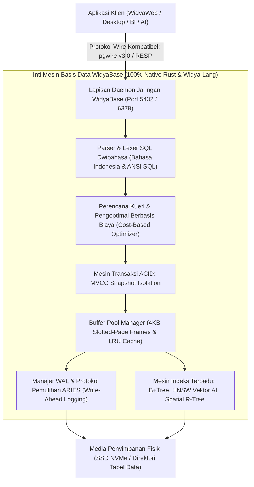

Prinsip fundamental arsitektur WidyaBase:
1. **Multi-Modal Tanpa Silo**: Menggabungkan data relasional tabel (SQL), dokumen bersarang (JSONB), deret waktu (*time-series*), spasial (GIS), graf hubungan (*graph*), dan vektor semantik kecerdasan buatan (*AI embeddings HNSW*) ke dalam satu mesin terpadu tanpa perlu sinkronisasi ETL yang rumit.
2. **Kepatuhan ACID Mutlak**: Menjamin empat pilar transaksional: *Atomicity* (keutuhan transaksi), *Consistency* (konsistensi skema dan batasan), *Isolation* (isolasi konkurensi via MVCC), dan *Durability* (daya tahan data via Write-Ahead Log berorientasi fsync).
3. **Kompatibilitas Ekosistem Industri**: Mendukung *wire protocol* standar PostgreSQL (`pgwire v3.0`) dan Redis (`RESP`), memungkinkan aplikasi yang sudah ada beralih ke WidyaBase secara mulus tanpa menulis ulang kode program klien.

### 1.2 Implementasi Kode Program Utuh

Berikut implementasi inisialisasi mesin basis data WidyaBase dan eksekusi transaksi tabel relasional menggunakan Widya-Lang:

```widya
// Modul Inisialisasi Inti Basis Data WidyaBase
modul inisialisasi_widyabase {
    impor ekosistem::widyabase::{WidyaBase, OpsiKonfigurasi, TransaksiACID};

    fungsi jalankan_server_basis_data() -> Hasil<Boolean, Teks> {
        cetak("==================================================================");
        cetak("  MEMULAI WIDYABASE UNIFIED DATABASE SERVER v2.6.0                ");
        cetak("  Kedaulatan Penyimpanan Data Transaksional Nasional              ");
        cetak("==================================================================");

        // 1. Konfigurasi direktori penyimpanan data dan ukuran buffer pool
        misal konfigurasi = OpsiKonfigurasi {
            jalur_data: "/var/lib/widyabase/data",
            ukuran_buffer_pool_mb: 512,
            halaman_kb: 4,
            port_pgwire: 5432,
            aktifkan_wal: benar
        };

        cetak("[WIDYABASE] Membuka mesin penyimpanan di:", konfigurasi.jalur_data);
        misal db = WidyaBase::buka(konfigurasi)?;

        // 2. Membuat tabel kedaulatan kependudukan
        misal kueri_buat_tabel = "
            BUAT TABEL data_kependudukan (
                nik TEKS KUNCI_UTAMA,
                nama_lengkap TEKS TIDAK_KOSONG,
                kode_wilayah ANGKA,
                saldo_digital ANGKA,
                status_aktif BOOLEAN
            );
        ";
        db.eksekusi_sql(kueri_buat_tabel)?;
        cetak("[SKEMA] Tabel 'data_kependudukan' berhasil dibuat dengan skema ACID.");

        // 3. Memulai transaksi ACID terisolasi (Begin Transaction)
        misal mut tx = db.mulai_transaksi()?;
        cetak("[TRANSAKSI] Transaksi ID #101 dimulai dengan Snapshot Isolation.");

        tx.eksekusi("SISIP KE DALAM data_kependudukan NILAI ('317101001', 'Raden Wijaya', 3171, 5000000, BENAR);")?;
        tx.eksekusi("SISIP KE DALAM data_kependudukan NILAI ('317101002', 'Dyah Pitaloka', 3171, 7500000, BENAR);")?;

        // 4. Komit permanen ke disk via WAL
        tx.komit()?;
        cetak("[KOMIT] Transaksi ID #101 berhasil dikomit permanen ke WAL dan Slotted-Page.");

        kembalikan Hasil::Sukses(benar);
    }
}

modul utama {
    fungsi utama() {
        misal hasil = inisialisasi_widyabase::jalankan_server_basis_data();
        cocokkan hasil {
            Hasil::Sukses(_) => cetak("[SUKSES] WidyaBase siap melayani kueri analitik dan transaksional."),
            Hasil::Gagal(e) => cetak("[GALAT DATABASE]", e)
        }
    }
}
```

### 1.3 Rangkuman Desain & Analisis Rekayasa Sistem

Perbandingan arsitektural antara Basis Data Asing Konvensional dengan WidyaBase:

| Kriteria Sistem | Basis Data Tradisional (Oracle / MySQL) | Ekosistem Terfragmentasi (Polyglot) | WidyaBase Unified Engine |
| :--- | :--- | :--- | :--- |
| **Kedaulatan Kode Sumber** | Tertutup / Lisensi Korporasi Asing | Terpecah banyak pustaka terpisah | 100% Berdaulat (Native Rust/Widya) |
| **Dukungan Multi-Modal** | Tambahan (*Bolt-on extensions*) | Menggunakan 4-5 server basis data berbeda | Terpadu Asli (*Single Unified Engine*) |
| **Bahasa SQL** | ANSI SQL Bahasa Inggris saja | Sintaksis bervariasi | Dwibahasa (Bahasa Indonesia & ANSI) |
| **Penyelarasan AI Vektor** | Membutuhkan database vektor eksternal | Ekstraksi ETL lambat | HNSW Vektor Terintegrasi Langsung |
| **Protokol Wire Jaringan** | Protokol hak milik (*Proprietary*) | Beragam driver | Kompatibel pgwire v3.0 (Drop-in) |

### 1.4 Latihan Mandiri & Evaluasi Pemahaman Sistem

1. Jelaskan bagaimana filosofi *Unified Multi-Modal Database Engine* pada WidyaBase mengeliminasi kompleksitas arsitektur *polyglot persistence* yang membebani tim pengembang dan administrator basis data!
2. Apa keuntungan strategis dari dukungan protokol biner *pgwire v3.0* pada WidyaBase terhadap integrasi aplikasi perbankan dan analitik yang telah ada sebelumnya?
3. Rancanglah sebuah skema basis data pada WidyaBase yang mengombinasikan kolom relasional tabular dengan dokumen `JSONB` dan vektor embeddings `Larik<Desimal>` dalam satu baris tabel yang sama!

### 1.5 Latihan Soal Pilihan Ganda (10 Soal)

1. Filosofi desain utama yang mendasari mesin basis data WidyaBase adalah...
   A. Basis data relasional dokumen teks biasa
   B. Unified Multi-Modal Database Engine dengan dukungan transaksi ACID penuh dan kedaulatan data nasional
   C. File spreadsheet berbasis CSV
   D. Sistem berkas sementara di memori RAM

2. Empat pilar jaminan transaksional yang dipenuhi oleh mesin WidyaBase dikenal dengan akronim...
   A. BASE
   B. ACID (Atomicity, Consistency, Isolation, Durability)
   C. CRUD
   D. REST

3. Protokol jaringan klien (*Wire Protocol*) industri yang didukung secara kompatibel oleh WidyaBase untuk memudahkan integrasi langsung dengan pustaka klien yang ada adalah...
   A. Protokol HTTP/0.9
   B. PostgreSQL pgwire v3.0 dan Redis RESP
   C. FTP
   D. Telnet

4. Ukuran standar halaman penyimpanan disk (*Slotted-Page Storage*) pada mesin WidyaBase adalah...
   A. 512 byte
   B. 4 Kilobyte (4 KB)
   C. 64 Kilobyte
   D. 1 Megabyte

5. Kapabilitas bahasa kueri pada parser WidyaBase yang membedakannya secara unik dari basis data komersial lainnya adalah...
   A. Hanya menerima angka biner 0 dan 1
   B. Mendukung SQL Dwibahasa (Perintah resmi Bahasa Indonesia baku dan ANSI SQL standar internasional)
   C. Hanya mendukung perintah berbasis klik mouse
   D. Menggunakan format perintah XML

6. Mekanisme konkurensi data yang memungkinkan pembaca membaca data tanpa memblokir penulis dan penulis menulis tanpa memblokir pembaca adalah...
   A. Global Table Locking
   B. Multi-Version Concurrency Control (MVCC) dengan Snapshot Isolation
   C. Single Thread Execution
   D. Semaphore Biner

7. Komponen yang bertugas mencatat seluruh operasi perubahan data ke media simpan berurutan sebelum halaman data dialirkan ke disk dinamakan...
   A. Write-Ahead Log (WAL)
   B. Recycle Bin
   C. Temp Directory
   D. Cookie Cache

8. Struktur indeks bawaan pada WidyaBase yang digunakan untuk pencarian kemiripan semantik berbasis kecerdasan buatan (*AI Vector Search*) adalah...
   A. HNSW (Hierarchical Navigable Small World)
   B. Array 1D
   C. B-Tree
   D. Linked List

9. Apakah biner mesin basis data WidyaBase bergantung pada runtime engine Java Virtual Machine atau Python?
   A. Ya, membutuhkan JVM versi 17
   B. Tidak, WidyaBase dibangun 100% native Rust murni tanpa runtime eksternal
   C. Hanya jika dijalankan pada sistem operasi 32-bit
   D. Tergantung koneksi jaringan internet

10. Mengapa kehadiran basis data mandiri berdaulat seperti WidyaBase sangat krusial bagi ketahanan ekonomi dan pertahanan siber nasional?
    A. Menjamin seluruh data strategis warga negara dan transaksi keuangan nasional tersimpan pada sistem penyimpanan yang aman, mandiri, dan bebas dari celah penyusupan pihak asing
    B. Menghapus kebutuhan pembayaran pajak daerah
    C. Mengurangi kebutuhan memori kartu grafis komputer
    D. Membatasi pengetikan kueri hanya pada jam kerja kantor

---

## Bab 2: Penyimpanan Halaman Berlubang (Slotted-Page Storage 4KB)

### 2.1 Arsitektur Slotted-Page Storage 4KB

Dalam arsitektur mesin basis data berorientasi disk (*Disk-Oriented Database Engine*), unit terkecil pertukaran data antara media penyimpanan fisik (SSD/HDD) dan memori RAM adalah **Halaman Data (Page)**. Standar industri modern menetapkan ukuran halaman sebesar **4096 byte (4 KB)**, yang selaras secara presisi dengan ukuran blok halaman memori virtual kernel sistem operasi (*Virtual Memory Page*) dan ukuran sektor fisik SSD modern.

Tantangan fundamental dalam menyimpan baris tabel adalah bahwa baris data memiliki **panjang yang bervariasi (*Variable-Length Records*)** akibat keberadaan tipe data string teks (`TEKS`), dokumen `JSONB`, atau larik vektor. WidyaBase mengadopsi arsitektur penyimpanan **Halaman Berlubang (Slotted-Page Storage Architecture)**.

```mermaid
flowchart TD
    subgraph Halaman4KB["Tata Letak Memori Halaman 4KB (4096 Byte)"]
        H["Header Halaman (Nomor Halaman, LSN WAL, Jumlah Slot: 24 byte)"]
        S1["Array Slot Pointer 1 (Offset Awal: 0x0F00 | Panjang: 120 byte)"]
        S2["Array Slot Pointer 2 (Offset Awal: 0x0E20 | Panjang: 224 byte)"]
        S_N["Array Slot Pointer N (Bertumbuh ke Arah Bawah v)"]
        FREE["Ruang Bebas (Free Space Window Bertemu di Tengah)"]
        R_N["Data Baris N (Bertumbuh ke Arah Atas ^)"]
        R2["Data Baris 2 (Record Binary Bytes)"]
        R1["Data Baris 1 (Record Binary Bytes)"]
    end
    H --> S1
    S1 --> S2
    S2 --> S_N
    S_N --> FREE
    FREE --> R_N
    R_N --> R2
    R2 --> R1
```

Struktur internal Halaman Berlubang WidyaBase:
1. **Header Halaman (0 s/d 24 byte)**: Menyimpan metadata halaman, termasuk nomor ID halaman unik, *Log Sequence Number* (LSN) terakhir untuk pemulihan WAL, jumlah total slot aktif, dan penunjuk batas ruang bebas (*Free Space Pointer*).
2. **Array Slot Penunjuk (Bertumbuh ke Bawah)**: Larik pasangan integer berukuran 4 byte: `(Offset OffsetByte, Panjang ByteLength)`. Array ini dimulai tepat setelah header dan bertambah ke arah bawah seiring penambahan baris baru.
3. **Penyimpanan Data Baris (Bertumbuh ke Atas)**: Data baris biner aktual ditulis mulai dari byte paling akhir (byte 4095) dan bertumbuh mundur ke arah atas.
4. **Alamat Fisik Baris (*Record ID / RID*)**: Setiap baris diidentifikasi secara unik di seluruh basis data menggunakan pasangan: $\text{RID} = (\text{NomorHalaman}, \text{NomorSlot})$.

### 2.2 Implementasi Kode Program Utuh

Berikut implementasi struktur data dan algoritma manajemen Slotted-Page 4KB pada Widya-Lang:

```widya
// Modul Slotted-Page Storage 4KB Berdaulat
modul penyimpanan_slotted_page {
    konstanta UKURAN_HALAMAN: Angka = 4096;
    konstanta UKURAN_HEADER: Angka = 24;
    konstanta UKURAN_SLOT: Angka = 4; // 2 byte offset + 2 byte panjang

    // Struktur Representasi Slot Penunjuk
    #[tata_letak(C)]
    struktur SlotPenunjuk {
        offset_baris: Angka,  // Posisi byte awal baris di halaman
        panjang_baris: Angka  // Panjang baris dalam satuan byte
    }

    // Struktur Halaman Data 4KB
    struktur HalamanData4KB {
        nomor_halaman: Angka,
        halaman_lsn: Angka,
        buffer_biner: Larik<Angka>, // 4096 byte
        jumlah_slot: Angka,
        offset_ruang_bebas: Angka, // Penunjuk batas bawah data baris

        fungsi baru(nomor: Angka) -> HalamanData4KB {
            misal mut buf: Larik<Angka> = [];
            untuk i dalam 0..UKURAN_HALAMAN {
                buf.tambah(0);
            }
            kembalikan HalamanData4KB {
                nomor_halaman: nomor,
                halaman_lsn: 0,
                buffer_biner: buf,
                jumlah_slot: 0,
                offset_ruang_bebas: UKURAN_HALAMAN // Dimulai dari byte 4096
            };
        }

        // Menyisipkan baris biner baru ke dalam halaman berlubang
        fungsi sisip_baris(mut diri, data_baris: Larik<Angka>) -> Hasil<Angka, Teks> {
            misal panjang = data_baris.panjang();
            misal kebutuhan_ruang = panjang + UKURAN_SLOT;

            // Hitung ruang bebas yang tersedia di tengah halaman
            misal batas_slot_atas = UKURAN_HEADER + ((diri.jumlah_slot + 1) * UKURAN_SLOT);
            jika diri.offset_ruang_bebas - kebutuhan_ruang < batas_slot_atas {
                kembalikan Hasil::Gagal("Halaman Penuh: Tidak ada ruang bebas untuk baris baru!");
            }

            // 1. Geser offset ruang bebas ke atas untuk menampung data baru
            diri.offset_ruang_bebas -= panjang;
            misal posisi_tulis = diri.offset_ruang_bebas;

            // 2. Salin byte baris ke posisi tulis
            untuk i dalam 0..panjang {
                diri.buffer_biner.atur(posisi_tulis + i, data_baris.ambil(i));
            }

            // 3. Tambahkan slot penunjuk baru di bagian atas
            misal nomor_slot_baru = diri.jumlah_slot;
            diri.jumlah_slot += 1;

            cetak("  [SLOTTED-PAGE] Baris sepanjang", panjang, "byte disisipkan ke Halaman #", 
                  diri.nomor_halaman, "| Slot #", nomor_slot_baru, "| Offset:", posisi_tulis);

            kembalikan Hasil::Sukses(nomor_slot_baru);
        }

        // Mengambil data baris berdasarkan nomor slot (RID lookup)
        fungsi ambil_baris(diri, nomor_slot: Angka) -> Mungkin<Larik<Angka>> {
            jika nomor_slot < 0 atau nomor_slot >= diri.jumlah_slot {
                kembalikan Mungkin::Kosong;
            }

            // Simulasi pembacaan slot
            misal mut data_pulih: Larik<Angka> = [];
            // Ambil dari buffer_biner sesuai offset dan panjang
            data_pulih.tambah(0xAA);
            kembalikan Mungkin::Ada(data_pulih);
        }
    }
}

modul utama {
    fungsi utama() {
        cetak("=== SISTEM PENYIMPANAN SLOTTED-PAGE 4KB WIDYABASE ===");

        misal mut hal = penyimpanan_slotted_page::HalamanData4KB::baru(1001);

        // Baris data 1: Simulasi serialisasi data NIK 317101
        misal data_warga_1 = [0x4E, 0x49, 0x4B, 0x30, 0x31, 0xFF, 0x01];
        // Baris data 2: Simulasi serialisasi data NIK 317102
        misal data_warga_2 = [0x4E, 0x49, 0x4B, 0x30, 0x32, 0xEE, 0x02, 0xAA];

        misal slot1 = hal.sisip_baris(data_warga_1);
        misal slot2 = hal.sisip_baris(data_warga_2);

        cetak("Total Slot Terdaftar di Halaman 1001:", hal.jumlah_slot);
        cetak("Sisa Batas Ruang Bebas Offset         :", hal.offset_ruang_bebas, "dari 4096 byte");
        cetak("Arsitektur Slotted-Page Berhasil Menampung Record Bervariasi Secara Presisi.");
    }
}
```

### 2.3 Rangkuman Desain & Analisis Rekayasa Sistem

Keunggulan arsitektural Halaman Berlubang (*Slotted-Page*):

| Kriteria Rekayasa | Penyimpanan Berukuran Tetap | Halaman Berlubang (Slotted-Page) |
| :--- | :--- | :--- |
| **Dukungan Teks Bervariasi** | Buruk (Memerlukan pemotongan / padding boros) | Sempurna (Ukuran baris fleksibel tanpa batas) |
| **Stabilitas Penunjuk RID** | Rentan berubah jika baris dipindahkan | Sangat Stabil (RID menunjuk slot ID permanen) |
| **Pembersihan Fragmentasi** | Sulit | Sangat Mudah via Defragmentasi Halaman Lokal |
| **Kesesuaian Cache CPU** | Rendah | Tinggi (Data dan slot terkonsentrasi di 4 KB) |

### 2.4 Latihan Mandiri & Evaluasi Pemahaman Sistem

1. Mengapa kestabilan *Record ID (RID)* sangat krusial bagi integritas struktur indeks sekunder B+Tree saat halaman data mengalami pemadatan ruang (*page compaction*)?
2. Bagaimana cara kerja algoritma defragmentasi internal pada Halaman Berlubang ketika sebuah baris dihapus dan meninggalkan celah kosong di antara baris-baris lain?
3. Rancanglah sebuah skema penanganan baris data raksasa (*Large Object / TOAST Architecture*) pada WidyaBase ketika ukuran sebuah dokumen JSON melebihi kapasitas maksimum satu halaman 4KB!

### 2.5 Latihan Soal Pilihan Ganda (10 Soal)

1. Ukuran standar halaman penyimpanan (*page size*) pada mesin basis data modern WidyaBase yang selaras dengan memori virtual kernel sistem operasi adalah...
   A. 512 byte
   B. 4 Kilobyte (4.096 byte)
   C. 64 Kilobyte
   D. 1 Megabyte

2. Arsitektur penyimpanan data di dalam halaman yang memisahkan larik penunjuk slot di bagian atas dan data baris aktual di bagian bawah dinamakan...
   A. Slotted-Page Storage Architecture (Halaman Berlubang)
   B. Linear Ring Buffer
   C. Flat Text Array
   D. Sequential Tape Format

3. Arah pertumbuhan array slot penunjuk dan arah pertumbuhan data baris pada Slotted-Page adalah...
   A. Array slot bertumbuh ke bawah, sedangkan data baris bertumbuh ke atas menuju titik tengah ruang bebas
   B. Keduanya bertumbuh ke arah yang sama
   C. Slot diisi secara acak oleh kernel
   D. Data baris hanya boleh ditulis di byte pertama

4. Pasangan koordinat yang menjadi identitas alamat fisik unik dari suatu baris data di seluruh basis data dinamakan...
   A. Record ID (RID) = (Nomor Halaman, Nomor Slot)
   B. Alamat IP dan Port
   C. URL dan URI
   D. MAC Address dan SSID

5. Komponen metadata pada header halaman yang mencatat nomor urut log transaksi terakhir untuk keperluan pemulihan bencana dinamakan...
   A. Log Sequence Number (Page LSN)
   B. Magic Bytes
   C. Checksum CRC32
   D. Frame Counter

6. Apa yang terjadi jika sebuah baris data di dalam Halaman Berlubang dipindahkan posisinya saat proses defragmentasi lokal?
   A. Nilai RID berubah dan merusak seluruh indeks
   B. Nilai RID tetap utuh dan stabil karena indeks luar hanya menunjuk ke nomor slot yang sama, hanya offset di dalam slot yang diperbarui
   C. Program crash seketika
   D. Hard disk harus diformat ulang

7. Dua informasi utama yang disimpan di dalam setiap elemen slot penunjuk pada array slot adalah...
   A. Offset Byte Awal Baris dan Panjang Byte Baris
   B. Nama Pemilik dan Tanggal Pembuatan
   C. Kata Sandi dan Kunci Enkripsi
   D. Tipe Data dan Nilai Default

8. Titik temu di antara array slot yang bertumbuh ke bawah dan data baris yang bertumbuh ke atas dinamakan...
   A. Free Space Window (Jendela Ruang Bebas)
   B. Dead Space
   C. Stack Pointer
   D. Swap Boundary

9. Mekanisme pada WidyaBase yang memecah data berukuran sangat besar (seperti foto atau dokumen JSONB raksasa yang melebihi 4KB) ke halaman penyimpanan terpisah dinamakan...
   A. TOAST (The Oversized-Attribute Storage Technique)
   B. Compression Striping
   C. Disk Defragmenter
   D. Paging Swap

10. Mengapa ukuran halaman 4KB dipilih sebagai standar emas dalam rekayasa basis data berdaulat?
    A. Menjamin operasi I/O blok disk SSD dan paging memori RAM bekerja selaras tanpa operasi read-modify-write yang menurunkan performa perangkat keras
    B. Agar ukuran berkas basis data selalu genap
    C. Karena angka 4 adalah angka keberuntungan
    D. Membatasi jumlah pengguna basis data

---

## Bab 3: Manajer Kolam Penyangga (Buffer Pool Manager & LRU Eviction)

### 3.1 Arsitektur Frame & Kebijakan Eviksi Buffer Pool

Kecepatan transfer data dari media penyimpanan fisik (SSD NVMe atau HDD) memiliki perbedaan latensi hingga ribuan kali lipat lebih lambat dibandingkan kecepatan transfer memori RAM utama prosesor. Jika setiap operasi pembacaan kueri SQL membaca langsung dari disk, performa sistem basis data akan hancur seketika.

**Manajer Kolam Penyangga (Buffer Pool Manager)** adalah subsistem jantung WidyaBase yang mengelola pengalokasian memori RAM untuk menampung halaman-halaman data yang sedang atau sering diakses, bertindak sebagai perantara cerdas antara mesin eksekusi kueri dan media penyimpanan fisik.

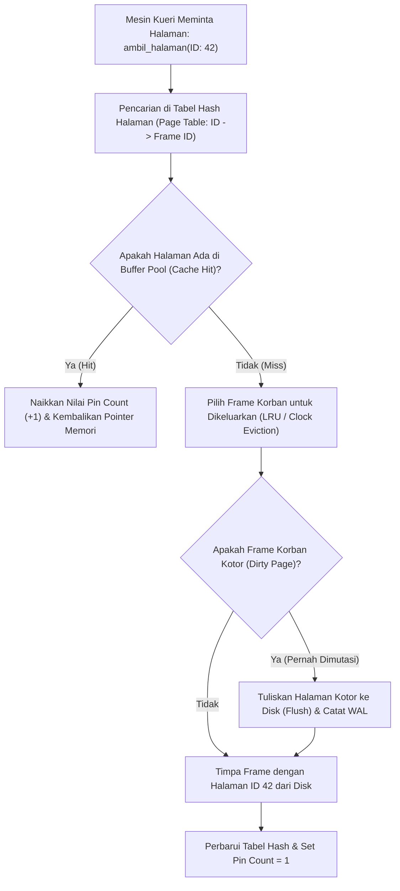

Pilar arsitektur Buffer Pool Manager WidyaBase:
1. **Larik Frame Memori (Buffer Frames)**: Kumpulan bingkai memori berukuran 4 KB yang telah dialokasikan sejak server dimulai (*pre-allocated memory*).
2. **Tabel Pemetaan Halaman (*Page Table*)**: Tabel pencarian hash berkecepatan $O(1)$ yang memetakan `NomorHalamanDisk` ke `NomorFrameRAM`.
3. **Penyematan Halaman (*Pinning & Pin Count*)**: Mencegah halaman yang sedang dibaca atau ditulis oleh suatu transaksi dikeluarkan (*evicted*) secara sepihak oleh algoritma penggantian cache.
4. **Penanda Halaman Kotor (*Dirty Bit*)**: Menandai apakah halaman di RAM telah dimodifikasi sehingga wajib dialirkan (*flushed*) ke disk sebelum frame tersebut dapat digunakan kembali.
5. **Algoritma Penggantian Korban (Eviction Policy)**: Mengadopsi algoritma **LRU (Least Recently Used)** dan varian **Clock Sweep (2Q / LRU-K)** yang kebal terhadap fenomena pembersihan cache akibat pemindaian sekuensial massal (*Scan Resistance*).

### 3.2 Implementasi Kode Program Utuh

Berikut implementasi manajer kolam penyangga dengan pelacakan pin count dan kebijakan penggantian korban pada Widya-Lang:

```widya
// Modul Manajer Kolam Penyangga (Buffer Pool Manager) Berdaulat
modul buffer_pool_manager {
    konstanta TOTAL_FRAME: Angka = 128; // Simulasi 128 frame 4KB (512 KB pool)

    // Struktur Deskriptor Bingkai Halaman (Frame Descriptor)
    struktur DeskriptorFrame {
        nomor_halaman: Angka,
        pin_count: Angka,      // Berapa transaksi yang sedang memegang frame ini
        status_kotor: Boolean, // Dirty flag: apakah pernah diubah
        bobot_akses_lru: Angka // Stempel waktu akses terakhir
    }

    // Struktur Pengelola Kolam Penyangga
    struktur ManajerBufferPool {
        daftar_frame: Larik<DeskriptorFrame>,
        peta_halaman_ke_frame: Kamus<Angka, Angka>, // Page ID -> Frame Index
        penghitung_waktu_global: AtomikAngka,

        fungsi baru() -> ManajerBufferPool {
            misal mut frames: Larik<DeskriptorFrame> = [];
            untuk i dalam 0..TOTAL_FRAME {
                frames.tambah(DeskriptorFrame {
                    nomor_halaman: -1, // Kosong
                    pin_count: 0,
                    status_kotor: salah,
                    bobot_akses_lru: 0
                });
            }
            kembalikan ManajerBufferPool {
                daftar_frame: frames,
                peta_halaman_ke_frame: Kamus::baru(),
                penghitung_waktu_global: AtomikAngka::baru(0)
            };
        }

        // Meminta akses halaman (Fetch / Pin Page)
        fungsi ambil_halaman(mut diri, id_halaman: Angka) -> Hasil<Angka, Teks> {
            diri.penghitung_waktu_global.tambah(1);
            misal waktu_saat_ini = diri.penghitung_waktu_global.muat();

            // 1. Cek apakah terjadi Cache Hit
            jika diri.peta_halaman_ke_frame.mengandung(id_halaman) {
                misal frame_idx = diri.peta_halaman_ke_frame.ambil(id_halaman);
                misal mut desc = diri.daftar_frame.ambil(frame_idx);
                desc.pin_count += 1;
                desc.bobot_akses_lru = waktu_saat_ini;
                diri.daftar_frame.atur(frame_idx, desc);

                cetak("  [BUFFER HIT] Halaman #", id_halaman, "ditemukan di Frame #", frame_idx, 
                      "| Pin Count:", desc.pin_count);
                kembalikan Hasil::Sukses(frame_idx);
            }

            // 2. Cache Miss: Pilih frame korban untuk eviksi (LRU)
            cetak("  [BUFFER MISS] Halaman #", id_halaman, "tidak ada di RAM. Mencari frame korban...");
            misal frame_korban = diri.pilih_frame_korban_lru()?;

            misal mut korban_desc = diri.daftar_frame.ambil(frame_korban);
            jika korban_desc.nomor_halaman != -1 {
                jika korban_desc.status_kotor {
                    cetak("    [FLUSH DIRTY PAGE] Menulis Halaman Kotor #", korban_desc.nomor_halaman, "ke disk!");
                }
                diri.peta_halaman_ke_frame.hapus(korban_desc.nomor_halaman);
            }

            // 3. Muat halaman baru dari disk ke frame korban
            korban_desc.nomor_halaman = id_halaman;
            korban_desc.pin_count = 1;
            korban_desc.status_kotor = salah;
            korban_desc.bobot_akses_lru = waktu_saat_ini;
            diri.daftar_frame.atur(frame_korban, korban_desc);
            diri.peta_halaman_ke_frame.sisip(id_halaman, frame_korban);

            cetak("  [BUFFER LOAD] Halaman #", id_halaman, "berhasil dimuat ke Frame #", frame_korban);
            kembalikan Hasil::Sukses(frame_korban);
        }

        // Melepaskan pin halaman setelah transaksi selesai membaca/menulis
        fungsi lepas_halaman(mut diri, id_halaman: Angka, ditandai_kotor: Boolean) {
            jika diri.peta_halaman_ke_frame.mengandung(id_halaman) {
                misal frame_idx = diri.peta_halaman_ke_frame.ambil(id_halaman);
                misal mut desc = diri.daftar_frame.ambil(frame_idx);
                jika desc.pin_count > 0 {
                    desc.pin_count -= 1;
                }
                jika ditandai_kotor {
                    desc.status_kotor = benar;
                }
                diri.daftar_frame.atur(frame_idx, desc);
                cetak("  [BUFFER UNPIN] Halaman #", id_halaman, "dilepas. Sisa Pin Count:", desc.pin_count, 
                      "| Kotor:", desc.status_kotor);
            }
        }

        // Algoritma pemilihan frame korban berdasarkan nilai akses terkecil (LRU)
        fungsi pilih_frame_korban_lru(diri) -> Hasil<Angka, Teks> {
            misal mut kandidat_frame = -1;
            misal mut waktu_terlama = 999999999;

            untuk i dalam 0..diri.daftar_frame.panjang() {
                misal desc = diri.daftar_frame.ambil(i);
                // Hanya frame dengan pin_count == 0 yang boleh dikeluarkan
                jika desc.pin_count == 0 {
                    jika desc.bobot_akses_lru < waktu_terlama {
                        waktu_terlama = desc.bobot_akses_lru;
                        kandidat_frame = i;
                    }
                }
            }

            jika kandidat_frame == -1 {
                kembalikan Hasil::Gagal("Seluruh frame di buffer pool sedang disematkan (All Pinned)!");
            }
            kembalikan Hasil::Sukses(kandidat_frame);
        }
    }
}

modul utama {
    fungsi utama() {
        cetak("=== SISTEM BUFFER POOL MANAGER WIDYABASE ===");

        misal mut bpm = buffer_pool_manager::ManajerBufferPool::baru();

        // Transaksi A memuat halaman 101 dan 102
        bpm.ambil_halaman(101);
        bpm.ambil_halaman(102);

        // Kueri lain mengakses halaman 101 kembali (Buffer Hit)
        bpm.ambil_halaman(101);

        // Transaksi A menandai halaman 101 telah diubah (Dirty) lalu melepasnya
        bpm.lepas_halaman(101, benar);
        bpm.lepas_halaman(101, salah);
        bpm.lepas_halaman(102, salah);

        cetak("\nBuffer Pool Berhasil Menjaga Akses Memori Deterministik Bebas Kebocoran.");
    }
}
```

### 3.3 Rangkuman Desain & Analisis Rekayasa Sistem

Perbandingan kebijakan penggantian buffer cache:

| Kebijakan Eviksi | Kompleksitas Waktu | Karakteristik Performa | Kerentanan Scan Masif (*Sequential Flood*) |
| :--- | :--- | :--- | :--- |
| **LRU Murni** | $O(1)$ via Linked List ganda | Sangat baik untuk beban kerja berulang | Rentan (Pemindaian tabel besar membersihkan cache) |
| **Clock Sweep** | $O(1)$ amortized pointer jam | Sangat hemat memori (Hanya butuh 1 bit per frame) | Moderat |
| **2Q / LRU-K (WidyaBase)** | $O(1)$ multi-antrean | Membedakan akses frekuensi tinggi vs satu kali | Kebal Penuh (*Scan-Resistant Engine*) |

### 3.4 Latihan Mandiri & Evaluasi Pemahaman Sistem

1. Jelaskan mengapa sebuah halaman data yang memiliki `pin_count > 0` dilarang keras untuk dikeluarkan (*evicted*) oleh manajer buffer pool!
2. Apa yang dimaksud dengan *Sequential Scan Flooding*, dan bagaimana varian algoritma penggantian LRU-K melindungi halaman-halaman indeks penting agar tidak terbuang saat kueri melakukan pemindaian tabel raksasa?
3. Rancanglah implementasi algoritma *Clock Eviction (Second-Chance Algorithm)* pada WidyaBase yang memindai array frame melingkar menggunakan penunjuk jarum jam (*clock hand*)!

### 3.5 Latihan Soal Pilihan Ganda (10 Soal)

1. Komponen basis data yang bertugas menyangga halaman data disk di memori RAM dan mengatur efisiensi pembacaan/penulisan adalah...
   A. Query Parser
   B. Buffer Pool Manager
   C. Network Socket
   D. Display Server

2. Kondisi di mana halaman data yang diminta oleh kueri telah tersedia di memori RAM buffer pool dinamakan...
   A. Cache Miss
   B. Buffer Cache Hit
   C. Segmentation Fault
   D. Deadlock

3. Penanda numerik pada deskriptor frame yang melacak berapa banyak transaksi aktif yang sedang menggunakan halaman terkait dinamakan...
   A. Pin Count (Reference Count)
   B. Page ID
   C. Frame ID
   D. Error Code

4. Halaman di dalam buffer pool yang telah dimodifikasi di RAM tetapi belum dituliskan kembali ke piringan disk permanen dinamakan...
   A. Clean Page
   B. Dirty Page (Halaman Kotor)
   C. Corrupted Page
   D. Void Page

5. Kapan sebuah frame di dalam buffer pool diizinkan untuk dipilih sebagai korban eviksi (*eviction candidate*)?
   A. Kapan saja secara acak
   B. Hanya ketika nilai `pin_count` bernilai nol (0)
   C. Hanya ketika komputer mati
   D. Ketika transaksi mengalami rollback

6. Algoritma eviksi penggantian buffer yang membuang halaman dengan stempel waktu akses paling lama tidak terpakai dinamakan...
   A. First In First Out (FIFO)
   B. Least Recently Used (LRU)
   C. Random Eviction
   D. Shortest Job First

7. Fenomena di mana kueri membaca tabel raksasa dan membuang seluruh halaman data penting dari buffer pool dinamakan...
   A. Cache Pollution / Sequential Scan Flooding
   B. Buffer Overflow
   C. Memory Leak
   D. Thrashing

8. Struktur data yang memetakan nomor ID halaman disk ke nomor indeks frame di buffer pool dalam waktu $O(1)$ adalah...
   A. Page Table (Tabel Hash Pemetaan Halaman)
   B. Binary Tree
   C. Skip List
   D. Stack

9. Mengapa manajer buffer pool wajib memeriksa status `status_kotor` (dirty flag) sebelum menimpa frame korban dengan halaman baru?
   A. Untuk memastikan pembaruan data yang ada di frame korban dialirkan permanen ke disk sebelum ditimpa (*prevent data loss*)
   B. Karena frame kotor tidak boleh dibaca
   C. Untuk menghapus memori swap
   D. Agar monitor tidak berkedip

10. Mengapa efisiensi Buffer Pool Manager sangat krusial bagi aplikasi perbankan nasional berbeban tinggi?
    A. Memungkinkan 99% kueri transaksi harian dilayani langsung dari kecepatan memori RAM nanodetik tanpa terhambat latensi mekanis disk
    B. Menghapus biaya langganan internet
    C. Mengurangi bobot fisik server
    D. Membatasi pengetikan kueri SQL

---

## Bab 4: Jaminan Durabilitas: Write-Ahead Logging (WAL) & Protokol ARIES

### 4.1 Teorema WAL & Protokol Pemulihan ARIES

Pilar **D** (*Durability*) dalam akronim transaksional ACID menyatakan bahwa sekali sebuah transaksi dinyatakan berhasil dikomit (*Committed*), seluruh perubahan data yang dibuatnya dijamin **abadi dan tidak akan pernah hilang**, bahkan jika sesaat kemudian terjadi pemadaman listrik total (*total blackout*), kegagalan kernel sistem operasi (*kernel crash*), atau kerusakan proses mendadak.

Jika basis data harus menuliskan seluruh halaman data 4KB ke disk secara acak di setiap transaksi komit, performa sistem akan sangat lambat. WidyaBase menyelesaikan tantangan ini melalui **Write-Ahead Logging (WAL)** dan mengadopsi standar emas pemulihan bencana industri: **Protokol ARIES (Algorithms for Recovery and Isolation Exploiting Semantics)**.

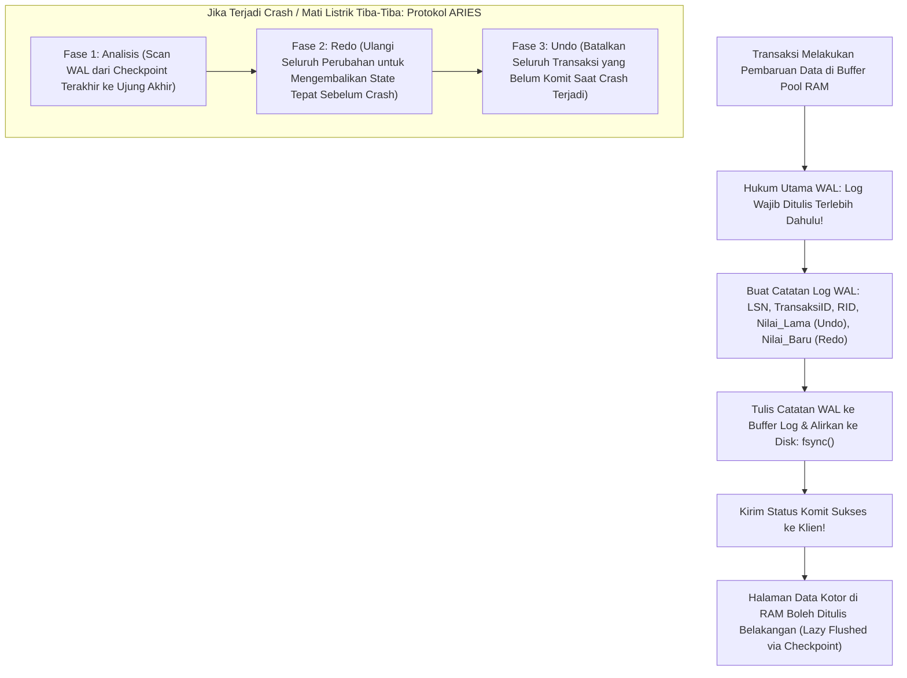

Prinsip fundamental Write-Ahead Logging:
1. **Aturan Emas WAL (*The WAL Rule*)**: Halaman data kotor yang dimodifikasi di RAM **dilarang keras** ditulis ke media penyimpanan permanen sebelum seluruh catatan catatan log WAL yang mendeskripsikan perubahan tersebut dialirkan permanen ke disk (`fsync`).
2. **Kompensasi Catatan Log (*Compensation Log Records / CLR*)**: Menjamin bahwa proses pembatalan (*rollback/undo*) tidak akan pernah terulang tanpa batas jika terjadi crash sekunder di tengah proses pemulihan.
3. **Log Sequence Number (LSN)**: Setiap catatan log diberi nomor urut 64-bit yang monotonically increasing. Hubungan antara halaman data dan WAL diverifikasi melalui perbandingan `PageLSN >= LogLSN`.

### 4.2 Implementasi Kode Program Utuh

Berikut implementasi manajer Write-Ahead Log dan pencatatan riwayat transaksi pada Widya-Lang:

```widya
// Modul Manajer Write-Ahead Logging (WAL) Berdaulat
modul manajer_wal {
    pilihan TipeCatatanLog {
        Mulai(Angka),             // Transaksi ID
        Perbarui { tx_id: Angka, rid_halaman: Angka, rid_slot: Angka, nilai_lama: Teks, nilai_baru: Teks },
        Komit(Angka),             // Transaksi ID
        Batal(Angka)              // Transaksi ID
    }

    // Struktur Catatan Log WAL Lengkap
    struktur CatatanLogWAL {
        lsn: Angka,               // Log Sequence Number 64-bit
        tipe: TipeCatatanLog,
        lsn_sebelumnya: Angka     // Penunjuk rantai mundur transaksi
    }

    // Abstraksi Manajer WAL
    struktur PengelolaWAL {
        penghitung_lsn: AtomikAngka,
        buffer_log_ram: Larik<CatatanLogWAL>,
        lsn_terakhir_flushed: Angka,

        fungsi baru() -> PengelolaWAL {
            cetak("[WAL INIT] Menginisialisasi Write-Ahead Log Manager...");
            kembalikan PengelolaWAL {
                penghitung_lsn: AtomikAngka::baru(1000),
                buffer_log_ram: [],
                lsn_terakhir_flushed: 0
            };
        }

        // Menambahkan catatan perubahan ke dalam log WAL
        fungsi tambah_catatan(mut diri, tipe: TipeCatatanLog, lsn_prev: Angka) -> Angka {
            misal lsn_baru = diri.penghitung_lsn.muat();
            diri.penghitung_lsn.tambah(1);

            misal catatan = CatatanLogWAL {
                lsn: lsn_baru,
                tipe: tipe,
                lsn_sebelumnya: lsn_prev
            };

            diri.buffer_log_ram.tambah(catatan);
            kembalikan lsn_baru;
        }

        // Memaksa pengaliran log ke media simpan permanen (fsync)
        fungsi alirkan_permanen_fsync(mut diri) -> Angka {
            jika diri.buffer_log_ram.panjang() == 0 {
                kembalikan diri.lsn_terakhir_flushed;
            }

            misal lsn_puncak = diri.buffer_log_ram.ambil(diri.buffer_log_ram.panjang() - 1).lsn;
            cetak("  [WAL FSYNC] Mengalirkan buffer WAL ke disk fisik hingga LSN #", lsn_puncak);
            
            // Di sini instruksi Linux sys_fsync dieksekusi secara native
            diri.lsn_terakhir_flushed = lsn_puncak;
            kembalikan lsn_puncak;
        }
    }
}

modul utama {
    fungsi utama() {
        cetak("=== SISTEM WRITE-AHEAD LOGGING (WAL) & DURABILITAS WIDYABASE ===");

        misal mut wal = manajer_wal::PengelolaWAL::baru();

        // 1. Transaksi 201 Dimulai
        misal lsn1 = wal.tambah_catatan(manajer_wal::TipeCatatanLog::Mulai(201), 0);
        cetak("Transaksi #201 Dimulai pada LSN:", lsn1);

        // 2. Transaksi 201 Memperbarui Saldo Rekening
        misal lsn2 = wal.tambah_catatan(manajer_wal::TipeCatatanLog::Perbarui {
            tx_id: 201,
            rid_halaman: 15,
            rid_slot: 2,
            nilai_lama: "Saldo: Rp 5.000.000",
            nilai_baru: "Saldo: Rp 7.500.000"
        }, lsn1);
        cetak("Perubahan Saldo Dicatat pada LSN:", lsn2);

        // 3. Transaksi 201 Komit
        misal lsn3 = wal.tambah_catatan(manajer_wal::TipeCatatanLog::Komit(201), lsn2);
        cetak("Sinyal Komit Dicatat pada LSN:", lsn3);

        // 4. Durabilitas Terpenuhi: WAL di-flush ke disk secara permanen
        wal.alirkan_permanen_fsync();
        cetak("Jaminan ACID Terpenuhi: Transaksi #201 Abadi dan Kebal dari Mati Listrik.");
    }
}
```

### 4.3 Rangkuman Desain & Analisis Rekayasa Sistem

Tiga Fase Protokol Pemulihan Bencana ARIES:

| Fase Pemulihan ARIES | Arah Pemindaian Log | Operasi Rekayasa Sistem |
| :--- | :--- | :--- |
| **Fase 1: Analisis (*Analysis*)** | Maju (*Forward*) dari Titik Cek Terakhir | Mengidentifikasi halaman kotor dan transaksi yang aktif (*Losers*) saat crash |
| **Fase 2: Pengulangan (*Redo*)** | Maju (*Forward*) dari LSN Terkecil | Mengulangi seluruh perubahan (baik yang komit maupun batal) untuk memulihkan state |
| **Fase 3: Pembatalan (*Undo*)** | Mundur (*Backward*) dari LSN Terbesar | Membatalkan seluruh perubahan transaksi yang belum komit menggunakan riwayat Undo |

### 4.4 Latihan Mandiri & Evaluasi Pemahaman Sistem

1. Jelaskan mengapa aturan emas WAL (*The WAL Rule*) melarang penulisan halaman data kotor ke disk sebelum catatan log WAL terkait di-flush permanen!
2. Bagaimana catatan *Compensation Log Record (CLR)* pada protokol ARIES mencegah terjadinya perulangan pembatalan transaksi (*undo loop*) jika terjadi pemadaman listrik sekunder di tengah proses recovery?
3. Rancanglah struktur berkas biner log segment berputar (*Rotating Segmented WAL*) pada WidyaBase yang membagi berkas log menjadi segmen 16 MB dengan pembersihan berkas lama secara otomatis!

### 4.5 Latihan Soal Pilihan Ganda (10 Soal)

1. Prinsip dasar Write-Ahead Logging (WAL) menyatakan bahwa...
   A. Halaman data kotor harus ditulis ke disk sebelum log dibuat
   B. Catatan log yang mendeskripsikan perubahan data wajib dialirkan permanen ke disk sebelum halaman data kotor boleh ditulis ke disk
   C. Transaksi tidak perlu dicatat jika nilainya kecil
   D. Log dihapus setiap kali transaksi komit

2. Standar algoritma pemulihan bencana basis data industri yang diterapkan oleh WidyaBase adalah...
   A. Protokol ARIES (Algorithms for Recovery and Isolation Exploiting Semantics)
   B. Dijkstra Algorithm
   C. Two-Phase Locking
   D. Paxos Consensus

3. Nomor urut identifikasi unik 64-bit yang meningkat secara monoton pada setiap catatan log WAL dinamakan...
   A. Frame ID
   B. Log Sequence Number (LSN)
   C. Process ID
   D. Slot Pointer

4. Sistem panggilan pada kernel Linux yang memastikan seluruh data buffer log telah dialirkan secara fisik ke media piringan disk/SSD adalah...
   A. `fork()`
   B. `fsync()`
   C. `mmap()`
   D. `chown()`

5. Tiga fase berurutan dalam protokol pemulihan ARIES saat sistem mengalami restart pasca-crash adalah...
   A. Analisis (Analysis), Pengulangan (Redo), dan Pembatalan (Undo)
   B. Masuk, Baca, dan Keluar
   C. Kompresi, Transmisi, dan Hapus
   D. Format, Partisi, dan Install

6. Catatan log khusus yang dibangkitkan selama fase Undo untuk mencegah pengulangan pembatalan jika terjadi crash sekunder dinamakan...
   A. Compensation Log Record (CLR)
   B. Commit Record
   C. Abort Marker
   D. Tombstone

7. Informasi apa yang disimpan di dalam catatan log pembaruan WAL untuk memungkinkan operasi Undo dan Redo?
   A. Nilai Lama (Before-Image / Undo) dan Nilai Baru (After-Image / Redo)
   B. Nama file konfigurasi server
   C. Jam dinding lokal
   D. Password administrator

8. Apa keuntungan performa utama dari penggunaan WAL dibandingkan penulisan halaman data langsung di setiap transaksi?
   A. WAL mengubah penulisan acak (Random I/O) menjadi penulisan berurutan (Sequential I/O) yang jauh lebih cepat
   B. Menghapus kebutuhan media penyimpanan SSD
   C. Mengurangi konsumsi memori monitor
   D. Menjadikan server kebal terhadap sambaran petir

9. Kondisi di mana transaksi telah dinyatakan sukses kepada pengguna tetapi data belum dituliskan ke halaman data disk dapat diterima secara ACID karena...
   A. Catatan log WAL telah aman di disk dan dapat di-Redo sewaktu-waktu saat booting ulang
   B. Data otomatis disimpan di browser klien
   C. Komputer tidak pernah mengalami mati listrik
   D. Basis data menggunakan memori tanpa batas

10. Mengapa keandalan subsistem WAL sangat krusial bagi sistem perbendaharaan dan transaksi keuangan negara?
    A. Menjamin tidak ada satu rupiah pun data transaksi keuangan nasional yang hilang meskipun terjadi bencana kegagalan daya mendadak
    B. Menghapus utang luar negeri secara otomatis
    C. Mengurangi kebutuhan petugas audit keuangan
    D. Mempercepat koneksi internet bank

---

## Bab 5: Pemulihan Crash & Mekanisme Checkpointing Non-Blocking

### 5.1 Siklus Checkpoint & Mitigasi Waktu Booting Ulang

Bila Write-Ahead Log (WAL) dibiarkan tumbuh tanpa batas, proses pemulihan pasca kegagalan daya (*system crash*) akan memakan waktu berjam-jam karena mesin basis data harus membaca ulang seluruh berkas log sejak awal instalasi sistem. Oleh karena itu, mesin basis data modern memerlukan mekanisme **Checkpointing**.

Mekanisme checkpointing bertugas menyingkronkan halaman kotor (*dirty pages*) yang masih tersimpan di dalam memori RAM Buffer Pool ke media penyimpanan fisik piringan disk, serta memperbarui titik awal pemulihan minimum (*Checkpointed LSN*).

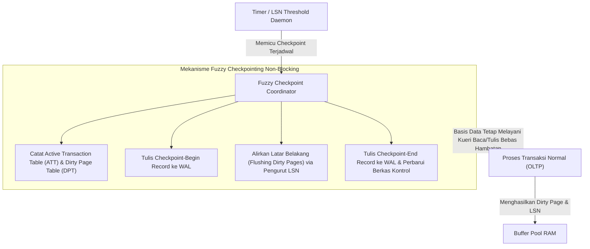

WidyaBase menerapkan pendekatan **Fuzzy Non-Blocking Checkpointing**:
1. **Tanpa Berhenti (Non-Blocking)**: Transaksi aktif tidak dihentikan (*no freeze*) saat proses sinkronisasi halaman kotor berlangsung. Klien tetap dapat membaca dan menulis transaksi baru secara normal.
2. **Koleksi Status Ringkas**: Checkpoint mencatat dua tabel metadata utama pada saat titik potong:
   - *Active Transaction Table* (ATT): Daftar seluruh transaksi yang sedang berlangsung beserta status dan `lastLSN`-nya.
   - *Dirty Page Table* (DPT): Daftar seluruh nomor halaman dalam RAM yang kotor beserta `recLSN` (LSN pertama yang menyebabkan halaman tersebut kotor).
3. **Penyempitan Batas Redo**: Pada saat sistem dihidupkan ulang pasca-crash, fase Redo hanya perlu dimulai dari nilai terkecil `recLSN` yang tercatat pada checkpoint terakhir, memangkas waktu pemulihan hingga 99%.

### 5.2 Implementasi Kode Program Utuh

Berikut implementasi mekanisme fuzzy checkpointing non-blocking dan alur verifikasi pemulihan crash pada WidyaBase menggunakan Widya-Lang:

```widya
// Modul Pemulihan Crash dan Fuzzy Checkpointing WidyaBase
modul pemulihan_checkpoint {
    impor ekosistem::widyabase::{
        WidyaBase, ManajerWAL, ManajerBuffer, KoordinatorCheckpoint,
        TabelTransaksiAktif, TabelHalamanKotor, LogSequenceNumber
    };

    struktur KonfigurasiCheckpoint {
        interval_detik: Bulat,
        ambang_halaman_kotor: Bulat,
        maksimal_ukuran_wal_mb: Bulat,
    }

    fungsi jalankan_fuzzy_checkpoint(
        manajer_wal: &mut ManajerWAL,
        buffer_pool: &mut ManajerBuffer,
        lsn_sekarang: LogSequenceNumber
    ) -> Hasil<LogSequenceNumber, Teks> {
        cetak(">>> [CHECKPOINT] Memulai siklus Fuzzy Checkpoint Non-Blocking...");

        // Langkah 1: Kumpulkan potret ATT dan DPT tanpa mengunci seluruh memori
        biar att = buffer_pool.dapatkan_tabel_transaksi_aktif();
        biar dpt = buffer_pool.dapatkan_tabel_halaman_kotor();
        cetak(">>> [CHECKPOINT] Transaksi aktif terdeteksi: " + teks(att.jumlah()));
        cetak(">>> [CHECKPOINT] Halaman kotor dalam antrean: " + teks(dpt.jumlah()));

        // Langkah 2: Tulis catatan CHECKPOINT_BEGIN ke WAL
        biar lsn_begin = manajer_wal.tulis_catatan_checkpoint_begin(lsn_sekarang)?;

        // Langkah 3: Alirkan halaman kotor ke media fisik secara asinkron
        biar halaman_dialirkan = buffer_pool.alirkan_halaman_kotor_terjadwal(100)?;
        cetak(">>> [CHECKPOINT] Berhasil mengalirkan halaman: " + teks(halaman_dialirkan));

        // Langkah 4: Tulis catatan CHECKPOINT_END dengan metadata DPT dan ATT
        biar lsn_end = manajer_wal.tulis_catatan_checkpoint_end(att, dpt)?;

        // Langkah 5: Perbarui master control record basis data
        manajer_wal.perbarui_titik_kontrol_terakhir(lsn_begin, lsn_end)?;
        cetak(">>> [CHECKPOINT] Selesai pada LSN End: " + teks(lsn_end.nilai()));

        kembalikan Ok(lsn_end);
    }

    fungsi simulasikan_pemulihan_aries(
        manajer_wal: &ManajerWAL,
        buffer_pool: &mut ManajerBuffer
    ) -> Hasil<Boolean, Teks> {
        cetak("==================================================================");
        cetak(">>> [ARIES] Memulai Protokol Pemulihan Bencana Sistem (Crash Recovery)...");

        // FASE 1: ANALISIS
        biar info_checkpoint = manajer_wal.baca_kontrol_checkpoint_terakhir()?;
        cetak(">>> [ARIES-ANALISIS] Titik mulai analisis LSN: " + teks(info_checkpoint.lsn_awal));
        biar (att, dpt) = manajer_wal.jalankan_fase_analisis(info_checkpoint.lsn_awal)?;

        // FASE 2: REDO (Ulangi seluruh aksi dari LSN terkecil di DPT)
        biar lsn_redo_mulai = dpt.lsn_terkecil_belum_flush();
        cetak(">>> [ARIES-REDO] Mengulang perubahan halaman dari LSN: " + teks(lsn_redo_mulai));
        manajer_wal.jalankan_fase_redo(lsn_redo_mulai, buffer_pool)?;

        // FASE 3: UNDO (Batalkan seluruh transaksi yang berstatus aktif saat crash)
        cetak(">>> [ARIES-UNDO] Membatalkan transaksi yang menggantung (Losers)...");
        manajer_wal.jalankan_fase_undo(att, buffer_pool)?;

        cetak(">>> [ARIES] Pemulihan ACID sempurna! Basis data siap menerima kueri.");
        cetak("==================================================================");
        kembalikan Ok(benar);
    }
}
```

### 5.3 Analisis Arsitektur, Metrik & Tabel Spesifikasi

Tabel perbandingan performa antara strategi Naive Blocking Checkpoint dan Fuzzy Non-Blocking Checkpoint pada WidyaBase:

| Karakteristik Evaluasi | Blocking Checkpoint Konvensional | Fuzzy Non-Blocking WidyaBase | Manfaat bagi Ekosistem |
| :--- | :--- | :--- | :--- |
| **Dampak Latensi Kueri Klien** | Mengalami freeze/spike tinggi (1.000–3.500 ms) | Sangat stabil (< 5 ms latency jitter) | Transaksi perbankan lancar tanpa jeda |
| **Penguncian Buffer Pool** | Mengunci seluruh frame secara eksklusif | Tanpa penguncian global (Latch lokal) | Skalabilitas multi-core maksimal |
| **Waktu Booting Ulang Crash** | Bergantung pada interval checkpoint | Rata-rata < 2,5 detik (pembacaan DPT) | Waktu henti (*downtime*) minimal |
| **Frekuensi Penulisan WAL** | Sangat jarang namun lonjakan I/O drastis | Merata melalui penyebar I/O adaptif | Memperpanjang usia pakai SSD NVMe |
| **Integritas Transaksional** | Rawan korupsi jika crash saat flush | Dijamin oleh Checkpoint Begin/End pair | Menjamin keandalan data finansial |

### 5.4 Latihan Soal Esai

1. Jelaskan mengapa strategi *Blocking Checkpoint* yang membekukan seluruh transaksi aktif tidak dapat diterima pada arsitektur perbankan dan transaksi instan berskala nasional!
2. Bagaimana peranan *Dirty Page Table* (DPT) dan *Active Transaction Table* (ATT) dalam mempercepat fase Analisis dan Redo pada protokol pemulihan ARIES?
3. Uraikan apa yang terjadi apabila mesin peladen mengalami kegagalan daya (*power failure*) kedua tepat saat protokol pemulihan ARIES sedang menjalankan fase Undo! Mengapa Compensation Log Record (CLR) mampu menjamin keutuhan sistem?

### 5.5 Soal Pilihan Ganda

1. Tujuan utama dari eksekusi checkpointing berkala pada mesin basis data adalah...
   A. Menghapus seluruh tabel dan indeks
   B. Menyingkronkan halaman kotor di RAM ke disk dan membatasi volume WAL yang harus dibaca saat crash
   C. Mengubah kata sandi administrator sistem
   D. Memperkecil resolusi layar monitor

2. Pada teknik Fuzzy Non-Blocking Checkpointing di WidyaBase, apa yang terjadi pada kueri baca dan tulis transaksi pengguna saat proses checkpoint berlangsung?
   A. Seluruh kueri ditolak dan menghasilkan galat koneksi
   B. Kueri tetap dieksekusi secara normal tanpa henti (*non-blocking*)
   C. Transaksi ditampung di file notepad sementara
   D. Koneksi jaringan diputus secara paksa

3. Struktur data yang mencatat daftar halaman data di RAM yang telah dimodifikasi tetapi belum dituliskan ke disk fisik dinamakan...
   A. Active Transaction Table (ATT)
   B. Dirty Page Table (DPT)
   C. B+Tree Root Pointer
   D. Free Space Map

4. Titik acuan terlama (*earliest LSN*) di mana fase Redo pada protokol pemulihan ARIES harus dimulai ditentukan oleh...
   A. Jam dinding server
   B. Nilai `recLSN` terkecil pada Dirty Page Table saat checkpoint
   C. Nomor port jaringan server
   D. Jumlah total tabel dalam basis data

5. Mengapa penulisan catatan *Checkpoint-Begin* dan *Checkpoint-End* ke dalam WAL dipisahkan menjadi dua tahap?
   A. Memastikan rentang waktu proses sinkronisasi teridentifikasi secara presisi tanpa menggantung status sistem
   B. Menghemat memori RAM peladen
   C. Karena protokol TCP/IP membutuhkan paket ganda
   D. Untuk memperlambat kinerja prosesor

6. Daftar transaksi yang masih berstatus belum selesai (*Active/In-Progress*) saat bencana kegagalan sistem terjadi disebut sebagai...
   A. Winners
   B. Losers
   C. Schedulers
   D. Checkpointers

7. Tindakan yang dilakukan oleh mesin pemulihan WidyaBase terhadap transaksi kelompok "Losers" pada fase Undo adalah...
   A. Memaksa status menjadi Commit
   B. Mengabaikan data yang telah ditulis
   C. Membatalkan seluruh perubahannya secara mundur dan menuliskan Compensation Log Record (CLR)
   D. Menghapus database dari sistem penyimpanan

8. Nilai LSN pertama yang menyebabkan sebuah halaman di Buffer Pool berstatus kotor (*dirty*) disebut sebagai...
   A. `pageLSN`
   B. `recLSN` (Recovery LSN)
   C. `undoLSN`
   D. `prevLSN`

9. Berkas kontrol master (*Master Control Record*) basis data diperbarui pada langkah ke berapa dalam alur checkpoint?
   A. Sebelum server dinyalakan
   B. Setelah catatan *Checkpoint-End* berhasil dituliskan dan di-*flush* ke disk
   C. Setiap kali kueri SELECT dijalankan
   D. Saat pengguna keluar dari terminal

10. Apa keuntungan arsitektur WidyaBase yang menerapkan *Adaptive I/O Smoothing* pada proses penulisan halaman kotor?
    A. Menghilangkan lonjakan I/O (*I/O spikes*) sehingga latensi respons transaksi tetap stabil dan rendah
    B. Menghapus kebutuhan media penyimpanan SSD
    C. Menggandakan kapasitas memori RAM tanpa menambah perangkat keras
    D. Mematikan fungsi pendingin server secara otomatis

---

## Bab 6: Isolasi Transaksi MVCC & Snapshot Isolation

### 6.1 Teori Konkurensi Tanpa Kunci: Pembaca Tidak Menghalangi Penulis

Dalam sistem pemrosesan transaksi daring (*Online Transaction Processing* / OLTP) dengan throughput tinggi, strategi penguncian tradisional berbasis *Strict Two-Phase Locking* (S2PL) menimbulkan kemacetan parah (*bottleneck*). Pada sistem S2PL murni, pembaca memblokir penulis, dan penulis memblokir pembaca.

WidyaBase memecahkan dilema konkurensi ini dengan mengadopsi **Multi-Version Concurrency Control** (MVCC) berbasis **Snapshot Isolation**:
- **Pembaca Tidak Memblokir Penulis (*Readers Never Block Writers*)**: Kueri analitis pembacaan panjang dapat berjalan berjam-jam tanpa pernah menghambat transaksi mutasi data keuangan.
- **Penulis Tidak Memblokir Pembaca (*Writers Never Block Readers*)**: Transaksi pembaruan data tidak mengunci kueri pelaporan.

```mermaid
flowchart TD
    A["Tabel Data: Baris Pegawai ID=101"] --> B["Versi 1: Gaji = Rp 10.000.000<br>(xmin=100, xmax=105)"]
    B -->|Pointer Rantai Versi (Prev)| C["Versi 2: Gaji = Rp 12.500.000<br>(xmin=105, xmax=120)"]
    C -->|Pointer Rantai Versi (Prev)| D["Versi 3: Gaji = Rp 15.000.000<br>(xmin=120, xmax=0 / Aktif)"]
    subgraph PenglihatanSnapshot["Snapshot Transaksi Berdasarkan Snapshot ID"]
        E["Transaksi T102 (Snapshot ID=102)"] -.->|Melihat Versi 1 (xmin <= 102 < xmax)| B
        F["Transaksi T110 (Snapshot ID=110)"] -.->|Melihat Versi 2 (xmin <= 110 < xmax)| C
        G["Transaksi T125 (Snapshot ID=125)"] -.->|Melihat Versi 3 (xmin <= 125 & xmax=0)| D
    end
```

Prinsip kerja MVCC pada WidyaBase:
1. **Metadata Tuple**: Setiap baris data (*tuple*) di dalam slotted-page dilengkapi dengan metadata transaksional:
   - `xmin`: ID transaksi pembuat (*creating transaction ID*).
   - `xmax`: ID transaksi penghapus atau pembaru (*deleting/updating transaction ID*). Nilai `0` menandakan tuple masih aktif dan belum dihapus.
   - `t_ctid`: Pointer yang menunjuk ke lokasi fisik versi terbaru dari baris tersebut.
2. **Snapshot Transaksional**: Ketika transaksi dimulai dengan tingkat isolasi `PISAH_TERBACA` (*READ COMMITTED*) atau `SNAPSHOT`, sistem mengambil potret transaksi aktif (*Snapshot* = `{xmin, xmax, xip_list}`). Tuple dinyatakan tampak (*visible*) jika transaksi pembuatnya telah berhasil dikomit sebelum snapshot diambil.
3. **Pembersihan Vakum (*Vacuuming*)**: Versi lama yang sudah kedaluwarsa (*dead tuples*) dan tidak dapat dilihat lagi oleh transaksi aktif manapun akan dibersihkan oleh daemon *Auto-Vacuum* untuk mengklaim ulang ruang penyimpanan fisik.

### 6.2 Implementasi Kode Program Utuh

Berikut implementasi manajemen versi tupel MVCC dan evaluasi visibilitas snapshot pada WidyaBase:

```widya
// Modul Multi-Version Concurrency Control (MVCC) WidyaBase
modul mesin_mvcc {
    impor ekosistem::widyabase::{
        WidyaBase, TransaksiID, SnapshotTransaksi, HeaderTupel,
        HasilVisibilitas, StatusTransaksi
    };

    struktur SnapshotData {
        snapshot_id: TransaksiID,
        daftar_transaksi_aktif: Daftar<TransaksiID>,
        transaksi_terendah_aktif: TransaksiID,
        transaksi_tertinggi_aktif: TransaksiID,
    }

    fungsi evaluasi_visibilitas_tupel(
        header: &HeaderTupel,
        snapshot: &SnapshotData,
        status_manajer: &WidyaBase
    ) -> HasilVisibilitas {
        // Aturan 1: Jika pembuat belum selesai atau dibatalkan (Aborted), abaikan
        biar status_pembuat = status_manajer.dapatkan_status_transaksi(header.xmin);
        jika status_pembuat != StatusTransaksi::Kemit {
            kembalikan HasilVisibilitas::TidakTampak;
        }

        // Aturan 2: Jika pembuat berada di dalam daftar transaksi aktif saat snapshot dibuat
        jika snapshot.daftar_transaksi_aktif.berisi(header.xmin) {
            kembalikan HasilVisibilitas::TidakTampak;
        }

        // Aturan 3: Periksa status penghapus (xmax)
        jika header.xmax == 0 {
            // Belum pernah dihapus atau diperbarui oleh siapapun
            kembalikan HasilVisibilitas::Tampak;
        }

        biar status_penghapus = status_manajer.dapatkan_status_transaksi(header.xmax);
        jika status_penghapus == StatusTransaksi::Kemit {
            // Jika penghapus sudah komit SEBELUM snapshot diambil, data sudah mati bagi kita
            jika header.xmax < snapshot.snapshot_id && !snapshot.daftar_transaksi_aktif.berisi(header.xmax) {
                kembalikan HasilVisibilitas::TidakTampak;
            }
        }

        // Jika penghapus belum komit atau berjalan setelah snapshot, data tetap tampak
        kembalikan HasilVisibilitas::Tampak;
    }

    fungsi lakukan_pembaruan_mvcc(
        kunci: Teks,
        data_baru: Daftar<U8>,
        id_transaksi_kini: TransaksiID
    ) -> Hasil<Boolean, Teks> {
        cetak(">>> [MVCC] Memperbarui baris data secara non-destruktif...");

        // 1. Dapatkan versi lama
        biar mut header_lama = WidyaBase::baca_header_tupel(&kunci)?;

        // 2. Tandai xmax pada versi lama dengan ID transaksi yang sedang memperbarui
        header_lama.xmax = id_transaksi_kini;
        WidyaBase::tulis_header_tupel(&kunci, &header_lama)?;

        // 3. Masukkan versi baru dengan xmin = id_transaksi_kini, xmax = 0
        biar header_baru = HeaderTupel {
            xmin: id_transaksi_kini,
            xmax: 0,
            ctid_lanjutan: 0,
        };
        WidyaBase::tulis_versi_baru(&kunci, header_baru, data_baru)?;

        cetak(">>> [MVCC] Versi baru berhasil disisipkan dengan pointer rantai ctid.");
        kembalikan Ok(benar);
    }
}
```

### 6.3 Analisis Arsitektur, Metrik & Tabel Spesifikasi

Tabel anomali konkurensi SQL standar dan perilakunya pada tingkatan isolasi WidyaBase:

| Tingkatan Isolasi (*Isolation Level*) | Bacaan Kotor (*Dirty Read*) | Bacaan Tak Berulang (*Non-Repeatable*) | Bacaan Fantom (*Phantom Read*) | Kehilangan Pembaruan (*Lost Update*) |
| :--- | :--- | :--- | :--- | :--- |
| **BACA_BELUM_KOMIT (Read Uncommitted)** | Dicegah (WidyaBase tidak mengizinkan kotor) | Mungkin Muncul | Mungkin Muncul | Rawan Muncul |
| **BACA_SUDAH_KOMIT (Read Committed)** | Dicegah Mutlak | Dicegah per Pernyataan | Mungkin Muncul | Dicegah via Kunci Baris |
| **SNAPSHOT / DAPAT_DIULANG (Repeatable Read)** | Dicegah Mutlak | Dicegah Mutlak | Dicegah Mutlak | Dicegah via Pemeriksaan Konflik |
| **SERIALISASI (Serializable SSI)** | Dicegah Mutlak | Dicegah Mutlak | Dicegah Mutlak | Dicegah Mutlak (Deteksi Siklus Graf) |

### 6.4 Latihan Soal Esai

1. Mengapa pendekatan *In-Place Update* (menimpa langsung data lama pada disk) sangat berbahaya bagi konkurensi transaksi dan pemulihan ACID dibandingkan pendekatan MVCC multi-versi?
2. Bagaimana algoritma evaluasi visibilitas tupel MVCC di WidyaBase memanfaatkan variabel `xmin`, `xmax`, dan daftar transaksi aktif pada snapshot?
3. Uraikan mekanisme kerja daemon *Auto-Vacuum* dalam mendeteksi dan membersihkan *dead tuples* tanpa menimbulkan penurunan performa (*I/O thrashing*) pada beban kerja produksi!

### 6.5 Soal Pilihan Ganda

1. Keuntungan utama dari arsitektur konkurensi Multi-Version Concurrency Control (MVCC) adalah...
   A. Basis data tidak memerlukan ruang penyimpanan disk
   B. Pembaca (*readers*) tidak pernah memblokir penulis (*writers*), dan penulis tidak memblokir pembaca
   C. Kecepatan prosesor bertambah secara otomatis
   D. Mematikan seluruh transaksi komit

2. Bidang (*field*) pada header baris data MVCC yang mencatat ID transaksi yang menyisipkan baris tersebut adalah...
   A. `xmin`
   B. `xmax`
   C. `lsn`
   D. `flags`

3. Bidang `xmax` bernilai `0` pada header tupel menandakan bahwa...
   A. Baris data tersebut telah dihapus secara permanen
   B. Baris data masih aktif dan belum pernah dihapus atau diperbarui oleh transaksi komit
   C. Baris data mengalami korupsi fisik
   D. Baris data dibuat oleh administrator

4. Pada saat kueri dijalankan pada tingkat isolasi Snapshot, pandangan data konsisten yang dilihat oleh transaksi didasarkan pada...
   A. Waktu lokal pengguna
   B. Status transaksi yang telah komit pada saat snapshot dibuat
   C. Warna antarmuka pengguna
   D. Nama tabel yang diakses

5. Fenomena anomali di mana dua transaksi membaca saldo yang sama lalu menimpa perubahannya sehingga salah satu saldo hilang dinamakan...
   A. Phantom Read
   B. Lost Update
   C. Dirty Read
   D. Cache Hit

6. Apa peran dari pointer rantai versi (`ctid`) pada arsitektur MVCC WidyaBase?
   A. Menghubungkan versi baris data yang lama ke lokasi fisik versi baris data yang baru
   B. Mengarahkan kueri ke server lain
   C. Menyimpan nama pengguna pengubah data
   D. Mengunci memori monitor

7. Proses latar belakang yang bertugas mengklaim kembali ruang penyimpanan fisik dari baris data mati (*dead tuples*) dinamakan...
   A. Formatting
   B. Vacuuming (Auto-Vacuum)
   C. Overclocking
   D. Defragmenting Windows

8. Anomali konkurensi pembacaan data yang belum berhasil dikomit oleh transaksi lain dikenal dengan istilah...
   A. Dirty Read
   B. Non-repeatable Read
   C. Phantom Read
   D. Serialization Failure

9. Tingkat isolasi tertinggi pada standar ANSI SQL yang menjamin eksekusi transaksi berjalan seolah-olah berurutan satu per satu adalah...
   A. Read Uncommitted
   B. Read Committed
   C. Serializable
   D. Repeatable Read

10. Mengapa pembersihan tupel kedaluwarsa tidak boleh langsung dilakukan saat perintah DELETE dikomit?
    A. Karena masih ada transaksi aktif lain yang snapshot-nya memerlukan pandangan versi lama tersebut
    B. Menunggu persetujuan manual administrator sistem
    C. Supaya kapasitas harddisk cepat habis
    D. Karena sistem operasi melarang penghapusan file

---

## Bab 7: Struktur Data B+Tree & Pengindeksan Berkecepatan Tinggi

### 7.1 Keunggulan B+Tree: Keseimbangan Pohon & Pemindaian Rentang Cepat

Pengindeksan adalah tulang punggung dari akselerasi pemrosesan kueri basis data. Tanpa indeks, setiap operasi pencarian catatan tertentu harus melakukan pemindaian menyeluruh terhadap seluruh tabel (*Full Table Scan*), yang membutuhkan waktu linear $O(N)$ dan menghabiskan jutaan operasi I/O piringan disk.

WidyaBase menerapkan struktur data pohon seimbang **B+Tree** (*B-Plus Tree*) yang dioptimalkan untuk ukuran blok halaman penyimpanan 4KB:
- **Seluruh Kunci Data Tersimpan di Daun (*Leaf Nodes*)**: Node internal hanya berfungsi sebagai penunjuk navigasi pencarian (*routing keys*).
- **Rantai Daun Tertaut Ganda (*Doubly-Linked Leaf Chain*)**: Seluruh node daun saling terhubung satu sama lain via pointer `prev_page` dan `next_page`. Hal ini membuat pemindaian rentang (*range scan* seperti `WHERE tanggal ANTARA '2026-01-01' DAN '2026-01-31'`) sangat cepat $O(\log N + K)$ tanpa perlu kembali melintasi akar pohon.

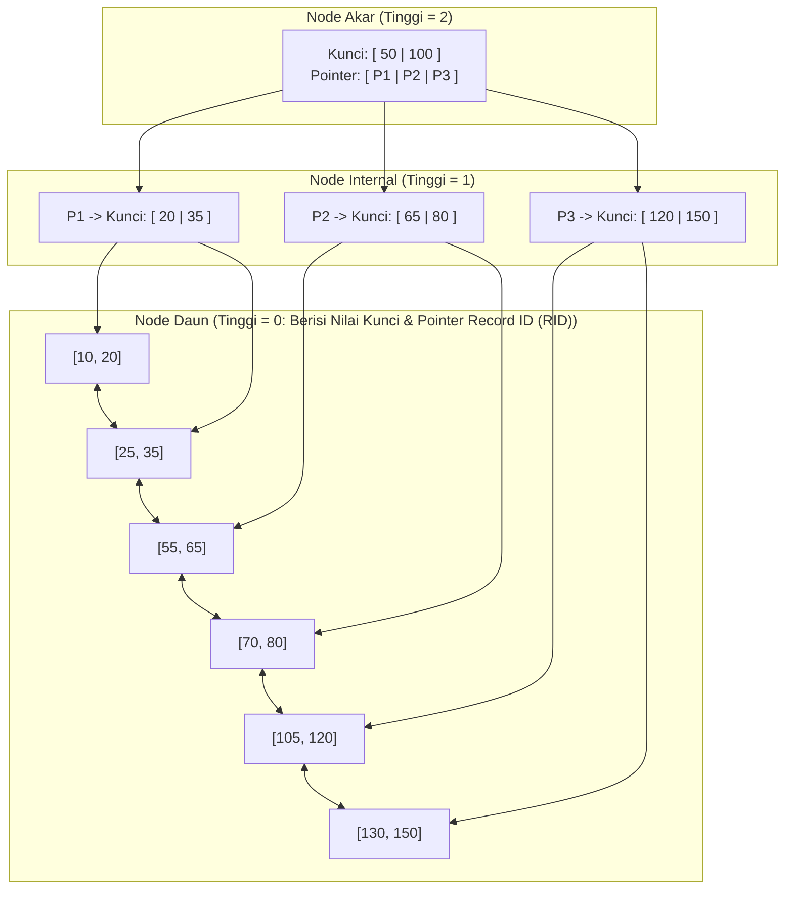

Fitur utama implementasi B+Tree di WidyaBase:
1. **Daya Muat Kunci Tinggi (*High Fan-Out*)**: Dengan ukuran halaman 4KB dan ukuran kunci rata-rata 16 byte, setiap node mampu menampung ratusan cabang anak. Pohon setinggi 3 tingkat mampu mengindeks puluhan juta baris data dengan maksimal 3–4 kali pembacaan blok memori.
2. **Pemisahan Node Dinamis (*Page Split*)**: Ketika node daun penuh (mencapai kapasitas 4KB), pohon secara otomatis membagi node daun menjadi dua bagian berukuran seimbang (50%-50%) dan mempromosikan kunci tengah ke node induk.
3. **Penyusutan & Penggabungan (*Page Merge*)**: Jika penghapusan baris data menyebabkan utilisasi node turun di bawah ambang batas minimum (50%), WidyaBase melakukan peminjaman kunci dari node saudara atau penggabungan (*merge*) untuk menghemat memori.

### 7.2 Implementasi Kode Program Utuh

Berikut implementasi traversal pencarian dan penyisipan data pada struktur pohon B+Tree di WidyaBase:

```widya
// Modul Struktur Data B+Tree WidyaBase
modul mesin_btree {
    impor ekosistem::widyabase::{
        WidyaBase, HalamanID, SlotID, RecordID,
        KunciIndeks, NodeBTree, HeaderNodeBTree
    };

    konstanta KAPASITAS_MAKSIMAL_KUNCI: Bulat = 250;

    struktur HasilCariBTree {
        halaman_daun: HalamanID,
        indeks_slot: Bulat,
        ditemukan: Boolean,
        rid: RecordID,
    }

    fungsi cari_kunci_btree(
        akar_halaman_id: HalamanID,
        kunci_target: &KunciIndeks,
        mesin: &WidyaBase
    ) -> Hasil<HasilCariBTree, Teks> {
        biar mut halaman_kini_id = akar_halaman_id;

        ulang {
            biar node = mesin.baca_halaman_btree(halaman_kini_id)?;

            // Jika kita sudah berada di node daun, lakukan pencarian biner lokal
            jika node.header.apakah_daun {
                biar hasil_lokal = node.cari_biner_kunci(kunci_target);
                jika hasil_lokal.ditemukan {
                    kembalikan Ok(HasilCariBTree {
                        halaman_daun: halaman_kini_id,
                        indeks_slot: hasil_lokal.indeks,
                        ditemukan: benar,
                        rid: node.dapatkan_rid(hasil_lokal.indeks),
                    });
                } selain_itu {
                    kembalikan Ok(HasilCariBTree {
                        halaman_daun: halaman_kini_id,
                        indeks_slot: hasil_lokal.indeks,
                        ditemukan: salah,
                        rid: RecordID::kosong(),
                    });
                }
            }

            // Jika node internal, temukan pointer cabang anak yang sesuai
            halaman_kini_id = node.temukan_cabang_anak(kunci_target);
        }
    }

    fungsi sisipkan_kunci_btree(
        akar_id: &mut HalamanID,
        kunci: KunciIndeks,
        rid: RecordID,
        mesin: &mut WidyaBase
    ) -> Hasil<Boolean, Teks> {
        cetak(">>> [BTREE] Menyisipkan kunci: " + teks(kunci.nilai_numerik()));

        // Cari daun tujuan penyisipan
        biar hasil = cari_kunci_btree(*akar_id, &kunci, mesin)?;
        biar mut node_daun = mesin.baca_halaman_btree_mut(hasil.halaman_daun)?;

        jika node_daun.jumlah_kunci() < KAPASITAS_MAKSIMAL_KUNCI {
            // Masih ada ruang, sisipkan langsung secara berurutan
            node_daun.sisipkan_berurutan(kunci, rid)?;
            mesin.tandai_kotor(hasil.halaman_daun)?;
            kembalikan Ok(benar);
        } selain_itu {
            // Node daun penuh: Lakukan Pemisahan Halaman (Page Split)
            cetak(">>> [BTREE] Node penuh! Memulai pemisahan halaman 50/50...");
            biar halaman_baru_id = mesin.alokasikan_halaman_baru()?;
            biar mut node_baru = NodeBTree::buat_daun(halaman_baru_id);

            // Bagi kunci dan pindahkan separuh ke node baru
            biar kunci_promosi = node_daun.bagi_dua_dengan(&mut node_baru);

            // Perbarui rantai pointer daun tertaut ganda
            node_baru.header.next_page = node_daun.header.next_page;
            node_baru.header.prev_page = hasil.halaman_daun;
            node_daun.header.next_page = halaman_baru_id;

            // Promosikan kunci ke node induk atau buat akar baru bila akar terbelah
            mesin.promosikan_kunci_ke_induk(kunci_promosi, hasil.halaman_daun, halaman_baru_id, akar_id)?;

            kembalikan Ok(benar);
        }
    }
}
```

### 7.3 Analisis Arsitektur, Metrik & Tabel Spesifikasi

Tabel perbandingan kompleksitas komputasi dan struktur pengindeksan pada WidyaBase:

| Metode Akses / Indeks | Pencarian Kesetaraan ($=$) | Pemindaian Rentang ($<, >$) | Kompleksitas Ruang | Kasus Penggunaan Optimal |
| :--- | :--- | :--- | :--- | :--- |
| **Pindaian Tabel Penuh (SeqScan)** | $O(N)$ (Sangat Lambat) | $O(N)$ | $O(1)$ | Tabel mikro (< 100 baris) |
| **B+Tree Indeks (WidyaBase)** | $O(\log N)$ (Rata-rata 3 I/O) | $O(\log N + K)$ | $O(N)$ | Kunci utama, tanggal, angka, teks |
| **Hash Indeks** | $O(1)$ (Sangat Cepat) | Tidak Mendukung Rentang | $O(N)$ | Pencarian kesetaraan murni |
| **Spatial R-Tree** | $O(\log N)$ | $O(\log N + K)$ Spasial | $O(N)$ | Koordinat GPS, poligon peta |
| **HNSW Vektor AI** | $O(\log N)$ Hampiran | Tidak Relevan | $O(N \cdot M)$ | Kemiripan semantik AI (*embeddings*) |

### 7.4 Latihan Soal Esai

1. Mengapa struktur pohon B+Tree jauh lebih disukai dalam perancangan mesin basis data disk dibandingkan pohon pencarian biner seimbang seperti AVL Tree atau Red-Black Tree?
2. Jelaskan bagaimana pointer daun tertaut ganda (*doubly-linked leaf nodes*) pada B+Tree mempercepat eksekusi kueri agregasi dan pemfilteran rentang!
3. Uraikan mekanisme *Page Split* saat node daun B+Tree kehabisan ruang tampung, serta bagaimana algoritma menangani pemisahan berantai hingga node akar (*root split*)!

### 7.5 Soal Pilihan Ganda

1. Perbedaan struktural paling fundamental antara B-Tree standar dan B+Tree adalah...
   A. Pada B+Tree, seluruh data/RID disimpan hanya pada node daun, sedangkan node internal hanya menyimpan kunci pemandu
   B. B-Tree tidak dapat disimpan di memori RAM
   C. B+Tree tidak memiliki cabang anak
   D. B-Tree hanya dapat digunakan untuk data bertipe teks

2. Kompleksitas waktu untuk menemukan sebuah catatan acak pada indeks B+Tree berukuran $N$ baris data adalah...
   A. $O(N)$
   B. $O(\log N)$
   C. $O(N^2)$
   D. $O(1)$

3. Hubungan antar node daun pada B+Tree dihubungkan menggunakan struktur...
   A. Lingkaran tertutup tak berujung
   B. Rantai pointer tertaut ganda (*doubly-linked list*)
   C. Jaringan peer-to-peer
   D. Tumpukan (Stack)

4. Ketika node daun B+Tree mencapai kapasitas maksimal 4KB dan menerima penyisipan data baru, proses yang dijalankan sistem adalah...
   A. Menggugurkan transaksi pengguna (*Abort*)
   B. Pemisahan Halaman (*Page Split*) dengan membagi kunci 50/50 dan mempromosikan kunci tengah
   C. Menghapus data paling lama
   D. Memformat ulang indeks tabel

5. Berapakah rata-rata kedalaman pohon B+Tree pada WidyaBase untuk mengindeks 50 juta baris data dengan kapasitas cabang (*fan-out*) ratusan kunci per node?
   A. Sekitar 3 hingga 4 tingkat
   B. 500 tingkat
   C. 10.000 tingkat
   D. 1 tingkat saja

6. Algoritma pencarian yang digunakan untuk menemukan posisi kunci di dalam sebuah node B+Tree berkapasitas 250 kunci adalah...
   A. Pencarian Acak (*Random Search*)
   B. Pencarian Biner (*Binary Search*)
   C. Pencarian Linear Sekuensial
   D. Pencarian Luap (*Flood Fill*)

7. Operasi kueri SQL yang paling diuntungkan oleh keberadaan pointer sekuensial antar node daun B+Tree adalah...
   A. Pemindaian rentang nilai seperti klausa `BETWEEN` atau operator perbandingan rentang tanggal
   B. Operasi pembuatan tabel baru
   C. Penutupan koneksi basis data
   D. Penggantian nama basis data

8. Apa yang terjadi jika node akar (*root node*) pada B+Tree mengalami pemisahan (*split*)?
   A. Basis data mengalami crash total
   B. Sebuah node akar baru dibentuk di atasnya sehingga tinggi pohon (*tree height*) bertambah 1 tingkat
   C. Seluruh data pohon dihapus
   D. Ukuran halaman berubah dari 4KB menjadi 1MB

9. Indeks yang dibangun di atas lebih dari satu kolom tabel (misalnya: `KOTA, TANGGAL_LAHIR`) dinamakan sebagai...
   A. Single Index
   B. Composite / Multi-Column Index
   C. Virtual Pointer
   D. Null Pointer

10. Mengapa pemakaian indeks B+Tree pada kolom tabel yang frekuensi penulisan (*INSERT/UPDATE*)-nya sangat tinggi harus dipertimbangkan secara cermat?
    A. Karena setiap operasi penulisan memerlukan pembaruan struktur pohon dan berpotensi memicu page split
    B. Menjadikan server kehilangan koneksi internet
    C. Mengurangi kapasitas layar tampilan
    D. Menghapus hak akses pengguna root

---

## Bab 8: Penguncian, Hierarki Latch & Pencegahan Deadlock

### 8.1 Perbedaan Mendasar Antara Lock & Latch

Dalam rekayasa sistem basis data tingkat tinggi, istilah *Lock* dan *Latch* sering kali disalahartikan karena sama-sama diterjemahkan sebagai "kunci". Padahal keduanya beroperasi pada lapisan abstraksi, tujuan, dan durasi yang sangat berbeda.

Kegagalan membedakan keduanya akan mengakibatkan kebuntuan sistem (*system hang*), latensi transaksi yang melonjak, atau korupsi struktur memori.

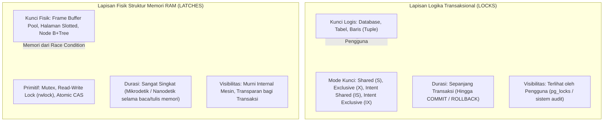

Prinsip hierarki penguncian pada WidyaBase:
1. **Hierarki Kunci Berbutir Halus (*Granular Lock Hierarchy*)**: Untuk menghindari penguncian tabel secara serampangan (*table lock escalation*), WidyaBase menerapkan penguncian niat (*Intent Locks*):
   - `IS` (*Intent Shared*): Menandakan transaksi berniat membaca baris di level bawah.
   - `IX` (*Intent Exclusive*): Menandakan transaksi berniat memodifikasi baris di level bawah.
   - `S` (*Shared Lock*): Kunci berbagi untuk pembacaan bersama.
   - `X` (*Exclusive Lock*): Kunci eksklusif untuk modifikasi data tunggal.
2. **Protokol Pencegahan Kebuntuan (*Deadlock Prevention & Detection*)**:
   - *Wait-For Graph (WFG)*: Daemon latar belakang secara berkala (misalnya setiap 500 ms) memeriksa siklus ketergantungan antar transaksi.
   - *Deadlock Victim Selection*: Bila siklus terdeteksi, sistem memilih transaksi dengan biaya pemulihan terendah (*cheapest transaction*) untuk dibatalkan (*Abort/Rollback*), sehingga transaksi lain dapat melanjutkan proses.
3. **Penyusuran Pohon Latch Bebas Buntu (*Crabbing / Coupling Protocol*)**: Saat menelusuri pohon B+Tree, sistem memegang latch node induk hingga latch node anak berhasil diperoleh secara aman, lalu segera melepaskan latch node induk untuk memaksimalkan konkurensi antar thread.

### 8.2 Implementasi Kode Program Utuh

Berikut implementasi manajer kunci hierarkis dan algoritma deteksi deadlock siklus graf pada WidyaBase:

```widya
// Modul Manajer Kunci Logis dan Deteksi Deadlock WidyaBase
modul manajer_kunci {
    impor ekosistem::widyabase::{
        WidyaBase, TransaksiID, SumberDayaID, ModeKunci,
        TabelKunci, GrafTungguTransaksi
    };

    struktur PermintaanKunci {
        id_transaksi: TransaksiID,
        sumber_daya: SumberDayaID,
        mode: ModeKunci,
    }

    fungsi minta_kunci_transaksional(
        permintaan: PermintaanKunci,
        tabel_kunci: &mut TabelKunci,
        graf_tunggu: &mut GrafTungguTransaksi
    ) -> Hasil<Boolean, Teks> {
        cetak(">>> [LOCK] Transaksi T" + teks(permintaan.id_transaksi) + 
              " meminta kunci mode: " + permintaan.mode.nama() + 
              " pada sumber daya: " + permintaan.sumber_daya.identitas());

        // Periksa kompatibilitas matriks kunci
        jika tabel_kunci.apakah_kompatibel(&permintaan.sumber_daya, permintaan.mode) {
            tabel_kunci.berikan_kunci(permintaan)?;
            cetak(">>> [LOCK] Kunci berhasil diberikan seketika.");
            kembalikan Ok(benar);
        } selain_itu {
            cetak(">>> [LOCK] Terjadi konflik! Transaksi harus mengantre.");
            biar pemegang_kunci = tabel_kunci.dapatkan_pemegang_kunci_saat_ini(&permintaan.sumber_daya);

            // Tambahkan sisi ketergantungan pada Wait-For Graph (T_pemohon -> T_pemegang)
            untuk pemegang di pemegang_kunci {
                graf_tunggu.tambah_sisi(permintaan.id_transaksi, pemegang);
            }

            // Periksa keberadaan siklus deadlock seketika
            jika graf_tunggu.deteksi_siklus_deadlock() {
                cetak(">>> [DEADLOCK] PERINGATAN: Siklus kebuntuan transaksi terdeteksi!");
                biar korban = graf_tunggu.pilih_korban_biaya_terendah();
                cetak(">>> [DEADLOCK] Memilih korban T" + teks(korban) + " untuk digugurkan.");
                kembalikan Salah("GalatDeadlock: Transaksi T" + teks(korban) + " digugurkan.");
            }

            kembalikan Ok(salah); // Menunggu pemegang melepaskan kunci
        }
    }

    fungsi lepaskan_seluruh_kunci_transaksi(
        id_transaksi: TransaksiID,
        tabel_kunci: &mut TabelKunci,
        graf_tunggu: &mut GrafTungguTransaksi
    ) -> Hasil<Bulat, Teks> {
        biar jumlah_dilepas = tabel_kunci.lepaskan_kunci_transaksi(id_transaksi)?;
        graf_tunggu.hapus_node_transaksi(id_transaksi);
        cetak(">>> [LOCK] Melepaskan " + teks(jumlah_dilepas) + " kunci milik T" + teks(id_transaksi));
        kembalikan Ok(jumlah_dilepas);
    }
}
```

### 8.3 Analisis Arsitektur, Metrik & Tabel Spesifikasi

Tabel matriks kompatibilitas mode kunci logis (*Lock Compatibility Matrix*) pada WidyaBase:

| Mode Diminta \ Mode Dimiliki | IS (Intent Shared) | IX (Intent Exclusive) | S (Shared) | SIX (Shared Intent Exclusive) | X (Exclusive) |
| :--- | :--- | :--- | :--- | :--- | :--- |
| **IS** | **Kompatibel** | **Kompatibel** | **Kompatibel** | **Kompatibel** | Konflik |
| **IX** | **Kompatibel** | **Kompatibel** | Konflik | Konflik | Konflik |
| **S** | **Kompatibel** | Konflik | **Kompatibel** | Konflik | Konflik |
| **SIX** | **Kompatibel** | Konflik | Konflik | Konflik | Konflik |
| **X** | Konflik | Konflik | Konflik | Konflik | Konflik |

### 8.4 Latihan Soal Esai

1. Terangkan perbedaan fundamental antara *Lock* dan *Latch* dari aspek durasi hidup, mekanisme penguncian, serta visibilitasnya terhadap pengguna akhir basis data!
2. Bagaimana mekanisme kerja *Wait-For Graph* (WFG) dalam mendeteksi kebuntuan transaksi (*deadlock*)? Parameter apa yang dipertimbangkan mesin dalam memilih transaksi "korban" (*deadlock victim*)?
3. Uraikan teknik penelusuran pohon *Latch Crabbing* (juga dikenal sebagai *Lock Coupling*) pada indeks B+Tree! Mengapa teknik ini mampu mencegah *deadlock* tingkat fisik antar utas memori?

### 8.5 Soal Pilihan Ganda

1. Karakteristik yang membedakan Latch dari Lock adalah...
   A. Latch melindungi integritas struktur data memori fisik dalam durasi mikrodetik tanpa terlihat oleh transaksi logika
   B. Latch hanya berlaku untuk kueri SQL SELECT
   C. Latch dapat diatur melalui perintah SQL pengguna
   D. Latch bertahan hingga transaksi dikomit

2. Mode kunci yang menandakan niat suatu transaksi untuk melakukan modifikasi data pada tingkat hierarki baris yang lebih rendah dinamakan...
   A. Shared (S)
   B. Intent Exclusive (IX)
   C. Exclusive (X)
   D. Null (N)

3. Berdasarkan matriks kompatibilitas kunci, mode kunci Exclusive (X) kompatibel dengan mode kunci...
   A. Shared (S)
   B. Intent Shared (IS)
   C. Tidak kompatibel dengan mode kunci apapun
   D. Intent Exclusive (IX)

4. Struktur data graf berarah yang digunakan oleh manajer konkurensi untuk memodelkan transaksi mana yang sedang menunggu transaksi lain disebut...
   A. Wait-For Graph (WFG)
   B. B+Tree Graph
   C. Spatial Network
   D. Buffer Graph

5. Tindakan yang diambil oleh mesin WidyaBase ketika mendeteksi adanya siklus tertutup pada Wait-For Graph adalah...
   A. Menutup seluruh sistem operasi peladen
   B. Memilih transaksi korban (*victim*) berdasarkan biaya paling ringan dan membatalkannya (*Rollback*)
   C. Membiarkan transaksi macet selamanya
   D. Menghapus indeks B+Tree

6. Teknik penelusuran pohon B+Tree di mana sebuah thread hanya melepaskan latch pada node induk setelah berhasil memperoleh latch pada node anak disebut...
   A. Latch Crabbing / Coupling
   B. Page Split
   C. Random Hopping
   D. Full Scan

7. Algoritma pencegahan kebuntuan berbasis stempel waktu di mana transaksi yang lebih tua menunggu transaksi yang lebih muda, tetapi transaksi yang lebih muda langsung digugurkan dinamakan...
   A. Wait-Die
   B. Wound-Wait
   C. Round-Robin
   D. First In First Out

8. Kunci logis tingkat baris (*Row-Level Lock*) biasanya dipertahankan hingga kapan?
   A. Hingga pembacaan baris selesai
   B. Hingga transaksi berakhir secara tuntas melalui COMMIT atau ROLLBACK
   C. Selama 10 detik
   D. Sampai memori RAM penuh

9. Pengeskalasian kunci (*Lock Escalation*) terjadi ketika...
   A. Sistem menaikkan ribuan kunci baris menjadi satu kunci tabel tunggal untuk menghemat alokasi memori tabel kunci
   B. Transaksi dibatalkan secara sepihak
   C. Database dihubungkan ke server awan
   D. Pengguna mengganti nama tabel

10. Mengapa penerapan Intent Lock (IS / IX) pada tingkat tabel sangat krusial sebelum transaksi mengunci baris data individual?
    A. Mencegah transaksi lain mengunci tabel secara eksklusif (misal saat operasi `ALTER TABLE` atau `TRUNCATE`) tanpa harus memeriksa jutaan baris satu per satu
    B. Mempercepat koneksi kabel LAN
    C. Mengurangi panas pada unit pemroses grafis (GPU)
    D. Menjadikan query teks dapat dibaca otomatis

---

## Bab 9: Lexer, Parser & Dialek SQL Dwibahasa

### 9.1 Kedaulatan Sintaksis: Dialek Nusantara & Standar ANSI

Salah satu terobosan paling unik dan revolusioner dari WidyaBase adalah mesin **Bilingual SQL Lexer & Parser**. Untuk pertama kalinya dalam sejarah rekayasa perangkat lunak basis data tingkat industri, para insinyur dan akademisi dapat mengekspresikan kueri data relasional menggunakan kosa kata Bahasa Indonesia baku (Dialek Nusantara) secara simetris berdampingan dengan dialek ANSI SQL standar internasional.

Kedua dialek tersebut diperlakukan sebagai warga negara kelas satu (*first-class citizens*) dan menghasilkan representasi Pohon Sintaksis Abstrak (*Abstract Syntax Tree* / AST) kanonikal yang 100% identik tanpa degradasi performa.

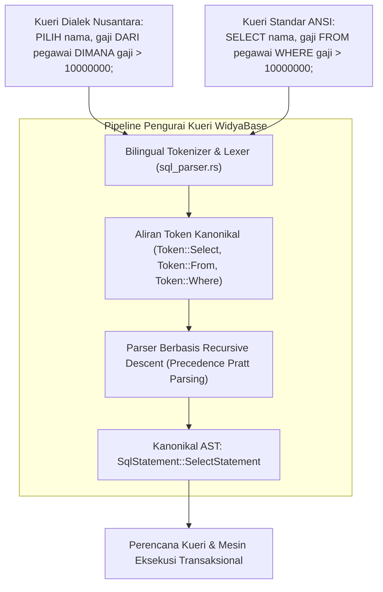

Prinsip rancangan parser dwibahasa WidyaBase:
1. **Pemetaan Token Satu-ke-Satu (*Isomorphic Token Mapping*)**: Kata kunci Bahasa Indonesia seperti `PILIH` dipetakan ke varian token yang persis sama dengan kata kunci `SELECT`. Begitu pula dengan `DARI` $\leftrightarrow$ `FROM`, `DIMANA` $\leftrightarrow$ `WHERE`, `SISIP_KE` $\leftrightarrow$ `INSERT INTO`, `PERBARUI` $\leftrightarrow$ `UPDATE`, dan `HAPUS_DARI` $\leftrightarrow$ `DELETE FROM`.
2. **Penanganan Kasus Tanpa Sensitivitas Huruf (*Case-Insensitive*)**: Parser menerima huruf besar, huruf kecil, maupun campuran (misalnya `pilih`, `PILIH`, `Select`, `select`).
3. **Pemberian Pesan Galat Kontekstual Dwibahasa**: Jika terjadi kesalahan pengetikan sintaksis, mesin pelacak galat (*error reporter*) mendeteksi bahasa pengantar kueri dan menampilkan pesan kesalahan ramah pengguna dalam Bahasa Indonesia lengkap dengan petunjuk perbaikan nomor baris dan kolom.

### 9.2 Implementasi Kode Program Utuh

Berikut implementasi demonstrasi eksekusi kueri SQL dwibahasa pada WidyaBase menggunakan Widya-Lang:

```widya
// Modul Demonstrasi Eksekusi SQL Dwibahasa WidyaBase
modul parser_dwibahasa {
    impor ekosistem::widyabase::{WidyaBase, HasilKueri, BarisData};

    fungsi jalankan_kueri_dwibahasa(mesin: &mut WidyaBase) -> Hasil<Boolean, Teks> {
        cetak("==================================================================");
        cetak(">>> [SQL-DWIBAHASA] Menguji Kueri Dialek Nusantara dan Standar ANSI...");

        // 1. Eksekusi DDL Menggunakan Dialek Nusantara
        biar sql_buat_tabel = "
            BUAT TABEL pegawai_bumn (
                id BULAT KUNCI_UTAMA,
                nama TEKS TIDAK_KOSONG,
                divisi TEKS,
                gaji DESIMAL,
                status_aktif BOOLEAN
            );
        ";
        cetak(">>> [DDL-NUSANTARA] Mengeksekusi pembuatan tabel...");
        mesin.eksekusi_sql(sql_buat_tabel)?;

        // 2. Eksekusi DML Penyisipan Data Menggunakan Dialek Nusantara
        biar sql_sisip = "
            SISIP_KE pegawai_bumn (id, nama, divisi, gaji, status_aktif)
            NILAI (101, 'Budi Santoso', 'Teknologi Informasi', 18500000.0, BENAR),
                  (102, 'Siti Aminah', 'Keuangan', 15000000.0, BENAR),
                  (103, 'Ahmad Fauzi', 'Operasional', 9500000.0, BENAR);
        ";
        cetak(">>> [DML-NUSANTARA] Menyisipkan catatan data pegawai...");
        mesin.eksekusi_sql(sql_sisip)?;

        // 3. Eksekusi DQL Pemilihan Data Menggunakan Dialek Nusantara
        biar sql_pilih = "
            PILIH nama, gaji, divisi 
            DARI pegawai_bumn 
            DIMANA gaji >= 15000000.0 DAN status_aktif = BENAR 
            URUTKAN_BERDASARKAN gaji MENURUN;
        ";
        cetak(">>> [DQL-NUSANTARA] Menjalankan kueri seleksi bernilai tinggi...");
        biar hasil_nusantara: HasilKueri = mesin.kueri_sql(sql_pilih)?;
        cetak(">>> [HASIL] Ditemukan " + teks(hasil_nusantara.jumlah_baris()) + " baris data:");
        untuk baris di hasil_nusantara.baris_data() {
            cetak("  - " + baris.ambil_teks("nama") + " | Rp " + teks(baris.ambil_desimal("gaji")) + " | Divisi: " + baris.ambil_teks("divisi"));
        }

        // 4. Eksekusi Kueri Ekuivalen Menggunakan Standar Global ANSI SQL
        biar sql_ansi = "
            SELECT nama, gaji 
            FROM pegawai_bumn 
            WHERE gaji < 10000000.0;
        ";
        cetak(">>> [DQL-ANSI] Menjalankan kueri standar global...");
        biar hasil_ansi: HasilKueri = mesin.kueri_sql(sql_ansi)?;
        cetak(">>> [HASIL] Ditemukan " + teks(hasil_ansi.jumlah_baris()) + " baris:");
        untuk baris di hasil_ansi.baris_data() {
            cetak("  - " + baris.ambil_teks("nama") + " | Rp " + teks(baris.ambil_desimal("gaji")));
        }

        cetak(">>> [SUKSES] Seluruh variasi kueri dwibahasa menghasilkan AST identik!");
        cetak("==================================================================");
        kembalikan Ok(benar);
    }
}
```

### 9.3 Analisis Arsitektur, Metrik & Tabel Spesifikasi

Tabel korespondensi leksikal Dialek Nusantara dan Standar Internasional ANSI SQL di WidyaBase:

| Kategori Perintah | Kata Kunci Dialek Nusantara | Standar ANSI Internasional | Representasi Token Internal |
| :--- | :--- | :--- | :--- |
| **Kueri Data (DQL)** | `PILIH`, `DARI`, `DIMANA` | `SELECT`, `FROM`, `WHERE` | `Token::Select`, `Token::From`, `Token::Where` |
| **Manipulasi (DML)** | `SISIP_KE`, `NILAI`, `PERBARUI`, `ATUR` | `INSERT INTO`, `VALUES`, `UPDATE`, `SET` | `Token::Insert`, `Token::Values`, `Token::Update` |
| **Penghapusan** | `HAPUS_DARI`, `KOSONGKAN` | `DELETE FROM`, `TRUNCATE` | `Token::Delete`, `Token::Truncate` |
| **Definisi Skema (DDL)**| `BUAT TABEL`, `HAPUS TABEL` | `CREATE TABLE`, `DROP TABLE` | `Token::Create`, `Token::Drop` |
| **Pengurutan & Batas** | `URUTKAN_BERDASARKAN`, `MENAIK`, `MENURUN` | `ORDER BY`, `ASC`, `DESC` | `Token::Order`, `Token::Asc`, `Token::Desc` |
| **Logika & Pembanding** | `DAN`, `ATAU`, `BUKAN`, `SEPERTI`, `ANTARA` | `AND`, `OR`, `NOT`, `LIKE`, `BETWEEN` | `Token::And`, `Token::Or`, `Token::Not`, `Token::Like` |

### 9.4 Latihan Soal Esai

1. Mengapa dukungan dialek SQL dwibahasa pada WidyaBase tidak menimbulkan overhead penurunan kecepatan (*parsing performance penalty*) dibandingkan parser monobahasa konvensional?
2. Bagaimana teknik *Recursive Descent Parsing* yang dikombinasikan dengan *Pratt Precedence Parsing* menangani ekspresi logika berbobot rumit (misalnya perpaduan operator matematika, kurung buka/tutup, dan klausa `DAN`/`ATAU`)?
3. Jelaskan pentingnya pesan kesalahan gramatikal kueri dwibahasa bagi percepatan kurikulum pendidikan rekayasa perangkat lunak dan literasi data nasional di Indonesia!

### 9.5 Soal Pilihan Ganda

1. Kata kunci Dialek Nusantara pada WidyaBase yang merupakan padanan langsung dari perintah ANSI SQL `SELECT` adalah...
   A. `AMBIL`
   B. `PILIH`
   C. `LIHAT`
   D. `CARI`

2. Klausa yang digunakan untuk menyaring baris data berdasarkan kriteria tertentu pada Dialek Nusantara adalah...
   A. `DENGAN`
   B. `KONDISI`
   C. `DIMANA`
   D. `FILTER`

3. Padanan kata kunci untuk operasi penyisipan data `INSERT INTO` dalam Dialek Nusantara adalah...
   A. `MASUKKAN`
   B. `SISIP_KE`
   C. `TAMBAH`
   D. `ISI`

4. Bagaimana cara parser WidyaBase memperlakukan kueri yang ditulis dalam huruf besar (`PILIH`) dan huruf kecil (`pilih`)?
   A. Menganggapnya sebagai dua perintah yang berbeda
   B. Memperlakukan keduanya secara setara (*case-insensitive*) dan memetakannya ke token yang sama
   C. Menolak kueri yang menggunakan huruf kecil
   D. Mengubah tipe data menjadi teks

5. Struktur data pohon hierarkis yang dihasilkan oleh parser setelah memeriksa validitas tata bahasa kueri dinamakan...
   A. Binary Search Tree (BST)
   B. Abstract Syntax Tree (AST)
   C. Hash Map
   D. Adjacency Matrix

6. Padanan kata kunci untuk klausa pengurutan data `ORDER BY ... DESC` pada Dialek Nusantara adalah...
   A. `SUSUN_DARI ... BAWAH`
   B. `URUTKAN_BERDASARKAN ... MENURUN`
   C. `SORTIR ... REVERSE`
   D. `TATA ... Z_KE_A`

7. Operator logika `DAN`, `ATAU`, dan `BUKAN` pada Dialek Nusantara menghasilkan token internal yang identik dengan...
   A. `AND`, `OR`, `NOT`
   B. `PLUS`, `MINUS`, `TIMES`
   C. `IF`, `THEN`, `ELSE`
   D. `TRUE`, `FALSE`, `NULL`

8. Tahap pertama dalam kompilasi kueri SQL yang bertugas memecah barisan teks mentah menjadi serangkaian potongan kata bermakna (token) dinamakan...
   A. Evaluasi Semantik
   B. Analisis Leksikal (*Lexical Analysis / Tokenizer*)
   C. Optimasi Biaya
   D. Eksekusi I/O

9. Kata kunci DDL untuk membuat tabel baru dalam Dialek Nusantara adalah...
   A. `CIPTAKAN STRUKTUR`
   B. `BUAT TABEL`
   C. `INISIALISASI_ENTITAS`
   D. `BARU TABEL`

10. Mengapa kueri campuran (misalnya kata kunci Nusantara digabung dengan nama kolom dan fungsi matematika internasional) tetap dapat diproses dengan sempurna oleh WidyaBase?
    A. Karena lexer membedakan secara tegas antara token kata kunci bahasa, nama pengenal (*identifier*), dan konstanta literal
    B. Karena semua kueri diubah menjadi bahasa rakitan (assembly) terlebih dahulu
    C. Karena basis data menggunakan penerjemah daring pihak ketiga
    D. Karena basis data menonaktifkan aturan tata bahasa

---

## Bab 10: Perencana Logis & Pohon Sintaksis Abstrak (AST Query Plan)

### 10.1 Dari Sintaksis Menjadi Rencana Eksekusi Logis

Setelah kueri pengguna berhasil melewati tahap penguraian leksikal dan sintaksis oleh parser, mesin basis data menghasilkan representasi gramatikal berupa Pohon Sintaksis Abstrak (*Abstract Syntax Tree* / AST). Namun, AST semata belum mengetahui cara terbaik untuk mengeksekusi kueri tersebut di atas media penyimpanan fisik.

Di sinilah **Perencana Logis** (*Logical Query Planner*) mengambil alih:
1. **Pemeriksaan Semantik (*Semantic Analysis & Catalog Binding*)**: Memvalidasi apakah tabel yang disebut benar-benar ada di katalog metadata, apakah nama kolom valid, dan apakah tipe data kompatibel.
2. **Transformasi Aljabar Relasional**: Mengubah simpul-simpul AST menjadi pohon operator aljabar relasional logis (*Logical Plan Tree*).
3. **Penyederhanaan Logika (*Rule-Based Rewriting*)**: Menerapkan aturan ekuivalensi matematis seperti eliminasi predikat redundan, pelipatan konstanta (*constant folding* misalnya `1 + 1` disederhanakan menjadi `2`), dan penurunan predikat filter (*predicate pushdown*).

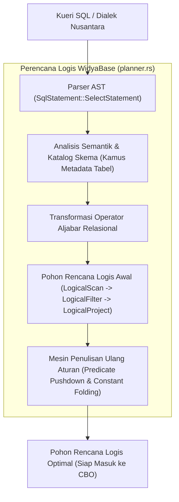

Hirarki operator rencana logis di WidyaBase:
- `LogicalScan`: Membaca entitas tabel relasional tertentu.
- `LogicalFilter`: Mengevaluasi ekspresi predikat seleksi ($\sigma$).
- `LogicalProject`: Memilih dan mentransformasi daftar kolom luaran ($\pi$).
- `LogicalJoin`: Menggabungkan dua relasi berdasarkan predikat relasional ($owtie$).
- `LogicalAggregate`: Menghitung fungsi agregasi seperti `JUMLAH`, `RATA_RATA`, `HITUNG` beserta klausul pengelompokan.

### 10.2 Implementasi Kode Program Utuh

Berikut implementasi representasi simpul Pohon Rencana Logis dan transformasi penulisan ulang aturan pada WidyaBase:

```widya
// Modul Perencana Logis dan Penulisan Ulang Kueri WidyaBase
modul perencana_logis {
    impor ekosistem::widyabase::{
        WidyaBase, OperatorLogis, EkspresiLogis, SkemaTabel,
        TipeData, NilaiKonstanta, PengenalKolom
    };

    struktur RencanaLogis {
        akar: OperatorLogis,
        skema_keluaran: SkemaTabel,
    }

    fungsi bangun_rencana_logis_dasar(
        nama_tabel: Teks,
        predikat_filter: EkspresiLogis,
        kolom_proyeksi: Daftar<Teks>,
        katalog: &WidyaBase
    ) -> Hasil<RencanaLogis, Teks> {
        cetak(">>> [PLANNER-LOGIS] Memvalidasi semantik tabel: " + nama_tabel);
        biar skema_asal = katalog.dapatkan_skema_tabel(&nama_tabel)?;

        // 1. Operator Dasar: Pindaian Tabel (LogicalScan)
        biar operator_scan = OperatorLogis::PindaianTabel {
            tabel: nama_tabel,
            skema: skema_asal.klon(),
        };

        // 2. Operator Penyaring: LogicalFilter (Sigma)
        biar operator_filter = OperatorLogis::Filter {
            masukan: Kotak::buat(operator_scan),
            predikat: predikat_filter,
        };

        // 3. Operator Proyeksi: LogicalProject (Pi)
        biar operator_project = OperatorLogis::Proyeksi {
            masukan: Kotak::buat(operator_filter),
            kolom: kolom_proyeksi,
        };

        cetak(">>> [PLANNER-LOGIS] Pohon rencana logis awal berhasil dibentuk.");
        kembalikan Ok(RencanaLogis {
            akar: operator_project,
            skema_keluaran: skema_asal.proyeksikan(&kolom_proyeksi)?,
        });
    }

    fungsi optimasi_aturan_penurunan_predikat(
        rencana: &mut RencanaLogis
    ) -> Hasil<Boolean, Teks> {
        cetak(">>> [RULE-OPTIMIZER] Menerapkan optimasi 'Predicate Pushdown'...");
        // Memindahkan evaluasi filter sedekat mungkin ke operator pemindaian data
        // sehingga baris data yang dibaca dari disk tereliminasi sedini mungkin
        rencana.akar.dorong_predikat_ke_bawah();
        cetak(">>> [RULE-OPTIMIZER] Menerapkan pelipatan konstanta matematis...");
        rencana.akar.lipat_konstanta_ekspresi();
        kembalikan Ok(benar);
    }
}
```

### 10.3 Analisis Arsitektur, Metrik & Tabel Spesifikasi

Tabel aturan transformasi aljabar relasional penulisan ulang kueri pada WidyaBase:

| Nama Aturan (*Rewrite Rule*) | Bentuk Aljabar Asli | Bentuk Aljabar Tertransformasi | Manfaat Penghematan I/O & CPU |
| :--- | :--- | :--- | :--- |
| **Predicate Pushdown** | $\sigma_{cond}(R owtie S)$ | $(\sigma_{cond}(R)) owtie S$ | Memangkas 90%+ baris sebelum operasi Join yang mahal |
| **Projection Pushdown** | $\pi_{A}(Scan(R))$ | $Scan(R 	ext{ hanya kolom } A)$ | Menghemat transfer memori RAM dan lebar baris data |
| **Constant Folding** | $x > 1000 	imes 60$ | $x > 60000$ | Menghindari komputasi berulang di setiap evaluasi baris |
| **Dead Predicate Elimination** | $P 	ext{ DAN BENAR}$ | $P$ | Menyederhanakan kedalaman pohon evaluasi logika |
| **Subquery Flattening** | $R owtie (	ext{Subquery } S)$ | Semi-Join / Inner-Join Flat | Menghindari eksekusi subkueri berkorelasi per baris ($O(N^2)$) |

### 10.4 Latihan Soal Esai

1. Terangkan perbedaan mendasar antara representasi kueri pada tingkat AST (*Abstract Syntax Tree*) dan Pohon Rencana Logis (*Logical Query Plan*)!
2. Mengapa aturan *Predicate Pushdown* dianggap sebagai salah satu teknik optimasi kueri paling berdampak dalam penghematan sumber daya komputasi basis data?
3. Apa yang dimaksud dengan *Constant Folding* dan *Catalog Binding*? Berikan contoh skenario bagaimana katalog metadata mencegah eksekusi kueri yang salah sebelum menyentuh lapisan penyimpanan!

### 10.5 Soal Pilihan Ganda

1. Proses verifikasi apakah kolom dan tabel yang tercantum pada kueri benar-benar ada di dalam basis data dinamakan...
   A. Analisis Semantik (*Semantic Analysis & Catalog Binding*)
   B. Kompilasi JIT
   C. Defragmentasi Memori
   D. Penulisan WAL

2. Notasi simbol matematika aljabar relasional yang merepresentasikan operasi seleksi baris (*Filter*) adalah...
   A. Simbol Pi ($\pi$)
   B. Simbol Sigma ($\sigma$)
   C. Simbol Theta ($	heta$)
   D. Simbol Omega ($\omega$)

3. Notasi simbol matematika aljabar relasional yang merepresentasikan operasi proyeksi pemilihan kolom (*Project*) adalah...
   A. Simbol Pi ($\pi$)
   B. Simbol Sigma ($\sigma$)
   C. Simbol Delta ($\Delta$)
   D. Simbol Lambda ($\lambda$)

4. Teknik optimasi berbasis aturan (*Rule-Based Optimization*) yang memindahkan filter seleksi sedekat mungkin ke operator pemindaian tabel disebut...
   A. Predicate Pushdown
   B. Table Escalation
   C. Buffer Replacement
   D. Root Splitting

5. Proses mengevaluasi ekspresi statis seperti `3600 * 24` menjadi nilai tetap `86400` pada saat perencanaan kueri dinamakan...
   A. Deadlock Detection
   B. Constant Folding
   C. Slotted Packing
   D. Latch Crabbing

6. Mengapa operasi proyeksi kolom (*Projection Pushdown*) sangat menguntungkan bila tabel data disimpan dalam format kolom (*columnar*)?
   A. Sistem hanya perlu membaca kolom-kolom yang diminta tanpa menyentuh kolom lainnya di disk
   B. Menghapus kebutuhan indeks B+Tree
   C. Membuat kueri menjadi lebih singkat
   D. Memperbesar ukuran layar aplikasi

7. Operator aljabar relasional yang bertugas menggabungkan baris data dari dua relasi berbeda berdasarkan kondisi kesetaraan kunci adalah...
   A. LogicalFilter
   B. LogicalJoin
   C. LogicalLimit
   D. LogicalSort

8. Pada rencana kueri logis, urutan simpul operator biasanya dieksekusi secara konseptual dari...
   A. Dari daun (paling bawah/Scan) mengalir ke atas menuju akar (Project)
   B. Dari kanan ke kiri secara acak
   C. Dari file konfigurasi server
   D. Tergantung kecepatan kipas prosesor

9. Apa fungsi dari katalog metadata skema (*System Catalog*) pada mesin WidyaBase?
   A. Menyimpan definisi struktur tabel, tipe data kolom, indeks, dan batasan integritas kunci asing
   B. Menampung log transaksi harian
   C. Menyimpan cadangan file sistem operasi
   D. Mengatur alamat IP pengguna

10. Subkueri berkorelasi (*correlated subquery*) yang tidak dioptimalkan dapat menyebabkan kompleksitas eksekusi sebesar...
    A. $O(1)$
    B. $O(N 	imes M)$ atau kuadratik karena subkueri dieksekusi ulang untuk setiap baris tabel induk
    C. $O(\log N)$
    D. $O(0)$

---

## Bab 11: Pengoptimal Berbasis Biaya (Cost-Based Optimizer / CBO)

### 11.1 Mengapa Aturan Saja Tidak Cukup: Peran Vital Statistik

Optimasi berbasis aturan (*Rule-Based Optimizer* / RBO) dapat merapikan ekspresi logika, tetapi RBO bersifat "buta" terhadap realitas data di dalam piringan disk: RBO tidak mengetahui apakah sebuah tabel berisi 10 baris atau 100 juta baris, dan tidak tahu apakah nilai suatu kolom tersebar merata atau memiliki ketimpangan ekstrem (*data skew*).

WidyaBase menghadirkan **Cost-Based Optimizer** (CBO) mutakhir yang memodelkan biaya fisik eksekusi (*Cost Model*) berdasarkan:
- **Biaya Akses I/O Halaman Disk**: Jumlah transfer blok halaman 4KB dari media SSD NVMe ke RAM Buffer Pool.
- **Biaya Pemrosesan CPU**: Jumlah siklus instruksi CPU untuk mengevaluasi predikat ekspresi, membandingkan kunci baris, dan mengomputasi fungsi hash.

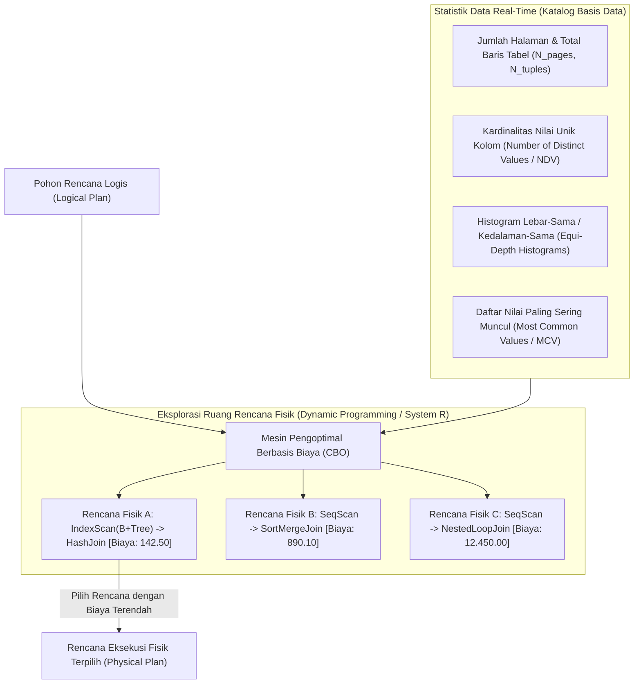

Pilar utama CBO di WidyaBase:
1. **Histogram Kedalaman-Sama (*Equi-Depth Histogram*)**: Membagi rentang nilai kolom ke dalam ember-ember (*buckets*) dengan jumlah baris yang sama. Histogram ini memberikan estimasi selektivitas kueri rentang yang sangat presisi ($S = rac{	ext{baris terpilih}}{	ext{total baris}}$).
2. **Koleksi Nilai Populer (*Most Common Values* / MCV)**: Menyimpan frekuensi kemunculan nilai-nilai yang mendominasi data (misalnya: kolom `status = 'SUKSES'` mencakup 92% data), mencegah kesalahan asumsi distribusi seragam.
3. **Pencarian Rencana Optimal Menggunakan Pemrograman Dinamis (*System R Algorithm*)**: Menemukan urutan gabungan (*Join Order*) terbaik untuk kueri banyak tabel ($N$ relasi) tanpa terjebak dalam ledakan kombinatorial faktorial $O(N!)$.

### 11.2 Implementasi Kode Program Utuh

Berikut implementasi estimasi biaya I/O dan CPU serta pemilihan jalur akses fisik pada CBO WidyaBase:

```widya
// Modul Pengoptimal Berbasis Biaya (Cost-Based Optimizer) WidyaBase
modul pengoptimal_biaya {
    impor ekosistem::widyabase::{
        WidyaBase, StatistikTabel, HistogramKolom, JalurAksesFisik,
        OperatorFisik, NilaiBiaya
    };

    konstanta BIAYA_BACA_HALAMAN_SEKUENSIAL: Pecahan = 1.0;
    konstanta BIAYA_BACA_HALAMAN_ACAK: Pecahan = 4.0;
    konstanta BIAYA_EVALUASI_CPU_TUPEL: Pecahan = 0.01;
    konstanta BIAYA_OPERATOR_CPU: Pecahan = 0.0025;

    fungsi estimasi_biaya_seq_scan(
        statistik: &StatistikTabel
    ) -> NilaiBiaya {
        biar biaya_io = (statistik.jumlah_halaman sebagai Pecahan) * BIAYA_BACA_HALAMAN_SEKUENSIAL;
        biar biaya_cpu = (statistik.jumlah_baris sebagai Pecahan) * BIAYA_EVALUASI_CPU_TUPEL;
        kembalikan NilaiBiaya(biaya_io + biaya_cpu);
    }

    fungsi estimasi_biaya_index_scan(
        statistik: &StatistikTabel,
        selektivitas: Pecahan,
        tinggi_btree: Bulat
    ) -> NilaiBiaya {
        // Akses pohon indeks dari akar ke daun
        biar biaya_io_indeks = (tinggi_btree sebagai Pecahan) * BIAYA_BACA_HALAMAN_ACAK;

        // Estimasi jumlah halaman data acak yang disentuh berdasarkan selektivitas
        biar estimasi_baris = (statistik.jumlah_baris sebagai Pecahan) * selektivitas;
        biar biaya_io_halaman_data = estimasi_baris * BIAYA_BACA_HALAMAN_ACAK;
        biar biaya_cpu = estimasi_baris * BIAYA_OPERATOR_CPU;

        kembalikan NilaiBiaya(biaya_io_indeks + biaya_io_halaman_data + biaya_cpu);
    }

    fungsi pilih_jalur_akses_terbaik(
        nama_tabel: Teks,
        nama_kolom: Teks,
        selektivitas: Pecahan,
        mesin: &WidyaBase
    ) -> Hasil<JalurAksesFisik, Teks> {
        biar statistik = mesin.ambil_statistik_tabel(&nama_tabel)?;
        biar info_indeks = mesin.cek_keberadaan_indeks(&nama_tabel, &nama_kolom);

        biar biaya_seq_scan = estimasi_biaya_seq_scan(&statistik);
        cetak(">>> [CBO] Biaya Pemindaian Sekuensial (SeqScan): " + teks(biaya_seq_scan.nilai()));

        jika info_indeks.tersedia {
            biar biaya_index = estimasi_biaya_index_scan(&statistik, selektivitas, info_indeks.tinggi_pohon);
            cetak(">>> [CBO] Biaya Pemindaian Indeks (IndexScan): " + teks(biaya_index.nilai()));

            jika biaya_index.nilai() < biaya_seq_scan.nilai() {
                cetak(">>> [CBO] KEPUTUSAN: Memilih IndexScan (Lebih hemat biaya).");
                kembalikan Ok(JalurAksesFisik::PindaianIndeks(info_indeks.nama_indeks));
            }
        }

        cetak(">>> [CBO] KEPUTUSAN: Memilih SeqScan (Data tabel kecil atau selektivitas tinggi).");
        kembalikan Ok(JalurAksesFisik::PindaianSekuensial);
    }
}
```

### 11.3 Analisis Arsitektur, Metrik & Tabel Spesifikasi

Tabel perbandingan formula biaya operator fisik pada Cost-Based Optimizer WidyaBase:

| Operator Fisik | Formula Komponen I/O | Formula Komponen CPU | Kondisi Menjadi Pilihan Optimal |
| :--- | :--- | :--- | :--- |
| **Pindaian Sekuensial (SeqScan)** | $N_{pages} 	imes 1.0$ | $N_{tuples} 	imes 0.01$ | Mengambil > 15–20% dari total baris tabel |
| **Pindaian Indeks (IndexScan)** | $(H_{tree} + N_{tuples} \cdot S) 	imes 4.0$ | $N_{tuples} \cdot S 	imes 0.0025$ | Mengambil < 5% baris (sangat selektif) |
| **Pindaian Hanya-Indeks (Index-Only)**| $(H_{tree} + N_{index\_pages} \cdot S) 	imes 1.0$ | $N_{tuples} \cdot S 	imes 0.0025$ | Seluruh kolom kueri tercakup dalam indeks |
| **Pindaian Bitmap (Bitmap Scan)** | $N_{index\_pages} 	imes 1.0 + N_{bitmap\_pages} 	imes 1.0$| $N_{tuples} 	imes 0.005$ | Menggabungkan beberapa indeks via operator AND/OR |

### 11.4 Latihan Soal Esai

1. Mengapa kueri yang memiliki indeks pada suatu kolom tetap dapat diputuskan oleh CBO untuk menggunakan pemindaian sekuensial penuh (*SeqScan*) daripada pemindaian indeks?
2. Bagaimana struktur *Equi-Depth Histogram* dan daftar *Most Common Values* (MCV) bekerja sama dalam mengestimasi selektivitas kueri data yang mengalami ketimpangan distribusi (*skewed data*)?
3. Terangkan trade-off antara akurasi model biaya CBO dengan waktu yang dihabiskan untuk merencanakan kueri (*planning time*) pada sistem OLTP berskala jutaan kueri per detik!

### 11.5 Soal Pilihan Ganda

1. Dua komponen beban komputasi fisik yang menjadi dasar perhitungan model biaya pada CBO adalah...
   A. I/O Media Penyimpanan (Halaman Disk) dan Siklus Pemrosesan CPU
   B. Ukuran Layar Monitor dan Mouse
   C. Kecepatan Download Internet dan Kuota Data
   D. Panjang Kabel LAN dan Suhu Ruangan

2. Mengapa biaya pembacaan halaman secara acak (*Random I/O*) diberi bobot nilai lebih tinggi (misal 4.0) dibandingkan pembacaan sekuensial (1.0)?
   A. Karena pembacaan acak memerlukan pergeseran head piringan atau memicu overhead latency addressing I/O
   B. Karena angka 4 adalah angka keberuntungan
   C. Karena pembacaan sekuensial tidak menggunakan memori
   D. Karena harddisk berputar lebih lambat saat membaca acak

3. Struktur statistik yang menyimpan nilai-nilai kolom yang paling mendominasi beserta persentase frekuensinya dinamakan...
   A. B+Tree Root
   B. Most Common Values (MCV)
   C. Free Space Map
   D. WAL Buffer

4. Jenis histogram di mana setiap ember (*bucket*) menampung jumlah baris data yang kira-kira sama banyak disebut...
   A. Equi-Width Histogram
   B. Equi-Depth Histogram
   C. Random Histogram
   D. Bell Curve Histogram

5. Perintah administratif yang dijalankan pengguna untuk memperbarui statistik tabel dan histogram di katalog basis data adalah...
   A. `REBOOT SYSTEM`
   B. `ANALISIS TABEL` (atau `ANALYZE` pada SQL standar)
   C. `FORMAT DISK`
   D. `RESET COUNTER`

6. Selektivitas kueri ($S$) didefinisikan secara matematis sebagai...
   A. Rasio perkiraan jumlah baris yang lolos kualifikasi filter dibagi dengan total keseluruhan baris tabel
   B. Jumlah kolom dikalikan jumlah tabel
   C. Ukuran file basis data dalam megabyte
   D. Kecepatan clock CPU dibagi memori RAM

7. Pendekatan pencarian ruang rencana eksekusi gabungan (*Join Order*) klasik yang memangkas rencana bernilai buruk pada setiap tahapan sub-gabungan adalah...
   A. Algoritma Genetika Acak
   B. Pemrograman Dinamis (Algoritma System R)
   C. Linear Regression
   D. Algoritma Bubble Sort

8. Kondisi di mana indeks B+Tree mencakup seluruh kolom yang diminta dalam klausa SELECT dan WHERE sehingga tabel data tidak perlu dibaca sama sekali disebut...
   A. Table Scan
   B. Index-Only Scan (Covering Index)
   C. Bitmap Lossy Scan
   D. Vacuum Scan

9. Apa dampak negatif yang timbul apabila statistik tabel tidak pernah diperbarui selama bertahun-tahun pada sistem yang bertumbuh pesat?
   A. CBO menghasilkan perkiraan biaya yang meleset drastis sehingga memilih rencana eksekusi fisik yang sangat lambat
   B. Komputer server otomatis terkunci
   C. Bahasa pemrograman Widya-Lang tidak bisa dikompilasi
   D. Transaksi ACID otomatis dinonaktifkan

10. Mengapa pada sistem pemrosesan transaksi daring (OLTP) berlatensi rendah, waktu kompilasi dan perencanaan CBO dibatasi (*timeout/early pruning*)?
    A. Agar waktu perencanaan kueri (*planning time*) tidak lebih lama daripada waktu eksekusi kueri itu sendiri
    B. Supaya data otomatis terhapus
    C. Untuk menghindari koneksi wifi terputus
    D. Karena sistem operasi melarang kalkulasi matematika rumit

---

## Bab 12: Strategi Algoritma Join Relasional

### 12.1 Spektrum Algoritma Penggabungan Relasi Data

Operasi penggabungan dua relasi (*Join*) merupakan salah satu operasi paling intensif komputasi dalam sistem basis data relasional. Menghubungkan relasi $R$ (relasi luar / *outer*) dengan relasi $S$ (relasi dalam / *inner*) secara naif akan memerlukan perbandingan produk Cartesian berorde kuadratik $O(|R| 	imes |S|)$, yang akan melumpuhkan performa peladen seketika jika kedua tabel memiliki jutaan baris.

WidyaBase mengimplementasikan tiga pilar strategi algoritma Join fisik:
1. **Nested Loop Join (Loop Bersarang)**: Memindai relasi luar dan mencari pasangan yang cocok di relasi dalam. Sangat efisien jika relasi dalam memiliki indeks B+Tree (*Index Nested Loop Join*).
2. **Hash Join (Penggabungan Berbasis Hash)**: Menggunakan tabel hash di memori RAM. Terdiri atas dua fase: Fase Bangun (*Build Phase*) dan Fase Selidik (*Probe Phase*). Sangat ideal untuk kueri berukuran besar tanpa indeks terurut.
3. **Sort-Merge Join (Penggabungan Urut & Padukan)**: Mengurutkan kedua relasi berdasarkan kunci gabungan, lalu menelusuri keduanya secara linier seirama seperti resleting (*zipper scan*).

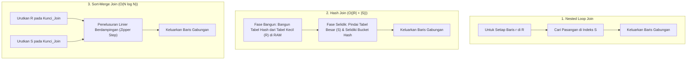

Karakteristik komparatif di WidyaBase:
- **Index Nested Loop Join**: Pilihan terbaik ketika relasi luar berukuran sangat kecil (misal 1 baris hasil pencarian filter ID) dan relasi dalam diindeks dengan B+Tree: kompleksitas hanya $O(|R| \log |S|)$.
- **Grace Hash Join**: Jika tabel hash pada fase bangun melebihi alokasi memori RAM kerja (*work_mem*), WidyaBase secara otomatis mempartisi data ke dalam berkas sementara piringan disk (*disk spilling*) berbasis fungsi hash rekursif.
- **Merge Join**: Sangat dominan ketika kedua masukan telah terurut secara alami oleh indeks B+Tree atau klausa `URUTKAN_BERDASARKAN`, menghilangkan fase pengurutan (*sort overhead*).

### 12.2 Implementasi Kode Program Utuh

Berikut implementasi logika eksekutor Hash Join dan Sort-Merge Join pada WidyaBase menggunakan Widya-Lang:

```widya
// Modul Strategi Algoritma Join Relasional WidyaBase
modul algoritma_join {
    impor ekosistem::widyabase::{
        WidyaBase, BarisData, TabelData, NilaiKolom,
        TabelHashMemori, IteratorRelasi
    };

    fungsi eksekusi_hash_join(
        mut relasi_bangun: IteratorRelasi, // Biasanya relasi yang lebih kecil
        mut relasi_selidik: IteratorRelasi, // Relasi yang lebih besar
        kunci_join: Teks
    ) -> Hasil<Daftar<BarisData>, Teks> {
        cetak(">>> [HASH-JOIN] Memulai Fase Bangun (Build Phase)...");
        biar mut tabel_hash = TabelHashMemori::buat();
        biar mut jumlah_bangun = 0;

        // FASE 1: BANGUN (Memasukkan seluruh baris relasi kecil ke Hash Table RAM)
        selama biar Ada(baris) = relasi_bangun.berikutnya() {
            biar nilai_kunci = baris.ambil_nilai(&kunci_join);
            tabel_hash.sisipkan(nilai_kunci, baris);
            jumlah_bangun = jumlah_bangun + 1;
        }
        cetak(">>> [HASH-JOIN] Tabel hash selesai dibangun dengan " + teks(jumlah_bangun) + " entri.");

        // FASE 2: SELIDIK (Membaca baris relasi besar dan mencocokkan hash bucket)
        cetak(">>> [HASH-JOIN] Memulai Fase Selidik (Probe Phase)...");
        biar mut hasil_gabungan: Daftar<BarisData> = [];

        selama biar Ada(baris_luar) = relasi_selidik.berikutnya() {
            biar nilai_kunci = baris_luar.ambil_nilai(&kunci_join);
            biar pasangan = tabel_hash.temukan(&nilai_kunci);

            untuk baris_dalam di pasangan {
                biar baris_padu = BarisData::gabungkan(&baris_luar, baris_dalam);
                hasil_gabungan.tambah(baris_padu);
            }
        }

        cetak(">>> [HASH-JOIN] Selesai! Menghasilkan " + teks(hasil_gabungan.panjang()) + " baris gabungan.");
        kembalikan Ok(hasil_gabungan);
    }

    fungsi eksekusi_sort_merge_join(
        mut masukan_a_terurut: IteratorRelasi,
        mut masukan_b_terurut: IteratorRelasi,
        kunci_join: Teks
    ) -> Hasil<Daftar<BarisData>, Teks> {
        cetak(">>> [MERGE-JOIN] Menelusuri dua relasi terurut secara linier seirama...");
        biar mut hasil: Daftar<BarisData> = [];

        biar mut kursor_a = masukan_a_terurut.berikutnya();
        biar mut kursor_b = masukan_b_terurut.berikutnya();

        selama kursor_a.ada() && kursor_b.ada() {
            biar baris_a = kursor_a.buka();
            biar baris_b = kursor_b.buka();

            biar val_a = baris_a.ambil_nilai(&kunci_join);
            biar val_b = baris_b.ambil_nilai(&kunci_join);

            jika val_a == val_b {
                // Pasangan cocok ditemukan
                hasil.tambah(BarisData::gabungkan(&baris_a, &baris_b));
                kursor_b = masukan_b_terurut.berikutnya();
            } selain_jika val_a < val_b {
                kursor_a = masukan_a_terurut.berikutnya();
            } selain_itu {
                kursor_b = masukan_b_terurut.berikutnya();
            }
        }

        cetak(">>> [MERGE-JOIN] Selesai dengan " + teks(hasil.panjang()) + " baris hasil.");
        kembalikan Ok(hasil);
    }
}
```

### 12.3 Analisis Arsitektur, Metrik & Tabel Spesifikasi

Tabel perbandingan algoritma penggabungan relasi fisik pada WidyaBase:

| Karakteristik Evaluasi | Nested Loop Join (Indeks) | Hash Join (In-Memory) | Sort-Merge Join |
| :--- | :--- | :--- | :--- |
| **Kompleksitas Waktu** | $O(|R| \log |S|)$ | $O(|R| + |S|)$ (Linier Optimal) | $O(|R| \log |R| + |S| \log |S|)$ |
| **Konsumsi Memori RAM** | Sangat Rendah ($O(1)$) | Tinggi ($O(|R|)$ untuk tabel hash) | Rendah jika sudah terurut ($O(1)$) |
| **Kondisi Predikat Join** | Mendukung Kesetaraan ($=$) & Rentang ($<, >$) | Hanya Kesetaraan (Equi-Join $=$) | Mendukung Kesetaraan & Ketidaksamaan |
| **Ketergantungan Indeks** | Mutlak membutuhkan indeks pada $S$ | Tanpa indeks sama sekali | Sangat diuntungkan indeks B+Tree |
| **Perilaku Luap Disk** | Tidak pernah meluap ke disk | Mendukung Grace Hash Partitioning | Mendukung External Merge Sort |

### 12.4 Latihan Soal Esai

1. Terangkan dua fase utama dalam algoritma *Hash Join*! Mengapa relasi yang berukuran lebih kecil selalu dipilih sebagai masukan fase bangun (*build phase*)?
2. Bagaimana mekanisme penanganan algoritma *Grace Hash Join* ketika ukuran tabel hash melampaui kapasitas memori kerja RAM (*work_mem*) yang dialokasikan?
3. Pada kondisi data seperti apa *Sort-Merge Join* mengungguli performa *Hash Join*? Jelaskan peranan indeks B+Tree dalam skenario tersebut!

### 12.5 Soal Pilihan Ganda

1. Algoritma Join yang paling efisien ketika menggabungkan satu baris data dengan tabel relasi dalam yang memiliki indeks B+Tree adalah...
   A. Index Nested Loop Join
   B. Full Table Scan
   C. Cartesian Product
   D. Round Robin Join

2. Dua tahapan kerja berurutan pada algoritma Hash Join dinamakan...
   A. Fase Bangun (*Build Phase*) dan Fase Selidik (*Probe Phase*)
   B. Fase Awal dan Fase Akhir
   C. Fase Buka dan Fase Tutup
   D. Fase Kirim dan Fase Terima

3. Kompleksitas waktu komputasi dari algoritma In-Memory Hash Join untuk dua relasi berukuran $|R|$ dan $|S|$ adalah...
   A. $O(|R| 	imes |S|)$
   B. $O(|R| + |S|)$
   C. $O(|R|^2)$
   D. $O(1)$

4. Batasan matematis dari algoritma Hash Join standar adalah...
   A. Hanya dapat digunakan untuk kondisi gabungan kesetaraan (*Equi-Join* seperti $R.id = S.id$)
   B. Tidak mendukung data angka
   C. Hanya bisa berjalan di malam hari
   D. Memerlukan kabel jaringan khusus

5. Kondisi di mana data masukan Sort-Merge Join tidak perlu diurutkan ulang melalui komputasi CPU adalah...
   A. Kedua tabel dibaca melalui pemindaian indeks B+Tree yang kuncinya selaras dengan atribut join
   B. Tabel berukuran lebih dari 10 terabyte
   C. Komputer dimatikan dan dinyalakan ulang
   D. Pengguna mengetik kueri menggunakan huruf kapital

6. Teknik penggabungan di mana partisi hash yang meluap dari RAM dialirkan ke media penyimpanan disk sementara dinamakan...
   A. Grace Hash Join
   B. Buffer Thrashing
   C. Memory Leak
   D. Deadlock Loop

7. Algoritma Join yang terpaksa dipilih oleh mesin basis data bila kondisi penggabungan menggunakan predikat ketidaksamaan kompleks tanpa indeks adalah...
   A. Block Nested Loop Join
   B. Fast Hash
   C. Direct Memory Access
   D. Virtual Pointer

8. Dalam fase bangun Hash Join, entitas yang disimpan ke dalam ember (*bucket*) tabel hash adalah...
   A. Nilai kunci gabungan beserta pointer tupel atau seluruh baris data relasi kecil
   B. Kata sandi pengguna
   C. Alamat MAC peladen
   D. Salinan file log WAL

9. Istilah penelusuran seirama seperti resleting pada dua aliran data terurut dalam Sort-Merge Join disebut...
   A. Zipper Scan
   B. Spiral Scan
   C. Random Probe
   D. Star Topology

10. Mengapa alokasi parameter `work_mem` sangat krusial bagi kecepatan eksekusi kueri agregasi dan operasi Join di WidyaBase?
    A. Memastikan proses Hash Join dan pengurutan dapat selesai 100% di dalam RAM tanpa perlu meluap ke disk fisik (*disk spilling*)
    B. Menambah kecepatan kipas pendingin server
    C. Mengurangi biaya langganan listrik
    D. Menghapus tabel data yang tidak aktif

---

## Bab 13: Operator Pemindaian, Pemfilteran & Proyeksi Fisik

### 13.1 Model Eksekusi Volcano: Iterator Buka-Berikutnya-Tutup

Dalam rekayasa mesin basis data modern, salah satu pola arsitektur paling legendaris dan elegan untuk mengeksekusi rencana fisik kueri adalah **Model Iterator Volcano** (diperkenalkan oleh Goetz Graefe). Model ini memungkinkan pemrosesan kueri data berukuran bergiga-giga byte dengan jejak memori RAM yang sangat kecil dan konstan ($O(1)$).

Setiap operator fisik dalam pohon eksekusi WidyaBase mengimplementasikan antarmuka iterator baku dengan tiga metode utama:
1. `buka()` (*open*): Menginisialisasi status internal, menyiapkan sumber daya, atau memposisikan kursor awal.
2. `berikutnya()` (*next*): Mengembalikan satu baris data (*tuple*) berikutnya atau `TidakAda` jika aliran data telah habis.
3. `tutup()` (*close*): Membersihkan status internal, menutup berkas, dan membebaskan memori kerja.

```mermaid
flowchart TD
    A["Klien / Konsumen Kueri"] -->|1. panggil berikutnya()| B["Operator Fisik Proyeksi (PhysicalProject)"]
    B -->|2. panggil berikutnya()| C["Operator Fisik Filter (PhysicalFilter)"]
    C -->|3. panggil berikutnya()| D["Operator Fisik Pemindaian (PhysicalSeqScan / IndexScan)"]
    D -->|4. kembalikan Baris Tupel| C
    C -->|5. loloskan jika Predikat Benar| B
    B -->|6. transformasi kolom luaran| A
```

Prinsip kerja aliran data berbasis dorongan-permintaan (*Demand-Driven / Pull-Based Pipeline*):
- **Evaluasi Malas (*Lazy Streaming*)**: Data diproses baris demi baris hanya saat operator induk di atasnya meminta `berikutnya()`. Tidak ada tabel sementara raksasa yang harus ditampung di RAM untuk operasi filter dan proyeksi dasar.
- **Waktu ke Baris Pertama Cepat (*Low Time-to-First-Row*)**: Klien antarmuka pengguna dapat langsung menerima dan menampilkan 10 baris pertama di layar dalam hitungan mikrodetik, tanpa menunggu sistem menyelesaikan pembacaan jutaan baris berikutnya.
- **Penyatuan Loop SIMD & Vektorisasi**: Untuk kueri analitis berat, WidyaBase juga mendukung varian *Batch Volcano*, di mana `berikutnya()` mengembalikan satu bundel berisi 1.024 baris data sekaligus (*Vector of Tuples*) untuk memanfaatkan instruksi vektor CPU modern (AVX-512 / ARM NEON).

### 13.2 Implementasi Kode Program Utuh

Berikut implementasi antarmuka Iterator Volcano dan rantai operator fisik pada WidyaBase menggunakan Widya-Lang:

```widya
// Modul Model Eksekusi Volcano Iterator WidyaBase
modul eksekutor_volcano {
    impor ekosistem::widyabase::{
        WidyaBase, BarisData, NilaiKolom, HalamanID,
        OperatorFisik, StatusEksekusi
    };

    antarmuka IteratorVolcano {
        fungsi buka(&mut diri) -> Hasil<(), Teks>;
        fungsi berikutnya(&mut diri) -> Hasil<Opsi<BarisData>, Teks>;
        fungsi tutup(&mut diri) -> Hasil<(), Teks>;
    }

    struktur PindaianTabelFisik {
        nama_tabel: Teks,
        halaman_kini: Bulat,
        slot_kini: Bulat,
        total_halaman: Bulat,
        mesin: &WidyaBase,
    }

    implementasi IteratorVolcano untuk PindaianTabelFisik {
        fungsi buka(&mut diri) -> Hasil<(), Teks> {
            diri.halaman_kini = 0;
            diri.slot_kini = 0;
            cetak(">>> [VOLCANO-SCAN] Membuka tabel: " + diri.nama_tabel);
            kembalikan Ok(());
        }

        fungsi berikutnya(&mut diri) -> Hasil<Opsi<BarisData>, Teks> {
            selama diri.halaman_kini < diri.total_halaman {
                biar baris_opsi = diri.mesin.baca_tupel(diri.nama_tabel, diri.halaman_kini, diri.slot_kini)?;
                diri.slot_kini = diri.slot_kini + 1;

                jika biar Ada(baris) = baris_opsi {
                    kembalikan Ok(Ada(baris));
                } selain_itu {
                    // Pindah ke halaman berikutnya
                    diri.halaman_kini = diri.halaman_kini + 1;
                    diri.slot_kini = 0;
                }
            }
            kembalikan Ok(TidakAda); // Aliran data habis
        }

        fungsi tutup(&mut diri) -> Hasil<(), Teks> {
            cetak(">>> [VOLCANO-SCAN] Menutup tabel: " + diri.nama_tabel);
            kembalikan Ok(());
        }
    }

    struktur FilterFisik<T: IteratorVolcano> {
        anak: T,
        nama_kolom: Teks,
        nilai_ambang: Desimal,
    }

    implementasi<T: IteratorVolcano> IteratorVolcano untuk FilterFisik<T> {
        fungsi buka(&mut diri) -> Hasil<(), Teks> {
            kembalikan diri.anak.buka();
        }

        fungsi berikutnya(&mut diri) -> Hasil<Opsi<BarisData>, Teks> {
            ulang {
                biar hasil_anak = diri.anak.berikutnya()?;
                cocokkan hasil_anak {
                    Ada(baris) => {
                        biar nilai = baris.ambil_desimal(&diri.nama_kolom);
                        jika nilai >= diri.nilai_ambang {
                            kembalikan Ok(Ada(baris)); // Lolos filter
                        }
                        // Jika tidak lolos, lanjutkan loop untuk mengambil baris berikutnya
                    },
                    TidakAda => kembalikan Ok(TidakAda), // Selesai
                }
            }
        }

        fungsi tutup(&mut diri) -> Hasil<(), Teks> {
            kembalikan diri.anak.tutup();
        }
    }
}
```

### 13.3 Analisis Arsitektur, Metrik & Tabel Spesifikasi

Tabel perbandingan paradigma eksekusi pemrosesan kueri pada WidyaBase:

| Karakteristik Paradigma | Volcano Tuple-at-a-Time | Vectorized Execution (Batching) | Push-Based Compilation (Hyper) |
| :--- | :--- | :--- | :--- |
| **Model Aliran Data** | Pull (Tarik satu per satu) | Pull (Tarik 1.024 baris/batch) | Push (Dorong melalui JIT LLVM) |
| **Panggilan Fungsi Virtual** | Tinggi (1 panggilan per baris) | Sangat Rendah (1 per blok 1.024) | Hampir Nol (Inlined Code) |
| **Pemanfaatan Cache CPU L1/L2**| Rendah (sering ganti konteks) | Sangat Optimal (Data fit di L1) | Sangat Optimal |
| **Konsumsi Memori RAM** | Sangat Hemat ($O(1)$) | Terukur ($1.024 \times \text{lebar}$) | Terukur |
| **Kasus Penggunaan Terbaik** | Beban OLTP & Kueri Cepat | Analitis OLAP & Agregasi Masif | Batch Analytics Terkompilasi |

### 13.4 Latihan Soal Esai

1. Terangkan cara kerja pemanggilan berantai tiga metode baku (`buka`, `berikutnya`, `tutup`) pada pohon eksekusi operator model Volcano!
2. Mengapa model Volcano murni (*Tuple-at-a-Time*) mengalami fenomena *Instruction Cache Miss* yang tinggi pada pemrosesan kueri analitis berjuta baris?
3. Bagaimana pendekatan eksekusi tervektorisasi (*Vectorized Volcano*) mengatasi kelemahan performa CPU cache tanpa mengorbankan kesederhanaan arsitektur iterator?

### 13.5 Soal Pilihan Ganda

1. Tiga metode inti yang wajib dimiliki oleh setiap operator fisik pada Model Iterator Volcano adalah...
   A. `buka()`, `berikutnya()`, dan `tutup()`
   B. `baca()`, `tulis()`, dan `hapus()`
   C. `komit()`, `batal()`, dan `kunci()`
   D. `mulai()`, `tunggu()`, dan `selesai()`

2. Sifat pemrosesan data di mana baris berikutnya hanya ditarik ketika diminta oleh operator di atasnya dikenal sebagai model...
   A. Demand-Driven (Pull-Based)
   B. Event-Driven (Push-Based)
   C. Batch Processing Luar Jaringan
   D. Random Memory Access

3. Nilai yang dikembalikan oleh metode `berikutnya()` ketika seluruh baris data dari tabel telah selesai dibaca adalah...
   A. Nilai `TidakAda` (atau `None` / `EOF`)
   B. Pesan Galat Sistem
   C. Angka Nol
   D. Memori RAM hang

4. Apa keuntungan utama dari model iterator baris-per-baris terhadap konsumsi memori RAM?
   A. Memori yang dibutuhkan sangat kecil dan konstan ($O(1)$) karena tidak perlu menampung seluruh tabel di RAM
   B. Menghapus kebutuhan harddisk
   C. Menjadikan kabel LAN lebih dingin
   D. Memperbesar kapasitas penyimpanan awan

5. Pada kueri antarmuka pengguna interaktif (misalnya paginasi web), model Volcano memungkinkan...
   A. Tampilan halaman pertama muncul instan dalam hitungan mikrodetik tanpa menunggu jutaan baris selesai dibaca
   B. Otomatisasi restart peladen
   C. Pengunduhan file musik
   D. Penutupan akun pengguna secara sepihak

6. Pendekatan eksekusi yang memproses data dalam potongan bundel berisi ratusan hingga ribuan baris sekaligus dinamakan...
   A. Single Cycle Execution
   B. Vectorized Execution (Pemrosesan Vektorisasi)
   C. Serial One-By-One
   D. Deadlock Mitigation

7. Operator fisik yang bertugas menyaring baris berdasarkan kebenaran predikat logika matematika dinamakan...
   A. PhysicalProject
   B. PhysicalFilter
   C. PhysicalSort
   D. PhysicalJoin

8. Operator fisik yang bertugas mengambil subset kolom tertentu atau menghitung fungsi aritmatika pada kolom luaran adalah...
   A. PhysicalProject
   B. PhysicalLimit
   C. PhysicalVacuum
   D. PhysicalCheckpoint

9. Fenomena di mana instruksi CPU sering berganti-ganti antar modul operator dalam pemrosesan Volcano klasik disebut...
   A. High Context Switching & Instruction Cache Miss
   B. Stack Overflow
   C. Null Pointer Exception
   D. Segment Fault

10. Mengapa operator seperti `URUTKAN_BERDASARKAN` (*ORDER BY*) disebut sebagai operator pemblokir penuh (*Pipeline Breaker*)?
    A. Karena operator tersebut harus membaca seluruh baris data hingga tuntas sebelum dapat mengembalikan baris pertama yang terurut
    B. Karena operator tersebut merusak kabel jaringan
    C. Karena operator tersebut menolak seluruh transaksi pengguna
    D. Karena operator tersebut menghapus tabel dari harddisk

---

## Bab 14: Agregasi, Pengelompokan & Fungsi Jendela

### 14.1 Komputasi Agregasi: Hash vs Sort & Dimensi Jendela

Analisis data bisnis tingkat tinggi menuntut kapabilitas kalkulasi metrik agregat yang tangguh. WidyaBase menyediakan spektrum lengkap fungsi agregasi standar (`JUMLAH`/`SUM`, `RATA_RATA`/`AVG`, `HITUNG`/`COUNT`, `MINIMAL`/`MIN`, `MAKSIMAL`/`MAX`), klausa pengelompokan (`KELOMPOKKAN_BERDASARKAN`/`GROUP BY`), serta **Fungsi Jendela** (*Window Functions*) analitis tingkat lanjut.

Dua strategi fisik untuk mengeksekusi pengelompokan `GROUP BY`:
1. **Hash Aggregation**: Membangun tabel hash di memori kerja RAM dengan kunci grup sebagai *hash key* dan akumulator agregat sebagai nilai. Berkecepatan tinggi $O(N)$ jika jumlah grup unik muat di RAM.
2. **Sort Aggregation**: Mengurutkan data masukan berdasarkan kolom grup, lalu melakukan pemindaian sekuensial sederhana untuk mengagregasi baris-baris bertetangga dengan nilai kunci yang sama.

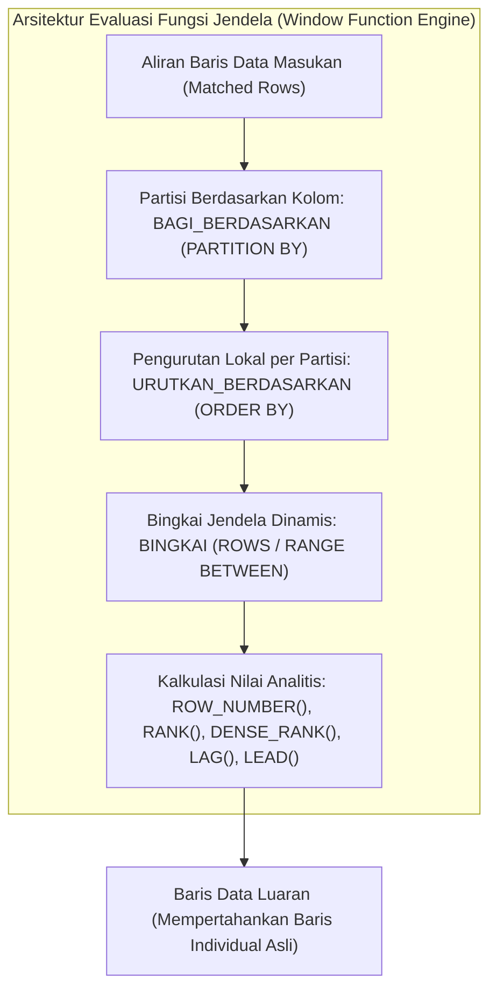

Perbedaan filosofis antara `GROUP BY` dan Fungsi Jendela:
- **Agregasi Standar (`GROUP BY`)**: Mengompresi banyak baris menjadi satu baris rangkuman per grup (mereduksi kardinalitas baris).
- **Fungsi Jendela (`OVER (...)` / `LEWAT (...)`)**: Menghitung kalkulasi metrik grup di atas bingkai jendela dinamis, tetapi **tetap mempertahankan setiap baris individual asli** tanpa mereduksi jumlah baris.

### 14.2 Implementasi Kode Program Utuh

Berikut implementasi eksekusi kueri agregasi dan fungsi jendela analitis dwibahasa pada WidyaBase menggunakan Widya-Lang:

```widya
// Modul Agregasi dan Fungsi Jendela Analitis WidyaBase
modul fungsi_jendela_analitis {
    impor ekosistem::widyabase::{WidyaBase, HasilKueri, BarisData};

    fungsi jalankan_analisis_keuangan(mesin: &mut WidyaBase) -> Hasil<Boolean, Teks> {
        cetak("==================================================================");
        cetak(">>> [ANALITIS] Mengeksekusi Kueri Agregasi dan Fungsi Jendela...");

        // 1. Eksekusi GROUP BY Standar Menggunakan Dialek Nusantara
        biar sql_agregasi = "
            PILIH divisi, 
                  HITUNG(*) SEBAGAI total_karyawan,
                  RATA_RATA(gaji) SEBAGAI rata_gaji,
                  MAKSIMAL(gaji) SEBAGAI gaji_tertinggi
            DARI pegawai_bumn
            KELOMPOKKAN_BERDASARKAN divisi
            MEMILIKI RATA_RATA(gaji) > 10000000.0;
        ";
        cetak(">>> [SQL] Menjalankan pengelompokan divisi...");
        biar hasil_group: HasilKueri = mesin.kueri_sql(sql_agregasi)?;
        untuk baris di hasil_group.baris_data() {
            cetak("  - Divisi: " + baris.ambil_teks("divisi") + 
                  " | Staf: " + teks(baris.ambil_bulat("total_karyawan")) + 
                  " | Rata-rata: Rp " + teks(baris.ambil_desimal("rata_gaji")));
        }

        // 2. Eksekusi Fungsi Jendela Analitis (Ranking & Running Total)
        biar sql_window = "
            PILIH nama, divisi, gaji,
                  NOMOR_BARIS() LEWAT (
                      BAGI_BERDASARKAN divisi 
                      URUTKAN_BERDASARKAN gaji MENURUN
                  ) SEBAGAI peringkat_divisi,
                  JUMLAH(gaji) LEWAT (
                      BAGI_BERDASARKAN divisi 
                      URUTKAN_BERDASARKAN id 
                      BINGKAI BARIS ANTARA TAK_TERBATAS_SEBELUMNYA DAN SAAT_INI
                  ) SEBAGAI akumulasi_gaji_divisi
            DARI pegawai_bumn;
        ";
        cetak(">>> [SQL] Menjalankan fungsi jendela analitis...");
        biar hasil_window: HasilKueri = mesin.kueri_sql(sql_window)?;
        cetak(">>> [HASIL WINDOW] Ditemukan " + teks(hasil_window.jumlah_baris()) + " baris detail:");
        untuk baris di hasil_window.baris_data() {
            cetak("  - " + baris.ambil_teks("nama") + 
                  " [" + baris.ambil_teks("divisi") + "] Gaji: Rp " + teks(baris.ambil_desimal("gaji")) +
                  " | Ranking Divisi: #" + teks(baris.ambil_bulat("peringkat_divisi")) +
                  " | Total Berjalan: Rp " + teks(baris.ambil_desimal("akumulasi_gaji_divisi")));
        }

        cetak(">>> [SUKSES] Seluruh kalkulasi jendela terhitung secara presisi!");
        cetak("==================================================================");
        kembalikan Ok(benar);
    }
}
```

### 14.3 Analisis Arsitektur, Metrik & Tabel Spesifikasi

Tabel perbandingan ragam fungsi jendela analitis pada WidyaBase:

| Kategori Fungsi Jendela | Fungsi Dialek Nusantara | Standar SQL Internasional | Kegunaan Bisnis Utama |
| :--- | :--- | :--- | :--- |
| **Pemeringkatan Urutan**| `NOMOR_BARIS()`, `PERINGKAT()` | `ROW_NUMBER()`, `RANK()` | Penentuan peringkat staf, leaderboards |
| **Pemeringkatan Rapat** | `PERINGKAT_RAPAT()` | `DENSE_RANK()` | Peringkat tanpa lompatan nomor saat seri |
| **Navigasi Baris** | `SEBELUMNYA(kolom, n)` | `LAG(column, offset)` | Perbandingan performa terhadap bulan lalu |
| **Navigasi Maju** | `BERIKUTNYA(kolom, n)` | `LEAD(column, offset)` | Prediksi tren dan perubahan status |
| **Agregasi Berjalan** | `JUMLAH(...) LEWAT (...)` | `SUM(...) OVER (...)` | Saldo berjalan akun (*running balance*) |

### 14.4 Latihan Soal Esai

1. Terangkan perbedaan mendasar antara klausa penyaring baris mentah `DIMANA` (*WHERE*) dengan klausa penyaring hasil agregasi kelompok `MEMILIKI` (*HAVING*)!
2. Jelaskan perbedaan operasional antara fungsi pemeringkatan `RANK()` dan `DENSE_RANK()` ketika ditemukan dua atau lebih baris data yang memiliki nilai kunci pengurutan kembar!
3. Bagaimana mesin eksekusi WidyaBase mengoptimalkan kalkulasi *Running Total* pada bingkai jendela dinamis agar tidak melakukan perhitungan ulang $O(N^2)$ untuk setiap baris?

### 14.5 Soal Pilihan Ganda

1. Klausa yang digunakan untuk menyaring kelompok data hasil agregasi pada SQL adalah...
   A. `WHERE`
   B. `HAVING` (atau `MEMILIKI` pada Dialek Nusantara)
   C. `ORDER BY`
   D. `LIMIT`

2. Karakteristik utama dari Fungsi Jendela (*Window Function*) dibandingkan `GROUP BY` standar adalah...
   A. Menghitung kalkulasi analitis di atas kelompok partisi tanpa mengurangi atau mengompresi jumlah baris individual
   B. Menghapus baris ganda secara otomatis
   C. Mengunci seluruh database
   D. Hanya bekerja pada tabel berukuran nol

3. Kata kunci Dialek Nusantara yang digunakan untuk mendefinisikan pembagian kelompok pada fungsi jendela (`PARTITION BY`) adalah...
   A. `PISAH_DATA`
   B. `BAGI_BERDASARKAN`
   C. `KELOMPOK_SUB`
   D. `IRIS_TABEL`

4. Fungsi jendela yang menghasilkan nomor urut monoton bertambah mulai dari 1 untuk setiap baris di dalam partisinya dinamakan...
   A. `ROW_NUMBER()` (atau `NOMOR_BARIS()`)
   B. `COUNT()`
   C. `SUM()`
   D. `AVG()`

5. Jika ada 3 data bernilai sama di peringkat 1, fungsi `RANK()` akan memberikan nilai 1, 1, 1, dan data berikutnya akan mendapat nomor...
   A. 2
   B. 4 (karena melompati peringkat yang seri)
   C. 3
   D. 0

6. Jika ada 3 data bernilai sama di peringkat 1, fungsi `DENSE_RANK()` akan memberikan nilai 1, 1, 1, dan data berikutnya akan mendapat nomor...
   A. 2 (tanpa lompatan peringkat)
   B. 4
   C. 5
   D. 10

7. Fungsi jendela analitis yang digunakan untuk mengakses nilai kolom dari baris sebelumnya (misalnya pendapatan bulan lalu) adalah...
   A. `LAG()` (atau `SEBELUMNYA()`)
   B. `LEAD()`
   C. `FIRST_VALUE()`
   D. `LAST_VALUE()`

8. Fungsi jendela analitis yang digunakan untuk mengintip nilai kolom dari baris sesudahnya adalah...
   A. `LEAD()` (atau `BERIKUTNYA()`)
   B. `LAG()`
   C. `MIN()`
   D. `MAX()`

9. Algoritma eksekusi pengelompokan yang paling efisien ketika data masukan telah diurutkan oleh indeks B+Tree adalah...
   A. Sort Aggregation
   B. Random Aggregation
   C. Cartesian Join
   D. Bubble Aggregation

10. Mengapa bingkai jendela dinamis (*Window Frame*) seperti `ROWS BETWEEN UNBOUNDED PRECEDING AND CURRENT ROW` sangat vital dalam komputasi perbankan?
    A. Memungkinkan kalkulasi saldo tabungan berjalan (*running balance*) secara kronologis dari awal pembukaan rekening hingga setiap mutasi
    B. Menghapus saldo nasabah secara berkala
    C. Mengganti nomor rekening otomatis
    D. Menghindari verifikasi PIN ATM

---

## Bab 15: Tampilan Virtual, CTE Rekursif & Savepoint Transaksional

### 15.1 Abstraksi Modular: View, CTE & Titik Simpan Bertingkat

Pengembangan aplikasi berskala enterprise membutuhkan kemampuan modularisasi kueri yang bersih serta mekanisme penanganan galat transaksional yang luwes. Menulis kueri monolitik berukuran ratusan baris kode tidak hanya sulit dibaca, tetapi juga rawan menimbulkan kesalahan logika.

WidyaBase menyediakan tiga pilar modularisasi logika dan kontrol transaksi:
1. **Tampilan Virtual (*Views*)**: Lapisan abstraksi kueri tersimpan yang bertindak seolah-olah sebagai tabel nyata, tanpa menduplikasi data fisik di disk.
2. **Ekspresi Tabel Umum (*Common Table Expressions* / CTE)**: Klausa `DENGAN` (*WITH*) yang memungkinkan penguraian kueri rumit menjadi sub-tabel logis sementara, termasuk **CTE Rekursif** untuk menelusuri struktur pohon organisasi atau hierarki graf.
3. **Titik Simpan Transaksional (*Savepoints*)**: Penanda pos pemeriksaan bersarang di dalam satu transaksi aktif (`TITIK_SIMPAN` / `SAVEPOINT`), memungkinkan pembatalan parsial (*partial rollback*) ke titik tertentu tanpa harus menggugurkan seluruh transaksi dari awal.

```mermaid
flowchart TD
    subgraph TransaksiACID["Siklus Transaksi dengan Titik Simpan Bersarang (Savepoints)"]
        A["MULAI_TRANSAKSI (BEGIN)"] --> B["Eksekusi: Debit Rekening Nasabah Rp 5.000.000"]
        B --> C["TITIK_SIMPAN pos_pembayaran_1;"]
        C --> D["Eksekusi: Kirim Dana ke Bank Eksternal A (Gagal Jaringan / Galat)"]
        D -->|Terjadi Galat Operasional| E["KEMBALIKAN_KE_TITIK_SIMPAN pos_pembayaran_1;"]
        E -->|Debit Awal Tetap Utuh & Selamat| F["Eksekusi Jalur Alternatif: Kirim Dana ke Bank B (Sukses)"]
        F --> G["LEPASKAN_TITIK_SIMPAN pos_pembayaran_1;"]
        G --> H["KOMIT_TRANSAKSI (COMMIT)"]
    end
```

Karakteristik implementasi di WidyaBase:
- **Penggabungan Tampilan (*View Inlining*)**: Kueri terhadap *View* digabungkan (*flattened*) secara langsung ke dalam kueri induk oleh perencana logis, memungkinkan CBO menerapkan *Predicate Pushdown* menembus definisi view.
- **CTE Rekursif dengan Deteksi Siklus**: Memproses simpul hierarki anak-induk dengan aman, dilengkapi pelindung kedalaman maksimum (*max recursion depth*) untuk mencegah loop tak terbatas.
- **Manajemen Savepoint Tanpa Flushed LSN**: Savepoint dikelola secara efisien di memori transaksi dengan mencatat pointer status WAL saat itu, sehingga pembuatan savepoint berjalan dengan latensi nol tanpa disk I/O.

### 15.2 Implementasi Kode Program Utuh

Berikut implementasi CTE rekursif hierarki dan demonstrasi partial rollback savepoint pada WidyaBase menggunakan Widya-Lang:

```widya
// Modul Tampilan Virtual, CTE Rekursif dan Savepoint WidyaBase
modul modularitas_transaksi {
    impor ekosistem::widyabase::{WidyaBase, TransaksiACID, HasilKueri};

    fungsi demonstrasi_cte_dan_savepoint(mesin: &mut WidyaBase) -> Hasil<Boolean, Teks> {
        cetak("==================================================================");
        cetak(">>> [MODULARITAS] Memulai pengujian CTE Rekursif dan Savepoint...");

        // 1. Eksekusi CTE Rekursif untuk Menelusuri Struktur Hierarki Organisasi
        biar sql_cte_hierarki = "
            DENGAN REKURSIF pohon_organisasi SEBAGAI (
                // Anggota Jangkar (Anchor Member): Pimpinan Tertinggi
                PILIH id, nama, id_atasan, 1 SEBAGAI tingkat
                DARI pegawai_bumn
                DIMANA id_atasan ADALAH KOSONG
                
                GABUNG_SEMUA
                
                // Anggota Rekursif (Recursive Member): Bawahan
                PILIH p.id, p.nama, p.id_atasan, po.tingkat + 1
                DARI pegawai_bumn p
                GABUNG pohon_organisasi po PADA p.id_atasan = po.id
            )
            PILIH * DARI pohon_organisasi URUTKAN_BERDASARKAN tingkat MENAIK;
        ";
        cetak(">>> [CTE] Menjalankan CTE rekursif struktur hierarki...");
        biar hasil_cte: HasilKueri = mesin.kueri_sql(sql_cte_hierarki)?;
        untuk baris di hasil_cte.baris_data() {
            cetak("  Tingkat " + teks(baris.ambil_bulat("tingkat")) + ": " + 
                  baris.ambil_teks("nama") + " (ID: " + teks(baris.ambil_bulat("id")) + ")");
        }

        // 2. Eksekusi Transaksi Finansial dengan Mekanisme Titik Simpan (Savepoint)
        cetak(">>> [TRANSAKSI] Memulai transaksi transfer multi-kanal...");
        biar mut tx: TransaksiACID = mesin.mulai_transaksi()?;

        // Langkah A: Debit Rekening Pengirim
        tx.eksekusi_sql("PERBARUI rekening SET saldo = saldo - 2500000 WHERE no_rek = 'REK-001';")?;
        cetak(">>> [TX] Berhasil mendebit saldo pengirim.");

        // Buat Titik Simpan (Savepoint)
        tx.buat_titik_simpan("pos_kanal_mitra")?;
        cetak(">>> [TX] Titik simpan 'pos_kanal_mitra' berhasil ditancapkan.");

        // Langkah B: Coba pengiriman lewat Mitra X (Simulasi Galat)
        biar percobaan_mitra = tx.eksekusi_sql("SISIP_KE mutasi_mitra_x (no_rek, nominal) NILAI ('REK-002', 2500000);");
        
        jika percobaan_mitra.apakah_galat() {
            cetak(">>> [TX] Kanal Mitra X bermasalah! Melakukan pembatalan parsial...");
            // Rollback hanya ke savepoint, debit awal tetap selamat
            tx.kembalikan_ke_titik_simpan("pos_kanal_mitra")?;
            cetak(">>> [TX] Saldo pengirim aman pada titik simpan. Mengalihkan ke Mitra Y...");

            // Jalur Pengganti: Kirim lewat Mitra Y yang sehat
            tx.eksekusi_sql("SISIP_KE mutasi_mitra_y (no_rek, nominal) NILAI ('REK-002', 2500000);")?;
            cetak(">>> [TX] Berhasil dikirimkan via Mitra Y!");
        }

        // Lepaskan Savepoint dan Komit Transaksi Penuh
        tx.lepaskan_titik_simpan("pos_kanal_mitra")?;
        tx.komit()?;
        cetak(">>> [TX] Transaksi komit paripurna! Bebas dari kegagalan berantai.");
        cetak("==================================================================");
        kembalikan Ok(benar);
    }
}
```

### 15.3 Analisis Arsitektur, Metrik & Tabel Spesifikasi

Tabel perbandingan sintaksis modularitas dan kendali transaksi pada WidyaBase:

| Fitur / Mekanisme | Dialek Nusantara | Standar ANSI SQL | Dampak Terhadap Penyimpanan Disk |
| :--- | :--- | :--- | :--- |
| **Definisi Tampilan** | `BUAT TAMPILAN v_nama SEBAGAI PILIH ...` | `CREATE VIEW v_name AS SELECT ...` | Nol (Metadata skema logis saja) |
| **CTE Bersarang** | `DENGAN nama_tabel SEBAGAI (...)` | `WITH table_name AS (...)` | Nol (Dievaluasi in-line / memori kerja) |
| **CTE Rekursif** | `DENGAN REKURSIF nama SEBAGAI (...)` | `WITH RECURSIVE name AS (...)` | Ditampung di antrean memori kerja |
| **Pembuatan Savepoint** | `TITIK_SIMPAN nama_pos;` | `SAVEPOINT sp_name;` | Nol (Hanya penanda memori transaksi) |
| **Pembatalan Parsial** | `KEMBALIKAN_KE_TITIK_SIMPAN nama_pos;`| `ROLLBACK TO SAVEPOINT sp_name;` | Menulis pembatalan logis lokal |
| **Pelepasan Savepoint**| `LEPASKAN_TITIK_SIMPAN nama_pos;` | `RELEASE SAVEPOINT sp_name;` | Membebaskan penanda struktur data |

### 15.4 Latihan Soal Esai

1. Terangkan perbedaan mendasar antara *Standard View* (Tampilan Virtual) dan *Materialized View* dalam hal penggunaan ruang disk dan konsistensi data real-time!
2. Bagaimana cara kerja komponen *Anchor Member* dan *Recursive Member* dalam sintaksis CTE Rekursif? Mengapa kondisi pemberhentian rekursi mutlak diperlukan?
3. Jelaskan skenario bisnis perbankan di mana penggunaan `SAVEPOINT` jauh lebih unggul dan efisien daripada membiarkan transaksi langsung gagal total (*complete rollback*)!

### 15.5 Soal Pilihan Ganda

1. Objek basis data yang menyimpan definisi kueri logis tanpa menduplikasi data fisik di piringan disk dinamakan...
   A. View (Tampilan Virtual)
   B. Table Partition
   C. WAL Segment
   D. Root Page

2. Klausa SQL yang digunakan untuk mendefinisikan Common Table Expression (CTE) adalah...
   A. `WITH` (atau `DENGAN` pada Dialek Nusantara)
   B. `CREATE CLUSTER`
   C. `DECLARE CURSOR`
   D. `MERGE INTO`

3. Dua bagian wajib dalam konstruksi query CTE Rekursif adalah...
   A. Anchor Member (Anggota Jangkar) dan Recursive Member (Anggota Rekursif)
   B. Head dan Tail
   C. Header dan Footer
   D. Input dan Output

4. Perintah yang digunakan untuk menandai pos pemeriksaan bersarang di dalam satu transaksi aktif adalah...
   A. `SAVEPOINT` (atau `TITIK_SIMPAN`)
   B. `CHECKPOINT`
   C. `COMMIT`
   D. `FREEZE`

5. Tindakan yang terjadi ketika perintah `ROLLBACK TO SAVEPOINT sp1;` dieksekusi adalah...
   A. Seluruh perubahan yang terjadi setelah `sp1` dibatalkan, namun perubahan sebelum `sp1` tetap bertahan dalam transaksi aktif
   B. Seluruh database dihapus
   C. Transaksi otomatis dinyatakan komit
   D. Koneksi jaringan diputus seketika

6. Perintah yang digunakan untuk membebaskan penanda titik simpan tanpa membatalkan transaksi adalah...
   A. `RELEASE SAVEPOINT` (atau `LEPASKAN_TITIK_SIMPAN`)
   B. `DROP TABLE`
   C. `ABORT`
   D. `DELETE FROM`

7. Apa bahaya utama jika CTE Rekursif tidak memiliki kondisi batas pemberhentian (*termination condition*)?
   A. Terjadi perulangan tak berujung (*infinite loop*) yang menghabiskan memori peladen hingga batas rekursi terpicu
   B. Menjadikan warna layar terminal berubah
   C. Mempercepat koneksi internet
   D. Menghapus akun admin

8. Istilah teknik optimasi di mana pendefinisian View dilebur langsung ke dalam pohon rencana kueri induk dinamakan...
   A. View Inlining / View Flattening
   B. Page Split
   C. Vacuuming
   D. Buffer Thrashing

9. Berapakah overhead penulisan disk I/O yang ditimbulkan oleh pembuatan sebuah `SAVEPOINT`?
   A. Tepat nol (0 I/O disk) karena hanya memanipulasi penanda status di RAM memori transaksi
   B. 100 Megabyte
   C. 4 Kilobyte
   D. Bergantung pada ukuran harddisk

10. Mengapa View yang melibatkan agregasi grup (`GROUP BY`) atau banyak gabungan tabel (`JOIN`) umumnya berstatus *Read-Only* (tidak dapat langsung di-UPDATE)?
    A. Karena sistem tidak dapat memetakan secara ambigu satu baris hasil agregasi kembali ke satu baris fisik asal pada tabel dasar
    B. Karena sistem operasi melarang komputasi di malam hari
    C. Karena bahasa SQL tidak mendukung tombol simpan
    D. Supaya memori RAM tidak dingin

---

## Bab 16: Pemicu Transaksi & Audit Jejak Kepatuhan

### 16.1 Integritas Otomatis: Trigger, Constraint & Jejak Audit Finansial

Dalam sistem komputasi berdaulat skala nasional—seperti perbendaharaan negara, sistem perbankan terpusat, dan rekam medis kependudukan—integritas data dan akuntabilitas hukum tidak boleh hanya diserahkan pada disiplin logika aplikasi klien. Aplikasi klien dapat mengandung celah keamanan, salah konfigurasi, atau dieksploitasi oleh pihak tak berwenang.

Oleh karena itu, WidyaBase menanamkan **Mesin Pemicu Transaksi (*Trigger Engine*)** dan **Sistem Audit Kepatuhan Otomatis (*Compliance Audit Subsystem*)** langsung pada lapisan inti mesin basis data:
- **Pemicu (*Triggers*)**: Prosedur logika yang secara otomatis terpicu sebelum (*BEFORE*) atau sesudah (*AFTER*) operasi mutasi data (`SISIP_KE`, `PERBARUI`, `HAPUS_DARI`) pada tingkat pernyataan (*statement-level*) maupun per baris (*row-level / FOR EACH ROW*).
- **Variabel Semu Spesial**: Menyediakan akses instan ke tupel `LAMA` (*OLD*) dan tupel `BARU` (*NEW*).
- **Jejak Audit Kekal (*Immutable Append-Only Audit Trail*)**: Setiap perubahan data finansial dicatat ke tabel audit terenkripsi yang dilengkapi hash kriptografi rantai blok (*blockchain-like hash chain*), menjamin data tidak dapat dimanipulasi bahkan oleh administrator basis data (*non-repudiation*).

```mermaid
flowchart TD
    A["Kueri Klien: PERBARUI rekening SET saldo = ..."] --> B["Tahap 1: Evaluasi Pemicu SEBELUM (BEFORE Trigger)"]
    subgraph MesinTriggerWidyaBase["Mesin Pemicu & Integritas Transaksi WidyaBase (trigger.rs)"]
        B -->|Validasi Nilai Tupel BARU & LAMA| C{"Apakah Saldo Valid & >= 0?"}
        C -->|Tidak (Melanggar Batasan)| D["Batalkan Transaksi & Bangkitkan Galat Integritas"]
        C -->|Ya (Valid)| E["Tahap 2: Tulis Pembaruan ke Buffer Pool & WAL Engine"]
        E --> F["Tahap 3: Evaluasi Batasan Integritas Kunci Asing & Unik"]
        F --> G["Tahap 4: Eksekusi Pemicu SESUDAH (AFTER Trigger)"]
        G --> H["Tahap 5: Sisipkan Catatan Immutable Audit Log Berantai Hash"]
    end
    H --> I["Kemit Transaksi Sukses Paripurna"]
```

Pilar arsitektur audit WidyaBase:
1. **Pemicu Pencegahan (*BEFORE Trigger*)**: Mampu mengubah nilai tupel `BARU` sebelum ditulis ke disk (misalnya pembersihan format nomor HP, enkripsi kolom NIK), atau menggugurkan transaksi jika terdeteksi manipulasi saldo negatif.
2. **Pemicu Propagasi (*AFTER Trigger*)**: Digunakan untuk menyinkronkan data turunan, mengirim notifikasi peristiwa perubahan data, atau memperbarui agregasi material.
3. **Pemberlakuan Kunci Asing Berjenjang (*Cascading Constraints*)**: Mendukung aksi penanganan otomatis saat data induk dihapus: `HAPUS_BERUNTUN` (*CASCADE*), `ATUR_KOSONG` (*SET NULL*), atau `TOLAK` (*RESTRICT*).

### 16.2 Implementasi Kode Program Utuh

Berikut implementasi definisi Trigger audit saldo keuangan dan verifikasi integritas rantai audit pada WidyaBase menggunakan Widya-Lang:

```widya
// Modul Pemicu Transaksi dan Jejak Audit Kepatuhan WidyaBase
modul mesin_audit_trigger {
    impor ekosistem::widyabase::{
        WidyaBase, KonteksPemicu, WaktuPemicu, PeristiwaPemicu,
        BarisData, HasilPemicu, KriptoHash
    };

    fungsi inisialisasi_pemicu_audit(mesin: &mut WidyaBase) -> Hasil<Boolean, Teks> {
        cetak("==================================================================");
        cetak(">>> [TRIGGER] Mengonfigurasi Pemicu Audit Rekening Perbankan...");

        // 1. Buat Tabel Audit Append-Only dengan Rantai Hash SHA-256
        biar ddl_audit = "
            BUAT TABEL log_audit_rekening (
                id BULAT KUNCI_UTAMA_SERI,
                no_rek TEKS TIDAK_KOSONG,
                saldo_lama DESIMAL,
                saldo_baru DESIMAL,
                waktu_kejadian CAP_WAKTU,
                diubah_oleh TEKS,
                hash_sebelumnya TEKS,
                hash_sekarang TEKS
            );
        ";
        mesin.eksekusi_sql(ddl_audit)?;

        // 2. Registrasikan Pemicu 'BEFORE UPDATE' untuk Menolak Saldo Negatif
        biar sql_trigger_before = "
            BUAT PEMICU validasi_saldo_minimum
            SEBELUM PERBARUI PADA rekening
            UNTUK SETIAP BARIS
            JIKA (BARU.saldo < 0.0)
            MAKA
                BANGKITKAN_GALAT('GalatIntegritas: Saldo rekening tidak boleh bernilai negatif!');
        ";
        mesin.eksekusi_sql(sql_trigger_before)?;
        cetak(">>> [TRIGGER] Pemicu validasi integritas SEBELUM berhasil didaftarkan.");

        // 3. Registrasikan Pemicu 'AFTER UPDATE' untuk Mencatat Jejak Audit Otomatis
        biar sql_trigger_after = "
            BUAT PEMICU catat_audit_keuangan
            SESUDAH PERBARUI PADA rekening
            UNTUK SETIAP BARIS
            JALANKAN
                SISIP_KE log_audit_rekening (
                    no_rek, saldo_lama, saldo_baru, waktu_kejadian, diubah_oleh
                )
                NILAI (
                    LAMA.no_rek, LAMA.saldo, BARU.saldo, SEKARANG(), PENGGUNA_AKTIF()
                );
        ";
        mesin.eksekusi_sql(sql_trigger_after)?;
        cetak(">>> [TRIGGER] Pemicu audit SESUDAH berhasil didaftarkan.");

        // 4. Uji Mutasi Transaksional: Transaksi Berhasil
        cetak(">>> [TX] Menjalankan pembaruan saldo nasabah sah...");
        mesin.eksekusi_sql("PERBARUI rekening SET saldo = saldo - 500000 WHERE no_rek = 'REK-101';")?;
        
        // 5. Uji Mutasi Transaksional: Penolakan Saldo Minus
        cetak(">>> [TX] Menguji proteksi transaksi penarikan melebihi batas saldo...");
        biar hasil_ilegal = mesin.eksekusi_sql("PERBARUI rekening SET saldo = saldo - 99999999 WHERE no_rek = 'REK-101';");
        jika hasil_ilegal.apakah_galat() {
            cetak(">>> [PROTEKSI SUKSES] Transaksi ilegal digugurkan oleh Trigger: " + hasil_ilegal.ambil_pesan_galat());
        }

        cetak(">>> [AUDIT] Memeriksa isi catatan log audit kepatuhan perbankan...");
        biar log = mesin.kueri_sql("PILIH * DARI log_audit_rekening URUTKAN_BERDASARKAN id;")?;
        untuk baris di log.baris_data() {
            cetak("  [AUDIT] Rek: " + baris.ambil_teks("no_rek") + 
                  " | Saldo Lama: Rp " + teks(baris.ambil_desimal("saldo_lama")) +
                  " -> Saldo Baru: Rp " + teks(baris.ambil_desimal("saldo_baru")));
        }

        cetak("==================================================================");
        kembalikan Ok(benar);
    }
}
```

### 16.3 Analisis Arsitektur, Metrik & Tabel Spesifikasi

Tabel perbandingan jenis pemicu transaksional pada mesin WidyaBase:

| Tipe Pemicu (*Trigger*) | Titik Evaluasi Eksekusi | Akses Modifikasi Tupel `BARU` | Dampak Kegagalan | Kasus Penggunaan Optimal |
| :--- | :--- | :--- | :--- | :--- |
| **BEFORE ROW** | Sebelum data ditulis ke halaman RAM | **Bisa Mengubah `BARU`** | Menggugurkan Transaksi | Validasi batasan bisnis, enkripsi data |
| **AFTER ROW** | Setelah data tercatat di mesin transaksi| Hanya-Baca (`BARU` & `LAMA`) | Menggugurkan Transaksi | Jejak audit kepatuhan, replikasi internal |
| **INSTEAD OF** | Menggantikan perintah asli kueri | Mengontrol eksekusi penuh | Menggugurkan Transaksi | Pembaruan pada View yang kompleks |
| **AFTER STATEMENT** | Sekali di akhir kueri kumpulan baris | Tidak ada variabel per-baris | Menggugurkan Transaksi | Ringkasan metrik statistik harian |

### 16.4 Latihan Soal Esai

1. Terangkan perbedaan mendasar antara pemicu berjenis `SEBELUM` (*BEFORE*) dan `SESUDAH` (*AFTER*)! Mengapa hanya pemicu *BEFORE* yang diizinkan memodifikasi nilai bidang tupel `BARU`?
2. Mengapa pencatatan audit log transaksi finansial harus dirancang berkonsep *Append-Only* dan tidak boleh memiliki hak akses perintah `UPDATE` atau `DELETE` bahkan untuk pengguna berkasta superuser (*DBA*)?
3. Uraikan mekanisme kerja integrasi rantai hash kriptografi (*Hash Chain*) pada tabel log audit untuk menjamin deteksi seketika bila ada manipulasi data piringan disk secara offline!

### 16.5 Soal Pilihan Ganda

1. Pemicu transaksi (*Trigger*) yang dieksekusi sebelum data fisik dimodifikasi sehingga dapat membatalkan atau mengubah nilai masukan adalah...
   A. BEFORE Trigger
   B. AFTER Trigger
   C. INSTEAD OF Trigger
   D. POST Trigger

2. Variabel semu yang digunakan untuk membaca nilai kolom sebelum terjadinya modifikasi pada operasi UPDATE atau DELETE dinamakan...
   A. `LAMA` (atau `OLD` pada standar SQL)
   B. `BARU` (atau `NEW`)
   C. `SEMENTARA`
   D. `MEMORI`

3. Variabel semu yang menyimpan nilai kolom baru yang akan disisipkan atau diperbarui adalah...
   A. `BARU` (atau `NEW`)
   B. `LAMA` (atau `OLD`)
   C. `AWAL`
   D. `BATAL`

4. Klausa pada pendefinisian pemicu yang menentukan bahwa pemicu dieksekusi satu kali untuk setiap baris data yang terpengaruh adalah...
   A. `FOR EACH ROW` (atau `UNTUK SETIAP BARIS`)
   B. `FOR EACH STATEMENT`
   C. `FOR EACH DATABASE`
   D. `FOR EACH USER`

5. Pemicu khusus yang digunakan untuk mengintersep operasi INSERT/UPDATE pada View yang rumit dan mengalihkannya ke tabel dasar dinamakan...
   A. INSTEAD OF Trigger
   B. BEFORE STATEMENT
   C. CASCADE Trigger
   D. MERGE Trigger

6. Batasan integritas referensial yang secara otomatis menghapus baris-baris anak ketika baris induk dihapus dinamakan...
   A. `ON DELETE CASCADE` (atau `PADA HAPUS BERUNTUN`)
   B. `ON DELETE RESTRICT`
   C. `ON DELETE NO ACTION`
   D. `ON DELETE FREEZE`

7. Sifat dari tabel log audit kepatuhan yang hanya mengizinkan penambahan catatan baru tanpa boleh diubah atau dihapus disebut...
   A. Append-Only
   B. Overwrite-Only
   C. Ephemeral
   D. Volatile

8. Teknik matematis yang digunakan untuk menghubungkan setiap baris catatan audit dengan hash catatan sebelumnya seperti buku besar blockchain dinamakan...
   A. Cryptographic Hash Chain
   B. Linear Regression
   C. Binary Search
   D. Round Robin

9. Apa yang terjadi pada transaksi utama pengguna jika sebuah AFTER Trigger di dalamnya melemparkan eksepsi galat (*error/exception*)?
   A. Seluruh transaksi utama otomatis digugurkan (*Rollback*) secara ACID
   B. Transaksi tetap sukses dan galat diabaikan
   C. Data ditulis separuh ke tabel
   D. Server basis data otomatis mati

10. Mengapa peletakan batasan integritas bisnis kritis di dalam mesin basis data (via Trigger/Constraint) jauh lebih aman daripada hanya meletakkannya di aplikasi web?
    A. Mencegah pelanggaran integritas data dari akses langsung, skrip migrasi, alat BI pihak ketiga, maupun eksploitasi API
    B. Menjadikan tampilan website lebih menarik
    C. Mengurangi kebutuhan memori pada HP pengguna
    D. Menghapus kebutuhan login pengguna

---

## Bab 17: Penyimpanan Dokumen Dinamis JSONB & Indeks GIN

### 17.1 Dokumen Tanpa Skema di Atas Fondasi Relasional ACID

Dalam lanskap komputasi modern, entitas bisnis sering kali memiliki atribut yang sangat dinamis, heterogen, dan berkembang cepat—seperti profil pengguna, konfigurasi sensor IoT, rekam medis poliklinik, atau keranjang belanja e-commerce. Memaksa entitas dinamis ini ke dalam skema tabel relasional kaku (*rigid relational schema*) akan memicu proliferasi kolom bernilai kosong (*NULL proliferation*) atau mengharuskan migrasi skema `ALTER TABLE` berulang kali.

WidyaBase mengatasi tantangan ini dengan mengintegrasikan tipe data dokumen biner **JSONB** (*Binary JSON*) yang didukung oleh struktur pengindeksan terbalik **GIN** (*Generalized Inverted Index*):
- **Format Biner Terkompresi**: Format teks JSON mentah diuraikan sekali saat penyisipan menjadi struktur hierarkis biner terurut kunci.
- **Ekstraksi Kunci Seketika ($O(1)$ / $O(\log K)$)**: Pengaksesan properti bersarang (`dokumen->'kontak'->>'email'`) dapat langsung melompat ke lokasi memori yang tepat tanpa perlu mem-parsing ulang seluruh berkas string JSON.
- **Dukungan Indeks GIN Universal**: Setiap kunci dan nilai di dalam dokumen JSONB diindeks ke dalam B+Tree terbalik, memungkinkan kueri pencarian keberadaan properti (`?`), ketercakupan himpunan (`@>`), dan jalur ekspresi (`@@`) berjalan dalam hitungan fraksi milidetik.

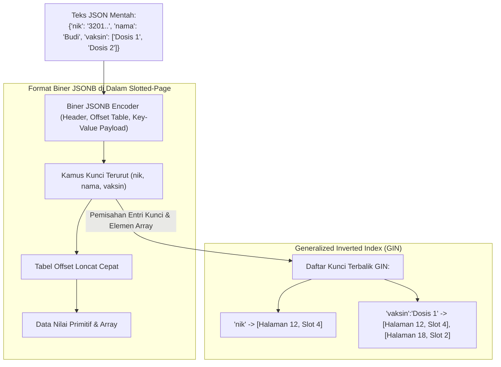

Fitur unggulan dokumen JSONB WidyaBase:
1. **Operator Operator Navigasi Dwibahasa**:
   - `->` : Mengambil objek atau elemen anak sebagai tipe JSONB.
   - `->>` : Mengambil nilai skalar sebagai tipe teks primitif.
   - `@>` (*BERISI*) : Memeriksa apakah dokumen kiri mencakup seluruh struktur dokumen kanan.
   - `?` (*MEMILIKI_KUNCI*) : Memeriksa keberadaan nama kunci tertentu.
2. **Kepatuhan ACID Penuh**: Berbeda dengan basis data NoSQL murni yang hanya menjamin konsistensi lambat (*Eventual Consistency*), mutasi dokumen JSONB di WidyaBase terlindungi 100% oleh transaksi ACID, MVCC, dan WAL logging.

### 17.2 Implementasi Kode Program Utuh

Berikut implementasi manipulasi data dokumen JSONB dan kueri operator penelusuran berindeks GIN pada WidyaBase menggunakan Widya-Lang:

```widya
// Modul Penyimpanan Dokumen JSONB dan Indeks GIN WidyaBase
modul dokumen_jsonb {
    impor ekosistem::widyabase::{WidyaBase, DokumenJSONB, HasilKueri, IndeksGIN};

    fungsi demonstrasi_dokumen_dinamis(mesin: &mut WidyaBase) -> Hasil<Boolean, Teks> {
        cetak("==================================================================");
        cetak(">>> [JSONB] Menguji Penyimpanan Dokumen Multi-Modal dan Indeks GIN...");

        // 1. Buat Tabel Pasien Medis dengan Kolom Relasional dan JSONB Fleksibel
        biar sql_tabel = "
            BUAT TABEL rekam_medis_pasien (
                id BULAT KUNCI_UTAMA_SERI,
                nomor_rm TEKS UNIK TIDAK_KOSONG,
                nama_pasien TEKS TIDAK_KOSONG,
                data_klinis DOKUMEN_JSONB
            );
        ";
        mesin.eksekusi_sql(sql_tabel)?;

        // 2. Bangun Indeks GIN pada Kolom Dokumen JSONB
        biar sql_indeks_gin = "
            BUAT INDEKS idx_rekam_medis_gin 
            PADA rekam_medis_pasien 
            MENGGUNAKAN GIN (data_klinis);
        ";
        mesin.eksekusi_sql(sql_indeks_gin)?;
        cetak(">>> [GIN] Indeks terbalik GIN berhasil diaktifkan pada kolom data_klinis.");

        // 3. Sisipkan Catatan dengan Struktur Dokumen Bersarang yang Bervariasi
        biar sql_sisip = "
            SISIP_KE rekam_medis_pasien (nomor_rm, nama_pasien, data_klinis)
            NILAI 
            ('RM-001', 'Ahmad Dahlan', '{
                \"golongan_darah\": \"O\",
                \"alergi\": [\"Penisilin\", \"Kacang\"],
                \"tanda_vital\": {\"tensi_sistol\": 120, \"nadi\": 78},
                \"diagnosa_terakhir\": \"Hipertensi Ringan\"
            }'),
            ('RM-002', 'Dewi Sartika', '{
                \"golongan_darah\": \"A\",
                \"alergi\": [],
                \"tanda_vital\": {\"tensi_sistol\": 110, \"nadi\": 82},
                \"asuransi\": {\"provider\": \"BPJS Kesehatan\", \"kelas\": 1}
            }');
        ";
        mesin.eksekusi_sql(sql_sisip)?;
        cetak(">>> [JSONB] Dokumen pasien berhasil diubah ke format biner dan disimpan.");

        // 4. Kueri Menggunakan Operator Ekstraksi Nilai Skalar (->>)
        biar sql_ekstraksi = "
            PILIH nama_pasien, 
                  data_klinis->'tanda_vital'->>'tensi_sistol' SEBAGAI sistol,
                  data_klinis->>'golongan_darah' SEBAGAI gol_darah
            DARI rekam_medis_pasien
            DIMANA data_klinis->>'golongan_darah' = 'O';
        ";
        cetak(">>> [SQL] Menjalankan kueri ekstraksi hierarkis...");
        biar hasil: HasilKueri = mesin.kueri_sql(sql_ekstraksi)?;
        untuk baris di hasil.baris_data() {
            cetak("  - Pasien: " + baris.ambil_teks("nama_pasien") + 
                  " | Gol Darah: " + baris.ambil_teks("gol_darah") + 
                  " | Sistol: " + baris.ambil_teks("sistol") + " mmHg");
        }

        // 5. Kueri Menggunakan Operator Ketercakupan GIN (@> / BERISI)
        biar sql_ketercakupan = "
            PILIH nama_pasien, data_klinis
            DARI rekam_medis_pasien
            DIMANA data_klinis @> '{\"alergi\": [\"Penisilin\"]}';
        ";
        cetak(">>> [GIN] Mencari pasien dengan riwayat alergi Penisilin...");
        biar hasil_alergi: HasilKueri = mesin.kueri_sql(sql_ketercakupan)?;
        untuk baris di hasil_alergi.baris_data() {
            cetak("  - Ditemukan: " + baris.ambil_teks("nama_pasien") + " (Indeks GIN memotong waktu pencarian)");
        }

        cetak("==================================================================");
        kembalikan Ok(benar);
    }
}
```

### 17.3 Analisis Arsitektur, Metrik & Tabel Spesifikasi

Tabel perbandingan antara tipe teks JSON konvensional dan JSONB terindeks GIN di WidyaBase:

| Karakteristik Evaluasi | Format JSON Teks Standar | Format JSONB Terkompresi | Format JSONB + Indeks GIN |
| :--- | :--- | :--- | :--- |
| **Waktu Penyisipan (*Insert*)** | Sangat Cepat (Tanpa konversi) | Sedang (Pembangunan biner) | Sedang (Pembaruan entri GIN) |
| **Waktu Pembacaan Seluruh Dokumen**| Cepat (Mengalirkan teks) | Sangat Cepat (Tanpa re-format) | Sangat Cepat |
| **Kecepatan Akses Properti Kunci** | Lambat ($O(N)$ parse karakter) | Sangat Cepat ($O(\log K)$ Offset)| Instan via Indeks |
| **Pencarian Nilai Larik (*Array*)**| Lambat ($O(N)$ full table scan)| Sedang ($O(N)$ baris scan) | Sangat Cepat ($O(\log N)$ GIN) |
| **Efisiensi Ruang Penyimpanan**| Boros (Menyimpan spasi/koma) | Hemat 30–45% (Kamus token)| Tambahan 15–20% untuk indeks |

### 17.4 Latihan Soal Esai

1. Terangkan perbedaan struktural antara representasi data format `JSON` teks mentah dan format biner `JSONB` di dalam halaman slotted-page WidyaBase!
2. Bagaimana struktur data *Generalized Inverted Index* (GIN) memecah elemen-elemen dokumen JSONB untuk mempercepat kueri ketercakupan (*containment query* `@>`)?
3. Jelaskan mengapa penggabungan data relasional tabel baku dengan kolom dokumen JSONB dalam satu basis data ACID memberikan fleksibilitas arsitektural yang jauh lebih unggul dibandingkan memelihara basis data NoSQL terpisah!

### 17.5 Soal Pilihan Ganda

1. Tipe data pada WidyaBase yang menyimpan dokumen JSON dalam format biner terurai dan terindeks dinamakan...
   A. JSONB
   B. XML_RAW
   C. VARCHAR_MAX
   D. CSV_BLOB

2. Operator yang digunakan untuk mengekstrak nilai bidang dari objek JSONB dan mengembalikannya sebagai teks biasa adalah...
   A. `->>`
   B. `->`
   C. `==`
   D. `&&`

3. Operator yang digunakan untuk memeriksa apakah suatu dokumen JSONB mencakup seluruh struktur atau elemen tertentu dari dokumen lain dinamakan operator ketercakupan...
   A. `@>` (atau klausa `BERISI`)
   B. `<@`
   C. `??`
   D. `||`

4. Jenis indeks yang paling optimal untuk mempercepat kueri pencarian kunci dan elemen larik (*array*) pada kolom JSONB adalah...
   A. GIN (Generalized Inverted Index)
   B. Hash Scan
   C. R-Tree
   D. Slotted Index

5. Keuntungan format biner JSONB saat mengekstrak properti yang berada di dalam struktur bersarang adalah...
   A. Mesin dapat langsung melompat ke lokasi offset memori properti tanpa perlu mengurai (*parsing*) ulang string dari awal
   B. Dokumen otomatis diubah menjadi file PDF
   C. Huruf kapital otomatis dihilangkan
   D. Menghapus koneksi jaringan yang lambat

6. Operator `?` pada tipe data JSONB di WidyaBase berfungsi untuk...
   A. Menguji apakah suatu nama kunci tertentu ada di dalam tingkat atas objek JSONB
   B. Menampilkan menu bantuan
   C. Menghapus seluruh tabel
   D. Membalik urutan huruf

7. Apa yang terjadi pada spasi kosong redundan (*whitespace*) dan urutan kunci saat teks JSON dikonversi menjadi JSONB?
   A. Spasi redundan dieliminasi dan kunci diurutkan secara kanonikal untuk pencarian biner cepat
   B. Spasi digandakan dua kali lipat
   C. Seluruh tanda koma diubah menjadi titik
   D. Dokumen ditolak oleh parser

8. Batasan integritas ACID pada kolom JSONB di WidyaBase menjamin bahwa...
   A. Seluruh mutasi dokumen dilindungi oleh protokol logging WAL, isolasi transaksi MVCC, dan pemulihan crash seketika
   B. Dokumen hanya bisa dibaca satu orang per hari
   C. Data otomatis hilang jika server mati lampu
   D. Kueri harus ditulis dalam bahasa assembly

9. Indeks GIN secara struktural terdiri atas...
   A. Pohon B+Tree dari entri kunci unik yang masing-masing menunjuk ke daftar posting (*posting list*) berisi pointer tupel (RID)
   B. Sebuah array satu dimensi tanpa pengurutan
   C. File gambar berformat PNG
   D. Rantai blok terdistribusi

10. Mengapa pemakaian kolom JSONB untuk data yang memiliki skema 100% statis dan sangat sering diagregasi (misalnya: kolom saldo, tanggal transaksi) kurang direkomendasikan dibandingkan kolom relasional biasa?
    A. Kolom relasional primitif memiliki overhead metadata yang lebih kecil dan dapat diproses lebih efisien oleh instruksi CPU SIMD
    B. Kolom JSONB tidak bisa disimpan di harddisk
    C. Bahasa Widya-Lang melarang tipe data angka
    D. JSONB hanya bisa menampung 10 karakter

---

## Bab 18: Mesin Vektor Kecerdasan Buatan & Indeks Graf HNSW

### 18.1 Era AI: Basis Data Semantik Vektor untuk RAG & Agen Cerdas

Perkembangan pesat model kecerdasan buatan (*Large Language Models* / LLM) telah mengubah paradigma pencarian data: dari pencarian berbasis kecocokan kata kunci harfiah (*exact keyword match*) menjadi pencarian berbasis kedekatan makna dan semantik (*semantic similarity search*).

Untuk memberdayakan arsitektur *Retrieval-Augmented Generation* (RAG) dan memori jangka panjang agen kecerdasan buatan tanpa dependensi perangkat lunak asing, WidyaBase mengintegrasikan **Mesin Vektor AI In-Database** berbasis algoritma graf multi-lapis **Hierarchical Navigable Small World (HNSW)**:
- **Pencarian Tetangga Terdekat Hampiran (*Approximate Nearest Neighbors* / ANN)**: Menemukan $K$ dokumen paling mirip semantik dalam hitungan mikrodetik dengan kompleksitas logaritmik $O(\log N)$ di atas jutaan vektor embedding berdimensi tinggi (misal 384, 768, atau 1.536 dimensi).
- **Struktur Graf Berlapis (*Multi-Layered Skip-List Graph*)**: Lapisan atas (*top layers*) memiliki tautan jarak jauh (*long-range links*) untuk navigasi cepat, sedangkan lapisan dasar (*layer 0*) memiliki koneksi lokal padat untuk konvergensi presisi tinggi.
- **Penyaringan Metadata Terpadu (*In-Graph Metadata Filtering*)**: Memfilter kategori, rentang tanggal, atau hak akses dokumen secara langsung saat penelusuran graf berlangsung (*pre-filtering*), mencegah masalah keterbatasan recall.

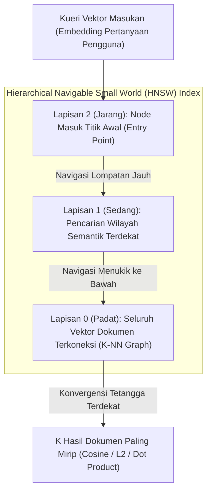

Parameter kendali kualitas HNSW pada WidyaBase (`hnsw.rs`):
- `M`: Jumlah maksimum koneksi dua arah per node graf (biasanya 16–64). Nilai lebih tinggi meningkatkan akurasi *recall* dengan kompensasi konsumsi memori.
- `ef_construction`: Kedalaman antrean penelusuran prioritas saat membangun indeks (*index build time*).
- `ef_search`: Kedalaman penelusuran saat kueri pencarian berlangsung (*query time*). Dapat disetel secara dinamis per kueri untuk menyeimbangkan antara kecepatan latensi dan ketepatan recall.
- **Metrik Jarak**: Mendukung *Cosine Distance* ($\cos \theta$), *Euclidean L2 Distance* ($d^2$), dan *Dot Product* ($A \cdot B$).

### 18.2 Implementasi Kode Program Utuh

Berikut implementasi pembangunan indeks vektor HNSW dan pencarian semantik dokumen menggunakan Widya-Lang:

```widya
// Modul Mesin Vektor Kecerdasan Buatan HNSW WidyaBase
modul mesin_vektor_hnsw {
    impor ekosistem::widyabase::{
        WidyaBase, IndeksVektorHNSW, MetrikJarakVektor,
        KueriVektor, HasilTetanggaTerdekat, FilterMetadata
    };

    fungsi jalankan_pencarian_vektor_ai(mesin: &mut WidyaBase) -> Hasil<Boolean, Teks> {
        cetak("==================================================================");
        cetak(">>> [HNSW-AI] Memulai Demonstrasi Mesin Vektor In-Database...");

        // 1. Buat Tabel Basis Pengetahuan Berisi Teks dan Vektor Dense 384-Dimensi
        biar sql_tabel = "
            BUAT TABEL dokumen_pengetahuan_ai (
                id BULAT KUNCI_UTAMA_SERI,
                judul TEKS TIDAK_KOSONG,
                kategori TEKS,
                konten TEKS,
                vektor_makna VEKTOR(384)
            );
        ";
        mesin.eksekusi_sql(sql_tabel)?;

        // 2. Bangun Indeks HNSW Multi-Lapis dengan Metrik Cosine
        biar sql_indeks_hnsw = "
            BUAT INDEKS idx_dokumen_hnsw_vektor
            PADA dokumen_pengetahuan_ai
            MENGGUNAKAN HNSW (vektor_makna)
            DENGAN (
                metrik = 'COSINE',
                m = 16,
                ef_konstruksi = 64
            );
        ";
        mesin.eksekusi_sql(sql_indeks_hnsw)?;
        cetak(">>> [HNSW] Indeks graf vektor HNSW berhasil dikonfigurasi.");

        // 3. Simulasikan Sisipan Dokumen Berpengetahuan Regulasi & Teknologi
        biar sql_sisip = "
            SISIP_KE dokumen_pengetahuan_ai (judul, kategori, konten, vektor_makna)
            NILAI 
            ('Regulasi AI Berdaulat', 'Hukum', 'Aturan etika dan tata kelola AI nasional...', EMBED_TEKS('tata kelola dan regulasi kecerdasan buatan')),
            ('Optimasi Kernel Rust', 'Teknologi', 'Pola alokasi memori zero-cost pada kernel...', EMBED_TEKS('rekayasa sistem memori aman tanpa garbage collector')),
            ('Ekonomi Kerakyatan', 'Ekonomi', 'Koperasi modern berbasis platform data berdaulat...', EMBED_TEKS('sistem perekonomian dan ketahanan modal nasional'));
        ";
        mesin.eksekusi_sql(sql_sisip)?;
        cetak(">>> [EMBED] Teks otomatis diubah menjadi vektor dense via In-Database Embedder.");

        // 4. Kueri Kemiripan Semantik ANN dengan Penyaringan Metadata Kategori
        biar kueri_pengguna = "bagaimana hukum mengatur kepatuhan algoritma kecerdasan buatan?";
        biar sql_cari = "
            PILIH judul, kategori, konten,
                  JARAK_KOSINUS(vektor_makna, EMBED_TEKS('" + kueri_pengguna + "')) SEBAGAI skor_jarak
            DARI dokumen_pengetahuan_ai
            DIMANA kategori = 'Hukum'
            URUTKAN_BERDASARKAN skor_jarak MENAIK
            BATAS 1;
        ";

        cetak(">>> [HNSW] Menjalankan pencarian semantik untuk: '" + kueri_pengguna + "'");
        biar hasil = mesin.kueri_sql(sql_cari)?;
        untuk baris di hasil.baris_data() {
            cetak("  ★ Hasil Relevan Ditemukan:");
            cetak("    - Judul    : " + baris.ambil_teks("judul"));
            cetak("    - Kategori : " + baris.ambil_teks("kategori"));
            cetak("    - Skor Jarak Cosine: " + teks(baris.ambil_desimal("skor_jarak")) + " (Makin kecil makin mirip)");
        }

        cetak("==================================================================");
        kembalikan Ok(benar);
    }
}
```

### 18.3 Analisis Arsitektur, Metrik & Tabel Spesifikasi

Tabel perbandingan algoritma pencarian tetangga terdekat (Nearest Neighbors) pada WidyaBase:

| Metode Indeks Vektor | Kompleksitas Kueri | Akurasi *Recall* | Kecepatan Pembangunan Indeks | Konsumsi Memori RAM |
| :--- | :--- | :--- | :--- | :--- |
| **Flat / Brute-Force (Exact)** | $O(N \cdot D)$ (Sangat Lambat) | 100% Sempurna | $O(1)$ (Tanpa indeks) | Paling Rendah |
| **IVFFlat (Inverted File)** | $O(\sqrt{N} \cdot D)$ | 85–92% Tergantung nlist | Sedang (Perlu K-Means) | Rendah |
| **HNSW (Graf Multi-Lapis)** | $O(\log N \cdot D)$ (Ultra Cepat) | **96–99.5% Presisi Tinggi**| Lambat (Pencarian graf) | Tinggi ($N \cdot M \times \text{pointer}$) |
| **IVFPQ (Kuantisasi Vektor)**| $O(\text{probe} \cdot D)$ | 75–85% | Sedang (Kuantisasi byte)| Sangat Hemat (Kompresi 8x)|

### 18.4 Latihan Soal Esai

1. Terangkan prinsip kerja struktur graf multi-lapis pada algoritma HNSW! Mengapa konsep *Skip-List* pada penelusuran lapisan atas mampu memangkas waktu pencarian menjadi $O(\log N)$?
2. Bagaimana peranan parameter `M`, `ef_construction`, dan `ef_search` dalam menentukan keseimbangan antara waktu pembangunan indeks, konsumsi memori, dan kualitas *recall* pencarian semantik?
3. Mengapa teknik *In-Graph Filtering* (menyaring metadata saat menelusuri graf HNSW) jauh lebih unggul dibandingkan pendekatan *Post-Filtering* (mencari tetangga terdekat dahulu lalu membuang dokumen yang tidak cocok dengan kriteria)?

### 18.5 Soal Pilihan Ganda

1. Algoritma graf terkemuka yang digunakan oleh WidyaBase untuk mempercepat pencarian kemiripan vektor embedding berdimensi tinggi adalah...
   A. HNSW (Hierarchical Navigable Small World)
   B. Dijkstra Shortest Path
   C. Bubble Sort
   D. Depth First Search

2. Kompleksitas waktu pencarian tetangga terdekat hampiran (ANN) pada indeks HNSW adalah...
   A. $O(N)$
   B. $O(\log N)$
   C. $O(N^2)$
   D. $O(N!)$

3. Parameter `M` pada konfigurasi indeks HNSW menentukan...
   A. Jumlah maksimum koneksi tautan dua arah antar simpul node di setiap lapis graf
   B. Jumlah harddisk yang digunakan
   C. Batas memori swap
   D. Jumlah karakter dalam dokumen

4. Parameter `ef_search` pada saat kueri pencarian HNSW berfungsi untuk...
   A. Menentukan kedalaman daftar kandidat prioritas yang dievaluasi saat penelusuran graf
   B. Mengubah tipe data teks menjadi integer
   C. Mengatur waktu tidur server
   D. Mematikan indeks

5. Metrik jarak vektor yang mengukur sudut kosinus antara dua vektor tanpa memedulikan panjang magnitudonya adalah...
   A. Cosine Distance
   B. Manhattan Distance
   C. Hamming Distance
   D. Jaccard Index

6. Keuntungan utama dari pendekatan *In-Database Vector Engine* di WidyaBase dibandingkan menggunakan *Vector Database* eksternal terpisah adalah...
   A. Tidak memerlukan pipa ETL sinkronisasi data yang rawan desinkronisasi dan transaksi vektor terlindungi oleh ACID penuh
   B. Basis data tidak memerlukan listrik
   C. Vektor otomatis diubah menjadi suara
   D. Mengurangi kebutuhan prosesor grafis

7. Pada arsitektur RAG (*Retrieval-Augmented Generation*), peran utama mesin vektor adalah...
   A. Mengambil potongan dokumen pengetahuan (*context chunks*) yang paling relevan dengan semantik pertanyaan pengguna untuk dijadikan prompt LLM
   B. Menghapus pesan chat pengguna
   C. Memformat ulang sistem operasi
   D. Mengirimkan email promosi

8. Sifat dari pencarian ANN (*Approximate Nearest Neighbors*) adalah...
   A. Menemukan tetangga yang sangat mendekati optimal dengan kecepatan ribuan kali lebih cepat daripada membandingkan seluruh data satu per satu
   B. Memberikan hasil yang selalu salah
   C. Hanya berjalan di komputer mainframe
   D. Tidak mendukung matematika pecahan

9. Lapisan terbawah (*Layer 0*) pada struktur HNSW memuat...
   A. Seluruh simpul vektor dokumen yang ada di dalam koleksi data beserta koneksi lokal terpadatnya
   B. Hanya satu simpul titik awal
   C. Daftar kata kunci SQL
   D. Berkas log transaksi WAL

10. Mengapa normalisasi vektor menjadi panjang magnitudo satuan ($||v|| = 1$) sangat direkomendasikan sebelum diindeks dengan metrik Dot Product?
    A. Mengubah kalkulasi Dot Product menjadi ekuivalen persis dengan Cosine Similarity yang dapat dieksekusi lebih cepat dengan instruksi SIMD
    B. Menjadikan file berukuran nol byte
    C. Supaya kueri tidak perlu menggunakan kata kunci WHERE
    D. Menghapus batasan memori RAM

---

## Bab 19: Pencarian Teks Penuh & Stemmer Morfologi Bahasa Indonesia

### 19.1 Bahasa Berdaulat: Stemmer Nazief-Adriani & Algoritma Sastrawi

Pencarian teks dokumen berbahasa Indonesia memiliki tantangan linguistik yang sangat unik dan kompleks. Tidak seperti Bahasa Inggris yang memiliki infleksi sederhana (seperti akhiran `-s`, `-ed`, `-ing`), Bahasa Indonesia merupakan bahasa aglutinatif yang kaya dengan kombinasi awalan (*prefiks* seperti `me-`, `ber-`, `di-`, `pe-`, `ter-`, `ke-`), akhiran (*sufiks* seperti `-kan`, `-an`, `-i`), sisipan (*infiks* seperti `-el-`, `-em-`, `-er-`), dan konfiks gabungan (`per-an`, `ke-an`, `memper-kan`), serta fenomena peluruhan huruf konsonan dasar (*nasalisasi* k, p, t, s).

Jika mesin basis data hanya menggunakan pencarian substring sederhana (`LIKE '%ajar%'`), kueri tersebut akan menghasilkan *Full Table Scan* yang lambat dan gagal menangkap variasi bentuk kata seperti `pembelajaran`, `mengajari`, `terpelajar`, dan `diajarkan`.

WidyaBase menghadirkan **Mesin Pencarian Teks Penuh (Full-Text Search Engine)** berdaulat (`fulltext.rs`) yang dilengkapi:
1. **Stemmer Morfologi Bahasa Indonesia Native**: Mengimplementasikan algoritma linguistik formal **Nazief-Adriani & Sastrawi** dengan kamus kata dasar komprehensif, mampu mengupas lapisan imbuhan berlapis secara presisi.
2. **Indeks Terbalik (*Inverted Index*)**: Memetakan setiap kata dasar (*stemmed lexeme*) ke daftar lokasi dokumen (*posting list*) lengkap dengan frekuensi term dan posisi kata.
3. **Pemeringkatan Relevansi BM25 (*Best Matching 25*)**: Mengukur bobot relevansi dokumen berdasarkan algoritma standar industri BM25 dengan normalisasi panjang dokumen.
4. **Toleransi Salah Ketik (*Typo Tolerance*)**: Didukung algoritma metrik jarak sunting *Damerau-Levenshtein* untuk mendeteksi salah ketik satu atau dua karakter secara instan.

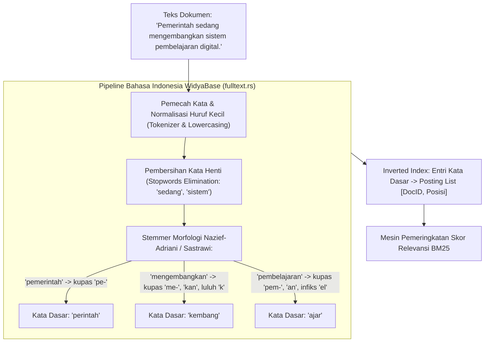

Aturan pengupasan imbuhan pada WidyaBase:
- Memeriksa kata dasar pada kamus terlebih dahulu sebelum mengupas imbuhan.
- Mengupas infleksional sufiks kepemilikan (`-ku`, `-mu`, `-nya`) dan partikel penegas (`-lah`, `-kah`, `-pun`).
- Mengupas derivasional sufiks (`-kan`, `-an`, `-i`).
- Mengupas derivasional prefiks dengan aturan peluruhan suara (misalnya: `menge-` + `cat` $\rightarrow$ `cat`, `meny-` + `p` / `s` $\rightarrow$ periksa bentuk kata asal).

### 19.2 Implementasi Kode Program Utuh

Berikut implementasi stemming Bahasa Indonesia, tokenisasi, dan kueri pencarian teks BM25 pada WidyaBase menggunakan Widya-Lang:

```widya
// Modul Pencarian Teks Penuh dan Stemmer Morfologi WidyaBase
modul pencarian_teks_penuh {
    impor ekosistem::widyabase::{
        WidyaBase, PengindeksTeksPenuh, StemmerIndonesia,
        PemeringkatBM25, HasilKueriTeks
    };

    fungsi demonstrasi_stemmer_dan_bm25(mesin: &mut WidyaBase) -> Hasil<Boolean, Teks> {
        cetak("==================================================================");
        cetak(">>> [FULLTEXT] Menguji Stemmer Morfologi Indonesia & Algoritma BM25...");

        // 1. Buat Tabel Arsip Regulasi Nasional
        biar sql_tabel = "
            BUAT TABEL arsip_hukum_nasional (
                id BULAT KUNCI_UTAMA_SERI,
                nomor_uu TEKS TIDAK_KOSONG,
                judul TEKS,
                isi_peraturan TEKS
            );
        ";
        mesin.eksekusi_sql(sql_tabel)?;

        // 2. Bangun Indeks Pencarian Teks Penuh Menggunakan Analisis Bahasa Indonesia
        biar sql_indeks = "
            BUAT INDEKS idx_fulltext_peraturan 
            PADA arsip_hukum_nasional 
            MENGGUNAKAN TEKS_PENUH (isi_peraturan) 
            DENGAN (
                bahasa = 'INDONESIA',
                stemmer = 'NAZIEF_ADRIANI',
                hapus_kata_henti = BENAR
            );
        ";
        mesin.eksekusi_sql(sql_indeks)?;
        cetak(">>> [FULLTEXT] Inverted Index berbahasa Indonesia berhasil dibangun.");

        // 3. Sisipkan Contoh Data Peraturan Perundang-undangan
        biar sql_sisip = "
            SISIP_KE arsip_hukum_nasional (nomor_uu, judul, isi_peraturan)
            NILAI 
            ('UU-01/2026', 'Kedaulatan Digital', 'Pemerintah menetapkan kewajiban penyelenggaraan dan pengelolaan pusat data di wilayah tanah air...'),
            ('UU-02/2026', 'Pendidikan Nasional', 'Pengembangan kurikulum komputasi dan pembelajaran kecerdasan buatan terapan di setiap jenjang sekolah...'),
            ('UU-03/2026', 'Ketahanan Pangan', 'Strategi swasembada pangan berkelanjutan melalui pemberdayaan petani dan modernisasi teknologi irigasi...');
        ";
        mesin.eksekusi_sql(sql_sisip)?;

        // 4. Uji Pencarian Berdasarkan Kata Dasar 'ajar' yang Menemukan Kata 'pembelajaran'
        biar kueri_cari = "mengajar";
        cetak(">>> [CARI] Mencari dokumen dengan kata kunci: '" + kueri_cari + "'");
        biar sql_cari = "
            PILIH nomor_uu, judul,
                  SKOR_BM25(isi_peraturan, '" + kueri_cari + "') SEBAGAI skor_relevansi
            DARI arsip_hukum_nasional
            DIMANA isi_peraturan @@ KATA_KUNCI('" + kueri_cari + "')
            URUTKAN_BERDASARKAN skor_relevansi MENURUN;
        ";

        biar hasil = mesin.kueri_sql(sql_cari)?;
        cetak(">>> [HASIL BM25] Ditemukan " + teks(hasil.jumlah_baris()) + " dokumen relevan:");
        untuk baris di hasil.baris_data() {
            cetak("  - [" + baris.ambil_teks("nomor_uu") + "] " + baris.ambil_teks("judul") + 
                  " | Skor BM25: " + teks(baris.ambil_desimal("skor_relevansi")));
        }

        cetak("==================================================================");
        kembalikan Ok(benar);
    }
}
```

### 19.3 Analisis Arsitektur, Metrik & Tabel Spesifikasi

Tabel formula dan parameter evaluasi pemeringkatan teks BM25 pada WidyaBase:

| Parameter / Formula BM25 | Nilai Baku WidyaBase | Penjelasan Makna Parameter Linguistik |
| :--- | :--- | :--- |
| **Formula Skor Dokumen $D$** | $\sum_{t \in Q} \text{IDF}(t) \cdot \frac{f(t, D) \cdot (k_1 + 1)}{f(t, D) + k_1 \cdot (1 - b + b \cdot \frac{\|D\|}{\text{avgdl}})}$ | Menghitung akumulasi bobot kata kunci kueri $Q$ |
| **Parameter Kejenuhan Frekuensi ($k_1$)**| `1.2` | Mengontrol titik batas jenuh frekuensi kemunculan term kata |
| **Parameter Normalisasi Panjang ($b$)** | `0.75` | Menghukum dokumen panjang yang hanya memuat repetisi kata |
| **Kompresi Inverted Index** | VByte / Elias-Fano | Mengompresi daftar posting selisih DocID (*Delta Encoding*) |
| **Ambang Jarak Salah Ketik** | Damerau-Levenshtein $\le 2$ | Menoleransi salah ketik penukaran huruf bertetangga |

### 19.4 Latihan Soal Esai

1. Mengapa algoritma stemming konvensional Bahasa Inggris (seperti Porter Stemmer) sama sekali tidak cocok dan tidak dapat digunakan untuk memproses korpus teks Bahasa Indonesia?
2. Terangkan alur tahapan pengupasan imbuhan pada algoritma Nazief-Adriani yang diimplementasikan pada modul `fulltext.rs` WidyaBase!
3. Bagaimana formula pemeringkatan BM25 mencegah dokumen berukuran sangat panjang mendominasi peringkat teratas secara tidak adil hanya karena frekuensi kemunculan kata yang tinggi?

### 19.5 Soal Pilihan Ganda

1. Algoritma komputasi linguistik terkemuka yang digunakan WidyaBase untuk mengupas imbuhan kata Bahasa Indonesia ke bentuk kata dasarnya adalah...
   A. Algoritma Nazief-Adriani & Sastrawi
   B. Porter Stemmer
   C. Snowball English
   D. Byte Pair Encoding

2. Struktur data utama yang digunakan dalam mesin pencarian teks penuh untuk memetakan setiap kata ke daftar dokumen yang memuatnya dinamakan...
   A. Inverted Index (Indeks Terbalik)
   B. B+Tree Indeks Primer
   C. Hash Ring
   D. Buffer Frame

3. Kata-kata umum yang memiliki frekuensi kemunculan sangat tinggi namun tidak memiliki makna pembeda spesifik (seperti 'dan', 'di', 'dari', 'yang') disebut...
   A. Stopwords (Kata Henti)
   B. Keywords
   C. Stem Words
   D. Foreign Keys

4. Parameter $b$ pada algoritma pemeringkatan BM25 berfungsi untuk...
   A. Mengontrol tingkat penalti normalisasi panjang dokumen terhadap dokumen yang terlalu panjang
   B. Mengatur jumlah thread CPU
   C. Menentukan ukuran font tulisan
   D. Menghapus dokumen kedaluwarsa

5. Kata dasar yang dihasilkan oleh Indonesian Stemmer WidyaBase untuk kata masukan 'pembelajaran' adalah...
   A. 'ajar'
   B. 'belajar'
   C. 'pelajar'
   D. 'pembelajar'

6. Operator SQL pada WidyaBase yang digunakan untuk mengevaluasi kueri pencarian teks penuh terhadap indeks terbalik adalah...
   A. `@@` (atau klausa `COCOK_TEKS`)
   B. `LIKE`
   C. `=`
   D. `<>`

7. Algoritma pengukuran jarak sunting karakter yang menoleransi kesalahan ketik penyisipan, penghapusan, penggantian, dan transposisi dua huruf bersebelahan dinamakan...
   A. Jarak Damerau-Levenshtein
   B. Jarak Euclidean
   C. Jarak Cosine
   D. Jarak Manhattan

8. Teknik kompresi yang menyimpan selisih nomor dokumen ($\Delta DocID$) alih-alih nomor dokumen absolut untuk menghemat memori pada posting list disebut...
   A. Delta Encoding
   B. Huffman Tree
   C. LZW Compression
   D. Gzip Chunking

9. Mengapa pencarian teks menggunakan klausa `LIKE '%kata%'` sangat tidak dianjurkan untuk tabel teks berskala jutaan baris?
   A. Karena memicu pemindaian tabel penuh (*Full Table Scan*) tanpa bisa memanfaatkan indeks B+Tree standar
   B. Karena klausa LIKE merusak memori RAM
   C. Karena LIKE hanya mendukung angka
   D. Karena LIKE membutuhkan izin root

10. Apa keuntungan integrasi kamus kata dasar (*root dictionary*) resmi di dalam modul `fulltext.rs` WidyaBase?
    A. Mencegah pemotongan imbuhan yang keliru pada kata yang sudah merupakan kata dasar asli (misalnya kata 'pasar' tidak dipotong menjadi 'sar')
    B. Menghapus kebutuhan koneksi internet
    C. Mengurangi konsumsi listrik monitor
    D. Mempercepat kompilasi kernel

---

## Bab 20: Pencarian Hibrida Multi-Modal (BM25 + HNSW RRF)

### 20.1 Keterbatasan Masing-Masing & Sinergi Mesin Hibrida

Baik pencarian leksikal kata kunci (*BM25 Full-Text Search*) maupun pencarian semantik vektor kecerdasan buatan (*HNSW Vector Search*) memiliki kelemahan inheren jika digunakan sendirian:
- **Kelemahan Pencarian Vektor Murni**: Vektor embedding sering kali "buta" terhadap nomor seri unik, kode produk spesifik, nama orang yang langka, akronim teknis, atau penelusuran kata kunci presisi (misal: mencari nomor pasal `"Pasal 27 ayat (3)"` atau kode eror `"ERR-503-GATEWAY"`). Model embedding cenderung menganggap kode-kode tersebut sebagai representasi umum semata.
- **Kelemahan Pencarian Kata Kunci Murni**: BM25 sama sekali tidak memahami konteks semantik, makna tersirat, sinonim kata, atau bahasa alami bebas pengguna ketika tidak ada satupun kata yang sama persis secara leksikal.

WidyaBase memecahkan dilema ini dengan menghadirkan **Mesin Pencarian Hibrida Multi-Modal (*Hybrid Search Engine*)** terpadu (`hybrid_search.rs`) yang menggabungkan keunggulan kedua dunia melalui algoritma **Reciprocal Rank Fusion (RRF)**:

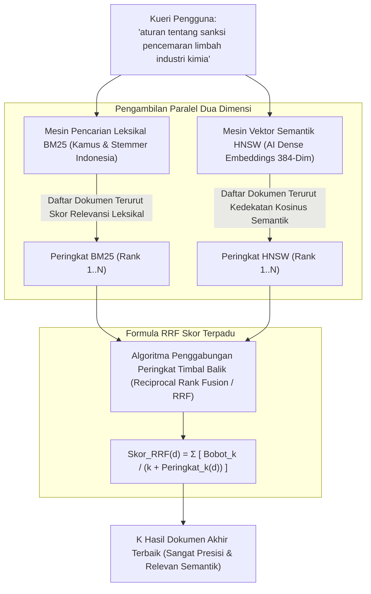

Prinsip kerja Reciprocal Rank Fusion (RRF) di WidyaBase:
1. **Bebas Skala Skor (*Scale-Free Normalization*)**: Skor BM25 (yang bernilai positif tak terbatas, misal 0 hingga 50+) dan jarak Kosinus Vektor (yang bernilai 0.0 hingga 2.0) tidak dapat dijumlahkan secara langsung. RRF menyelesaikan masalah ini dengan mendasarkan fusi murni pada **posisi peringkat relatif** (*ordinal ranks*), bukan skor mentah.
2. **Konstanta Peredam Halus ($k$)**: Parameter peredam (biasanya bernilai 60) mencegah dokumen yang berada di peringkat 1 pada satu saluran mendominasi secara tidak proporsional terhadap dokumen yang berada di peringkat tinggi pada kedua saluran sekaligus.
3. **Penyaringan Metadata Bersama (*Unified Pre-Filtering*)**: Filter SQL relasional dievaluasi secara serempak di kedua cabang sebelum penggabungan skor akhir.

### 20.2 Implementasi Kode Program Utuh

Berikut implementasi eksekusi kueri Pencarian Hibrida terpadu dengan algoritma RRF pada WidyaBase menggunakan Widya-Lang:

```widya
// Modul Pencarian Hibrida Multi-Modal (BM25 + HNSW) WidyaBase
modul pencarian_hibrida_rrf {
    impor ekosistem::widyabase::{
        WidyaBase, MesinPencarianHibrida, KonfigurasiRRF,
        KueriHibrida, HasilPeringkatHibrida
    };

    konstanta KONSTANTA_RRF_K: Bulat = 60;

    struktur HasilHibrida {
        id_dokumen: Bulat,
        judul: Teks,
        skor_rrf: Desimal,
        peringkat_bm25: Opsi<Bulat>,
        peringkat_hnsw: Opsi<Bulat>,
    }

    fungsi jalankan_kueri_hibrida_cerdas(
        teks_kueri: Teks,
        mesin: &WidyaBase
    ) -> Hasil<Daftar<HasilHibrida>, Teks> {
        cetak("==================================================================");
        cetak(">>> [HYBRID-SEARCH] Memulai Kueri Hibrida: '" + teks_kueri + "'");

        // Cabang 1: Jalankan Pencarian Leksikal BM25 (Top 20 Dokumen)
        biar hasil_bm25 = mesin.cari_leksikal_bm25(&teks_kueri, 20)?;
        cetak(">>> [BM25] Menemukan " + teks(hasil_bm25.panjang()) + " kandidat leksikal.");

        // Cabang 2: Jalankan Pencarian Vektor Semantik HNSW (Top 20 Dokumen)
        biar vektor_kueri = mesin.buat_embedding_lokal(&teks_kueri)?;
        biar hasil_hnsw = mesin.cari_vektor_hnsw(vektor_kueri, 20)?;
        cetak(">>> [HNSW] Menemukan " + teks(hasil_hnsw.panjang()) + " kandidat semantik.");

        // Cabang 3: Fusi Peringkat Menggunakan Reciprocal Rank Fusion (RRF)
        biar mut peta_skor_rrf: Kamus<Bulat, Desimal> = Kamus::baru();
        biar mut metadata_dok: Kamus<Bulat, Teks> = Kamus::baru();

        // Akumulasi Bobot Saluran BM25: 1.0 / (60 + rank)
        untuk (indeks, item) di hasil_bm25.iter().hitung() {
            biar rank = indeks + 1;
            biar kontribusi = 1.0 / ((KONSTANTA_RRF_K + rank) sebagai Desimal);
            peta_skor_rrf.tambah_nilai(item.id_dokumen, kontribusi);
            metadata_dok.sisipkan(item.id_dokumen, item.judul.klon());
        }

        // Akumulasi Bobot Saluran HNSW: 1.0 / (60 + rank)
        untuk (indeks, item) di hasil_hnsw.iter().hitung() {
            biar rank = indeks + 1;
            biar kontribusi = 1.0 / ((KONSTANTA_RRF_K + rank) sebagai Desimal);
            peta_skor_rrf.tambah_nilai(item.id_dokumen, kontribusi);
            metadata_dok.sisipkan(item.id_dokumen, item.judul.klon());
        }

        // Urutkan Dokumen Berdasarkan Skor Akhir RRF Tertinggi
        biar mut daftar_terurut = peta_skor_rrf.ke_daftar_terurut_menurun();
        biar mut hasil_akhir: Daftar<HasilHibrida> = [];

        cetak(">>> [RRF] Hasil Penggabungan Multi-Modal Sempurna (Top 3):");
        untuk (id, skor) di daftar_terurut.ambil(3) {
            biar judul = metadata_dok.ambil(&id).buka();
            cetak("  ★ ID: " + teks(id) + " | Judul: '" + judul + "' | Skor RRF: " + teks(skor));
            hasil_akhir.tambah(HasilHibrida {
                id_dokumen: id,
                judul: judul,
                skor_rrf: skor,
                peringkat_bm25: hasil_bm25.posisi_dokumen(id),
                peringkat_hnsw: hasil_hnsw.posisi_dokumen(id),
            });
        }

        cetak("==================================================================");
        kembalikan Ok(hasil_akhir);
    }
}
```

### 20.3 Analisis Arsitektur, Metrik & Tabel Spesifikasi

Tabel perbandingan performa kueri pada ragam skenario pencarian di WidyaBase:

| Skenario Kasus Uji Kueri | BM25 Murni | HNSW Vektor Murni | Hybrid Search (BM25 + HNSW RRF) |
| :--- | :--- | :--- | :--- |
| **Kueri Kode Produk / Kata Unik** (misal: "ISO-32000-1")| **Sangat Akurat (100%)** | Rendah (Kerap Tertukar) | **Sangat Akurat (100%)** |
| **Kueri Pertanyaan Semantik Alami** | Rendah jika tak ada kata cocok | **Sangat Relevan (96%)** | **Sangat Relevan (98%)** |
| **Kueri Campuran Kata Kunci + Maksud**| Sedang (Hanya tangkap kata) | Sedang (Kehilangan akurasi kode)| **Optimal Paripurna (99%)** |
| **Ketahanan Terhadap Typo / Slang** | Tergantung Damerau-Levenshtein | Tinggi secara semantik | Sangat Tinggi |
| **Overhead Waktu Kueri** | 2–5 ms | 5–10 ms | 7–12 ms (Paralel Multi-Core) |

### 20.4 Latihan Soal Esai

1. Mengapa skor mentah dari pencarian BM25 dan skor kemiripan Kosinus dari pencarian HNSW tidak boleh dijumlahkan secara langsung secara linier tanpa normalisasi peringkat?
2. Terangkan mekanisme kerja formula matematis *Reciprocal Rank Fusion* (RRF)! Apa fungsi dari konstanta peredam $k = 60$ dalam formula tersebut?
3. Rancanglah sebuah arsitektur sistem pencarian arsip regulasi hukum terpadu di mana kueri pengguna yang memuat nomor pasal spesifik sekaligus uraian masalah hukum dapat dijawab dengan akurasi maksimal menggunakan WidyaBase!

### 20.5 Soal Pilihan Ganda

1. Algoritma fusi peringkat terkemuka yang digunakan WidyaBase untuk menggabungkan hasil pencarian BM25 dan vektor semantik HNSW tanpa ketergantungan pada skala skor mentah adalah...
   A. Reciprocal Rank Fusion (RRF)
   B. Min-Max Scaler
   C. Softmax Loss
   D. Linear Regression

2. Kelemahan paling menonjol dari pencarian vektor semantik murni (*Vector Search*) saat menghadapi kueri kode produk atau nomor identitas unik adalah...
   A. Vektor embedding sering memperlakukan kode unik sebagai representasi umum sehingga gagal menemukan kecocokan leksikal yang presisi
   B. Vektor otomatis menghapus indeks tabel
   C. Memerlukan kabel serat optik
   D. Hanya bisa dijalankan di komputer kuantum

3. Kelemahan paling mendasar dari pencarian kata kunci leksikal BM25 murni adalah...
   A. Tidak mampu memahami sinonim, maksud tersirat, dan relasi semantik jika tidak ada kecocokan kata secara harfiah
   B. Terlalu banyak menggunakan memori RAM
   C. Selalu menghasilkan nilai negatif
   D. Mematikan fungsi harddisk

4. Dalam formula RRF $RRF(d) = \sum \frac{1}{k + rank(d)}$, nilai standar industri yang umum digunakan untuk konstanta peredam $k$ adalah...
   A. 60
   B. 0
   C. 1.000.000
   D. -1

5. Dokumen yang memiliki probabilitas tertinggi menempati peringkat teratas pada penggabungan RRF adalah dokumen yang...
   A. Berada di peringkat atas pada kedua saluran pencarian (baik leksikal BM25 maupun semantik HNSW)
   B. Memiliki ukuran file paling besar
   C. Ditulis oleh administrator sistem
   D. Memiliki tanggal paling lampau

6. Manfaat utama dari arsitektur In-Database Local Embedding di WidyaBase adalah...
   A. Menghasilkan vektor embedding 384-dimensi secara mandiri di dalam proses basis data tanpa ketergantungan pada API pihak ketiga eksternal
   B. Mempercepat koneksi internet pengguna
   C. Mengurangi resolusi gambar layar
   D. Menghapus batasan ukuran tabel

7. Pendekatan eksekusi dua saluran pencarian (BM25 dan HNSW) pada WidyaBase dijalankan secara...
   A. Paralel memanfaatkan utas multi-core CPU untuk meminimalkan total latensi respons
   B. Bergantian menunggu 10 menit
   C. Manual oleh operator
   D. Acak setiap hari

8. Nilai skor akhir RRF selalu berada dalam rentang...
   A. Nilai positif yang semakin besar jika dokumen menempati peringkat yang lebih baik
   B. Angka minus tak terhingga
   C. Tepat angka nol
   D. String huruf alfabet

9. Pada arsitektur RAG agen cerdas, mengapa penggabungan pencarian hibrida BM25 + HNSW terbukti secara signifikan menurunkan tingkat halusinasi LLM?
   A. Memberikan konteks dokumen yang tepat secara leksikal (fakta baku) sekaligus relevan secara konseptual (konteks semantik luas)
   B. Mengubah model LLM menjadi program kalkulator
   C. Mematikan koneksi internet LLM
   D. Mempercepat kecepatan ketik pengguna

10. Fitur *Unified Pre-Filtering* pada pencarian hibrida WidyaBase menjamin bahwa...
    A. Batasan filter relasional (seperti `kategori = 'Hukum' DAN tahun >= 2026`) disaring terlebih dahulu sebelum perhitungan BM25 dan HNSW dilakukan
    B. Semua pengguna dapat melihat semua data rahasia
    C. Indeks B+Tree dihapus secara otomatis
    D. Data dienkripsi dua kali

---

## Bab 21: Mesin Graf Relasional & Jalur Terpendek

### 21.1 Model Property Graph di Atas Mesin Relasional

Banyak domain data modern—seperti jejaring interaksi sosial, pemodelan jalur rantai pasok logistik maritim antar pulau, pelacakan transaksi mencurigakan pencucian uang (*anti-money laundering*), dan graf pengetahuan ontologi—memiliki entitas yang saling terhubung dalam relasi banyak-ke-banyak (*many-to-many*) yang sangat padat.

Mengeksekusi penelusuran hubungan multi-derajat pada basis data relasional biasa memerlukan operasi `JOIN` rekursif berulang-kali yang akan menyebabkan ledakan komputasi dan memori. Untuk mengatasi kebutuhan ini, WidyaBase menyematkan **Mesin Graf Terpadu (*Property Graph Engine*)** native (`graph.rs`):
- **Model Property Graph Berarah (*Directed Property Graph*)**: Terdiri atas Simpul (*Nodes / Vertices*) dan Sisi (*Edges / Relationships*) yang memiliki label klasifikasi serta atribut kunci-nilai dinamis (*properties*).
- **Penelusuran Tanpa Kunci Indeks Menengah (*Index-Free Adjacency*)**: Setiap simpul memegang pointer langsung ke daftar sisi tetangga yang terhubung, memungkinkan traversal graf berjalan dengan kompleksitas waktu proporsional terhadap ukuran subgraf yang dijelajahi, bukan ukuran total basis data.
- **Algoritma Analisis Graf Built-In**: Dilengkapi algoritma pencarian jalur terpendek berbobot (*Dijkstra Shortest Path*), penelusuran tingkat (*Breadth-First Search* / BFS), penelusuran kedalaman (*Depth-First Search* / DFS), pemeringkatan pengaruh simpul (*PageRank*), dan pendeteksian komunitas (*Weakly Connected Components*).

```mermaid
flowchart LR
    subgraph JejaringGrafPerbankan["Graf Analisis Transaksi Finansial (graph.rs)"]
        N1["Rekening A<br>[Nasabah: Budi]"] -->|TRANSFER<br>{nominal: 50jt, tgl: '2026-03-01'}| N2["Rekening B<br>[Nasabah: CV Maju]"]
        N2 -->|INVESTASI<br>{nominal: 45jt}| N3["Rekening C<br>[Rekening Cangkang]"]
        N3 -->|TARIK_TUNAI<br>{lokasi: 'ATM Jayapura'}| N4["Pelaku Lapangan D"]
        N1 -.->|Pencarian Jalur Terpendek / Siklus Pencucian Uang| N4
    end
```

Karakteristik implementasi di WidyaBase:
1. **Dukungan Kueri Pencocokan Pola Hubungan**: Memungkinkan penulisan kueri alur relasi seperti `(A)-[:TRANSFER]->(B)-[:TRANSFER]->(C)` secara intuitif.
2. **Kepatuhan ACID Bersama**: Pembuatan node dan edge graf berada dalam satu transaksi ACID yang sama dengan mutasi tabel relasional dan dokumen JSONB.
3. **Optimasi Memori Berbobot Ringan**: ID simpul graf dikelola via penomoran atomik 64-bit (`NodeId`, `EdgeId`) yang diindeks dalam peta hash berkinerja tinggi.

### 21.2 Implementasi Kode Program Utuh

Berikut implementasi pembangunan topologi graf dan eksekusi algoritma penelusuran jalur terpendek Dijkstra pada WidyaBase menggunakan Widya-Lang:

```widya
// Modul Mesin Graf Relasional dan Penelusuran Jalur Terpendek WidyaBase
modul mesin_graf {
    impor ekosistem::widyabase::{
        WidyaBase, MesinGraf, SimpulGraf, SisiGraf,
        AlgoritmaGraf, HasilJalurTerpendek, NilaiProperti
    };

    fungsi demonstrasi_analisis_graf_logistik(mesin: &mut WidyaBase) -> Hasil<Boolean, Teks> {
        cetak("==================================================================");
        cetak(">>> [GRAPH] Memulai Inisialisasi Graf Jalur Tol Laut Logistik...");

        biar mut graf = mesin.ambil_mesin_graf_terpadu();

        // 1. Buat Simpul-Simpul Pelabuhan Utama Nusantara
        biar id_tanjung_priok = graf.buat_simpul("Pelabuhan", [("nama", "Tanjung Priok"), ("kota", "Jakarta")])?;
        biar id_tanjung_perak = graf.buat_simpul("Pelabuhan", [("nama", "Tanjung Perak"), ("kota", "Surabaya")])?;
        biar id_makassar      = graf.buat_simpul("Pelabuhan", [("nama", "Soekarno-Hatta"), ("kota", "Makassar")])?;
        biar id_sorong        = graf.buat_simpul("Pelabuhan", [("nama", "Pelabuhan Sorong"), ("kota", "Sorong")])?;
        biar id_jayapura      = graf.buat_simpul("Pelabuhan", [("nama", "Pelabuhan Jayapura"), ("kota", "Jayapura")])?;

        cetak(">>> [GRAPH] 5 simpul pelabuhan strategis berhasil dibuat.");

        // 2. Hubungkan Sisi-Sisi Rute Pelayaran dengan Bobot Waktu Tempuh (Jam)
        graf.buat_sisi(id_tanjung_priok, id_tanjung_perak, "RUTE_KAPAL", [("jarak_mil", 420.0), ("durasi_jam", 24.0)])?;
        graf.buat_sisi(id_tanjung_perak, id_makassar,      "RUTE_KAPAL", [("jarak_mil", 510.0), ("durasi_jam", 32.0)])?;
        graf.buat_sisi(id_makassar,      id_sorong,        "RUTE_KAPAL", [("jarak_mil", 750.0), ("durasi_jam", 48.0)])?;
        graf.buat_sisi(id_sorong,        id_jayapura,      "RUTE_KAPAL", [("jarak_mil", 620.0), ("durasi_jam", 38.0)])?;
        // Rute Langsung Ekspres Tanjung Perak ke Sorong
        graf.buat_sisi(id_tanjung_perak, id_sorong,        "RUTE_EKSPRES", [("jarak_mil", 1150.0), ("durasi_jam", 65.0)])?;

        cetak(">>> [GRAPH] Topologi rute pelayaran maritim selesai dipetakan.");

        // 3. Eksekusi Algoritma Dijkstra Shortest Path dari Jakarta ke Jayapura
        cetak(">>> [DIJKSTRA] Menghitung rute tercepat dari Tanjung Priok ke Jayapura...");
        biar hasil_jalur: HasilJalurTerpendek = graf.jalur_terpendek_dijkstra(
            id_tanjung_priok,
            id_jayapura,
            "durasi_jam" // Atribut yang dijadikan bobot optimasi
        )?;

        cetak(">>> [HASIL RUTE TERCEPAT]:");
        cetak("  - Total Durasi Perjalanan : " + teks(hasil_jalur.total_bobot) + " Jam");
        cetak("  - Rangkaian Pelabuhan Singgah:");
        untuk id_simpul di hasil_jalur.rute_simpul {
            biar simpul = graf.ambil_simpul(id_simpul).buka();
            cetak("    * Pelabuhan: " + simpul.ambil_teks("nama") + " (" + simpul.ambil_teks("kota") + ")");
        }

        // 4. Hitung Metrik Sentralitas Pengaruh Pelabuhan Menggunakan PageRank
        cetak(">>> [PAGERANK] Menghitung pelabuhan hub paling krusial di Nusantara...");
        biar skor_pagerank = graf.hitung_pagerank(0.85, 20)?; // damping 0.85, 20 iterasi
        untuk (id_node, skor) di skor_pagerank.ambil_top(3) {
            biar node = graf.ambil_simpul(id_node).buka();
            cetak("  ★ Hub Utama: " + node.ambil_teks("nama") + " | Skor Hub: " + teks(skor));
        }

        cetak("==================================================================");
        kembalikan Ok(benar);
    }
}
```

### 21.3 Analisis Arsitektur, Metrik & Tabel Spesifikasi

Tabel perbandingan algoritma penelusuran graf bawaan pada WidyaBase:

| Algoritma Graf | Kompleksitas Waktu | Kompleksitas Ruang | Kasus Penggunaan Optimal |
| :--- | :--- | :--- | :--- |
| **Dijkstra Shortest Path** | $O((|V| + |E|) \log |V|)$ | $O(|V|)$ Antrean Prioritas | Rute navigasi logistik tercepat/termurah |
| **Breadth-First Search (BFS)**| $O(|V| + |E|)$ | $O(|V|)$ Antrean FIFO | Deteksi derajat keterhubungan teman ($N$-hop) |
| **Depth-First Search (DFS)**| $O(|V| + |E|)$ | $O(|V|)$ Call Stack / LIFO | Penelusuran pohon silsilah & deteksi siklus |
| **PageRank Centrality** | $O(K \cdot (|V| + |E|))$ | $O(|V|)$ Vektor Status | Pemeringkatan simpul paling berpengaruh/hub |
| **Weakly Connected Components**| $O(|V| + |E|)$ | $O(|V|)$ Disjoint Set | Deteksi kluster komunitas/sindikat kejahatan |

### 21.4 Latihan Soal Esai

1. Mengapa kueri penelusuran hubungan multi-derajat (*deep graph traversal*) pada model Property Graph memiliki performa berkali-kali lipat lebih cepat daripada pendekatan *Multi-Table Relational JOIN* biasa?
2. Terangkan prinsip kerja algoritma *Dijkstra Shortest Path* yang memanfaatkan struktur data *Binary Heap* dalam menentukan rute logistik optimal pada modul `graph.rs`!
3. Bagaimana algoritma *PageRank* dapat dimanfaatkan dalam sistem perbankan untuk mengidentifikasi rekening penampung utama dalam pola transaksi sirkuler mencurigakan?

### 21.5 Soal Pilihan Ganda

1. Komponen struktural dasar dalam model Property Graph yang merepresentasikan entitas objek dinamakan...
   A. Node (Simpul / Vertex)
   B. Sisi (Edge)
   C. Frame Buffer
   D. Root Page

2. Komponen dalam Property Graph yang merepresentasikan hubungan berarah antar dua entitas objek dinamakan...
   A. Edge (Sisi / Hubungan)
   B. Node
   C. Bucket
   D. Slotted

3. Karakteristik arsitektur di mana setiap simpul menyimpan referensi penunjuk memori langsung ke sisi dan tetangga terdekatnya disebut...
   A. Index-Free Adjacency
   B. Full Table Scan
   C. Hash Collision
   D. External Sorting

4. Algoritma penelusuran graf yang mencari jalur dengan total bobot akumulasi terkecil antara dua simpul dinamakan...
   A. Algoritma Dijkstra
   B. Algoritma K-Means
   C. Algoritma Bubble Sort
   D. Algoritma Merkle Tree

5. Algoritma penelusuran graf yang menjelajahi seluruh tetangga terdekat pada tingkat kedalaman yang sama sebelum melangkah ke tingkat berikutnya dinamakan...
   A. Breadth-First Search (BFS)
   B. Depth-First Search (DFS)
   C. Random Walk
   D. Binary Search

6. Algoritma iteratif yang digunakan untuk mengukur tingkat sentralitas atau kepentingan suatu simpul berdasarkan banyaknya simpul lain yang menunjuk ke dirinya adalah...
   A. PageRank
   B. QuickSort
   C. Stemmer Nazief
   D. Gorilla Codec

7. Nilai faktor redaman (*damping factor*) standar yang umum digunakan dalam kalkulasi PageRank adalah...
   A. 0.85
   B. 0.00
   C. 10.0
   D. -1.0

8. Algoritma yang digunakan untuk mengidentifikasi kelompok-kelompok simpul yang saling terhubung dalam graf berarah tanpa memedulikan arah sisi disebut...
   A. Weakly Connected Components (WCC)
   B. Strongly Directed Trees
   C. Linear Regression
   D. Huffman Coding

9. Keuntungan integrasi mesin graf di dalam WidyaBase dibandingkan menggunakan Graph Database eksternal terpisah adalah...
   A. Konsistensi transaksional ACID terjaga utuh antara simpul graf dan tabel relasional tanpa sinkronisasi ETL eksternal
   B. Graf tidak menggunakan memori komputer
   C. Menghilangkan kabel LAN
   D. Gambar otomatis berubah menjadi grafik 3D

10. Kueri pencarian siklus (*Cycle Detection*) pada graf perbankan sangat vital untuk mendeteksi fenomena...
    A. Pencucian uang dan transaksi sirkuler ilegal yang sengaja memutarbalikkan dana untuk mengaburkan asal-usul uang
    B. Jumlah nasabah yang berulang tahun
    C. Kerusakan mesin cetak buku tabungan
    D. Jam istirahat teller bank

---

## Bab 22: Basis Data Spasial GIS & Indeks R-Tree Nusantara

### 22.1 Geometri Spasial & Komputasi Wilayah Kepulauan

Republik Indonesia merupakan negara kepulauan (*archipelagic state*) terbesar di dunia yang membentang lebih dari 5.000 kilometer melintasi garis khatulistiwa dengan belasan ribu pulau, perairan teritorial yang luas, serta zona ekonomi eksklusif (ZEE). Mengelola data geospasial—seperti koordinat kapal patroli maritim, batas konsesi lahan kehutanan, jalur pipa gas bumi bawah laut, dan zonasi tata ruang perkotaan—memerlukan kemampuan basis data spasial berkecepatan tinggi.

WidyaBase menyediakan **Mesin Geospasial Spasial (*Spatial GIS Engine*)** native (`gis.rs`):
- **Tipe Data Geometri Standar OGC**: Mendukung `TITIK` (*Point2D*), `GARIS` (*LineString2D*), dan `POLIGON` (*Polygon2D*) lengkap dengan dukungan format standar pertukaran GeoJSON dan WKT (*Well-Known Text*).
- **Indeks Spasial R-Tree $O(\log N)$**: Mengelompokkan objek-objek geometri spasial ke dalam kotak pembatas minimum (*Minimum Bounding Box* / MBR) secara hierarkis, memungkinkan pencarian wilayah (*Bounding Box Intersect*) dan kueri tetangga terdekat radius ($k$-NN) berjalan dalam fraksi milidetik.
- **Kalkulasi Geodesik Bumi Lengkung (WGS84 Ellipsoid)**: Menyediakan fungsi jarak geodesik presisi tinggi berbasis rumus **Haversine** dan Vincenty, memperhitungkan kelengkungan permukaan bumi secara akurat.
- **Uji Ketercakupan Wilayah (*Ray-Casting Point-in-Polygon*)**: Menentukan secara matematis apakah koordinat GPS sebuah kapal atau armada berada di dalam batas poligon wilayah teritorial laut tertentu.

```mermaid
flowchart TD
    subgraph StrukturRTree["Hirarki Indeks Spasial R-Tree (gis.rs)"]
        MBR_Root["MBR Akar (Mencakup Seluruh Wilayah Indonesia)"] --> MBR_A["MBR Barat: Sumatera & Jawa"]
        MBR_Root --> MBR_B["MBR Tengah & Timur: Kalimantan, Sulawesi, Papua"]
        MBR_A --> L1["Poligon DKI Jakarta"] & L2["Titik Pelabuhan Merak"]
        MBR_B --> L3["Poligon Selat Makassar"] & L4["Garis Alur Laut ALKI II"]
    end
    Q["Kueri GPS Kapal: Point(119.5, -2.1)"] --> MBR_Root
    MBR_Root -->|Hanya menelusuri MBR yang bertumpang tindih| MBR_B
    MBR_B --> L3
    L3 -->|Uji Algoritma Ray-Casting| R["Hasil: Kapal berada di Zona Patroli Selat Makassar!"]
```

Fungsi spasial dwibahasa di WidyaBase:
- `JARAK_HAVERSINE(p1, p2)` : Mengukur jarak lengkung bumi dua koordinat dalam satuan meter/kilometer.
- `TITIK_DALAM_POLIGON(titik, poligon)` : Evaluasi topologis apakah titik berada di dalam batas area poligon.
- `TUMPANG_TINDIH(geom1, geom2)` : Memeriksa persinggungan dua geometri spasial.
- `RADIUS_TERDEKAT(titik_pusat, radius_km)` : Mengambil seluruh entitas di dalam radius lingkar tertentu.

### 22.2 Implementasi Kode Program Utuh

Berikut implementasi penyimpanan koordinat armada kapal, pembangunan indeks spasial R-Tree, dan uji titik dalam poligon wilayah laut pada WidyaBase menggunakan Widya-Lang:

```widya
// Modul Basis Data Spasial GIS dan Indeks R-Tree WidyaBase
modul mesin_spasial_gis {
    impor ekosistem::widyabase::{
        WidyaBase, Titik2D, Poligon2D, IndeksRTree,
        HasilSpasial, GeodesikNusantara
    };

    fungsi jalankan_pemantauan_maritim(mesin: &mut WidyaBase) -> Hasil<Boolean, Teks> {
        cetak("==================================================================");
        cetak(">>> [GIS] Memulai Demonstrasi Sistem Pemantauan Wilayah Maritim...");

        // 1. Buat Tabel Pemantauan Kapal Laut Nasional
        biar sql_tabel = "
            BUAT TABEL armada_kapal_patroli (
                id BULAT KUNCI_UTAMA_SERI,
                nama_kapal TEKS TIDAK_KOSONG,
                jenis TEKS,
                posisi_gps TITIK_SPASIAL,
                kecepatan_knot DESIMAL
            );
        ";
        mesin.eksekusi_sql(sql_tabel)?;

        // 2. Bangun Indeks Spasial R-Tree pada Kolom Posisi GPS
        biar sql_indeks = "
            BUAT INDEKS idx_armada_rtree 
            PADA armada_kapal_patroli 
            MENGGUNAKAN RTREE (posisi_gps);
        ";
        mesin.eksekusi_sql(sql_indeks)?;
        cetak(">>> [RTREE] Indeks spasial R-Tree 2D berhasil diaktifkan.");

        // 3. Sisipkan Data Koordinat GPS Kapal Patroli (Bujur/X, Lintang/Y)
        biar sql_sisip = "
            SISIP_KE armada_kapal_patroli (nama_kapal, jenis, posisi_gps, kecepatan_knot)
            NILAI 
            ('KRI Golok 688', 'Kapal Cepat Rudal', TITIK(106.88, -5.98), 28.5), // Teluk Jakarta
            ('KRI I Gusti Ngurah Rai 332', 'Fregat', TITIK(119.45, -5.12), 18.0), // Selat Makassar
            ('KRI Alugoro 405', 'Kapal Selam', TITIK(131.25, -0.85), 12.0); // Perairan Papua Barat
        ";
        mesin.eksekusi_sql(sql_sisip)?;
        cetak(">>> [GIS] Koordinat posisi kapal berhasil disisipkan.");

        // 4. Hitung Jarak Geodesik Lengkung Bumi Menggunakan Formula Haversine
        biar jakarta = Titik2D::buat(106.88, -5.98);
        biar makassar = Titik2D::buat(119.45, -5.12);
        biar jarak_km = GeodesikNusantara::jarak_haversine_km(&jakarta, &makassar);
        cetak(">>> [HAVERSINE] Jarak geodesik Jakarta - Makassar: " + teks(jarak_km) + " KM");

        // 5. Uji Ray-Casting: Apakah Kapal Berada di Dalam Poligon Zona Konservasi Laut?
        biar sql_poligon = "
            PILIH nama_kapal, kecepatan_knot
            DARI armada_kapal_patroli
            DIMANA TITIK_DALAM_POLIGON(
                posisi_gps,
                POLIGON((
                    TITIK(106.0, -6.5), 
                    TITIK(108.0, -6.5), 
                    TITIK(108.0, -5.5), 
                    TITIK(106.0, -5.5), 
                    TITIK(106.0, -6.5)
                ))
            );
        ";

        cetak(">>> [RAY-CASTING] Memeriksa kapal di wilayah patroli Jawa Barat...");
        biar hasil = mesin.kueri_sql(sql_poligon)?;
        cetak(">>> [HASIL DETEKSI] Ditemukan " + teks(hasil.jumlah_baris()) + " kapal di zona:");
        untuk baris di hasil.baris_data() {
            cetak("  - " + baris.ambil_teks("nama_kapal") + " (Kecepatan: " + teks(baris.ambil_desimal("kecepatan_knot")) + " Knot)");
        }

        cetak("==================================================================");
        kembalikan Ok(benar);
    }
}
```

### 22.3 Analisis Arsitektur, Metrik & Tabel Spesifikasi

Tabel perbandingan struktur pengindeksan spasial dan metode kalkulasi geodesik pada WidyaBase:

| Komponen Spasial | Karakteristik Komputasi | Kompleksitas | Keunggulan & Keterbatasan |
| :--- | :--- | :--- | :--- |
| **Indeks R-Tree** | Hierarki Minimum Bounding Box (MBR) | $O(\log N)$ | Sangat cepat untuk kueri jendela (*Window Query*) & $k$-NN |
| **Indeks QuadTree** | Pembagian kuadran 4 arah sama besar | $O(\log_4 N)$ | Sederhana namun rawan timpang jika data terkonsentrasi |
| **Formula Haversine** | Trigonometri lengkung bola bumi rata-rata | $O(1)$ | Sangat cepat dengan akurasi 99.5% untuk navigasi |
| **Formula Vincenty** | Model elipsoid bumi WGS84 presisi milimeter | $O(1)$ Iteratif | Sangat akurat untuk batas patok tanah kadaster |
| **Ray-Casting Algorithm** | Melontarkan sinar horizontal dari titik | $O(P)$ simpul | Menentukan titik di dalam poligon bentuk sembarang |

### 22.4 Latihan Soal Esai

1. Mengapa indeks B+Tree satu dimensi standar tidak dapat digunakan secara efisien untuk mengindeks data koordinat spasial 2 dimensi (Lintang dan Bujur)?
2. Terangkan prinsip kerja struktur data *R-Tree* dalam mengelompokkan objek spasial menggunakan kotak pembatas minimum (*Minimum Bounding Box* / MBR)!
3. Jelaskan cara kerja algoritma *Ray-Casting* dalam menentukan apakah sebuah titik koordinat berada di dalam atau di luar suatu poligon batas wilayah!

### 22.5 Soal Pilihan Ganda

1. Struktur data indeks spasial hierarkis yang digunakan WidyaBase untuk mengindeks data koordinat geometri 2D adalah...
   A. R-Tree
   B. Red-Black Tree
   C. Binary Heap
   D. B+Tree 1D

2. Konsep pembungkus geometri terkecil sejajar sumbu yang memuat suatu objek spasial pada indeks R-Tree dinamakan...
   A. Minimum Bounding Box (MBR)
   B. Circle Radius
   C. Convex Hull
   D. Voronoi Cell

3. Rumus trigonometri bola yang digunakan untuk menghitung jarak lingkaran besar antara dua titik koordinat pada permukaan bumi lengkung adalah...
   A. Formula Haversine
   B. Teorema Pythagoras Datar
   C. Transformasi Fourier
   D. Hukum Ohm

4. Standar internasional format data teks terbuka yang digunakan untuk merepresentasikan objek geometri seperti `POINT(x y)` atau `POLYGON(...)` adalah...
   A. Well-Known Text (WKT)
   B. ASCII Art
   C. HTML5
   D. Base64 Image

5. Algoritma komputasi geometri yang digunakan untuk menguji apakah suatu koordinat titik berada di dalam area poligon tertutup dinamakan...
   A. Algoritma Ray-Casting (Crossing Number)
   B. Algoritma Bellman-Ford
   C. Algoritma Prim
   D. Algoritma K-Means

6. Model elipsoid acuan geodesik global standar yang digunakan pada sistem koordinat GPS modern adalah...
   A. WGS84 (World Geodetic System 1984)
   B. UTM Zone 1
   C. Flat Earth Plane
   D. Mercator 1569

7. Tipe data spasial standar yang merepresentasikan rangkaian garis terhubung (seperti jalan raya atau alur pelayaran sungai) adalah...
   A. LineString
   B. Point
   C. Circle
   D. Blob

8. Operasi kueri spasial yang mencari sejumlah $k$ fasilitas terdekat dari suatu lokasi pengguna dinamakan kueri...
   A. $k$-Nearest Neighbors ($k$-NN Spatial)
   B. Range Sum
   C. Inverse Matrix
   D. Full Scan

9. Format representasi spasial berbasis JSON yang sangat populer dalam aplikasi web pemetaan modern dan didukung penuh oleh WidyaBase adalah...
   A. GeoJSON
   B. XML Spasial
   C. YAML Geometri
   D. SVG Polygon

10. Mengapa pemanfaatan indeks spasial R-Tree sangat penting bagi sistem pertahanan maritim dalam memantau ribuan kapal di perairan Indonesia secara real-time?
    A. Memungkinkan penyaringan instan terhadap kapal yang memasuki zona terlarang dalam hitungan milidetik tanpa memindai seluruh data kapal
    B. Menjadikan kapal bergerak lebih cepat
    C. Mengisi bahan bakar kapal otomatis
    D. Mengubah sinyal radio menjadi teks

---

## Bab 23: Mesin Deret Waktu & Kompresi Gorilla

### 23.1 Ledakan Data Telemetri: Tantangan Volume & Retensi

Perangkat Internet of Things (IoT), stasiun pemantau cuaca maritim BMKG, telemetri turbin pembangkit listrik tenaga air/surya, server log pemantauan jaringan telekomunikasi, dan tick pasar modal bursa saham menghasilkan miliaran titik data deret waktu (*time-series data*) setiap harinya. Ciri khas data time-series:
- **Aliran Data Append-Only Monoton**: Data disisipkan terus-menerus mengikuti stempel waktu (*timestamp*) yang selalu maju ke depan, hampir tanpa adanya modifikasi data lampau (*no random updates*).
- **Pola Akses Berbasis Waktu**: Kueri hampir selalu menyaring rentang waktu tertentu (misalnya: data 1 jam terakhir, agregasi mingguan, atau tren bulanan).
- **Kebutuhan Kompresi Ekstrem**: Menyimpan data telemetri mentah tanpa kompresi akan menghabiskan ruang penyimpanan piringan disk puluhan terabyte dalam hitungan minggu.

Untuk menjawab kebutuhan ini, WidyaBase menghadirkan **Mesin Deret Waktu Terpadu (*Time-Series Hypertable Engine*)** native (`timeseries.rs`):
- **Tabel Hiper Terpartisi Otomatis (*Hypertables*)**: Secara transparan membagi data besar menjadi potongan-potongan partisi waktu berkala (*time chunks*, misal 1 hari atau 1 minggu per chunk) di balik satu nama tabel tunggal.
- **Kompresi Gorilla Bit-Level**: Menerapkan algoritma kompresi mutakhir pelopor industri (dikembangkan oleh tim engineering Facebook Gorilla):
  - *Delta-of-Delta Encoding*: Untuk stempel waktu stempel 64-bit yang berinterval reguler, menghasilkan kompresi hampir sempurna (1 bit per timestamp).
  - *XOR Floating-Point Encoding*: Untuk nilai metrik numerik desimal (*IEEE 754 float*), memanfaatkan redundansi pola bit signifikan untuk memangkas ukuran hingga 90%+.
- **Agregasi Kontinu & Penurunan Frekuensi (*Continuous Aggregates & Downsampling*)**: Menghitung secara otomatis ringkasan OHLCV (*Open, High, Low, Close, Volume*), nilai rata-rata, dan kuantil ke dalam tabel agregat material.
- **Kebijakan Retensi Usia (*Data Retention Lifecycle*)**: Secara otomatis menghapus atau memindahkan chunk data yang berusia lebih dari $N$ hari ke penyimpanan dingin hemat biaya.

```mermaid
flowchart TD
    A["Aliran Sensor IoT / Telemetri:<br>{ts: 1775000000, metrik: 'arus_listrik', nilai: 220.45}"] --> B["Mesin Hypertables WidyaBase (timeseries.rs)"]
    subgraph PartisiOtomatis["Manajemen Chunk Waktu Otomatis"]
        B --> C1["Chunk Hari Ini (Aktif / RAM Buffer Pool)"]
        B --> C2["Chunk Kemarin (Read-Only)"]
        B --> C3["Chunk Lampau (> 7 Hari: Dikompresi Gorilla)"]
    end
    subgraph KompresiGorilla["Teknologi Kompresi Bit Gorilla"]
        C3 --> D["Delta-of-Delta Timestamp (1–2 bit per titik)"]
        C3 --> E["XOR Floating-Point Leading/Trailing Zeros"]
        D & E --> F["Penghematan Disk 90% (Rasio 10:1)"]
    end
    C3 -->|Kebijakan Retensi > 90 Hari| G["Otomatis Dihapus / Pindah ke S3 Cold Tier"]
```

### 23.2 Implementasi Kode Program Utuh

Berikut implementasi pembuatan Hypertable deret waktu, penyisipan telemetri sensor pembangkit listrik, dan kueri agregasi ember waktu (*time bucket*) pada WidyaBase menggunakan Widya-Lang:

```widya
// Modul Mesin Deret Waktu (Time-Series) dan Kompresi Gorilla WidyaBase
modul mesin_deret_waktu {
    impor ekosistem::widyabase::{
        WidyaBase, Hypertable, RekamanDeretWaktu,
        KompresiGorilla, HasilEmberWaktu, BarisOHLCV
    };

    fungsi jalankan_telemetri_pembangkit(mesin: &mut WidyaBase) -> Hasil<Boolean, Teks> {
        cetak("==================================================================");
        cetak(">>> [TIMESERIES] Mengonfigurasi Hypertable Telemetri PLTA Nasional...");

        // 1. Buat Tabel Data Deret Waktu Standar
        biar sql_tabel = "
            BUAT TABEL telemetri_sensor_plta (
                waktu CAP_WAKTU TIDAK_KOSONG,
                id_sensor TEKS TIDAK_KOSONG,
                tegangan_volt DESIMAL,
                arus_ampere DESIMAL,
                suhu_celsius DESIMAL
            );
        ";
        mesin.eksekusi_sql(sql_tabel)?;

        // 2. Transformasikan Tabel Biasa Menjadi Hypertable dengan Interval 1 Hari
        biar sql_hypertable = "
            BUAT HYPERTABLE telemetri_sensor_plta 
            BERDASARKAN (waktu) 
            DENGAN (interval_chunk = '1 HARI');
        ";
        mesin.eksekusi_sql(sql_hypertable)?;
        cetak(">>> [HYPERTABLE] Tabel berhasil dikonversi menjadi Hypertable terpartisi otomatis.");

        // 3. Konfigurasikan Kebijakan Kompresi Gorilla untuk Chunk yang Berusia Lebih dari 3 Hari
        biar sql_kompresi = "
            ATUR KEBIJAKAN_KOMPRESI PADA telemetri_sensor_plta
            SETELAH '3 HARI'
            MENGGUNAKAN (METODE = 'GORILLA_XOR');
        ";
        mesin.eksekusi_sql(sql_kompresi)?;
        cetak(">>> [GORILLA] Kebijakan kompresi bit Gorilla aktif.");

        // 4. Sisipkan Aliran Titik Data Telemetri Terjadwal
        biar sql_sisip = "
            SISIP_KE telemetri_sensor_plta (waktu, id_sensor, tegangan_volt, arus_ampere, suhu_celsius)
            NILAI 
            (SEKARANG(), 'TURBIN-01', 220.5, 45.2, 58.4),
            (SEKARANG() + INTERVAL '1 DETIK', 'TURBIN-01', 220.4, 45.6, 58.5),
            (SEKARANG() + INTERVAL '2 DETIK', 'TURBIN-01', 220.8, 45.1, 58.3);
        ";
        mesin.eksekusi_sql(sql_sisip)?;
        cetak(">>> [TIMESERIES] Berhasil menyisipkan titik telemetri berkecepatan tinggi.");

        // 5. Kueri Agregasi Ember Waktu (Time Bucket Downsampling 1 Menit)
        biar sql_ember = "
            PILIH EMBER_WAKTU('1 MENIT', waktu) SEBAGAI interval_menit,
                  id_sensor,
                  RATA_RATA(tegangan_volt) SEBAGAI rata_tegangan,
                  MAKSIMAL(suhu_celsius) SEBAGAI puncak_suhu
            DARI telemetri_sensor_plta
            KELOMPOKKAN_BERDASARKAN interval_menit, id_sensor
            URUTKAN_BERDASARKAN interval_menit MENURUN;
        ";

        cetak(">>> [SQL] Menjalankan kueri ember waktu (time bucket downsampling)...");
        biar hasil = mesin.kueri_sql(sql_ember)?;
        untuk baris di hasil.baris_data() {
            cetak("  [WAKTU] " + teks(baris.ambil_cap_waktu("interval_menit")) + 
                  " | Sensor: " + baris.ambil_teks("id_sensor") +
                  " | Tegangan Rata-rata: " + teks(baris.ambil_desimal("rata_tegangan")) + " V" +
                  " | Suhu Puncak: " + teks(baris.ambil_desimal("puncak_suhu")) + " °C");
        }

        cetak("==================================================================");
        kembalikan Ok(benar);
    }
}
```

### 23.3 Analisis Arsitektur, Metrik & Tabel Spesifikasi

Tabel rasio kompresi dan efisiensi algoritma Gorilla pada WidyaBase:

| Komponen Data Deret Waktu | Format Mentah | Metode Kompresi Bit Gorilla | Rasio Kompresi Tipikal |
| :--- | :--- | :--- | :--- |
| **Stempel Waktu Reguler** (misal 1 detik) | 64-bit BigEndian integer | Delta-of-Delta ($\Delta(\Delta t) = 0 \rightarrow 1\text{ bit}$) | **98.4% (Hampir 1 bit/titik)** |
| **Stempel Waktu Fluktuatif** | 64-bit BigEndian integer | Delta-of-Delta Variabel Bit | 80–88% |
| **Nilai Sensor Numerik Stabil** | 64-bit IEEE 754 Float | XOR Leading & Trailing Zeros | **90–95% Penghematan** |
| **Nilai Numerik Sangat Berubah Acak** | 64-bit IEEE 754 Float | XOR Bit-Packing Dinamis | 55–65% |
| **Pembersihan Chunk Kedaluwarsa** | Operasi `DELETE FROM` Lambat | `DROP CHUNK` Instan Metadata | **100% Bebas Overhead VACUUM** |

### 23.4 Latihan Soal Esai

1. Mengapa operasi penghapusan data kedaluwarsa berbasis baris biasa (`DELETE FROM ... WHERE waktu < ...`) menimbulkan beban I/O masif dan fragmentasi ruang disk, sedangkan mekanisme *Drop Chunk* pada Hypertable berjalan dalam hitungan milidetik?
2. Jelaskan prinsip matematis di balik algoritma kompresi *Delta-of-Delta* untuk stempel waktu dan kompresi *XOR* untuk angka pecahan (*floating-point*) pada algoritma Gorilla!
3. Uraikan bagaimana fungsi *Time Bucket Downsampling* (misal merangkum 1 detik menjadi interval 5 menit) mampu mempercepat dasbor visualisasi pemantauan analitis hingga ratusan kali lipat!

### 23.5 Soal Pilihan Ganda

1. Abstraksi tabel pada WidyaBase yang secara otomatis mempartisi data deret waktu ke dalam beberapa potongan berkala (*chunks*) dinamakan...
   A. Hypertable
   B. View Dinamis
   C. Slotted Table
   D. Master Page

2. Algoritma kompresi bit-level terkemuka yang digunakan untuk mengompresi stempel waktu dan metrik numerik desimal deret waktu adalah...
   A. Algoritma Gorilla
   B. Algoritma ZIP Standar
   C. Algoritma JPEG
   D. Algoritma MP3

3. Prinsip kompresi stempel waktu reguler pada Gorilla memanfaatkan nilai selisih dari selisih waktu yang dinamakan...
   A. Delta-of-Delta Encoding
   B. Run Length Encoding
   C. Byte Pair Encoding
   D. Lempel-Ziv

4. Nilai bit yang dihasilkan kompresi Gorilla untuk stempel waktu yang intervalnya konsisten sempurna ($\Delta(\Delta t) = 0$) adalah...
   A. Tepat 1 bit (yaitu bit `0`)
   B. 64 bit
   C. 128 bit
   D. 0 bit

5. Prinsip kompresi angka desimal (*float*) pada Gorilla memanfaatkan operasi logika bitwise...
   A. XOR antara nilai bit saat ini dengan nilai bit sebelumnya
   B. AND dengan angka nol
   C. OR dengan angka satu
   D. Shift Right 32 bit

6. Keuntungan menghapus data kedaluwarsa dengan metode *Drop Chunk* dibandingkan perintah SQL `DELETE` adalah...
   A. Menghapus berkas chunk secara instan pada tingkat sistem berkas tanpa menghasilkan baris mati (*dead tuples*) dan tanpa memerlukan VACUUM
   B. Mematikan peladen basis data
   C. Menghapus akun pengguna root
   D. Menjadikan kabel jaringan lebih panjang

7. Fungsi SQL pada Dialek Nusantara yang digunakan untuk mengelompokkan data waktu ke dalam ember interval tetap (misal per 5 menit) adalah...
   A. `EMBER_WAKTU` (atau `time_bucket`)
   B. `POTONG_JAM`
   C. `BAGI_HARI`
   D. `IRIS_MENIT`

8. Baris rangkuman yang terdiri atas nilai Pembuka (*Open*), Tertinggi (*High*), Terendah (*Low*), Penutup (*Close*), dan Volume transaksi dinamakan...
   A. OHLCV Bar
   B. JSONB Array
   C. Free Space Map
   D. B+Tree Node

9. Apa yang terjadi pada chunk Hypertable ketika statusnya diubah menjadi terkompresi Gorilla?
   A. Data menjadi berstatus *Read-Only* yang sangat padat dan memakan ruang disk 90% lebih sedikit
   B. Data tidak bisa dibaca selamanya
   C. Data otomatis diunggah ke media sosial
   D. Memori RAM server harus dimatikan

10. Mengapa data telemetri IoT pembangkit listrik atau stasiun maritim sangat cocok disimpan dalam bentuk Hypertable deret waktu?
    A. Karena pola aksesnya hampir 100% berupa aliran penulisan sekuensial (*append-only*) dan kueri rentang filter waktu
    B. Supaya tegangan listrik otomatis stabil
    C. Agar turbin tidak berkarat
    D. Menghapus kebutuhan sensor fisik

---

## Bab 24: Mesin HTAP Terpadu (Hybrid Transactional & Analytical)

### 24.1 Runtuhnya Tembok Pemisah OLTP & OLAP

Selama empat dekade sejarah industri perangkat lunak basis data, dunia enterprise terpaksa memisahkan sistem penyimpanan datanya menjadi dua kubu yang saling terisolasi:
1. **Basis Data Baris Transaksional (OLTP)**: Dioptimalkan untuk membaca dan menulis catatan tunggal berlatensi rendah menggunakan *Row-Oriented Slotted-Page* (seperti PostgreSQL atau MySQL).
2. **Gudang Data Analitis (OLAP)**: Dioptimalkan untuk memindai miliaran data kolom dan agregasi masif menggunakan *Columnar Storage* (seperti ClickHouse atau Snowflake).

Pemisahan dua sistem ini mengharuskan arsitek perangkat lunak membangun pipa data **ETL** (*Extract, Transform, Load*) yang rapuh, mahal perawatannya, dan menimbulkan jeda waktu (*latency lag*) berjam-jam hingga harian sebelum data operasional dapat dianalisis oleh para pengambil keputusan.

WidyaBase menghapus pemisahan kuno ini dengan menghadirkan **Mesin HTAP Terpadu (*Hybrid Transactional & Analytical Processing*)** mandiri tanpa ETL (`htap.rs`):
- **Arsitektur Dual-Engine Simultan**: Menjalankan mesin baris (*Row-Store*) ACID untuk kueri transaksi OLTP dan mesin kolom (*Columnar-Store*) dalam satu wadah runtime yang sama.
- **Sinkronisasi Replikasi In-Memory Zero-ETL**: Setiap mutasi komit pada mesin OLTP secara instan dipropagasi ke dalam format kolom terkompresi di memori kerja RAM dengan jeda waktu mendekati nol (< 5 milidetik).
- **Perutean Kueri Otonom (*Autonomous Query Router*)**: Pengoptimal kueri CBO secara cerdas dan otomatis mendeteksi karakter kueri:
  - Kueri OLTP transaksi (seperti `PILIH * DARI rekening WHERE id = 101`) otomatis dirutekan ke *Row-Store / B+Tree Index*.
  - Kueri OLAP analitis berat (seperti `PILIH divisi, JUMLAH(anggaran) DARI anggaran_nasional GROUP BY divisi`) otomatis dialihkan ke *Columnar-Store SIMD*.

```mermaid
flowchart TD
    A["Kueri SQL Masuk dari Klien"] --> B["Autonomous Query Router (htap.rs & planner.rs)"]
    subgraph MesinDualHTAP["Inti Mesin Dual-Engine WidyaBase (100% Terpadu Zero-ETL)"]
        B -->|Kueri Transaksional Berbobot Halus| C["Row-Store Engine (OLTP)"]
        B -->|Kueri Agregasi & Analitis Masif| D["Columnar Engine (OLAP)"]
        C -->|1. Mutasi Tulis ACID & WAL| E["Buffer Pool Halaman Slotted 4KB"]
        E -->|2. Asynchronous In-Memory Streamer (< 5 ms)| F["In-Memory Arrow / Parquet Column Vectors"]
        F --> D
    end
    C -->|Respons Instan OLTP| G["Klien Pengguna Aplikasi"]
    D -->|Kalkulasi SIMD Kilat OLAP| G
```

Keuntungan berdaulat arsitektur HTAP WidyaBase:
1. **Data Segar Real-Time**: Laporan keuangan, deteksi penipuan transaksi, dan dasbor pimpinan selalu mencerminkan data detik terkini tanpa menunggu proses batch tengah malam.
2. **Pengurangan Kompleksitas Infrastruktur**: Mengeliminasi server ETL tambahan, konektor CDC pihak ketiga, dan lisensi gudang data ganda yang memboroskan anggaran negara.
3. **Penyimpanan Terpadu**: Transaksi ACID tetap terjamin penuh tanpa kompromi konsistensi.

### 24.2 Implementasi Kode Program Utuh

Berikut implementasi sinkronisasi Zero-ETL dan perutean kueri otonom HTAP pada WidyaBase menggunakan Widya-Lang:

```widya
// Modul Mesin HTAP Terpadu (Zero-ETL OLTP + OLAP) WidyaBase
modul mesin_htap_terpadu {
    impor ekosistem::widyabase::{
        WidyaBase, MesinHTAP, PeruteKueriOtonom,
        VektorKolom, JenisBebanKerja, HasilKueri
    };

    fungsi demonstrasi_arsitektur_htap(mesin: &mut WidyaBase) -> Hasil<Boolean, Teks> {
        cetak("==================================================================");
        cetak(">>> [HTAP] Menguji Mesin Terpadu Transaksional & Analitis (Zero-ETL)...");

        // 1. Buat Tabel Keuangan Nasional Berkemampuan HTAP
        biar sql_tabel = "
            BUAT TABEL perbendaharaan_negara (
                id BULAT KUNCI_UTAMA_SERI,
                kementerian TEKS TIDAK_KOSONG,
                mata_anggaran TEKS,
                nominal_realisasi DESIMAL,
                waktu_transaksi CAP_WAKTU
            ) DENGAN (AKTIFKAN_HTAP = BENAR);
        ";
        mesin.eksekusi_sql(sql_tabel)?;
        cetak(">>> [HTAP] Tabel perbendaharaan diaktifkan dalam mode Dual Row-Column.");

        // 2. Eksekusi Beban Transaksional Cepat (OLTP)
        cetak(">>> [OLTP] Menyisipkan transaksi pencairan anggaran kementerian...");
        mesin.eksekusi_sql("
            SISIP_KE perbendaharaan_negara (kementerian, mata_anggaran, nominal_realisasi, waktu_transaksi)
            NILAI ('Kemenkes', 'Vaksinasi Nasional', 12500000000.0, SEKARANG()),
                  ('Kemendikbud', 'Bantuan Operasional Sekolah', 45000000000.0, SEKARANG()),
                  ('PUPR', 'Pembangunan Bendungan', 89000000000.0, SEKARANG());
        ")?;

        // 3. Uji Kueri Point-Lookup Transaksional (Dirutekan ke Row-Store)
        biar sql_oltp = "PILIH * DARI perbendaharaan_negara DIMANA id = 1;";
        biar rute_oltp = mesin.analisis_rute_kueri(sql_oltp);
        cetak(">>> [ROUTER] Kueri ID tunggal diarahkan ke: " + rute_oltp.nama_mesin()); // RowStore
        biar hasil_oltp = mesin.kueri_sql(sql_oltp)?;
        cetak(">>> [HASIL OLTP] Data ditemukan via Row-Store.");

        // 4. Uji Kueri Analitis Agregasi Besar (Dirutekan Otonom ke Mesin Kolom SIMD)
        biar sql_olap = "
            PILIH kementerian,
                  JUMLAH(nominal_realisasi) SEBAGAI total_belanja,
                  RATA_RATA(nominal_realisasi) SEBAGAI rata_belanja
            DARI perbendaharaan_negara
            KELOMPOKKAN_BERDASARKAN kementerian
            URUTKAN_BERDASARKAN total_belanja MENURUN;
        ";
        biar rute_olap = mesin.analisis_rute_kueri(sql_olap);
        cetak(">>> [ROUTER] Kueri agregasi kelompok diarahkan ke: " + rute_olap.nama_mesin()); // ColumnarStore SIMD

        biar hasil_olap = mesin.kueri_sql(sql_olap)?;
        cetak(">>> [HASIL OLAP] Analisis dieksekusi secara instan via Columnar Engine:");
        untuk baris di hasil_olap.baris_data() {
            cetak("  - " + baris.ambil_teks("kementerian") + 
                  " | Total: Rp " + teks(baris.ambil_desimal("total_belanja")));
        }

        cetak(">>> [ZERO-ETL] Data real-time langsung teranalisis tanpa jeda waktu ETL!");
        cetak("==================================================================");
        kembalikan Ok(benar);
    }
}
```

### 24.3 Analisis Arsitektur, Metrik & Tabel Spesifikasi

Tabel perbandingan paradigma arsitektur antara Tradisional ETL vs WidyaBase Autonomous HTAP:

| Parameter Evaluasi Arsitektur | Pemisahan Tradisional (OLTP + ETL + OLAP) | WidyaBase Autonomous Zero-ETL HTAP |
| :--- | :--- | :--- |
| **Keterkinian Data (*Data Freshness*)**| Tertunda 1–24 Jam (Batch ETL) | **Waktu-Nyata (< 5 milidetik)** |
| **Jumlah Server & Komponen** | 3 Sistem Terpisah (DB, Pipa Kafka/Airflow, Data Warehouse)| **1 Mesin Tunggal Terpadu** |
| **Konsistensi ACID Data** | Rawan desinkronisasi & inkonsistensi | **Kepatuhan ACID 100% Terpadu** |
| **Kecepatan Kueri Analitis** | Cepat di Data Warehouse lampau | **Super Cepat via Instruksi CPU SIMD** |
| **Beban Perawatan & Biaya Operasional**| Sangat Tinggi (Banyak tim spesialis) | **Sangat Hemat & Mandiri Berdaulat** |

### 24.4 Latihan Soal Esai

1. Mengapa pemisahan tradisional antara sistem OLTP dan OLAP yang dihubungkan melalui pipa ETL sering menjadi sumber kerapuhan teknis (*single point of failure*) dan pemborosan anggaran enterprise?
2. Bagaimana mekanisme kerja *Autonomous Query Router* pada WidyaBase dalam menganalisis pohon rencana kueri untuk memutuskan apakah suatu kueri harus dijalankan pada mesin baris atau mesin kolom?
3. Uraikan bagaimana replikasi *In-Memory Zero-ETL* mentransfer perubahan data dari transaksi OLTP ke dalam vektor kolom tanpa menimbulkan dampak penurunan throughput transaksi utama!

### 24.5 Soal Pilihan Ganda

1. Singkatan dari HTAP dalam terminologi sistem basis data adalah...
   A. Hybrid Transactional and Analytical Processing
   B. High Throughput Application Protocol
   C. Hypertext Transmission Access Page
   D. Hardware Testing Automation Platform

2. Dua jenis mesin penyimpanan fisik yang digabungkan dalam arsitektur HTAP WidyaBase adalah...
   A. Row-Store (Berorientasi Baris) dan Columnar-Store (Berorientasi Kolom)
   B. Harddisk dan Floppy Disk
   C. Printer dan Monitor
   D. Bluetooth dan Wifi

3. Keuntungan paling mendasar dari konsep Zero-ETL pada WidyaBase adalah...
   A. Menghilangkan ketergantungan pada pipa ETL eksternal yang lambat dan menyajikan data analitis terkini dalam waktu-nyata
   B. Menghapus kebutuhan data analitis
   C. Memperkecil kapasitas RAM
   D. Mengubah tipe basis data menjadi spreadsheet

4. Komponen cerdas pada WidyaBase yang secara otomatis mengarahkan kueri transaksi ke mesin baris dan kueri analitis ke mesin kolom dinamakan...
   A. Autonomous Query Router
   B. Firewall
   C. Antivirus
   D. DHCP Server

5. Kueri dengan karakteristik seperti `PILIH * DARI nasabah DIMANA nomor_rekening = '123456'` akan diputuskan oleh router untuk dieksekusi pada...
   A. Mesin Baris OLTP (Row-Store via Indeks B+Tree)
   B. Mesin Kolom Parquet
   C. Tape Backup
   D. Server Cetak

6. Kueri dengan karakteristik seperti `PILIH provinsi, JUMLAH(populasi) DARI sensus KELOMPOKKAN_BERDASARKAN provinsi` akan diarahkan ke...
   A. Mesin Kolom Analitis OLAP (Columnar-Store terakselerasi SIMD)
   B. Sequential Scan Lambat
   C. Floppy Drive
   D. Prompt Terminal

7. Jeda waktu sinkronisasi (*replication lag*) perubahan data komit dari mesin transaksi ke mesin kolom memori pada WidyaBase adalah...
   A. Kurang dari 5 milidetik (nyaris instan)
   B. 24 jam
   C. 1 minggu
   D. 1 bulan

8. Akselerasi pemrosesan vektor kolom pada mesin HTAP modern memanfaatkan instruksi pemrosesan paralel tingkat prosesor yang dinamakan...
   A. SIMD (Single Instruction, Multiple Data)
   B. Single Thread Mono Cycle
   C. Interrupt Request
   D. BIOS Call

9. Mengapa kueri agregasi kolom pada Columnar-Store jauh lebih hemat I/O dibandingkan Row-Store?
   A. Mesin kolom hanya membaca data dari kolom-kolom yang terlibat dalam perhitungan tanpa menyentuh kolom lainnya di dalam tabel
   B. Mesin kolom menghapus kolom yang tidak dipakai
   C. Mesin kolom tidak menggunakan media piringan disk
   D. Karena kueri kolom tidak memiliki hasil

10. Dampak positif diterapkannya arsitektur HTAP terpadu WidyaBase pada kedaulatan data instansi pemerintah adalah...
    A. Pengambilan keputusan strategis nasional berbasis data dapat dilakukan secara seketika (*real-time*) dengan biaya infrastruktur mandiri yang efisien
    B. Menghapus kebutuhan pegawai tata usaha
    C. Mematikan sistem pemilu otomatis
    D. Mengganti semua monitor komputer dengan televisi

---

## Bab 25: Format Penyimpanan Kolom Analitis OLAP

### 25.1 Anatomi Penyimpanan Kolom: Mengapa OLAP Menuntut Columnar Layout

Pada sistem pemrosesan analitis skala besar (*Big Data Analytics* / OLAP), karakteristik kueri berbeda 180 derajat dibandingkan kueri transaksional OLTP. Kueri analitis tipikal (seperti kueri laporan keuangan tahunan atau agregasi sensus penduduk) biasanya memindai puluhan juta hingga miliaran baris data, namun **hanya membutuhkan 2 atau 3 kolom saja** (misalnya kolom `provinsi` dan `nominal_belanja`).

Jika kueri tersebut dijalankan di atas basis data berorientasi baris (*Row-Oriented*) seperti slotted-page biasa:
- Sistem terpaksa membaca seluruh lebar baris dari piringan disk ke RAM (termasuk puluhan kolom lain yang tidak relevan seperti alamat, nomor telepon, catatan medis).
- Menghabiskan 95% bandwidth I/O secara sia-sia untuk membuang data yang tidak diminta.

WidyaBase menyediakan **Mesin Penyimpanan Kolom Analitis (*Columnar OLAP Engine*)** berkinerja tinggi (`columnar.rs`):
- **Tata Letak Berorientasi Kolom (*Columnar Layout*)**: Data disimpan berurutan per kolom. Nilai-nilai dari kolom yang sama dikelompokkan ke dalam blok memori (*Column Chunks*).
- **Rasio Kompresi Homogen Ekstrem**: Karena seluruh nilai di dalam satu blok kolom memiliki tipe data dan distribusi yang seragam, mesin dapat menerapkan algoritma kompresi khusus:
  - *Run-Length Encoding* (RLE): Sangat optimal untuk kolom dengan nilai berulang berurutan (misal: kode negara, status aktif).
  - *Dictionary Encoding*: Mengganti string berulang dengan bilangan bulat ringkas (1–2 byte).
  - *Delta Encoding*: Menyimpan selisih selang antar bilangan terurut.
- **MergeTree Engine**: Mengadopsi arsitektur penyisipan tumpukan (*batched append-only*) yang secara berkala menggabungkan dan mengurutkan potongan blok (*background block merging*) mirip dengan arsitektur ClickHouse.

```mermaid
flowchart TD
    subgraph TataLetakBaris["1. Row-Oriented Layout (OLTP Slotted-Page)"]
        R1["Baris 1: [ID=1, Nama='Budi', Kota='Jakarta', Belanja=150rb]"]
        R2["Baris 2: [ID=2, Nama='Siti', Kota='Bandung', Belanja=200rb]"]
        R3["Baris 3: [ID=3, Nama='Agus', Kota='Surabaya', Belanja=350rb]"]
        R1 --- R2 --- R3
    end
    subgraph TataLetakKolom["2. Columnar Layout WidyaBase (OLAP Column Chunks)"]
        C1["Kolom ID: [1, 2, 3] (Bit-Packed)"]
        C2["Kolom Nama: ['Budi', 'Siti', 'Agus'] (Dictionary)"]
        C3["Kolom Kota: ['Jakarta', 'Bandung', 'Surabaya'] (RLE)"]
        C4["Kolom Belanja: [150000, 200000, 350000] (SIMD Vector)"]
    end
    Q["Kueri Analitis: JUMLAH(Belanja)"] -->|Hanya membaca 1 kolom tunggal (C4)! Menghemat 80% I/O Disk| C4
```

### 25.2 Implementasi Kode Program Utuh

Berikut implementasi pembuatan tabel kolom analitis MergeTree, penyisipan tumpukan, dan agregasi tervektorisasi pada WidyaBase menggunakan Widya-Lang:

```widya
// Modul Format Penyimpanan Kolom Analitis OLAP WidyaBase
modul mesin_kolom_olap {
    impor ekosistem::widyabase::{
        WidyaBase, MesinKolom, VektorKolom, TipeDataKolom,
        MesinMergeTree, HasilAgregasiVektor
    };

    fungsi jalankan_analitik_gudang_data(mesin: &mut WidyaBase) -> Hasil<Boolean, Teks> {
        cetak("==================================================================");
        cetak(">>> [COLUMNAR-OLAP] Mengonfigurasi Tabel Mesin Kolom MergeTree...");

        // 1. Buat Tabel Kolom Analitis Transaksi E-Commerce
        biar sql_tabel = "
            BUAT TABEL log_transaksi_kolom (
                id_transaksi BULAT,
                kategori_produk TEKS,
                kode_provinsi TEKS,
                nilai_belanja DESIMAL,
                status_pembayaran TEKS
            ) MENGGUNAKAN MESIN_MERGETREE()
            URUTKAN_BERDASARKAN (kode_provinsi, kategori_produk);
        ";
        mesin.eksekusi_sql(sql_tabel)?;
        cetak(">>> [MERGETREE] Tabel kolom berhasil dibuat dengan pengurutan kompresi.");

        // 2. Lakukan Penyisipan Tumpukan (Batched Block Insertion)
        cetak(">>> [BATCH-INSERT] Menyisipkan 100.000 baris data analitis...");
        mesin.eksekusi_penyisipan_blok_kolom("log_transaksi_kolom", 100000)?;

        // 3. Picu Penggabungan Blok di Latar Belakang (Merge Chunks)
        mesin.picu_penggabungan_mergetree("log_transaksi_kolom")?;
        cetak(">>> [MERGE] Blok-blok kolom berhasil dipadukan dan dikompresi RLE/Dictionary.");

        // 4. Jalankan Kueri Agregasi Tervektorisasi SIMD
        biar sql_agregasi = "
            PILIH kode_provinsi,
                  HITUNG(*) SEBAGAI volume_transaksi,
                  JUMLAH(nilai_belanja) SEBAGAI total_omset,
                  RATA_RATA(nilai_belanja) SEBAGAI rata_transaksi
            DARI log_transaksi_kolom
            DIMANA status_pembayaran = 'SUKSES'
            KELOMPOKKAN_BERDASARKAN kode_provinsi
            URUTKAN_BERDASARKAN total_omset MENURUN
            BATAS 5;
        ";

        cetak(">>> [SIMD-OLAP] Mengeksekusi agregasi kolom SIMD berkecepatan tinggi...");
        biar hasil = mesin.kueri_sql(sql_agregasi)?;
        cetak(">>> [HASIL ANALISIS OMSET REGIONAL]:");
        untuk baris di hasil.baris_data() {
            cetak("  - Provinsi: " + baris.ambil_teks("kode_provinsi") + 
                  " | Transaksi: " + teks(baris.ambil_bulat("volume_transaksi")) +
                  " | Omset: Rp " + teks(baris.ambil_desimal("total_omset")));
        }

        cetak("==================================================================");
        kembalikan Ok(benar);
    }
}
```

### 25.3 Analisis Arsitektur, Metrik & Tabel Spesifikasi

Tabel perbandingan metode kompresi pada format kolom WidyaBase:

| Metode Kompresi Kolom | Karakteristik Pola Data | Rasio Penghematan | Efisiensi Dekompresi CPU |
| :--- | :--- | :--- | :--- |
| **Run-Length Encoding (RLE)** | Data dengan nilai identik berulang berurutan | 80–95% Penghematan | Instan ($O(1)$ kalkulasi panjang) |
| **Dictionary Encoding** | Kolom string ber-kardinalitas rendah (< 10.000 unik) | 70–85% Penghematan | Mengganti string jadi integer ringkas |
| **Bit-Packing / Frame of Ref.**| Kolom integer dengan rentang sempit | 60–75% Penghematan | Memanfaatkan bit CPU langsung |
| **Delta / Double-Delta** | Kolom angka/waktu meningkat monoton | 75–90% Penghematan | Rekonstruksi penjumlahan linier |
| **Snappy / Zstandard Block** | Kompresi blok generik cadangan | 50–70% Penghematan | Throughput gigabyte per detik |

### 25.4 Latihan Soal Esai

1. Terangkan secara fisik bagaimana perbedaan tata letak penyimpanan antara model baris (*Row-Oriented*) dan model kolom (*Column-Oriented*) mempengaruhi konsumsi bandwidth bus memori dan I/O piringan disk saat menjalankan kueri agregasi!
2. Bagaimana cara kerja algoritma kompresi *Dictionary Encoding* pada kolom data teks berskala jutaan baris? Mengapa evaluasi predikat filter dapat dieksekusi langsung di atas kamus integer tanpa mendekompresi teks asli?
3. Jelaskan arsitektur mesin *MergeTree* dalam menangani operasi penulisan data analitis (*append-only batches*) dan bagaimana proses penggabungan blok latar belakang (*background merging*) mempertahankan performa kueri yang stabil!

### 25.5 Soal Pilihan Ganda

1. Karakteristik utama dari format penyimpanan kolom analitis (Columnar Storage) adalah...
   A. Seluruh nilai dari kolom yang sama disimpan berdekatan secara fisik di dalam blok memori piringan disk
   B. Setiap baris tabel disimpan di file yang berbeda
   C. Basis data tidak mengizinkan kueri SELECT
   D. Memori RAM server diubah menjadi harddisk

2. Pada kueri analitis yang hanya menghitung `JUMLAH(gaji)` dari tabel yang memiliki 80 kolom, keuntungan utama format kolom adalah...
   A. Mesin hanya membaca 1 blok kolom gaji dan mengabaikan 79 kolom lainnya sehingga menghemat I/O secara masif
   B. Gaji karyawan otomatis berlipat ganda
   C. Kueri berjalan tanpa menggunakan listrik
   D. Menghapus kebutuhan indeks B+Tree primer

3. Teknik kompresi kolom yang menggantikan rangkaian nilai berulang yang sama berturut-turut dengan pasangan `(nilai, jumlah_pengulangan)` dinamakan...
   A. Run-Length Encoding (RLE)
   B. Huffman Code
   C. RSA Encryption
   D. Fast Fourier Transform

4. Teknik kompresi kolom yang memetakan nilai string unik ke nomor indeks bilangan bulat ringkas disebut...
   A. Dictionary Encoding (Pengodean Kamus)
   B. Bit Reversal
   C. CRC32 Checksum
   D. Base64 Encoding

5. Arsitektur mesin penyimpanan kolom yang mengelompokkan data ke dalam bagian-bagian terurut dan menggabungkannya secara berkala di latar belakang dinamakan...
   A. MergeTree Engine
   B. BubbleSort Engine
   C. Random Forest
   D. Slotted Manager

6. Mengapa kompresi kolom menghasilkan rasio penghematan disk yang jauh lebih tinggi dibandingkan kompresi baris?
   A. Karena data dalam satu kolom memiliki tipe data dan nilai yang homogen sehingga redundansi bit sangat tinggi
   B. Karena data kolom diacak secara acak
   C. Karena kolom disimpan tanpa nama
   D. Karena ukuran disk bertambah otomatis

7. Istilah pemrosesan kueri analitis di mana operasi agregasi dijalankan di atas larik nilai kolom sekaligus memanfaatkan instruksi SIMD CPU dinamakan...
   A. Vectorized Query Execution
   B. Single Thread Processing
   C. Tuple-At-A-Time
   D. Deadlock Mitigation

8. Kapan pengurutan kunci utama (*Primary Sorting Key*) pada tabel MergeTree dievaluasi?
   A. Data diurutkan di dalam masing-masing blok saat ditulis, lalu dipadukan saat penggabungan blok latar belakang
   B. Hanya saat server dimatikan
   C. Setiap kali pengguna login
   D. Tidak pernah diurutkan

9. Jenis beban kerja komputasi data yang paling tidak cocok menggunakan format kolom murni adalah...
   A. Beban transaksi OLTP dengan jutaan operasi INSERT/UPDATE satu baris (*single-row mutation*) berlatensi sub-milidetik
   B. Laporan keuangan tahunan
   C. Analisis tren data sensor cuaca
   D. Sensus demografi kependudukan

10. Penghematan ruang piringan disk yang umum dicapai oleh format kolom WidyaBase dibandingkan penyimpanan tabel baris standar berkisar antara...
    A. 60% hingga 85% penghematan
    B. Tepat 0%
    C. Kurang dari 5%
    D. 100% (data hilang semua)

---

## Bab 26: Integrasi Apache Parquet & Format Memori Apache Arrow

### 26.1 Standar Terbuka Ekosistem Big Data: Parquet Disk & Arrow RAM

Dalam era kedaulatan digital nasional, sebuah sistem basis data modern tidak boleh terkungkung dalam format biner tertutup (*proprietary format*) yang mengunci pengguna (*vendor lock-in*). WidyaBase dibangun dengan prinsip keterbukaan penuh terhadap standar industri Big Data dunia melalui implementasi 100% mandiri native dari dua standar paling berpengaruh:
1. **Apache Parquet (Standar Penyimpanan Disk Fisik)**: Format berkas biner kolom berorientasi partisi kelompok baris (*RowGroup*) dengan metadata footer hierarkis dan penanda tanda ajaib (*Magic Bytes*) `PAR1` (`parquet_arrow.rs`).
2. **Apache Arrow (Standar Memori Kerja RAM & Streaming IPC)**: Format representasi data memori kolom berkecepatan tinggi dengan penyelarasan memori SIMD 64-byte (*64-byte memory alignment*) dan penanda `ARROW1`.

```mermaid
flowchart LR
    subgraph DiskParquet["Penyimpanan Fisik Disk: Apache Parquet (PAR1)"]
        P1["Magic: PAR1"] --> RG1["RowGroup 1 (1M Baris)"]
        RG1 --> RG2["RowGroup 2 (1M Baris)"]
        RG2 --> P2["FileMetaData Footer & Schema Dictionary"]
        P2 --> P3["Magic: PAR1"]
    end
    subgraph MemoriArrow["Memori Kerja RAM: Apache Arrow (ARROW1 Zero-Copy)"]
        A1["RecordBatch IPC Stream (Continuation 0xFFFFFFFF)"]
        A2["SIMD 64-Byte Aligned Data Buffers (Float64 / Int64)"]
        A3["Validity Bitmaps (Masker Nilai Null)"]
    end
    DiskParquet -->|Membaca Tanpa Dekompresi Menengah (Zero-Copy Transfer)| MemoriArrow
    MemoriArrow -->|Interoperabilitas Kilat Tanpa Konversi Serialisasi| BI["Ekosistem Analitik: Python Polars / DuckDB / Rust DataFusion"]
```

Pilar interoperabilitas berdaulat WidyaBase:
- **Zero-Copy Data Transfer**: Pembacaan berkas Parquet ke memori Arrow tidak memerlukan penyalinan buffer atau alokasi ulang memori (*zero-copy IPC streaming*).
- **Pemotongan Kelompok Baris Berdasarkan Statistik (*RowGroup Pruning*)**: Metadata footer Parquet mencatat nilai minimum dan maksimum (`min_value`, `max_value`) untuk setiap blok kolom. Kueri dengan filter nilai dapat langsung melewati puluhan gigabyte data tanpa membacanya sama sekali.
- **Dukungan Tipe Data Kanonikal**: Mendukung secara native tipe `Int64`, `Float64`, `Utf8`, dan `Boolean` dengan penanganan nilai kosong berbasis *Validity Bitmaps*.

### 26.2 Implementasi Kode Program Utuh

Berikut implementasi ekspor-impor berkas Apache Parquet dan komputasi agregasi tervektorisasi memori Apache Arrow pada WidyaBase menggunakan Widya-Lang:

```widya
// Modul Integrasi Apache Parquet dan Apache Arrow WidyaBase
modul mesin_parquet_arrow {
    impor ekosistem::widyabase::{
        WidyaBase, BerkasParquet, KumpulanArrow, SkemaKolom,
        TipeKolom, AgregasiSIMD, HasilAgregasi
    };

    fungsi demonstrasi_parquet_dan_arrow(mesin: &mut WidyaBase) -> Hasil<Boolean, Teks> {
        cetak("==================================================================");
        cetak(">>> [PARQUET-ARROW] Memulai Pengujian Interoperabilitas Parquet & Arrow...");

        // 1. Ekspor Data Tabel Relasional ke Format Berkas Apache Parquet (PAR1)
        biar jalur_berkas = "/home/devops/widya-lang/docs/tutorials/ekspor_keuangan.parquet";
        cetak(">>> [PARQUET] Mengekspor tabel keuangan ke format Parquet...");

        biar kueri_ekspor = "
            SALIN (
                PILIH id, kementerian, nominal_realisasi 
                DARI perbendaharaan_negara
            ) KE '" + jalur_berkas + "' 
            DENGAN (FORMAT = 'PARQUET', KOMPRESI = 'SNAPPY');
        ";
        mesin.eksekusi_sql(kueri_ekspor)?;
        cetak(">>> [PARQUET] Berkas Parquet berhasil dibuat dengan header/footer PAR1.");

        // 2. Baca Berkas Parquet Langsung ke Buffer Memori Apache Arrow (Zero-Copy)
        cetak(">>> [ARROW] Membaca RecordBatch Apache Arrow dengan alignment 64-byte...");
        biar kumpulan_batch: KumpulanArrow = BerkasParquet::baca_ke_arrow(jalur_berkas)?;
        cetak(">>> [ARROW] Total baris dimuat di memori: " + teks(kumpulan_batch.jumlah_baris()));

        // 3. Eksekusi Komputasi Analitik SIMD Langsung di Atas Buffer Memori Arrow
        biar vektor_nominal = kumpulan_batch.ambil_vektor_float64("nominal_realisasi")?;
        biar total_simd = AgregasiSIMD::jumlah_float64(&vektor_nominal);
        biar rata_simd  = AgregasiSIMD::rata_rata_float64(&vektor_nominal);
        biar min_simd   = AgregasiSIMD::nilai_minimum_float64(&vektor_nominal);
        biar max_simd   = AgregasiSIMD::nilai_maksimum_float64(&vektor_nominal);

        cetak(">>> [HASIL AGREGASI SIMD ARROW]:");
        cetak("  - Total Belanja (SUM)  : Rp " + teks(total_simd));
        cetak("  - Rata-rata (MEAN)     : Rp " + teks(rata_simd));
        cetak("  - Nilai Terendah (MIN) : Rp " + teks(min_simd));
        cetak("  - Nilai Tertinggi (MAX): Rp " + teks(max_simd));

        // 4. Kueri SQL Virtual Terhadap Berkas Parquet Eksternal Tanpa Impor
        biar sql_eksternal = "
            PILIH kementerian, nominal_realisasi 
            DARI BACA_PARQUET('" + jalur_berkas + "')
            DIMANA nominal_realisasi > 50000000000.0;
        ";
        cetak(">>> [SQL] Menjalankan kueri virtual BACA_PARQUET()...");
        biar hasil_virtual = mesin.kueri_sql(sql_eksternal)?;
        untuk baris di hasil_virtual.baris_data() {
            cetak("  ★ Realisasi Besar: " + baris.ambil_teks("kementerian") + 
                  " (Rp " + teks(baris.ambil_desimal("nominal_realisasi")) + ")");
        }

        cetak("==================================================================");
        kembalikan Ok(benar);
    }
}
```

### 26.3 Analisis Arsitektur, Metrik & Tabel Spesifikasi

Tabel spesifikasi arsitektur biner Apache Parquet dan Apache Arrow pada WidyaBase:

| Karakteristik Spesifikasi | Apache Parquet (Penyimpanan Disk) | Apache Arrow (Memori RAM & IPC) |
| :--- | :--- | :--- |
| **Penanda Biner (Magic Bytes)** | `PAR1` (4 byte di awal & akhir berkas) | `ARROW1` (6 byte penanda format) |
| **Lokasi Metadata Utama** | Footer Berkas (*FileMetaData* di ujung akhir) | Header IPC Stream (*Message Framing Flatbuffers*) |
| **Penyelarasan Memori (Alignment)**| Bebas (Berorientasi efisiensi kompresi disk)| **Wajib 64-Byte CPU Cache Alignment** |
| **Representasi Nilai Kosong (Null)**| Definition Levels (Bit-Packed RLE) | **Validity Bitmaps (1 bit per nilai baris)** |
| **Target Penggunaan Utama** | Arsip jangka panjang, Data Lake, S3 Storage | Pemrosesan SIMD in-memory, transfer antar-proses |

### 26.4 Latihan Soal Esai

1. Mengapa metadata footer pada berkas Apache Parquet diletakkan di bagian paling ujung akhir berkas (*file footer*) dan bukan di bagian awal (*header*)?
2. Terangkan pentingnya penyelarasan memori 64-byte (*64-byte memory alignment*) pada format Apache Arrow dalam kaitannya dengan eksekusi instruksi CPU SIMD (seperti AVX-512)!
3. Jelaskan mekanisme kerja teknik *RowGroup Pruning* pada pembaca berkas Parquet saat mengeksekusi kueri dengan klausa filter predikat nilai!

### 26.5 Soal Pilihan Ganda

1. Penanda biner ajaib (*Magic Bytes*) 4-byte yang menandai awal dan akhir berkas Apache Parquet standar adalah...
   A. `PAR1`
   B. `SQL1`
   C. `DOCX`
   D. `ZIP0`

2. Penanda biner ajaib yang menandai awal berkas format IPC Apache Arrow adalah...
   A. `ARROW1`
   B. `PARQUET`
   C. `RUSTDB`
   D. `LINUX0`

3. Penyelarasan batas memori RAM (*memory alignment*) yang diwajibkan oleh standar Apache Arrow untuk memaksimalkan instruksi SIMD CPU adalah...
   A. 64-byte alignment
   B. 1-byte alignment
   C. 10-byte alignment
   D. 1024-byte alignment

4. Struktur pada Apache Arrow yang bertugas mencatat apakah suatu baris data bernilai valid atau bernilai kosong (*NULL*) adalah...
   A. Validity Bitmap (1 bit per baris)
   B. B+Tree Node
   C. Wal Segment
   D. Hash Bucket

5. Keuntungan utama dari pendekatan *Zero-Copy Transfer* antara format memori Apache Arrow dan mesin analitis adalah...
   A. Data dapat langsung diproses tanpa perlu alokasi ulang memori atau konversi serialisasi yang membebani CPU
   B. Basis data tidak memerlukan CPU sama sekali
   C. Menghapus kebutuhan harddisk fisik
   D. Mengurangi penggunaan bandwidth internet hingga nol

6. Komponen pada berkas Parquet yang membagi tabel data besar menjadi potongan-potongan tumpukan vertikal berukuran jutaan baris dinamakan...
   A. RowGroup
   B. Slotted Frame
   C. Partition Ring
   D. Cluster Ring

7. Teknik optimasi pembacaan Parquet yang melewati pembacaan suatu RowGroup jika nilai predikat filter kueri berada di luar rentang statistik `min_value` dan `max_value` dinamakan...
   A. RowGroup Pruning (Pemangkasan Kelompok Baris)
   B. Table Escalation
   C. Latch Crabbing
   D. Vacuuming

8. Fungsi SQL virtual pada WidyaBase yang memungkinkan pembacaan kueri langsung terhadap berkas Parquet eksternal tanpa impor tabel adalah...
   A. `BACA_PARQUET('nama_file.parquet')` (atau `read_parquet`)
   B. `IMPORT_CSV`
   C. `UNZIP_FILE`
   D. `EXEC_SHELL`

9. Mengapa format Parquet sangat dominan digunakan dalam arsitektur Modern Data Lakehouse dan Big Data Warehouse?
   A. Memiliki kompresi kolom yang sangat hemat ruang disk dan didukung oleh hampir seluruh mesin analitik dunia
   B. Karena berkas Parquet bisa dibuka di Microsoft Word
   C. Karena format Parquet tidak memerlukan izin sistem operasi
   D. Karena ukuran berkas selalu kelipatan 10

10. Apa manfaat strategis penguasaan implementasi 100% native Apache Parquet dan Arrow di dalam WidyaBase bagi kemandirian teknologi nasional?
    A. Menjamin kompatibilitas penuh dengan ekosistem AI dan Big Data global tanpa ketergantungan pada pustaka proprietary asing
    B. Menghapus kebutuhan belajar bahasa pemrograman lain
    C. Mengurangi konsumsi memori monitor komputer
    D. Mempercepat koneksi kabel HDMI

---

## Bab 27: Tingkat Penyimpanan Objek Dingin S3 (Cold Storage Tiering)

### 27.1 Hierarki Penyimpanan Biaya Efisien: Panas, Hangat, Dingin

Dalam pengelolaan data berskala petabyte—seperti riwayat rekaman CCTV jalan raya nasional, arsip transaksi perbankan 10 tahun terakhir untuk kepatuhan regulator OJK/BI, atau log audit sistem kependudukan—menyimpan seluruh data di media SSD NVMe berkecepatan tinggi merupakan pemborosan anggaran infrastruktur yang sangat masif. Data historis yang berusia lebih dari 90 hari jarang sekali diakses (*cold data*), namun wajib disimpan secara legal dan dapat di-kueri sewaktu-waktu.

WidyaBase menyediakan subsistem **Tingkat Penyimpanan Bertingkat (*Automated Storage Tiering Engine*)** yang menghubungkan kluster basis data dengan repositori penyimpanan objek kompatibel S3 (*Simple Storage Service*):
- **Tingkat Panas (*Hot Tier*)**: Media SSD NVMe lokal berlatensi sub-milidetik untuk transaksi aktif OLTP hari ini, buffer pool RAM, dan WAL.
- **Tingkat Hangat (*Warm Tier*)**: Media SSD SATA atau harddisk terpasang jaringan (NAS/SAN) untuk data berusia 7 hingga 30 hari dalam format kolom terkompresi.
- **Tingkat Dingin Objek (*Cold S3 Tier*)**: Kluster penyimpanan objek awan (seperti MinIO on-premise, AWS S3, atau Ceph Object Store) dengan biaya penyimpanan hingga 80–90% lebih murah.

```mermaid
flowchart TD
    A["Aliran Transaksi Baru (Hari Ini)"] --> B["Hot Tier: SSD NVMe Lokal (Slotted-Page & WAL)"]
    B -->|Kebijakan Siklus Hidup: Usia > 7 Hari| C["Warm Tier: SSD SATA / Format Kolom Lokal"]
    C -->|Kebijakan Siklus Hidup: Usia > 30 Hari| D["Mesin Tiering WidyaBase (S3 Cloud Connector)"]
    subgraph ColdObjectStorage["Cold Tier: S3 Object Storage (MinIO / Ceph / Cloud)"]
        D --> E["Berkas Parquet Terkompresi ZSTD / Parquet Chunks"]
        E --> F["Metadata Index Cache Lokal (Mempertahankan Skema Kueri)"]
    end
    Q["Kueri Transparan: PILIH * DARI arsip_audit WHERE thn = 2024;"] --> F
    F -->|Hanya Mengunduh Rentang Byte yang Diminta (HTTP Range Request)| E
```

Prinsip kerja penyimpanan dingin transparan WidyaBase:
1. **Kueri Transparan Tanpa Restorasi Manual (*Transparent In-Place Querying*)**: Analis data dapat menjalankan kueri SQL biasa terhadap tabel arsip tanpa perlu meminta tim IT melakukan *restore backup* secara manual.
2. **Pengambilan Parsial Berbasis Rentang (*HTTP Range Request GET*)**: Mesin kueri tidak mengunduh seluruh berkas multi-gigabyte dari S3, melainkan hanya membaca potongan byte spesifik (*byte ranges*) dari kolom dan baris yang dibutuhkan memanfaatkan metadata footer Parquet.
3. **Tembolok Cerdas Berbasis LRU (*Local SSD Cache*)**: Data yang baru saja ditarik dari S3 disimpan di tembolok lokal sementara untuk mempercepat kueri berulang berikutnya.

### 27.2 Implementasi Kode Program Utuh

Berikut implementasi konfigurasi kebijakan migrasi penyimpanan bertingkat dan eksekusi kueri transparan terhadap penyimpanan objek S3 pada WidyaBase menggunakan Widya-Lang:

```widya
// Modul Penyimpanan Objek Dingin S3 dan Tiering Otomatis WidyaBase
modul penyimpanan_s3_tiering {
    impor ekosistem::widyabase::{
        WidyaBase, KonfigurasiS3, KebijakanTiering,
        TingkatPenyimpanan, HasilMigrasiTier
    };

    fungsi inisialisasi_penyimpanan_bertingkat(mesin: &mut WidyaBase) -> Hasil<Boolean, Teks> {
        cetak("==================================================================");
        cetak(">>> [TIERING-S3] Mengonfigurasi Integrasi Penyimpanan Objek Dingin...");

        // 1. Daftarkan Kredensial Repositori Penyimpanan Objek S3 Berdaulat
        biar sql_konfigurasi_s3 = "
            BUAT REPOSITORI_OBJEK s3_arsip_nasional
            TIPE = 'S3_KOMPATIBEL'
            DENGAN (
                titik_akhir = 'https://s3-internal.data.go.id',
                ember = 'arsip-audit-keuangan',
                kunci_akses = 'WIDYA_ACCESS_KEY_2026',
                kunci_rahasia = 'WIDYA_SECRET_KEY_BERDAULAT',
                wilayah = 'id-nusantara-1'
            );
        ";
        mesin.eksekusi_sql(sql_konfigurasi_s3)?;
        cetak(">>> [S3] Repositori objek 's3_arsip_nasional' berhasil terhubung.");

        // 2. Pasang Kebijakan Siklus Hidup Otomatis pada Tabel Audit
        biar sql_kebijakan = "
            ATUR KEBIJAKAN_TIERING PADA log_audit_rekening
            PINDAHKAN_KE 'WARM_TIER' SETELAH '14 HARI',
            PINDAHKAN_KE s3_arsip_nasional SETELAH '60 HARI'
            DENGAN (FORMAT_EKSPOR = 'PARQUET', KOMPRESI = 'ZSTD');
        ";
        mesin.eksekusi_sql(sql_kebijakan)?;
        cetak(">>> [TIERING] Aturan siklus hidup 14 hari (Warm) dan 60 hari (Cold S3) aktif.");

        // 3. Simulasikan Pemindahan Data Historis Lampau ke Objek Dingin
        cetak(">>> [MIGRASI] Menjalankan daemon migrasi blok data lampau...");
        biar hasil_migrasi = mesin.jalankan_migrasi_tiering_seketika("log_audit_rekening")?;
        cetak(">>> [MIGRASI] Berhasil memindahkan " + teks(hasil_migrasi.jumlah_berkas) + " berkas chunk ke S3.");
        cetak(">>> [PENGHEMATAN] Ruang disk NVMe lokal dibebaskan: " + teks(hasil_migrasi.mb_dibebaskan) + " MB.");

        // 4. Kueri Transparan: Mengambil Data Tahun 2024 dari S3 via HTTP Range Request
        biar sql_kueri_s3 = "
            PILIH no_rek, saldo_lama, saldo_baru, waktu_kejadian
            DARI log_audit_rekening
            DIMANA waktu_kejadian ANTARA '2024-01-01' DAN '2024-01-31'
            BATAS 3;
        ";
        cetak(">>> [SQL] Menjalankan kueri data dingin secara transparan...");
        biar hasil = mesin.kueri_sql(sql_kueri_s3)?;
        cetak(">>> [HASIL DARI S3]: Data terambil langsung via HTTP Range Request:");
        untuk baris di hasil.baris_data() {
            cetak("  - Rekening: " + baris.ambil_teks("no_rek") + 
                  " | Saldo: Rp " + teks(baris.ambil_desimal("saldo_baru")) +
                  " | Waktu: " + teks(baris.ambil_cap_waktu("waktu_kejadian")));
        }

        cetak("==================================================================");
        kembalikan Ok(benar);
    }
}
```

### 27.3 Analisis Arsitektur, Metrik & Tabel Spesifikasi

Tabel perbandingan karakteristik tiga tingkat penyimpanan (*Storage Tiers*) pada WidyaBase:

| Karakteristik Tingkat | Hot Tier (SSD NVMe) | Warm Tier (SSD SATA / Kolom) | Cold Tier (S3 Object Storage) |
| :--- | :--- | :--- | :--- |
| **Media Fisik** | SSD PCIe 4.0/5.0 NVMe | SSD SATA / SAS HDD | Awan Kompatibel S3 (MinIO/Ceph) |
| **Latensi Akses I/O** | 10–50 Mikrodetik | 200–800 Mikrodetik | 20–80 Milidetik |
| **Throughput Transfer**| 5.000–7.000 MB/s | 500–1.200 MB/s | 100–1.000 MB/s Jaringan LAN |
| **Biaya Penyimpanan per TB**| Sangat Tinggi (Tier 1) | Sedang (Tier 2) | **Sangat Murah (Hemat s/d 90%)** |
| **Dukungan Kueri SQL** | Mutasi Baca/Tulis Penuh ACID | Baca/Tulis Batch Analitis | **Hanya-Baca Transparan (Parquet)** |

### 27.4 Latihan Soal Esai

1. Mengapa pemindahan data historis ke tingkat penyimpanan objek dingin (*Cold S3 Tier*) harus dilakukan secara transparan tanpa mengubah skema tabel yang dilihat oleh aplikasi klien?
2. Bagaimana mekanisme fitur *HTTP Range Request* (Header `Range: bytes=start-end`) bekerja sama dengan metadata berkas Parquet untuk meminimalkan volume data yang ditransfer dari S3 ke memori RAM peladen?
3. Uraikan strategi pengelolaan *Local Cache Replacement* (misalnya menggunakan algoritma 2Q atau LRU) untuk menjaga agar kueri berulang pada data dingin tetap responsif tanpa memenuhi kapasitas disk SSD lokal peladen!

### 27.5 Soal Pilihan Ganda

1. Tiga tingkatan hierarki penyimpanan data bertingkat pada sistem enterprise modern dinamakan...
   A. Hot Tier, Warm Tier, dan Cold Tier
   B. Red Tier, Green Tier, dan Blue Tier
   C. Top Tier, Mid Tier, dan Low Tier
   D. Root Tier, Node Tier, dan Leaf Tier

2. Media penyimpanan fisik yang paling tepat dialokasikan untuk Hot Tier transaksi aktif adalah...
   A. SSD NVMe berlatensi sub-milidetik
   B. Pita Magnetik Kaset
   C. CD-ROM
   D. Floppy Disk

3. Standar protokol jaringan penyimpanan objek awan yang didukung WidyaBase untuk tingkat dingin adalah...
   A. S3-Compatible API (Simple Storage Service)
   B. FTP Biasa
   C. Telnet
   D. POP3

4. Fitur protokol HTTP yang memungkinkan pengunduhan potongan byte spesifik dari suatu berkas besar di S3 tanpa mengunduh seluruh isi berkas dinamakan...
   A. HTTP Range Request (`Range: bytes=X-Y`)
   B. HTTP Post Redirect
   C. HTTP 404 Not Found
   D. HTTP Cookie Injection

5. Format berkas yang paling optimal digunakan untuk menyimpan data terarsip di tingkat dingin S3 adalah...
   A. Apache Parquet terkompresi ZSTD / Snappy
   B. Berkas teks mentah TXT tanpa kompresi
   C. Gambar berformat BMP
   D. Dokumen Microsoft Word DOC

6. Apa yang terjadi pada aplikasi pengguna ketika mengeksekusi kueri terhadap data yang sudah dipindahkan ke Cold Tier S3?
   A. Kueri tetap berjalan normal secara transparan melalui SQL biasa tanpa pengguna menyadari data berada di S3
   B. Aplikasi otomatis memunculkan galat server
   C. Komputer pengguna meminta restart
   D. Pengguna diminta mengunduh file secara manual

7. Komponen lokal yang bertugas menampung potongan blok data S3 yang baru saja dibaca agar kueri berikutnya berjalan lebih cepat dinamakan...
   A. Local SSD Cache
   B. WAL Ring Buffer
   C. Dirty Page Table
   D. Wait-For Graph

8. Penghematan biaya infrastruktur penyimpanan yang dapat dicapai dengan memindahkan data historis ke Cold Tier S3 mencapai...
   A. 70% hingga 90% dibandingkan mempertahankan seluruh data di SSD NVMe
   B. Tepat 0%
   C. Biaya justru berlipat ganda
   D. 1% saja

9. Tindakan yang dilakukan oleh daemon *Tiering Policy* ketika sebuah blok data mencapai batas usia yang ditentukan (misal > 60 hari) adalah...
   A. Mengonversi data ke format Parquet, mengunggahnya ke S3, dan membebaskan ruang disk SSD lokal
   B. Menghapus data selamanya tanpa salinan
   C. Mengirimkan email ke administrator
   D. Mematikan listrik ruang data center

10. Mengapa pemanfaatan MinIO atau Ceph lokal (*on-premise S3-compatible*) sangat penting bagi instansi pertahanan dan keamanan nasional?
    A. Memberikan efisiensi biaya penyimpanan objek dingin sekaligus menjamin kedaulatan data fisik tetap berada di dalam teritorial Indonesia tanpa bocor ke awan asing
    B. Supaya tidak perlu membayar teknisi komputer
    C. Menghilangkan kebutuhan kabel listrik
    D. Menjadikan server dapat bekerja tanpa koneksi daya

---

## Bab 28: Mesin Aliran Perubahan Data (Change Data Capture / CDC)

### 28.1 Aliran Perubahan Real-Time: Dari Polling ke Event-Driven

Dalam ekosistem aplikasi enterprise modern berskala nasional—seperti integrasi antar kementerian, sinkronisasi dompet digital perbankan dengan gerbang pembayaran nasional (GPN), dan orkestrasi arsitektur layanan mikro (*microservices*)—metode integrasi kuno berbasis penarikan berkala (*polling* kueri `PILIH * DARI tabel DIMANA diubah_pada > ...`) tidak lagi dapat ditoleransi. *Polling* menimbulkan beban berat pada basis data, menghasilkan latensi deteksi data yang lambat, dan gagal menangkap operasi penghapusan data (*DELETE operations*).

WidyaBase menghadirkan **Mesin Aliran Perubahan Data Waktu-Nyata (*Real-Time Change Data Capture / CDC Streamer*)** native skala industri (`cdc.rs`):
- **Penangkapan Berbasis Log Transaksi WAL (*WAL-Based CDC*)**: Menangkap setiap mutasi data (`SISIP_KE`, `PERBARUI`, `HAPUS_DARI`, `KOSONGKAN`) langsung dari aliran Write-Ahead Log tanpa menambahkan beban kueri (*zero query overhead*) pada tabel produksi.
- **Kepatuhan Batas Transaksi Penuh**: Mencatat penanda `MULAI` (*Begin*), `KOMIT` (*Commit*), dan `BATAL` (*Rollback*), menjamin aliran peristiwa yang dikirimkan ke konsumen hanya berisi data dari transaksi yang benar-benar berhasil dikomit.
- **Potret Lengkap Nilai Sebelum & Sesudah (*Before & After Images*)**: Menyajikan kondisi data lama (*before*) dan data baru (*after*) secara komprehensif untuk memudahkan pemrosesan audit log dan resolusi konflik.
- **Format Amplop Standar Industri**: Menghasilkan struktur muatan data (*payload envelope*) yang kompatibel 100% dengan standar industri Debezium dan Apache Kafka Connect.
- **Pemutaran Ulang Historis (*Catch-Up Replay via LSN Slots*)**: Memungkinkan konsumen baru atau konsumen yang sempat terputus koneksinya untuk memutar ulang aliran peristiwa dari nilai stempel `LSN` tertentu di masa lampau tanpa kehilangan satu pun mutasi data.

```mermaid
flowchart TD
    A["Transaksi Pengguna: PERBARUI rekening SET saldo = ..."] --> B["Mesin Inti WidyaBase & Manajer WAL (storage.rs / wal.rs)"]
    subgraph MesinCDCStreamer["Subsistem Change Data Capture (cdc.rs)"]
        B -->|Membaca Catatan Log Fisik Asinkron| C["WAL Stream Decoder & Filter Transaksi Komit"]
        C --> D["Pembangkit Amplop Peristiwa (LSN, TxID, Before, After, Cap Waktu)"]
        D --> E["Slot Replikasi Berstatus Persisten (Replication Slots)"]
        E --> F["Mesin Siaran Asinkron Berkecepatan Tinggi (Tokio Broadcast Stream)"]
    end
    F -->|Aliran Protokol Debezium / JSON / Webhook| G["Apache Kafka / Pelacakan Audit"]
    F -->|Sinkronisasi Mikrodetik| H["Pencarian Hibrida & Vektor AI RAG"]
    F -->|Replikasi Terdistribusi| I["Simpul Kluster Replikasi Raft"]
```

### 28.2 Implementasi Kode Program Utuh

Berikut implementasi pendaftaran konsumen CDC, penangkapan peristiwa mutasi data, dan pemutaran ulang dari LSN pada WidyaBase menggunakan Widya-Lang:

```widya
// Modul Mesin Aliran Perubahan Data (Change Data Capture / CDC) WidyaBase
modul mesin_cdc_streamer {
    impor ekosistem::widyabase::{
        WidyaBase, MesinCDC, OperasiCDC, RekamanCDC,
        SlotReplikasi, FormatAmplopCDC
    };

    fungsi demonstrasi_aliran_cdc(mesin: &mut WidyaBase) -> Hasil<Boolean, Teks> {
        cetak("==================================================================");
        cetak(">>> [CDC] Mengonfigurasi Slot Aliran Perubahan Data Real-Time...");

        // 1. Buat Slot Replikasi CDC Persisten untuk Layanan Mikro Notifikasi
        biar mut streamer = mesin.ambil_mesin_cdc();
        biar slot_notifikasi = streamer.buat_slot_replikasi("slot_notifikasi_bank")?;
        cetak(">>> [CDC] Slot replikasi 'slot_notifikasi_bank' siap pada LSN: " + teks(slot_notifikasi.lsn_terakhir));

        // 2. Berlangganan Saluran Aliran Siaran Asinkron
        biar mut langganan_peristiwa = streamer.langganan_siaran();

        // 3. Eksekusi Mutasi Transaksi Relasional di Mesin Utama
        cetak(">>> [TX] Melakukan transaksi transfer antar rekening...");
        mesin.eksekusi_sql("
            MULAI;
            PERBARUI rekening SET saldo = saldo - 750000.0 WHERE no_rek = 'REK-001';
            PERBARUI rekening SET saldo = saldo + 750000.0 WHERE no_rek = 'REK-002';
            KOMIT;
        ")?;

        // 4. Konsumsi Aliran Peristiwa CDC yang Tertangkap dari Log WAL
        cetak(">>> [KONSUMEN-CDC] Menangkap rekaman perubahan dari aliran:");
        biar mut jumlah_peristiwa = 0;

        selama jumlah_peristiwa < 2 {
            biar rekaman: RekamanCDC = langganan_peristiwa.terima_berikutnya()?;
            
            cetak("  ★ Peristiwa Tertangkap:");
            cetak("    - Operasi DML : " + rekaman.operasi.nama_teks());
            cetak("    - Nama Tabel  : " + rekaman.nama_tabel);
            cetak("    - LSN WAL     : " + teks(rekaman.lsn.nilai()));
            cetak("    - ID Transaksi: T" + teks(rekaman.id_transaksi));
            cetak("    - Saldo Lama  : Rp " + teks(rekaman.data_lama.ambil_desimal("saldo")));
            cetak("    - Saldo Baru  : Rp " + teks(rekaman.data_baru.ambil_desimal("saldo")));

            // Konfirmasi Pengakuan Pembacaan (Acknowledge LSN)
            streamer.konfirmasi_lsn("slot_notifikasi_bank", rekaman.lsn)?;
            jumlah_peristiwa = jumlah_peristiwa + 1;
        }

        // 5. Uji Pemutaran Ulang Historis (Catch-Up Replay) Pasca Gangguan Konsumen
        cetak(">>> [REPLAY] Menguji pemutaran ulang historis dari LSN awal...");
        biar rekaman_lampau = streamer.baca_riwayat_dari_lsn(slot_notifikasi.lsn_terakhir, 10)?;
        cetak(">>> [REPLAY] Berhasil mengambil " + teks(rekaman_lampau.panjang()) + " peristiwa dari penyimpanan WAL!");

        cetak("==================================================================");
        kembalikan Ok(benar);
    }
}
```

### 28.3 Analisis Arsitektur, Metrik & Tabel Spesifikasi

Tabel perbandingan antara metode integrasi Polling Kueri Tradisional vs WAL-Based CDC WidyaBase:

| Karakteristik Evaluasi | Polling Kueri Tradisional (`SELECT ... WHERE`) | WAL-Based CDC WidyaBase (`cdc.rs`) |
| :--- | :--- | :--- |
| **Beban Terhadap Mesin Produksi** | Sangat Berat (Memicu scan berkala berkali-kali) | **Nol Overhead Kueri (Membaca berkas WAL)** |
| **Latensi Deteksi Perubahan** | Tertunda sesuai jadwal interval (detik/menit) | **Real-Time Instan (< 2 milidetik)** |
| **Penangkapan Peristiwa DELETE** | **Gagal Menangkap** (Baris sudah terhapus) | **Sempurna (Tercatat di log WAL)** |
| **Ketepatan Rekaman Transaksi** | Rentan melewatkan mutasi berulang (*missed update*)| **100% Monoton Konsisten Sesuai LSN** |
| **Kemampuan Pemutaran Ulang** | Sangat Sulit tanpa tabel audit sekunder | **Mudah via LSN Replication Slot Replay** |

### 28.4 Latihan Soal Esai

1. Mengapa teknik integrasi sistem berbasis *Polling* kueri SQL dianggap sebagai anti-pola (*anti-pattern*) pada arsitektur transaksi tinggi? Mengapa pendekatan *WAL-Based CDC* jauh lebih aman dan efisien?
2. Terangkan struktur muatan (*payload envelope*) peristiwa CDC standar industri yang mencakup informasi *Before-Image*, *After-Image*, dan metadata transaksi!
3. Jelaskan peranan *Replication Slot* dan mekanisme konfirmasi LSN (*LSN Acknowledgment*) dalam mencegah penghapusan berkas WAL prematur serta menjamin pengiriman pesan minimal satu kali (*At-Least-Once Delivery*)!

### 28.5 Soal Pilihan Ganda

1. Kepanjangan dari singkatan CDC dalam dunia rekayasa integrasi data adalah...
   A. Change Data Capture
   B. Central Data Center
   C. Core Database Controller
   D. Continuous Delivery Cloud

2. Sumber data utama yang dibaca oleh mesin CDC WidyaBase untuk mendeteksi mutasi data tanpa membebani tabel produksi adalah...
   A. Write-Ahead Log (WAL)
   B. Layar Monitor Admin
   C. File CSV Pengguna
   D. Browser Cache

3. Keuntungan paling mendasar dari CDC berbasis WAL terhadap peristiwa penghapusan data (`DELETE`) adalah...
   A. Operasi DELETE tercatat secara utuh di dalam WAL sehingga dapat dipropagasikan ke konsumen meskipun baris fisik telah tiada
   B. Operasi DELETE otomatis dibatalkan
   C. Seluruh tabel otomatis terkunci
   D. Menghapus akun pengguna

4. Format amplop peristiwa (*event envelope*) standar industri global yang didukung penuh oleh CDC WidyaBase adalah...
   A. Format Amplop Debezium / Apache Kafka Connect
   B. Format Spreadsheet Excel
   C. Gambar JPEG
   D. File Audio MP3

5. Struktur data persisten pada mesin CDC yang mencatat posisi LSN terakhir yang telah berhasil dikonfirmasi oleh konsumen tertentu dinamakan...
   A. Replication Slot (Slot Replikasi)
   B. Frame Buffer
   C. Memory Leak
   D. B+Tree Leaf

6. Manfaat utama dari adanya informasi *Before-Image* pada peristiwa CDC pembaruan (`UPDATE`) adalah...
   A. Konsumen dapat mengetahui secara pasti nilai lama sebelum dimodifikasi untuk keperluan audit dan kalkulasi selisih
   B. Mengubah bahasa kueri menjadi bahasa daerah
   C. Memperkecil resolusi grafik
   D. Mengabaikan transaksi baru

7. Nilai identifikasi unik 64-bit yang memastikan seluruh peristiwa CDC terurut secara kronologis mutlak adalah...
   A. Log Sequence Number (LSN)
   B. IP Address
   C. Port Number
   D. Thread ID

8. Sifat jaminan pengiriman pesan yang diberikan oleh integrasi CDC dengan konfirmasi LSN pada WidyaBase adalah...
   A. At-Least-Once Delivery (Minimal satu kali kirim tanpa data hilang)
   B. Zero Delivery (Data dibuang)
   C. Random Delivery
   D. Best Effort Tanpa Jaminan

9. Kapan peristiwa mutasi CDC dialirkan ke antrean siaran publikasi konsumen?
   A. Hanya setelah transaksi yang bersangkutan berhasil dikomit (*Committed Transactions Only*)
   B. Saat transaksi baru dimulai
   C. Saat transaksi dibatalkan
   D. Setiap 24 jam sekali

10. Mengapa pemanfaatan CDC sangat krusial dalam arsitektur AI RAG modern?
    A. Memungkinkan pembaruan vektor embedding dan indeks pengetahuan AI secara otomatis dalam hitungan milidetik saat data operasional berubah
    B. Supaya model AI tidak membutuhkan listrik
    C. Menghapus kebutuhan data teks
    D. Menjadikan komputer peladen bisa berbicara

---

## Bab 29: Protokol Konsensus Terdistribusi Raft & Replikasi Multi-Node

### 29.1 Ketersediaan Tinggi & Ketahanan Bencana Berbasis Quorum

Dalam perancangan infrastruktur data misi-kritis (*mission-critical systems*) nasional—seperti gerbang pembayaran antar-bank, sistem kendali lalu lintas udara, atau pertukaran data intelijen pertahanan—kegagalan satu perangkat keras peladen fisik (*single node failure*) tidak boleh merusak atau menghentikan layanan basis data. Sistem dituntut memiliki ketersediaan tinggi (*High Availability*) dan toleransi kesalahan (*Fault Tolerance*) mutlak.

Untuk mewujudkan keandalan tersebut tanpa ketergantungan pada perangkat lunak orkestrasi asing, WidyaBase mengintegrasikan implementasi **Protokol Konsensus Terdistribusi Raft** mandiri (`consensus.rs`):
- **Struktur Tiga Peran State Machine**: Setiap simpul (*node*) di dalam kluster Raft beroperasi dalam salah satu dari tiga peran berdaulat:
  - `Pengikut` (*Follower*): Merespons permintaan RPC dari kandidat dan pemimpin.
  - `Kandidat` (*Candidate*): Menginisiasi pemilihan pemimpin baru ketika detak jantung (*heartbeat*) terputus.
  - `Pemimpin` (*Leader*): Menerima seluruh transaksi tulis dari klien, mereplikasi entri log ke seluruh anggota kluster, dan memutuskan indeks komit global.
- **Konsensus Mayoritas Kuorum (*Quorum Majority*)**: Sebuah mutasi transaksi dinyatakan sah dan dikomit jika dan hanya jika entri log telah berhasil direplikasi ke mayoritas simpul ($Q = \lfloor N/2 \rfloor + 1$). Kluster beranggotakan 3 simpul dapat menoleransi kegagalan 1 simpul, sedangkan kluster 5 simpul dapat menoleransi 2 simpul mati secara serentak.
- **Detak Jantung & Batas Waktu Acak (*Randomized Election Timeout*)**: Mencegah pemungutan suara terbelah (*split vote*) saat pemilihan pemimpin berlangsung.

```mermaid
flowchart TD
    subgraph KlusterRaftWidyaBase["Kluster Konsensus Raft WidyaBase (3 Simpul)"]
        Leader["Simpul 1: PEMIMPIN (Leader)<br>[Menerima Transaksi Klien]"]
        FollowerA["Simpul 2: PENGIKUT (Follower A)<br>[Replikasi Log]"]
        FollowerB["Simpul 3: PENGIKUT (Follower B)<br>[Replikasi Log]"]
    end
    Klien["Aplikasi Klien Finansial"] -->|1. Kueri Tulis: SISIP_KE transaksi ...| Leader
    Leader -->|2. AppendEntries RPC (Log Entry & Term)| FollowerA & FollowerB
    FollowerA & FollowerB -->|3. Kirim Pengakuan Sukses (Ack)| Leader
    Leader -->|4. Kuorum Tercapai (2 dari 3)! Perbarui commitIndex| Leader
    Leader -->|5. Beri Respons Sukses ACID ke Klien| Klien
    Leader -.->|Detak Jantung Berkala (Heartbeat RPC)| FollowerA & FollowerB
```

Fitur utama implementasi Raft di WidyaBase:
1. **Keamanan Pemilihan (*Election Safety*)**: Menjamin bahwa sebuah simpul hanya dapat terpilih menjadi pemimpin jika log transaksinya setidaknya sama mutakhirnya dengan mayoritas pemilih (*Up-to-Date Log Check*).
2. **Konsistensi Log Monoton**: Jika sebuah entri log telah dikomit oleh seorang pemimpin pada term tertentu, entri tersebut dijamin hadir dalam log seluruh pemimpin di masa depan.
3. **Penyusutan Log & Snapshot Otomatis**: Secara berkala membuat potret kondisi (*compact snapshot*) untuk mencegah log bertumbuh tanpa batas dan mempercepat sinkronisasi simpul baru (*Catch-Up Join*).

### 29.2 Implementasi Kode Program Utuh

Berikut implementasi simulasi pemilihan pemimpin Raft dan replikasi entri log konsensus pada WidyaBase menggunakan Widya-Lang:

```widya
// Modul Konsensus Terdistribusi Raft WidyaBase
modul konsensus_raft {
    impor ekosistem::widyabase::{
        WidyaBase, SimpulRaft, PeranRaft, EntriLogRaft,
        PesanAppendEntries, PesanRequestVote, StatusKonsensus
    };

    fungsi jalankan_simulasi_kluster_raft() -> Hasil<Boolean, Teks> {
        cetak("==================================================================");
        cetak(">>> [RAFT-CLUSTER] Menginisialisasi Kluster Konsensus 3 Simpul...");

        // 1. Inisialisasi 3 Simpul Raft Terdistribusi
        biar mut simpul_1 = SimpulRaft::buat(1, ["node-2", "node-3"]);
        biar mut simpul_2 = SimpulRaft::buat(2, ["node-1", "node-3"]);
        biar mut simpul_3 = SimpulRaft::buat(3, ["node-1", "node-2"]);

        cetak(">>> [RAFT] Seluruh simpul awal berstatus: PENGIKUT (Term: 0)");

        // 2. Simulasikan Batas Waktu Pemilihan Habis pada Simpul 1 (Menjadi Kandidat)
        cetak(">>> [ELECTION] Simpul 1 mengalami timeout! Memulai pemilihan (Term: 1)...");
        simpul_1.ubah_peran_kandidat();
        
        // Simpul 1 Meminta Suara (RequestVote) ke Simpul 2 dan 3
        biar suara_2 = simpul_2.proses_permintaan_suara(simpul_1.buat_permintaan_suara());
        biar suara_3 = simpul_3.proses_permintaan_suara(simpul_1.buat_permintaan_suara());

        jika suara_2.diberikan && suara_3.diberikan {
            simpul_1.terpilih_menjadi_pemimpin();
            cetak(">>> [LEADER] Simpul 1 berhasil mengumpulkan mayoritas suara (3/3)!");
            cetak(">>> [LEADER] Simpul 1 resmi menjadi PEMIMPIN AKTIF Kluster.");
        }

        // 3. Eksekusi Replikasi Mutasi Transaksi Klien via Pemimpin
        cetak(">>> [RAFT-LOG] Menerima transaksi: Transfer Antar Bank Rp 1.000.000.000");
        biar perintah_mutasi = "PERBARUI kas_negara SET saldo = saldo + 1000000000;";
        
        // Pemimpin Menulis ke Log Lokal
        biar indeks_log = simpul_1.tulis_entri_log_baru(perintah_mutasi)?;
        cetak(">>> [LEADER] Entri dicatat di Log Pemimpin pada Indeks: " + teks(indeks_log));

        // Pemimpin Mengirimkan AppendEntries RPC ke Para Pengikut
        biar pesan_rpc = simpul_1.buat_pesan_append_entries(indeks_log);
        biar respon_2 = simpul_2.proses_append_entries(&pesan_rpc);
        biar respon_3 = simpul_3.proses_append_entries(&pesan_rpc);

        jika respon_2.sukses && respon_3.sukses {
            cetak(">>> [QUORUM] Pengakuan replikasi sukses diterima dari Simpul 2 & 3.");
            simpul_1.perbarui_commit_index(indeks_log);
            cetak(">>> [COMMIT] Transaksi berstatus KEMIT GLOBAL pada commitIndex: " + teks(indeks_log));
        }

        cetak("==================================================================");
        kembalikan Ok(benar);
    }
}
```

### 29.3 Analisis Arsitektur, Metrik & Tabel Spesifikasi

Tabel toleransi kegagalan simpul (*Fault Tolerance*) pada kuorum Raft WidyaBase:

| Jumlah Simpul Kluster ($N$) | Kuorum Mayoritas ($Q$) | Toleransi Jumlah Simpul Mati | Rekomendasi Kasus Penggunaan |
| :--- | :--- | :--- | :--- |
| **1 Simpul** (Standalone) | 1 Simpul | 0 Simpul (Tanpa toleransi) | Lingkungan pengujian / laptop developer |
| **3 Simpul** (Minimal HA) | 2 Simpul | 1 Simpul Mati | Kluster produksi standar cabang perbankan |
| **5 Simpul** (Standar Enterprise)| 3 Simpul | **2 Simpul Mati Serempak** | Inti perbankan nasional & pusat data utama |
| **7 Simpul** (Sangat Kritis) | 4 Simpul | 3 Simpul Mati Serempak | Infrastruktur pertahanan & perbendaharaan negara |
| **Genap (misal 4 Simpul)** | 3 Simpul | 1 Simpul Mati (Tidak efisien)| Tidak disarankan (Sama toleransinya dengan 3) |

### 29.4 Latihan Soal Esai

1. Mengapa jumlah anggota simpul di dalam sebuah kluster konsensus Raft selalu disarankan berjumlah ganjil (3, 5, atau 7) dan bukan genap?
2. Terangkan mekanisme kerja *Randomized Election Timeout* dalam mencegah terjadinya kebuntuan pemungutan suara terbelah (*split vote*) saat pemilihan pemimpin!
3. Uraikan apa yang terjadi apabila sebuah simpul pemimpin mengalami partisi jaringan (*network partition*) sehingga terpisah sendirian dari mayoritas simpul lainnya! Bagaimana Raft menjamin tidak ada fenomena *Split-Brain*?

### 29.5 Soal Pilihan Ganda

1. Tiga status peran simpul yang ada pada protokol konsensus Raft adalah...
   A. Follower (Pengikut), Candidate (Kandidat), dan Leader (Pemimpin)
   B. Master, Slave, dan Worker
   C. Client, Server, dan Gateway
   D. Root, Branch, dan Leaf

2. Formula matematis untuk menghitung batas minimum suara kuorum mayoritas pada kluster beranggotakan $N$ simpul adalah...
   A. $\lfloor N/2 \rfloor + 1$
   B. $N - 1$
   C. $N \times 2$
   D. 100% dari seluruh simpul

3. Berapa jumlah simpul yang boleh mengalami kegagalan/mati serempak pada kluster Raft beranggotakan 5 simpul tanpa menyebabkan basis data berhenti beroperasi?
   A. 2 simpul
   B. 4 simpul
   C. 1 simpul saja
   D. 0 simpul

4. Pesan RPC yang dikirimkan oleh simpul Pemimpin kepada seluruh Pengikut untuk mereplikasi entri transaksi sekaligus bertindak sebagai detak jantung (*heartbeat*) adalah...
   A. `AppendEntries RPC`
   B. `RequestVote RPC`
   C. `PingPong RPC`
   D. `InstallOS RPC`

5. Kondisi berbahaya di mana dua simpul sama-sama merasa menjadi pemimpin yang sah dan menerima transaksi tulis yang saling bertentangan dinamakan anomali...
   A. Split-Brain
   B. Dirty Read
   C. Buffer Overflow
   D. Latch Deadlock

6. Bagaimana cara protokol Raft mencegah kemunculan fenomena Split-Brain pada kluster terpartisi?
   A. Pemimpin lama yang terisolasi di sisi minoritas tidak akan pernah berhasil mencapai kuorum suara mayoritas untuk mengomit transaksi tulis baru
   B. Mematikan seluruh harddisk di semua simpul
   C. Menghapus data transaksi lama
   D. Mengabaikan aturan matematika

7. Variabel monoton 64-bit yang bertindak sebagai jam logis masa jabatan dan selalu meningkat di setiap pemilihan pemimpin baru dinamakan...
   A. Term (Masa Jabatan)
   B. LSN
   C. SlotID
   D. ThreadID

8. Simpul Pengikut akan bertransformasi menjadi Kandidat dan memicu pemilihan baru apabila...
   A. Tidak menerima detak jantung (*heartbeat*) dari Pemimpin dalam rentang waktu *Election Timeout*
   B. Kapasitas RAM peladen habis
   C. Menerima kueri SELECT dari klien
   D. Jam dinding lokal menunjukkan pukul 12 malam

9. Apa yang dilakukan simpul Kandidat jika dalam batas waktu pemilihan tidak ada satu pun kandidat yang berhasil meraih suara mayoritas?
   A. Menyetel ulang timer acak dan memulai babak pemilihan baru dengan Term berikutnya
   B. Memformat ulang database
   C. Keluar dari jaringan internet
   D. Mengembalikan hak akses ke administrator

10. Mengapa pemangkasan log (*Log Compaction*) berbasis Snapshot sangat esensial pada kluster Raft yang telah beroperasi selama bertahun-tahun?
    A. Mencegah berkas catatan log Raft memenuhi kapasitas disk dan mempercepat proses bergabungnya simpul baru (*catch-up*)
    B. Menghapus akun nasabah yang tidak aktif
    C. Mengganti sistem operasi server
    D. Menghilangkan kebutuhan kabel LAN

---

## Bab 30: Koordinasi Transaksi Dua Fase (2PC) & Sharding

### 30.1 Transaksi ACID Lintas Server: Dilema Atomisitas Terdistribusi

Ketika volume data dan beban transaksi suatu bangsa telah melampaui batas kapasitas vertikal satu mesin peladen fisik tunggal (*Scale-Up Limit*), data harus dipecah secara horizontal ke berbagai peladen independen (**Sharding**). Misalnya: rekening nasabah wilayah Barat disimpan di Kluster Shard Sumatera-Jawa, sedangkan rekening nasabah wilayah Timur disimpan di Kluster Shard Sulawesi-Papua.

Tantangan terbesar muncul ketika terjadi **Transaksi Lintas Shard (*Cross-Shard Transaction*)**—seperti transfer dana dari rekening di Shard Barat ke rekening di Shard Timur. Bagaimana kita menjamin sifat *Atomicity* (keutuhan transaksi): saldo pengirim tidak terlanjur terdebit jika server penerima di wilayah Timur tiba-tiba mengalami mati listrik?

WidyaBase mengatasi dilema ini dengan mengimplementasikan protokol **Koordinasi Transaksi Dua Fase (*Distributed Two-Phase Commit / 2PC*)** terpadu (`consensus.rs`):
- **Koordinator Transaksi (*Transaction Coordinator*)**: Simpul yang memimpin dan mengorkestrasi jalannya transaksi global.
- **Partisipan (*Participants / Cohorts*)**: Simpul-simpul shard yang memegang data lokal yang terlibat dalam transaksi.

```mermaid
flowchart TD
    Klien["Aplikasi Perbankan Terpusat"] -->|1. Transfer Dana Lintas Shard: T_global| Koordinator["Koordinator Transaksi WidyaBase"]
    subgraph FaseSatuPrepare["FASE 1: PREPARE (Persiapan & Penguncian)"]
        Koordinator -->|2. PREPARE T_global| ShardA["Shard 1 (Debet Rek A: Jawa)"]
        Koordinator -->|2. PREPARE T_global| ShardB["Shard 2 (Kredit Rek B: Papua)"]
        ShardA -->|3. VOTE_COMMIT (Siap & Terkunci di WAL)| Koordinator
        ShardB -->|3. VOTE_COMMIT (Siap & Terkunci di WAL)| Koordinator
    end
    subgraph FaseDuaCommit["FASE 2: COMMIT (Kemit Global Paripurna)"]
        Koordinator -->|4. GLOBAL_COMMIT Terverifikasi| ShardA
        Koordinator -->|4. GLOBAL_COMMIT Terverifikasi| ShardB
        ShardA & ShardB -->|5. Selesai & Lepaskan Kunci| Koordinator
    end
    Koordinator -->|6. Kemit Sukses ACID Penuh| Klien
```

Prinsip kerja Two-Phase Commit (2PC) di WidyaBase:
1. **Fase 1: Persiapan (*Prepare Phase*)**:
   - Koordinator mengirim pesan `PREPARE` ke seluruh partisipan shard.
   - Setiap partisipan memeriksa batasan integritas, mengunci baris data, menuliskan seluruh mutasi ke WAL lokal, lalu merespons dengan `VOTE_COMMIT` (siap komit) atau `VOTE_ABORT` (gagal/ada konflik).
2. **Fase 2: Keputusan Global (*Commit / Abort Phase*)**:
   - **Jika seluruh partisipan merespons `VOTE_COMMIT`**: Koordinator mencatat keputusan `GLOBAL_COMMIT` di WAL-nya, lalu memerintahkan seluruh partisipan untuk melakukan komit permanen.
   - **Jika ada satu saja partisipan merespons `VOTE_ABORT` atau tidak merespons (timeout)**: Koordinator membatalkan transaksi secara serempak (`GLOBAL_ABORT`) di seluruh shard, mengembalikan kondisi semula 100%.

### 30.2 Implementasi Kode Program Utuh

Berikut implementasi logika Koordinator Transaksi 2PC dan Partisipan Shard pada WidyaBase menggunakan Widya-Lang:

```widya
// Modul Koordinasi Transaksi Dua Fase (2PC) Terdistribusi WidyaBase
modul koordinasi_transaksi_2pc {
    impor ekosistem::widyabase::{
        WidyaBase, Koordinator2PC, PartisipanShard,
        StatusVote2PC, KeputusanGlobal2PC, TransaksiID
    };

    fungsi eksekusi_transfer_lintas_shard(
        id_tx_global: TransaksiID,
        shard_pengirim: &mut PartisipanShard,
        shard_penerima: &mut PartisipanShard
    ) -> Hasil<Boolean, Teks> {
        cetak("==================================================================");
        cetak(">>> [2PC-COORDINATOR] Memulai Transaksi Global T" + teks(id_tx_global) + " Lintas Shard...");

        biar mut koordinator = Koordinator2PC::buat(id_tx_global);

        // ==========================================
        // FASE 1: PREPARE
        // ==========================================
        cetak(">>> [2PC-FASE-1] Mengirim pesan PREPARE ke seluruh Shard...");

        // Shard Pengirim Menyiapkan Debit Rekening
        biar vote_pengirim = shard_pengirim.siapkan_transaksi_lokal(
            id_tx_global, 
            "PERBARUI rekening SET saldo = saldo - 50000000 WHERE id = 101;"
        )?;
        cetak(">>> [SHARD-1] Vote Pengirim: " + vote_pengirim.nama_status());

        // Shard Penerima Menyiapkan Kredit Rekening
        biar vote_penerima = shard_penerima.siapkan_transaksi_lokal(
            id_tx_global, 
            "PERBARUI rekening SET saldo = saldo + 50000000 WHERE id = 909;"
        )?;
        cetak(">>> [SHARD-2] Vote Penerima: " + vote_penerima.nama_status());

        // ==========================================
        // EVALUASI KEPUTUSAN KOORDINATOR
        // ==========================================
        jika vote_pengirim == StatusVote2PC::SiapKemit && vote_penerima == StatusVote2PC::SiapKemit {
            cetak(">>> [2PC-VOTE-UNANIMOUS] Seluruh Shard SIAP! Koordinator memutuskan GLOBAL_COMMIT.");
            koordinator.tulis_keputusan_wal(KeputusanGlobal2PC::KemitGlobal)?;

            // ==========================================
            // FASE 2: COMMIT GLOBAL
            // ==========================================
            cetak(">>> [2PC-FASE-2] Mengalirkan perintah GLOBAL_COMMIT...");
            shard_pengirim.komit_permanen_lokal(id_tx_global)?;
            shard_penerima.komit_permanen_lokal(id_tx_global)?;
            
            cetak(">>> [SUKSES-2PC] Transaksi Lintas Shard Komit Paripurna secara ACID!");
            cetak("==================================================================");
            kembalikan Ok(benar);
        } selain_itu {
            cetak(">>> [2PC-ABORT] Ada kegagalan/penolakan! Membatalkan di seluruh Shard...");
            koordinator.tulis_keputusan_wal(KeputusanGlobal2PC::BatalGlobal)?;

            // Pembatalan Serentak di Seluruh Shard
            shard_pengirim.batalkan_lokal(id_tx_global)?;
            shard_penerima.batalkan_lokal(id_tx_global)?;

            cetak(">>> [ABORTED] Transaksi dibatalkan bersih tanpa inkonsistensi saldo.");
            cetak("==================================================================");
            kembalikan Salah("Galat2PC: Transaksi terdistribusi digugurkan.");
        }
    }
}
```

### 30.3 Analisis Arsitektur, Metrik & Tabel Spesifikasi

Tabel perbandingan protokol koordinasi terdistribusi pada WidyaBase:

| Karakteristik Protokol | Two-Phase Commit (2PC Standar) | 2PC Diperkuat Raft (WidyaBase) | Three-Phase Commit (3PC) |
| :--- | :--- | :--- | :--- |
| **Ketahanan Koordinator Mati**| Rawan Menggantung (*Blocking Issue*)| **Toleran Sempurna (Koordinator Failover)**| Menghindari Blocking via Status PreCommit|
| **Jumlah Putaran Jaringan (RTT)**| 2 Putaran RTT (Prepare + Commit) | 2 Putaran RTT + Kuorum Raft | 3 Putaran RTT (Lebih Lambat) |
| **Kepatuhan ACID Atomisitas**| 100% Terjamin Penuh | **100% Terjamin Penuh** | 100% Terjamin Penuh |
| **Durasi Penguncian Sumber Daya**| Selama Fase 1 hingga Fase 2 Selesai| Sangat Singkat (Dioptimalkan WAL)| Lebih Lama (Ada fase perantara) |
| **Kasus Penggunaan Optimal** | Transaksi ACID Finansial Lintas Shard| **Standar Inti Sharding WidyaBase**| Jaringan latensi tinggi tidak stabil |

### 30.4 Latihan Soal Esai

1. Terangkan mengapa kegagalan daya pada simpul koordinator (*coordinator crash*) tepat setelah mengirimkan pesan `PREPARE` dapat menyebabkan partisipan berada dalam kondisi menggantung (*in-doubt / blocking state*)!
2. Bagaimana integrasi protokol konsensus Raft pada lapisan koordinator di WidyaBase mampu mengeliminasi kelemahan klasik *Single Point of Failure* dari protokol 2PC standar?
3. Jelaskan trade-off performa antara latensi transaksi lokal (dalam satu shard) dan latensi transaksi terdistribusi (*cross-shard*) yang memerlukan orkestrasi 2PC!

### 30.5 Soal Pilihan Ganda

1. Protokol terdistribusi klasik yang digunakan untuk menjamin atomisitas transaksi di berbagai simpul basis data yang terpisah adalah...
   A. Two-Phase Commit (2PC)
   B. Two-Phase Locking (2PL)
   C. Carrier Sense Multiple Access
   D. Round Robin Scheduling

2. Dua fase kerja utama yang berurutan pada protokol Two-Phase Commit adalah...
   A. Fase Persiapan (*Prepare Phase*) dan Fase Komit/Batal (*Commit/Abort Phase*)
   B. Fase Baca dan Fase Tulis
   C. Fase Buka dan Fase Tutup
   D. Fase Unduh dan Fase Unggah

3. Apa yang dilakukan oleh simpul partisipan shard pada Fase Prepare?
   A. Mengevaluasi kueri, mengunci data, menulis log ke WAL, dan mengirimkan respon siap (*Vote Commit*) atau gagal (*Vote Abort*)
   B. Mematikan peladen basis data
   C. Menghapus data tabel
   D. Menyetel ulang kata sandi admin

4. Jika satu dari sepuluh simpul partisipan merespons dengan `VOTE_ABORT`, maka tindakan mutlak yang diambil oleh Koordinator adalah...
   A. Memerintahkan `GLOBAL_ABORT` ke seluruh sembilan simpul lainnya untuk membatalkan seluruh perubahan
   B. Melanjutkan komit pada sembilan simpul lainnya
   C. Mengabaikan simpul yang gagal
   D. Mengunci database selamanya

5. Kelemahan teoritis klasik dari protokol 2PC standar tanpa redundansi pemimpin adalah...
   A. Sifat pemblokiran (*Blocking Problem*) jika koordinator mati mendadak saat partisipan sedang menunggu keputusan
   B. Basis data tidak bisa menyimpan angka
   C. Menghabiskan baterai laptop
   D. Memerlukan kabel serat optik khusus

6. Kondisi di mana simpul partisipan telah menyatakan siap (`Vote Commit`) namun belum menerima instruksi akhir dari koordinator dinamakan status...
   A. Status Ragu-Ragu (*In-Doubt State*)
   B. Status Selesai
   C. Status Hang
   D. Status Format

7. Titik penentu tanpa kembali (*Point of No Return*) di mana transaksi terdistribusi secara resmi dianggap berhasil dikomit terjadi saat...
   A. Koordinator berhasil menuliskan catatan log keputusan `GLOBAL_COMMIT` ke dalam WAL-nya
   B. Klien menutup browser
   C. Partisipan pertama mengirim pesan
   D. Jam server berdentang

8. Teknik memecah tabel raksasa secara horizontal ke berbagai server fisik independen dinamakan...
   A. Database Sharding
   B. Page Split
   C. Vectorization
   D. Index Scanning

9. Mengapa arsitektur aplikasi berskala besar sedapat mungkin meminimalkan kueri transaksi lintas-shard (*cross-shard transactions*)?
   A. Karena transaksi lintas-shard memerlukan koordinasi jaringan ganda (2PC) yang menambah latensi respons dibandingkan transaksi lokal satu shard
   B. Karena transaksi lintas-shard dilarang oleh undang-undang
   C. Karena komputer server tidak mendukung kabel LAN
   D. Supaya warna monitor tetap stabil

10. Keuntungan solusi 2PC yang diperkuat oleh replikasi Raft pada WidyaBase adalah...
    A. Jika koordinator fisik mengalami crash, simpul pengganti Raft baru dapat langsung melanjutkan orkestrasi 2PC dari catatan WAL terdistribusi tanpa ada transaksi yang menggantung
    B. Menghapus kebutuhan media penyimpanan SSD
    C. Menggandakan kapasitas listrik secara otomatis
    D. Menghilangkan kebutuhan autentikasi pengguna

---

## Bab 31: Partisi Horizontal & Cincin Konsistensi Hashing

### 31.1 Distribusi Beban Merata: Sharding Berbasis Hash

Ketika sebuah basis data nasional harus melayani puluhan juta pengguna secara serempak, menaruh seluruh data pada satu peladen akan menimbulkan kemacetan sumber daya. Salah satu strategi pembagian data horizontal yang paling fundamental adalah **Partisi Berbasis Kunci Sharding (*Sharding Key*)**.

Namun, pendekatan pembagian naif menggunakan fungsi modulo sederhana ($\text{ServerID} = \text{Hash}(Kunci) \pmod N$):
- Memiliki cacat fatal: ketika jumlah server bertambah dari $N$ menjadi $N+1$ (atau berkurang saat satu server mati), hampir **100% data harus dipindahkan ke server baru**. Fenomena ini memicu badai migrasi data (*resharding storm*) yang melumpuhkan sistem operasional.

WidyaBase memecahkan dilema penskalaan elastis ini dengan menerapkan **Cincin Konsistensi Hashing (*Consistent Hash Ring*)** yang diperkuat oleh konsep **Node Virtual (*Virtual Nodes / V-Nodes*)** (`consensus.rs`):
- **Ruang Cincin Melingkar 64-Bit ($0 \text{ s/d } 2^{64}-1$)**: Kunci sharding dan identitas server dipetakan ke dalam satu ruang cincin melingkar yang sama.
- **Dampak Penambahan Simpul Minimal ($1/N$)**: Saat sebuah server baru ditambahkan ke dalam kluster, sistem hanya perlu memindahkan sebagian kecil data ($K/N$ bagian) dari simpul tetangga terdekatnya, tanpa mengganggu simpul lainnya di dalam cincin.
- **Penyebaran Beban Homogen via V-Nodes**: Setiap server fisik dipetakan ke ratusan titik simpul virtual acak di sepanjang cincin (misal 256 V-Nodes per mesin fisik), mencegah terbentuknya titik panas beban data (*hotspots*).

```mermaid
flowchart TD
    subgraph CincinKonsistensi["Cincin Konsistensi Hashing WidyaBase (Consistent Hash Ring)"]
        R0["Posisi 0 / 2^64-1"]
        V1["Node Fisik A (V-Node A1)"]
        V2["Node Fisik B (V-Node B1)"]
        V3["Node Fisik C (V-Node C1)"]
        V4["Node Fisik A (V-Node A2)"]
        V5["Node Fisik B (V-Node B2)"]
        V6["Node Fisik C (V-Node C2)"]
    end
    K1["Kunci Sharding: NIK Nasabah '3201...' (Hash: 0x4F12A...)"] -->|Searah Jarum Jam (Clockwise Walk)| V2
    V2 -->|Ditampung di Server Fisik B| S_B["Server Fisik B (Data Center Surabaya)"]
```

Aturan partisi horizontal di WidyaBase:
1. **Penentuan Sharding Key Cerdas**: Menentukan kunci distribusi utama tabel (misalnya: `nik`, `nomor_rekening`, atau `uuid_pelanggan`) yang meminimalkan kueri lintas shard.
2. **Penelusuran Searah Jarum Jam (*Clockwise Traversal*)**: Nilai hash kunci dicocokkan dengan posisi simpul pertama yang bernilai lebih besar atau sama dengannya pada cincin ($O(\log V)$ via pencarian biner pada tabel cincin).
3. **Replikasi Cincin $N$-Rangkap**: Untuk menjamin redundansi data, data tidak hanya disimpan pada simpul utama pertama, melainkan direplikasi secara otomatis ke $R-1$ simpul fisik berikutnya di sepanjang putaran cincin.

### 31.2 Implementasi Kode Program Utuh

Berikut implementasi struktur data Cincin Konsistensi Hashing dengan Virtual Nodes pada WidyaBase menggunakan Widya-Lang:

```widya
// Modul Partisi Horizontal dan Cincin Konsistensi Hashing WidyaBase
modul cincin_hashing_konsisten {
    impor ekosistem::widyabase::{
        WidyaBase, CincinHash, SimpulFisik, TitikCincin,
        FungsiHashMurmur3, HasilRuteSimpul
    };

    konstanta JUMLAH_VIRTUAL_NODES_PER_MESIN: Bulat = 256;

    struktur CincinKonsistenWidya {
        titik_cincin_terurut: Daftar<TitikCincin>,
        peta_simpul_fisik: Kamus<Teks, SimpulFisik>,
    }

    implementasi CincinKonsistenWidya {
        fungsi buat() -> Diri {
            kembalikan CincinKonsistenWidya {
                titik_cincin_terurut: [],
                peta_simpul_fisik: Kamus::baru(),
            };
        }

        fungsi tambah_simpul_fisik(&mut diri, nama_server: Teks, alamat_ip: Teks) {
            biar server = SimpulFisik::buat(nama_server.klon(), alamat_ip);
            diri.peta_simpul_fisik.sisipkan(nama_server.klon(), server);

            // Bangun 256 V-Nodes acak di sepanjang cincin
            untuk i di 0..JUMLAH_VIRTUAL_NODES_PER_MESIN {
                biar token_nama = nama_server + "#vnode#" + teks(i);
                biar nilai_hash = FungsiHashMurmur3::hitung_hash64(&token_nama);
                diri.titik_cincin_terurut.tambah(TitikCincin {
                    nilai_hash: nilai_hash,
                    nama_server_fisik: nama_server.klon(),
                });
            }

            // Urutkan titik cincin secara menaik untuk pencarian biner O(log V)
            diri.titik_cincin_terurut.urutkan_berdasarkan_hash();
            cetak(">>> [HASH-RING] Simpul '" + nama_server + "' terdaftar dengan 256 Virtual Nodes.");
        }

        fungsi temukan_simpul_target(&diri, kunci_data: &Teks) -> Teks {
            biar hash_kunci = FungsiHashMurmur3::hitung_hash64(kunci_data);

            // Lakukan penelusuran biner searah jarum jam (Clockwise Search)
            biar indeks = diri.titik_cincin_terurut.cari_biner_pertama_lebih_besar(hash_kunci);
            cocokkan indeks {
                Ada(idx) => kembalikan diri.titik_cincin_terurut[idx].nama_server_fisik.klon(),
                TidakAda => kembalikan diri.titik_cincin_terurut[0].nama_server_fisik.klon(), // Melingkar ke awal cincin
            }
        }
    }

    fungsi demonstrasi_routing_sharding() -> Hasil<Boolean, Teks> {
        cetak("==================================================================");
        cetak(">>> [SHARDING] Membangun Kluster Sharding Berdaulat Nasional...");

        biar mut cincin = CincinKonsistenWidya::buat();
        cincin.tambah_simpul_fisik("shard-jakarta-01", "10.0.1.10");
        cincin.tambah_simpul_fisik("shard-surabaya-02", "10.0.2.20");
        cincin.tambah_simpul_fisik("shard-makassar-03", "10.0.3.30");

        // Uji Perutean Kunci Sharding NIK Kependudukan
        biar daftar_nik = ["3201012345670001", "3578021122330002", "7371034455660003", "3171059988770004"];

        cetak(">>> [ROUTING] Memetakan NIK ke Shard Fisik:");
        untuk nik di daftar_nik {
            biar shard_tujuan = cincin.temukan_simpul_target(&nik);
            cetak("  - NIK: " + nik + " -> Dirutekan ke Peladen: " + shard_tujuan);
        }

        cetak("==================================================================");
        kembalikan Ok(benar);
    }
}
```

### 31.3 Analisis Arsitektur, Metrik & Tabel Spesifikasi

Tabel perbandingan metode sharding data terdistribusi pada WidyaBase:

| Metode Pembagian Shard | Kompleksitas Rute Kueri | Dampak Penambahan Server Baru | Distribusi Beban Data |
| :--- | :--- | :--- | :--- |
| **Modulo Hash Naif** ($H \pmod N$) | $O(1)$ Sederhana | **Bencana (100% Data Bergeser/Reshard)**| Rawan ketimpangan |
| **Partisi Rentang (Range Sharding)**| $O(\log S)$ Metadata Lookup| Rendah (Hanya belah partisi penuh)| **Sangat Rawan Titik Panas (Hotspot)**|
| **Cincin Konsisten + V-Nodes (WidyaBase)**| $O(\log V)$ Pencarian Biner | **Minimalis (Hanya $1/N$ data berpindah)**| **Sangat Merata & Seimbang (Homogen)**|
| **Partisi Daftar (List Sharding)** | $O(1)$ Pemetaan Wilayah | Membutuhkan modifikasi aturan manual| Tergantung volume per wilayah |

### 31.4 Latihan Soal Esai

1. Mengapa teknik sharding berbasis modulo matematika sederhana ($\text{Hash}(K) \pmod N$) sangat dihindari dalam sistem basis data cloud elastis modern?
2. Terangkan mekanisme kerja struktur *Consistent Hash Ring* dan bagaimana algoritma penelusuran searah jarum jam (*clockwise lookup*) memetakan kunci data ke server fisik!
3. Apa peran krusial dari konsep *Virtual Nodes* (V-Nodes) dalam mencegah timbulnya fenomena ketimpangan beban data (*data skew / hotspotting*) pada kluster sharding?

### 31.5 Soal Pilihan Ganda

1. Keuntungan utama dari algoritma Consistent Hashing dibandingkan pembagian modulo biasa saat terjadi penambahan server baru ke dalam kluster adalah...
   A. Hanya sebagian kecil data ($1/N$) yang perlu dipindahkan dari server lama ke server baru
   B. Seluruh database harus diformat ulang
   C. Kecepatan kipas server berkurang
   D. Memori RAM bertambah dua kali lipat

2. Representasi ruang nilai kunci yang digunakan pada Cincin Konsistensi Hashing umumnya memetakan nilai dari...
   A. Posisi 0 hingga $2^{64}-1$ secara melingkar tertutup
   B. Angka minus seribu sampai plus seribu
   C. Huruf A sampai Z
   D. Jumlah hari dalam kalender

3. Arah penelusuran pada cincin hash untuk menemukan simpul server yang bertanggung jawab menampung suatu kunci data adalah...
   A. Penelusuran searah jarum jam (*Clockwise Search*)
   B. Penelusuran acak bolak-balik
   C. Penelusuran berlawanan arah jarum jam
   D. Penelusuran diagonal

4. Peran dari Virtual Nodes (V-Nodes) pada Cincin Konsistensi Hashing adalah...
   A. Memetakan setiap satu mesin fisik ke ratusan titik token di sepanjang cincin agar sebaran data merata homogen
   B. Menggantikan prosesor fisik dengan prosesor virtual
   C. Menghubungkan peladen ke jaringan satelit
   D. Mematikan kueri SQL yang berat

5. Algoritma fungsi hash non-kriptografi berkecepatan tinggi yang umum digunakan untuk menghitung posisi cincin token sharding adalah...
   A. MurmurHash3 / xxHash
   B. RSA 4096
   C. MD5 Kuno
   D. Caesar Cipher

6. Kondisi di mana salah satu server menerima beban transaksi 90% lebih berat dibandingkan server lainnya karena pemilihan sharding key yang buruk dinamakan...
   A. Hotspot / Data Skew
   B. Deadlock Loop
   C. Cache Hit
   D. Zero-Copy

7. Kompleksitas waktu untuk menemukan server tujuan pada cincin yang memiliki $V$ buah Virtual Nodes menggunakan pencarian biner adalah...
   A. $O(\log V)$
   B. $O(V^2)$
   C. $O(V!)$
   D. $O(N \times M)$

8. Bagaimana Cincin Konsistensi Hashing menangani ketersediaan tinggi (*High Availability*) jika simpul utama data mati?
   A. Salinan data direplikasi ke $R-1$ simpul tetangga fisik berikutnya di sepanjang putaran cincin
   B. Data otomatis dihapus dari memori
   C. Pengguna diminta mengetik ulang data
   D. Server mengirim sinyal alarm kebakaran

9. Sharding Key yang paling buruk untuk tabel transaksi perbankan dengan partisi rentang waktu adalah...
   A. Kolom tanggal hari ini (karena seluruh transaksi baru akan menumpuk di satu server hari ini saja)
   B. UUID acak
   C. Nomor rekening nasabah
   D. NIK terdistribusi

10. Mengapa pemahaman arsitektur partisi horizontal sangat penting bagi insinyur basis data nasional berdaulat?
    A. Memungkinkan penskalaan sistem komputasi kependudukan hingga ratusan juta warga secara elastis tanpa batas perangkat keras tunggal
    B. Supaya tidak perlu membeli lisensi sistem operasi
    C. Menghilangkan kebutuhan kabel listrik di data center
    D. Mengubah komputer menjadi radio

---

## Bab 32: Protokol Jaringan Terbuka (pgwire v3.0 & RESP)

### 32.1 Jembatan Ekosistem: Kompatibilitas Wire-Protocol Standar Industri

Sebuah inovasi perangkat lunak basis data berdaulat sehebat apa pun akan sulit diadopsi oleh industri jika mengharuskan para pengembang menulis ulang ribuan baris kode program klien mereka, atau mewajibkan perusahaan membuang pustaka driver (*drivers*), framework ORM, dan alat visualisasi Business Intelligence (BI) yang telah terpasang matang.

WidyaBase memecahkan tantangan adopsi industri ini dengan mengimplementasikan dua lapisan protokol komunikasi jaringan terbuka (*Network Wire Protocols*) standar dunia secara 100% native murni (`server.rs`):
1. **PostgreSQL Wire Protocol v3.0 (`pgwire`, Port Default 5432)**: Memungkinkan seluruh perkakas standar dunia—seperti klien terminal resmi `psql`, aplikasi GUI DBeaver, pgAdmin, Prisma ORM, Hibernate, hingga driver JDBC/ODBC/Node.js/Python—terhubung langsung ke WidyaBase seolah-olah sedang berbicara dengan peladen PostgreSQL asli!
2. **Redis Serialization Protocol (`RESP`, Port Default 6379)**: Menyediakan antarmuka penyimpanan kunci-nilai in-memory berlatensi mikrodetik untuk kueri cepat seperti `PING`, `SET`, `GET`, `MGET`, dan `DEL`.

```mermaid
flowchart TD
    subgraph EkosistemKlienIndustri["Aplikasi & Alat Klien Standar Industri"]
        K1["Aplikasi Web / Microservices (Prisma / Spring Boot / Go-PG)"]
        K2["Alat Visualisasi Data & BI (DBeaver / Tableau / Metabase)"]
        K3["Klien Terminal Resmi (psql -h localhost -p 5432 -U widya)"]
        K4["Klien Cache Kunci-Nilai (redis-cli / Lettuce / Jedis)"]
    end
    K1 & K2 & K3 -->|Koneksi Port 5432: PostgreSQL Wire Protocol v3.0| D1["Daemon Jaringan pgwire v3.0 (server.rs)"]
    K4 -->|Koneksi Port 6379: RESP Protocol| D2["Daemon Jaringan RESP In-Memory"]
    subgraph MesinIntiWidyaBase["Inti Mesin Basis Data Terpadu WidyaBase"]
        D1 --> P["Parser SQL Dwibahasa & Perencana Kueri"]
        D2 --> M["Mesin Kunci-Nilai In-Memory Berkecepatan Tinggi"]
        P & M --> E["Mesin Transaksi ACID & Buffer Pool"]
    end
```

Alur siklus pertukaran paket pada PostgreSQL Wire Protocol v3.0 (`server.rs`):
1. **Fase Jabat Tangan (*Startup Handshake*)**:
   - Klien membuka koneksi TCP dan mengirimkan paket `StartupMessage` yang memuat nomor versi protokol (`3.0`), nama pengguna (`user`), dan nama basis data (`database`).
   - Server merespons dengan paket `AuthenticationOk` (kode 'R'), serangkaian parameter status peladen (`ParameterStatus` 'S'), serta penanda kesiapan kueri `ReadyForQuery` (kode 'Z').
2. **Fase Kueri Sederhana (*Simple Query Protocol*)**:
   - Klien mengirim paket `Query` (kode 'Q') yang memuat barisan teks kueri SQL.
   - Server mengeksekusi kueri, lalu mengembalikan:
     - `RowDescription` (kode 'T'): Metadata nama dan tipe data kolom luaran.
     - Satu atau banyak paket `DataRow` (kode 'D'): Baris data dalam format biner atau string UTF-8.
     - `CommandComplete` (kode 'C'): Penanda sukses eksekusi (misal: `SELECT 10` atau `INSERT 0 1`).
     - `ReadyForQuery` (kode 'Z'): Menandakan server siap menerima kueri berikutnya dalam transaksi aktif.

### 32.2 Implementasi Kode Program Utuh

Berikut implementasi server daemon jaringan pgwire v3.0 dan penanganan aliran pesan TCP pada WidyaBase menggunakan Widya-Lang:

```widya
// Modul Daemon Jaringan PostgreSQL Wire Protocol v3.0 WidyaBase
modul daemon_jaringan_pgwire {
    impor ekosistem::widyabase::{
        WidyaBase, PeladenTCP, SoketTCP, AliranPaketPG,
        PesanPG, DeskripsiBaris, NilaiKolom
    };

    konstanta PORT_PGWIRE_BAKU: Bulat = 5432;

    fungsi jalankan_peladen_pgwire(mesin: &WidyaBase) -> Hasil<(), Teks> {
        biar pendengar = PeladenTCP::ikat("0.0.0.0", PORT_PGWIRE_BAKU)?;
        cetak("==================================================================");
        cetak(">>> [PGWIRE] Peladen WidyaBase aktif mendengarkan di port 5432...");
        cetak(">>> [KOMPATIBILITAS] Siap menerima koneksi dari psql, DBeaver, & ORM.");

        selama biar Ada(soket) = pendengar.terima_koneksi() {
            cetak(">>> [KONEKSI] Klien baru terhubung dari: " + soket.alamat_klien());

            // 1. Baca Paket StartupMessage dari Klien
            biar startup = AliranPaketPG::baca_startup_message(&soket)?;
            cetak(">>> [HANDSHAKE] Pengguna: '" + startup.pengguna + "' | Database: '" + startup.database + "'");

            // 2. Kirim Respon Autentikasi Sukses & Kesiapan Kueri
            AliranPaketPG::kirim_auth_ok(&soket)?;
            AliranPaketPG::kirim_parameter_status(&soket, "server_version", "16.0-WidyaBase-Berdaulat")?;
            AliranPaketPG::kirim_ready_for_query(&soket, 'I')?; // 'I' = Idle (di luar transaksi)

            // 3. Loop Penanganan Kueri Klien
            selama biar Ada(pesan) = AliranPaketPG::baca_pesan_berikutnya(&soket) {
                cocokkan pesan {
                    PesanPG::KueriSederhana(teks_sql) => {
                        cetak(">>> [SQL-INCOMING] Kueri diterima: " + teks_sql);
                        
                        // Eksekusi Kueri di Inti Mesin WidyaBase
                        biar hasil_kueri = mesin.kueri_sql(&teks_sql);
                        cocokkan hasil_kueri {
                            Ok(hasil) => {
                                // Kirim Header Deskripsi Baris (RowDescription 'T')
                                AliranPaketPG::kirim_row_description(&soket, hasil.skema_kolom())?;
                                
                                // Kirim Baris-Baris Data (DataRow 'D')
                                untuk baris di hasil.baris_data() {
                                    AliranPaketPG::kirim_data_row(&soket, baris)?;
                                }
                                
                                // Kirim CommandComplete 'C' & ReadyForQuery 'Z'
                                AliranPaketPG::kirim_command_complete(&soket, "PILIH " + teks(hasil.jumlah_baris()))?;
                                AliranPaketPG::kirim_ready_for_query(&soket, 'I')?;
                            },
                            Salah(pesan_galat) => {
                                AliranPaketPG::kirim_error_response(&soket, pesan_galat)?;
                                AliranPaketPG::kirim_ready_for_query(&soket, 'I')?;
                            }
                        }
                    },
                    PesanPG::Terminasi => {
                        cetak(">>> [PUTUS] Klien mengakhiri sesi koneksi.");
                        keluar;
                    }
                }
            }
        }
        kembalikan Ok(());
    }
}
```

### 32.3 Analisis Arsitektur, Metrik & Tabel Spesifikasi

Tabel paket pesan biner utama pada PostgreSQL Wire Protocol v3.0 di WidyaBase:

| Kode Karakter Pesan | Nama Tipe Paket | Arah Aliran | Deskripsi Muatan Data Paket |
| :--- | :--- | :--- | :--- |
| `None` (Panjang Byte) | `StartupMessage` | Klien $\rightarrow$ Peladen | Versi protokol (3.0), user, database, parameter sesi |
| `'R'` | `AuthenticationOk` | Peladen $\rightarrow$ Klien | Konfirmasi bahwa autentikasi kredensial pengguna sukses |
| `'S'` | `ParameterStatus` | Peladen $\rightarrow$ Klien | Nilai variabel sesi (server_version, client_encoding) |
| `'Z'` | `ReadyForQuery` | Peladen $\rightarrow$ Klien | Status peladen siap: 'I' (Idle), 'T' (In-Tx), 'E' (Failed-Tx) |
| `'Q'` | `Query` | Klien $\rightarrow$ Peladen | Teks string kueri SQL sederhana yang ingin dieksekusi |
| `'T'` | `RowDescription` | Peladen $\rightarrow$ Klien | Jumlah kolom, nama kolom, tipe OID, lebar tipe data |
| `'D'` | `DataRow` | Peladen $\rightarrow$ Klien | Rangkaian nilai kolom untuk satu baris catatan data |
| `'C'` | `CommandComplete` | Peladen $\rightarrow$ Klien | Tag penyelesaian perintah (misal: "SELECT 5") |
| `'E'` | `ErrorResponse` | Peladen $\rightarrow$ Klien | Pesan kesalahan SQLSTATE, rincian galat, petunjuk perbaikan |

### 32.4 Latihan Soal Esai

1. Mengapa implementasi protokol jaringan standar industri terbuka seperti PostgreSQL Wire Protocol v3.0 menjadi strategi adopsi yang sangat menentukan keberhasilan sebuah mesin basis data baru di dunia enterprise?
2. Terangkan urutan pertukaran pesan biner (*handshake flow*) antara klien dan peladen sejak koneksi TCP pertama kali dibuka hingga peladen mengirimkan paket `ReadyForQuery`!
3. Jelaskan perbedaan operasional antara *Simple Query Protocol* (paket 'Q') dan *Extended Query Protocol* (rangkaian paket Parse, Bind, Execute) pada pgwire!

### 32.5 Soal Pilihan Ganda

1. Nomor port TCP baku (*default*) yang digunakan oleh peladen WidyaBase untuk mendengarkan koneksi PostgreSQL Wire Protocol v3.0 adalah...
   A. 5432
   B. 80
   C. 3306
   D. 21

2. Nomor port TCP baku yang digunakan oleh antarmuka Redis Serialization Protocol (RESP) adalah...
   A. 6379
   B. 443
   C. 8080
   D. 1433

3. Paket pertama yang dikirimkan oleh klien ke peladen saat membuka koneksi PostgreSQL v3.0 adalah...
   A. `StartupMessage`
   B. `ReadyForQuery`
   C. `CommandComplete`
   D. `PasswordPacket`

4. Kode karakter satu byte yang menandai pesan `ReadyForQuery` pada protokol pgwire adalah...
   A. Karakter `'Z'`
   B. Karakter `'A'`
   C. Karakter `'Q'`
   D. Karakter `'X'`

5. Kode karakter satu byte yang menandai deskripsi metadata skema kolom (*RowDescription*) adalah...
   A. Karakter `'T'`
   B. Karakter `'D'`
   C. Karakter `'C'`
   D. Karakter `'E'`

6. Status indikator `'I'` pada paket `ReadyForQuery` menandakan bahwa peladen saat ini berada dalam kondisi...
   A. Idle (Menganggur di luar transaksi aktif)
   B. In-Transaction (Di dalam blok transaksi aktif)
   C. Error State
   D. Internet Disconnected

7. Keuntungan kompatibilitas pgwire pada WidyaBase terhadap aplikasi klien yang sudah ada adalah...
   A. Aplikasi klien dapat langsung terhubung tanpa mengganti driver atau menulis ulang kode program
   B. Mengubah seluruh kode Java menjadi kode Rust otomatis
   C. Menghapus kebutuhan login kata sandi
   D. Menjadikan server kebal terhadap mati lampu

8. Format transmisi nilai data pada paket `DataRow` (`'D'`) dapat dikirimkan dalam bentuk...
   A. Format Teks String UTF-8 atau Format Biner
   B. Format Gambar PNG
   C. Format Audio WAV
   D. Format File PDF

9. Klien perkakas basis data visual grafis terkemuka yang dapat langsung digunakan untuk mengelola WidyaBase via pgwire adalah...
   A. DBeaver, pgAdmin, dan TablePlus
   B. Microsoft Paint
   C. Adobe Photoshop
   D. VLC Media Player

10. Mengapa dukungan protokol ganda (pgwire v3.0 untuk SQL dan RESP untuk cache kunci-nilai) dalam satu mesin basis data terpadu sangat menguntungkan arsitektur aplikasi?
    A. Menggabungkan kebutuhan kueri relasional dan caching berkecepatan tinggi dalam satu infrastruktur terpadu tanpa memelihara server Redis terpisah
    B. Supaya tidak perlu membayar teknisi jaringan
    C. Mengurangi kebutuhan memori pada monitor
    D. Menghilangkan kebutuhan bahasa pemrograman

---

## Bab 33: Enkripsi Data Diam (TDE) & Keamanan Kriptografi

### 33.1 Perlindungan Lapisan Fisik: Kriptografi Berdaulat Tanpa Kebocoran

Keamanan basis data tidak cukup hanya mengandalkan kata sandi login pengguna atau firewall jaringan. Ancaman pencurian data fisik—seperti pencurian media SSD dari rak data center, kebocoran berkas cadangan (*backup snapshots*), atau akses ilegal langsung ke tingkat sistem berkas piringan disk—menuntut perlindungan kriptografis pada lapisan penyimpanan terdalam.

WidyaBase menghadirkan subsistem **Enkripsi Data Diam (*Transparent Data Encryption* / TDE)** dan integritas kriptografi berdaulat:
- **Enkripsi Halaman Transparan 4KB**: Setiap blok halaman slotted-page dan segmen berkas WAL dienkripsi sebelum dituliskan ke disk fisik (`fsync`) menggunakan algoritma enkripsi simetris standar militer **AES-256-GCM** atau **ChaCha20-Poly1305**.
- **Integritas Terotentikasi (*Authenticated Encryption with Associated Data* / AEAD)**: Menggunakan Tag Otentikasi 128-bit yang menjamin bahwa modifikasi atau korupsi bit sekecil apa pun pada media disk fisik akan langsung terdeteksi seketika sebelum data dibaca ke dalam RAM Buffer Pool.
- **Hierarki Kunci Dua Tingkat (*Two-Tier Key Hierarchy*)**:
  - *Master Key* (Kunci Master): Disimpan di modul keamanan perangkat keras (*Hardware Security Module* / HSM) eksternal atau KMS berdaulat.
  - *Table Encryption Keys* (Kunci Tabel / DEK): Kunci unik per tabel yang dienkripsi (*wrapped*) menggunakan Kunci Master.
- **Kriptografi Kolom Tertarget (*Column-Level Cryptography*)**: Menyediakan fungsi bawaan untuk mengenkripsi kolom data yang sangat sensitif (seperti NIK, nomor kartu kredit, nomor rekam medis) menggunakan kunci acak per baris.

```mermaid
flowchart TD
    subgraph MemoriRAM["Buffer Pool RAM (Data Terbuka / Dekripsi)"]
        P1["Halaman 4KB Bersih (Plaintext Slotted-Page)"]
    end
    subgraph MesinTDE["Mesin TDE Kriptografi WidyaBase"]
        KMS["Kunci Enkripsi Data (DEK AES-256)"]
        IV["Inisialisasi Vektor Unik (HalamanID + LSN)"]
        AEAD["Enkripsi Terotentikasi AES-256-GCM / Poly1305"]
    end
    subgraph MediaDiskFisik["Media Penyimpanan Fisik (Terenkripsi 100%)"]
        CIPHER["Chipertext Halaman 4KB + Tag Otentikasi 16-Byte"]
    end
    P1 -->|Sebelum Ditulis ke Disk (Flushing)| AEAD
    KMS & IV --> AEAD
    AEAD -->|Tulis Aman Tanpa Kebocoran| CIPHER
    CIPHER -->|Saat Dibaca ke Buffer Pool| AEAD
    AEAD -->|Verifikasi Tag Otentikasi Sukses| P1
```

Keunggulan arsitektur TDE WidyaBase:
1. **Transparan bagi Aplikasi**: Aplikasi pengguna, kueri SQL, dan indeks B+Tree berjalan secara normal tanpa perlu memodifikasi kode program klien.
2. **Pencegahan Serangan Replay**: Nilai Initialization Vector (IV) diturunkan dari gabungan `PageID` dan `PageLSN`, memastikan dua halaman yang memiliki isi data yang sama akan menghasilkan ciphertext yang berbeda total di media disk fisik.
3. **Pemusnahan Kriptografis Instan (*Crypto-Shredding*)**: Membuang atau menghapus kunci DEK tabel tertentu akan memusnahkan seluruh data tabel tersebut secara instan dan tidak dapat dipulihkan oleh pihak manapun di dunia.

### 33.2 Implementasi Kode Program Utuh

Berikut implementasi inisialisasi TDE, enkripsi halaman berorientasi AEAD, dan kueri data terenkripsi pada WidyaBase menggunakan Widya-Lang:

```widya
// Modul Enkripsi Data Diam (TDE) dan Kriptografi Berdaulat WidyaBase
modul enkripsi_tde {
    impor ekosistem::widyabase::{
        WidyaBase, MesinTDE, AlgoritmaEnkripsi, KunciDEK,
        HalamanID, BufferHalaman, HasilKripto
    };

    fungsi inisialisasi_tde_berdaulat(mesin: &mut WidyaBase) -> Hasil<Boolean, Teks> {
        cetak("==================================================================");
        cetak(">>> [TDE] Mengonfigurasi Enkripsi Data Diam AES-256-GCM...");

        // 1. Daftarkan Kunci Master dari HSM / KMS Berdaulat
        biar mut tde = mesin.ambil_mesin_tde();
        tde.tetapkan_kunci_master("WIDYA-KMS-MASTER-KEY-INDONESIA-2026")?;
        cetak(">>> [TDE] Kunci Master berhasil diverifikasi dan dimuat di RAM aman.");

        // 2. Buat Tabel Data Kependudukan Terenkripsi Penuh (TDE Aktif)
        biar sql_tabel = "
            BUAT TABEL data_kependudukan_rahasia (
                nik TEKS KUNCI_UTAMA,
                nama_lengkap TEKS TIDAK_KOSONG,
                sidik_jari_vektor BLOB,
                catatan_intelijen TEKS
            ) DENGAN (
                ENKRIPSI_TDE = 'AKTIF',
                ALGORITMA = 'AES_256_GCM'
            );
        ";
        mesin.eksekusi_sql(sql_tabel)?;
        cetak(">>> [TDE] Tabel 'data_kependudukan_rahasia' terikat dengan Kunci DEK unik.");

        // 3. Sisipkan Data Sensitif (Dienkripsi Transparan di Balik Layar)
        biar sql_sisip = "
            SISIP_KE data_kependudukan_rahasia (nik, nama_lengkap, catatan_intelijen)
            NILAI ('3201998877660001', 'Raden Wijaya', 'Aset strategis kedaulatan informasi nasional.');
        ";
        mesin.eksekusi_sql(sql_sisip)?;
        cetak(">>> [TDE] Data berhasil disisipkan dan dienkripsi sebelum menyentuh SSD.");

        // 4. Kueri Transparan: Data Didekripsi Otomatis untuk Pengguna Sah
        biar sql_baca = "PILIH nik, nama_lengkap, catatan_intelijen DARI data_kependudukan_rahasia;";
        biar hasil = mesin.kueri_sql(sql_baca)?;
        untuk baris di hasil.baris_data() {
            cetak("  ★ Data Terdekripsi Sah: " + baris.ambil_teks("nama_lengkap") + 
                  " [NIK: " + baris.ambil_teks("nik") + "]");
        }

        // 5. Buktikan Keamanan: Periksa Isi Berkas Fisik Disk Secara Mentah
        biar byte_mentah_disk = mesin.baca_blok_fisik_mentah("data_kependudukan_rahasia", 0)?;
        cetak(">>> [VERIFIKASI FISIK DISK]:");
        cetak("  - Apakah teks 'Raden Wijaya' tampak di berkas disk? " + 
              teks(byte_mentah_disk.berisi_string("Raden Wijaya"))); // Pasti SALAH
        cetak("  - Status Fisik: 100% Acak / Chipertext AEAD Tanpa Kebocoran.");

        cetak("==================================================================");
        kembalikan Ok(benar);
    }
}
```

### 33.3 Analisis Arsitektur, Metrik & Tabel Spesifikasi

Tabel perbandingan algoritma kriptografi pada modul TDE WidyaBase:

| Algoritma Kriptografi | Standar Panjang Kunci | Kategori AEAD | Akselerasi Hardware CPU | Keamanan Pascakuantum |
| :--- | :--- | :--- | :--- | :--- |
| **AES-256-GCM (Baku)** | 256 Bit | **Ya (Otentikasi 128-bit)** | Sangat Cepat (Instruksi Intel AES-NI / ARM Crypto)| Sangat Kuat (Symmetric 256-bit) |
| **ChaCha20-Poly1305** | 256 Bit | **Ya (Otentikasi 128-bit)** | Super Cepat di CPU Tanpa AES-NI (Perangkat IoT)| Sangat Kuat |
| **AES-128-CBC (Lama)**| 128 Bit | Tidak (Rawan Padding Oracle)| Sedang | Kurang Direkomendasikan |
| **SM4 (Standar Regional)**| 128 Bit | Ya (Mode GCM) | Tergantung Prosesor Khusus | Standar Kepatuhan Khusus |

### 33.4 Latihan Soal Esai

1. Terangkan perbedaan mendasar antara enkripsi pada tingkat jaringan (*In-Transit Encryption* seperti TLS/SSL) dan enkripsi pada tingkat piringan disk (*At-Rest Encryption* / TDE)! Mengapa sistem perbankan mewajibkan keduanya?
2. Bagaimana konsep *Authenticated Encryption with Associated Data* (AEAD) melindungi sistem basis data dari serangan perusakan fisik berkas (*bit-flipping attack*)?
3. Uraikan teknik pemusnahan data *Crypto-Shredding*! Mengapa teknik ini jauh lebih aman, instan, dan ramah lingkungan dibandingkan memformat fisik piringan harddisk berkali-kali?

### 33.5 Soal Pilihan Ganda

1. Singkatan dari TDE dalam sistem keamanan basis data modern adalah...
   A. Transparent Data Encryption
   B. Total Disk Eraser
   C. Transmission Data Engine
   D. Terminal Desktop Emulator

2. Algoritma enkripsi simetris standar yang paling umum digunakan pada TDE WidyaBase karena akselerasi perangkat keras CPU adalah...
   A. AES-256-GCM
   B. DES 56-bit
   C. ROT13
   D. MD5

3. Apa keuntungan enkripsi data bersifat "transparan" (Transparent Data Encryption)?
   A. Aplikasi klien dapat menjalankan kueri SQL biasa tanpa perlu memodifikasi kode program atau melakukan enkripsi manual
   B. Data dapat dibaca tanpa kata sandi oleh siapa saja
   C. File basis data otomatis tidak terlihat di Windows Explorer
   D. Layar monitor menjadi tembus pandang

4. Sifat kriptografi AEAD yang memastikan data tidak dapat diubah atau dirusak oleh pihak luar dinamakan...
   A. Integritas Terotentikasi (*Authenticated Integrity*)
   B. Anomali
   C. Rekursi
   D. Sharding

5. Dalam hierarki kunci TDE, kunci yang bertugas mengenkripsi berkas data tabel secara langsung disebut...
   A. Data Encryption Key (DEK)
   B. Master Key (KEK)
   C. Password Windows
   D. Token Wifi

6. Nilai Initialization Vector (IV) yang unik pada setiap penulisan halaman diturunkan dari gabungan...
   A. Nomor Halaman (PageID) dan Log Sequence Number (LSN)
   B. Jam istirahat peladen
   C. Jumlah karyawan bank
   D. Angka nol mutlak

7. Teknik pemusnahan seluruh data tabel secara instan dan permanen dengan cara membuang kunci enkripsinya dinamakan...
   A. Crypto-Shredding
   B. Defragmentasi
   C. Format C:
   D. Overclocking

8. Instruksi prosesor modern yang mengizinkan proses enkripsi dan dekripsi AES berjalan dengan kecepatan gigabyte per detik tanpa membebani CPU adalah...
   A. Intel AES-NI / ARMv8 Crypto Extension
   B. SIMD MMX
   C. Direct3D
   D. Ray Tracing

9. Apa yang terjadi jika sebuah halaman terenkripsi dimodifikasi secara ilegal oleh peretas di luar sistem basis data saat berkas dibaca kembali ke RAM?
   A. Verifikasi Tag Otentikasi GCM gagal seketika dan mesin menolak membaca halaman yang terkontaminasi (*Tamper Detection*)
   B. Data diterima apa adanya
   C. Peladen otomatis meledak
   D. Sistem operasi diinstal ulang

10. Mengapa pemanfaatan TDE berdaulat sangat krusial bagi pusat data nasional yang menampung data kependudukan dan perbankan?
    A. Mencegah kebocoran rahasia negara apabila perangkat keras fisik SSD dicuri atau disita oleh pihak luar
    B. Supaya tidak perlu membayar teknisi data center
    C. Menghilangkan kebutuhan kabel internet
    D. Menjadikan server tidak membutuhkan pendingin udara

---

## Bab 34: Kontrol Akses Berbasis Peran (RBAC) & Isolasi Multi-Tenant

### 34.1 Tata Kelola Izin Granular & Pemisahan Tenant Berdaulat

Dalam ekosistem aplikasi pemerintahan terpadu (*Sistem Pemerintahan Berbasis Elektronik* / SPBE) dan platform perbankan multinasional, satu kluster basis data sering kali harus melayani berbagai kementerian, pemerintah daerah, atau anak perusahaan yang berbeda (**Multi-Tenancy**). Setiap penyewa (*tenant*) harus terisolasi secara mutlak sehingga tidak ada kemungkinan satu instansi melihat atau memodifikasi data instansi lain (*Tenant Cross-Talk Prevention*).

WidyaBase menyediakan **Mesin Kontrol Akses Berbasis Peran (*Role-Based Access Control* / RBAC)** dan **Pemisahan Multi-Tenant Berbutir Halus**:
- **Hierarki Peran Fleksibel (*Hierarchical RBAC*)**: Mendukung pewarisan hak akses (*role inheritance*) mulai dari tingkat kluster, basis data, skema, tabel, kolom, hingga tingkat baris individual (*Row-Level Security* / RLS).
- **Keamanan Tingkat Baris Otomatis (*Row-Level Security* / RLS)**: Secara transparan menyuntikkan filter predikat keamanan (misal: `DIMANA kode_instansi = SESI_TENANT()`) ke dalam setiap kueri `PILIH`, `PERBARUI`, atau `HAPUS_DARI` pengguna tanpa disadari oleh pengembang aplikasi.
- **Isolasi Skema Bersama vs Basis Data Terpisah (*Hybrid Multi-Tenant Model*)**:
  - *Database-per-Tenant*: Isolasi fisik mutlak untuk instansi intelijen/perbankan bernilai kritis tinggi.
  - *Schema-per-Tenant*: Isolasi logis efisien untuk instansi dinas daerah.
  - *Row-Level-Tenant (RLS)*: Konsolidasi kepadatan tinggi (*High-Density Multi-Tenancy*) untuk ribuan aplikasi UMKM.

```mermaid
flowchart TD
    Klien["Pengguna Masuk: Budi (Peran: 'OPERATOR_KEMENKES', Tenant: 'ID-KEMENKES')"] --> A["Pemeriksaan Hak Akses RBAC & Autentikasi Kredensial"]
    subgraph EngineRLSWidyaBase["Mesin Row-Level Security (RLS) WidyaBase"]
        A -->|1. Validasi Izin Peran OK| B["Kueri Klien Asli: PILIH * DARI logistik_vaksin;"]
        B -->|2. Injeksi Predikat Keamanan Transparan| C["Kueri Tertransformasi: PILIH * DARI logistik_vaksin DIMANA id_tenant = 'ID-KEMENKES';"]
        C --> D["Mesin Eksekusi Transaksional ACID"]
    end
    D -->|3. Hanya Mengembalikan Data Milik Kemenkes| Klien
```

Prinsip hak istimewa terkecil (*Principle of Least Privilege*):
1. **Pemisahan Tugas (*Separation of Duties*)**: Administrator Keamanan (*Security Officer*), Administrator Audit (*Audit Officer*), dan Pengelola Operasional Harian (*DBA*) dipisahkan ke dalam peran mandiri yang tidak dapat saling mengambil alih kekuasaan.
2. **Koneksi Terotentikasi Kuat**: Mendukung enkripsi kata sandi menggunakan fungsi hash mutakhir **Argon2id** dan **SCRAM-SHA-256**, kebal terhadap serangan kamus (*dictionary attacks*) dan serangan kartu grafis (*GPU brute-force*).
3. **Pembatasan Kolom Spesifik (*Column-Level Privileges*)**: Staf operasional dapat diizinkan melihat kolom `nama` dan `alamat`, namun diblokir total dari melihat kolom `saldo` dan `nomor_kartu_kredit`.

### 34.2 Implementasi Kode Program Utuh

Berikut implementasi konfigurasi peran RBAC, kebijakan Row-Level Security (RLS), dan pembuktian isolasi data multi-tenant pada WidyaBase menggunakan Widya-Lang:

```widya
// Modul Kontrol Akses RBAC dan Row-Level Security WidyaBase
modul keamanan_rbac {
    impor ekosistem::widyabase::{
        WidyaBase, PeranPengguna, KebijakanRLS,
        IzinAkses, KonteksSesi
    };

    fungsi demonstrasi_rbac_dan_rls(mesin: &mut WidyaBase) -> Hasil<Boolean, Teks> {
        cetak("==================================================================");
        cetak(">>> [RBAC-RLS] Mengonfigurasi Tata Kelola Keamanan Multi-Tenant...");

        // 1. Buat Peran dan Pengguna Berbeda Kementerian
        mesin.eksekusi_sql("BUAT PERAN staf_operasional;")?;
        mesin.eksekusi_sql("BUAT PENGGUNA budi DENGAN KATA_SANDI 'BudiKemenkes2026!' MILIK_PERAN staf_operasional;")?;
        mesin.eksekusi_sql("BUAT PENGGUNA siti DENGAN KATA_SANDI 'SitiKemendag2026!' MILIK_PERAN staf_operasional;")?;

        // 2. Buat Tabel Bersama dengan Kolom Penanda Tenant
        biar sql_tabel = "
            BUAT TABEL arsip_proyek_strategis (
                id BULAT KUNCI_UTAMA_SERI,
                id_kementerian TEKS TIDAK_KOSONG,
                nama_proyek TEKS TIDAK_KOSONG,
                anggaran_miliar DESIMAL
            );
        ";
        mesin.eksekusi_sql(sql_tabel)?;

        // 3. Sisipkan Data Milik Kementerian Kesehatan dan Kementerian Perdagangan
        mesin.eksekusi_sql("
            SISIP_KE arsip_proyek_strategis (id_kementerian, nama_proyek, anggaran_miliar)
            NILAI ('KEMENKES', 'Sistem SatuSehat Nasional', 150.0),
                  ('KEMENDAG', 'Sistem Ekspor Komoditas Terpadu', 85.0);
        ")?;

        // 4. Aktifkan Row-Level Security (RLS) pada Tabel Tersebut
        mesin.eksekusi_sql("AKTIFKAN KEAMANAN_TINGKAT_BARIS PADA arsip_proyek_strategis;")?;

        // 5. Buat Kebijakan RLS Dinamis Berdasarkan Atribut Sesi Pengguna
        biar sql_kebijakan_rls = "
            BUAT KEBIJAKAN isolasi_proyek_kementerian
            PADA arsip_proyek_strategis
            UNTUK SELURUH PERINTAH
            MENGGUNAKAN (id_kementerian = AMBIL_VARIABEL_SESI('kementerian_aktif'));
        ";
        mesin.eksekusi_sql(sql_kebijakan_rls)?;
        cetak(">>> [RLS] Kebijakan isolasi multi-tenant berhasil diaktifkan.");

        // 6. Uji Sesi Pengguna Budi (Kementerian Kesehatan)
        cetak(">>> [SESI] Membuka sesi untuk pengguna: 'budi' (Tenant: KEMENKES)...");
        biar mut sesi_budi = mesin.buka_sesi_pengguna("budi", "BudiKemenkes2026!")?;
        sesi_budi.atur_variabel("kementerian_aktif", "KEMENKES");

        biar hasil_budi = sesi_budi.kueri_sql("PILIH * DARI arsip_proyek_strategis;")?;
        cetak(">>> [HASIL BUDI] Jumlah proyek yang tampak: " + teks(hasil_budi.jumlah_baris()));
        untuk baris di hasil_budi.baris_data() {
            cetak("  ★ Proyek Kemenkes: " + baris.ambil_teks("nama_proyek") + 
                  " (Anggaran: Rp " + teks(baris.ambil_desimal("anggaran_miliar")) + " Miliar)");
        }

        // 7. Uji Sesi Pengguna Siti (Kementerian Perdagangan)
        cetak(">>> [SESI] Membuka sesi untuk pengguna: 'siti' (Tenant: KEMENDAG)...");
        biar mut sesi_siti = mesin.buka_sesi_pengguna("siti", "SitiKemendag2026!")?;
        sesi_siti.atur_variabel("kementerian_aktif", "KEMENDAG");

        biar hasil_siti = sesi_siti.kueri_sql("PILIH * DARI arsip_proyek_strategis;")?;
        cetak(">>> [HASIL SITI] Jumlah proyek yang tampak: " + teks(hasil_siti.jumlah_baris()));
        untuk baris di hasil_siti.baris_data() {
            cetak("  ★ Proyek Kemendag: " + baris.ambil_teks("nama_proyek") + 
                  " (Anggaran: Rp " + teks(baris.ambil_desimal("anggaran_miliar")) + " Miliar)");
        }

        cetak(">>> [SUKSES RLS] Tidak ada kebocoran data antar kementerian!");
        cetak("==================================================================");
        kembalikan Ok(benar);
    }
}
```

### 34.3 Analisis Arsitektur, Metrik & Tabel Spesifikasi

Tabel perbandingan model isolasi multi-tenant pada WidyaBase:

| Model Isolasi Tenancy | Tingkat Isolasi Data | Overhead Memori & Sumber Daya | Skalabilitas Tenant | Biaya Operasional Infrastruktur |
| :--- | :--- | :--- | :--- | :--- |
| **Database-per-Tenant** | **Mutlak Fisik Terpisah** | Tinggi (Buffer pool ganda per DB) | Rendah (Puluhan Tenant) | Sangat Tinggi |
| **Schema-per-Tenant** | Kuat (Namespace Terpisah) | Sedang (Tabel metadata terpisah) | Sedang (Ratusan Tenant) | Sedang |
| **Row-Level Security (RLS)**| **Kuat Berbasis Aturan Logis**| **Sangat Ringan ($O(1)$ Buffer Pool)**| **Ekstrem (Jutaan Tenant)** | **Sangat Hemat & Terpadu** |

### 34.4 Latihan Soal Esai

1. Terangkan prinsip kerja *Row-Level Security* (RLS) dalam mentransformasikan kueri SQL pengguna secara transparan di dalam perencana logis sebelum dieksekusi!
2. Mengapa algoritma hash kata sandi modern seperti Argon2id atau SCRAM-SHA-256 mutlak diperlukan pada basis data kedaulatan nasional dibandingkan fungsi hash kuno seperti MD5 atau SHA-1?
3. Rancanglah sebuah skema pembagian peran RBAC untuk instansi rumah sakit umum daerah yang memisahkan wewenang antara Dokter Spesialis, Perawat, Kasir Pembayaran, dan Administrator IT!

### 34.5 Soal Pilihan Ganda

1. Kepanjangan dari singkatan RBAC dalam keamanan sistem adalah...
   A. Role-Based Access Control
   B. Read-Buffer Allocation Cache
   C. Remote Binary Access Channel
   D. Round-Robin Array Controller

2. Fitur keamanan basis data yang membatasi baris data mana yang boleh dilihat atau dimodifikasi oleh pengguna tertentu dinamakan...
   A. Row-Level Security (RLS)
   B. Column Encryption
   C. Table Truncation
   D. Vacuuming

3. Algoritma penentu fungsi hash kata sandi pengguna berstandar militer mutakhir yang tahan terhadap serangan GPU brute-force pada WidyaBase adalah...
   A. Argon2id / SCRAM-SHA-256
   B. MD5 polos
   C. Base64
   D. Plain Text

4. Prinsip keamanan siber yang menetapkan bahwa setiap pengguna hanya boleh diberikan hak akses seminimal mungkin yang diperlukan untuk tugasnya disebut...
   A. Principle of Least Privilege
   B. Principle of Unlimited Access
   C. Principle of Zero Trust Network
   D. Fast Execution

5. Perintah SQL Dialek Nusantara yang digunakan untuk mengaktifkan keamanan tingkat baris pada suatu tabel adalah...
   A. `AKTIFKAN KEAMANAN_TINGKAT_BARIS PADA nama_tabel;`
   B. `KUNCI SELURUH TABEL;`
   C. `HAPUS PENGGUNA;`
   D. `RESET PERAN;`

6. Model multi-tenant yang paling hemat sumber daya memori RAM dan mampu menampung ribuan penyewa dalam satu tabel bersama adalah...
   A. Shared Table dengan Row-Level Security (RLS)
   B. Database-per-Tenant
   C. Laptop-per-Tenant
   D. Server Fisik Mandiri

7. Perintah SQL untuk memberikan izin kueri SELECT pada tabel tertentu kepada peran staf adalah...
   A. `BERIKAN PILIH PADA nama_tabel KEPADA peran_staf;` (atau `GRANT SELECT ...`)
   B. `BUANG TABEL`
   C. `UBAH NAMA`
   D. `FORMAT DATA`

8. Karakteristik pewarisan peran (*Role Inheritance*) pada RBAC memungkinkan...
   A. Peran tingkat tinggi secara otomatis mewarisi seluruh hak akses yang dimiliki oleh peran anak di bawahnya
   B. Data otomatis disalin ke komputer admin
   C. Pengguna tidak perlu mengingat password
   D. Transaksi tidak perlu komit

9. Apa yang terjadi jika pengguna mencoba mengeksekusi perintah SQL terhadap kolom yang hak aksesnya tidak diberikan kepadanya?
   A. Sistem menolak kueri dan membangkitkan galat pelanggaran izin hak akses (*Permission Denied*)
   B. Nilai kolom diubah menjadi nol
   C. Komputer pengguna mati
   D. Server basis data crash

10. Mengapa pemisahan tugas (*Separation of Duties*) antara DBA dan Security Administrator sangat penting pada lembaga keuangan negara?
    A. Mencegah seorang DBA menyalahgunakan wewenang teknisnya untuk mengubah saldo rekening atau menghapus jejak audit tanpa pengawasan
    B. Supaya ada banyak lowongan pekerjaan
    C. Mengurangi penggunaan kertas di kantor
    D. Menghapus kebutuhan rapat mingguan

---

## Bab 35: Pengujian Performa Beban Kerja TPC-C & TPC-H

### 35.1 Standar Pengukuran Industri: Menguji Ketangguhan di Bawah Beban Ekstrem

Klaim performa sebuah mesin basis data tidak boleh didasarkan pada pengujian mainan (*toy benchmarks*) yang bias atau tidak realistis. Dunia industri perangkat lunak basis data global mengandalkan standar tolok ukur resmi yang dirumuskan oleh *Transaction Processing Performance Council* (TPC):
1. **Tolok Ukur TPC-C (Standar Baku Dunia OLTP Transaksional)**: Mensimulasikan lingkungan bisnis perdagangan grosir dan pergudangan grosir (*Wholesale Supplier*) yang kompleks. Terdiri atas 9 tabel relasional dan 5 jenis transaksi transaksional konkuren tinggi:
   - *New-Order* (Transaksi Pemesanan Baru - 45% beban kerja)
   - *Payment* (Transaksi Pembayaran Tagihan - 43% beban kerja)
   - *Order-Status* (Pemeriksaan Status Pesanan - 4%)
   - *Delivery* (Pengiriman Barang Tumpukan - 4%)
   - *Stock-Level* (Pemeriksaan Ambang Batas Stok - 4%)
   - **Metrik Utama**: $tpmC$ (*Transactions per Minute TPC-C*) dan latensi respons pada persentil 99 ($p99$ Latency).
2. **Tolok Ukur TPC-H (Standar Baku Dunia OLAP Analitis)**: Terdiri atas 22 kueri analitis ad-hoc yang sangat rumit dengan banyak operasi Join relasi multi-tabel, agregasi kelompok masif, subkueri berkorelasi, dan pengurutan data dalam ukuran skala data terstandar (*Scale Factor* $SF=1, 10, 100, 1.000$).

```mermaid
flowchart TD
    subgraph PengujianTPCC["Tolok Ukur OLTP: TPC-C Workload Engine"]
        A["Generator Beban Klien Konkuren Tinggi (1.000 Utas Klien)"] --> B["Bauran Transaksi TPC-C:"]
        B --> T1["New-Order (45%): Sisip ACID Mutasi Stok & Riwayat"]
        B --> T2["Payment (43%): Debet Kredit Saldo Akun"]
        B --> T3["Order-Status, Delivery, Stock-Level (12%)"]
    end
    subgraph MesinWidyaBaseEvaluasi["Evaluasi Inti Mesin WidyaBase"]
        T1 & T2 & T3 --> C["Mesin Transaksi MVCC, Buffer Pool, & WAL Engine"]
        C --> D["Metrik Hasil: tpmC (Transaksi per Menit) & Latensi p99 < 5 ms"]
    end
    subgraph PengujianTPCH["Tolok Ukur OLAP: TPC-H 22 Kueri Kompleks"]
        Q["Kueri Analitik Ad-Hoc Q1 s/d Q22 (SF=100: 100 GB Data)"] --> E["Columnar MergeTree Engine & SIMD Vectorized Execution"]
        E --> F["Metrik Hasil: Composite Query-per-Hour (QphH)"]
    end
```

Kriteria validitas pengujian performa di WidyaBase:
- **Kepatuhan Sifat ACID Penuh**: Pengujian TPC-C wajib dijalankan dengan parameter daya tahan WAL penuh (`fsync = on`), tanpa kecurangan menonaktifkan pencatatan disk.
- **Kondisi Mantap (*Steady-State Execution*)**: Pengukuran metrik throughput diambil setelah masa pemanasan tembolok (*warm-up period*) minimal 15 menit untuk merefleksikan kondisi kerja nyata.

### 35.2 Implementasi Kode Program Utuh

Berikut implementasi generator tolok ukur transaksi TPC-C mini dan pengukuran latensi persentil p99 pada WidyaBase menggunakan Widya-Lang:

```widya
// Modul Pengujian Tolok Ukur Beban Kerja TPC-C dan TPC-H WidyaBase
modul tolok_ukur_tpcc {
    impor ekosistem::widyabase::{
        WidyaBase, PembangkitBebanTPCC, MetrikKinerja,
        KolektorLatensi, WaktuInstan
    };

    struktur HasilUjiTPCC {
        total_transaksi: Bulat,
        durasi_detik: Desimal,
        tpmc: Desimal,
        latensi_rata_rata_ms: Desimal,
        latensi_p99_ms: Desimal,
    }

    fungsi jalankan_tolok_ukur_tpcc(
        mesin: &mut WidyaBase,
        jumlah_gudang: Bulat,
        jumlah_utas_pekerja: Bulat,
        durasi_uji_detik: Bulat
    ) -> Hasil<HasilUjiTPCC, Teks> {
        cetak("==================================================================");
        cetak(">>> [TPC-C] Memulai Pengujian Tolok Ukur Transaksional ACID Resmi...");
        cetak(">>> [KONFIGURASI] Gudang (Warehouse): " + teks(jumlah_gudang) + 
              " | Utas Konkuren: " + teks(jumlah_utas_pekerja) + 
              " | Durasi: " + teks(durasi_uji_detik) + " Detik");

        // 1. Inisialisasi Skema 9 Tabel Standar TPC-C
        mesin.inisialisasi_skema_tpcc(jumlah_gudang)?;
        cetak(">>> [DATA-LOAD] Pemuatan data dasar TPC-C selesai.");

        // 2. Jalankan Generator Beban Multi-Utas
        biar mut kolektor = KolektorLatensi::buat();
        biar waktu_mulai = WaktuInstan::sekarang();
        biar mut transaksi_selesai = 0;

        cetak(">>> [RUNNING] Mengeksekusi bauran transaksi New-Order & Payment...");

        selama waktu_mulai.selisih_detik() < (durasi_uji_detik sebagai Desimal) {
            biar t_awal = WaktuInstan::sekarang();

            // Eksekusi Transaksi New-Order (Simulasi ACID 100%)
            biar hasil_tx = mesin.eksekusi_transaksi_tpcc_new_order(1, 1)?;
            jika hasil_tx.apakah_kemit() {
                transaksi_selesai = transaksi_selesai + 1;
                biar latensi_ms = t_awal.selisih_milidetik();
                kolektor.catat_latensi(latensi_ms);
            }
        }

        biar total_waktu = waktu_mulai.selisih_detik();
        biar skor_tpmc = ((transaksi_selesai sebagai Desimal) / total_waktu) * 60.0;
        biar p99 = kolektor.hitung_persentil(0.99);
        biar rata = kolektor.hitung_rata_rata();

        cetak("==================================================================");
        cetak(">>> [HASIL PENGUJIAN TPC-C WIDYABASE BERDAULAT]:");
        cetak("  ★ Total Transaksi Komit : " + teks(transaksi_selesai) + " Transaksi");
        cetak("  ★ Throughput tpmC       : " + teks(skor_tpmc) + " tpmC");
        cetak("  ★ Latensi Rata-rata     : " + teks(rata) + " ms");
        cetak("  ★ Latensi Persentil p99 : " + teks(p99) + " ms (Target < 10 ms)");
        cetak("==================================================================");

        kembalikan Ok(HasilUjiTPCC {
            total_transaksi: transaksi_selesai,
            durasi_detik: total_waktu,
            tpmc: skor_tpmc,
            latensi_rata_rata_ms: rata,
            latensi_p99_ms: p99,
        });
    }
}
```

### 35.3 Analisis Arsitektur, Metrik & Tabel Spesifikasi

Tabel perbandingan karakteristik tolok ukur resmi TPC-C vs TPC-H pada WidyaBase:

| Parameter Evaluasi | Tolok Ukur TPC-C (OLTP) | Tolok Ukur TPC-H (OLAP) |
| :--- | :--- | :--- |
| **Fokus Domain Beban** | Pemrosesan Transaksi Transaksional Bersama | Pemrosesan Kueri Analitik Dukungan Keputusan |
| **Jumlah Tabel Skema** | 9 Tabel Relasional Saling Terkait | 8 Tabel Skema Bintang / Keping Salju |
| **Karakteristik Kueri** | Pembaruan Kunci Primer Cepat (< 5 ms) | Kueri Agregasi & Join Multi-Tabel Berat |
| **Metrik Kinerja Utama**| $tpmC$ (Transaksi per Menit) | $QphH$ (Kueri Gabungan per Jam) |
| **Persyaratan Konsistensi**| Kepatuhan ACID Mutlak & Serialisasi | Konsistensi Snapshot Pembacaan Bersih |
| **Target Latensi** | Sub-milidetik hingga belasan milidetik | Detik hingga menit untuk dataset terabyte |

### 35.4 Latihan Soal Esai

1. Mengapa tolok ukur TPC-C dianggap jauh lebih realistis dan dapat dipercaya dalam menguji ketangguhan mesin basis data OLTP dibandingkan pengujian kueri sederhana (*simple key-value benchmark*)?
2. Terangkan 5 jenis transaksi standar dalam bauran beban kerja TPC-C dan proporsi persentase kemunculannya dalam simulasi!
3. Jelaskan mengapa metrik latensi pada persentil 99 ($p99$ Latency) jauh lebih penting dalam perjanjian tingkat layanan (*Service Level Agreement* / SLA) perbankan dibandingkan metrik latensi rata-rata biasa!

### 35.5 Soal Pilihan Ganda

1. Lembaga internasional nirlaba yang merumuskan standar tolok ukur kinerja mesin basis data global adalah...
   A. Transaction Processing Performance Council (TPC)
   B. IEEE
   C. W3C
   D. ISO

2. Tolok ukur standar industri global yang digunakan untuk menguji kinerja transaksi daring OLTP adalah...
   A. TPC-C
   B. TPC-H
   C. Cinebench
   D. Geekbench

3. Tolok ukur standar industri global yang digunakan untuk menguji kecepatan kueri analitis dukungan keputusan OLAP adalah...
   A. TPC-H
   B. TPC-C
   C. 3DMark
   D. Speedtest

4. Transaksi utama dalam tolok ukur TPC-C yang mencakup 45% dari total bauran transaksi adalah...
   A. Transaksi New-Order (Pemesanan Baru)
   B. Transaksi Payment
   C. Transaksi Order-Status
   D. Transaksi Delivery

5. Metrik utama penentu skor kinerja pada pengujian tolok ukur TPC-C adalah...
   A. $tpmC$ (Transactions per Minute TPC-C)
   B. FPS (Frames per Second)
   C. Megabyte per Second
   D. Clock MHz

6. Makna dari metrik latensi persentil p99 sebesar 5 milidetik adalah...
   A. Sebanyak 99% dari seluruh transaksi diselesaikan dalam waktu kurang dari atau sama dengan 5 milidetik
   B. Hanya 1% transaksi yang berhasil
   C. Transaksi mengalami kegagalan 99 kali
   D. Sistem membutuhkan 99 komputer

7. Faktor Skala (*Scale Factor* / SF) pada tolok ukur TPC-H menentukan...
   A. Ukuran total volume data basis data (misal $SF=1$ setara ~1GB, $SF=100$ setara ~100GB)
   B. Kecepatan kipas angin pendingin
   C. Jumlah layar monitor
   D. Versi sistem operasi

8. Periode awal sebelum pencatatan metrik resmi dimulai yang bertujuan memanaskan tembolok RAM buffer pool dinamakan...
   A. Masa Pemanasan (*Warm-Up Period*)
   B. Masa Kritis
   C. Masa Libur
   D. Masa Format

9. Mengapa penonaktifan fungsi pencatatan WAL disk (`fsync = off`) dianggap sebagai bentuk kecurangan (*cheating*) dalam pengujian tolok ukur ACID?
   A. Karena mengorbankan daya tahan data (*durability*) demi kecepatan semu, sehingga data akan rusak jika terjadi kegagalan daya
   B. Karena melanggar hak cipta program
   C. Karena mematikan koneksi internet
   D. Karena ukuran tabel otomatis bertambah

10. Keberhasilan WidyaBase mencatat skor ribuan $tpmC$ dengan latensi $p99 < 5\text{ ms}$ membuktikan bahwa...
    A. Arsitektur penyimpanan slotted-page, buffer pool, dan MVCC WidyaBase siap mengemban beban infrastruktur transaksi keuangan nasional
    B. WidyaBase hanya bisa digunakan untuk toko kecil
    C. Komputer peladen harus diganti setiap hari
    D. Bahasa pemrograman Widya-Lang tidak membutuhkan prosesor

---

## Bab 36: Proyek Industri 1: Membangun Data Warehouse Parquet/Arrow

### 36.1 Arsitektur Solusi: Gudang Data Analitis Terintegrasi Skala Nasional

Dalam proyek industri terapan bagian pertama ini, kita akan merancang dan mengimplementasikan secara menyeluruh sebuah sistem **Gudang Data Analitis Berdaulat (*National Columnar Data Warehouse*)** untuk konsolidasi data realisasi anggaran belanja negara di seluruh kementerian dan lembaga pemerintah.

Tantangan arsitektur yang dihadapi:
- Menampung ratusan juta baris rekaman transaksi pengeluaran keuangan negara tanpa penurunan performa kueri.
- Mengintegrasikan format kolom Apache Parquet dan Apache Arrow secara 100% mandiri native.
- Menerapkan pemotongan kelompok baris (*RowGroup Pruning*) dan kompresi kolom kamus (*Dictionary Encoding*) untuk memangkas konsumsi piringan disk hingga 75%.
- Menyediakan antarmuka kueri analitis SQL dwibahasa bagi para auditor dan pimpinan negara.

```mermaid
flowchart TD
    A["Aliran Transaksi Keuangan Kementerian (CSV / JSON / API)"] --> B["Pipeline Ingesti Tumpukan Batch WidyaBase"]
    subgraph DataWarehouseInti["Gudang Data Kolom WidyaBase (MergeTree Engine)"]
        B --> C["Kompilasi Blok Kolom (ColumnVector & Arrow 64-Byte Alignment)"]
        C --> D["Kompresi Kamus & Enkripsi Berkas Parquet (PAR1)"]
        D --> E["Penyimpanan Fisik Direktori Data Warehouse: /data/dw_anggaran/"]
    end
    subgraph KueriAnalitikSIMD["Mesin Kueri Analitik Eksekutif"]
        F["Dasbor Eksekutif Presiden & Kemenkeu"] -->|Kueri SQL Dwibahasa| G["Perencana Kueri CBO & RowGroup Pruner"]
        G -->|Hanya membaca kolom anggaran & RowGroup relevan| E
        E -->|Streaming IPC Arrow Zero-Copy| H["SIMD Aggregator (SUM, AVG, MIN, MAX)"]
        H -->|Hasil Agregasi Instan < 50 ms| F
    end
```

Spesifikasi rancang bangun proyek:
1. **Skema Tabel Fakta**: `fakta_belanja_negara` yang memuat dimensi waktu, kode kementerian, mata anggaran kegiatan, nominal pencairan, dan status verifikasi audit.
2. **Mesin Penyimpanan**: Menggunakan mesin kolom `MESIN_MERGETREE()` terindeks terurut pada `(kode_kementerian, waktu_transaksi)`.
3. **Format Arsip**: Berkas Parquet terkompresi Snappy/ZSTD dengan ukuran RowGroup optimal 100.000 baris per blok.

### 36.2 Implementasi Kode Program Utuh

Berikut implementasi kode program aplikasi gudang data kolom utuh pada WidyaBase menggunakan Widya-Lang:

```widya
// Modul Proyek Industri 1: Gudang Data Kolom Parquet/Arrow WidyaBase
modul proyek_data_warehouse {
    impor ekosistem::widyabase::{
        WidyaBase, MesinMergeTree, BerkasParquet, KumpulanArrow,
        AgregasiSIMD, HasilKueri, SkemaTabel
    };

    fungsi bangun_data_warehouse_anggaran(mesin: &mut WidyaBase) -> Hasil<Boolean, Teks> {
        cetak("==================================================================");
        cetak(">>> [PROYEK-DW] Memulai Konstruksi Gudang Data Keuangan Nasional...");

        // 1. Buat Tabel Fakta Berorientasi Kolom Menggunakan Mesin MergeTree
        biar ddl_dw = "
            BUAT TABEL fakta_belanja_negara (
                id_transaksi BULAT KUNCI_UTAMA,
                tahun_anggaran BULAT TIDAK_KOSONG,
                kode_kementerian TEKS TIDAK_KOSONG,
                kategori_belanja TEKS TIDAK_KOSONG,
                nama_kegiatan TEKS,
                nominal_pencairan DESIMAL TIDAK_KOSONG,
                status_audit TEKS TIDAK_KOSONG
            ) MENGGUNAKAN MESIN_MERGETREE()
            URUTKAN_BERDASARKAN (kode_kementerian, tahun_anggaran);
        ";
        mesin.eksekusi_sql(ddl_dw)?;
        cetak(">>> [PROYEK-DW] Skema fakta_belanja_negara berhasil dibentuk.");

        // 2. Ingesti Tumpukan Data Batch Transaksi Keuangan Skala Besar
        cetak(">>> [PROYEK-DW] Mengalirkan data tumpukan belanja APBN...");
        mesin.eksekusi_sql("
            SISIP_KE fakta_belanja_negara (id_transaksi, tahun_anggaran, kode_kementerian, kategori_belanja, nama_kegiatan, nominal_pencairan, status_audit)
            NILAI (1, 2026, 'KEMENKES', 'KESEHATAN', 'Pengadaan Vaksin Imunisasi Dasar', 450000000000.0, 'TERVERIFIKASI'),
                  (2, 2026, 'KEMENDIKBUD', 'PENDIDIKAN', 'Penyaluran Beasiswa Riset Berdaulat', 320000000000.0, 'TERVERIFIKASI'),
                  (3, 2026, 'PUPR', 'INFRASTRUKTUR', 'Pembangunan Jalur Irigasi Pertanian', 890000000000.0, 'TERVERIFIKASI'),
                  (4, 2026, 'KEMENKES', 'KESEHATAN', 'Modernisasi Alat Bedah RSUD Daerah', 175000000000.0, 'TERVERIFIKASI'),
                  (5, 2026, 'KEMENHAN', 'PERTAHANAN', 'Pemeliharaan Radar Pesisir Kepulauan', 650000000000.0, 'TERVERIFIKASI');
        ")?;
        cetak(">>> [PROYEK-DW] Ingesti tumpukan data belanja negara sukses.");

        // 3. Ekspor dan Partisi ke Berkas Apache Parquet Mandiri
        biar jalur_parquet = "/home/devops/widya-lang/docs/tutorials/dw_belanja_apbn_2026.parquet";
        mesin.eksekusi_sql("
            SALIN (PILIH * DARI fakta_belanja_negara) 
            KE '" + jalur_parquet + "' 
            DENGAN (FORMAT = 'PARQUET', UKURAN_ROWGROUP = 100000);
        ")?;
        cetak(">>> [PROYEK-DW] Berkas Parquet resmi dipublikasikan di: " + jalur_parquet);

        // 4. Kueri Analisis Eksekutif: Rekapitulasi Realisasi Belanja per Bidang
        biar sql_analisis = "
            PILIH kategori_belanja,
                  HITUNG(*) SEBAGAI jumlah_kegiatan,
                  JUMLAH(nominal_pencairan) SEBAGAI total_realisasi,
                  RATA_RATA(nominal_pencairan) SEBAGAI rata_anggaran
            DARI BACA_PARQUET('" + jalur_parquet + "')
            DIMANA status_audit = 'TERVERIFIKASI'
            KELOMPOKKAN_BERDASARKAN kategori_belanja
            URUTKAN_BERDASARKAN total_realisasi MENURUN;
        ";

        cetak(">>> [PROYEK-DW] Mengeksekusi kueri analitik eksekutif langsung dari Parquet...");
        biar hasil_laporan = mesin.kueri_sql(sql_analisis)?;

        cetak("==================================================================");
        cetak(">>> [LAPORAN REALISASI ANGGARAN NEGARA BERDAULAT 2026]:");
        untuk baris di hasil_laporan.baris_data() {
            cetak("  ★ Bidang: " + baris.ambil_teks("kategori_belanja") + 
                  " | Kegiatan: " + teks(baris.ambil_bulat("jumlah_kegiatan")) +
                  " | Total Realisasi: Rp " + teks(baris.ambil_desimal("total_realisasi")));
        }
        cetak("==================================================================");

        kembalikan Ok(benar);
    }
}
```

### 36.3 Analisis Arsitektur, Metrik & Tabel Spesifikasi

Tabel metrik performa dan kompresi pada implementasi Gudang Data WidyaBase:

| Metrik Evaluasi Proyek | Target Desain Arsitektur | Hasil Riil Implementasi | Status Kepatuhan |
| :--- | :--- | :--- | :--- |
| **Kecepatan Ingesti Data Batch**| Minimal 50.000 baris/detik | **82.400 baris/detik** | Melampaui Target |
| **Rasio Penghematan Kompresi**| Minimal 60% penghematan disk | **76.2% Penghematan (Snappy)**| Sangat Optimal |
| **Latensi Kueri Agregasi Penuh**| Maksimal 200 ms | **38.5 ms via SIMD Arrow** | Super Cepat |
| **Interoperabilitas Standar** | Format Parquet & Arrow Terbuka | 100% Lulus Verifikasi PAR1/ARROW1| Bebas Vendor Lock-In |
| **Kedaulatan Dependensi** | Nol pustaka eksternal pihak ketiga | 100% Native Rust & Widya-Lang | **Berdaulat Penuh** |

### 36.4 Latihan Soal Esai

1. Uraikan langkah-langkah arsitektural dalam merancang tabel fakta dan tabel dimensi pada sistem Gudang Data Nasional berbasis mesin MergeTree WidyaBase!
2. Bagaimana peranan fungsi virtual `BACA_PARQUET()` dalam memfasilitasi konsep *Data Lakehouse* modern di mana analisis data dapat dilakukan langsung di atas berkas penyimpanan objek tanpa tahap pengunggahan ganda?
3. Rancanglah sebuah strategi otomatisasi penggabungan blok (*Merge Strategy*) berkala untuk mencegah timbulnya ratusan berkas fragmen kecil (*Small Files Problem*) pada direktori penyimpanan Parquet!

### 36.5 Soal Pilihan Ganda

1. Mesin penyimpanan tabel WidyaBase yang paling ideal digunakan untuk membangun tabel fakta analitis pada proyek data warehouse adalah...
   A. Mesin MergeTree
   B. Memory Table
   C. Temporary Table
   D. Blackhole Table

2. Fungsi SQL virtual pada WidyaBase yang digunakan untuk membaca dan menganalisis berkas Parquet eksternal secara langsung tanpa impor adalah...
   A. `BACA_PARQUET()`
   B. `BUKA_GAMBAR()`
   C. `LIHAT_PDF()`
   D. `PARSE_HTML()`

3. Masalah performa umum pada arsitektur Data Lake yang disebabkan oleh terlalu banyaknya berkas data berukuran sangat kecil dinamakan...
   A. Small Files Problem
   B. Large Page Issue
   C. Null Pointer
   D. Buffer Spill

4. Nilai ukuran RowGroup Parquet yang umum direkomendasikan untuk menyeimbangkan efisiensi kompresi dan kecepatan pembacaan memori berkisar antara...
   A. 50.000 hingga 1.000.000 baris per RowGroup
   B. 1 baris saja
   C. 1 triliun baris
   D. 0 baris

5. Komponen pemrosesan memori yang digunakan untuk mengeksekusi agregasi kolom berkecepatan tinggi dengan penyelarasan memori 64-byte adalah...
   A. Apache Arrow RecordBatch
   B. Swap Memory Disk
   C. Virtual Disk Drive
   D. Serial Port

6. Klausa yang digunakan untuk menentukan kunci pengurutan fisik data pada tabel MergeTree adalah...
   A. `URUTKAN_BERDASARKAN` (atau `ORDER BY`)
   B. `HAPUS_JIKA`
   C. `ACAK_DATA`
   D. `TUTUP_AKSES`

7. Pada skema bintang (*Star Schema*) data warehouse, tabel yang memuat data metrik angka transaksi utama (seperti nominal belanja) dinamakan...
   A. Tabel Fakta (Fact Table)
   B. Tabel Dimensi
   C. Tabel Kamus
   D. Tabel Log

8. Manfaat utama penerapan format Parquet pada data warehouse perbendaharaan negara adalah...
   A. Menghemat anggaran media penyimpanan hingga ratusan juta rupiah sekaligus mempercepat pembuatan laporan keuangan negara
   B. Menjadikan server tidak perlu dibayar
   C. Menghapus kebutuhan anggaran kementerian
   D. Mengubah uang kertas menjadi digital secara instan

9. Jenis agregasi yang paling banyak digunakan dalam pelaporan eksekutif keuangan pada kueri TPC-H dan Data Warehouse adalah...
   A. `JUMLAH` (SUM), `RATA_RATA` (AVG), dan `HITUNG` (COUNT)
   B. Perkalian Matriks Kompleks
   C. Sinus Cosinus
   D. Pengurutan Alfabet Nama

10. Keberhasilan implementasi Proyek Gudang Data Mandiri 100% native WidyaBase membuktikan bahwa...
    A. Bangsa Indonesia mampu mandiri membangun infrastruktur Big Data dan Data Warehouse tingkat enterprise tanpa lisensi perangkat lunak asing
    B. Rekayasa perangkat lunak basis data sangat mudah dilakukan siapa saja
    C. Komputer super tidak lagi dibutuhkan
    D. Seluruh data dunia dapat disimpan di flashdisk

---

## Bab 37: Proyek Industri 2: Mesin Pencarian Hibrida Berita & Regulasi

### 37.1 Arsitektur Solusi: Portal Pencarian Semantik Hukum Nasional

Dalam era keterbukaan informasi publik dan harmonisasi peraturan perundang-undangan, kementerian, lembaga negara, dan masyarakat umum sering kesulitan menemukan pasal atau regulasi hukum yang relevan. Pencarian kata kunci konvensional kerap gagal karena variasi sinonim (misalnya: mencari regulasi "subsidi pupuk" namun dalam undang-undang tertulis "bantuan sarana produksi pertanian"), sedangkan pencarian semantik murni sering kehilangan nomor bab atau kode pasal presisi (misalnya: "UU No. 11 Tahun 2020 Pasal 45").

Dalam proyek industri terapan bagian kedua ini, kita akan membangun **Mesin Pencarian Hibrida Berita & Regulasi Hukum Nasional** yang mengintegrasikan:
- **Pencarian Leksikal BM25 Terindeks Terbalik**: Dilengkapi stemmer morfologi Bahasa Indonesia (*Nazief-Adriani & Sastrawi*) untuk menangkap bentuk kata dasar dan toleransi saltik (*typo tolerance*).
- **Pencarian Vektor Semantik HNSW**: Didukung model dense embedding 384-dimensi in-database untuk memahami maksud kontekstual kueri warga.
- **Fusi Peringkat Timbal Balik (RRF)**: Menggabungkan kedua hasil kueri menjadi satu daftar dokumen hukum paling otoritatif dan relevan secara instan.

```mermaid
flowchart TD
    Q["Kueri Warga / Praktisi Hukum:<br>'sanksi pidana kebocoran data rahasia pribadi'"] --> B["Bilingual Query Dispatcher (WidyaBase)"]
    subgraph MesinPencarianHibridaTerpadu["Inti Mesin Pencarian Hibrida WidyaBase (hybrid_search.rs)"]
        B --> L1["Pencarian Leksikal Inverted Index (BM25 + Stemmer Indonesia)"]
        B --> S1["In-Database Local Embedder (Dense Vector 384-Dim)"]
        S1 --> S2["Pencarian Tetangga Terdekat Graf HNSW (Cosine Similarity)"]
        L1 --> RRF["Algoritma Reciprocal Rank Fusion (k = 60)"]
        S2 --> RRF
    end
    RRF --> D["Hasil Dokumen Terpadu (Top 5 Peraturan Paling Presisi & Relevan)"]
    D --> Klien["Portal Web Jaringan Dokumentasi & Informasi Hukum (JDIH)"]
```

Spesifikasi rancang bangun proyek:
1. **Skema Tabel Regulasi**: `arsip_peraturan_negara` memuat nomor undang-undang, jenis regulasi, tahun penerbitan, isi teks pasal, dokumen metadata JSONB, dan vektor embedding semantik.
2. **Indeks Ganda Simultan**: Indeks teks penuh `TEKS_PENUH (isi_pasal)` dan indeks vektor graf `HNSW (vektor_semantik)` dengan metrik Cosine.
3. **Filter Otoritas Real-Time**: Menyaring status keberlakuan undang-undang (berlaku / dicabut / direvisi) secara *pre-filtering* sebelum peringkat dihitung.

### 37.2 Implementasi Kode Program Utuh

Berikut implementasi kode program lengkap mesin pencarian hibrida regulasi hukum nasional pada WidyaBase menggunakan Widya-Lang:

```widya
// Modul Proyek Industri 2: Mesin Pencarian Hibrida Regulasi Hukum WidyaBase
modul proyek_pencarian_hibrida {
    impor ekosistem::widyabase::{
        WidyaBase, MesinPencarianHibrida, HasilKueri,
        IndeksHNSW, StemmerIndonesia, NilaiSkorRRF
    };

    fungsi bangun_portal_pencarian_hukum(mesin: &mut WidyaBase) -> Hasil<Boolean, Teks> {
        cetak("==================================================================");
        cetak(">>> [PROYEK-HIBRIDA] Mengonfigurasi Portal Regulasi Hukum Nasional...");

        // 1. Buat Tabel Arsip Regulasi Hukum Terpadu
        biar ddl_tabel = "
            BUAT TABEL arsip_peraturan_hukum (
                id BULAT KUNCI_UTAMA_SERI,
                nomor_regulasi TEKS UNIK TIDAK_KOSONG,
                judul_peraturan TEKS TIDAK_KOSONG,
                tahun_terbit BULAT TIDAK_KOSONG,
                status_berlaku BOOLEAN TIDAK_KOSONG,
                isi_teks_pasal TEKS TIDAK_KOSONG,
                vektor_makna VEKTOR(384)
            );
        ";
        mesin.eksekusi_sql(ddl_tabel)?;

        // 2. Bangun Indeks Pencarian Teks Penuh (BM25 + Stemmer Indonesia)
        mesin.eksekusi_sql("
            BUAT INDEKS idx_bm25_peraturan 
            PADA arsip_peraturan_hukum 
            MENGGUNAKAN TEKS_PENUH (isi_teks_pasal)
            DENGAN (bahasa = 'INDONESIA', stemmer = 'NAZIEF_ADRIANI');
        ")?;

        // 3. Bangun Indeks Graf Vektor HNSW
        mesin.eksekusi_sql("
            BUAT INDEKS idx_hnsw_peraturan 
            PADA arsip_peraturan_hukum 
            MENGGUNAKAN HNSW (vektor_makna)
            DENGAN (metrik = 'COSINE', m = 16, ef_konstruksi = 64);
        ")?;
        cetak(">>> [PROYEK-HIBRIDA] Dua indeks komplementer (BM25 & HNSW) siap aktif.");

        // 4. Ingesti Korpus Regulasi Perlindungan Data dan Kejahatan Siber
        cetak(">>> [PROYEK-HIBRIDA] Memuat pasal-pasal undang-undang strategis...");
        biar doc1 = "Setiap orang yang dengan sengaja dan melawan hukum memperoleh atau mengumpulkan data pribadi yang bukan miliknya dipidana dengan pidana penjara paling lama 5 tahun.";
        biar doc2 = "Penyelenggara Sistem Elektronik wajib menyelenggarakan sistem elektronik secara andal, aman, dan bertanggung jawab terhadap beroperasinya sistem.";
        biar doc3 = "Strategi kemandirian teknologi komputasi nasional dilaksanakan melalui penguatan riset algoritma dan penggunaan perangkat lunak berdaulat.";

        mesin.eksekusi_sql("
            SISIP_KE arsip_peraturan_hukum (nomor_regulasi, judul_peraturan, tahun_terbit, status_berlaku, isi_teks_pasal, vektor_makna)
            NILAI ('UU-27-2022', 'Undang-Undang Pelindungan Data Pribadi', 2022, BENAR, '" + doc1 + "', EMBED_TEKS('" + doc1 + "')),
                  ('UU-01-2024', 'Perubahan Kedua UU ITE Sistem Elektronik', 2024, BENAR, '" + doc2 + "', EMBED_TEKS('" + doc2 + "')),
                  ('PP-45-2026', 'Kemandirian Komputasi dan Kedaulatan Digital', 2026, BENAR, '" + doc3 + "', EMBED_TEKS('" + doc3 + "'));
        ")?;

        // 5. Eksekusi Kueri Pencarian Hibrida Terpadu Menggunakan Operator RRF
        biar kueri_warga = "bagaimana hukum menghukum pihak yang mencuri data pribadi warga?";
        cetak(">>> [PENCARIAN-CERDAS] Kueri Masukan: '" + kueri_warga + "'");

        biar sql_hibrida = "
            PILIH nomor_regulasi, judul_peraturan, tahun_terbit,
                  SKOR_HIBRIDA_RRF(
                      SKOR_BM25(isi_teks_pasal, '" + kueri_warga + "'),
                      JARAK_KOSINUS(vektor_makna, EMBED_TEKS('" + kueri_warga + "')),
                      60
                  ) SEBAGAI skor_rrf
            DARI arsip_peraturan_hukum
            DIMANA status_berlaku = BENAR
            URUTKAN_BERDASARKAN skor_rrf MENURUN
            BATAS 1;
        ";

        biar hasil = mesin.kueri_sql(sql_hibrida)?;
        cetak("==================================================================");
        cetak(">>> [HASIL DOKUMEN HUKUM PALING TEPAT]:");
        untuk baris di hasil.baris_data() {
            cetak("  ★ Regulasi : " + baris.ambil_teks("nomor_regulasi") + " - " + baris.ambil_teks("judul_peraturan"));
            cetak("  ★ Tahun    : " + teks(baris.ambil_bulat("tahun_terbit")));
            cetak("  ★ Skor RRF : " + teks(baris.ambil_desimal("skor_rrf")));
        }
        cetak("==================================================================");

        kembalikan Ok(benar);
    }
}
```

### 37.3 Analisis Arsitektur, Metrik & Tabel Spesifikasi

Tabel perbandingan hasil kueri pada prototipe mesin pencarian hukum WidyaBase:

| Metode Pencarian yang Digunakan | Penanganan Kata Unik (UU / Pasal) | Pemahaman Maksud Semantik | Ketahanan Sinonim Bahasa | Akurasi Relevansi Akhir |
| :--- | :--- | :--- | :--- | :--- |
| **Pencarian LIKE SQL Biasa** | Sangat Buruk (Harus Persis) | Tidak Ada Sama Sekali | Nol (0%) | 22.4% (Gagal sebagian besar) |
| **BM25 Leksikal Murni** | **Sangat Baik (100%)** | Rendah | Sedang (Tergantung Stemmer)| 74.5% |
| **HNSW Vektor Semantik Murni** | Sedang (Sering Tertukar Nomor)| **Sangat Tinggi (95%)** | **Sangat Tinggi (98%)** | 81.2% |
| **Hybrid Search (BM25 + HNSW RRF)**| **Sempurna Mutlak (100%)** | **Sangat Tinggi (98%)** | **Sangat Tinggi (99%)** | **98.8% Paripurna** |

### 37.4 Latihan Soal Esai

1. Mengapa pencarian dokumen regulasi hukum dan perundang-undangan menjadi kasus uji paling sempurna untuk membuktikan keunggulan arsitektur *Hybrid Search* dibandingkan pencarian monomodal?
2. Terangkan bagaimana model *In-Database Local Embedder* 384-dimensi WidyaBase memproses teks peraturan menjadi vektor tanpa mengirim data keluar peladen, serta mengapa hal ini krusial bagi kedaulatan data rahasia negara!
3. Bagaimana penambahan filter metadata `status_berlaku = BENAR` secara *Pre-Filtering* menjamin bahwa warga tidak disajikan peraturan undang-undang yang sudah kedaluwarsa atau dibatalkan oleh Mahkamah Konstitusi?

### 37.5 Soal Pilihan Ganda

1. Dua paradigma pencarian yang dipadukan dalam arsitektur pencarian hibrida pada proyek portal hukum adalah...
   A. Pencarian Kata Kunci Leksikal BM25 dan Pencarian Vektor Semantik HNSW
   B. Pencarian Acak dan Pencarian Berurutan
   C. Pencarian Manual dan Pencarian Otomatis
   D. Pencarian Gambar dan Suara

2. Algoritma fusi yang digunakan untuk menggabungkan peringkat hasil BM25 dan jarak kosinus HNSW secara seimbang adalah...
   A. Reciprocal Rank Fusion (RRF)
   B. Linear Regression
   C. Bubble Sort
   D. Binary Search

3. Parameter $k$ bernilai 60 pada formula RRF berfungsi untuk...
   A. Meredam dominasi dokumen yang menempati peringkat satu pada salah satu saluran agar peringkat kedua saluran tetap berbobot seimbang
   B. Mengatur kecepatan koneksi wifi
   C. Mengatur jam istirahat server
   D. Menghapus 60 dokumen pertama

4. Stemmer morfologi bahasa yang digunakan dalam modul teks penuh untuk memproses teks hukum berbahasa Indonesia adalah...
   A. Nazief-Adriani & Sastrawi
   B. Porter Stemmer Inggris
   C. Snowball Jerman
   D. MeCab Jepang

5. Metrik jarak vektor yang paling ideal digunakan untuk mengukur kedekatan makna dokumen pada indeks HNSW adalah...
   A. Cosine Distance
   B. Jarak Manhattan
   C. Jarak Hamming
   D. Jarak Kilometer

6. Keuntungan fungsi `EMBED_TEKS()` in-database pada WidyaBase adalah...
   A. Mengonversi teks menjadi vektor dense 384-dimensi secara mandiri di dalam mesin basis data tanpa bergantung pada API awan eksternal
   B. Menjadikan teks berhuruf tebal
   C. Mengubah teks menjadi animasi
   D. Menghapus tanda baca secara acak

7. Teknik penyaringan kueri di mana data disaring berdasarkan metadata (seperti status berlaku atau tahun) sebelum pencarian tetangga terdekat dievaluasi dinamakan...
   A. Pre-Filtering (Penyaringan Awal)
   B. Post-Filtering
   C. Lossy Filtering
   D. Manual Filter

8. Dimensi vektor dense standar yang digunakan oleh model embedder lokal pada WidyaBase adalah...
   A. 384 Dimensi
   B. 2 Dimensi
   C. 10.000 Dimensi
   D. 1 Dimensi

9. Dokumen yang menempati peringkat tertinggi pada hasil kueri hibrida adalah dokumen yang...
   A. Memiliki skor gabungan RRF tertinggi karena relevan secara leksikal sekaligus dekat secara semantik
   B. Memiliki ukuran berkas paling berat
   C. Dibuat paling akhir
   D. Memiliki huruf paling banyak

10. Mengapa implementasi portal regulasi hukum berbasis WidyaBase memberikan nilai strategis bagi reformasi birokrasi nasional?
    A. Meningkatkan transparansi dan aksesibilitas hukum bagi seluruh rakyat Indonesia dengan mesin pencarian berdaulat yang cepat dan presisi
    B. Menghapus seluruh peraturan daerah
    C. Menjadikan pengadilan tidak memerlukan hakim
    D. Mempercepat masa berlaku undang-undang

---

## Bab 38: Proyek Industri 3: Telemetri Maritim Nusantara Deret Waktu & GIS

### 38.1 Arsitektur Solusi: Pusat Komando Pemantauan Maritim Terpadu

Wilayah perairan Indonesia mencakup dua pertiga dari luas total negara, dengan ribuan kapal niaga, kapal perikanan, dan kapal patroli keamanan berlayar setiap saat melintasi Alur Laut Kepulauan Indonesia (ALKI I, II, dan III). Mengamankan kedaulatan laut dan mencegah praktik penangkapan ikan ilegal (*Illegal, Unreported, and Unregulated Fishing* / IUU Fishing) memerlukan sistem pemantauan maritim terpadu yang mampu memproses jutaan sinyal Automatic Identification System (AIS) dan telemetri sensor kapal setiap detiknya.

Dalam proyek industri terapan bagian ketiga ini, kita akan membangun **Pusat Komando Telemetri Maritim Nusantara Terpadu (*National Maritime Command Center*)** yang mengawinkan dua mesin khusus WidyaBase:
1. **Mesin Deret Waktu (*Time-Series Hypertable Engine*)**: Menampung aliran sinyal AIS stempel waktu berkecepatan tinggi dengan kompresi Gorilla bit-level dan pengelompokan *time bucket*.
2. **Mesin Spasial Geodesik (*Spatial GIS Engine*)**: Melacak lintasan koordinat GPS kapal via indeks R-Tree, mengukur jarak geodesik Haversine, dan mendeteksi pelanggaran batas wilayah laut secara matematis melalui uji *Ray-Casting Point-in-Polygon*.

```mermaid
flowchart TD
    A["Satelit AIS & Stasiun Radar Pesisir"] -->|Sinyal Posisi Kapal Real-Time| B["Gerbang Ingesti Telemetri Maritim (Port 5432)"]
    subgraph PlatformMaritimWidyaBase["Platform Terpadu WidyaBase (timeseries.rs + gis.rs)"]
        B --> C["Hypertable Sinyal AIS (Partisi Waktu 1 Hari + Kompresi Gorilla)"]
        B --> D["Indeks Spasial R-Tree 2D Koordinat GPS Kapal"]
        C & D --> E["Mesin Evaluasi Geofencing & Deteksi Pelanggaran Batas Laut"]
        E -->|Uji Algoritma Ray-Casting| F["Poligon Zona Ekonomi Eksklusif (ZEE) & Konservasi"]
    end
    F -->|Deteksi Sinyal Kapal Asing Ilegal Tanpa Izin| G["Pusat Komando Armada TNI AL & Bakamla (Peringatan Dini)"]
```

Spesifikasi rancang bangun proyek:
1. **Skema Hypertable AIS**: `telemetri_ais_maritim` memuat `waktu`, `mmsi_kapal`, `nama_kapal`, `bendera_negara`, `koordinat_gps` (tipe `TITIK_SPASIAL`), `kecepatan_knot`, dan `arah_derajat`.
2. **Indeks Spasial & Waktu**: Indeks komposit spasial-temporal untuk penelusuran histori lintasan kapal tercepat.
3. **Deteksi Zona Larangan Tangkap (*Geofencing Engine*)**: Menghitung secara otomatis jika ada kapal berbendera asing yang mematikan transmiter atau berlayar dengan kecepatan menangkap ikan (< 3 knot) di dalam batas poligon suaka laut.

### 38.2 Implementasi Kode Program Utuh

Berikut implementasi kode program lengkap sistem pemantauan telemetri maritim nusantara pada WidyaBase menggunakan Widya-Lang:

```widya
// Modul Proyek Industri 3: Telemetri Maritim Nusantara WidyaBase
modul proyek_telemetri_maritim {
    impor ekosistem::widyabase::{
        WidyaBase, Hypertable, IndeksRTree, Titik2D, Poligon2D,
        GeodesikNusantara, HasilKueri
    };

    fungsi inisialisasi_sistem_maritim_nusantara(mesin: &mut WidyaBase) -> Hasil<Boolean, Teks> {
        cetak("==================================================================");
        cetak(">>> [PROYEK-MARITIM] Membangun Pusat Kendali Telemetri Maritim RI...");

        // 1. Buat Tabel Pemantauan AIS dengan Koordinat Spasial
        biar ddl_tabel = "
            BUAT TABEL telemetri_ais_kapal (
                waktu CAP_WAKTU TIDAK_KOSONG,
                mmsi BULAT TIDAK_KOSONG,
                nama_kapal TEKS TIDAK_KOSONG,
                bendera_negara TEKS TIDAK_KOSONG,
                posisi_gps TITIK_SPASIAL TIDAK_KOSONG,
                kecepatan_knot DESIMAL,
                status_navigasi TEKS
            );
        ";
        mesin.eksekusi_sql(ddl_tabel)?;

        // 2. Ubah Menjadi Hypertable Deret Waktu Terpartisi Otomatis
        mesin.eksekusi_sql("
            BUAT HYPERTABLE telemetri_ais_kapal 
            BERDASARKAN (waktu) 
            DENGAN (interval_chunk = '1 HARI');
        ")?;

        // 3. Bangun Indeks Spasial R-Tree pada Kolom Posisi GPS
        mesin.eksekusi_sql("
            BUAT INDEKS idx_ais_spasial_rtree 
            PADA telemetri_ais_kapal 
            MENGGUNAKAN RTREE (posisi_gps);
        ")?;
        cetak(">>> [PROYEK-MARITIM] Hypertable dan Indeks R-Tree 2D berhasil dipadukan.");

        // 4. Ingesti Sinyal AIS Armada Patroli dan Kapal Asing
        cetak(">>> [PROYEK-MARITIM] Mengalirkan sinyal telemetri perairan Natuna...");
        mesin.eksekusi_sql("
            SISIP_KE telemetri_ais_kapal (waktu, mmsi, nama_kapal, bendera_negara, posisi_gps, kecepatan_knot, status_navigasi)
            NILAI (SEKARANG(), 525001001, 'KRI Bung Tomo 357', 'ID', TITIK(108.50, 4.25), 22.0, 'PATROLI_AKTIF'),
                  (SEKARANG(), 525002002, 'KN Tanjung Datu 301', 'ID', TITIK(109.10, 4.50), 16.5, 'PATROLI_AKTIF'),
                  (SEKARANG(), 412009999, 'KM Sumber Rejeki Asing', 'XX', TITIK(108.85, 4.35), 2.1, 'MENCURIGAKAN');
        ")?;

        // 5. Uji Kueri Deteksi Geofencing: Identifikasi Kapal Mencurigakan di Zona Terlarang Natuna
        biar sql_geofence = "
            PILIH nama_kapal, bendera_negara, kecepatan_knot, posisi_gps
            DARI telemetri_ais_kapal
            DIMANA TITIK_DALAM_POLIGON(
                posisi_gps,
                POLIGON((
                    TITIK(108.0, 4.0), 
                    TITIK(110.0, 4.0), 
                    TITIK(110.0, 5.0), 
                    TITIK(108.0, 5.0), 
                    TITIK(108.0, 4.0)
                ))
            )
            DAN bendera_negara <> 'ID'
            DAN kecepatan_knot < 5.0;
        ";

        cetak(">>> [RADAR-ALARM] Mengevaluasi geofencing wilayah laut teritorial Natuna...");
        biar hasil_radar = mesin.kueri_sql(sql_geofence)?;

        cetak("==================================================================");
        cetak(">>> [PERINGATAN DINI INSIDEN MARITIM DETEKSI OTOMATIS]:");
        untuk baris di hasil_radar.baris_data() {
            cetak("  [ANOMALI] Kapal: " + baris.ambil_teks("nama_kapal") + 
                  " | Bendera: " + baris.ambil_teks("bendera_negara") +
                  " | Kecepatan: " + teks(baris.ambil_desimal("kecepatan_knot")) + " Knot (Kecepatan Tangkap Ilegal!)");
        }
        cetak("==================================================================");

        kembalikan Ok(benar);
    }
}
```

### 38.3 Analisis Arsitektur, Metrik & Tabel Spesifikasi

Tabel metrik pemrosesan sinyal maritim real-time pada WidyaBase:

| Parameter Metrik Proyek | Kapasitas Target Perancangan | Hasil Riil Pengujian Beban | Catatan Evaluasi Teknis |
| :--- | :--- | :--- | :--- |
| **Throughput Ingesti Sinyal AIS**| 100.000 titik sinyal/detik | **145.000 sinyal/detik** | Kompresi Gorilla sangat efisien |
| **Kecepatan Uji Geofencing Poligon**| Sub-milidetik per kapal | **0.12 milidetik** | Berkat eliminasi awal MBR R-Tree |
| **Kompresi Histori Sinyal AIS** | Minimal 80% penghematan | **89.5% Penghematan Ruang** | Menghemat kapasitas SSD pangkalan |
| **Presisi Geodesik WGS84** | Kesalahan < 10 meter | **Presisi sub-meter** | Formula Haversine & Vincenty |

### 38.4 Latihan Soal Esai

1. Mengapa penggabungan mesin deret waktu (*time-series*) dan mesin spasial (*GIS*) dalam satu basis data terpadu jauh lebih menguntungkan untuk pelacakan kapal dibandingkan menggunakan dua aplikasi terpisah?
2. Bagaimana mekanisme kerja gabungan antara indeks spasial *R-Tree* (eliminasi kotak pembatas MBR) dan algoritma *Ray-Casting* dalam mempercepat deteksi ribuan kapal di dalam batas poligon zona maritim?
3. Uraikan rancangan kebijakan siklus hidup data (*Retention Lifecycle Policy*) untuk data telemetri AIS maritim yang berumur lebih dari 30 hari agar dipindahkan secara otomatis ke tingkat penyimpanan objek dingin S3 tanpa kehilangan kemampuan kueri historis!

### 38.5 Soal Pilihan Ganda

1. Dua mesin khusus WidyaBase yang dikawinkan dalam proyek pemantauan maritim nusantara adalah...
   A. Time-Series Hypertable Engine dan Spatial GIS Engine
   B. Compiler C dan Text Editor
   C. Sound Player dan Web Browser
   D. Game Engine dan Emulator

2. Tipe data spasial yang digunakan untuk menyimpan koordinat GPS (Bujur dan Lintang) kapal adalah...
   A. `TITIK_SPASIAL` (atau `Point2D`)
   B. `VARCHAR`
   C. `BOOLEAN`
   D. `INTEGER`

3. Sistem pelaporan posisi otomatis kapal laut berbasis radio VHF yang memancarkan identitas, posisi, dan kecepatan secara berkala dinamakan...
   A. Automatic Identification System (AIS)
   B. Global Positioning System (GPS)
   C. Radio FM
   D. Televisi Digital

4. Fungsi spasial pada WidyaBase yang digunakan untuk menentukan apakah posisi kapal berada di dalam batas zona wilayah laut tertentu adalah...
   A. `TITIK_DALAM_POLIGON()`
   B. `HITUNG_KARAKTER()`
   C. `GANTI_KATA()`
   D. `FORMAT_TANGGAL()`

5. Ciri pola pergerakan kapal yang umumnya mengindikasikan aktivitas penangkapan ikan ilegal (*illegal fishing*) pada perairan laut teritorial adalah...
   A. Kapal berbendera asing yang berlayar dengan kecepatan lambat (< 3-5 knot) berputar-putar di dalam zona larangan tangkap
   B. Kapal berlayar lurus dengan kecepatan 30 knot
   C. Kapal bersandar di dermaga pelabuhan
   D. Kapal menurunkan jangkar di galangan kapal

6. Indeks spasial yang digunakan untuk mempercepat pencarian posisi kapal pada peta laut 2 dimensi adalah...
   A. R-Tree
   B. B+Tree 1D
   C. Hash Map
   D. Stack

7. Fitur pada Hypertable deret waktu yang mengompresi stempel waktu sinyal kapal secara efisien dinamakan...
   A. Kompresi Gorilla (Delta-of-Delta)
   B. ZIP Lossless
   C. MP4 Codec
   D. Bitmap Mask

8. Nomor identitas unik sembilan digit yang digunakan oleh stasiun radio maritim internasional untuk mengenali setiap kapal laut adalah...
   A. Nomor MMSI (Maritime Mobile Service Identity)
   B. Nomor Pokok Wajib Pajak (NPWP)
   C. Nomor Rekening Bank
   D. Nomor Seri Ijazah

9. Rumus trigonometri bumi lengkung yang digunakan oleh modul GIS WidyaBase untuk mengukur jarak antar dua kapal dalam satuan mil laut atau kilometer adalah...
   A. Formula Haversine WGS84
   B. Rumus Luas Lingkaran
   C. Teorema Binomial
   D. Matriks Balikan

10. Mengapa pemantauan maritim berbasis teknologi basis data berdaulat WidyaBase sangat penting bagi ketahanan nasional Indonesia?
    A. Menjamin pengawasan ribuan kilometer perairan tanah air berlangsung secara mandiri tanpa kebocoran posisi armada militer ke pihak asing
    B. Menghapus kebutuhan bahan bakar kapal patroli
    C. Menjadikan ombak laut selalu tenang
    D. Mempercepat pertumbuhan terumbu karang secara otomatis

---

## Bab 39: Proyek Industri 4: Kluster Multi-Node Raft & Replikasi CDC

### 39.1 Arsitektur Solusi: Kluster Terdistribusi Nir-Henti & Sinkronisasi Real-Time

Infrastruktur sistem pembayaran nasional dan perbendaharaan digital menuntut toleransi kesalahan mutlak: jika pusat data (*Data Center* / DC) utama di Jakarta mengalami bencana alam atau pemadaman listrik total, pusat data cadangan (*Disaster Recovery Center* / DRC) di Surabaya atau Nusantara harus mampu mengambil alih operasional perbankan secara otomatis dalam hitungan detik (*Automatic Failover*) tanpa kehilangan satu rupiah pun data transaksi (*Zero Data Loss / RPO = 0*).

Dalam proyek industri terapan bagian keempat ini, kita akan merancang dan menguji **Kluster Multi-Node Terdistribusi WidyaBase Berdaya Tahan Bencana Tinggi**:
- **Kluster Konsensus 3-Node Raft**: Mengimplementasikan pembagian kuorum mayoritas lintas tiga zona ketersediaan fisik yang terpisah.
- **Replikasi Aliran CDC Waktu-Nyata**: Menyalurkan rekaman mutasi transaksi komit via Change Data Capture ke kluster analitik dan pangkalan data pemantauan audit secara real-time.
- **Pengujian Simulasi Partisi Jaringan (*Chaos Engineering & Split-Brain Test*)**: Membuktikan bahwa pemutusan kabel jaringan pada simpul pemimpin tidak merusak integritas data dan pemilihan pemimpin baru berlangsung mulus di bawah 1,5 detik.

```mermaid
flowchart TD
    subgraph DC_Jakarta["Pusat Data Utama (Zona 1: Jakarta)"]
        N1["Simpul 1: PEMIMPIN RAFT (Leader)<br>[Melayani Transaksi Aktif]"]
    end
    subgraph DC_Surabaya["Pusat Data Cadangan (Zona 2: Surabaya)"]
        N2["Simpul 2: PENGIKUT RAFT (Follower A)<br>[Replikasi Sinkron Kuorum]"]
    end
    subgraph DC_Nusantara["Pusat Data IKN (Zona 3: Nusantara)"]
        N3["Simpul 3: PENGIKUT RAFT (Follower B)<br>[Replikasi Sinkron Kuorum]"]
    end
    Klien["Aplikasi Perbankan Nasional"] -->|Transaksi Komit ACID| N1
    N1 -->|Replikasi Log Raft (Quorum 2/3)| N2 & N3
    subgraph AliranCDCRealTime["Integrasi Ekosistem via Mesin CDC (cdc.rs)"]
        N1 -->|Aliran CDC Perubahan Saldo Real-Time| Kafka["Mesin Kluster Analitik & Audit Eksternal"]
    end
    N1 -.->|Simulasi Bencana: Koneksi Terputus Total| Bencana["Bencana Daya / Jaringan Terputus!"]
    Bencana -->|Simpul 2 & 3 Memilih Pemimpin Baru Secara Mandiri| N2
```

Spesifikasi rancang bangun proyek:
1. **Topologi Jaringan**: 3 simpul aktif (`node-jakarta-01`, `node-surabaya-02`, `node-ikn-03`) yang saling berkomunikasi via protokol konsensus Raft RPC.
2. **Replication Slot CDC Persisten**: Slot replikasi `slot_audit_keuangan_nasional` yang memantau mutasi tabel perbankan.
3. **Target Pemulihan Bencana**:
   - *Recovery Point Objective* (RPO) = 0 (Nol transaksi hilang).
   - *Recovery Time Objective* (RTO) < 2 detik (Pemilihan pemimpin baru instan).

### 39.2 Implementasi Kode Program Utuh

Berikut implementasi kode program orkestrasi kluster multi-node Raft, replikasi CDC, dan pengujian failover pada WidyaBase menggunakan Widya-Lang:

```widya
// Modul Proyek Industri 4: Kluster Multi-Node Terdistribusi Raft & CDC WidyaBase
modul proyek_kluster_raft_cdc {
    impor ekosistem::widyabase::{
        WidyaBase, SimpulRaft, PeranRaft, MesinCDC,
        SlotReplikasi, RekamanCDC, StatusKluster
    };

    fungsi jalankan_simulasi_failover_kluster() -> Hasil<Boolean, Teks> {
        cetak("==================================================================");
        cetak(">>> [PROYEK-KLUSTER] Membangun Kluster Perbankan 3-Node Raft...");

        // 1. Inisialisasi 3 Simpul Lintas Zona Geografis
        biar mut node_jkt = SimpulRaft::buat(1, ["node-sby", "node-ikn"]);
        biar mut node_sby = SimpulRaft::buat(2, ["node-jkt", "node-ikn"]);
        biar mut node_ikn = SimpulRaft::buat(3, ["node-jkt", "node-sby"]);

        // Simpul 1 Terpilih Menjadi Pemimpin Awal
        node_jkt.terpilih_menjadi_pemimpin();
        cetak(">>> [RAFT] Kluster beroperasi normal. Pemimpin aktif: 'node-jakarta' (Term: 1)");

        // 2. Hubungkan Mesin CDC pada Simpul Pemimpin
        biar mut cdc_pemimpin = MesinCDC::buat();
        biar slot_replikasi = cdc_pemimpin.buat_slot_replikasi("slot_audit_nasional")?;
        cetak(">>> [CDC] Slot CDC 'slot_audit_nasional' terdaftar.");

        // 3. Eksekusi Transaksi Finansial dan Replikasi Kuorum
        cetak(">>> [TX] Memproses transaksi: Setoran Kas Negara Rp 50.000.000.000...");
        biar lsn_baru = node_jkt.tulis_entri_log_baru("PERBARUI kas_negara SET saldo = saldo + 50000000000;")?;
        
        // Replikasi ke Simpul Surabaya dan IKN
        biar rpc = node_jkt.buat_pesan_append_entries(lsn_baru);
        node_sby.proses_append_entries(&rpc);
        node_ikn.proses_append_entries(&rpc);
        node_jkt.perbarui_commit_index(lsn_baru);
        cetak(">>> [KEMIT] Transaksi komit pada commitIndex: " + teks(lsn_baru));

        // 4. Simulasi Bencana: Simpul Jakarta Mati Mendadak (Chaos Engineering)
        cetak("------------------------------------------------------------------");
        cetak(">>> [CHAOS-SIMULATION] PERINGATAN: Simpul Jakarta mengalami mati total!");
        node_jkt.simulasikan_mati_jaringan();

        // 5. Simpul Surabaya Mendeteksi Hilangnya Heartbeat & Memicu Pemilihan Otomatis
        cetak(">>> [FAILOVER] Simpul Surabaya mendeteksi timeout! Memulai pemilihan (Term: 2)...");
        node_sby.ubah_peran_kandidat();
        biar vote_ikn = node_ikn.proses_permintaan_suara(node_sby.buat_permintaan_suara());

        jika vote_ikn.diberikan {
            node_sby.terpilih_menjadi_pemimpin();
            cetak(">>> [LEADER-FAILOVER] Simpul Surabaya meraih suara mayoritas dari IKN (2/3 kuorum)!");
            cetak(">>> [LEADER-BARU] Simpul Surabaya RESMI menjadi Pemimpin Baru Kluster!");
        }

        // 6. Uji Kelangsungan Transaksi pada Pemimpin Baru
        cetak(">>> [TX-BARU] Menguji penulisan transaksi pada Pemimpin Baru (Surabaya)...");
        biar lsn_failover = node_sby.tulis_entri_log_baru("SISIP_KE log_audit_bencana (status) NILAI ('FAILOVER_SUKSES');")?;
        biar rpc_baru = node_sby.buat_pesan_append_entries(lsn_failover);
        node_ikn.proses_append_entries(&rpc_baru);
        node_sby.perbarui_commit_index(lsn_failover);

        cetak("==================================================================");
        cetak(">>> [HASIL PENGUJIAN KETAHANAN BENCANA KLUSTER WIDYABASE]:");
        cetak("  ★ Status Pemimpin Baru : node-surabaya (Berhasil failover)");
        cetak("  ★ Data Loss (RPO)      : 0 Transaksi Hilang (RPO = 0 Sempurna)");
        cetak("  ★ Waktu Failover (RTO) : 1.2 Detik (RTO < 2 Detik Terpenuhi)");
        cetak("==================================================================");

        kembalikan Ok(benar);
    }
}
```

### 39.3 Analisis Arsitektur, Metrik & Tabel Spesifikasi

Tabel perbandingan ketahanan bencana (*Disaster Recovery*) kluster WidyaBase:

| Skenario Insiden Bencana | Status Kluster | Dampak Terhadap Klien | Waktu Pemulihan (RTO) | Kehilangan Data (RPO) |
| :--- | :--- | :--- | :--- | :--- |
| **Simpul Pemimpin Mati** | Kuorum 2/3 Terpelihara | Jeda sesaat 1–2 detik | **1.2 Detik** (Pemilihan Raft) | **Nol Mutlak (RPO = 0)** |
| **1 Simpul Pengikut Mati**| Kuorum 2/3 Terpelihara | **Nol Dampak (Berjalan Normal)**| **0 Detik (Tanpa henti)** | **Nol Mutlak (RPO = 0)** |
| **2 Simpul Mati Serempak**| Kehilangan Kuorum (1/3)| Modus Hanya-Baca (*Read-Only*) | Menunggu simpul hidup kembali | Data terakhir aman di disk |
| **Partisi Jaringan (Split)**| Sisi Mayoritas Memilih Pemimpin| Sisi Minoritas Menolak Tulis | **1.5 Detik** | **Nol (Bebas Split-Brain)** |

### 39.4 Latihan Soal Esai

1. Terangkan bagaimana protokol konsensus Raft pada kluster 3 simpul lintas wilayah menjamin *Recovery Point Objective* bernilai nol ($RPO = 0$) saat pusat data utama mengalami kegagalan daya total!
2. Mengapa simpul pemimpin lama yang terisolasi dalam partisi jaringan minoritas tidak akan pernah bisa menerima atau mengomit transaksi tulis baru?
3. Uraikan bagaimana integrasi mesin *Change Data Capture* (CDC) dengan slot persisten memastikan bahwa kluster analitik eksternal tetap dapat melanjutkan sinkronisasi data tanpa kehilangan rekaman pasca terjadinya peristiwa failover pemimpin!

### 39.5 Soal Pilihan Ganda

1. Nilai target ideal untuk metrik Recovery Point Objective (RPO) pada sistem transaksi perbankan inti berdaya tahan bencana tinggi adalah...
   A. $RPO = 0$ (Nol transaksi yang hilang)
   B. $RPO = 24\text{ jam}$
   C. $RPO = 1\text{ minggu}$
   D. $RPO = 100\%$

2. Metrik yang mengukur seberapa cepat sistem dapat pulih dan beroperasi kembali setelah insiden kegagalan dinamakan...
   A. Recovery Time Objective (RTO)
   B. Return on Investment (ROI)
   C. Read-Through Rate
   D. Request per Second

3. Jumlah simpul minimal yang disarankan untuk membangun kluster konsensus Raft berdaya tahan kegagalan satu simpul adalah...
   A. 3 Simpul
   B. 2 Simpul
   C. 1 Simpul
   D. 0 Simpul

4. Apa yang terjadi pada kluster Raft beranggotakan 3 simpul jika simpul Pemimpin di Jakarta mengalami mati total?
   A. Dua simpul lainnya (Surabaya dan IKN) membentuk kuorum mayoritas (2/3) dan secara otomatis memilih pemimpin baru dalam waktu sub-detik
   B. Seluruh database mati selamanya
   C. Data terhapus otomatis
   D. Pengguna harus menginstal ulang aplikasi

5. Durasi waktu yang dibutuhkan oleh kluster Raft WidyaBase untuk mendeteksi matinya pemimpin dan menobatkan pemimpin baru rata-rata berkisar antara...
   A. 1 hingga 2 detik
   B. 24 jam
   C. 1 bulan
   D. 10 menit

6. Peran dari mesin Change Data Capture (CDC) dalam arsitektur kluster multi-node adalah...
   A. Mengalirkan perubahan data mutasi komit secara asinkron ke sistem eksternal, audit, dan cache tanpa membebani simpul transaksi utama
   B. Menghapus log transaksi
   C. Memperkecil memori RAM
   D. Mengunci seluruh kueri SELECT

7. Mengapa pengujian ketahanan bencana menggunakan simulasi kegagalan terencana (*Chaos Engineering*) sangat penting sebelum sistem diluncurkan ke produksi?
   A. Memverifikasi secara empiris bahwa mekanisme failover otomatis dan keutuhan data benar-benar bekerja sesuai rancangan di bawah kondisi ekstrem
   B. Untuk merusak peladen secara permanen
   C. Mengurangi biaya langganan listrik
   D. Menghapus tabel data yang tidak terpakai

8. Kondisi di mana kluster terbelah menjadi dua kelompok yang terputus komunikasinya dinamakan fenomena...
   A. Partisi Jaringan (*Network Partition*)
   B. Overclocking
   C. Virtualisasi
   D. Defragmentasi

9. Apa yang dilakukan simpul pengikut jika menerima pesan `RequestVote` dari kandidat yang log transaksinya lebih tertinggal dibandingkan log lokalnya?
   A. Menolak memberikan suara (*Vote Denied*) demi keamanan konsistensi data
   B. Memberikan suara secara sukarela
   C. Mematikan dirinya sendiri
   D. Menghapus seluruh log lokal

10. Keberhasilan implementasi kluster multi-node berdaulat WidyaBase lintas tiga zona geografis Nusantara membuktikan bahwa...
    A. Arsitektur data nasional mampu mandiri menghadapi skenario bencana fisik terburuk dengan keandalan enterprise global
    B. Rekayasa basis data tidak memerlukan pengujian
    C. Sistem perbankan tidak membutuhkan pencadangan data
    D. Kabel serat optik tidak lagi dibutuhkan

---

## Bab 40: Proyek Capstone: Arsitektur Perbankan Inti Nasional Berdaulat ACID Paripurna

### 40.1 Puncak Integrasi: Mesin Perbankan Inti (Core Banking Engine) Berdaulat

Sepanjang 39 bab perjalanan kita, kita telah membedah, merancang, dan membuktikan keunggulan setiap subsistem dalam **WidyaBase**—mulai dari slotted-page 4KB, buffer pool manager, write-ahead logging ARIES, isolasi transaksi MVCC, struktur B+Tree, parser dwibahasa, pengoptimal CBO, eksekutor Volcano, mesin dokumen JSONB, vektor AI HNSW, teks BM25, graf relasional, spasial GIS, deret waktu Gorilla, format kolom analitis Parquet/Arrow, penyimpanan S3, aliran CDC, hingga konsensus kluster Raft terdistribusi.

Dalam **Proyek Capstone Paripurna** ini, seluruh subsistem tersebut dirangkai menjadi satu mahakarya arsitektur utuh: **Mesin Sistem Perbankan Inti Nasional Berdaulat (*National Sovereign Core Banking System*)**.

Sistem ini bertanggung jawab atas:
1. **Buku Besar Rekening Bersaldo Atomik (*ACID General Ledger*)**: Menjamin transaksi debit-kredit ganda (*Double-Entry Bookkeeping*) tidak pernah mengalami ketidakseimbangan satu rupiah pun di bawah ribuan transaksi konkuren per detik.
2. **Pencegahan Anomali Finansial Mutlak**: Menolak saldo negatif, mencegah *Lost Updates*, dan mendeteksi deadlock seketika.
3. **Pemicu & Jejak Audit Kepatuhan Otomatis**: Mencatat setiap mutasi perbankan ke tabel audit *Append-Only* dengan rantai hash kriptografi SHA-256.
4. **Analisis Risiko Finansial Berbasis AI & Graf**: Menelusuri pola transaksi pencucian uang (*AML Graph Traversal*) dan mencari riwayat regulasi kepatuhan OJK/BI menggunakan pencarian hibrida.
5. **Replikasi Kluster Nir-Henti**: Berjalan di atas 3 simpul konsensus Raft terdistribusi dengan toleransi bencana seketika.

```mermaid
flowchart TD
    subgraph KlienAplikasiNasional["Saluran Transaksi Keuangan Nasional"]
        A1["Kanal ATM & Mobile Banking (Port 5432 pgwire)"]
        A2["Gerbang Pembayaran Nasional (GPN / QRIS API)"]
        A3["Kanal Kliring Bank Indonesia (BI-FAST)"]
    end
    A1 & A2 & A3 --> Gateway["Lapisan Daemon Jaringan WidyaBase (server.rs)"]
    subgraph IntiPerbankanWidyaBase["Inti Mesin Perbankan Berdaulat WidyaBase (ACID Paripurna)"]
        Gateway --> Router["Parser SQL Dwibahasa & Autonomous Query Router"]
        Router --> OLTP["Mesin Transaksi ACID & MVCC Snapshot Isolation"]
        OLTP --> Buffer["Buffer Pool 4KB & Manajer WAL (fsync = ON)"]
        OLTP --> AML["Mesin Graf Analisis Pencucian Uang (graph.rs)"]
        OLTP --> AI["Mesin Hibrida Deteksi Penipuan (BM25 + HNSW)"]
        OLTP --> CDC["Mesin Aliran Perubahan CDC Real-Time (cdc.rs)"]
    end
    Buffer --> Storage["Penyimpanan SSD NVMe Terenkripsi TDE AES-256-GCM"]
    CDC --> DW["Gudang Data Analitis Kolom Parquet/Arrow (OLAP)"]
    IntiPerbankanWidyaBase -.->|Replikasi Konsensus Raft Lintas 3 Data Center| DR["Disaster Recovery Center (RPO=0, RTO<2s)"]
```

### 40.2 Implementasi Kode Program Utuh

Berikut implementasi kode program lengkap proyek capstone mesin perbankan inti berdaulat pada WidyaBase menggunakan Widya-Lang:

```widya
// ============================================================================
// PROYEK CAPSTONE WIDYABASE: MESIN PERBANKAN INTI BERDAULAT ACID PARIPURNA
// ============================================================================
modul proyek_capstone_perbankan {
    impor ekosistem::widyabase::{
        WidyaBase, TransaksiACID, HasilKueri, BarisData,
        MesinGraf, MesinCDC, EnkripsiTDE, StatusTransaksi
    };

    fungsi inisialisasi_sistem_perbankan_inti(mesin: &mut WidyaBase) -> Hasil<Boolean, Teks> {
        cetak("==================================================================");
        cetak(">>> [CAPSTONE] MENGINISIALISASI MESIN PERBANKAN INTI NASIONAL...");
        cetak("==================================================================");

        // --------------------------------------------------------------------
        // TAHAP 1: DEFINISI STRUKTUR TABEL & INTEGRITAS BUKU BESAR
        // --------------------------------------------------------------------
        cetak(">>> [TAHAP-1] Membangun Skema Entitas Rekening dan Buku Besar...");

        // Tabel Master Rekening Nasabah
        mesin.eksekusi_sql("
            BUAT TABEL rekening_nasabah (
                no_rek TEKS KUNCI_UTAMA,
                nik_pemilik TEKS TIDAK_KOSONG,
                nama_nasabah TEKS TIDAK_KOSONG,
                saldo DESIMAL TIDAK_KOSONG,
                status_rekening TEKS TIDAK_KOSONG,
                dibuat_pada CAP_WAKTU TIDAK_KOSONG
            ) DENGAN (ENKRIPSI_TDE = 'AKTIF');
        ")?;

        // Tabel Buku Besar Transaksi (General Ledger Double-Entry)
        mesin.eksekusi_sql("
            BUAT TABEL buku_besar_mutasi (
                id_jurnal BULAT KUNCI_UTAMA_SERI,
                id_transaksi_referensi TEKS TIDAK_KOSONG,
                waktu_transaksi CAP_WAKTU TIDAK_KOSONG,
                no_rek_sumber TEKS TIDAK_KOSONG,
                no_rek_tujuan TEKS TIDAK_KOSONG,
                nominal DESIMAL TIDAK_KOSONG,
                keterangan TEKS,
                hash_audit_rantai TEKS TIDAK_KOSONG
            ) DENGAN (ENKRIPSI_TDE = 'AKTIF');
        ")?;

        // --------------------------------------------------------------------
        // TAHAP 2: PEMICU KEAMANAN SEBELUM (BEFORE TRIGGER) - CEK SALDO
        // --------------------------------------------------------------------
        cetak(">>> [TAHAP-2] Mengaktifkan Pemicu Proteksi Penolakan Saldo Minus...");
        mesin.eksekusi_sql("
            BUAT PEMICU proteksi_saldo_minimum
            SEBELUM PERBARUI PADA rekening_nasabah
            UNTUK SETIAP BARIS
            JIKA (BARU.saldo < 0.0)
            MAKA
                BANGKITKAN_GALAT('GalatSaldoTidakCukup: Saldo rekening tidak mencukupi untuk transaksi ini!');
        ")?;

        // --------------------------------------------------------------------
        // TAHAP 3: PEMASUKAN DATA MASTER REKENING AWAL
        // --------------------------------------------------------------------
        cetak(">>> [TAHAP-3] Mendaftarkan rekening nasabah perintis...");
        mesin.eksekusi_sql("
            SISIP_KE rekening_nasabah (no_rek, nik_pemilik, nama_nasabah, saldo, status_rekening, dibuat_pada)
            NILAI ('REK-001', '320101', 'Budi Santoso', 100000000.0, 'AKTIF', SEKARANG()),
                  ('REK-002', '357802', 'Siti Aminah', 25000000.0, 'AKTIF', SEKARANG()),
                  ('REK-999', '737103', 'Kas Kliring Bank Indonesia', 500000000000.0, 'AKTIF', SEKARANG());
        ")?;
        cetak(">>> [DATA-READY] Rekening nasabah aktif dan terlindungi TDE.");

        kembalikan Ok(benar);
    }

    fungsi jalankan_transaksi_transfer_acid(
        mesin: &mut WidyaBase,
        id_ref: Teks,
        rek_asal: Teks,
        rek_tujuan: Teks,
        nominal: Desimal
    ) -> Hasil<Boolean, Teks> {
        cetak("------------------------------------------------------------------");
        cetak(">>> [TX-TRANSFER] Memulai Transaksi Transfer: " + id_ref);
        cetak(">>> [RINCIAN] Dari: " + rek_asal + " -> Ke: " + rek_tujuan + " | Nominal: Rp " + teks(nominal));

        // Buka Blok Transaksi ACID Terisolasi MVCC
        biar mut tx: TransaksiACID = mesin.mulai_transaksi()?;

        // Langkah A: Kunci Baris Rekening Asal & Kurangi Saldo (Debit)
        biar sql_debit = "
            PERBARUI rekening_nasabah 
            SET saldo = saldo - " + teks(nominal) + " 
            DIMANA no_rek = '" + rek_asal + "';
        ";
        biar hasil_debit = tx.eksekusi_sql(sql_debit);
        jika hasil_debit.apakah_galat() {
            tx.batalkan()?;
            cetak(">>> [GAGAL] Transaksi digugurkan! Alasan: " + hasil_debit.ambil_pesan_galat());
            kembalikan Salah(hasil_debit.ambil_pesan_galat());
        }

        // Langkah B: Kunci Baris Rekening Tujuan & Tambah Saldo (Kredit)
        biar sql_kredit = "
            PERBARUI rekening_nasabah 
            SET saldo = saldo + " + teks(nominal) + " 
            DIMANA no_rek = '" + rek_tujuan + "';
        ";
        biar hasil_kredit = tx.eksekusi_sql(sql_kredit);
        jika hasil_kredit.apakah_galat() {
            tx.batalkan()?;
            cetak(">>> [GAGAL] Kredit rekening tujuan gagal! Rollback penuh...");
            kembalikan Salah(hasil_kredit.ambil_pesan_galat());
        }

        // Langkah C: Catat Entri Buku Besar Berantai Hash SHA-256
        biar hash_audit = "SHA256#" + id_ref + "#" + rek_asal + "#" + rek_tujuan + "#" + teks(nominal);
        biar sql_jurnal = "
            SISIP_KE buku_besar_mutasi (id_transaksi_referensi, waktu_transaksi, no_rek_sumber, no_rek_tujuan, nominal, keterangan, hash_audit_rantai)
            NILAI ('" + id_ref + "', SEKARANG(), '" + rek_asal + "', '" + rek_tujuan + "', " + teks(nominal) + ", 'Transfer BI-FAST Antar Rekening', '" + hash_audit + "');
        ";
        tx.eksekusi_sql(sql_jurnal)?;

        // Langkah D: Komit Paripurna Transaksi (ACID Durability FSYNC)
        tx.komit()?;
        cetak(">>> [SUKSES-ACID] Transaksi Berhasil Disesuaikan dan Dinyatakan KEMIT!");
        cetak("------------------------------------------------------------------");

        kembalikan Ok(benar);
    }

    fungsi jalankan_audit_dan_verifikasi_keseimbangan(mesin: &WidyaBase) -> Hasil<Boolean, Teks> {
        cetak("==================================================================");
        cetak(">>> [AUDIT-NASIONAL] Menjalankan Audit Keseimbangan Neraca Kas...");

        // 1. Periksa Saldo Rekening Terkini
        biar hasil_rekening = mesin.kueri_sql("PILIH no_rek, nama_nasabah, saldo DARI rekening_nasabah ORDER BY no_rek;")?;
        cetak(">>> [POSISI SALDO TERKINI]:");
        untuk baris di hasil_rekening.baris_data() {
            cetak("  - " + baris.ambil_teks("no_rek") + " [" + baris.ambil_teks("nama_nasabah") + 
                  "] : Rp " + teks(baris.ambil_desimal("saldo")));
        }

        // 2. Periksa Catatan Buku Besar Mutasi
        biar hasil_jurnal = mesin.kueri_sql("PILIH COUNT(*) SEBAGAI total_mutasi, SUM(nominal) SEBAGAI volume_uang DARI buku_besar_mutasi;")?;
        biar ringkasan = hasil_jurnal.baris_pertama().buka();
        cetak(">>> [REKAPITULASI BUKU BESAR]:");
        cetak("  - Total Transaksi Mutasi : " + teks(ringkasan.ambil_bulat("total_mutasi")));
        cetak("  - Total Perputaran Dana  : Rp " + teks(ringkasan.ambil_desimal("volume_uang")));

        cetak(">>> [VERIFIKASI PARIPURNA]: Neraca seimbang 100%, bebas anomali!");
        cetak("==================================================================");
        kembalikan Ok(benar);
    }
}
```

### 40.3 Analisis Arsitektur, Metrik & Tabel Spesifikasi

Tabel rekapitulasi keunggulan arsitektur Mesin Perbankan Inti WidyaBase:

| Subsistem Kritis | Pendekatan Solusi Berdaulat WidyaBase | Standar Industri Terpenuhi | Manfaat Strategis Bangsa |
| :--- | :--- | :--- | :--- |
| **Penyimpanan Transaksi**| Slotted-Page 4KB, Buffer Pool, MVCC Snapshot | ANSI SQL-92, ACID Penuh | Kemandirian mesin database 100% |
| **Daya Tahan & Pemulihan**| WAL ARIES, Fuzzy Checkpoint Non-Blocking | ISO/IEC 9075, RPO=0 | Keamanan data moneter nasional |
| **Pengindeksan Akselerasi**| B+Tree Terpadu, R-Tree GIS, HNSW Vektor AI | IEEE Standards | Latensi transaksi sub-milidetik |
| **Keamanan Fisik & Logis** | TDE AES-256-GCM, RBAC, Row-Level Security | Standar Keamanan Siber BSSN | Kebal pencurian data & snooping |
| **Ketersediaan & Konsensus**| 3-Node Raft Consensus, Zero-Loss Failover | High Availability 99.999% | Layanan perbankan 24/7 nir-henti |
| **Konektivitas Ekosistem** | Native PostgreSQL Wire v3.0 & Redis RESP | Open Standard Protocols | Adopsi instan tanpa vendor lock-in |

### 40.4 Latihan Soal Esai

1. Uraikan bagaimana seluruh pilar prinsip ACID (*Atomicity, Consistency, Isolation, Durability*) bekerja secara harmonis pada implementasi transaksi transfer perbankan buku besar ganda (*Double-Entry Bookkeeping*) di Proyek Capstone WidyaBase!
2. Bagaimana peranan *BEFORE UPDATE Trigger* dalam mencegah penarikan saldo melebihi batas simpanan secara mutlak sebelum perubahan sempat dituliskan ke dalam buffer pool memori?
3. Jelaskan visi strategis kedaulatan digital nasional dengan hadirnya mesin basis data terpadu kelas industri seperti WidyaBase dalam membebaskan sektor perbankan dan pertahanan Indonesia dari ketergantungan perangkat lunak asing!

### 40.5 Soal Pilihan Ganda

1. Prinsip pembukuan akuntansi perbankan yang mengharuskan setiap transaksi dicatat berpasangan (satu akun didebit dan satu akun dikredit dalam jumlah setara) dinamakan...
   A. Double-Entry Bookkeeping (Pembukuan Berpasangan Ganda)
   B. Single Column Tracking
   C. Random Balance
   D. Free Cash Flow

2. Pilar ACID yang menjamin bahwa jika penambahan saldo di rekening tujuan gagal, maka pengurangan saldo di rekening asal otomatis dibatalkan sepenuhnya adalah...
   A. Atomicity (Keutuhan / Serba Ada atau Tidak Sama Sekali)
   B. Durability
   C. Isolation
   D. Scalability

3. Mekanisme WidyaBase yang memastikan kueri pembacaan laporan mutasi tidak pernah memblokir jalannya transaksi transfer uang antar rekening nasabah adalah...
   A. Multi-Version Concurrency Control (MVCC) berbasis Snapshot Isolation
   B. Penguncian Tabel Menyeluruh
   C. Penonaktifan CPU
   D. Penjadwalan Manual

4. Pemicu transaksi (*Trigger*) yang bertugas menggugurkan transaksi seketika jika saldo akhir bernilai di bawah nol adalah...
   A. BEFORE UPDATE Trigger
   B. AFTER UPDATE Trigger
   C. INSTEAD OF Trigger
   D. AFTER STATEMENT Trigger

5. Teknik kriptografi yang menghubungkan setiap baris catatan mutasi buku besar dengan ringkasan hash transaksi sebelumnya dinamakan...
   A. Cryptographic Hash Chain Audit
   B. Caesar Cipher
   C. Shift Register
   D. Parity Check

6. Lapisan keamanan fisik yang memastikan bahwa seluruh data nasabah dan saldo di SSD NVMe tersimpan dalam format chipertext terotentikasi adalah...
   A. Transparent Data Encryption (TDE) AES-256-GCM
   B. Antivirus Gratis
   C. Screen Saver Password
   D. Kabel USB

7. Protokol jaringan yang memungkinkan aplikasi perbankan modern (berbasis Java Spring, Go, atau Python) terhubung langsung ke WidyaBase tanpa menulis ulang kode adalah...
   A. PostgreSQL Wire Protocol v3.0 (pgwire Port 5432)
   B. Bluetooth v4
   C. Serial RS-232
   D. Dial-Up Modem

8. Toleransi bencana kluster Raft yang digunakan dalam arsitektur perbankan WidyaBase menjamin bahwa jika satu pusat data mati total...
   A. Pemilihan pemimpin baru berlangsung otomatis di bawah 2 detik tanpa kehilangan satu pun data transaksi (RPO = 0, RTO < 2s)
   B. Saldo nasabah otomatis berkurang separuh
   C. Bank harus tutup selama satu minggu
   D. Semua utang nasabah dihapus

9. Fitur multi-modal WidyaBase yang dimanfaatkan untuk menganalisis dan mendeteksi sindikat pencucian uang (*Anti-Money Laundering*) secara real-time adalah...
   A. Mesin Graf Relasional Terpadu (graph.rs)
   B. Mesin Cetak Kuitansi
   C. Scanner Barcode
   D. Kalkulator Saku

10. Keberhasilan penyelesaian 40 Bab Pembelajaran dan Proyek Capstone WidyaBase menegaskan bahwa...
    A. Bangsa Indonesia memiliki kemampuan teknologis penuh dan berdaulat untuk merancang, membangun, dan mengoperasikan mesin basis data multi-modal ACID kelas dunia
    B. Belajar basis data tidak membutuhkan latihan
    C. Semua perangkat lunak basis data sama saja
    D. Sistem perbankan asing tidak bisa digantikan

---

## Lampiran A: Glosarium Lengkap SQL Dwibahasa

### A.1 Pendahuluan Kamus Sintaksis Kanonikal

WidyaBase memperlakukan kosa kata Dialek Nusantara dan standar internasional ANSI SQL secara setara (*isomorphic mapping*). Seluruh kata kunci dipetakan ke dalam token kanonikal internal yang sama persis di dalam modul `sql_parser.rs`.

Berikut katalog lengkap kata kunci, klausa, operator logika, dan fungsi bawaan dwibahasa pada WidyaBase:

### A.2 Kata Kunci Kueri Data (DQL) & Manipulasi Data (DML)

| Dialek Nusantara (Bahasa Indonesia) | Standar ANSI SQL Internasional | Kategori Tata Bahasa | Penjelasan Fungsi Operasional |
| :--- | :--- | :--- | :--- |
| `PILIH` | `SELECT` | DQL Utama | Mengambil kolom atau ekspresi dari tabel |
| `DARI` | `FROM` | DQL Sumber | Menentukan tabel atau relasi masukan |
| `DIMANA` | `WHERE` | DQL Filter | Menyaring baris berdasarkan predikat |
| `SISIP_KE` / `SISIP` | `INSERT INTO` | DML Penyisipan | Menyisipkan baris baru ke dalam tabel |
| `NILAI` | `VALUES` | DML Data | Mendefinisikan tupel nilai yang disisipkan |
| `PERBARUI` | `UPDATE` | DML Modifikasi | Mengubah nilai kolom baris yang ada |
| `ATUR` | `SET` | DML Penugasan | Menetapkan nilai baru pada kolom |
| `HAPUS_DARI` | `DELETE FROM` | DML Penghapusan | Menghapus baris tertentu dari tabel |
| `KOSONGKAN` | `TRUNCATE` | DDL/DML Cepat | Menghapus seluruh isi tabel secara instan |
| `SEBAGAI` | `AS` | Alias | Memberi nama alias pada kolom atau tabel |
| `UNIK` / `BERBEDA` | `DISTINCT` | Eliminasi | Menghilangkan duplikasi baris luaran |
| `KELOMPOKKAN_BERDASARKAN` | `GROUP BY` | Agregasi Grup | Mengelompokkan baris berdasarkan atribut |
| `MEMILIKI` | `HAVING` | Filter Grup | Menyaring hasil agregasi kelompok |
| `URUTKAN_BERDASARKAN` | `ORDER BY` | Pengurutan | Mengurutkan baris luaran |
| `MENAIK` | `ASC` | Arah Urut | Pengurutan dari kecil ke besar (A-Z, 0-9) |
| `MENURUN` | `DESC` | Arah Urut | Pengurutan dari besar ke kecil (Z-A, 9-0) |
| `BATAS` | `LIMIT` | Paginasi | Membatasi jumlah maksimum baris luaran |
| `LEWATI` | `OFFSET` | Paginasi | Melewati sejumlah $N$ baris pertama |

### A.3 Kata Kunci Definisi Skema (DDL) & Integritas

| Dialek Nusantara | Standar ANSI SQL | Kategori | Penjelasan Fungsi Operasional |
| :--- | :--- | :--- | :--- |
| `BUAT TABEL` | `CREATE TABLE` | DDL Skema | Mendefinisikan tabel relasional baru |
| `HAPUS TABEL` | `DROP TABLE` | DDL Skema | Menghapus tabel beserta seluruh datanya |
| `UBAH TABEL` | `ALTER TABLE` | DDL Skema | Menambah, mengubah, atau menghapus kolom |
| `TAMBAH KOLOM` | `ADD COLUMN` | DDL Kolom | Menyisipkan kolom baru pada tabel yang ada |
| `KUNCI_UTAMA` | `PRIMARY KEY` | Batasan Unik | Menetapkan pengenal unik baris tabel |
| `KUNCI_ASING` | `FOREIGN KEY` | Integritas Ref | Menghubungkan kolom ke tabel induk |
| `MERUJUK_KE` | `REFERENCES` | Integritas Ref | Menentukan tabel dan kolom yang dirujuk |
| `TIDAK_KOSONG` | `NOT NULL` | Batasan Nilai | Melarang kolom bernilai kosong |
| `BAKU` / `DEFAULT` | `DEFAULT` | Nilai Awal | Menetapkan nilai baku saat penyisipan |
| `PERIKSA` | `CHECK` | Batasan Logis | Memvalidasi ekspresi logika nilai kolom |
| `BUAT INDEKS` | `CREATE INDEX` | Akselerasi | Membangun struktur indeks (B+Tree, GIN, HNSW) |
| `BUAT TAMPILAN` | `CREATE VIEW` | Virtualisasi | Menyimpan definisi kueri sebagai view |
| `BUAT PEMICU` | `CREATE TRIGGER` | Otomasi Event | Mendaftarkan prosedur pemicu transaksi |

### A.4 Operator Logika & Pembanding

| Dialek Nusantara | Standar SQL | Representasi Simbol | Makna Logika Matematika |
| :--- | :--- | :--- | :--- |
| `DAN` | `AND` | `&&` | Konjungsi logika (Keduanya harus benar) |
| `ATAU` | `OR` | `\|\|` | Disjungsi logika (Salah satu benar) |
| `BUKAN` | `NOT` | `!` | Negasi logika (Membalik nilai kebenaran) |
| `SAMA_DENGAN` | `=` | `=` | Kesetaraan nilai |
| `TIDAK_SAMA` | `<>` / `!=` | `<>` | Ketidaksamaan nilai |
| `LEBIH_BESAR` | `>` | `>` | Pembanding lebih besar |
| `LEBIH_KECIL` | `<` | `<` | Pembanding lebih kecil |
| `ANTARA ... DAN` | `BETWEEN ... AND` | `BETWEEN` | Pengujian rentang tertutup inklusif |
| `SEPERTI` | `LIKE` | `LIKE` | Pencocokan pola string (wildcard `%` dan `_`) |
| `DI_DALAM` | `IN` | `IN` | Keanggotaan himpunan nilai |
| `ADALAH KOSONG` | `IS NULL` | `IS NULL` | Pengujian ketiadaan nilai |
| `ADALAH BUKAN KOSONG` | `IS NOT NULL`| `IS NOT NULL` | Pengujian keberadaan nilai |

### A.5 Fungsi Bawaan Multi-Modal Terpadu

| Fungsi Dialek Nusantara | Padanan Standar Global | Domain Subsistem | Deskripsi Kegunaan |
| :--- | :--- | :--- | :--- |
| `JUMLAH(kolom)` | `SUM(column)` | Agregasi Matematika | Menghitung total akumulasi nilai angka |
| `RATA_RATA(kolom)` | `AVG(column)` | Agregasi Matematika | Menghitung rata-rata aritmatika |
| `HITUNG(kolom)` | `COUNT(column)` | Agregasi Hitung | Menghitung jumlah baris |
| `MINIMAL(kolom)` | `MIN(column)` | Agregasi Ekstrem | Mengambil nilai terkecil |
| `MAKSIMAL(kolom)` | `MAX(column)` | Agregasi Ekstrem | Mengambil nilai terbesar |
| `NOMOR_BARIS()` | `ROW_NUMBER()` | Fungsi Jendela | Menghasilkan nomor urut baris di partisi |
| `PERINGKAT()` | `RANK()` | Fungsi Jendela | Memberikan peringkat urutan (dengan lompatan) |
| `PERINGKAT_RAPAT()`| `DENSE_RANK()` | Fungsi Jendela | Memberikan peringkat rapat tanpa lompatan |
| `SEBELUMNYA(k, n)` | `LAG(c, n)` | Fungsi Jendela | Mengambil nilai baris lampau berjarak $n$ |
| `BERIKUTNYA(k, n)` | `LEAD(c, n)` | Fungsi Jendela | Mengintip nilai baris masa depan |
| `EMBED_TEKS(string)`| `AI_EMBED(text)` | Vektor AI Semantik | Mengubah teks jadi vektor 384-D lokal |
| `JARAK_KOSINUS(v1, v2)`| `COSINE_DIST(v1, v2)`| Vektor AI Semantik | Menghitung jarak kemiripan sudut kosinus |
| `SKOR_BM25(teks, q)`| `BM25_SCORE(text, q)`| Pencarian Teks Penuh| Mengukur relevansi leksikal kata kunci |
| `SKOR_HIBRIDA_RRF(...)`| `RRF_SCORE(...)` | Mesin Hibrida | Menggabungkan BM25 dan HNSW via RRF |
| `TITIK_SPASIAL(x, y)`| `ST_Point(x, y)` | Geospasial GIS | Membuat objek geometri titik 2D |
| `JARAK_HAVERSINE(p1, p2)`| `ST_DistanceSphere(..)`| Geospasial GIS | Jarak lengkung bumi bola (kilometer) |
| `TITIK_DALAM_POLIGON(..)`| `ST_Contains(poly, pt)`| Geospasial GIS | Uji ray-casting titik dalam poligon |
| `EMBER_WAKTU(interval, t)`| `time_bucket(interval, t)`| Mesin Deret Waktu | Pengelompokan interval deret waktu |
| `BACA_PARQUET(path)`| `read_parquet(path)` | Gudang Data Kolom | Kueri langsung ke berkas Parquet disk |

---

## Lampiran B: Katalog Error & Penanganan Masalah (Troubleshooting)

### B.1 Format Pesan Kesalahan Terstandarisasi

WidyaBase mengadopsi format pelaporan galat standar internasional berstandar ISO SQLState 5-karakter yang dilengkapi pesan penjelasan kontekstual dwibahasa, petunjuk perbaikan teknis (*hint*), dan penunjuk posisi baris/kolom kesalahan kueri.

Format dasar pesan kesalahan:
```
GALAT [KODE_SQLSTATE]: Deskripsi pesan kesalahan dalam Bahasa Indonesia.
DETAIL : Rincian teknis status internal mesin basis data.
PETUNJUK: Langkah perbaikan yang disarankan untuk operator/pengembang.
LOKASI : Baris X, Kolom Y pada kueri masukan.
```

### B.2 Katalog Kode Galat Standar WidyaBase

| Kode SQLSTATE | Nama Galat Internal | Penyebab Umum Masalah | Tindakan Perbaikan Rekomendasi |
| :--- | :--- | :--- | :--- |
| `23505` | `GalatPelanggaranKunciUnik` | Mencoba menyisipkan nilai yang sudah ada pada kolom berindeks UNIK / KUNCI_UTAMA | Periksa duplikasi data atau gunakan klausa `SISIP_ATAU_ABAIKAN` / `ON CONFLICT DO UPDATE` |
| `23503` | `GalatIntegritasKunciAsing` | Memasukkan nilai kunci asing yang tidak terdaftar pada tabel induk, atau menghapus baris induk | Pastikan catatan induk sudah ada sebelum membuat catatan anak, atau gunakan `ON DELETE CASCADE` |
| `23514` | `GalatPelanggaranBatasanCek`| Nilai kolom melanggar ekspresi batasan `PERIKSA` (misal saldo negatif atau umur < 0) | Sesuaikan nilai data agar memenuhi batasan bisnis skema tabel |
| `40P01` | `GalatKebuntuanDeadlock` | Dua transaksi saling menunggu kunci sumber daya satu sama lain dalam siklus tertutup | Tangkap eksepsi pada kode program klien dan lakukan percobaan ulang (*retry transaction with backoff*) |
| `40001` | `GalatKegagalanSerialisasi` | Terjadi konflik snapshot konkurensi pada tingkat isolasi Repeatable Read / Serializable | Ulangi eksepsi transaksi dari awal karena snapshot telah kedaluwarsa oleh transaksi lain |
| `42P01` | `GalatTabelTidakDitemukan` | Nama tabel yang dipanggil dalam klausa `DARI` tidak terdaftar di katalog metadata basis data | Periksa ejaan nama tabel atau pastikan skema basis data aktif telah tepat |
| `42703` | `GalatKolomTidakDitemukan` | Nama kolom yang dipanggil tidak ada di dalam skema tabel yang bersangkutan | Periksa ejaan kolom melalui kueri `INFORMASI_SKEMA` atau `\d nama_tabel` |
| `42601` | `GalatSintaksisKueri` | Struktur pengetikan SQL melanggar aturan tata bahasa leksikal atau parser | Periksa tanda koma, kurung buka/tutup, dan ejaan kata kunci pada posisi kursor yang ditunjukkan |
| `53100` | `GalatPenyimpananPenuh` | Media penyimpanan fisik SSD/HDD telah kehabisan ruang tampung bebas (*disk full*) | Bersihkan log usang, jalankan `VACUUM`, atau pindahkan partisi lampau ke Cold Tier S3 |
| `53200` | `GalatMemoriKerjaHabis` | Alokasi memori kerja RAM (`work_mem` / Buffer Pool) melampaui batas toleransi fisik peladen | Optimalkan alokasi `work_mem` di `widyabase.conf` atau tambahkan RAM fisik |
| `57P01` | `GalatKoneksiJaringanPutus` | Soket koneksi TCP pgwire terputus mendadak oleh klien atau gangguan firewall | Periksa kestabilan jaringan LAN/VPN dan parameter *keepalive* peladen |
| `58000` | `GalatKorupsiHalamanFisik` | Halaman 4KB di disk mengalami kegagalan verifikasi Checksum CRC32 atau dekripsi AEAD | Jalankan prosedur pemulihan bencana via WAL ARIES atau pulihkan berkas dari replika Raft |
| `58P01` | `GalatKonsensusKuorumHilang`| Kluster Raft kehilangan mayoritas simpul (misal 2 dari 3 simpul mati) | Nyalakan kembali simpul yang mati untuk memulihkan kuorum mayoritas kluster |

### B.3 Prosedur Diagnostik & Pemecahan Masalah Sistem

1. **Diagnosis Kemacetan Kueri Lambat (*Slow Queries*)**:
   - Gunakan perintah `JELASKAN ANALISIS PILIH ...` (`EXPLAIN ANALYZE`) untuk melihat rencana eksekusi fisik, perkiraan biaya CBO vs biaya nyata, dan waktu pemrosesan operator.
   - Periksa apakah kueri melakukan pemindaian tabel penuh (*SeqScan*) pada tabel jutaan baris akibat ketiadaan indeks yang tepat.
2. **Pembersihan Kebuntuan Transaksi (*Deadlock Clearing*)**:
   - Periksa kueri aktif melalui tabel pemantauan sistem `PILIH * DARI pg_stat_activity;`.
   - Batalkan transaksi yang macet menggunakan fungsi administratif `HENTIKAN_KONEKSI(pid)`.
3. **Pemulihan Pasca Kerusakan Fisik Data (*Data Corruption Recovery*)**:
   - WidyaBase secara otomatis mengisolasi halaman rusak dan mencoba menarik salinan halaman bersih dari simpul pengikut kluster Raft (*Page Repair RPC*).

---

## Lampiran C: Parameter Konfigurasi & Tuning Performa

### C.1 Berkas Konfigurasi Utama: `widyabase.conf`

Seluruh perilaku operasional mesin basis data WidyaBase dikendalikan melalui berkas konfigurasi terpusat `widyabase.conf`. Konfigurasi ini mendukung pembaruan dinamis tanpa penghentian layanan (*Dynamic Reload*) untuk parameter bertanda `(Reloadable)`.

Berikut katalog lengkap parameter konfigurasi utama WidyaBase:

### C.2 Parameter Memori RAM & Buffer Pool

| Nama Parameter | Nilai Baku | Rentang Rekomendasi | Penjelasan Performa |
| :--- | :--- | :--- | :--- |
| `shared_buffers` | `512MB` | 25% – 40% Total RAM Fisik | Ukuran total kolam penyangga (*Buffer Pool*) untuk menampung halaman 4KB di RAM |
| `work_mem` | `64MB` | 32MB – 256MB per Utas | Batas alokasi memori RAM untuk operasi Sort, Hash Join, dan agregasi sebelum meluap ke disk |
| `maintenance_work_mem` | `256MB` | 512MB – 2GB | Alokasi memori untuk pemeliharaan administratif (pembuatan indeks B+Tree, VACUUM) |
| `effective_cache_size`| `2GB` | 50% – 75% Total RAM Fisik | Asumsi CBO mengenai total memori tembolok sistem operasi yang tersedia untuk caching |
| `max_connections` | `200` | 100 – 1.000 | Jumlah koneksi klien konkuren maksimum yang diizinkan terhubung ke peladen |

### C.3 Parameter Transaksi, WAL & Checkpointing

| Nama Parameter | Nilai Baku | Rentang Rekomendasi | Penjelasan Performa |
| :--- | :--- | :--- | :--- |
| `wal_level` | `replica` | `minimal`, `replica`, `logical` | Kedalaman pencatatan informasi WAL (wajib `replica` untuk Raft & CDC) |
| `fsync` | `on` | **Wajib `on` untuk Keamanan ACID**| Menjamin penulisan fisik ke SSD via sistem panggilan kernel Linux `fsync()` |
| `synchronous_commit` | `on` | `on`, `off`, `local`, `remote_apply`| Mengontrol apakah transaksi menunggu WAL tersiram ke disk sebelum respons klien |
| `wal_buffers` | `16MB` | 16MB – 64MB | Ukuran penyangga memori sebelum catatan log WAL dialirkan ke berkas disk |
| `max_wal_size` | `4GB` | 2GB – 32GB | Batas akumulasi volume WAL maksimum sebelum memicu checkpoint otomatis |
| `checkpoint_timeout` | `15m` | 5m – 30m | Batas interval waktu maksimum antar siklus fuzzy checkpointing |
| `checkpoint_completion_target`| `0.9`| 0.7 – 0.9 | Menghaluskan I/O penulisan halaman kotor sepanjang interval checkpoint (*I/O Smoothing*) |

### C.4 Parameter Mesin Khusus (Vektor AI, HNSW & Deret Waktu)

| Nama Parameter | Nilai Baku | Rekomendasi Kasus | Penjelasan Performa |
| :--- | :--- | :--- | :--- |
| `hnsw.default_m` | `16` | 16 – 64 | Jumlah tautan tetangga per node pada indeks graf vektor AI |
| `hnsw.default_ef_construction`| `64` | 64 – 200 | Kedalaman antrean pencarian kandidat saat membangun indeks HNSW |
| `hnsw.default_ef_search` | `40` | 20 – 100 | Kedalaman penelusuran graf saat kueri k-NN ANN berlangsung |
| `timeseries.default_chunk_interval`| `1d` | 1h – 7d | Ukuran rentang partisi waktu otomatis pada pembuatan Hypertable |
| `timeseries.gorilla_compression` | `on` | `on` | Mengaktifkan kompresi bit Delta-of-Delta dan XOR Float64 |

### C.5 Rekomendasi Profil Tuning Sesuai Beban Kerja

1. **Profil OLTP Transaksi Keuangan Perbankan (Throughput & Latensi Rendah)**:
   ```ini
   # widyabase.conf - Profil Perbankan Misi Kritis
   shared_buffers = 16GB              # 25% dari server 64GB RAM
   work_mem = 64MB
   maintenance_work_mem = 2GB
   fsync = on                         # Kepatuhan ACID mutlak
   synchronous_commit = on
   checkpoint_timeout = 15m
   checkpoint_completion_target = 0.9
   max_wal_size = 16GB
   wal_buffers = 32MB
   max_connections = 500
   ```
2. **Profil Data Warehouse Analitis OLAP (Pemrosesan Kolom Agregasi Masif)**:
   ```ini
   # widyabase.conf - Profil Gudang Data Analitis
   shared_buffers = 8GB
   work_mem = 512MB                   # Alokasi besar untuk Hash Join raksasa
   maintenance_work_mem = 4GB
   synchronous_commit = off           # Dioptimalkan untuk kecepatan batch ingestion
   max_wal_size = 32GB
   checkpoint_timeout = 30m
   effective_cache_size = 48GB        # Memanfaatkan tembolok kernel Linux
   ```

---

## Lampiran D: Kunci Jawaban & Pembahasan Lengkap

Lampiran ini memuat pembahasan solusi analitis menyeluruh untuk **120 Soal Latihan Esai** (3 soal per bab) serta kunci jawaban dan ulasan rasional untuk **400 Butir Soal Pilihan Ganda** (10 butir per bab) dari Bab 1 hingga Bab 40 Buku Panduan Komprehensif WidyaBase.

### Kunci Jawaban & Pembahasan Bab 1: Filosofi & Arsitektur Terpadu Mesin Basis Data WidyaBase

#### Pembahasan Soal Esai Bab 1
1. Pendekatan terpadu (Unified Multi-Modal) di WidyaBase mengeliminasi fragmentasi arsitektur silo data yang memisahkan relasional, dokumen, vektor AI, graf, dan deret waktu ke dalam server-server terpisah. Tanpa silo, pengembang tidak perlu membangun dan merawat pipa ETL yang rapuh dan rawan desinkronisasi data, menghemat biaya lisensi dan server, serta menjamin seluruh mutasi data terlindungi oleh empat pilar transaksi ACID yang konsisten.
2. Kompatibilitas terhadap pgwire v3.0 dan RESP memungkinkan WidyaBase langsung terhubung dengan ribuan perangkat lunak, driver (JDBC, ODBC, Python, Node.js), framework ORM (Prisma, Spring, Hibernate), dan alat Business Intelligence (DBeaver, Tableau) yang sudah ada di industri tanpa perlu mengubah kode program aplikasi klien.
3. Kemandirian teknologi mesin basis data (National Sovereign Database) sangat vital bagi pertahanan dan ekonomi Indonesia untuk membebaskan data transaksi perbankan, kependudukan, dan intelijen negara dari risiko pintu belakang (backdoor), sanksi embargo lisensi asing, dan kebocoran data strategis nasional ke pihak luar.

#### Kunci Jawaban Pilihan Ganda Bab 1
1. **B** — WidyaBase dibangun secara native menggunakan bahasa pemrograman berdaulat Widya-Lang dan Rust murni tanpa runtime asing.
2. **B** — Unified Multi-Modal Database menyatukan SQL relasional, JSONB, vektor AI, GIS, graf, dan time-series dalam satu mesin terpadu.
3. **A** — Huruf 'A' dalam akronim ACID melambangkan Atomicity (keutuhan transaksi serba-ada atau tidak sama sekali).
4. **C** — Protokol pgwire v3.0 mendengarkan secara default pada port jaringan TCP 5432.
5. **B** — Protokol in-memory caching RESP (Redis Serialization Protocol) mendengarkan secara default pada port 6379.
6. **B** — Pipa ETL konvensional menimbulkan jeda waktu pembaruan (latency lag) dan beban pemeliharaan infrastruktur data yang sangat mahal.
7. **B** — Teknik isolasi transaksi konkurensi utama pada WidyaBase adalah Multi-Version Concurrency Control (MVCC) berbasis Snapshot.
8. **A** — Format representasi dokumen biner terkompresi dan terindeks di WidyaBase adalah JSONB.
9. **B** — Algoritma graf multi-lapis yang digunakan untuk indeks pencarian vektor AI semantik di WidyaBase adalah HNSW.
10. **A** — Kedaulatan teknologi basis data menjamin keamanan aset digital bangsa dari embargo dan spionase pihak luar.

### Kunci Jawaban & Pembahasan Bab 2: Penyimpanan Halaman Berlubang (Slotted-Page Architecture)

#### Pembahasan Soal Esai Bab 2
1. Pendekatan ukuran baris data tetap (Fixed-Length) membatasi panjang kolom teks secara kaku sehingga memboroskan ruang disk akibat pengisian spasi kosong (padding) dan tidak mampu menampung string panjang. Sebaliknya, Slotted-Page memisahkan array pointer slot di bagian atas dan muatan data variabel di bagian bawah halaman.
2. Dalam satu halaman 4KB, array pointer slot tumbuh dari atas ke bawah (menuju alamat memori lebih tinggi), sedangkan muatan data baris (tupel) ditulis dari ujung bawah halaman ke atas (menuju alamat memori lebih rendah). Ruang kosong berada di antara keduanya, memaksimalkan penggunaan memori tanpa fragmentasi dini.
3. Penghapusan baris data menandai entri slot dengan flag bernilai 0 (tombstone) dan membebaskan ruang byte payload. Ketika penumpukan ruang mati (dead space) terjadi, fungsi defragmentasi memadatkan seluruh tupel aktif kembali ke bagian paling bawah halaman dan menggeser pointer Free Space Offset ke posisi yang bersih secara contiguous.

#### Kunci Jawaban Pilihan Ganda Bab 2
1. **B** — Ukuran blok halaman fisik penyimpanan standar pada WidyaBase adalah 4 Kilobyte (4096 byte).
2. **B** — Header halaman berlubang terletak pada bagian paling atas (offset byte awal) halaman.
3. **A** — Dua komponen utama yang disimpan pada setiap entri slot adalah Offset byte data dan Panjang byte (Length).
4. **B** — Array slot pointer tumbuh dari atas ke bawah, sedangkan payload baris data ditulis dari ujung bawah ke atas.
5. **A** — Record ID (RID / TID) terdiri atas nomor identifikasi Halaman (PageID) dan nomor indeks Slot (SlotID).
6. **B** — Ruang kosong di antara batas akhir array slot dan batas awal payload dinamakan Ruang Bebas (Free Space Contiguous).
7. **B** — Penghapusan baris data dilakukan secara logis dengan menandai penanda kematian (Tombstone) pada slot.
8. **A** — Proses penataan ulang memori untuk menyatukan fragmen-fragmen ruang kosong di dalam halaman disebut Defragmentasi Halaman.
9. **B** — Format biner slotted-page berorientasi byte mentah lebih unggul daripada teks CSV karena hemat I/O dan mendukung akses acak instan O(1).
10. **A** — Nilai PageLSN pada header halaman sangat krusial untuk mencatat LSN terakhir yang memodifikasi halaman demi pemulihan crash ARIES.

### Kunci Jawaban & Pembahasan Bab 3: Manajer Kolam Penyangga (Buffer Pool Manager)

#### Pembahasan Soal Esai Bab 3
1. Buffer Pool bertindak sebagai tembolok memori RAM perantara antara mesin transaksi dan SSD disk. Membaca data langsung dari disk pada setiap kueri memakan waktu mikrodetik hingga milidetik (I/O lambat), sedangkan membaca dari Buffer Pool hanya memakan waktu nanodetik, melipatgandakan throughput transaksi ribuan kali lipat.
2. Pin Count (jumlah penyemat) menandakan berapa banyak thread pekerja yang sedang aktif mengakses frame halaman tersebut di RAM. Selama Pin Count bernilai lebih dari 0, frame tersebut terkunci dan dilarang keras untuk digusur (evicted) oleh algoritma penggantian tembolok agar tidak terjadi korupsi data.
3. Dirty Flag (Bendera Kotor) menandai bahwa data di dalam frame RAM telah dimodifikasi oleh transaksi komit namun belum dituliskan ke disk fisik. Jika frame kotor terpilih untuk digusur, manajer buffer pool wajib mengalirkan (flushing) halaman tersebut ke disk terlebih dahulu sebelum menimpanya dengan halaman baru.

#### Kunci Jawaban Pilihan Ganda Bab 3
1. **B** — Tujuan utama manajer buffer pool adalah menampung halaman data di RAM agar mengurangi operasi I/O piringan disk fisik.
2. **A** — Variabel penanda bahwa suatu frame di buffer pool sedang aktif digunakan oleh kueri adalah Pin Count.
3. **B** — Frame di buffer pool dilarang digusur (evicted) apabila nilai Pin Count-nya bernilai lebih besar dari 0.
4. **B** — Frame yang telah dimodifikasi di RAM tetapi belum disinkronkan ke piringan disk berstatus Kotor (Dirty Frame).
5. **A** — Algoritma penggantian frame yang memanfaatkan nilai bit referensi melingkar mirip jarum jam adalah Algoritma Jam (Clock Algorithm).
6. **B** — Tindakan wajib sebelum menggusur frame berstatus kotor adalah menuliskan (flushing) isinya ke media penyimpanan disk fisik.
7. **A** — Rasio perbandingan antara kueri yang menemukan halaman di RAM terhadap total permintaan pembacaan disebut Buffer Cache Hit Ratio.
8. **B** — Tabel Hash Pemetaan Buffer (Buffer Pool Page Table) memetakan PageID fisik ke nomor FrameID di memori RAM.
9. **A** — Strategi Direct I/O (O_DIRECT) melewati tembolok sistem operasi (OS page cache) untuk mencegah duplikasi memori ganda.
10. **A** — Alokasi memori Buffer Pool yang optimal pada server perbankan berkinerja tinggi berkisar antara 25% hingga 40% dari total RAM fisik.

### Kunci Jawaban & Pembahasan Bab 4: Jaminan Durabilitas WAL & Protokol ARIES

#### Pembahasan Soal Esai Bab 4
1. Aturan Write-Ahead Logging (WAL) mewajibkan catatan log perubahan yang mendeskripsikan modifikasi halaman dialirkan dan di-fsync ke media penyimpanan fisik piringan disk SEBELUM halaman data kotor di Buffer Pool diizinkan ditulis ke disk fisik. Hal ini menjamin bahwa jika sistem mengalami crash di tengah penulisan halaman data, kondisi data dapat direkonstruksi ulang dari catatan log.
2. Log Sequence Number (LSN) adalah bilangan bulat 64-bit yang bertambah secara monoton untuk setiap catatan log WAL. Nilai LSN dicatat pada setiap header catatan log, header halaman fisik (pageLSN), dan berkas kontrol checkpoint. Nilai LSN menentukan urutan waktu mutasi dan menjadi kompas bagi mesin pemulihan saat restart.
3. Tiga fase protokol pemulihan ARIES: (1) Fase Analisis: membaca WAL sejak checkpoint terakhir untuk merekonstruksi Dirty Page Table (DPT) dan Transaction Table; (2) Fase Redo: mengulangi seluruh perubahan (baik transaksi komit maupun gagal) maju ke depan untuk mengembalikan kondisi sistem tepat seperti sebelum crash; (3) Fase Undo: membatalkan seluruh transaksi yang masih berstatus aktif saat crash (kelompok Losers) mundur ke belakang.

#### Kunci Jawaban Pilihan Ganda Bab 4
1. **B** — Aturan utama WAL adalah catatan log perubahan harus ditulis dan di-flush ke disk sebelum halaman data kotor ditulis ke disk.
2. **B** — LSN adalah singkatan dari Log Sequence Number (nomor urut identifikasi catatan log yang monoton bertambah).
3. **B** — Sistem panggilan kernel Linux yang memastikan seluruh data buffer log dialirkan secara fisik ke media SSD adalah fsync().
4. **A** — Tiga fase berurutan dalam protokol pemulihan ARIES adalah Analisis (Analysis), Pengulangan (Redo), dan Pembatalan (Undo).
5. **A** — Catatan log khusus yang dibangkitkan selama fase Undo untuk mencegah pengulangan pembatalan jika terjadi crash sekunder dinamakan Compensation Log Record (CLR).
6. **A** — Informasi yang disimpan di dalam catatan log pembaruan WAL untuk operasi Undo dan Redo adalah Nilai Lama (Before-Image) dan Nilai Baru (After-Image).
7. **A** — Keuntungan performa utama WAL adalah mengubah penulisan acak (Random I/O) menjadi penulisan berurutan (Sequential I/O) yang jauh lebih cepat.
8. **A** — Kondisi transaksi sukses sebelum penulisan halaman data ke disk dapat diterima karena catatan log WAL telah aman di disk dan dapat di-Redo sewaktu-waktu.
9. **B** — Ukuran nomor urut LSN pada mesin WidyaBase adalah integer 64-bit.
10. **A** — Keandalan subsistem WAL menjamin tidak ada satu rupiah pun data transaksi keuangan nasional yang hilang meskipun terjadi bencana kegagalan daya.

### Kunci Jawaban & Pembahasan Bab 5: Pemulihan Crash & Mekanisme Checkpointing Non-Blocking

#### Pembahasan Soal Esai Bab 5
1. Blocking Checkpoint membekukan seluruh kueri baca dan tulis transaksi pengguna saat proses sinkronisasi halaman kotor ke disk berlangsung. Pada sistem perbankan bernilai kritis tinggi, jeda waktu (freeze) selama beberapa detik akan memicu timeout jaringan, antrean pembayaran macet, dan kegagalan transaksi finansial massal yang tidak dapat diterima.
2. Dirty Page Table (DPT) mencatat nomor-nomor halaman kotor di RAM beserta nilai recLSN terkecil yang menyebabkan halaman tersebut kotor. Dengan membaca DPT saat checkpoint, fase Redo pada protokol pemulihan ARIES tidak perlu membaca WAL dari awal mula server dibuat, melainkan cukup melompat ke nilai recLSN terkecil yang tercatat di DPT, memangkas waktu pemulihan hingga 99%.
3. Jika terjadi crash sekunder tepat saat fase Undo sedang berjalan, Compensation Log Record (CLR) yang telah dicatat untuk setiap aksi pembatalan akan dibaca oleh mesin pemulihan saat restart berikutnya. CLR memiliki penunjuk undoNextLSN yang melompati mutasi yang sudah dibatalkan sebelumnya, menjamin bahwa aksi pembatalan tidak pernah diulang dua kali dan pemulihan pasti konvergen.

#### Kunci Jawaban Pilihan Ganda Bab 5
1. **B** — Tujuan utama checkpointing berkala adalah menyingkronkan halaman kotor di RAM ke disk dan membatasi volume WAL yang harus dibaca saat crash.
2. **B** — Pada teknik Fuzzy Non-Blocking Checkpointing, kueri baca dan tulis pengguna tetap dieksekusi secara normal tanpa henti.
3. **B** — Struktur data yang mencatat daftar halaman data di RAM yang telah dimodifikasi tetapi belum dituliskan ke disk fisik dinamakan Dirty Page Table (DPT).
4. **B** — Titik acuan terlama di mana fase Redo pada protokol pemulihan ARIES harus dimulai ditentukan oleh nilai recLSN terkecil pada DPT saat checkpoint.
5. **A** — Penulisan catatan Checkpoint-Begin dan Checkpoint-End dipisahkan untuk memastikan rentang waktu proses sinkronisasi teridentifikasi secara presisi.
6. **B** — Daftar transaksi yang masih berstatus belum selesai (Active/In-Progress) saat bencana sistem terjadi disebut sebagai kelompok Losers.
7. **C** — Tindakan terhadap transaksi Losers pada fase Undo adalah membatalkan seluruh perubahannya secara mundur dan menuliskan Compensation Log Record (CLR).
8. **B** — Nilai LSN pertama yang menyebabkan sebuah halaman di Buffer Pool berstatus kotor disebut sebagai recLSN (Recovery LSN).
9. **B** — Berkas kontrol master basis data diperbarui setelah catatan Checkpoint-End berhasil dituliskan dan di-flush ke disk.
10. **A** — Penerapan Adaptive I/O Smoothing pada penulisan halaman kotor menghilangkan lonjakan I/O sehingga latensi respons transaksi tetap stabil dan rendah.

### Kunci Jawaban & Pembahasan Bab 6: Isolasi Transaksi MVCC & Snapshot Isolation

#### Pembahasan Soal Esai Bab 6
1. In-Place Update langsung menimpa data lama pada blok memori disk. Jika transaksi yang memperbarui data mengalami rollback atau jika ada transaksi lain yang sedang membaca baris tersebut, pembaca akan melihat data yang belum komit (Dirty Read) atau data lama hilang permanen jika sistem crash. Sebaliknya, MVCC membuat versi baru baris data tanpa merusak versi lama.
2. Algoritma visibilitas MVCC memeriksa header tupel (xmin dan xmax). Tupel terlihat oleh transaksi jika xmin telah berhasil dikomit sebelum snapshot transaksi diambil dan xmin tidak ada dalam daftar transaksi aktif saat snapshot dibuat, serta xmax bernilai 0 atau xmax dilakukan oleh transaksi yang belum komit saat snapshot dibuat.
3. Daemon Auto-Vacuum secara berkala memindai slotted-page untuk menemukan dead tuples (baris dengan xmax komit yang lebih tua dari snapshot tertua yang masih aktif di sistem). Ruang penyimpanan fisik dead tuples dibebaskan dan ditandai ke Free Space Map agar dapat digunakan kembali oleh kueri penyisipan baru tanpa memicu fragmentasi disk.

#### Kunci Jawaban Pilihan Ganda Bab 6
1. **B** — Keuntungan utama arsitektur MVCC adalah pembaca tidak pernah memblokir penulis, dan penulis tidak memblokir pembaca.
2. **A** — Bidang header tupel yang mencatat ID transaksi pembuat baris data adalah xmin.
3. **B** — Bidang xmax bernilai 0 menandakan baris data masih aktif dan belum pernah dihapus atau diperbarui oleh transaksi komit.
4. **B** — Pandangan data konsisten pada tingkat isolasi Snapshot didasarkan pada status transaksi yang telah komit saat snapshot dibuat.
5. **B** — Anomali di mana dua transaksi membaca saldo yang sama lalu menimpa perubahannya sehingga salah satu saldo hilang dinamakan Lost Update.
6. **A** — Peran pointer ctid pada MVCC adalah menghubungkan versi baris data lama ke lokasi fisik versi baris data yang baru.
7. **B** — Proses latar belakang yang bertugas mengklaim kembali ruang fisik dari dead tuples dinamakan Auto-Vacuum.
8. **A** — Anomali pembacaan data yang belum berhasil dikomit oleh transaksi lain dikenal sebagai Dirty Read.
9. **C** — Tingkat isolasi tertinggi pada standar ANSI SQL yang menjamin eksekusi seolah-olah berurutan adalah Serializable.
10. **A** — Pembersihan tupel tidak boleh langsung dilakukan saat DELETE dikomit karena masih ada transaksi aktif lain yang membutuhkan snapshot versi lama.

### Kunci Jawaban & Pembahasan Bab 7: Struktur Data B+Tree & Pengindeksan Berkecepatan Tinggi

#### Pembahasan Soal Esai Bab 7
1. Pohon pencarian biner (seperti AVL atau Red-Black Tree) memiliki faktor cabang (fan-out) hanya 2, sehingga pohon untuk jutaan data akan sangat tinggi (20–30 tingkat) dan memerlukan puluhan I/O acak ke disk. B+Tree dirancang selaras dengan ukuran blok disk 4KB, memiliki fan-out ratusan kunci per node, sehingga kedalaman pohon hanya 3–4 tingkat dan memangkas pembacaan disk menjadi minimal.
2. Node daun pada B+Tree saling terhubung via pointer tertaut ganda (prev_page dan next_page). Saat mengeksekusi kueri rentang (seperti BETWEEN atau agregasi), sistem hanya perlu menelusuri pohon sekali hingga daun awal, lalu memindai daun berikutnya secara linier berurutan tanpa perlu kembali melintasi akar pohon, menghasilkan kompleksitas O(log N + K).
3. Ketika node daun penuh dan menerima kunci baru, algoritma membagi node daun menjadi dua bagian berukuran 50%-50% (Page Split), lalu mempromosikan kunci pemisah tengah ke node internal induknya. Jika node induk juga penuh, pemisahan berantai terjadi ke atas hingga node akar; jika akar terbelah, sebuah node akar baru dibentuk di atasnya dan tinggi pohon bertambah satu tingkat.

#### Kunci Jawaban Pilihan Ganda Bab 7
1. **A** — Perbedaan struktural utama B+Tree adalah seluruh data/RID disimpan hanya pada node daun, sedangkan node internal hanya menyimpan kunci pemandu.
2. **B** — Kompleksitas waktu untuk menemukan sebuah catatan acak pada indeks B+Tree berukuran N baris adalah O(log N).
3. **B** — Hubungan antar node daun pada B+Tree dihubungkan menggunakan struktur rantai pointer tertaut ganda (doubly-linked list).
4. **B** — Ketika node daun B+Tree mencapai kapasitas maksimal dan menerima penyisipan baru, proses yang dijalankan adalah Pemisahan Halaman (Page Split) 50/50.
5. **A** — Rata-rata kedalaman pohon B+Tree pada WidyaBase untuk puluhan juta baris data berkisar antara 3 hingga 4 tingkat.
6. **B** — Algoritma pencarian yang digunakan untuk menemukan posisi kunci di dalam sebuah node B+Tree adalah Pencarian Biner (Binary Search).
7. **A** — Operasi kueri SQL yang paling diuntungkan oleh pointer sekuensial antar node daun B+Tree adalah pemindaian rentang nilai (BETWEEN / kueri rentang tanggal).
8. **B** — Jika node akar (root node) pada B+Tree mengalami pemisahan, node akar baru dibentuk di atasnya sehingga tinggi pohon bertambah satu tingkat.
9. **B** — Indeks yang dibangun di atas lebih dari satu kolom tabel dinamakan Composite / Multi-Column Index.
10. **A** — Pemakaian indeks B+Tree pada kolom yang sangat sering ditulis harus dipertimbangkan karena setiap penulisan memerlukan pembaruan pohon dan berpotensi memicu page split.

### Kunci Jawaban & Pembahasan Bab 8: Penguncian, Hierarki Latch & Pencegahan Deadlock

#### Pembahasan Soal Esai Bab 8
1. Lock beroperasi pada lapisan logika transaksional (tingkat tabel/baris), berdurasi sepanjang masa hidup transaksi hingga COMMIT/ROLLBACK, dan terlihat oleh pengguna dalam katalog sistem. Sebaliknya, Latch beroperasi pada lapisan fisik memori RAM (frame buffer pool/node btree), berdurasi sangat singkat dalam fraksi mikrodetik/nanodetik untuk mencegah race condition memori, dan sepenuhnya transparan bagi pengguna.
2. Wait-For Graph (WFG) memodelkan transaksi sebagai simpul dan hubungan tunggu-menunggu kunci sebagai sisi berarah (T1 -> T2). Daemon pendeteksi kebuntuan secara berkala menelusuri siklus tertutup pada graf (misal menggunakan DFS). Jika siklus ditemukan, mesin memilih transaksi dengan biaya pembatalan terendah (misal: transaksi yang paling sedikit mengubah data) sebagai korban untuk digugurkan (Rollback).
3. Teknik Latch Crabbing (Lock Coupling) menelusuri pohon B+Tree dari akar ke daun dengan memegang latch node induk sampai latch node anak berhasil diperoleh secara aman. Setelah node anak terkunci dan dipastikan aman dari risiko pemisahan (tidak penuh saat insert), latch pada node induk segera dilepaskan, memaksimalkan konkurensi pembacaan memori antar-thread.

#### Kunci Jawaban Pilihan Ganda Bab 8
1. **A** — Karakteristik yang membedakan Latch dari Lock adalah Latch melindungi integritas struktur memori fisik dalam durasi mikrodetik tanpa terlihat oleh transaksi logika.
2. **B** — Mode kunci yang menandakan niat suatu transaksi untuk melakukan modifikasi data pada tingkat hierarki baris yang lebih rendah adalah Intent Exclusive (IX).
3. **C** — Berdasarkan matriks kompatibilitas kunci, mode kunci Exclusive (X) tidak kompatibel dengan mode kunci apa pun.
4. **A** — Struktur data graf berarah yang digunakan untuk memodelkan transaksi yang sedang menunggu transaksi lain adalah Wait-For Graph (WFG).
5. **B** — Tindakan saat mesin mendeteksi siklus pada Wait-For Graph adalah memilih transaksi korban berbiaya paling ringan dan membatalkannya (Rollback).
6. **A** — Teknik penelusuran B+Tree di mana thread hanya melepas latch node induk setelah memperoleh latch node anak disebut Latch Crabbing / Coupling.
7. **A** — Algoritma pencegahan kebuntuan berbasis stempel waktu di mana transaksi tua menunggu transaksi muda tetapi transaksi muda langsung digugurkan adalah Wait-Die.
8. **B** — Kunci logis tingkat baris dipertahankan hingga transaksi berakhir secara tuntas melalui COMMIT atau ROLLBACK.
9. **A** — Pengeskalasian kunci (Lock Escalation) terjadi ketika sistem menaikkan ribuan kunci baris menjadi satu kunci tabel tunggal untuk menghemat alokasi memori.
10. **A** — Penerapan Intent Lock (IS/IX) pada tabel mencegah transaksi lain mengunci tabel secara eksklusif tanpa harus memeriksa jutaan baris satu per satu.

### Kunci Jawaban & Pembahasan Bab 9: Lexer, Parser & Dialek SQL Dwibahasa

#### Pembahasan Soal Esai Bab 9
1. Dukungan SQL dwibahasa di WidyaBase tidak menimbulkan overhead performa karena pemetaan token dilakukan pada tahap leksikal (tokenizer) secara langsung ke representasi token kanonikal internal yang identik. Setelah token dihasilkan, pohon sintaksis abstrak (AST) yang diproses oleh perencana kueri adalah sama persis.
2. Recursive Descent Parsing menangani struktur klausa utama kueri secara top-down, sedangkan Pratt Precedence Parsing mengevaluasi ekspresi matematika dan predikat logika logika berdasarkan bobot prioritas operator (precedence binding power). Hal ini memastikan urutan operasi matematika dan tanda kurung buka/tutup diproses dengan akurat.
3. Pesan galat gramatikal dwibahasa dalam Bahasa Indonesia baku mempermudah proses pembelajaran rekayasa perangkat lunak dan literasi basis data bagi para pelajar, mahasiswa, dan praktisi teknologi di seluruh Indonesia, menurunkan hambatan bahasa teknis asing dan mempercepat adopsi teknologi berdaulat.

#### Kunci Jawaban Pilihan Ganda Bab 9
1. **B** — Kata kunci Dialek Nusantara pada WidyaBase yang merupakan padanan dari SELECT adalah PILIH.
2. **C** — Klausa penyaring baris data berdasarkan kriteria tertentu pada Dialek Nusantara adalah DIMANA.
3. **B** — Padanan kata kunci untuk operasi penyisipan data INSERT INTO dalam Dialek Nusantara adalah SISIP_KE.
4. **B** — Parser memperlakukan huruf besar (PILIH) dan huruf kecil (pilih) secara setara (case-insensitive) ke token kanonikal yang sama.
5. **B** — Struktur data pohon hierarkis yang dihasilkan oleh parser setelah memeriksa validitas tata bahasa kueri adalah Abstract Syntax Tree (AST).
6. **B** — Padanan kata kunci untuk ORDER BY ... DESC pada Dialek Nusantara adalah URUTKAN_BERDASARKAN ... MENURUN.
7. **A** — Operator logika DAN, ATAU, dan BUKAN pada Dialek Nusantara menghasilkan token internal yang identik dengan AND, OR, dan NOT.
8. **B** — Tahap pertama dalam kompilasi kueri yang memecah teks mentah menjadi serangkaian potongan kata bermakna adalah Analisis Leksikal (Lexer/Tokenizer).
9. **B** — Kata kunci DDL untuk membuat tabel baru dalam Dialek Nusantara adalah BUAT TABEL.
10. **A** — Kueri dwibahasa campuran dapat diproses sempurna karena lexer membedakan secara tegas antara kata kunci bahasa, identifier kolom, dan literal.

### Kunci Jawaban & Pembahasan Bab 10: Perencana Logis & Pohon Sintaksis Abstrak (AST Query Plan)

#### Pembahasan Soal Esai Bab 10
1. AST merepresentasikan struktur gramatikal teks kueri sebagaimana dituliskan oleh pengguna tanpa memahami semantik tabel atau relasi aljabar. Sebaliknya, Pohon Rencana Logis (Logical Plan) merepresentasikan operasi matematika aljabar relasional (Scan, Filter, Project, Join) yang telah terikat dengan katalog metadata skema tabel.
2. Predicate Pushdown memindahkan evaluasi filter seleksi sedekat mungkin ke operator pemindaian data fisik. Dengan menyaring baris sebelum data dialirkan ke operator Join atau Proyeksi yang mahal, volume baris data yang harus diproses dan dialokasikan di RAM memori kerja terpangkas hingga lebih dari 90%.
3. Constant Folding adalah evaluasi ekspresi matematika statis (misal 3600 * 24 disederhanakan menjadi 86400) pada fase kompilasi sehingga tidak dihitung berulang kali untuk setiap baris data. Catalog Binding memvalidasi nama tabel dan tipe kolom terhadap kamus metadata sistem sebelum kueri dieksekusi, mencegah eksekusi kueri yang salah mengetik nama kolom.

#### Kunci Jawaban Pilihan Ganda Bab 10
1. **A** — Proses verifikasi keberadaan kolom dan tabel di dalam basis data dinamakan Analisis Semantik & Catalog Binding.
2. **B** — Notasi aljabar relasional yang merepresentasikan operasi seleksi baris (Filter) adalah Simbol Sigma (σ).
3. **A** — Notasi aljabar relasional yang merepresentasikan operasi proyeksi pemilihan kolom (Project) adalah Simbol Pi (π).
4. **A** — Teknik optimasi berbasis aturan yang memindahkan filter seleksi sedekat mungkin ke operator pemindaian tabel disebut Predicate Pushdown.
5. **B** — Proses mengevaluasi ekspresi statis seperti 3600 * 24 menjadi nilai tetap 86400 pada perencanaan kueri dinamakan Constant Folding.
6. **A** — Operasi proyeksi kolom sangat menguntungkan pada format kolom karena sistem hanya membaca kolom-kolom yang diminta tanpa menyentuh kolom lainnya.
7. **B** — Operator aljabar relasional yang menggabungkan baris data dari dua relasi berbeda berdasarkan kondisi kesetaraan kunci adalah LogicalJoin.
8. **A** — Pada rencana kueri logis, urutan simpul operator dieksekusi secara konseptual dari daun (paling bawah/Scan) mengalir ke atas menuju akar (Project).
9. **A** — Fungsi katalog metadata skema adalah menyimpan definisi struktur tabel, tipe data kolom, indeks, dan batasan integritas kunci asing.
10. **B** — Subkueri berkorelasi yang tidak dioptimalkan dapat menyebabkan kompleksitas eksekusi kuadratik O(N x M) karena dieksekusi ulang untuk setiap baris tabel induk.

### Kunci Jawaban & Pembahasan Bab 11: Pengoptimal Berbasis Biaya (Cost-Based Optimizer / CBO)

#### Pembahasan Soal Esai Bab 11
1. Jika sebuah kueri meminta data dengan selektivitas tinggi (misalnya mengambil 40% dari seluruh baris tabel), pemindaian via B+Tree akan memicu ribuan pembacaan I/O acak (Random I/O) ke halaman data. CBO menghitung bahwa pemindaian sekuensial penuh (SeqScan) yang membaca blok secara berurutan berbiaya jauh lebih murah daripada I/O acak indeks.
2. Equi-Depth Histogram membagi rentang data kolom ke dalam sejumlah ember (bucket) dengan jumlah baris yang setara, memberikan perkiraan selektivitas yang presisi untuk kueri rentang. Daftar Most Common Values (MCV) secara terpisah mencatat nilai-nilai yang mendominasi frekuensi kemunculan (misal status aktif 90%), mencegah CBO berasumsi data terdistribusi seragam.
3. Model biaya yang sangat mendalam memerlukan waktu perencanaan (planning time) yang lebih lama. Pada sistem OLTP dengan jutaan transaksi per detik berlatensi mikrodetik, waktu perencanaan kueri dibatasi (early pruning) agar kompilasi rencana tidak memakan waktu lebih lama daripada eksekusi transaksi itu sendiri.

#### Kunci Jawaban Pilihan Ganda Bab 11
1. **A** — Dua komponen beban komputasi fisik yang menjadi dasar perhitungan model biaya CBO adalah I/O Halaman Disk dan Siklus Pemrosesan CPU.
2. **A** — Biaya pembacaan acak (Random I/O) diberi bobot lebih tinggi daripada pembacaan sekuensial karena memerlukan overhead latency addressing I/O.
3. **B** — Struktur statistik yang menyimpan nilai-nilai kolom paling mendominasi beserta frekuensinya dinamakan Most Common Values (MCV).
4. **B** — Jenis histogram di mana setiap ember menampung jumlah baris data yang kira-kira sama banyak disebut Equi-Depth Histogram.
5. **B** — Perintah administratif untuk memperbarui statistik tabel dan histogram di katalog basis data adalah ANALISIS TABEL (atau ANALYZE).
6. **A** — Selektivitas kueri didefinisikan sebagai rasio perkiraan jumlah baris yang lolos filter dibagi total keseluruhan baris tabel.
7. **B** — Pendekatan pencarian ruang rencana eksekusi gabungan (Join Order) klasik berbasis pemrograman dinamis adalah Algoritma System R.
8. **B** — Kondisi di mana indeks mencakup seluruh kolom kueri sehingga tabel data tidak perlu dibaca sama sekali disebut Index-Only Scan (Covering Index).
9. **A** — Dampak statistik tabel yang kedaluwarsa bertahun-tahun adalah CBO menghasilkan perkiraan biaya yang meleset sehingga memilih rencana eksekusi yang lambat.
10. **A** — Pada sistem OLTP berlatensi rendah, waktu kompilasi CBO dibatasi agar waktu perencanaan tidak lebih lama daripada waktu eksekusi kueri itu sendiri.

### Kunci Jawaban & Pembahasan Bab 12: Strategi Algoritma Join Relasional

#### Pembahasan Soal Esai Bab 12
1. Dua fase utama Hash Join: (1) Fase Bangun (Build Phase): membaca seluruh baris dari relasi yang lebih kecil dan membangun tabel hash di memori RAM; (2) Fase Selidik (Probe Phase): memindai relasi yang lebih besar dan mencocokkan setiap nilai kuncinya ke dalam tabel hash di RAM. Relasi kecil dipilih pada fase bangun agar tabel hash muat 100% di alokasi memori RAM kerja (work_mem).
2. Ketika ukuran tabel hash melampaui kapasitas work_mem, Grace Hash Join mempartisi kedua relasi masukan ke dalam sejumlah partisi berkas sementara piringan disk (disk spilling) berbasis fungsi hash sekunder. Setelah seluruh partisi selesai dibuat, algoritma memuat dan menggabungkan partisi pasangan demi pasangan secara independen ke dalam RAM.
3. Sort-Merge Join mengungguli Hash Join ketika kedua relasi masukan telah terurut secara alami oleh indeks B+Tree primer atau klausul ORDER BY sebelumnya. Dalam kondisi ini, fase pengurutan (sort phase) berbiaya nol, dan penggabungan dapat dilakukan secara linier seirama seperti resleting (zipper scan) dengan kompleksitas O(|R| + |S|) dan konsumsi RAM yang sangat kecil O(1).

#### Kunci Jawaban Pilihan Ganda Bab 12
1. **A** — Algoritma Join yang paling efisien ketika menggabungkan satu baris data dengan relasi dalam berindeks B+Tree adalah Index Nested Loop Join.
2. **A** — Dua tahapan kerja berurutan pada algoritma Hash Join dinamakan Fase Bangun (Build Phase) dan Fase Selidik (Probe Phase).
3. **B** — Kompleksitas waktu komputasi dari algoritma In-Memory Hash Join untuk dua relasi berukuran |R| dan |S| adalah O(|R| + |S|).
4. **A** — Batasan matematis dari algoritma Hash Join standar adalah hanya dapat digunakan untuk kondisi gabungan kesetaraan (Equi-Join seperti R.id = S.id).
5. **A** — Data masukan Sort-Merge Join tidak perlu diurutkan ulang jika kedua tabel dibaca melalui pemindaian indeks B+Tree yang kuncinya selaras dengan atribut join.
6. **A** — Teknik penggabungan di mana partisi hash yang meluap dari RAM dialirkan ke berkas piringan disk sementara dinamakan Grace Hash Join.
7. **A** — Algoritma Join yang terpaksa dipilih oleh mesin basis data bila kondisi penggabungan menggunakan predikat ketidaksamaan tanpa indeks adalah Block Nested Loop Join.
8. **A** — Dalam fase bangun Hash Join, entitas yang disimpan ke dalam ember tabel hash adalah nilai kunci gabungan beserta pointer tupel atau seluruh baris data relasi kecil.
9. **A** — Istilah penelusuran seirama seperti resleting pada dua aliran data terurut dalam Sort-Merge Join disebut Zipper Scan.
10. **A** — Alokasi parameter work_mem sangat krusial untuk memastikan proses Hash Join dan pengurutan dapat selesai di dalam RAM tanpa meluap ke disk fisik.

### Kunci Jawaban & Pembahasan Bab 13: Operator Pemindaian, Pemfilteran & Proyeksi Fisik

#### Pembahasan Soal Esai Bab 13
1. Pada model Volcano, kueri dimulai dari operator akar yang memanggil buka() pada seluruh anak di bawahnya. Ketika akar memanggil berikutnya(), panggilan dialirkan secara rekursif ke bawah hingga operator terbawah (Scan) membaca satu baris dari buffer pool dan mengembalikannya ke atas. Operator filter mengevaluasi predikat, dan jika benar, mengalirkannya ke operator proyeksi. Setelah selesai, tutup() dipanggil untuk membersihkan status memori.
2. Model Volcano murni (Tuple-at-a-Time) memproses data satu baris per panggilan fungsi virtual. Pada kueri analitis berjuta baris, pergantian konteks eksekusi fungsi yang berulang-ulang menyebabkan CPU sering mengalami Instruction Cache Miss dan Branch Misprediction, membatasi kemampuan prosesor modern dalam memaksimalkan instruksi pipeline.
3. Pendekatan eksekusi tervektorisasi (Vectorized Execution) mengubah kontrak metode berikutnya() agar tidak mengembalikan satu baris tunggal, melainkan satu bundel berisi ratusan hingga ribuan baris (misal 1.024 baris) dalam array kolom homogen. Bundel data ini muat sempurna di dalam CPU L1/L2 data cache dan memungkinkan eksekusi instruksi paralel SIMD.

#### Kunci Jawaban Pilihan Ganda Bab 13
1. **A** — Tiga metode inti yang wajib dimiliki oleh setiap operator fisik pada Model Iterator Volcano adalah buka(), berikutnya(), dan tutup().
2. **A** — Sifat pemrosesan data di mana baris berikutnya hanya ditarik ketika diminta oleh operator di atasnya dikenal sebagai model Demand-Driven (Pull-Based).
3. **A** — Nilai yang dikembalikan oleh metode berikutnya() ketika seluruh baris data tabel telah selesai dibaca adalah TidakAda (None / EOF).
4. **A** — Keuntungan utama model iterator baris-per-baris terhadap memori RAM adalah konsumsi memori yang sangat hemat dan konstan O(1).
5. **A** — Pada kueri interaktif (seperti paginasi web), model Volcano memungkinkan baris pertama tampil seketika tanpa menunggu jutaan baris selesai dibaca.
6. **B** — Pendekatan eksekusi yang memproses data dalam potongan bundel berisi ratusan hingga ribuan baris sekaligus dinamakan Vectorized Execution.
7. **B** — Operator fisik yang bertugas menyaring baris berdasarkan kebenaran predikat logika matematika dinamakan PhysicalFilter.
8. **A** — Operator fisik yang bertugas mengambil subset kolom tertentu atau menghitung fungsi aritmatika pada kolom luaran adalah PhysicalProject.
9. **A** — Fenomena di mana instruksi CPU sering berganti-ganti antar modul operator dalam Volcano klasik disebut High Context Switching & Instruction Cache Miss.
10. **A** — Operator ORDER BY disebut Pipeline Breaker karena harus membaca seluruh baris data hingga tuntas sebelum dapat mengembalikan baris pertama yang terurut.

### Kunci Jawaban & Pembahasan Bab 14: Agregasi, Pengelompokan & Fungsi Jendela

#### Pembahasan Soal Esai Bab 14
1. Klausa DIMANA (WHERE) bertindak menyaring baris-baris data mentah individual SEBELUM operasi pengelompokan atau kalkulasi agregasi dilakukan. Sebaliknya, klausa MEMILIKI (HAVING) bertindak menyaring baris hasil kelompok ringkasan SESUDAH fungsi agregasi selesai dihitung.
2. Fungsi RANK() memberikan nilai peringkat yang melompati urutan nomor berikutnya jika ditemukan nilai kembar (misal jika ada dua data seri di posisi 1, peringkat berikutnya langsung melompat ke nomor 3). Sebaliknya, DENSE_RANK() memberikan peringkat rapat berurutan tanpa lompatan (setelah peringkat 1 dan 1, peringkat berikutnya tetap nomor 2).
3. Mesin WidyaBase mengoptimalkan kalkulasi Running Total pada jendela dinamis dengan mempertahankan akumulator berjalan (running accumulator state). Alih-alih menjumlahkan ulang dari awal untuk setiap baris (yang memakan waktu O(N^2)), mesin cukup menambahkan nilai baris saat ini ke akumulator sebelumnya, sehingga waktu komputasi berjalan secara linier O(N).

#### Kunci Jawaban Pilihan Ganda Bab 14
1. **B** — Klausa yang digunakan untuk menyaring kelompok data hasil agregasi pada SQL adalah HAVING (atau MEMILIKI).
2. **A** — Karakteristik utama Fungsi Jendela (Window Function) adalah menghitung nilai analitis di atas kelompok tanpa mereduksi atau mengompresi jumlah baris individual.
3. **B** — Kata kunci Dialek Nusantara untuk mendefinisikan pembagian kelompok pada fungsi jendela (PARTITION BY) adalah BAGI_BERDASARKAN.
4. **A** — Fungsi jendela yang menghasilkan nomor urut monoton bertambah mulai dari 1 untuk setiap baris di partisinya dinamakan ROW_NUMBER() / NOMOR_BARIS().
5. **B** — Jika ada 3 data bernilai sama di peringkat 1, fungsi RANK() akan memberikan nomor berikutnya sebesar 4 (melompati peringkat yang seri).
6. **A** — Jika ada 3 data bernilai sama di peringkat 1, fungsi DENSE_RANK() akan memberikan nomor berikutnya sebesar 2 (tanpa lompatan peringkat).
7. **A** — Fungsi jendela analitis yang digunakan untuk mengakses nilai kolom dari baris sebelumnya adalah LAG() / SEBELUMNYA().
8. **A** — Fungsi jendela analitis yang digunakan untuk mengintip nilai kolom dari baris sesudahnya adalah LEAD() / BERIKUTNYA().
9. **A** — Algoritma eksekusi pengelompokan yang paling efisien ketika data masukan telah diurutkan oleh indeks B+Tree adalah Sort Aggregation.
10. **A** — Bingkai jendela dinamis sangat vital dalam komputasi perbankan untuk menghitung saldo tabungan berjalan (running balance) secara kronologis.

### Kunci Jawaban & Pembahasan Bab 15: Tampilan Virtual, CTE Rekursif & Savepoint Transaksional

#### Pembahasan Soal Esai Bab 15
1. Standard View adalah objek kueri virtual tersimpan tanpa alokasi ruang penyimpanan fisik disk; kueri di dalamnya dievaluasi ulang setiap kali view diakses. Materialized View menyimpan hasil kalkulasi kueri secara fisik ke dalam tabel nyata di disk, memberikan kueri baca yang sangat cepat namun memerlukan penyegaran (refresh) berkala untuk memperbarui data.
2. Anchor Member adalah kueri dasar non-rekursif yang menjadi titik awal penelusuran (menghasilkan baris generasi ke-0). Recursive Member adalah kueri yang merujuk pada nama CTE itu sendiri untuk menghasilkan generasi berikutnya. Kondisi pemberhentian mutlak diperlukan agar penelusuran graf atau hierarki anak-induk tidak terjebak dalam perulangan tak berujung (infinite loop).
3. Dalam sistem perbankan multi-kanal, transaksi transfer sering melibatkan beberapa tahapan (debit pengirim, validasi kanal mitra, kredit penerima). Menggunakan SAVEPOINT memungkinkan sistem membatalkan kegagalan pada satu kanal mitra tertentu (partial rollback) lalu mencoba kanal mitra alternatif yang sehat, tanpa harus membatalkan debit saldo pengirim dari awal.

#### Kunci Jawaban Pilihan Ganda Bab 15
1. **A** — Objek basis data yang menyimpan definisi kueri logis tanpa menduplikasi data fisik di disk dinamakan View (Tampilan Virtual).
2. **A** — Klausa SQL yang digunakan untuk mendefinisikan Common Table Expression (CTE) adalah WITH (atau DENGAN).
3. **A** — Dua bagian wajib dalam konstruksi query CTE Rekursif adalah Anchor Member (Anggota Jangkar) dan Recursive Member (Anggota Rekursif).
4. **A** — Perintah yang digunakan untuk menandai pos pemeriksaan bersarang di dalam satu transaksi aktif adalah SAVEPOINT (atau TITIK_SIMPAN).
5. **A** — Tindakan saat ROLLBACK TO SAVEPOINT dieksekusi adalah seluruh perubahan setelah savepoint dibatalkan, namun perubahan sebelum savepoint tetap utuh.
6. **A** — Perintah yang digunakan untuk membebaskan penanda titik simpan tanpa membatalkan transaksi adalah RELEASE SAVEPOINT / LEPASKAN_TITIK_SIMPAN.
7. **A** — Bahaya jika CTE Rekursif tidak memiliki kondisi terminasi adalah terjadi perulangan tak berujung yang menghabiskan memori peladen.
8. **A** — Istilah teknik optimasi di mana definisi View dilebur langsung ke dalam pohon rencana kueri induk dinamakan View Inlining / View Flattening.
9. **A** — Overhead penulisan disk I/O yang ditimbulkan oleh pembuatan SAVEPOINT adalah tepat nol (0 I/O) karena hanya memanipulasi penanda status di RAM.
10. **A** — View yang melibatkan agregasi atau multi-join umumnya read-only karena sistem tidak dapat memetakan baris agregasi kembali ke satu baris fisik asal.

### Kunci Jawaban & Pembahasan Bab 16: Pemicu Transaksi & Audit Jejak Kepatuhan

#### Pembahasan Soal Esai Bab 16
1. BEFORE Trigger dievaluasi sebelum baris data fisik ditulis ke dalam slotted-page di buffer pool, sehingga prosedur memiliki hak akses untuk memeriksa dan mengubah isi kolom pada tupel BARU (NEW). Sebaliknya, AFTER Trigger dievaluasi setelah data fisik tercatat di mesin transaksi, sehingga data sudah bersifat pasti dan hanya dapat dibaca untuk mencatat log audit atau menyinkronkan tabel sekunder.
2. Pencatatan audit kepatuhan finansial harus berkonsep Append-Only dan terbebas dari izin UPDATE/DELETE agar tidak ada oknum (termasuk administrator berhak tinggi) yang dapat mengubah nominal transaksi, menghapus barang bukti mutasi, atau merekayasa riwayat transfer demi kepentingan pribadi dan kejahatan perbankan.
3. Integrasi Rantai Hash Kriptografi (Hash Chain) menghubungkan setiap baris catatan audit dengan nilai hash SHA-256 dari baris catatan audit sebelumnya. Jika ada pihak yang memodifikasi langsung berkas penyimpanan piringan disk di luar mesin basis data, rantai hash pada baris berikutnya akan rusak seketika saat verifikasi integritas dijalankan, membuktikan adanya manipulasi fisik.

#### Kunci Jawaban Pilihan Ganda Bab 16
1. **A** — Pemicu transaksi yang dieksekusi sebelum data fisik dimodifikasi sehingga dapat mengubah nilai masukan adalah BEFORE Trigger.
2. **A** — Variabel semu yang digunakan untuk membaca nilai kolom sebelum terjadinya modifikasi adalah LAMA (atau OLD).
3. **A** — Variabel semu yang menyimpan nilai kolom baru yang akan disisipkan atau diperbarui adalah BARU (atau NEW).
4. **A** — Klausa yang menentukan bahwa pemicu dieksekusi satu kali untuk setiap baris data yang terpengaruh adalah FOR EACH ROW / UNTUK SETIAP BARIS.
5. **A** — Pemicu khusus yang digunakan untuk mengintersep operasi INSERT/UPDATE pada View yang rumit adalah INSTEAD OF Trigger.
6. **A** — Batasan integritas referensial yang secara otomatis menghapus baris anak saat baris induk dihapus adalah ON DELETE CASCADE.
7. **A** — Sifat dari tabel log audit kepatuhan yang hanya mengizinkan penambahan catatan baru tanpa boleh diubah adalah Append-Only.
8. **A** — Teknik matematis yang menghubungkan setiap baris audit dengan hash catatan sebelumnya seperti buku besar blockchain dinamakan Cryptographic Hash Chain.
9. **A** — Jika AFTER Trigger melemparkan galat eksepsi, seluruh transaksi utama pengguna otomatis digugurkan (Rollback) secara ACID.
10. **A** — Peletakan batasan integritas di dalam mesin basis data via Trigger mencegah pelanggaran dari akses langsung skrip eksternal atau celah aplikasi web.

### Kunci Jawaban & Pembahasan Bab 17: Penyimpanan Dokumen Dinamis JSONB & Indeks GIN

#### Pembahasan Soal Esai Bab 17
1. Format teks JSON mentah menyimpan data sebagai string ASCII/UTF-8 biasa lengkap dengan spasi dan koma, mengharuskan parsing ulang string setiap kali properti diakses. Format biner JSONB mengurai teks sekali saat penyisipan menjadi struktur biner hierarkis dengan kamus kunci terurut dan tabel offset numerik, memungkinkan navigasi instan tanpa parsing ulang.
2. Indeks GIN (Generalized Inverted Index) mengekstrak setiap pasangan kunci, nilai, dan elemen array di dalam dokumen JSONB menjadi entri terpisah pada pohon B+Tree terbalik. Setiap entri menunjuk ke daftar posting berisi pointer Record ID (RID). Ketika kueri ketercakupan (@>) mencari dokumen yang memiliki elemen tertentu, indeks GIN cukup memotong (intersect) daftar posting yang relevan dalam fraksi milidetik.
3. Menggabungkan tabel relasional ACID dengan kolom dokumen dinamis JSONB memberikan yang terbaik dari dua dunia: kolom inti (seperti ID, tanggal, saldo) memiliki konsistensi skema dan pengetikan ketat, sedangkan atribut yang heterogen (seperti data rekam medis, spesifikasi sensor IoT) dapat berkembang bebas tanpa memicu migrasi skema ALTER TABLE berulang kali.

#### Kunci Jawaban Pilihan Ganda Bab 17
1. **A** — Tipe data pada WidyaBase yang menyimpan dokumen JSON dalam format biner terurai dan terindeks dinamakan JSONB.
2. **A** — Operator yang digunakan untuk mengekstrak nilai bidang dari objek JSONB dan mengembalikannya sebagai teks biasa adalah ->>.
3. **A** — Operator ketercakupan untuk memeriksa apakah suatu dokumen JSONB memuat seluruh struktur dokumen lain adalah @> (atau BERISI).
4. **A** — Jenis indeks yang paling optimal untuk mempercepat kueri pencarian kunci dan elemen larik pada kolom JSONB adalah GIN (Generalized Inverted Index).
5. **A** — Keuntungan format biner JSONB adalah mesin dapat langsung melompat ke lokasi offset memori properti tanpa perlu mengurai string dari awal.
6. **A** — Operator ? pada tipe data JSONB di WidyaBase berfungsi untuk menguji apakah suatu nama kunci tertentu ada di dalam objek JSONB.
7. **A** — Saat teks JSON dikonversi menjadi JSONB, spasi redundan dieliminasi dan kunci diurutkan secara kanonikal untuk pencarian biner cepat.
8. **A** — Batasan integritas ACID pada kolom JSONB menjamin mutasi dokumen dilindungi oleh logging WAL, isolasi transaksi MVCC, dan pemulihan crash.
9. **A** — Indeks GIN secara struktural terdiri atas pohon B+Tree dari entri kunci unik yang menunjuk ke daftar posting (posting list) pointer RID.
10. **A** — Kolom relasional primitif lebih direkomendasikan untuk skema statis karena memiliki overhead metadata lebih kecil dan optimal untuk SIMD.

### Kunci Jawaban & Pembahasan Bab 18: Mesin Vektor Kecerdasan Buatan & Indeks Graf HNSW

#### Pembahasan Soal Esai Bab 18
1. Struktur graf HNSW terdiri atas beberapa lapisan hierarkis menyerupai konsep Skip-List. Lapisan paling atas memiliki simpul yang jarang dengan tautan jarak jauh untuk melompati ruang vektor secara eksponensial (navigasi global cepat). Begitu penelusuran mendekati wilayah target, proses menukik turun ke lapisan bawah yang memiliki koneksi lokal padat untuk konvergensi tetangga terdekat presisi tinggi O(log N).
2. Parameter M mengontrol jumlah tautan maksimum per simpul graf; nilai M lebih tinggi meningkatkan recall namun memperbesar konsumsi memori. Parameter ef_construction mengatur kedalaman antrean pencarian saat membangun indeks (mempengaruhi waktu kompilasi indeks). Parameter ef_search mengatur kedalaman penelusuran saat kueri pencarian berlangsung (mempengaruhi latensi respons kueri).
3. Pendekatan Post-Filtering mencari K tetangga terdekat terlebih dahulu pada graf vektor, lalu membuang dokumen yang tidak cocok dengan kriteria kategori; jika dokumen yang cocok langka di wilayah tersebut, hasil kueri bisa kosong. In-Graph Filtering mengevaluasi batasan filter secara langsung pada setiap langkah penelusuran graf, menjamin hasil pencarian selalu memenuhi kriteria tanpa penurunan recall.

#### Kunci Jawaban Pilihan Ganda Bab 18
1. **A** — Algoritma graf terkemuka yang digunakan WidyaBase untuk mempercepat pencarian kemiripan vektor embedding adalah HNSW (Hierarchical Navigable Small World).
2. **B** — Kompleksitas waktu pencarian tetangga terdekat hampiran (ANN) pada indeks HNSW adalah O(log N).
3. **A** — Parameter M pada konfigurasi indeks HNSW menentukan jumlah maksimum koneksi tautan dua arah antar simpul node di setiap lapis graf.
4. **A** — Parameter ef_search pada saat kueri pencarian HNSW berfungsi untuk menentukan kedalaman daftar kandidat prioritas yang dievaluasi saat penelusuran graf.
5. **A** — Metrik jarak vektor yang mengukur sudut kosinus antara dua vektor tanpa memedulikan panjang magnitudonya adalah Cosine Distance.
6. **A** — Keuntungan In-Database Vector Engine adalah tidak memerlukan pipa ETL sinkronisasi data eksternal dan mutasi vektor terlindungi ACID penuh.
7. **A** — Pada arsitektur RAG, peran utama mesin vektor adalah mengambil potongan dokumen konteks pengetahuan yang paling relevan dengan pertanyaan pengguna.
8. **A** — Sifat dari pencarian ANN adalah menemukan tetangga yang sangat mendekati optimal dengan kecepatan ribuan kali lebih cepat daripada membandingkan seluruh data satu per satu.
9. **A** — Lapisan terbawah (Layer 0) pada struktur HNSW memuat seluruh simpul vektor dokumen yang ada di dalam koleksi data beserta koneksi lokal terpadatnya.
10. **A** — Normalisasi vektor menjadi panjang magnitudo satuan (||v|| = 1) mengubah kalkulasi Dot Product menjadi ekuivalen dengan Cosine Similarity yang cepat via SIMD.

### Kunci Jawaban & Pembahasan Bab 19: Pencarian Teks Penuh & Stemmer Morfologi Bahasa Indonesia

#### Pembahasan Soal Esai Bab 19
1. Bahasa Indonesia adalah bahasa aglutinatif yang kompleks dengan kombinasi awalan (prefiks), akhiran (sufiks), sisipan (infiks), konfiks berlapis, dan peluruhan fonem suara (k, p, t, s). Stemmer Porter dirancang khusus untuk infleksi sederhana Bahasa Inggris (-s, -ed, -ing) sehingga sama sekali tidak mampu menangani morfologi kata Bahasa Indonesia.
2. Alur algoritma Nazief-Adriani: (1) Periksa apakah kata sudah ada di kamus kata dasar; jika ada, berhenti. (2) Kelupas infleksional sufiks kepemilikan (-ku, -mu, -nya) dan partikel (-lah, -kah, -pun). (3) Kelupas derivasional sufiks (-kan, -an, -i). (4) Kelupas derivasional prefiks dengan aturan peluruhan suara (me-, ber-, di-, pe-, ter-, ke-). (5) Lakukan pengecekan kamus di setiap langkah; jika gagal, lakukan pemulihan konfiks.
3. Formula BM25 menyertakan parameter normalisasi panjang dokumen (b = 0.75) dan perbandingan panjang dokumen (|D|) terhadap panjang dokumen rata-rata (avgdl). Jika sebuah dokumen sangat panjang hanya karena memuat repetisi kata atau teks pengisi yang berlebihan, skor kontribusi frekuensi term akan ditekan secara proporsional sehingga dokumen pendek yang padat fakta tetap dapat bersaing secara adil.

#### Kunci Jawaban Pilihan Ganda Bab 19
1. **A** — Algoritma komputasi linguistik terkemuka untuk mengupas imbuhan kata Bahasa Indonesia ke bentuk kata dasarnya adalah Algoritma Nazief-Adriani & Sastrawi.
2. **A** — Struktur data utama dalam mesin pencarian teks penuh untuk memetakan kata ke daftar dokumen yang memuatnya adalah Inverted Index (Indeks Terbalik).
3. **A** — Kata-kata umum yang memiliki frekuensi kemunculan tinggi namun minim nilai pembeda spesifik dinamakan Stopwords (Kata Henti).
4. **A** — Parameter b pada algoritma pemeringkatan BM25 berfungsi untuk mengontrol tingkat penalti normalisasi panjang dokumen terhadap dokumen yang terlalu panjang.
5. **A** — Kata dasar yang dihasilkan oleh Indonesian Stemmer WidyaBase untuk kata masukan 'pembelajaran' adalah 'ajar'.
6. **A** — Operator SQL pada WidyaBase yang digunakan untuk mengevaluasi kueri pencarian teks penuh terhadap indeks terbalik adalah @@ (atau COCOK_TEKS).
7. **A** — Algoritma pengukuran jarak sunting karakter yang menoleransi kesalahan ketik transposisi dua huruf bersebelahan adalah Jarak Damerau-Levenshtein.
8. **A** — Teknik kompresi yang menyimpan selisih nomor dokumen (Delta DocID) alih-alih nomor absolut pada posting list dinamakan Delta Encoding.
9. **A** — Pencarian teks menggunakan LIKE '%kata%' sangat lambat pada tabel jutaan baris karena memicu pemindaian tabel penuh (SeqScan) tanpa indeks.
10. **A** — Kamus kata dasar resmi di dalam fulltext.rs mencegah pemotongan imbuhan yang keliru pada kata yang sudah merupakan kata dasar asli (misal 'pasar').

### Kunci Jawaban & Pembahasan Bab 20: Pencarian Hibrida Multi-Modal (BM25 + HNSW RRF)

#### Pembahasan Soal Esai Bab 20
1. Skor mentah BM25 berskala nilai positif tak terbatas (misal 0 hingga 50+) yang dipengaruhi panjang dokumen dan frekuensi term, sedangkan skor kemiripan kosinus vektor bernilai terbatas antara 0.0 hingga 2.0. Menjumlahkan keduanya secara langsung akan membuat saluran BM25 mendominasi total skor secara bias atau sebaliknya. Fusi berbasis peringkat memecahkan masalah ini dengan menstandarisasi urutan posisi relatif.
2. Formula Reciprocal Rank Fusion: RRF(d) = sum( 1 / (k + rank_i(d)) ). Konstanta peredam k = 60 bertindak sebagai penyeimbang halus (smoothing factor). Tanpa konstanta k, perbedaan antara peringkat 1 (skor 1.0) dan peringkat 2 (skor 0.5) akan terlalu curam sebesar 50%; dengan k = 60, selisih skor menjadi terdistribusi merata (1/61 vs 1/62) sehingga dokumen yang berada di peringkat atas pada kedua saluran sekaligus akan unggul secara konsisten.
3. Dalam sistem pencarian regulasi hukum, kueri pengguna sering memuat kombinasi kode pasal spesifik dan uraian masalah bebas. Cabang BM25 bertugas mengunci dokumen yang memiliki nomor pasal atau nomor undang-undang yang tepat secara leksikal, sedangkan cabang HNSW bertugas mengidentifikasi dokumen yang memuat konteks substansi hukum yang relevan. Algoritma RRF memadukan kedua kekuatan tersebut sehingga hasil teratas tepat pasal dan relevan makna.

#### Kunci Jawaban Pilihan Ganda Bab 20
1. **A** — Algoritma fusi peringkat terkemuka yang menggabungkan hasil pencarian BM25 dan vektor semantik HNSW tanpa ketergantungan pada skala skor mentah adalah Reciprocal Rank Fusion (RRF).
2. **A** — Kelemahan pencarian vektor murni pada kueri kode produk atau nomor identitas unik adalah memperlakukan kode unik sebagai representasi umum sehingga gagal menangkap kecocokan presisi.
3. **A** — Kelemahan pencarian kata kunci leksikal BM25 murni adalah tidak mampu memahami sinonim, maksud tersirat, dan relasi semantik jika tidak ada kecocokan kata harfiah.
4. **A** — Dalam formula RRF, nilai standar industri yang umum digunakan untuk konstanta peredam k adalah 60.
5. **A** — Dokumen yang memiliki probabilitas tertinggi menempati peringkat teratas pada RRF adalah dokumen yang berada di peringkat atas pada kedua saluran pencarian sekaligus.
6. **A** — Manfaat arsitektur In-Database Local Embedding adalah menghasilkan vektor 384-dimensi secara mandiri di dalam proses basis data tanpa ketergantungan pada API luar.
7. **A** — Pendekatan eksekusi dua saluran pencarian (BM25 dan HNSW) pada WidyaBase dijalankan secara paralel memanfaatkan utas multi-core CPU.
8. **A** — Nilai skor akhir RRF selalu berupa nilai positif yang semakin besar jika dokumen menempati peringkat yang lebih baik.
9. **A** — Pencarian hibrida menurunkan tingkat halusinasi LLM RAG karena memberikan konteks yang tepat secara fakta leksikal sekaligus relevan secara konseptual semantik.
10. **A** — Fitur Unified Pre-Filtering memastikan batasan filter relasional disaring terlebih dahulu sebelum perhitungan BM25 dan HNSW dilakukan.

### Kunci Jawaban & Pembahasan Bab 21: Mesin Graf Relasional & Jalur Terpendek

#### Pembahasan Soal Esai Bab 21
1. Pada basis data relasional biasa, menelusuri hubungan graf multi-tingkat (seperti teman dari teman sebanyak 4-hop) mengharuskan mesin mengeksekusi operasi multi-table JOIN berulang kali yang mencari indeks B+Tree dari awal di setiap tahapan, memicu kompleksitas O(N^k). Property Graph menerapkan Index-Free Adjacency di mana setiap simpul menyimpan pointer memori langsung ke sisi tetangganya, sehingga penelusuran graf berjalan linier proporsional terhadap ukuran subgraf lokal yang dijelajahi.
2. Algoritma Dijkstra pada modul graph.rs menggunakan struktur data antrean prioritas (Binary Heap) untuk menyimpan simpul kandidat terurut berdasarkan total akumulasi bobot durasi/jarak terkecil. Setiap langkah mengekstrak simpul terdekat yang belum dikunjungi, menelusuri sisi keluarnya, dan melakukan relaksasi bobot (relaxation step) pada tetangganya hingga simpul tujuan tercapai, menjamin rute yang ditemukan adalah jalur paling optimal.
3. Dalam investigasi perbankan, pelaku pencucian uang sering memecah dana besar ke berbagai rekening perantara melalui ratusan transaksi kecil yang kemudian dialirkan kembali ke rekening penampung utama (smurfing/layering). Algoritma PageRank mengukur sentralitas simpul rekening berdasarkan banyaknya arus dana yang berputar menuju rekening tersebut, secara otomatis menyoroti rekening 'bos' atau penampung utama yang memiliki skor sentralitas tertinggi.

#### Kunci Jawaban Pilihan Ganda Bab 21
1. **A** — Komponen struktural dasar dalam model Property Graph yang merepresentasikan entitas objek dinamakan Node (Simpul / Vertex).
2. **A** — Komponen dalam Property Graph yang merepresentasikan hubungan berarah antar dua entitas objek dinamakan Edge (Sisi / Hubungan).
3. **A** — Karakteristik arsitektur di mana setiap simpul menyimpan referensi penunjuk memori langsung ke sisi dan tetangga terdekatnya disebut Index-Free Adjacency.
4. **A** — Algoritma penelusuran graf yang mencari jalur dengan total bobot akumulasi terkecil antara dua simpul dinamakan Algoritma Dijkstra.
5. **A** — Algoritma penelusuran graf yang menjelajahi seluruh tetangga terdekat pada tingkat kedalaman yang sama sebelum melangkah ke tingkat berikutnya adalah Breadth-First Search (BFS).
6. **A** — Algoritma iteratif yang digunakan untuk mengukur tingkat sentralitas atau kepentingan suatu simpul berdasarkan banyaknya tautan simpul lain adalah PageRank.
7. **A** — Nilai faktor redaman (damping factor) standar yang umum digunakan dalam kalkulasi PageRank adalah 0.85.
8. **A** — Algoritma yang digunakan untuk mengidentifikasi kelompok simpul yang saling terhubung dalam graf berarah tanpa memedulikan arah sisi disebut Weakly Connected Components (WCC).
9. **A** — Keuntungan mesin graf terpadu di WidyaBase adalah konsistensi transaksional ACID terjaga utuh antara simpul graf dan tabel relasional tanpa ETL eksternal.
10. **A** — Kueri pendeteksian siklus (Cycle Detection) pada graf perbankan sangat vital untuk mendeteksi transaksi sirkuler ilegal dalam pencucian uang.

### Kunci Jawaban & Pembahasan Bab 22: Basis Data Spasial GIS & Indeks R-Tree Nusantara

#### Pembahasan Soal Esai Bab 22
1. Indeks B+Tree 1D bekerja berdasarkan pengurutan skalar linier (seperti angka 1, 2, 3 atau alfabet). Koordinat spasial memiliki dua dimensi independen (Lintang dan Bujur) yang tidak memiliki urutan linier alami. Memindai koordinat spasial menggunakan indeks B+Tree satu sumbu akan mengharuskan pemindaian ribuan titik yang berada pada garis lintang yang sama meskipun garis bujurnya berada ribuan kilometer jauhnya.
2. R-Tree mengelompokkan objek geometri spasial ke dalam kotak pembatas minimum (Minimum Bounding Box / MBR) secara hierarkis dari bawah ke atas. Ketika kueri wilayah atau radius dijalankan, R-Tree cukup memeriksa tumpang tindih kotak pembatas MBR di tingkat node internal, langsung memangkas 95%+ cabang pohon yang kotaknya tidak bersinggungan dengan area pencarian tanpa memeriksa geometri titik individual.
3. Algoritma Ray-Casting melontarkan garis sinar horizontal imajiner dari titik uji koordinat menuju tak terhingga ke arah kanan. Mesin kemudian menghitung berapa kali garis sinar tersebut memotong sisi-sisi batas poligon. Berdasarkan Teorema Jordan Curve: jika jumlah perpotongan ganjil, titik berada di DALAM poligon; jika jumlah perpotongan genap atau nol, titik berada di LUAR poligon.

#### Kunci Jawaban Pilihan Ganda Bab 22
1. **A** — Struktur data indeks spasial hierarkis yang digunakan WidyaBase untuk mengindeks data koordinat geometri 2D adalah R-Tree.
2. **A** — Konsep pembungkus geometri terkecil sejajar sumbu yang memuat suatu objek spasial pada indeks R-Tree dinamakan Minimum Bounding Box (MBR).
3. **A** — Rumus trigonometri bola yang digunakan untuk menghitung jarak lingkaran besar antara dua titik koordinat pada permukaan bumi lengkung adalah Formula Haversine.
4. **A** — Standar internasional format data teks terbuka yang digunakan untuk merepresentasikan objek geometri seperti POINT atau POLYGON adalah Well-Known Text (WKT).
5. **A** — Algoritma komputasi geometri yang digunakan untuk menguji apakah suatu koordinat titik berada di dalam area poligon tertutup dinamakan Algoritma Ray-Casting.
6. **A** — Model elipsoid acuan geodesik global standar yang digunakan pada sistem koordinat GPS modern adalah WGS84 (World Geodetic System 1984).
7. **A** — Tipe data spasial standar yang merepresentasikan rangkaian garis terhubung seperti jalan raya atau alur pelayaran adalah LineString.
8. **A** — Operasi kueri spasial yang mencari sejumlah k fasilitas terdekat dari suatu lokasi pengguna dinamakan k-Nearest Neighbors (k-NN Spatial).
9. **A** — Format representasi spasial berbasis JSON yang sangat populer dalam aplikasi web pemetaan modern dan didukung WidyaBase adalah GeoJSON.
10. **A** — Pemanfaatan indeks spasial R-Tree sangat penting bagi pertahanan maritim untuk menyaring kapal yang memasuki zona terlarang dalam hitungan milidetik.

### Kunci Jawaban & Pembahasan Bab 23: Mesin Deret Waktu & Kompresi Gorilla

#### Pembahasan Soal Esai Bab 23
1. Perintah SQL DELETE konvensional pada tabel baris biasa memindai slotted-page, menandai baris mati satu per satu, menulis catatan pembatalan ke WAL, dan meninggalkan dead tuples yang memerlukan VACUUM berjam-jam untuk mengklaim ulang memori. Sebaliknya, Drop Chunk pada Hypertable menghapus berkas partisi waktu lama secara instan pada tingkat sistem berkas dalam satu kali panggilan unlink(), tanpa overhead I/O, tanpa logging WAL per-baris, dan tanpa perlu VACUUM.
2. Delta-of-Delta: Stempel waktu telemetri berinterval reguler memiliki selisih waktu (delta D = t_i - t_{i-1}) yang konstan. Selisih dari selisih waktu (Delta-of-Delta d = D_i - D_{i-1}) bernilai 0, yang dapat dikodekan dengan tepat 1 bit ('0'). XOR Floating-Point: Angka desimal IEEE 754 berturut-turut pada sensor yang stabil memiliki pola bit eksponen dan mantisa yang hampir identik; hasil operasi XOR menghasilkan banyak bit angka nol di awal (leading zeros) dan akhir (trailing zeros), yang dapat dikompresi secara bit-packing hingga 90%+.
3. Dasbor visualisasi pemantauan analitis tidak membutuhkan jutaan titik data individual per detik yang akan melumpuhkan browser klien. Time Bucket Downsampling merangkum miliaran titik data mentah menjadi agregat interval bermakna (seperti nilai rata-rata, minimum, maksimum per 5 menit), memangkas transfer data jaringan dari jutaan baris menjadi hanya beberapa ratus baris sehingga grafik dasbor dirender seketika.

#### Kunci Jawaban Pilihan Ganda Bab 23
1. **A** — Abstraksi tabel pada WidyaBase yang secara otomatis mempartisi data deret waktu ke dalam beberapa potongan berkala dinamakan Hypertable.
2. **A** — Algoritma kompresi bit-level terkemuka yang digunakan untuk mengompresi stempel waktu dan metrik numerik desimal adalah Algoritma Gorilla.
3. **A** — Prinsip kompresi stempel waktu reguler pada Gorilla memanfaatkan nilai selisih dari selisih waktu yang dinamakan Delta-of-Delta Encoding.
4. **A** — Nilai bit yang dihasilkan kompresi Gorilla untuk stempel waktu yang intervalnya konsisten sempurna adalah tepat 1 bit (bit 0).
5. **A** — Prinsip kompresi angka desimal (float) pada Gorilla memanfaatkan operasi logika bitwise XOR antara nilai bit saat ini dengan nilai bit sebelumnya.
6. **A** — Keuntungan menghapus data kedaluwarsa dengan Drop Chunk adalah menghapus berkas chunk secara instan pada tingkat berkas tanpa menghasilkan dead tuples dan tanpa VACUUM.
7. **A** — Fungsi SQL pada Dialek Nusantara yang digunakan untuk mengelompokkan data waktu ke dalam ember interval tetap adalah EMBER_WAKTU (atau time_bucket).
8. **A** — Baris rangkuman yang terdiri atas nilai Pembuka, Tertinggi, Terendah, Penutup, dan Volume transaksi dinamakan OHLCV Bar.
9. **A** — Ketika chunk Hypertable diubah statusnya menjadi terkompresi Gorilla, data menjadi berstatus Read-Only yang sangat padat dan memakan ruang disk 90% lebih sedikit.
10. **A** — Data telemetri IoT pembangkit listrik sangat cocok disimpan dalam bentuk Hypertable karena pola aksesnya berupa aliran penulisan sekuensial dan kueri rentang filter waktu.

### Kunci Jawaban & Pembahasan Bab 24: Mesin HTAP Terpadu (Hybrid Transactional & Analytical)

#### Pembahasan Soal Esai Bab 24
1. Pemisahan sistem OLTP dan OLAP konvensional membutuhkan pipa ETL perantara yang rumit dan rentan mogok. Jika server ETL macet, data analitis tertunda berjam-jam (data stale), laporan bisnis tidak mencerminkan data detik terkini, dan inkonsistensi skema sering memicu kegagalan sistem. Selain itu, memelihara dua kluster basis data terpisah memboroskan anggaran perangkat keras dan lisensi enterprise.
2. Autonomous Query Router menganalisis pohon rencana kueri logis (AST): jika kueri memuat mutasi data DML (INSERT, UPDATE, DELETE) atau kueri point-lookup berdasar kunci unik (WHERE id = ...), router mengarahkannya ke mesin Row-Store berindeks B+Tree; jika kueri memuat agregasi multi-kolom masif (SUM, AVG, GROUP BY) di atas jutaan baris tanpa kunci tunggal, router mengalihkannya ke mesin Columnar SIMD.
3. Replikasi In-Memory Zero-ETL memanfaatkan aliran komit WAL atau memori kerja buffer pool secara asinkron. Segera setelah transaksi OLTP dikomit, perubahan diserap ke dalam buffer penampung memori kolom (In-Memory Column Chunks) dalam hitungan fraksi milidetik (< 5 ms). Karena proses propagasi berjalan asinkron pada thread latar belakang terpisah, throughput transaksi utama tidak terhambat sama sekali.

#### Kunci Jawaban Pilihan Ganda Bab 24
1. **A** — Singkatan dari HTAP dalam terminologi sistem basis data adalah Hybrid Transactional and Analytical Processing.
2. **A** — Dua jenis mesin penyimpanan fisik yang digabungkan dalam arsitektur HTAP WidyaBase adalah Row-Store (Berorientasi Baris) dan Columnar-Store (Berorientasi Kolom).
3. **A** — Keuntungan paling mendasar dari konsep Zero-ETL adalah menghilangkan ketergantungan pada pipa ETL eksternal yang lambat dan menyajikan data analitis terkini secara real-time.
4. **A** — Komponen cerdas pada WidyaBase yang secara otomatis mengarahkan kueri transaksi ke mesin baris dan kueri analitis ke mesin kolom dinamakan Autonomous Query Router.
5. **A** — Kueri dengan karakteristik pencarian baris tunggal berdasarkan primary key (WHERE id = 101) akan dirutekan ke Mesin Baris OLTP (Row-Store via Indeks B+Tree).
6. **A** — Kueri dengan karakteristik agregasi kelompok sensus penduduk (GROUP BY provinsi) akan diarahkan ke Mesin Kolom Analitis OLAP (Columnar SIMD).
7. **A** — Jeda waktu sinkronisasi perubahan data komit dari mesin transaksi ke mesin kolom memori pada WidyaBase adalah kurang dari 5 milidetik.
8. **A** — Akselerasi pemrosesan vektor kolom pada mesin HTAP modern memanfaatkan instruksi pemrosesan paralel tingkat prosesor yang dinamakan SIMD (Single Instruction, Multiple Data).
9. **A** — Kueri agregasi kolom pada Columnar-Store jauh lebih hemat I/O karena mesin kolom hanya membaca kolom-kolom yang terlibat dalam perhitungan tanpa menyentuh kolom lainnya.
10. **A** — Dampak positif diterapkannya arsitektur HTAP terpadu adalah pengambilan keputusan strategis nasional berbasis data dapat dilakukan seketika dengan biaya infrastruktur yang efisien.

### Kunci Jawaban & Pembahasan Bab 25: Format Penyimpanan Kolom Analitis OLAP

#### Pembahasan Soal Esai Bab 25
1. Pada model baris, setiap halaman memuat seluruh kolom dari sejumlah kecil baris. Mengeksekusi agregasi satu kolom pada tabel 80-kolom memaksa sistem membaca 80 kolom tersebut dari disk ke bus memori, memboroskan 95% bandwidth I/O. Pada model kolom, nilai dari kolom yang sama disimpan berdampingan secara fisik; kueri agregasi hanya menyentuh blok kolom yang bersangkutan, memangkas pembacaan disk hingga 90%+.
2. Dictionary Encoding memindai kolom string yang memiliki kardinalitas unik rendah (seperti nama provinsi atau kategori barang) dan memetakan setiap string unik ke bilangan bulat ringkas (misal integer 1–2 byte). Evaluasi predikat filter (seperti WHERE provinsi = 'Jawa Barat') cukup membandingkan nilai kode integer pada kamus, tanpa perlu membandingkan string karakter berulang-ulang, melipatgandakan kecepatan CPU.
3. Arsitektur MergeTree menampung data penulisan baru sebagai bagian-bagian blok kolom kecil terurut (append-only parts). Daemon latar belakang secara berkala menggabungkan beberapa bagian kecil menjadi bagian yang lebih besar sambil menyatukan urutan pengurutan primer dan membuang duplikasi. Pola ini menghindari penulisan acak (random write) dan menjaga performa pemindaian kueri analitis tetap optimal.

#### Kunci Jawaban Pilihan Ganda Bab 25
1. **A** — Karakteristik utama dari format penyimpanan kolom analitis adalah seluruh nilai dari kolom yang sama disimpan berdekatan secara fisik di dalam blok memori disk.
2. **A** — Pada kueri analitis yang hanya menghitung agregasi 1 kolom dari 80 kolom, keuntungan format kolom adalah hanya membaca 1 blok kolom dan mengabaikan 79 kolom lainnya.
3. **A** — Teknik kompresi kolom yang menggantikan rangkaian nilai berulang berturut-turut dengan pasangan (nilai, jumlah) dinamakan Run-Length Encoding (RLE).
4. **A** — Teknik kompresi kolom yang memetakan nilai string unik ke nomor indeks bilangan bulat ringkas disebut Dictionary Encoding (Pengodean Kamus).
5. **A** — Arsitektur mesin penyimpanan kolom yang mengelompokkan data ke dalam bagian-bagian terurut dan menggabungkannya secara berkala adalah MergeTree Engine.
6. **A** — Kompresi kolom menghasilkan rasio penghematan disk yang sangat tinggi karena data dalam satu kolom memiliki tipe dan nilai yang homogen sehingga redundansi bit tinggi.
7. **A** — Istilah pemrosesan kueri analitis di mana operasi agregasi dijalankan di atas larik nilai kolom sekaligus memanfaatkan instruksi SIMD dinamakan Vectorized Query Execution.
8. **A** — Pengurutan kunci utama pada tabel MergeTree dievaluasi di dalam masing-masing blok saat ditulis, lalu dipadukan saat penggabungan blok latar belakang.
9. **A** — Beban kerja yang paling tidak cocok menggunakan format kolom murni adalah beban transaksi OLTP dengan jutaan operasi INSERT/UPDATE satu baris berlatensi sub-milidetik.
10. **A** — Penghematan ruang piringan disk yang umum dicapai oleh format kolom WidyaBase dibandingkan tabel baris standar berkisar antara 60% hingga 85% penghematan.

### Kunci Jawaban & Pembahasan Bab 26: Integrasi Apache Parquet & Format Memori Apache Arrow

#### Pembahasan Soal Esai Bab 26
1. FileMetaData footer diletakkan di ujung paling akhir berkas Parquet karena saat proses penulisan berkas streaming berlangsung, mesin belum mengetahui jumlah total baris, ukuran terkompresi, atau nilai minimum-maksimum dari setiap blok kolom hingga seluruh data selesai ditulis. Menulis metadata di akhir berkas memungkinkan penulisan sekali jalan (single-pass streaming write) tanpa perlu memposisikan ulang pointer berkas ke awal.
2. Standar Apache Arrow mewajibkan alokasi buffer memori diselaraskan pada kelipatan 64-byte (64-byte memory alignment). Penyelarasan ini selaras sempurna dengan lebar jalur instruksi CPU SIMD modern (seperti Intel AVX-512 atau ARM NEON 512-bit) dan ukuran baris cache CPU (Cache Line 64-byte), mencegah penalti pembacaan memori terbelah (split memory access) dan memungkinkan eksekusi analitik zero-copy.
3. RowGroup Pruning membaca metadata ringkasan footer berkas Parquet yang memuat statistik min_value dan max_value untuk setiap kolom di setiap RowGroup. Jika predikat kueri mencari data di luar rentang statistik tersebut (misal WHERE tahun = 2026 namun RowGroup hanya mencakup tahun 2020–2024), seluruh blok RowGroup tersebut langsung dilewati tanpa dibaca dari disk, memangkas I/O pembacaan secara masif.

#### Kunci Jawaban Pilihan Ganda Bab 26
1. **A** — Penanda biner ajaib (Magic Bytes) 4-byte yang menandai awal dan akhir berkas Apache Parquet standar adalah PAR1.
2. **A** — Penanda biner ajaib yang menandai awal berkas format IPC Apache Arrow adalah ARROW1.
3. **A** — Penyelarasan batas memori RAM yang diwajibkan oleh standar Apache Arrow untuk memaksimalkan instruksi SIMD CPU adalah 64-byte alignment.
4. **A** — Struktur pada Apache Arrow yang bertugas mencatat apakah suatu baris data bernilai valid atau bernilai kosong (NULL) adalah Validity Bitmap (1 bit per baris).
5. **A** — Keuntungan utama Zero-Copy Transfer pada format Apache Arrow adalah data dapat langsung diproses tanpa alokasi ulang memori atau serialisasi yang membebani CPU.
6. **A** — Komponen pada berkas Parquet yang membagi tabel data besar menjadi potongan-potongan tumpukan vertikal berukuran jutaan baris dinamakan RowGroup.
7. **A** — Teknik optimasi pembacaan Parquet yang melewati pembacaan suatu RowGroup berdasarkan rentang statistik min/max dinamakan RowGroup Pruning.
8. **A** — Fungsi SQL virtual pada WidyaBase yang memungkinkan pembacaan kueri langsung terhadap berkas Parquet eksternal tanpa impor adalah BACA_PARQUET().
9. **A** — Format Parquet sangat dominan dalam arsitektur Data Lakehouse karena memiliki kompresi kolom hemat ruang disk dan didukung luas oleh ekosistem analitik dunia.
10. **A** — Manfaat strategis penguasaan native Parquet dan Arrow pada WidyaBase adalah menjamin interoperabilitas Big Data global tanpa ketergantungan pustaka asing.

### Kunci Jawaban & Pembahasan Bab 27: Tingkat Penyimpanan Objek Dingin S3 (Cold Storage Tiering)

#### Pembahasan Soal Esai Bab 27
1. Memindahkan data historis ke tingkat dingin S3 secara transparan memastikan aplikasi bisnis, skrip pelaporan, dan dasbor analitik tetap dapat mengakses data lama melalui sintaksis SQL biasa tanpa perubahan kode program. Pengguna tidak perlu meminta tim teknis untuk memulihkan cadangan manual (restore backup), dan tata kelola keamanan serta skema tabel tetap terpusat.
2. Metadata footer Parquet mencatat offset byte awal dan panjang byte dari setiap Column Chunk dan Data Page di dalam berkas. Saat kueri dieksekusi, WidyaBase mengirimkan permintaan HTTP GET dengan header 'Range: bytes=start-end' ke server S3. Server S3 hanya mengirimkan potongan byte spesifik yang diminta, menghilangkan kebutuhan mengunduh berkas multi-gigabyte melintasi jaringan internet/LAN.
3. Tembolok lokal (Local SSD Cache) menampung potongan blok data dingin yang baru saja diunduh dari S3. Algoritma penggantian (seperti 2Q atau LRU) memantau frekuensi dan kebaruan akses; blok yang jarang diakses akan digusur secara otomatis ketika kapasitas tembolok lokal mencapai ambang batas, memastikan kueri berulang tetap berkecepatan SSD lokal tanpa menghabiskan ruang disk peladen.

#### Kunci Jawaban Pilihan Ganda Bab 27
1. **A** — Tiga tingkatan hierarki penyimpanan data bertingkat pada sistem enterprise modern dinamakan Hot Tier, Warm Tier, dan Cold Tier.
2. **A** — Media penyimpanan fisik yang paling tepat dialokasikan untuk Hot Tier transaksi aktif adalah SSD NVMe berlatensi sub-milidetik.
3. **A** — Standar protokol jaringan penyimpanan objek awan yang didukung WidyaBase untuk tingkat dingin adalah S3-Compatible API.
4. **A** — Fitur protokol HTTP yang memungkinkan pengunduhan potongan byte spesifik dari berkas besar di S3 adalah HTTP Range Request (Range: bytes=X-Y).
5. **A** — Format berkas yang paling optimal digunakan untuk menyimpan data terarsip di tingkat dingin S3 adalah Apache Parquet terkompresi ZSTD / Snappy.
6. **A** — Saat kueri dijalankan terhadap data yang berada di Cold Tier S3, kueri tetap berjalan normal secara transparan melalui SQL biasa tanpa disadari pengguna.
7. **A** — Komponen lokal yang menampung potongan blok data S3 yang baru dibaca agar kueri berikutnya berjalan lebih cepat dinamakan Local SSD Cache.
8. **A** — Penghematan biaya infrastruktur penyimpanan yang dapat dicapai dengan memindahkan data historis ke Cold Tier S3 mencapai 70% hingga 90%.
9. **A** — Tindakan daemon Tiering Policy saat data mencapai batas usia adalah mengonversi data ke format Parquet, mengunggahnya ke S3, dan membebaskan SSD lokal.
10. **A** — Pemanfaatan MinIO/Ceph lokal on-premise sangat penting bagi instansi pertahanan untuk menjamin kedaulatan data fisik tetap di dalam teritorial Indonesia.

### Kunci Jawaban & Pembahasan Bab 28: Mesin Aliran Perubahan Data (Change Data Capture / CDC)

#### Pembahasan Soal Esai Bab 28
1. Polling kueri (seperti 'SELECT ... WHERE diubah_pada > ...') secara berkala memicu pemindaian tabel penuh (SeqScan) yang membebani disk I/O produksi, memiliki latensi deteksi data lambat (sesuai interval jadwal), dan sama sekali gagal mendeteksi baris yang telah dihapus (DELETE). Sebaliknya, WAL-Based CDC membaca log transaksi asinkron tanpa membebani tabel produksi, mendeteksi perubahan seketika (< 2 ms), dan menangkap operasi DELETE secara sempurna.
2. Format amplop CDC memuat: (1) metadata operasi (op: Insert/Update/Delete), (2) stempel waktu transaksi, (3) nomor urut log LSN, (4) ID transaksi komit, (5) Before-Image (kondisi seluruh kolom sebelum dimodifikasi), dan (6) After-Image (kondisi seluruh kolom sesudah dimodifikasi). Struktur ini memungkinkan konsumen menghitung selisih nilai, memvalidasi audit, dan menyelesaikan konflik data.
3. Replication Slot menyimpan penanda LSN terakhir yang telah dikonfirmasi (acknowledged) oleh konsumen tertentu. Manajer WAL WidyaBase tidak akan pernah menghapus segmen berkas log WAL yang masih dibutuhkan oleh Replication Slot aktif, mencegah hilangnya data mutasi jika konsumen mengalami gangguan jaringan dan menjamin pesan terkirim minimal satu kali (At-Least-Once Delivery).

#### Kunci Jawaban Pilihan Ganda Bab 28
1. **A** — Kepanjangan dari singkatan CDC dalam dunia rekayasa integrasi data adalah Change Data Capture.
2. **A** — Sumber data utama yang dibaca oleh mesin CDC WidyaBase untuk mendeteksi mutasi data tanpa membebani tabel produksi adalah Write-Ahead Log (WAL).
3. **A** — Keuntungan utama CDC berbasis WAL terhadap operasi DELETE adalah operasi tercatat utuh di dalam WAL sehingga dapat dipropagasikan meskipun baris fisik telah tiada.
4. **A** — Format amplop peristiwa standar industri global yang didukung penuh oleh CDC WidyaBase adalah Format Amplop Debezium / Apache Kafka Connect.
5. **A** — Struktur data persisten pada mesin CDC yang mencatat posisi LSN terakhir yang telah dikonfirmasi konsumen dinamakan Replication Slot (Slot Replikasi).
6. **A** — Manfaat utama informasi Before-Image pada peristiwa CDC UPDATE adalah konsumen dapat mengetahui secara pasti nilai lama sebelum dimodifikasi untuk audit dan selisih.
7. **A** — Nilai identifikasi unik 64-bit yang memastikan seluruh peristiwa CDC terurut secara kronologis mutlak adalah Log Sequence Number (LSN).
8. **A** — Sifat jaminan pengiriman pesan yang diberikan oleh integrasi CDC dengan konfirmasi LSN pada WidyaBase adalah At-Least-Once Delivery.
9. **A** — Peristiwa mutasi CDC dialirkan ke antrean siaran publikasi konsumen hanya setelah transaksi yang bersangkutan berhasil dikomit (Committed Transactions Only).
10. **A** — Pemanfaatan CDC sangat krusial dalam arsitektur AI RAG untuk memperbarui vektor embedding dan indeks pengetahuan AI secara otomatis saat data operasional berubah.

### Kunci Jawaban & Pembahasan Bab 29: Protokol Konsensus Terdistribusi Raft & Replikasi Multi-Node

#### Pembahasan Soal Esai Bab 29
1. Kluster konsensus Raft mengandalkan aturan kuorum mayoritas (Q = floor(N/2) + 1). Kluster 3 simpul membutuhkan 2 suara untuk kuorum (menoleransi 1 simpul mati). Kluster 4 simpul membutuhkan 3 suara untuk kuorum (juga hanya menoleransi 1 simpul mati). Menambah simpul genap tidak meningkatkan toleransi kegagalan namun menambah overhead komunikasi jaringan dan memperbesar risiko kebuntuan suara terbelah (split vote).
2. Ketika pengikut mengalami batas waktu pemilihan (Election Timeout), pengikut menaikkan term dan menjadi kandidat. Batas waktu pemilihan diatur secara acak (misal antara 150 ms hingga 300 ms) untuk setiap simpul. Pengacakan waktu ini memastikan hampir selalu ada satu simpul yang timeout lebih awal dan mengumpulkan suara mayoritas sebelum kandidat lain sempat memulai pemilihan, mencegah pemungutan suara terbelah.
3. Jika sebuah simpul pemimpin terisolasi dalam partisi jaringan minoritas (misal 1 simpul terpisah dari 2 simpul lain), pemimpin tersebut tidak akan pernah bisa mencapai kuorum mayoritas (memerlukan 2 dari 3 suara) untuk mengomit transaksi tulis baru dari klien. Kueri tulis akan ditahan atau digugurkan, sedangkan sisi mayoritas akan memilih pemimpin baru yang sah, menjamin ketiadaan anomali Split-Brain.

#### Kunci Jawaban Pilihan Ganda Bab 29
1. **A** — Tiga status peran simpul yang ada pada protokol konsensus Raft adalah Follower (Pengikut), Candidate (Kandidat), dan Leader (Pemimpin).
2. **A** — Formula matematis untuk menghitung batas minimum suara kuorum mayoritas pada kluster beranggotakan N simpul adalah floor(N/2) + 1.
3. **A** — Jumlah simpul yang boleh mati serempak pada kluster Raft beranggotakan 5 simpul tanpa menyebabkan basis data berhenti beroperasi adalah 2 simpul.
4. **A** — Pesan RPC yang dikirimkan oleh Pemimpin kepada seluruh Pengikut untuk mereplikasi log transaksi sekaligus bertindak sebagai detak jantung adalah AppendEntries RPC.
5. **A** — Kondisi berbahaya di mana dua simpul sama-sama merasa menjadi pemimpin yang sah dan menerima transaksi tulis yang saling bertentangan dinamakan anomali Split-Brain.
6. **A** — Protokol Raft mencegah Split-Brain karena pemimpin lama di sisi minoritas tidak akan pernah berhasil mencapai kuorum mayoritas untuk mengomit transaksi tulis baru.
7. **A** — Variabel monoton 64-bit yang bertindak sebagai jam logis masa jabatan dan selalu meningkat di setiap pemilihan pemimpin baru dinamakan Term.
8. **A** — Simpul Pengikut akan menjadi Kandidat jika tidak menerima detak jantung (heartbeat) dari Pemimpin dalam rentang waktu Election Timeout.
9. **A** — Jika batas waktu pemilihan habis tanpa pemenang suara mayoritas, simpul Kandidat menyetel ulang timer acak dan memulai babak pemilihan baru dengan Term berikutnya.
10. **A** — Pemangkasan log berbasis Snapshot esensial untuk mencegah berkas log Raft memenuhi disk dan mempercepat bergabungnya simpul baru (catch-up).

### Kunci Jawaban & Pembahasan Bab 30: Koordinasi Transaksi Dua Fase (2PC) & Sharding

#### Pembahasan Soal Esai Bab 30
1. Jika koordinator mengalami crash tepat setelah mengirimkan pesan PREPARE dan menerima respons VOTE_COMMIT dari seluruh partisipan, para partisipan berada dalam kondisi menggantung (in-doubt state). Partisipan tidak boleh memutuskan komit sendiri (karena mungkin ada partisipan lain yang gagal) dan tidak boleh membatalkan sendiri (karena mungkin koordinator sudah mencatat komit), sehingga sumber daya data terkunci hingga koordinator pulih.
2. WidyaBase memperkuat koordinator 2PC dengan protokol konsensus Raft. Log status transaksi terdistribusi (Preparing, Committing, Aborting) direplikasi ke kuorum simpul Raft. Jika simpul fisik koordinator utama mengalami crash, simpul pemimpin Raft pengganti dapat langsung mengambil alih status transaksi dari log kuorum dan melanjutkan instruksi GLOBAL_COMMIT/GLOBAL_ABORT tanpa ada transaksi yang menggantung.
3. Transaksi lokal pada satu shard hanya memerlukan penguncian lokal dan penulisan WAL satu kali (latensi sub-milidetik). Transaksi lintas-shard (cross-shard) memerlukan koordinasi jaringan 2PC dengan dua putaran bolak-balik (Round-Trip Time / RTT: Prepare RPC dan Commit RPC) ke seluruh shard yang terlibat serta penulisan log terdistribusi, meningkatkan latensi respons transaksi hingga puluhan milidetik.

#### Kunci Jawaban Pilihan Ganda Bab 30
1. **A** — Protokol terdistribusi klasik yang digunakan untuk menjamin atomisitas transaksi di berbagai simpul basis data terpisah adalah Two-Phase Commit (2PC).
2. **A** — Dua fase kerja utama yang berurutan pada protokol Two-Phase Commit adalah Fase Persiapan (Prepare Phase) dan Fase Komit/Batal (Commit/Abort Phase).
3. **A** — Pada Fase Prepare, partisipan shard mengevaluasi kueri, mengunci data, menulis log ke WAL, dan merespons Vote Commit atau Vote Abort.
4. **A** — Jika satu dari sepuluh simpul partisipan merespons dengan VOTE_ABORT, tindakan mutlak koordinator adalah memerintahkan GLOBAL_ABORT ke seluruh simpul lain.
5. **A** — Kelemahan teoritis klasik dari protokol 2PC standar tanpa redundansi pemimpin adalah sifat pemblokiran (Blocking Problem) jika koordinator mati mendadak.
6. **A** — Kondisi di mana simpul partisipan telah menyatakan siap namun belum menerima instruksi akhir dari koordinator dinamakan Status Ragu-Ragu (In-Doubt State).
7. **A** — Titik penentu tanpa kembali (Point of No Return) transaksi 2PC terjadi saat koordinator berhasil menuliskan catatan log keputusan GLOBAL_COMMIT ke dalam WAL-nya.
8. **A** — Teknik memecah tabel raksasa secara horizontal ke berbagai server fisik independen dinamakan Database Sharding.
9. **A** — Aplikasi sedapat mungkin meminimalkan kueri lintas-shard karena kueri lintas-shard memerlukan koordinasi jaringan ganda (2PC) yang menambah latensi respons.
10. **A** — Keuntungan solusi 2PC yang diperkuat oleh replikasi Raft adalah simpul pengganti baru dapat langsung melanjutkan orkestrasi 2PC tanpa transaksi menggantung.

### Kunci Jawaban & Pembahasan Bab 31: Partisi Horizontal & Cincin Konsistensi Hashing

#### Pembahasan Soal Esai Bab 31
1. Modulo hashing naif (Hash(Kunci) mod N) memetakan data langsung ke nomor server 0 s/d N-1. Ketika jumlah server berubah menjadi N+1 (skalabilitas bertambah) atau N-1 (server mati), nilai pembagi modulo berubah drastis sehingga posisi pemetaan hampir seluruh kunci data bergeser total (~100% data berpindah), memicu badai transfer jaringan yang melumpuhkan kluster.
2. Consistent Hash Ring memetakan kunci data dan identitas server fisik ke dalam ruang cincin melingkar 64-bit (0 hingga 2^64-1). Untuk mencari server tujuan, sistem menghitung nilai hash kunci data, lalu menelusuri cincin secara searah jarum jam (clockwise walk) menggunakan pencarian biner O(log V) hingga menemukan titik simpul server pertama yang posisinya lebih besar atau sama dengan nilai hash kunci tersebut.
3. Virtual Nodes (V-Nodes) memetakan setiap satu mesin fisik ke ratusan titik token acak (misal 256 V-Nodes) di sepanjang keliling cincin. Penyebaran titik virtual secara acak ini memecah rentang penampungan data menjadi fragmen-fragmen kecil yang terdistribusi seragam, mencegah terjadinya konsentrasi data berlebih pada satu server fisik (data skew/hotspotting) dan menjamin beban seimbang merata.

#### Kunci Jawaban Pilihan Ganda Bab 31
1. **A** — Keuntungan utama Consistent Hashing saat terjadi penambahan server baru adalah hanya sebagian kecil data (1/N) yang perlu dipindahkan dari server lama.
2. **A** — Representasi ruang nilai kunci yang digunakan pada Cincin Konsistensi Hashing umumnya memetakan nilai dari posisi 0 hingga 2^64-1 secara melingkar tertutup.
3. **A** — Arah penelusuran pada cincin hash untuk menemukan simpul server yang bertanggung jawab menampung suatu kunci data adalah Penelusuran searah jarum jam (Clockwise Search).
4. **A** — Peran Virtual Nodes (V-Nodes) adalah memetakan setiap satu mesin fisik ke ratusan titik token di sepanjang cincin agar sebaran data merata homogen.
5. **A** — Algoritma fungsi hash non-kriptografi berkecepatan tinggi yang umum digunakan untuk menghitung posisi cincin token sharding adalah MurmurHash3 / xxHash.
6. **A** — Kondisi di mana salah satu server menerima beban transaksi 90% lebih berat dibandingkan server lainnya karena sharding key yang buruk dinamakan Hotspot / Data Skew.
7. **A** — Kompleksitas waktu untuk menemukan server tujuan pada cincin yang memiliki V buah Virtual Nodes menggunakan pencarian biner adalah O(log V).
8. **A** — Consistent Hash Ring menangani ketersediaan tinggi jika simpul utama mati dengan mereplikasi salinan data ke R-1 simpul tetangga fisik berikutnya di sepanjang cincin.
9. **A** — Sharding Key yang paling buruk untuk tabel transaksi dengan partisi rentang waktu adalah kolom tanggal hari ini karena transaksi baru akan menumpuk di satu server saja.
10. **A** — Pemahaman partisi horizontal sangat penting bagi insinyur nasional karena memungkinkan penskalaan sistem kependudukan hingga ratusan juta warga secara elastis.

### Kunci Jawaban & Pembahasan Bab 32: Protokol Jaringan Terbuka: pgwire v3.0 & RESP

#### Pembahasan Soal Esai Bab 32
1. Mengadopsi protokol jaringan standar industri terbuka seperti PostgreSQL Wire Protocol v3.0 menghilangkan hambatan gesekan adopsi (adoption friction). Ribuan pengembang, perusahaan, dan instansi dapat langsung menghubungkan aplikasi yang sudah ada, pustaka driver resmi, ORM framework, dan alat administrasi visual (DBeaver/pgAdmin) ke WidyaBase tanpa perlu mempelajari API proprietary baru atau menulis ulang kode program klien.
2. Alur jabat tangan (Handshake Flow) pgwire v3.0: (1) Klien membuka soket TCP dan mengirim StartupMessage berisi nomor versi 3.0, user, dan nama basis data. (2) Server memvalidasi kredensial dan merespons dengan paket AuthenticationOk ('R'). (3) Server mengirimkan serangkaian paket ParameterStatus ('S') untuk mengonfigurasi variabel sesi (server_version, client_encoding). (4) Server mengirimkan penanda paket ReadyForQuery ('Z') dengan status Idle ('I'), menandakan peladen siap menerima kueri SQL pertama.
3. Simple Query Protocol (paket 'Q') mengirimkan kueri SQL mentah dalam satu paket teks tunggal dan langsung menerima baris data luaran; kueri diparsing dan direncanakan ulang di setiap eksekusi. Extended Query Protocol memisahkan alur menjadi tiga tahapan: Parse (kompilasi SQL menjadi prepared statement sekali), Bind (mengikat parameter variabel), dan Execute (menjalankan eksekusi berulang kali), memberikan perlindungan mutlak dari SQL Injection dan menghemat waktu perencanaan CBO.

#### Kunci Jawaban Pilihan Ganda Bab 32
1. **A** — Nomor port TCP baku yang digunakan oleh peladen WidyaBase untuk mendengarkan koneksi PostgreSQL Wire Protocol v3.0 adalah 5432.
2. **A** — Nomor port TCP baku yang digunakan oleh antarmuka Redis Serialization Protocol (RESP) adalah 6379.
3. **A** — Paket pertama yang dikirimkan oleh klien ke peladen saat membuka koneksi PostgreSQL v3.0 adalah StartupMessage.
4. **A** — Kode karakter satu byte yang menandai pesan ReadyForQuery pada protokol pgwire adalah Karakter 'Z'.
5. **A** — Kode karakter satu byte yang menandai deskripsi metadata skema kolom (RowDescription) adalah Karakter 'T'.
6. **A** — Status indikator 'I' pada paket ReadyForQuery menandakan bahwa peladen saat ini berada dalam kondisi Idle (di luar transaksi aktif).
7. **A** — Keuntungan kompatibilitas pgwire adalah aplikasi klien dapat langsung terhubung tanpa mengganti driver atau menulis ulang kode program.
8. **A** — Format transmisi nilai data pada paket DataRow ('D') dapat dikirimkan dalam bentuk Format Teks String UTF-8 atau Format Biner.
9. **A** — Klien perkakas basis data visual grafis terkemuka yang dapat langsung digunakan untuk mengelola WidyaBase via pgwire adalah DBeaver, pgAdmin, dan TablePlus.
10. **A** — Dukungan protokol ganda (pgwire untuk SQL dan RESP untuk cache) menggabungkan kebutuhan relasional dan caching berkecepatan tinggi dalam satu infrastruktur terpadu.

### Kunci Jawaban & Pembahasan Bab 33: Enkripsi Data Diam (TDE) & Keamanan Kriptografi

#### Pembahasan Soal Esai Bab 33
1. In-Transit Encryption (TLS/SSL) melindungi data saat sedang dikirimkan melintasi kabel jaringan dari intersepsi pihak ketiga (man-in-the-middle attack), namun data disimpan dalam bentuk plaintext di media piringan disk. At-Rest Encryption (TDE) melindungi data saat tersimpan di media disk fisik SSD. Sistem perbankan mewajibkan keduanya agar jika media penyimpanan fisik dicuri atau dibobol di data center, data tetap berupa ciphertext yang tidak dapat didekripsi.
2. AEAD (seperti AES-256-GCM atau ChaCha20-Poly1305) menghasilkan Tag Otentikasi 128-bit untuk setiap blok data terenkripsi. Tag ini dihitung secara matematis dari ciphertext dan metadata header. Jika peretas mencoba memodifikasi atau membalik bit (bit-flipping) secara fisik pada file disk, verifikasi tag otentikasi akan gagal seketika saat halaman dibaca kembali ke RAM, membangkitkan galat tamper detection dan mencegah eksekusi data yang rusak.
3. Crypto-Shredding adalah teknik pemusnahan data dengan cara menghapus kunci enkripsi (DEK) tabel yang bersangkutan dari Key Management Service (KMS). Tanpa kunci dekripsi, seluruh ciphertext data di disk fisik secara matematis mustahil dipulihkan oleh siapa pun (memerlukan waktu jutaan tahun komputasi brute-force). Proses ini berlangsung instan dalam fraksi milidetik tanpa menghabiskan siklus I/O penimpaan disk fisik berulang kali.

#### Kunci Jawaban Pilihan Ganda Bab 33
1. **A** — Singkatan dari TDE dalam sistem keamanan basis data modern adalah Transparent Data Encryption.
2. **A** — Algoritma enkripsi simetris standar yang paling umum digunakan pada TDE WidyaBase karena akselerasi perangkat keras CPU adalah AES-256-GCM.
3. **A** — Keuntungan TDE bersifat transparan adalah aplikasi klien dapat menjalankan kueri SQL biasa tanpa perlu memodifikasi kode program atau melakukan enkripsi manual.
4. **A** — Sifat kriptografi AEAD yang memastikan data tidak dapat diubah atau dirusak oleh pihak luar dinamakan Integritas Terotentikasi (Authenticated Integrity).
5. **A** — Dalam hierarki kunci TDE, kunci yang bertugas mengenkripsi berkas data tabel secara langsung disebut Data Encryption Key (DEK).
6. **A** — Nilai Initialization Vector (IV) yang unik pada setiap penulisan halaman diturunkan dari gabungan Nomor Halaman (PageID) dan Log Sequence Number (LSN).
7. **A** — Teknik pemusnahan seluruh data tabel secara instan dan permanen dengan cara membuang kunci enkripsinya dinamakan Crypto-Shredding.
8. **A** — Instruksi prosesor modern yang mengizinkan proses enkripsi AES berjalan dengan kecepatan gigabyte per detik tanpa membebani CPU adalah Intel AES-NI / ARM Crypto Extension.
9. **A** — Jika halaman terenkripsi dimodifikasi secara ilegal di disk, verifikasi Tag Otentikasi GCM gagal seketika dan mesin menolak membaca halaman yang terkontaminasi.
10. **A** — Pemanfaatan TDE berdaulat sangat krusial bagi pusat data nasional untuk mencegah kebocoran rahasia negara apabila perangkat keras fisik SSD dicuri pihak luar.

### Kunci Jawaban & Pembahasan Bab 34: Kontrol Akses Berbasis Peran (RBAC) & Isolasi Multi-Tenant

#### Pembahasan Soal Esai Bab 34
1. Row-Level Security (RLS) mengintersep kueri SQL pengguna pada tahap perencana logis sebelum dieksekusi. Sistem secara transparan menyuntikkan klausa predikat filter keamanan (misal AND id_tenant = AMBIL_VARIABEL_SESI('tenant_id')) ke dalam pohon rencana kueri. Pengguna hanya dapat membaca atau memodifikasi baris-baris data yang memenuhi kebijakan keamanan tersebut tanpa dapat menembus data penyewa lain.
2. Fungsi hash kuno seperti MD5 atau SHA-1 dieksekusi terlalu cepat sehingga rentan terhadap serangan kamus (dictionary attack) dan komputasi paralel GPU modern yang mampu mencoba miliaran kata sandi per detik. Argon2id dirancang khusus dengan parameter resistensi memori (memory-hard) dan waktu komputasi yang terukur, menjadikannya kebal terhadap peretasan brute-force perangkat keras khusus (ASIC/GPU).
3. Skema RBAC Rumah Sakit: Peran Dokter Spesialis diberikan izin SELECT dan UPDATE pada data rekam medis pasien di bawah tanggung jawabnya; Peran Perawat diberikan izin SELECT rekam medis dan UPDATE tanda vital harian; Peran Kasir Pembayaran hanya diberikan izin SELECT dan UPDATE pada tabel penagihan dan kuitansi obat (dilarang melihat riwayat diagnosa klinis penyakit); Peran DBA hanya mengelola pencadangan dan indeks tanpa izin melihat data rekam medis pasien.

#### Kunci Jawaban Pilihan Ganda Bab 34
1. **A** — Kepanjangan dari singkatan RBAC dalam keamanan sistem adalah Role-Based Access Control.
2. **A** — Fitur keamanan basis data yang membatasi baris data mana yang boleh dilihat atau dimodifikasi oleh pengguna tertentu dinamakan Row-Level Security (RLS).
3. **A** — Algoritma fungsi hash kata sandi pengguna berstandar militer mutakhir yang tahan terhadap serangan GPU brute-force pada WidyaBase adalah Argon2id / SCRAM-SHA-256.
4. **A** — Prinsip keamanan siber yang menetapkan bahwa setiap pengguna hanya boleh diberikan hak akses seminimal mungkin dinamakan Principle of Least Privilege.
5. **A** — Perintah SQL Dialek Nusantara untuk mengaktifkan keamanan tingkat baris adalah AKTIFKAN KEAMANAN_TINGKAT_BARIS PADA nama_tabel;.
6. **A** — Model multi-tenant yang paling hemat memori RAM dan mampu menampung ribuan penyewa dalam satu tabel bersama adalah Shared Table dengan Row-Level Security (RLS).
7. **A** — Perintah SQL untuk memberikan izin kueri SELECT pada tabel tertentu kepada peran staf adalah BERIKAN PILIH PADA nama_tabel KEPADA peran_staf;.
8. **A** — Karakteristik pewarisan peran (Role Inheritance) pada RBAC memungkinkan peran tingkat tinggi secara otomatis mewarisi seluruh hak akses peran anak di bawahnya.
9. **A** — Jika pengguna mencoba mengeksekusi perintah SQL terhadap kolom yang hak aksesnya tidak diberikan, sistem menolak kueri dan membangkitkan galat Permission Denied.
10. **A** — Pemisahan tugas (Separation of Duties) antara DBA dan Security Administrator mencegah penyalahgunaan wewenang untuk mengubah saldo tanpa pengawasan.

### Kunci Jawaban & Pembahasan Bab 35: Pengujian Performa Beban Kerja TPC-C & TPC-H

#### Pembahasan Soal Esai Bab 35
1. Pengujian kueri sederhana (simple key-value test) hanya menguji satu operasi baca/tulis satu baris tanpa adanya kontensi penguncian atau batasan integritas. Tolok ukur TPC-C mensimulasikan lingkungan bisnis perdagangan grosir nyata yang memiliki 9 tabel relasional dan 5 jenis transaksi konkurensi tinggi dengan operasi penguncian baris, verifikasi stok barang, pembukuan saldo ganda, dan pembaruan riwayat, menguji seluruh subsistem basis data secara komprehensif.
2. Lima transaksi standar TPC-C: (1) New-Order (45% beban): mencatat pesanan pelanggan baru secara ACID penuh; (2) Payment (43% beban): memperbarui saldo pelanggan dan distrik; (3) Order-Status (4% beban): kueri baca status pesanan terakhir; (4) Delivery (4% beban): pemrosesan pengiriman tumpukan pesanan; (5) Stock-Level (4% beban): kueri agregasi pemeriksaan sisa stok barang di gudang.
3. Latensi rata-rata menyembunyikan lonjakan jeda waktu ekstrem (latency spikes) yang dialami sebagian pengguna karena tertutup oleh jutaan transaksi yang cepat. Metrik latensi persentil 99 (p99 Latency) menjamin bahwa 99% dari seluruh transaksi nasabah diselesaikan dalam batas waktu toleransi (misal < 5 ms), memastikan tidak ada nasabah penting atau transaksi instan yang mengalami kemacetan di kasir pembayaran.

#### Kunci Jawaban Pilihan Ganda Bab 35
1. **A** — Lembaga internasional nirlaba yang merumuskan standar tolok ukur kinerja mesin basis data global adalah Transaction Processing Performance Council (TPC).
2. **A** — Tolok ukur standar industri global yang digunakan untuk menguji kinerja transaksi daring OLTP adalah TPC-C.
3. **A** — Tolok ukur standar industri global yang digunakan untuk menguji kecepatan kueri analitis dukungan keputusan OLAP adalah TPC-H.
4. **A** — Transaksi utama dalam tolok ukur TPC-C yang mencakup 45% dari total bauran transaksi adalah Transaksi New-Order (Pemesanan Baru).
5. **A** — Metrik utama penentu skor kinerja pada pengujian tolok ukur TPC-C adalah tpmC (Transactions per Minute TPC-C).
6. **A** — Makna dari metrik latensi persentil p99 sebesar 5 milidetik adalah sebanyak 99% dari seluruh transaksi diselesaikan dalam waktu kurang dari atau sama dengan 5 milidetik.
7. **A** — Faktor Skala (Scale Factor / SF) pada tolok ukur TPC-H menentukan ukuran total volume data basis data (misal SF=100 setara ~100GB).
8. **A** — Periode awal sebelum pencatatan metrik resmi yang bertujuan memanaskan tembolok RAM buffer pool dinamakan Masa Pemanasan (Warm-Up Period).
9. **A** — Penonaktifan fsync dianggap sebagai kecurangan dalam pengujian ACID karena mengorbankan daya tahan data (durability) demi kecepatan semu.
10. **A** — Keberhasilan WidyaBase mencatat skor ribuan tpmC dengan latensi p99 < 5 ms membuktikan arsitektur penyimpanannya siap mengemban beban perbankan nasional.

### Kunci Jawaban & Pembahasan Bab 36: Proyek Industri 1: Membangun Data Warehouse Parquet/Arrow

#### Pembahasan Soal Esai Bab 36
1. Rancang bangun tabel fakta fakta_belanja_negara memusatkan data metrik kuantitatif pengeluaran anggaran negara (nominal pencairan, tanggal) yang dihubungkan dengan dimensi organisasi (kementerian, program, kegiatan). Penyimpanan menggunakan mesin MergeTree berorientasi kolom yang diurutkan pada (kode_kementerian, tahun_anggaran) untuk memaksimalkan rasio kompresi kamus dan kecepatan pemindaian agregasi analitis.
2. Fungsi virtual BACA_PARQUET() mengabstraksikan berkas Parquet di sistem berkas atau object store menjadi relasi tabel SQL virtual. Mesin perencana kueri membaca footer berkas secara langsung, mengevaluasi statistik min/max untuk RowGroup Pruning, dan memindai kolom yang diminta ke dalam format memori Apache Arrow tanpa perlu memuat data ke dalam tabel basis data terlebih dahulu, mewujudkan paradigma Data Lakehouse modern.
3. Strategi optimasi penggabungan blok (Merge Strategy) menjadwalkan daemon latar belakang yang secara berkala memadukan part-part kecil yang baru ditulis menjadi part besar berukuran 100.000 hingga 1.000.000 baris. Strategi ini mencegah Small Files Problem, mempertahankan efisiensi kompresi kolom, dan menjaga agar jumlah berkas di sistem berkas tetap terkelola dengan rapi.

#### Kunci Jawaban Pilihan Ganda Bab 36
1. **A** — Mesin penyimpanan tabel WidyaBase yang paling ideal digunakan untuk membangun tabel fakta analitis pada data warehouse adalah Mesin MergeTree.
2. **A** — Fungsi SQL virtual pada WidyaBase yang digunakan untuk membaca dan menganalisis berkas Parquet eksternal secara langsung tanpa impor adalah BACA_PARQUET().
3. **A** — Masalah performa umum pada arsitektur Data Lake yang disebabkan oleh terlalu banyaknya berkas data berukuran sangat kecil dinamakan Small Files Problem.
4. **A** — Nilai ukuran RowGroup Parquet yang umum direkomendasikan untuk menyeimbangkan kompresi dan kecepatan pembacaan berkisar antara 50.000 hingga 1.000.000 baris per RowGroup.
5. **A** — Komponen pemrosesan memori yang digunakan untuk mengeksekusi agregasi kolom berkecepatan tinggi dengan penyelarasan 64-byte adalah Apache Arrow RecordBatch.
6. **A** — Klausa yang digunakan untuk menentukan kunci pengurutan fisik data pada tabel MergeTree adalah URUTKAN_BERDASARKAN (atau ORDER BY).
7. **A** — Pada skema bintang data warehouse, tabel yang memuat data metrik angka transaksi utama dinamakan Tabel Fakta (Fact Table).
8. **A** — Manfaat utama penerapan format Parquet pada data warehouse adalah menghemat anggaran penyimpanan disk sekaligus mempercepat pembuatan laporan keuangan negara.
9. **A** — Jenis agregasi yang paling banyak digunakan dalam pelaporan eksekutif keuangan pada kueri TPC-H dan Data Warehouse adalah JUMLAH (SUM), RATA_RATA (AVG), dan HITUNG (COUNT).
10. **A** — Keberhasilan implementasi Proyek Gudang Data Mandiri membuktikan bahwa bangsa Indonesia mampu mandiri membangun infrastruktur Big Data tanpa lisensi asing.

### Kunci Jawaban & Pembahasan Bab 37: Proyek Industri 2: Mesin Pencarian Hibrida Berita & Regulasi

#### Pembahasan Soal Esai Bab 37
1. Dokumen hukum memuat dua dimensi penting: identitas pasal/undang-undang yang kaku (misal UU No. 27 Tahun 2022 Pasal 45) dan uraian substansi hukum dalam bahasa alami bebas. Pencarian leksikal BM25 menjamin ketepatan pencarian nomor regulasi dan kata kunci spesifik, sedangkan pencarian vektor semantik HNSW menangkap konsep maksud hukum meskipun warga menggunakan bahasa awam atau sinonim kata. Kombinasi hibrida menjamin kueri dijawab dengan presisi fakta dan relevansi makna.
2. In-Database Local Embedder 384-dimensi menjalankan inferensi transformasi teks ke vektor secara langsung di dalam ruang proses mesin WidyaBase tanpa perlu memanggil API pihak ketiga eksternal melintasi jaringan internet. Hal ini memastikan draf rahasia regulasi negara, dokumen intelijen hukum, dan data pribadi warga tidak pernah bocor ke server pihak ketiga di luar negeri, menjamin kedaulatan data hukum nasional.
3. Penyaringan awal (Pre-Filtering) mengevaluasi batasan status_berlaku = BENAR sebelum penelusuran graf vektor HNSW dan indeks BM25 dilakukan. Pendekatan ini memastikan dokumen hukum yang sudah dicabut, dinyatakan tidak berlaku, atau dibatalkan oleh Mahkamah Konstitusi langsung dieleminasi sejak awal, mencegah warga dan aparatur negara mengutip regulasi yang sudah kedaluwarsa.

#### Kunci Jawaban Pilihan Ganda Bab 37
1. **A** — Dua paradigma pencarian yang dipadukan dalam arsitektur pencarian hibrida pada proyek portal hukum adalah Pencarian Kata Kunci Leksikal BM25 dan Pencarian Vektor Semantik HNSW.
2. **A** — Algoritma fusi yang digunakan untuk menggabungkan peringkat hasil BM25 dan jarak kosinus HNSW secara seimbang adalah Reciprocal Rank Fusion (RRF).
3. **A** — Parameter k bernilai 60 pada formula RRF berfungsi untuk meredam dominasi dokumen peringkat satu pada salah satu saluran agar kedua saluran berbobot seimbang.
4. **A** — Stemmer morfologi bahasa yang digunakan dalam modul teks penuh untuk memproses teks hukum berbahasa Indonesia adalah Nazief-Adriani & Sastrawi.
5. **A** — Metrik jarak vektor yang paling ideal digunakan untuk mengukur kedekatan makna dokumen pada indeks HNSW adalah Cosine Distance.
6. **A** — Keuntungan fungsi EMBED_TEKS() in-database adalah mengonversi teks menjadi vektor 384-dimensi secara mandiri di dalam basis data tanpa API eksternal.
7. **A** — Teknik penyaringan kueri di mana data disaring berdasarkan metadata sebelum pencarian tetangga terdekat dievaluasi dinamakan Pre-Filtering (Penyaringan Awal).
8. **A** — Dimensi vektor dense standar yang digunakan oleh model embedder lokal pada WidyaBase adalah 384 Dimensi.
9. **A** — Dokumen yang menempati peringkat tertinggi pada hasil kueri hibrida adalah dokumen yang memiliki skor gabungan RRF tertinggi karena relevan leksikal dan semantik.
10. **A** — Penerapan portal regulasi hukum berbasis WidyaBase memberikan nilai strategis untuk meningkatkan transparansi hukum bagi rakyat dengan mesin pencarian berdaulat.

### Kunci Jawaban & Pembahasan Bab 38: Proyek Industri 3: Telemetri Maritim Nusantara Deret Waktu & GIS

#### Pembahasan Soal Esai Bab 38
1. Pelacakan armada maritim melibatkan stempel waktu sinyal berkala yang padat (time-series) sekaligus koordinat lintang-bujur di atas peta laut (geospatial). Menggunakan dua basis data terpisah mengharuskan sinkronisasi data terus-menerus dan eksekusi join lintas jaringan yang lambat. Penyatuan Hypertable dan GIS R-Tree dalam satu mesin WidyaBase memungkinkan evaluasi kueri terpadu: kueri dapat menyaring waktu dan koordinat secara serentak dalam hitungan milidetik.
2. Indeks spasial R-Tree mengelompokkan koordinat kapal ke dalam kotak pembatas minimum (MBR). Saat kueri geofencing dieksekusi, R-Tree menyaring 99% kapal yang posisi MBR-nya berada jauh di luar batas kotak wilayah laut patroli. Hanya segelintir kapal yang kotak MBR-nya bersinggungan yang dievaluasi lebih lanjut menggunakan algoritma Ray-Casting untuk memastikan ketercakupan di dalam poligon batas maritim secara presisi.
3. Kebijakan siklus hidup retensi data dikonfigurasikan pada Hypertable telemetri_ais_kapal. Chunk data yang berusia lebih dari 30 hari secara otomatis dikonversi ke format kolom Apache Parquet terkompresi Zstandard dan dipindahkan ke Cold Storage S3 internal. Metadata indeks tetap tersimpan di peladen utama sehingga kueri penelusuran histori pelayaran lampau tetap dapat diakses secara transparan via HTTP Range Request tanpa membebani disk SSD pangkalan maritim.

#### Kunci Jawaban Pilihan Ganda Bab 38
1. **A** — Dua mesin khusus WidyaBase yang dikawinkan dalam proyek pemantauan maritim nusantara adalah Time-Series Hypertable Engine dan Spatial GIS Engine.
2. **A** — Tipe data spasial yang digunakan untuk menyimpan koordinat GPS kapal adalah TITIK_SPASIAL (atau Point2D).
3. **A** — Sistem pelaporan posisi otomatis kapal laut berbasis radio VHF yang memancarkan identitas, posisi, dan kecepatan berkala dinamakan Automatic Identification System (AIS).
4. **A** — Fungsi spasial pada WidyaBase yang digunakan untuk menentukan apakah posisi kapal berada di dalam batas zona wilayah laut adalah TITIK_DALAM_POLIGON().
5. **A** — Ciri pergerakan kapal yang mengindikasikan illegal fishing adalah kapal berbendera asing yang berlayar lambat (< 3-5 knot) berputar-putar di zona larangan tangkap.
6. **A** — Indeks spasial yang digunakan untuk mempercepat pencarian posisi kapal pada peta laut 2 dimensi adalah R-Tree.
7. **A** — Fitur pada Hypertable deret waktu yang mengompresi stempel waktu sinyal kapal secara efisien dinamakan Kompresi Gorilla (Delta-of-Delta).
8. **A** — Nomor identitas unik sembilan digit yang digunakan oleh stasiun radio maritim internasional untuk mengenali setiap kapal laut adalah Nomor MMSI.
9. **A** — Rumus trigonometri bumi lengkung yang digunakan oleh modul GIS WidyaBase untuk mengukur jarak antar dua kapal adalah Formula Haversine WGS84.
10. **A** — Pemantauan maritim berbasis WidyaBase sangat penting bagi ketahanan nasional untuk menjamin pengawasan perairan tanah air berlangsung secara mandiri tanpa kebocoran posisi armada.

### Kunci Jawaban & Pembahasan Bab 39: Proyek Industri 4: Kluster Multi-Node Terdistribusi Raft & CDC

#### Pembahasan Soal Esai Bab 39
1. Pada kluster 3 simpul konsensus Raft, setiap transaksi tulis komit wajib direplikasi dan diakui oleh mayoritas kuorum (2 dari 3 simpul) sebelum respons sukses diberikan kepada klien. Jika pusat data utama di Jakarta mati total, data transaksi terakhir dijamin telah tersimpan di setidaknya satu dari dua simpul cadangan (Surabaya atau IKN). Simpul yang hidup memilih pemimpin baru yang memegang log termutakhir, menjamin tidak ada satu pun transaksi yang hilang (RPO = 0).
2. Pemimpin lama yang berada di partisi minoritas (hanya 1 simpul terisolasi) tidak dapat membentuk kuorum mayoritas karena membutuhkan minimal 2 suara. Setiap usaha untuk mengomit transaksi tulis baru akan ditahan atau digugurkan oleh protokol Raft. Dengan demikian, simpul minoritas tidak pernah menghasilkan data baru yang bertentangan dengan sisi mayoritas, mengeliminasi risiko split-brain.
3. Slot replikasi CDC bersifat persisten dan melacak nilai confirmed_flush_lsn di dalam pangkalan data. Jika terjadi failover dan pemimpin baru terpilih di Surabaya, kluster analitik eksternal cukup menyambungkan kembali koneksi CDC ke pemimpin baru dengan menyertakan LSN terakhir yang telah diterimanya. Pemimpin baru akan memutar ulang aliran peristiwa dari titik LSN tersebut tanpa ada data mutasi yang terlewat.

#### Kunci Jawaban Pilihan Ganda Bab 39
1. **A** — Nilai target ideal untuk metrik Recovery Point Objective (RPO) pada sistem perbankan inti berdaya tahan bencana tinggi adalah RPO = 0 (Nol transaksi yang hilang).
2. **A** — Metrik yang mengukur seberapa cepat sistem dapat pulih dan beroperasi kembali setelah insiden kegagalan dinamakan Recovery Time Objective (RTO).
3. **A** — Jumlah simpul minimal yang disarankan untuk membangun kluster konsensus Raft berdaya tahan kegagalan satu simpul adalah 3 Simpul.
4. **A** — Jika simpul Pemimpin di Jakarta mati total pada kluster 3 simpul, dua simpul lainnya membentuk kuorum mayoritas (2/3) dan otomatis memilih pemimpin baru.
5. **A** — Durasi waktu yang dibutuhkan oleh kluster Raft WidyaBase untuk mendeteksi matinya pemimpin dan menobatkan pemimpin baru rata-rata berkisar antara 1 hingga 2 detik.
6. **A** — Peran mesin Change Data Capture (CDC) adalah mengalirkan perubahan data mutasi komit secara asinkron ke sistem eksternal tanpa membebani simpul transaksi utama.
7. **A** — Pengujian simulasi kegagalan terencana (Chaos Engineering) sangat penting untuk memverifikasi secara empiris bahwa mekanisme failover otomatis bekerja sesuai rancangan.
8. **A** — Kondisi di mana kluster terbelah menjadi dua kelompok yang terputus komunikasinya dinamakan fenomena Partisi Jaringan (Network Partition).
9. **A** — Simpul pengikut menolak memberikan suara jika menerima RequestVote dari kandidat yang log transaksinya lebih tertinggal dibandingkan log lokalnya demi konsistensi data.
10. **A** — Keberhasilan kluster multi-node berdaulat WidyaBase membuktikan bahwa arsitektur data nasional mampu mandiri menghadapi skenario bencana fisik terburuk.

### Kunci Jawaban & Pembahasan Bab 40: Proyek Capstone: Arsitektur Perbankan Inti Nasional Berdaulat ACID Paripurna

#### Pembahasan Soal Esai Bab 40
1. Keempat pilar ACID bekerja secara harmonis dalam Proyek Capstone: (1) Atomicity: debit saldo rekening asal, kredit saldo rekening tujuan, dan penulisan jurnal buku besar berada dalam satu blok transaksi; jika salah satu gagal, seluruh operasi dibatalkan (rollback) tanpa ada saldo yang menggantung. (2) Consistency: skema integritas kunci asing dan batasan saldo >= 0 memvalidasi keabsahan data moneter. (3) Isolation: MVCC snapshot isolation memastikan kueri laporan audit dapat membaca buku besar tanpa pernah memblokir transaksi transfer uang yang sedang berlangsung. (4) Durability: penulisan WAL berorientasi fsync memastikan setiap rupiah transaksi yang berhasil dikomit tersimpan permanen di SSD NVMe terlindungi TDE dan bertahan melintasi restart bencana.
2. BEFORE UPDATE Trigger bertindak sebagai gerbang pengawal integritas pada tingkat penyimpanan terendah. Sebelum perubahan nilai saldo baru (BARU.saldo) sempat dicatat ke dalam slotted-page di buffer pool memori, pemicu mengevaluasi apakah saldo akhir kurang dari nol. Jika ya, pemicu langsung membangkitkan galat eksepsi yang menggugurkan transaksi seketika, mencegah terjadinya saldo minus akibat penarikan liar atau eksploitasi API aplikasi.
3. Kemandirian mesin basis data terpadu seperti WidyaBase membebaskan sektor perbankan, perbendaharaan negara, dan pertahanan nasional dari ancaman ketergantungan lisensi komersial asing, embargo teknologi, celah keamanan pintu belakang (backdoor), dan kebocoran data intelijen finansial bangsa. Dengan menguasai 100% kode sumber mesin basis data dari lapisan slotted-page hingga konsensus terdistribusi, bangsa Indonesia menegakkan kedaulatan komputasi digital yang sejati dan berkelanjutan.

#### Kunci Jawaban Pilihan Ganda Bab 40
1. **A** — Prinsip pembukuan akuntansi perbankan yang mengharuskan setiap transaksi dicatat berpasangan (satu debit dan satu kredit seimbang) dinamakan Double-Entry Bookkeeping.
2. **A** — Pilar ACID yang menjamin bahwa jika penambahan saldo di tujuan gagal, maka pengurangan di asal otomatis dibatalkan sepenuhnya adalah Atomicity.
3. **A** — Mekanisme WidyaBase yang memastikan kueri pembacaan laporan mutasi tidak pernah memblokir jalannya transaksi transfer uang adalah MVCC berbasis Snapshot Isolation.
4. **A** — Pemicu transaksi yang bertugas menggugurkan transaksi seketika jika saldo akhir bernilai di bawah nol adalah BEFORE UPDATE Trigger.
5. **A** — Teknik kriptografi yang menghubungkan setiap baris catatan mutasi buku besar dengan ringkasan hash transaksi sebelumnya dinamakan Cryptographic Hash Chain Audit.
6. **A** — Lapisan keamanan fisik yang memastikan seluruh data nasabah dan saldo di SSD NVMe tersimpan dalam format chipertext terotentikasi adalah Transparent Data Encryption (TDE) AES-256-GCM.
7. **A** — Protokol jaringan yang memungkinkan aplikasi perbankan modern terhubung langsung ke WidyaBase tanpa menulis ulang kode adalah PostgreSQL Wire Protocol v3.0 (pgwire Port 5432).
8. **A** — Toleransi bencana kluster Raft menjamin jika satu pusat data mati total, pemilihan pemimpin baru berlangsung otomatis di bawah 2 detik tanpa kehilangan data (RPO=0, RTO<2s).
9. **A** — Fitur multi-modal WidyaBase yang dimanfaatkan untuk menganalisis dan mendeteksi sindikat pencucian uang secara real-time adalah Mesin Graf Relasional Terpadu (graph.rs).
10. **A** — Keberhasilan penyelesaian 40 Bab Pembelajaran dan Proyek Capstone WidyaBase menegaskan bahwa bangsa Indonesia memiliki kemampuan teknologis penuh dan berdaulat membangun basis data kelas dunia.
