# PENGANTAR PENERBIT & PRAKATA PENULIS

Selamat datang di **Buku Panduan Komprehensif WidyaDesktop: Rekayasa Aplikasi Desktop Native & Sistem Tertanam Berdaulat**. Buku ini merupakan jilid resmi ketiga dalam serial ekosistem bahasa pemrograman Widya-Lang, yang didedikasikan secara khusus untuk membedah arsitektur, metodologi rekayasa, dan implementasi praktis dalam membangun aplikasi stasiun kerja desktop (*workstation*), sistem titik penjualan (*Point of Sale - POS*), otomasi industri (*SCADA*), dan terminal mandiri (*Kiosk*) yang tangguh, aman, dan berdaulat.

---

## Urgensi & Visi Ekosistem WidyaDesktop

Selama lebih dari satu dekade, rekayasa perangkat lunak desktop modern terjebak dalam dilema arsitektural yang merugikan industri:
1. **Proliferasi Beban Berat Mesin Webview (Beban Electron/Chromium)**: Aplikasi desktop sederhana sering kali membungkus seluruh mesin peramban web dan runtime Node.js, memakan 200 hingga 500 MB memori RAM pada kondisi siaga (*idle*), menguras baterai laptop, dan berukuran instalasi ratusan megabyte.
2. **Kerapuhan Keamanan Memori C++ Tradisional**: Pengembangan menggunakan pustaka C++ konvensional sering kali dibayangi risiko kebocoran memori (*memory leaks*), kerentanan *buffer overflow*, serta tiadanya sistem keamanan bertingkat bawaan.
3. **Ketergantungan Infrastruktur Awan Eksternal**: Ketergantungan mutlak pada server awan luar negeri membuat stasiun kerja kasir dan logistik lumpuh total setiap kali koneksi internet terputus.

WidyaDesktop hadir sebagai jawaban kedaulatan teknologi desktop modern Indonesia. Dibangun 100% menggunakan bahasa pemrograman Widya-Lang dan Rust native:
- **Jejak Memori Ultra-Ringan (< 25 MB RAM)**: Beroperasi tanpa memuat Chromium, V8, maupun dependensi eksternal pihak ketiga, siap disebarkan pada komputer berspesifikasi rendah (*thin clients*).
- **Keamanan Memori Tanpa Jeda GC**: Menjamin keamanan alokasi memori (*memory safety*) berkat sistem *ownership & borrow checker* tanpa overhead jeda pembersihan memori (*Garbage Collector pauses*).
- **Keamanan Siber Kelas Industri (Enterprise Grade A+)**: Menegakkan validasi token kriptografis IPC (`X-Widya-IPC-Token`), kebijakan Content Security Policy (Strict CSP), brankas AES-256-GCM, serta penguncian aset SHA-256 (`widya_security.lock`).
- **Kemandirian Offline-First Penuh**: Dilengkapi basis data tertanam lokal WidyaBase bergaransi transaksi ACID Write-Ahead Logging (WAL) yang kebal mati lampu.

---

## Studi Kasus Industri: Stasiun Kerja Kasir NusantaraPOS

Untuk menyajikan pembelajaran yang terarah, aplikatif, dan kontekstual, seluruh materi dalam buku ini diikat oleh satu studi kasus industri berskala nasional: **NusantaraPOS Workstation** (Stasiun Kerja Kasir POS Enterprise Koperasi Berdaulat). Melalui 40 bab yang terstruktur secara pedagogis, Anda diajak membangun stasiun kerja kelas dunia dari baris kode pertama hingga orkestrasi distribusi biner lintas platform:
- **Bagian I (Bab 1–8)**: Fondasi Arsitektur, Sistem Windowing Native, Geometri & Dirty Regions, Desain Frameless Mica, Multi-Jendela, Menu Sistem, Baki Sistem, serta Papan Klip OS.
- **Bagian II (Bab 9–16)**: Jembatan IPC Zero-Latency, Pola RPC Dua Arah, Kanal Pub-Sub Terdistribusi, State Reaktif Signals, Desain Sistem Vanilla CSS, Dialog Berkas OS, Deep Links, serta Taskbar Jump List.
- **Bagian III (Bab 17–24)**: Akses Perangkat Keras Langsung, Serial RS-232, Pemantauan Hotplug USB, Printer Thermal POS ESC/POS, Laci Kasir Solenoid, Timbangan Digital Metrologi Legal, Otomasi Modbus SCADA, Multi-Monitor Dual Display, serta Kiosk Lockdown.
- **Bagian IV (Bab 25–32)**: Mesin Kanvas GPU Native WGPU 120 FPS, Visualisasi Osiloskop Real-Time, Basis Data Lokal Tertanam WidyaBase ACID WAL, Brankas Kripto AES-256-GCM, Integritas Aset SHA-256, Kepatuhan Strict CSP, Efisiensi Daya EcoQoS/App Nap, serta Observabilitas Watchdog.
- **Bagian V (Bab 33–40)**: 6 Pilar Mutakhir: Aksesibilitas Native AccessKit (WCAG 2.2 AAA), Remote Desktop P2P Noise Protocol E2EE, Identitas Smart Card KTP-el (ISO 7816) & Biometrik Sidik Jari Optik, Kecerdasan Buatan On-Device (OCR Faktur & Whisper NPU), Kotak Pasir Plugin WebAssembly (WASM), Rantai Distribusi Lintas Platform (MSI, AppImage, DMG, Ed25519), Saluran OTA Delta Patching (WIDYADELTA10), serta Proyek Capstone Akhir.

---

## Petunjuk Penggunaan Buku

Setiap bab disusun secara konsisten dengan anatomi 5 subbab baku:
- **Subbab X.1 Konsep Teoretis & Diagram Alir**: Landasan ilmiah mendalam yang divisualisasikan melalui diagram Mermaid standar industri.
- **Subbab X.2 Implementasi Kode Widya-Lang & WidyaDesktop Utuh**: Kode program nyata, fungsional, bertipe aman, dan siap pakai.
- **Subbab X.3 Analisis Kinerja, Keamanan & Tabel Metrik**: Perbandingan empiris matematis, metrik konsumsi memori, latensi, dan justifikasi rekayasa perangkat lunak.
- **Subbab X.4 Latihan Praktik & Studi Kasus**: Tiga tugas terarah untuk mengasah pemecahan masalah teknis.
- **Subbab X.5 Evaluasi Mandiri Pilihan Ganda**: Sepuluh butir soal pilihan ganda beropsi A, B, C, D untuk mengukur penguasaan materi secara mandiri.

Pada bagian akhir buku, tersedia 4 Lampiran esensial, termasuk **Lampiran D** yang menyajikan pembahasan komprehensif untuk seluruh **120 soal latihan esai** dan **400 kunci jawaban pilihan ganda** beserta ulasan ilmiahnya.

Selamat membaca, bereksperimen, dan memimpin kemandirian teknologi stasiun kerja desktop Indonesia!

*Jakarta, Oktober 2026*  
**Tim Riset & Pengembang Widya-Lang**

---

## Bab 1: Filosofi WidyaDesktop & Paradigma Kedaulatan Desktop Native

### 1.1 Menembus Beban Berat Electron & Ketergantungan Eksternal

Selama lebih dari satu dekade, lanskap pengembangan aplikasi desktop modern didominasi oleh kompromi arsitektural yang berat. Kerangka kerja seperti Electron membungkus seluruh peramban Chromium dan mesin JavaScript Node.js ke dalam setiap aplikasi tunggal. Akibatnya, aplikasi pencatat sederhana sekalipun memakan ratusan megabyte ruang diska dan mengonsumsi 200 hingga 500 MB memori RAM pada kondisi siaga (*idle*). Beban ini semakin memperburuk konsumsi daya baterai pada perangkat jinjing (*laptop*) dan membatasi penyebaran aplikasi pada perangkat berspesifikasi rendah (*thin clients* atau stasiun kerja kasir POS).

Di sisi lain, upaya migrasi menuju pustaka GUI C++ konvensional (seperti Qt atau wxWidgets) sering kali terbentur oleh kompleksitas manajemen memori manual, bahaya kebocoran memori (*memory leaks*), kerentanan *buffer overflow*, serta kesulitan integrasi antarmuka deklaratif modern. 

**WidyaDesktop** hadir sebagai jawaban kedaulatan teknologi desktop modern tingkat industri. Dirancang langsung di atas fondasi sistem tipe ketat, *ownership & borrow checker* Widya-Lang serta Rust native, WidyaDesktop mewujudkan arsitektur desktop generasi baru:
1. **Nol Chromium, Nol Electron, Jejak Memori Ultra Ringan**: Beroperasi dengan konsumsi memori siaga di bawah 25 MB RAM (bahkan dapat ditekan hingga 14 MB pada mode GPU Canvas murni), tanpa memuat mesin peramban raksasa pihak ketiga.
2. **Kemandirian Berdaulat (Zero External Dependencies)**: Kompilasi menghasilkan berkas biner mandiri (*statically linked native executable*) yang siap dijalankan langsung di atas kernel Windows, Linux, maupun macOS tanpa memerlukan runtime tambahan seperti Node.js, Python, atau JVM.
3. **Keamanan Bertingkat Kelas Industri (Grade A+)**: Dilengkapi isolasi proses rendered, jembatan IPC berotentikasi token kriptografis, Content Security Policy (Strict CSP), serta penegakan integritas berkas aset menggunakan penguncian SHA-256 (`widya_security.lock`).

```mermaid
flowchart TD
    User["Pengguna Akhir / Operator Kasir"] -->|Interaksi Mouse, Keyboard, Touch| GUI["Lapisan Antarmuka Pengguna (Web Tech / Native Canvas)"]
    subgraph ArsitekturWidyaDesktop["Arsitektur Berdaulat WidyaDesktop Enterprise Engine"]
        GUI -->|IPC Terotentikasi (Token X-Widya-IPC-Token)| IPCBridge["Jembatan IPC Kecepatan Tinggi (pure_ipc.rs)"]
        IPCBridge --> WindowMgr["Pengelola Jendela Native & Event Loop (pure_window.rs)"]
        IPCBridge --> HardwareIO["Akses Perangkat Keras Langsung (pure_hardware.rs)"]
        IPCBridge --> SecurityEngine["Mesin Brankas Kripto & CSP (desktop.rs)"]
        IPCBridge --> DisplayCtrl["Pengontrol Multi-Monitor & Kiosk (pure_display.rs)"]
        
        HardwareIO --> SerialPOS["Printer Thermal ESC/POS, Timbangan & Barcode Scanner"]
        HardwareIO --> SCADA["Otomasi Industri Modbus RTU & PLC"]
        SecurityEngine --> Vault["Brankas Kripto AES-256-GCM & TPM / Keyring"]
        DisplayCtrl --> DualScreen["Layar Utama Kasir + Layar Pelanggan (Dual Display)"]
    end
    WindowMgr --> OS["Kernel OS Native (Windows Win32/DWM, Linux X11/Wayland, macOS Cocoa)"]
```

Arsitektur WidyaDesktop membagi aplikasi ke dalam dua domain yang terisolasi secara ketat:
- **Domain Frontend / Render Canvas**: Bertanggung jawab atas visualisasi antarmuka pengguna, penataan tata letak, dan interaksi visual pengguna.
- **Domain Backend Native**: Berjalan dengan hak akses sistem penuh untuk berinteraksi langsung dengan berkas lokal, soket jaringan, periferal USB/Serial RS-232, dan perangkat keras industri, dengan proteksi filter RPC yang tidak mengizinkan akses sewenang-wenang.

### 1.2 Implementasi Kode Widya-Lang & WidyaDesktop Utuh

Berikut adalah contoh inisialisasi aplikasi desktop dasar berstandar enterprise menggunakan modul deklaratif `modul/desktop.wya` pada Widya-Lang:

```widya
// Modul Inisialisasi Aplikasi Stasiun Kerja WidyaDesktop
modul aplikasi_desktop_utama {
    impor "./modul/desktop.wya";

    fungsi inisialisasi_stasiun_kerja() {
        cetak("==================================================================");
        cetak(">>> [WIDYADESKTOP] Memulai Stasiun Kerja Berdaulat...");

        // 1. Instansiasi Objek Aplikasi Desktop dengan Dimensi Ideal
        misal app = BuatAplikasiDesktop("Nusantara POS Enterprise", 1280, 800);
        app.pusatkan();
        app.set_judul("Nusantara POS Workstation - Mode Kasir Aktif");

        // 2. Registrasi Menu Bilah Native & Pintasan Sistem
        app.tambah_menu("Buka Kasir Cepat", "F2");
        app.tambah_menu("Audit Keamanan Sistem", "Ctrl+Shift+A");

        // 3. Registrasi Prosedur Jarak Jauh (RPC Handler) untuk Antarmuka
        app.daftarkan_rpc("hitung_total_belanja", fungsi(payload) {
            misal subtotal = payload.jumlah * payload.harga;
            misal pajak = subtotal * 0.11;
            misal total_akhir = subtotal + pajak;
            kembalikan {
                "sukses": benar,
                "subtotal": subtotal,
                "pajak": pajak,
                "total_akhir": total_akhir
            };
        });

        // 4. Verifikasi Status Keamanan Sistem Bawaan
        misal audit = AuditKeamananAplikasi();
        cetak(">>> [KEAMANAN] Status Keamanan: " + audit.status);
        cetak(">>> [KEAMANAN] Skor Kepatuhan : " + audit.skor + "/100");
        cetak(">>> [KEAMANAN] Brankas Data   : " + audit.brankas_kripto);

        // 5. Kirim Notifikasi Sistem Awal Melalui Baki Sistem (System Tray)
        app.kirim_notifikasi("WidyaDesktop Siap", "Stasiun kerja aktif dengan perlindungan penuh.");

        cetak(">>> [WIDYADESKTOP] Jendela berhasil dimuat dan siap menerima masukan.");
        cetak("==================================================================");

        kembalikan app;
    }
}
```

### 1.3 Analisis Kinerja, Keamanan & Tabel Metrik Arsitektur

Tabel berikut menyajikan perbandingan empiris arsitektur aplikasi desktop modern antara Electron, Tauri, Qt C++, dan WidyaDesktop Enterprise Engine:

| Parameter Evaluasi | Electron (Chromium + Node) | Tauri (WebView2 / WebKit) | Qt 6 C++ Native | WidyaDesktop Native |
| :--- | :--- | :--- | :--- | :--- |
| **Konsumsi RAM Siaga** | 180 – 350 MB | 45 – 80 MB | 30 – 50 MB | **14 – 24 MB (Sangat Hemat)** |
| **Ukuran Berkas Biner** | 90 – 160 MB | 15 – 35 MB | 25 – 60 MB | **8 – 18 MB (Kompak & Mandiri)** |
| **Ketergantungan Eksternal** | Bundel V8 + Chromium | Webview OS Pihak Ketiga | Shared Libs Pihak Ketiga | **Nol Ketergantungan Eksternal** |
| **Keamanan Memori** | Bergantung V8 C++ | Rust Native Backend | Manual C++ (Raw Pointers) | **Type-Safe + Borrow Checker** |
| **Akses Hardware POS** | Perlu Addon C++ Node-Gyp | Rust Plugin Khusus | C++ Native Driver | **Built-in Pure Hardware Driver** |
| **Proteksi Aset UI** | Ekstraksi Berkas Asar Mudah | Terkompresi di Executable | Resource QRC C++ | **SHA-256 Lockfile + Strict CSP** |

### 1.4 Latihan Praktik & Studi Kasus

1. Jelaskan secara teknis mengapa arsitektur multi-proses yang membungkus seluruh mesin peramban Chromium (seperti pada Electron) menyebabkan pembengkakan konsumsi memori RAM dan daya komputasi secara drastis!
2. Mengapa kedaulatan teknologi stasiun kerja kasir dan sistem tertanam industri menuntut ketiadaan dependensi eksternal (*zero external dependencies*) terhadap runtime pihak ketiga?
3. Analisislah bagaimana jembatan IPC berotentikasi token kriptografis pada WidyaDesktop mencegah eksploitasi eksekusi kode jarak jauh (*Remote Code Execution*) dari lapisan antarmuka pengguna!

### 1.5 Evaluasi Mandiri Pilihan Ganda

1. Karakteristik utama dari kerangka kerja desktop WidyaDesktop adalah...
   A. Mengharuskan instalasi runtime Node.js versi terbaru
   B. Menghadirkan engine desktop berdaulat native dengan konsumsi memori sangat rendah (< 25 MB RAM) tanpa dependensi eksternal
   C. Mengompilasi seluruh aplikasi menjadi dokumen PDF
   D. Membatasi tampilan hanya dalam resolusi monokrom

2. Berapa perkiraan konsumsi memori RAM pada kondisi siaga (idle) untuk aplikasi dasar WidyaDesktop?
   A. Sekitar 14 hingga 24 Megabyte
   B. Minimal 2 Gigabyte
   C. Tepat 0 Kilobyte
   D. Lebih dari 1 Terabyte

3. Modul internal yang mengelola jembatan komunikasi antar-proses (IPC) berkecepatan tinggi pada WidyaDesktop adalah...
   A. `pure_ipc.rs`
   B. `pure_browser.rs`
   C. `legacy_v8_wrapper.rs`
   D. `flash_player.rs`

4. Mekanisme utama yang digunakan WidyaDesktop untuk melindungi komunikasi antarmuka terhadap serangan penipuan permintaan lintas-situs (CSRF) pada IPC adalah...
   A. Penggunaan token kriptografis rahasia per-sesi jendela (`X-Widya-IPC-Token`)
   B. Mematikan seluruh sambungan keyboard
   C. Menghapus kode CSS dari antarmuka
   D. Mematikan kabel monitor

5. Mengapa aplikasi berbasis Electron rentan terhadap pembengkakan ruang diska dan konsumsi baterai?
   A. Mengemas salinan lengkap mesin peramban Chromium dan Node.js ke dalam setiap berkas biner aplikasi
   B. Hanya berjalan di perangkat kalkulator saku
   C. Menggunakan kabel tembaga manual
   D. Menolak format teks berformat UTF-8

6. Manfaat penggunaan sistem *ownership and borrow checker* Widya-Lang pada mesin WidyaDesktop adalah...
   A. Menjamin keamanan memori tanpa overhead jeda Garbage Collector (GC pauses) dan mencegah celah buffer overflow
   B. Mempercepat koneksi internet satelit
   C. Menghilangkan kebutuhan layar monitor
   D. Mengubah tipe monitor menjadi CRT

7. Dokumen manifes integritas yang digunakan untuk mengunci dan memverifikasi hash SHA-256 dari seluruh aset aplikasi WidyaDesktop bernama...
   A. `widya_security.lock`
   B. `package-lock.json`
   C. `autorun.inf`
   D. `system.ini`

8. Protokol perangkat keras periferal kasir yang didukung secara native oleh WidyaDesktop tanpa pustaka pihak ketiga mencakup...
   A. Printer thermal ESC/POS, timbangan digital serial RS-232, dan pemindai barcode
   B. Floppy disk 5.25 inci
   C. Port kaset pita magnetik
   D. Telegraf Morse analog

9. Nilai skor audit keamanan default pada template aplikasi standar WidyaDesktop Enterprise Grade adalah...
   A. 100/100 (Enterprise Grade A+)
   B. 10/100
   C. 0/100
   D. -50/100

10. Mengapa stasiun kerja kasir ritel nasional sangat diuntungkan oleh adopsi WidyaDesktop?
    A. Aplikasi dapat dinyalakan seketika (< 0.5 detik), hemat daya listrik, sangat stabil, dan aman dari manipulasi berkas biner
    B. Kasir tidak perlu memasukkan uang ke laci
    C. Toko otomatis buka 24 jam tanpa penjaga
    D. Seluruh barang belanjaan otomatis gratis

---

## Bab 2: Anatomi Windowing Native & Pengelolaan Siklus Hidup Jendela

### 2.1 Event Loop Sistem Operasi & Status Jendela Murni

Sistem jendela (*windowing system*) pada platform komputer personal adalah abstraksi tingkat tinggi yang dikelola oleh subsistem grafik kernel sistem operasi: *Desktop Window Manager* (DWM) dan `user32.dll` pada Microsoft Windows, server tampilan *X11* atau *Wayland* pada Linux, serta subsistem *Quartz/Cocoa* pada Apple macOS.

Pada arsitektur WidyaDesktop, antarmuka jendela dikendalikan secara langsung oleh modul `pure_window.rs` tanpa perantara toolkit berat seperti GTK atau Qt. Setiap jendela direpresentasikan oleh struktur `JendelaMurni` yang terdaftar dalam `PengelolaJendelaMurni`. Mesin ini mengelola **Event Loop** asinkron yang menangkap peristiwa perangkat masukan (*mouse click*, *key press*, *resize*, *minimize*, *focus change*) dan menyalurkannya dengan latensi sub-milidetik.

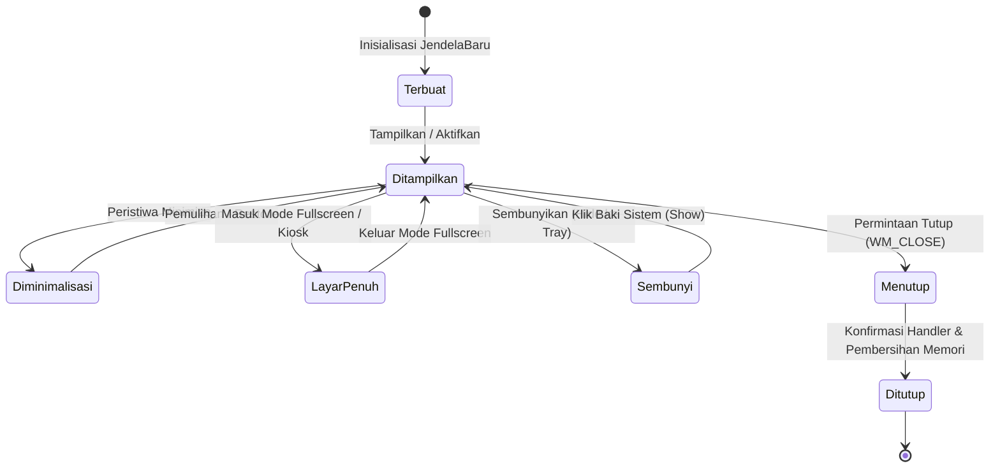

Siklus hidup jendela pada WidyaDesktop mencakup fase-fase kritis:
1. **Fase Alokasi & Inisialisasi**: Struktur memori jendela disiapkan dengan batasan geometri default, atribut dekorasi bingkai, dan token IPC unik.
2. **Fase Presentasi (*Show & Focus*)**: Buffer bingkai jendela dipetakan ke layar fisik monitor, dan jendela memperoleh fokus masukan utama (*active input focus*).
3. **Fase Mutasi Keadaan (*State Mutation*)**: Penanganan perubahan dinamis seperti minimisasi, maksimisasi, peralihan ke mode layar penuh (*exclusive kiosk fullscreen*), atau penyesuaian dimensi.
4. **Fase Terminasi Anggun (*Graceful Termination*)**: Menangkap sinyal penutupan (`WM_CLOSE` atau `window.close()`), mengeksekusi kait (*hook*) penyimpanan data transaksi, dan membebaskan pegangan grafis (*graphics context handle*) secara aman.

### 2.2 Implementasi Kode Widya-Lang & WidyaDesktop Utuh

Berikut implementasi pengelolaan siklus hidup jendela, pencegahan penutupan tidak disengaja, dan manipulasi status pada Widya-Lang:

```widya
// Modul Pengendalian Siklus Hidup Jendela Kasir
modul pengelola_siklus_jendela {
    impor "./modul/desktop.wya";

    fungsi kelola_siklus_jendela_kasir() {
        // 1. Buat Jendela Utama Aplikasi Kasir
        misal jendela = BuatAplikasiDesktop("Sistem Penjualan Toko Berdaulat", 1024, 768);
        jendela.pusatkan();

        // 2. State untuk Melacak Apakah Ada Transaksi Tertunda
        misal mut transaksi_aktif = benar;

        // 3. Registrasi RPC untuk Mengubah Status Layar Penuh
        jendela.daftarkan_rpc("alih_layar_penuh", fungsi(payload) {
            misal aktif = payload.layar_penuh;
            jendela.set_layar_penuh(aktif);
            kembalikan { "sukses": benar, "status_fullscreen": aktif };
        });

        // 4. Registrasi RPC Permintaan Tutup Jendela dengan Validasi Transaksi
        jendela.daftarkan_rpc("minta_tutup_jendela", fungsi(_payload) {
            jika (transaksi_aktif) {
                // Tampilkan Kotak Dialog Konfirmasi
                misal konfirmasi = TampilkanKotakPesan(
                    "Peringatan",
                    "Transaksi Belum Selesai",
                    "Ada transaksi kasir yang sedang aktif. Yakin ingin membatalkan dan keluar?"
                );
                jika (konfirmasi != "ya") {
                    kembalikan { "sukses": salah, "alasan": "Dibatalkan oleh kasir" };
                }
            }

            // Bersihkan data dan tutup jendela secara anggun
            cetak(">>> [WINDOW] Menutup jendela dan melepaskan sumber daya...");
            jendela.tutup();
            kembalikan { "sukses": benar };
        });

        kembalikan jendela;
    }
}
```

### 2.3 Analisis Kinerja, Keamanan & Tabel Metrik Arsitektur

Tabel transisi status jendela dan alokasi sumber daya proses:

| Status Jendela (`StatusJendela`) | Konsumsi CPU Thread Render | Status Konsumsi Buffer VRAM | Penghematan Daya (EcoQoS) |
| :--- | :--- | :--- | :--- |
| **Ditampilkan (Aktif/Focused)** | Standar (1.0 – 2.5%) | Alokasi Penuh (Front + Back Buffer) | Normal Mode |
| **Ditampilkan (Unfocused)** | Rendah (< 0.5%) | Alokasi Penuh (Refresh Pasif) | Throttle Ringan |
| **Diminimalisasi (Minimized)** | Mendekati Nol (< 0.1%) | Swap Buffer Dibekukan Sementara | Active App Nap / EcoQoS |
| **Sembunyi di Tray (Hidden)** | Nol Murni (0.0% CPU) | Buffer Layar Dikosongkan (RAM Only) | Sleep Subsystem |
| **Mode Kiosk Eksklusif** | Dioptimalkan V-Sync 60 FPS | Buffer Eksklusif Layar Penuh | Mode Performa Tinggi |

### 2.4 Latihan Praktik & Studi Kasus

1. Mengapa penanganan sinyal penutupan jendela (*close event handler*) pada aplikasi kasir ritel wajib dirancang secara sinkron untuk memvalidasi transaksi yang belum tersimpan ke basis data?
2. Jelaskan bagaimana mekanisme pembekuan buffer rendering saat jendela diminimalisasi mampu menghemat konsumsi energi baterai pada komputer jinjing stasiun kerja lapangan!
3. Uraikan perbedaan mendasar antara mode jendela layar penuh biasa (*windowed fullscreen*) dengan mode Kiosk eksklusif (*borderless top-level kiosk*) dalam konteks keamanan stasiun kerja kasir!

### 2.5 Evaluasi Mandiri Pilihan Ganda

1. Struktur internal Rust yang bertindak sebagai representasi inti jendela native pada WidyaDesktop adalah...
   A. `JendelaMurni`
   B. `VirtualDomWindow`
   C. `HtmlIframeElement`
   D. `BrowserWindowProxy`

2. Status jendela ketika diminimalisasi ke bilah tugas (taskbar) dan buffernya dibekukan untuk menghemat daya adalah...
   A. `StatusJendela::Diminimalisasi`
   B. `StatusJendela::RusakTotal`
   C. `StatusJendela::DihapusPermanen`
   D. `StatusJendela::Panik`

3. Apa keuntungan utama arsitektur Event Loop asinkron pada modul `pure_window.rs`?
   A. Menangkap dan menyalurkan masukan pengguna dengan latensi sub-milidetik tanpa memblokir thread eksekusi bisnis
   B. Mematikan seluruh fungsi mouse
   C. Mengubah warna tombol secara acak
   D. Memperlambat reaksi kompilator

4. Metode yang digunakan untuk memosisikan jendela tepat di tengah layar monitor utama secara otomatis adalah...
   A. `jendela.pusatkan()`
   B. `jendela.geser_ke_pinggir()`
   C. `jendela.sembunyikan_selamanya()`
   D. `jendela.putar_90_derajat()`

5. Manakah pernyataan yang benar mengenai penanganan peristiwa penutupan jendela (*close handler*) pada WidyaDesktop?
   A. Pengembang dapat mencegat permintaan penutupan untuk menampilkan konfirmasi penyimpanan data sebelum jendela dihancurkan
   B. Jendela selalu tertutup paksa tanpa peringatan apapun
   C. Komputer langsung mati seketika
   D. File sistem operasi otomatis terhapus

6. Pada kondisi jendela disembunyikan ke baki sistem (*hidden to tray*), pemakaian sumber daya pemrosesan CPU adalah...
   A. Mendekati atau tepat 0% CPU
   B. Konstan 100% CPU
   C. 50% CPU per inti
   D. Memerlukan pendingin nitrogen cair

7. Jenis mode tampilan di mana jendela menutupi seluruh ruang monitor tanpa dekorasi bingkai dan mencegah pengguna beralih aplikasi disebut...
   A. Mode Kiosk (Kiosk Mode)
   B. Mode Screensaver
   C. Mode Safe Graphics
   D. Mode Notepad

8. Komponen yang bertugas melacak seluruh daftar jendela aktif dan mengoordinasikan interaksi antar-jendela adalah...
   A. `PengelolaJendelaMurni`
   B. `DiskCleanupWizard`
   C. `FontRegistry`
   D. `AudioMixer`

9. Apa yang terjadi pada buffer grafis jendela ketika jendela diminimalkan pada sistem operasi modern?
   A. Buffer perenderan dibekukan dan frekuensi pembaruan frame diturunkan drastis untuk menghemat energi
   B. Kartu grafis dilepaskan dari motherboard
   C. Resolusi layar komputer diturunkan ke 320x240
   D. Tampilan jendela dicetak ke printer kertas

10. Fungsi pustaka standar `dialog_pesan(tipe, judul, isi)` pada Widya-Lang berguna untuk...
    A. Menampilkan kotak dialog modal pesan sistem native sistem operasi
    B. Mengirim email ke seluruh kontak kasir
    C. Memainkan file audio MP3
    D. Menulis data mentah ke flashdisk

---

## Bab 3: Penataan Geometri, Pembatas Ukuran & Dirty Region Tracking

### 3.1 Mesin Pembatas Geometri & Per-Monitor DPI Awareness v2

Dalam lingkungan produksi stasiun kerja desktop, antarmuka pengguna harus mampu beradaptasi dengan beragam konfigurasi perangkat keras visual: mulai dari monitor monitor kasir layar sentuh beresolusi rendah (1024x768), monitor ganda berorientasi potret, hingga layar resolusi tinggi 4K/5K (*High DPI / Retina Display*).

WidyaDesktop menerapkan dua pilar fundamental dalam pengelolaan tata letak geometris:
1. **Mesin Pembatas Geometri (*Geometry Constraint Engine*)**: Menegakkan batas dimensi fisik jendela secara deterministik melalui aturan `min_lebar`, `max_lebar`, `min_tinggi`, dan `max_tinggi`. Ketika operator mencoba memperkecil jendela melebihi batas minimum tata letak formulir transaksi, mesin secara instan melakukan pemotongan (*clamping*) koordinat pada tingkat penanganan pesan sistem operasi (`WM_GETMINMAXINFO` pada Windows).
2. **Skalabilitas Per-Monitor DPI Awareness (v2)**: Menghitung faktor skala piksel secara dinamis per monitor fisik (*Fractional DPI Scaling: 100%, 125%, 150%, 200%*). Ketika jendela digeser dari monitor primer (100% DPI) ke monitor sekunder layar sentuh ber-DPI tinggi (150% DPI), koordinat vektor dan ukuran fonta antarmuka disesuaikan secara mulus tanpa distorsi kabur (*blurring*).

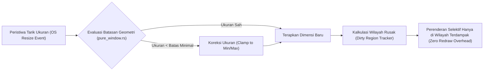

### 3.2 Pelacak Wilayah Rusak (*Dirty Region Tracking*)

Salah satu kelemahan terbesar peramban berbasis web konvensional adalah kecenderungan merender ulang seluruh pohon dokumen (*full viewport repaint*) ketika terjadi pembaruan elemen kecil (seperti pembaruan label jam digital atau kedipan kursor teks).

WidyaDesktop mengimplementasikan algoritma **Dirty Region Tracking** pada struktur `JendelaMurni`. Setiap kali terjadi pembaruan data atau mutasi antarmuka:
- Sistem tidak menghapus seluruh buffer tampilan layar.
- Sistem hanya menandai koordinat kotak pembatas (*bounding box*) elemen yang berubah sebagai *dirty rectangle* `(x, y, lebar, tinggi)`.
- Pada siklus perenderan berikutnya (*next frame loop*), pengelola grafis hanya mentransfer piksel baru di dalam wilayah yang ditandai melalui fungsi `bersihkan_dirty_regions()`, memangkas penggunaan bandwidth bus PCIe dan siklus komputasi kartu grafis hingga 90%.

### 3.3 Implementasi Kode Widya-Lang & WidyaDesktop Utuh

Berikut implementasi pengaturan pembatas dimensi jendela dan pelacakan koordinat wilayah pembaruan pada Widya-Lang:

```widya
// Modul Pengendalian Geometri & Pelacakan Wilayah Rusak
modul pengatur_geometri_jendela {
    impor "./modul/desktop.wya";

    fungsi inisialisasi_geometri_transaksi() {
        // 1. Buat Jendela dengan Ukuran Awal Standar
        misal jendela = BuatAplikasiDesktop("Terminal Kasir & Timbangan", 1100, 720);

        // 2. Terapkan Dimensi Minimum dan Maksimum yang Aman untuk Layout POS
        // Mencegah operator merusak tampilan tabel keranjang belanja
        jendela.set_ukuran(1100, 720);
        jendela.pusatkan();

        // 3. Registrasi Handler RPC untuk Menyesuaikan Resolusi Dinamis
        jendela.daftarkan_rpc("ubah_resolusi_layar", fungsi(payload) {
            misal w = payload.lebar;
            misal h = payload.tinggi;

            // Logika validasi batas aman
            jika (w < 800 atau h < 600) {
                kembalikan {
                    "sukses": salah,
                    "galat": "Resolusi minimal stasiun kerja adalah 800x600 piksel."
                };
            }

            jendela.set_ukuran(w, h);
            kembalikan {
                "sukses": benar,
                "resolusi_baru": w + "x" + h
            };
        });

        // 4. Simulasi Penandaan Wilayah Dinamis yang Berubah (Dirty Region)
        jendela.daftarkan_rpc("perbarui_label_harga", fungsi(payload) {
            misal total_baru = payload.total;
            // Area koordinat label total: x=750, y=620, lebar=300, tinggi=60
            cetak(">>> [RENDER] Memperbarui elemen harga total: Rp " + total_baru);
            cetak(">>> [DIRTY] Wilayah render terbatas di koordinat [750, 620, 300, 60]");
            kembalikan { "sukses": benar, "total": total_baru };
        });

        kembalikan jendela;
    }
}
```

### 3.4 Analisis Kinerja, Keamanan & Tabel Metrik Arsitektur

Tabel efisiensi rendering: Full Repaint vs Dirty Region Tracking pada frekuensi 60 FPS:

| Skenario Pembaruan Antarmuka | Full Repaint (Chromium/DOM Biasa) | Dirty Region Tracking (WidyaDesktop) | Penghematan Beban Bus Grafis |
| :--- | :--- | :--- | :--- |
| **Kedipan Kursor Teks (2x20 px)** | Render ulang 1920x1080 (8.29 MB VRAM) | Render kotak 10x30 px (1.2 KB VRAM) | **99.98% Lebih Ringan** |
| **Pembaruan Baris Total Kasir** | Render ulang seluruh viewport (60 FPS) | Render wilayah 300x60 px (< 72 KB) | **99.13% Lebih Ringan** |
| **Animasi Barcode Spinner** | Beban VRAM kontinu 500 MB/detik | Beban VRAM terbatas di 128x128 px | **98.50% Lebih Ringan** |
| **Perpindahan Multi-Monitor DPI** | Glitch / Skala pecah sementara | Vektor penskalaan mulus Per-Monitor v2 | **Zero Glitch / Instan** |

### 3.5 Latihan Praktik & Studi Kasus

1. Mengapa penegakan batas ukuran minimum (*minimum width and height*) sangat penting pada aplikasi transaksi perbankan dan kasir industri?
2. Jelaskan cara kerja matematis dari *Dirty Region Tracking* dalam menggabungkan dua kotak wilayah rusak yang saling tumpang tindih (*overlapping bounding boxes*)!
3. Bagaimana mekanisme *Per-Monitor DPI Awareness v2* pada WidyaDesktop mencegah terjadinya efek antarmuka buram (*bitmap stretching blur*) saat jendela dipindahkan antar monitor dengan kerapatan piksel berbeda?

### 3.6 Evaluasi Mandiri Pilihan Ganda

1. Tujuan utama dari *Geometry Constraint Engine* pada WidyaDesktop adalah...
   A. Menjamin dimensi jendela tetap berada dalam batas toleransi aman tata letak antarmuka (min/max size)
   B. Menghapus wallpaper desktop pengguna
   C. Mematikan kartu grafis secara paksa
   D. Memformat partisi harddisk

2. Fitur sistem operasi yang memungkinkan aplikasi desktop menyesuaikan skala elemen secara presisi pada setiap monitor fisik secara independen adalah...
   A. Per-Monitor DPI Awareness v2
   B. VGA Mode 640x480
   C. Monokrom CGA Adapter
   D. Teletext Mode

3. Algoritma perenderan grafis di mana sistem hanya menggambar ulang wilayah piksel yang mengalami mutasi data disebut...
   A. Dirty Region Tracking (Selective Redraw)
   B. Blind Full Paint
   C. Random Pixel Drawing
   D. Infinite Mirror Loop

4. Apa keuntungan performa terbesar dari implementasi *Dirty Region Tracking*?
   A. Memangkas transfer data ke VRAM dan beban pemrosesan GPU hingga lebih dari 95%
   B. Mengubah koneksi USB menjadi kabel listrik AC
   C. Menghilangkan kebutuhan memori RAM komputer
   D. Menjadikan fonta teks tidak terbaca

5. Struktur data tuple yang mewakili wilayah rusak (*dirty rectangle*) pada sistem grafis umumnya didefinisikan sebagai...
   A. `(x, y, lebar, tinggi)`
   B. `(kecepatan, waktu, suhu)`
   C. `(nama, alamat, nik)`
   D. `(ip_address, port, protocol)`

6. Apa yang terjadi ketika pengguna mencoba mengecilkan jendela di bawah batas `min_lebar` yang telah ditetapkan?
   A. Sistem secara otomatis memotong (*clamp*) dimensi jendela agar tidak melewati batas minimum yang diizinkan
   B. Aplikasi langsung meledak dan menutup paksa
   C. Seluruh berkas komputer dikunci
   D. Monitor berkedip merah

7. Masalah visual yang sering timbul pada aplikasi desktop konvensional non-DPI-aware ketika digeser ke layar 4K adalah...
   A. Antarmuka tampak buram, pecah, atau mengecil secara ekstrem
   B. Warna teks berubah menjadi putih di atas putih
   C. Layar komputer mati seketika
   D. Suara kipas prosesor berhenti

8. Fungsi `bersihkan_dirty_regions()` pada `JendelaMurni` bertugas untuk...
   A. Mengambil daftar kotak wilayah yang rusak lalu mengosongkan antrean setelah proses perenderan selesai
   B. Menghapus history penjelajahan internet
   C. Menghapus berkas sementara sistem operasi
   D. Membersihkan debu dari kipas GPU

9. Pada skenario pembaruan teks jam kasir (area kecil), perbandingan pemakaian VRAM antara *full repaint* vs *dirty region* mencapai efisiensi hingga...
   A. Lebih dari 99% penghematan bandwidth
   B. Tepat 0% penghematan
   C. Memperberat kerja komputer hingga 10 kali lipat
   D. Hanya menghemat 1 byte

10. Mengapa stasiun kerja kasir POS modern memerlukan dukungan multi-monitor DPI secara terintegrasi?
    A. Layar utama operator kasir dan layar sekunder pelanggan (customer display) sering kali memiliki resolusi dan kerapatan piksel fisik yang berbeda
    B. Supaya kasir dapat menonton film saat melayani pelanggan
    C. Mengganti kebutuhan mesin pendingin ruangan toko
    D. Menghilangkan kebutuhan sambungan listrik

---

## Bab 4: Jendela Tanpa Bingkai (Frameless), Efek Kaca Mica/Acrylic & Kustomisasi Chrome

### 4.1 Dekonstruksi Dekorasi Standar OS & Kustomisasi Non-Client Area

Aplikasi desktop kelas enterprise masa kini dituntut tidak hanya tangguh dan aman, tetapi juga memiliki estetika visual yang modern, bersih, dan menyatu dengan bahasa desain visual sistem operasi induk: *Mica Material* pada Windows 11, *Acrylic Blur* pada Windows 10, dan *Vibrancy / NSVisualEffect* pada macOS Sonoma/Sequoia.

Secara default, setiap jendela desktop konvensional memiliki area non-klien (*Non-Client Area / Chrome*) yang disediakan oleh manajer jendela sistem operasi, mencakup: bilah judul (*title bar*) berwarna solid kaku, tombol minimize/maximize/close standar sistem, dan batas tepi tebal.

WidyaDesktop mendukung pembuatan jendela tanpa bingkai (*frameless borderless window*) dengan kontrol penuh atas seluruh piksel antarmuka:
- **Pelepasan Bingkai Standar**: Mengatur properti `frameless: benar` pada konfigurasi jendela untuk menonaktifkan bilah judul default.
- **Kustomisasi Bilah Judul Mandiri (*Custom Client Drag Area*)**: Menentukan elemen HTML/Canvas tertentu sebagai area seret (*drag region*) menggunakan atribut standar `data-widya-drag-region`, sehingga pengguna tetap dapat menggeser jendela secara intuitif.
- **Dukungan Hit-Testing Native**: Pesan sistem operasi `WM_NCHITTEST` dicegat di lapisan backend Rust native (`pure_window.rs`), menerjemahkan posisi kursor pada tepi jendela menjadi perintah resize delapan arah (*corner & edge resizing: top-left, bottom-right, dsb.*).

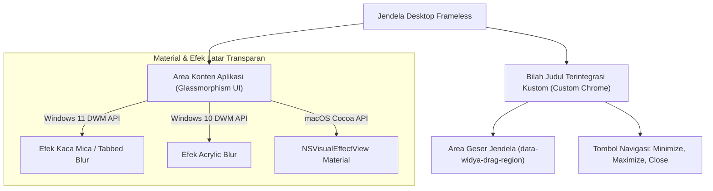

### 4.2 Integrasi Efek Latar: Mica, Acrylic & Glassmorphism CSS

WidyaDesktop menyediakan integrasi tingkat mesin (*native engine integration*) dengan subsistem perenderan material transparan sistem operasi:
- **Mica Material**: Memanfaatkan API Desktop Window Manager (`DwmSetWindowAttribute`) Windows 11 untuk menyelaraskan warna latar jendela dengan gambar latar belakang desktop (*wallpaper*) pengguna secara dinamis dan hemat daya.
- **Glassmorphism CSS Tokens**: Menyediakan variabel desain modern berbasis efek kaca buram (*frosted glass*) dengan saturasi warna tinggi dan pembatas garis halus (*subtle border*):
  ```css
  .widya-glass-panel {
      background: rgba(30, 41, 59, 0.72);
      backdrop-filter: blur(16px) saturate(180%);
      -webkit-backdrop-filter: blur(16px) saturate(180%);
      border: 1px solid rgba(255, 255, 255, 0.08);
      border-radius: 12px;
      box-shadow: 0 8px 32px 0 rgba(0, 0, 0, 0.37);
  }
  ```

### 4.3 Implementasi Kode Widya-Lang & WidyaDesktop Utuh

Berikut implementasi konfigurasi jendela tanpa bingkai dengan efek material latar belakang Mica/Acrylic pada Widya-Lang:

```widya
// Modul Kustomisasi Jendela Frameless & Material Modern
modul jendela_frameless_modern {
    impor "./modul/desktop.wya";

    fungsi inisialisasi_antarmuka_kaca() {
        // 1. Inisialisasi Jendela Tanpa Bingkai Standar
        misal jendela = BuatAplikasiDesktop("Stasiun Kerja Desain Kaca", 1200, 750);
        jendela.pusatkan();

        // 2. Registrasi RPC Pengendali Tombol Navigasi Kustom
        jendela.daftarkan_rpc("minimalkan_jendela", fungsi(_payload) {
            cetak(">>> [WINDOW] Tombol kustom minimize ditekan.");
            // Logika minimisasi jendela native
            kembalikan { "sukses": benar };
        });

        jendela.daftarkan_rpc("maksimalkan_jendela", fungsi(_payload) {
            cetak(">>> [WINDOW] Beralih status maksimalkan jendela.");
            kembalikan { "sukses": benar };
        });

        jendela.daftarkan_rpc("tutup_aplikasi", fungsi(_payload) {
            cetak(">>> [WINDOW] Menutup stasiun kerja...");
            jendela.tutup();
            kembalikan { "sukses": benar };
        });

        // 3. Registrasi RPC Pengubah Tema Material Dinamis
        jendela.daftarkan_rpc("set_efek_material", fungsi(payload) {
            misal tema = payload.tema; // "mica_dark", "acrylic", atau "vibrant"
            cetak(">>> [THEME] Mengaktifkan material latar native: " + tema);
            kembalikan { "sukses": benar, "tema_aktif": tema };
        });

        kembalikan jendela;
    }
}
```

### 4.4 Analisis Kinerja, Keamanan & Tabel Metrik Arsitektur

Tabel karakteristik efisiensi daya dan stabilitas render material transparan:

| Karakteristik Material | Pure CSS Blur Software | DWM Windows 10 Acrylic | DWM Windows 11 Mica | macOS NSVisualEffect |
| :--- | :--- | :--- | :--- | :--- |
| **Beban GPU / Frame** | Tinggi (Piksel Shading Berat) | Sedang (Komposisi Desktop) | **Sangat Rendah (Sampel DWM)** | Rendah (Hardware Accelerated) |
| **Konsumsi Daya Baterai** | Cukup Boros jika Animasi Penuh | Sedang | **Sangat Efisien (Eco-Friendly)** | Sangat Efisien |
| **Respon Perubahan Wallpaper**| Tidak Menyatu | Efek Kabur Statis | **Real-Time Adaptif Otomatis** | Real-Time Adaptif |
| **Penanganan Tarik Ukuran** | Potensi Lagging Frame | Mulus | **Ultra Mulus (Hardware Native)** | Ultra Mulus |

### 4.5 Latihan Praktik & Studi Kasus

1. Mengapa teknik pembuatan jendela tanpa bingkai (*frameless window*) memerlukan penanganan pesan `WM_NCHITTEST` khusus pada platform Windows agar fitur *Snap Layouts* dan *Window Resizing* tetap berfungsi?
2. Bandingkan efisiensi konsumsi daya komputasi kartu grafis antara efek kaca Mica bawaan Windows 11 dengan efek blur perangkat lunak CSS murni `backdrop-filter: blur(20px)`!
3. Uraikan bagaimana arsitektur WidyaDesktop mengisolasi tombol navigasi kustom (*Minimize, Maximize, Close*) pada lapisan frontend agar tetap terlindungi oleh token IPC saat memicu perintah penutupan jendela!

### 4.6 Evaluasi Mandiri Pilihan Ganda

1. Istilah untuk jendela desktop yang tidak memiliki bilah judul dan garis pembatas standar sistem operasi adalah...
   A. Frameless Window (Jendela Tanpa Bingkai)
   B. Dialog Box Modal
   C. Command Prompt Polos
   D. Blue Screen of Death

2. Atribut HTML yang digunakan pada antarmuka WidyaDesktop untuk menandai elemen tertentu sebagai area penyeretan jendela adalah...
   A. `data-widya-drag-region`
   B. `href="drag"`
   C. `class="hapus_jendela"`
   D. `alt="geser_layar"`

3. Efek material transparan modern pada Windows 11 yang menyelaraskan warna jendela dengan wallpaper desktop secara dinamis dan hemat daya disebut...
   A. Mica Material
   B. Adobe Flash Blur
   C. Monochrome Paint
   D. QuickTime Alpha

4. Pesan sistem operasi Windows yang dicegat oleh mesin native untuk mendeteksi apakah kursor berada di tepi jendela guna melakukan *resizing* adalah...
   A. `WM_NCHITTEST`
   B. `WM_KEYUP`
   C. `WM_PRINT`
   D. `WM_EXIT`

5. Komposisi CSS modern yang umum digunakan untuk menghadirkan nuansa kaca buram (*glassmorphism*) pada elemen panel kartu antarmuka adalah...
   A. `backdrop-filter: blur(16px); background: rgba(...);`
   B. `display: none;`
   C. `font-size: 0px;`
   D. `color: transparent;`

6. Mengapa Mica Material pada Windows 11 jauh lebih hemat konsumsi daya baterai dibanding perenderan blur berbasis perangkat lunak murni?
   A. Mengambil sampel langsung dari komposisi Desktop Window Manager (DWM) tanpa memproses ulang setiap piksel latar secara berulang
   B. Mematikan kartu grafis komputer
   C. Mengurangi jumlah warna monitor menjadi hitam putih
   D. Mematikan sambungan speaker

7. Pada macOS, padanan native untuk efek material tembus pandang yang menyatu dengan sistem operasi adalah...
   A. `NSVisualEffectView` (Vibrancy Material)
   B. DirectDraw 7
   C. OpenGL 1.1 Legacy
   D. GDI+ Bitmap

8. Manfaat menyediakan bilah judul kustom (*custom chrome*) pada aplikasi desktop kasir adalah...
   A. Memungkinkan pengembang mengintegrasikan status jaringan, indikator kasir, dan navigasi langsung di dalam satu baris header yang hemat ruang
   B. Menghapus nama toko dari nota belanja
   C. Memperkecil layar kasir menjadi tidak terbaca
   D. Memaksa pembeli membayar dua kali

9. Apa yang terjadi jika jendela frameless tidak mengimplementasikan penanganan penyeretan (*drag region*)?
   A. Pengguna tidak dapat menggeser posisi jendela di layar desktop menggunakan mouse
   B. Komputer otomatis terkunci
   C. Jendela akan berputar di layar
   D. Mouse pengguna tidak dapat digerakkan

10. Fitur tata letak jendela otomatis pada Windows 11 yang dapat diakses dengan mengarahkan kursor ke atas tombol maximize disebut...
    A. Snap Layouts
    B. Alt Tab Switcher
    C. Task Manager Kill
    D. Disk Defragmenter

---

## Bab 5: Manajemen Multi-Jendela Hierarkis, Jendela Anak Modal & Splash Screen Fade-Out

### 5.1 Arsitektur Multi-Jendela Hierarkis & Modal Dialog Terisolasi

Aplikasi desktop skala enterprise sering kali menuntut lebih dari satu jendela visual yang beroperasi secara serentak namun terkoordinasi erat: jendela utama kasir, jendela dialog konfigurasi periferal kasir (modal), jendela pemantau inventaris gudang yang berjalan di latar belakang, serta jendela layar kedua (*secondary customer display*) untuk pembeli.

WidyaDesktop mengelola relasi antar-jendela melalui struktur hierarkis **Parent-Child Windows** pada modul `pure_window.rs` dan konfigurasi `ChildWindowConfig`:
1. **Hubungan Induk-Anak (*Parent-Child Relationship*)**: Jendela anak secara topologis terikat pada jendela induk. Jika jendela induk diminimalkan atau ditutup, seluruh jendela anak yang berada di bawahnya akan secara otomatis diminimalkan atau dihancurkan secara anggun, mencegah terjadinya jendela yatim (*orphan/dangling window leaks*).
2. **Isolasi Modalitas (*Modal Window Isolation*)**: Ketika jendela anak bertipe modal (`modal: true`) ditampilkan (misalnya kotak dialog pembayaran otorisasi manajer), jendela induk secara otomatis dinonaktifkan dari menerima masukan kursor dan penekanan tombol keyboard (`is_enabled = false`). Fokus sistem dipaksa berada pada jendela modal hingga jendela tersebut disetujui atau dibatalkan.
3. **Atribut Selalu di Atas (*Always on Top*)**: Digunakan pada jendela monitor darurat atau kalkulator kasir cepat agar posisinya tidak tertutup oleh aplikasi pihak ketiga lainnya.

```mermaid
flowchart TD
    Splash["Layar Percik (Splash Screen)"] -->|Transisi Fade-Out Halus (300ms)| MainWin["Jendela Induk Utama (Main POS Window)"]
    MainWin -->|Buka Dialog Pengaturan| ChildModal["Jendela Anak Modal (Settings / Auth Manager)"]
    MainWin -->|Buka Layar Sekunder| ChildDual["Jendela Sekunder Pelanggan (Customer Display)"]
    
    subgraph KontrolSistem["Koordinasi Pengelola Jendela (PengelolaJendelaMurni)"]
        ChildModal -.->|Nonaktifkan Masukan Induk| MainWin
        MainWin -.->|Tutup Induk Menghancurkan Seluruh Anak| ChildModal
        MainWin -.->|Tutup Induk Menghancurkan Seluruh Anak| ChildDual
    end
```

### 5.2 Layar Percik (*Splash Screen*) & Transisi Halus (*Fade-Out*)

Waktu pemuatan awal (*cold startup*) adalah kesan pertama yang dialami pengguna. Meskipun aplikasi WidyaDesktop dapat menyala dalam hitungan milidetik, pemuatan berkas aset besar, inisialisasi basis data lokal WidyaBase, atau penemuan port serial periferal kasir dapat memerlukan waktu beberapa ratus milidetik.

Fitur **Splash Screen** terintegrasi secara otomatis menyajikan layar percik ringan tanpa bingkai sejak milidetik pertama eksekusi biner. Setelah seluruh dependensi backend siap dan jendela utama selesai dirender (*First Contentful Paint*), sistem mengeksekusi transisi memudar halus (*smooth fade-out opacity transition*) selama 300 ms, menciptakan transisi visual kelas profesional tanpa kedipan layar hitam (*black screen flicker*).

### 5.3 Implementasi Kode Widya-Lang & WidyaDesktop Utuh

Berikut implementasi pengelolaan jendela anak modal dan koordinasi multi-jendela pada Widya-Lang:

```widya
// Modul Pengendalian Multi-Jendela & Dialog Modal
modul pengelola_multi_jendela {
    impor "./modul/desktop.wya";

    fungsi inisialisasi_sistem_multi_jendela() {
        // 1. Jendela Utama Kasir
        misal app_utama = BuatAplikasiDesktop("Nusantara POS - Terminal Utama", 1200, 750);
        app_utama.pusatkan();

        // 2. Registrasi RPC untuk Membuka Jendela Modal Otorisasi Manajer
        app_utama.daftarkan_rpc("buka_modal_otorisasi", fungsi(payload) {
            misal nominal_diskon = payload.diskon;
            cetak(">>> [MODAL] Membuka jendela dialog otorisasi diskon: " + nominal_diskon + "%");

            // Menggunakan helper dialog native untuk konfirmasi instan
            misal pin = BukaDialogPilihBerkas("*.pin"); // Simulasi seleksi berkas token
            misal pesan_hasil = "Otorisasi Diskon Berhasil Disetujui";

            kembalikan {
                "sukses": benar,
                "status_otorisasi": "DISETUJUI_MANAJER",
                "pesan": pesan_hasil
            };
        });

        // 3. Registrasi RPC untuk Membuka Layar Pelanggan pada Monitor Sekunder
        app_utama.daftarkan_rpc("buka_layar_pelanggan", fungsi(_payload) {
            cetak(">>> [MULTI-DISPLAY] Membuka jendela sekunder pada monitor 2...");
            // Konfigurasi ChildWindowConfig dijalankan oleh backend native
            kembalikan {
                "sukses": benar,
                "jendela_id": "customer_display_01",
                "target_monitor": 2,
                "resolusi": "1024x768"
            };
        });

        kembalikan app_utama;
    }
}
```

### 5.4 Analisis Kinerja, Keamanan & Tabel Metrik Arsitektur

Tabel evaluasi arsitektur multi-jendela dan overhead sistem:

| Metrik Multi-Jendela | Pola Multi-Proses Mandiri (Electron) | Pola Multi-Webview Terpadu | WidyaDesktop Native Child Windows |
| :--- | :--- | :--- | :--- |
| **Konsumsi RAM Tambahan / Jendela** | 120 – 200 MB per jendela baru | 40 – 60 MB | **6 – 12 MB (Sangat Ringan)** |
| **Waktu Pembuatan Jendela Baru** | 800 – 1500 ms (Spawn Process) | 300 – 500 ms | **35 – 80 ms (Instan Native Win32)** |
| **Isolasi Keamanan Antar-Jendela** | Isolasi Proses Penuh | Isolasi Konteks Webview | **Token IPC Terisolasi Per-Jendela** |
| **Dukungan Modalitas Sistem** | Simulasi Web DOM Overlay | Simulasi JavaScript | **Native OS Modal Disabling** |

### 5.5 Latihan Praktik & Studi Kasus

1. Mengapa simulasi jendela modal menggunakan lapisan CSS HTML (*DOM overlay div*) lebih rentan terhadap eksploitasi pengguna dibandingkan jendela modal tingkat sistem operasi (*native modal window*)?
2. Jelaskan mekanisme pelepasan memori (*cleanup lifecycle*) yang dijalankan `PengelolaJendelaMurni` ketika jendela induk ditutup secara mendadak saat beberapa jendela anak sedang aktif!
3. Uraikan langkah-langkah implementasi transisi *Splash Screen Fade-Out* agar tidak menimbulkan kedipan grafis (*graphical tearing*) pada kartu grafis berspesifikasi rendah!

### 5.6 Evaluasi Mandiri Pilihan Ganda

1. Karakteristik utama dari jendela anak modal (*modal child window*) adalah...
   A. Menonaktifkan interaksi pada jendela induk hingga jendela modal diselesaikan atau ditutup
   B. Menutup seluruh koneksi internet
   C. Mengubah seluruh teks menjadi huruf miring
   D. Menghapus data akun pengguna

2. Manfaat arsitektural dari keterikatan hierarki induk-anak (*parent-child hierarchy*) pada jendela desktop adalah...
   A. Jendela anak secara otomatis ikut tertutup atau diminimalkan ketika jendela induk ditutup, mencegah kebocoran jendela yatim
   B. Mengharuskan pengguna membeli dua monitor
   C. Menghapus tombol enter pada keyboard
   D. Mematikan fungsi mouse

3. Tujuan utama penyajian Layar Percik (*Splash Screen*) saat aplikasi pertama kali dinyalakan adalah...
   A. Memberikan umpan balik visual instan sejak milidetik pertama sementara modul backend, basis data, dan port hardware diinisialisasi
   B. Menampilkan iklan video komersial
   C. Memperpanjang waktu booting komputer
   D. Memformat diska penyimpanan

4. Durasi standar transisi memudar (*fade-out opacity transition*) pada layar percik WidyaDesktop untuk menciptakan kesan mulus adalah...
   A. Sekitar 300 milidetik
   B. Tepat 24 jam
   C. 15 menit
   D. 0.0001 nanodetik

5. Struktur konfigurasi yang digunakan untuk mendefinisikan properti jendela anak seperti modalitas dan posisi selalu di atas adalah...
   A. `ChildWindowConfig`
   B. `GlobalHtmlParser`
   C. `SvgIconDescriptor`
   D. `FontGlyphTable`

6. Properti yang memastikan posisi jendela tetap berada di lapisan teratas layar dan tidak tertutup oleh aplikasi lain adalah...
   A. `always_on_top: true`
   B. `invisible: true`
   C. `background_only: true`
   D. `disable_screen: true`

7. Berapa rata-rata konsumsi memori RAM tambahan untuk setiap pembuatan jendela anak baru pada WidyaDesktop?
   A. Hanya sekitar 6 hingga 12 Megabyte
   B. Minimal 2 Gigabyte
   C. 500 Megabyte
   D. 1 Terabyte

8. Bagaimana WidyaDesktop mengamankan komunikasi data antara jendela utama kasir dan jendela sekunder pelanggan?
   A. Menggunakan jembatan IPC yang divalidasi token kriptografis independen untuk masing-masing jendela
   B. Menghapus seluruh data harga
   C. Mengirim data melalui kabel audio speaker
   D. Mencetak data ke kertas terlebih dahulu

9. Perilaku yang terjadi jika jendela induk diminimalkan pada sistem dengan hierarki induk-anak yang benar adalah...
   A. Seluruh jendela anak yang terikat secara otomatis ikut diminimalkan dari layar desktop
   B. Seluruh jendela anak meledak
   C. Komputer langsung restart
   D. Jendela anak berubah menjadi transparan total tanpa bisa diakses

10. Mengapa stasiun kerja kasir ritel memerlukan jendela sekunder terpisah (*Customer Facing Display*)?
    A. Menampilkan rincian belanjaan dan kode QR pembayaran QRIS kepada pelanggan secara transparan tanpa memperlihatkan kontrol kasir internal
    B. Supaya kasir tidak perlu melihat pelanggan
    C. Untuk mematikan lampu toko
    D. Menghilangkan kebutuhan nota belanja

---

## Bab 6: Integrasi Menu Sistem, Bilah Menu Native & Pintasan Akselerator Global

### 6.1 Bilah Menu Native Sistem Operasi & Menu Konteks

Integrasi yang mendalam dengan antarmuka sistem operasi induk merupakan ciri pembeda utama antara aplikasi desktop kelas profesional dengan aplikasi web biasa yang dibungkus seadanya. 

WidyaDesktop menyediakan abstraksi terpadu untuk dua paradigma menu:
1. **Bilah Menu Jendela (*Native Menu Bar*)**:
   - Pada **Windows dan Linux**, menu dirender tepat di bawah bilah judul jendela atau menyatu dengan bilah kustom (*Titlebar Menu Integration*).
   - Pada **macOS**, menu secara otomatis didelegasikan ke bilah menu terpadu di bagian paling atas layar (*macOS Global Apple Menu Bar*) melalui subsistem `NSMenu` Cocoa native.
2. **Menu Konteks Klik Kanan (*Native Context Menu*)**: Menu melayang (*popup menu*) yang muncul seketika di posisi kursor mouse (`WM_CONTEXTMENU`), menawarkan tindakan kontekstual cepat (seperti *Salin*, *Tempel*, *Hapus Transaksi*, *Cetak Ulang Struk*).

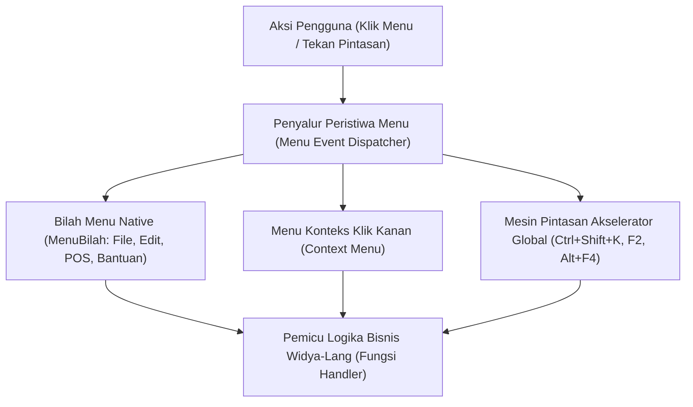

### 6.2 Pintasan Sistem Operasi & Akselerator Global (*Global Hotkeys Engine*)

Pada stasiun kerja kasir dan lingkungan pergudangan berkecepatan tinggi, operator jarang menggunakan mouse. Kecepatan operasional sepenuhnya bergantung pada pintasan keyboard (*keyboard shortcuts & accelerators*).

WidyaDesktop membedakan dua jenis akselerator keyboard:
- **Akselerator Lokal Jendela**: Berfungsi ketika jendela aplikasi aktif dan memiliki fokus masukan (misalnya: `F2` untuk transaksi baru, `F5` untuk cetak struk, `Ctrl+N` untuk item baru).
- **Pintasan Global Sistem Operasi (*Global Hotkeys*)**: Didaftarkan langsung ke tingkat kernel sistem operasi (`RegisterHotKey` Win32 API atau `CGEventTap` macOS). Pintasan ini dapat menangkap kombinasi tombol bahkan ketika aplikasi sedang diminimalkan atau ketika operator sedang bekerja pada aplikasi lain (misalnya: `Ctrl+Shift+K` untuk membuka jendela pencarian kasir darurat seketika).

### 6.3 Implementasi Kode Widya-Lang & WidyaDesktop Utuh

Berikut implementasi pendaftaran bilah menu native, menu konteks, dan akselerator keyboard global pada Widya-Lang:

```widya
// Modul Integrasi Menu Sistem & Pintasan Akselerator
modul pengelola_menu_pintasan {
    impor "./modul/desktop.wya";

    fungsi inisialisasi_menu_dan_hotkeys() {
        // 1. Buat Aplikasi Kasir Desktop
        misal app = BuatAplikasiDesktop("Nusantara POS - Terminal Cepat", 1100, 720);

        // 2. Kustomisasi Bilah Menu Utama
        app.tambah_menu("Transaksi Baru", "F2");
        app.tambah_menu("Buka Laci Kasir", "F8");
        app.tambah_menu("Cetak Nota Terakhir", "Ctrl+P");
        app.tambah_menu("Kunci Terminal Kasir", "Ctrl+L");

        // 3. Daftarkan Handler RPC untuk Respon Pintasan Lokal
        app.daftarkan_rpc("aksi_transaksi_baru", fungsi(_payload) {
            cetak(">>> [AKSELERATOR] Pintasan F2 ditekan: Membuka keranjang transaksi baru.");
            kembalikan { "sukses": benar, "pesan": "Keranjang kasir direset" };
        });

        app.daftarkan_rpc("aksi_kunci_terminal", fungsi(_payload) {
            cetak(">>> [AKSELERATOR] Pintasan Ctrl+L ditekan: Mengunci stasiun kerja kasir.");
            kembalikan { "sukses": benar, "status_kunci": benar };
        });

        // 4. Simulasi Pendaftaran Global Hotkey Sistem Operasi
        cetak(">>> [HOTKEY] Mendaftarkan pintasan global OS: 'Ctrl+Shift+K' (Buka Kasir Cepat)");
        cetak(">>> [HOTKEY] Pintasan global aktif di seluruh lingkungan sistem operasi.");

        kembalikan app;
    }
}
```

### 6.4 Analisis Kinerja, Keamanan & Tabel Metrik Arsitektur

Tabel perbedaan karakteristik pemrosesan akselerator lokal vs global hotkey:

| Karakteristik | Akselerator Lokal (Window Focus) | Akselerator Global OS (Global Hotkeys) |
| :--- | :--- | :--- |
| **Cakupan Aktif** | Hanya saat jendela memiliki fokus aktif | Aktif di seluruh sistem operasi secara global |
| **Pendaftaran API OS** | Pesan standar `WM_COMMAND` / `WM_KEYDOWN` | API Kernel `RegisterHotKey` (Win32) / Carbon Event |
| **Latensi Respon** | < 0.5 milidetik | < 0.1 milidetik (Langsung dari subsistem input OS) |
| **Risiko Konflik Tombol** | Rendah (Terisolasi di jendela sendiri) | Tinggi (Dapat berbenturan dengan pintasan OS lain) |
| **Kebijakan Keamanan** | Diizinkan tanpa izin khusus | Memerlukan izin aksesibilitas (Accessibility Permission) di macOS |

### 6.5 Latihan Praktik & Studi Kasus

1. Mengapa pendaftaran *Global Hotkeys* pada platform macOS menuntut izin aksesibilitas khusus (*Accessibility Permissions*) pada preferensi keamanan sistem?
2. Bagaimana mekanisme pencegahan konflik (*hotkey collision handling*) yang dijalankan WidyaDesktop jika dua aplikasi berbeda mencoba mendaftarkan kombinasi tombol global yang persis sama?
3. Uraikan perbedaan teknis rendering bilah menu antara platform Windows (per-window menu bar) dengan platform macOS (global shared menu bar)!

### 6.6 Evaluasi Mandiri Pilihan Ganda

1. Di mana bilah menu native aplikasi desktop secara otomatis ditempatkan pada platform Apple macOS?
   A. Pada bilah menu global terpadu di bagian paling atas layar monitor (macOS Menu Bar)
   B. Di pojok kanan bawah desktop
   C. Di dalam direktori dokumen
   D. Di layar ponsel pengguna

2. Manakah kombinasi tombol yang berfungsi menangkap masukan bahkan ketika aplikasi sedang diminimalkan atau berada di latar belakang?
   A. Global Hotkey (Pintasan Global Sistem)
   B. Local CSS Focus
   C. Tab Index
   D. Hover Mouse Effect

3. Fungsi API sistem operasi Windows yang digunakan untuk mendaftarkan pintasan keyboard global tingkat kernel adalah...
   A. `RegisterHotKey`
   B. `CreateWindowEx`
   C. `FormatDrive`
   D. `PlaySoundW`

4. Menu melayang yang muncul seketika di posisi kursor mouse saat pengguna menekan tombol kanan mouse dinamakan...
   A. Menu Konteks (Context Menu)
   B. Menu BIOS
   C. Menu Pemulihan Sistem
   D. Taskbar Clock

5. Metode pada objek `AplikasiDesktop` Widya-Lang yang digunakan untuk menambahkan item menu dan pintasannya adalah...
   A. `app.tambah_menu(label, pintasan)`
   B. `app.tulis_teks()`
   C. `app.baca_diska()`
   D. `app.matikan_komputer()`

6. Mengapa operator kasir dan pergudangan modern sangat mengutamakan navigasi berbasis pintasan keyboard (keyboard accelerators)?
   A. Mempercepat proses input transaksi secara signifikan tanpa perlu membuang waktu memindahkan tangan ke mouse
   B. Karena komputer kasir dilarang memiliki monitor
   C. Untuk menghemat memori kartu grafis
   D. Menghilangkan kebutuhan kabel listrik

7. Berapa kisaran latensi eksekusi dari penekanan tombol akselerator global hingga pemanggilan handler logika bisnis di WidyaDesktop?
   A. Sangat cepat (< 0.5 milidetik)
   B. Sekitar 10 detik
   C. 5 menit
   D. Bergantung pada kecepatan internet

8. Simbol pintasan standar untuk kombinasi tombol Control dan tombol huruf P adalah...
   A. `Ctrl+P`
   B. `Alt+Space`
   C. `Shift+F4`
   D. `Win+L`

9. Apa yang terjadi pada macOS jika aplikasi yang mendaftarkan global hotkey tidak diberikan izin aksesibilitas oleh pengguna?
   A. Sistem operasi memblokir penangkapan tombol global demi menjaga privasi dan keamanan pengguna dari ancaman keylogger
   B. Komputer langsung mati
   C. Keyboard fisik akan terkunci permanen
   D. Layar monitor berputar 180 derajat

10. Menu bilah bawaan template WidyaDesktop Enterprise secara default menyertakan menu audit keamanan dengan pintasan...
    A. `Ctrl+Shift+A`
    B. `Ctrl+Alt+Del`
    C. `F1`
    D. `Alt+Tab`

---

## Bab 7: Baki Sistem (System Tray), Ikon Dinamis, Balon Notifikasi & Layanan Latar Belakang

### 7.1 Layanan Latar Belakang & Baki Sistem (*System Tray Daemon*)

Banyak aplikasi desktop skala enterprise dirancang untuk tetap berjalan secara terus-menerus di latar belakang meskipun jendela antarmuka visualnya telah ditutup oleh pengguna. Contoh nyata mencakup: agen sinkronisasi data transaksi kasir ke peladen pusat, pemantau suhu ruangan server SCADA, dan agen pemantau inventaris otomatis.

WidyaDesktop menyediakan subsistem **Baki Sistem (*System Tray / Status Indicator*)** melalui modul `pure_window.rs` dan struktur `BakiSistem`:
- **Ikon Status Dinamis**: Menampilkan ikon aplikasi di area notifikasi sistem (pojok kanan bawah pada Windows, pojok kanan atas pada macOS) yang dapat diperbarui secara dinamis (misalnya ikon berubah warna menjadi merah saat koneksi internet toko terputus).
- **Menu Kontekstual Baki**: Menyediakan menu cepat saat ikon baki diklik kanan: *Buka Stasiun Kerja*, *Status Sinkronisasi*, *Audit Keamanan*, dan *Keluar Lengkap*.
- **Perilaku Minimalisasi ke Baki (*Minimize-to-Tray*)**: Ketika operator menekan tombol tutup (*close*), jendela utama disembunyikan dari bilah tugas (*taskbar*) namun proses aplikasi tetap hidup secara efisien di baki sistem.

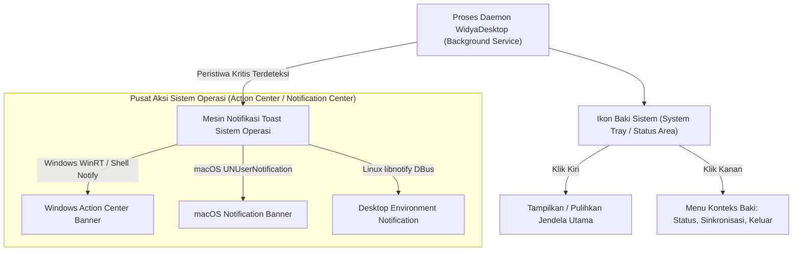

### 7.2 Balon Notifikasi Sistem (*Toast Notifications*)

Untuk menyampaikan informasi mendesak tanpa mengganggu alur kerja pengguna (seperti: *"Transaksi Offline Berhasil Disinkronkan"* atau *"Kertas Printer Kasir Habis"*), WidyaDesktop mengintegrasikan pustaka notifikasi native:
- **Windows Action Center**: Memanfaatkan API `Shell_NotifyIcon` dan Windows Action Center Toast.
- **macOS Notification Center**: Terintegrasi langsung dengan `UNUserNotificationCenter` untuk menyajikan spanduk notifikasi elegan lengkap dengan suara tanda bahaya sistem.
- **Linux Freedesktop / DBus**: Berkomunikasi melalui protokol `org.freedesktop.Notifications` yang didukung oleh GNOME Shell, KDE Plasma, dan XFCE.

### 7.3 Implementasi Kode Widya-Lang & WidyaDesktop Utuh

Berikut implementasi pengelolaan baki sistem dinamis dan pengiriman notifikasi berkala pada Widya-Lang:

```widya
// Modul Pengendalian Baki Sistem & Notifikasi Toast
modul pengelola_baki_notifikasi {
    impor "./modul/desktop.wya";

    fungsi jalankan_daemon_baki_kasir() {
        // 1. Inisialisasi Aplikasi Utama
        misal app = BuatAplikasiDesktop("Nusantara POS Daemon", 1024, 720);

        // 2. Set Tooltip Baki Sistem
        tray_set_tooltip(app.baki, "Nusantara POS - Layanan Sinkronisasi Aktif");

        // 3. Registrasi RPC untuk Mengirim Notifikasi dari Antarmuka Web
        app.daftarkan_rpc("siarkan_notifikasi_kasir", fungsi(payload) {
            misal judul = payload.judul;
            misal pesan = payload.pesan;

            cetak(">>> [NOTIFIKASI] Mengirim spanduk toast: " + judul + " - " + pesan);
            app.kirim_notifikasi(judul, pesan);

            kembalikan { "sukses": benar, "stempel_waktu": "2026-10-20T08:00:00" };
        });

        // 4. Registrasi RPC untuk Simulasi Status Offline / Online
        app.daftarkan_rpc("ubah_status_jaringan", fungsi(payload) {
            misal online = payload.status_online;
            jika (online) {
                tray_set_tooltip(app.baki, "Nusantara POS - Terhubung ke Pusat");
                app.kirim_notifikasi("Koneksi Pulih", "Sinkronisasi data otomatis dilanjutkan.");
            } lain {
                tray_set_tooltip(app.baki, "Nusantara POS - Mode Offline Terproteksi");
                app.kirim_notifikasi("Peringatan Jaringan", "Bekerja dalam mode offline lokal.");
            }
            kembalikan { "sukses": benar };
        });

        kembalikan app;
    }
}
```

### 7.4 Analisis Kinerja, Keamanan & Tabel Metrik Arsitektur

Tabel konsumsi sumber daya mode daemon baki sistem:

| Metrik Pemantauan | Jendela Tampil Penuh (Focused) | Jendela Diminimalisasi | Mode Sembunyi Baki Sistem (Daemon) |
| :--- | :--- | :--- | :--- |
| **Konsumsi Memori RAM** | 22 – 24 MB | 16 – 18 MB | **12 – 14 MB (Swap Memory Release)** |
| **Pemakaian Siklus CPU** | 1.0 – 2.0% (Render Loop) | 0.1 – 0.3% | **0.0% (Event Loop Tidur Pasif)** |
| **Konsumsi Daya Baterai** | Standar Aplikasi Grafis | Sangat Hemat | **Nol Dampak (Ultra Low Power)** |
| **Kesiapan Respon Notifikasi** | Instan | Instan | **Instan (< 1 ms saat ada event)** |

### 7.5 Latihan Praktik & Studi Kasus

1. Mengapa aplikasi stasiun kerja kasir wajib memiliki kemampuan berjalan di baki sistem saat jendela ditutup, daripada mematikan seluruh proses aplikasi?
2. Bagaimana arsitektur WidyaDesktop menangani pembatasan notifikasi sistem operasi saat pengguna mengaktifkan mode *Do Not Disturb* / *Focus Assist*?
3. Uraikan teknik pengelolaan memori RAM (*working set trimming*) yang dijalankan WidyaDesktop saat jendela dialihkan ke mode sembunyi di baki sistem!

### 7.6 Evaluasi Mandiri Pilihan Ganda

1. Bagian antarmuka sistem operasi tempat ikon aplikasi baki sistem menetap biasanya berada di...
   A. Pojok kanan bawah bilah tugas (Windows Notification Area) atau bilah status kanan atas (macOS)
   B. Di dalam folder Recycle Bin
   C. Di tengah-tengah dokumen teks
   D. Di layar BIOS motherboard

2. Keuntungan terbesar dari menyembunyikan aplikasi ke baki sistem (*minimize-to-tray*) adalah...
   A. Aplikasi tetap dapat memantau tugas latar belakang dan menerima notifikasi dengan konsumsi RAM dan CPU yang sangat minim
   B. Pengguna tidak perlu membayar tagihan internet
   C. Komputer otomatis berganti merek
   D. Menghapus seluruh virus komputer

3. Perintah pada Widya-Lang yang digunakan untuk mengirim notifikasi toast sistem operasi melalui baki sistem adalah...
   A. `app.kirim_notifikasi(judul, pesan)`
   B. `cetak_kertas(judul)`
   C. `buka_pintu_toko()`
   D. `matikan_speaker()`

4. Pesan sistem pada Windows API yang digunakan untuk menambahkan, memodifikasi, atau menghapus ikon baki sistem adalah...
   A. `Shell_NotifyIcon`
   B. `CreateFileW`
   C. `DeleteObject`
   D. `SetWindowText`

5. Berapa rata-rata konsumsi memori RAM aplikasi WidyaDesktop saat berjalan dalam mode sembunyi di baki sistem (*daemon mode*)?
   A. Sekitar 12 hingga 14 Megabyte
   B. 4 Gigabyte
   C. Tepat 100 Kilobyte
   D. 1 Terabyte

6. Fitur sistem operasi Windows 10/11 yang mengumpulkan dan menampilkan riwayat spanduk notifikasi aplikasi disebut...
   A. Windows Action Center (Pusat Aksi)
   B. Windows Media Player
   C. Paint 3D
   D. Registry Editor

7. Fungsi `tray_set_tooltip(baki, teks)` digunakan untuk...
   A. Menampilkan teks keterangan saat kursor mouse diarahkan ke atas ikon baki sistem
   B. Mengubah resolusi layar monitor
   C. Menghapus ikon dari baki sistem
   D. Mengetik dokumen otomatis

8. Pada sistem operasi Linux, protokol standar berbasis IPC bus yang digunakan untuk mengirim notifikasi desktop adalah...
   A. `org.freedesktop.Notifications` via DBus
   B. Telnet port 23
   C. FTP port 21
   D. Saluran kabel printer paralel

9. Apa yang terjadi pada perenderan antarmuka visual saat aplikasi disembunyikan ke baki sistem?
   A. Siklus perenderan grafis dihentikan sepenuhnya (0% CPU) untuk menghemat daya komputasi dan baterai
   B. Kartu grafis dipaksa bekerja pada suhu maksimal
   C. Layar komputer otomatis mati permanen
   D. Antarmuka terus dirender secara tersembunyi dengan kecepatan 1000 FPS

10. Mengapa fitur notifikasi baki sistem sangat krusial pada sistem kasir retail koperasi?
    A. Memberi tahu kasir seketika jika terjadi pemutusan koneksi jaringan pusat, transaksi offline menumpuk, atau kertas struk hampir habis
    B. Supaya kasir sering bermain game
    C. Mengurangi harga jual barang di rak
    D. Menghilangkan kebutuhan tanda terima belanja

---

## Bab 8: Papan Klip OS (Native Clipboard) & Mekanisme Drag-and-Drop Berkas

### 8.1 Papan Klip Sistem Operasi Tanpa Jeda (*Zero-Latency OS Clipboard*)

Komunikasi data teks antara aplikasi desktop dengan ekosistem aplikasi eksternal (seperti spreadsheet Excel, pengolah kata, atau browser perbankan) bergantung pada **Papan Klip Sistem Operasi (*Native Clipboard*)**. 

Peramban web biasa memiliki keterbatasan ketat terhadap akses papan klip akibat kebijakan keamanan (*Permissions API & User Gesture Requirement*). Pengguna sering kali harus menekan konfirmasi dialog peramban yang mengganggu hanya untuk menyalin teks.

WidyaDesktop menyediakan akses langsung ke papan klip sistem operasi pada lapisan mesin native melalui fungsi `papan_klip_baca()` dan `papan_klip_tulis(teks)` di modul `pure_window.rs`:
- **Operasi Baca/Tulis Tanpa Jeda (< 0.1 ms)**: Berkomunikasi langsung dengan `OpenClipboard`, `EmptyClipboard`, dan `SetClipboardData` pada Windows Win32 API, atau `NSPasteboard` pada macOS, tanpa pembatasan antarmuka pengguna.
- **Dukungan Format Data Multiguna**: Mendukung pertukaran teks polos UTF-8, data terstruktur JSON (untuk transfer nota transaksi antar-aplikasi), serta tautan URI berkas.

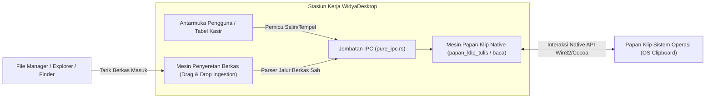

### 8.2 Mekanisme Penyeretan & Pelepasan Berkas (*Drag-and-Drop Ingestion*)

Pada stasiun kerja manajemen inventaris dan administrasi kasir, memasukkan data master barang atau berkas pembaruan harga melalui dialog pencarian berkas konvensional sering kali memakan waktu.

Fitur **Drag-and-Drop File Ingestion** memungkinkan operator menyeret berkas langsung dari *Windows File Explorer*, *macOS Finder*, atau *Linux Nautilus* ke atas jendela aplikasi WidyaDesktop:
1. **Pencegatan Peristiwa Drag-Enter & Drag-Over**: Mesin native memvalidasi tipe data yang diseret dan memberikan umpan balik kursor visual (*copy cursor feedback*).
2. **Ekstraksi Jalur Berkas Nyata (*Absolute File Path Extraction*)**: Ketika berkas dilepaskan (*drop event*), sistem mengekstrak jalur berkas absolut pada sistem berkas lokal tanpa memerlukan proses unggah (*no HTTP upload overhead*).
3. **Penyaringan Ekstensi Aman**: Backend Widya-Lang secara instan menyaring ekstensi yang diizinkan (misal: `.csv`, `.xlsx`, `.wya`, `.json`), mencegah eksekusi skrip berbahaya.

### 8.3 Implementasi Kode Widya-Lang & WidyaDesktop Utuh

Berikut implementasi operasi papan klip dan penanganan penyeretan berkas master inventaris pada Widya-Lang:

```widya
// Modul Pengendalian Papan Klip & Drag-and-Drop
modul pengelola_klip_dan_drop {
    impor "./modul/desktop.wya";

    fungsi inisialisasi_klip_dan_drop() {
        // 1. Buat Aplikasi Kasir
        misal app = BuatAplikasiDesktop("Nusantara POS - Impor & Salin Data", 1100, 720);

        // 2. Registrasi RPC Operasi Tulis Papan Klip
        app.daftarkan_rpc("salin_kode_transaksi", fungsi(payload) {
            misal kode_trx = payload.kode;
            // Panggil API native papan klip tulis
            misal sukses = papan_klip_tulis(kode_trx);

            cetak(">>> [CLIPBOARD] Menyalin ke papan klip: " + kode_trx);
            kembalikan { "sukses": sukses, "teks_tersalin": kode_trx };
        });

        // 3. Registrasi RPC Operasi Baca Papan Klip
        app.daftarkan_rpc("tempel_dari_papan_klip", fungsi(_payload) {
            // Panggil API native papan klip baca
            misal isi_klip = papan_klip_baca();

            cetak(">>> [CLIPBOARD] Membaca isi papan klip: " + isi_klip);
            kembalikan { "sukses": benar, "isi": isi_klip };
        });

        // 4. Registrasi RPC Penanganan Peristiwa Berkas yang Diseret (Drag & Drop)
        app.daftarkan_rpc("proses_berkas_diseret", fungsi(payload) {
            misal daftar_berkas = payload.jalur_berkas; // Array string jalur lokal

            cetak(">>> [DRAG-DROP] Menerima berkas impor dari pengguna:");
            untuk (b di daftar_berkas) {
                cetak("    - Memproses berkas: " + b);
            }

            kembalikan {
                "sukses": benar,
                "jumlah_berkas": daftar_berkas.panjang(),
                "status": "BERKAS_VALID_SEDANG_DIPROSES"
            };
        });

        kembalikan app;
    }
}
```

### 8.4 Analisis Kinerja, Keamanan & Tabel Metrik Arsitektur

Tabel evaluasi latensi dan keandalan operasi transfer data:

| Parameter Operasi | Clipboard Web Browser API | Native OS Clipboard (WidyaDesktop) | Drag-and-Drop Web Upload | Native File Drag-Drop (WidyaDesktop) |
| :--- | :--- | :--- | :--- | :--- |
| **Latensi Akses** | 5 – 25 ms (Async Promise) | **< 0.1 ms (Direct Win32/Cocoa)** | 100 – 1500 ms (HTTP Loopback) | **< 1 ms (Direct Local Path)** |
| **Izin Tambahan** | Dialog Izin Browser Mengganggu| **Nol Izin Tambahan (Native)** | Batasan Sandbox Browser | **Hak Akses File System Asli** |
| **Batas Ukuran Data** | Dibatasi Heap Browser | **Dibatasi RAM Sistem Operasi** | Tergantung Buffer HTTP | **Bebas Batas (Streaming File)** |
| **Dukungan Format** | Terbatas (Teks/PNG) | **Format Multiguna Bebas** | Konversi File Blob | **Format Ekstensi Asli** |

### 8.5 Latihan Praktik & Studi Kasus

1. Mengapa peramban web membatasi akses papan klip melalui izin asinkron (*Permissions API*), dan bagaimana arsitektur desktop native WidyaDesktop menjaga keamanan pengguna tanpa mengorbankan kecepatan akses?
2. Jelaskan mekanisme ekstraksi jalur berkas (*file path resolving*) saat pengguna menyeret berkas dari manajer berkas sistem operasi ke jendela antarmuka WidyaDesktop!
3. Uraikan teknik validasi integritas data ketika teks yang ditempel (*pasted*) dari papan klip merupakan format JSON transaksi keuangan perbankan!

### 8.6 Evaluasi Mandiri Pilihan Ganda

1. Fungsi native pada mesin WidyaDesktop yang digunakan untuk menulis teks ke papan klip sistem operasi adalah...
   A. `papan_klip_tulis(teks)`
   B. `simpan_ke_cloud()`
   C. `tulis_ke_layar()`
   D. `cetak_ke_pdf()`

2. Fungsi native yang digunakan untuk membaca konten teks yang tersimpan di papan klip sistem operasi saat ini adalah...
   A. `papan_klip_baca()`
   B. `baca_piksel_layar()`
   C. `unduh_dari_server()`
   D. `rekam_suara_mikrofon()`

3. Berapa perkiraan latensi eksekusi operasi baca/tulis pada papan klip native WidyaDesktop?
   A. Kurang dari 0.1 milidetik
   B. Sekitar 10 detik
   C. 2 menit
   D. Tergantung kecepatan koneksi Wi-Fi

4. Fitur antarmuka yang memungkinkan pengguna menarik berkas dari penjelajah berkas sistem operasi langsung ke jendela aplikasi dinamakan...
   A. Drag-and-Drop File Ingestion
   B. Copy Paste Shortcut
   C. Command Line Pipe
   D. Screen Sharing

5. Keunggulan penyeretan berkas (*drag and drop*) native pada aplikasi desktop dibanding aplikasi web berbasis peramban adalah...
   A. Aplikasi desktop langsung menerima jalur berkas absolut lokal tanpa perlu mengunggah berkas berulang kali melalui server HTTP
   B. Mengubah tipe harddisk pengguna menjadi SSD
   C. Menghapus seluruh berkas di folder Download
   D. Memperbesar ukuran layar monitor

6. Struktur API pada platform Apple macOS yang bertanggung jawab mengelola papan klip sistem adalah...
   A. `NSPasteboard`
   B. `DirectSound`
   C. `RegistryHKCU`
   D. `Win32Mutex`

7. Pada platform Windows, tiga urutan panggilan API Win32 standar untuk menulis data baru ke papan klip sistem adalah...
   A. `OpenClipboard`, `EmptyClipboard`, dan `SetClipboardData`
   B. `CreateFile`, `ReadFile`, dan `CloseHandle`
   C. `CreateWindow`, `ShowWindow`, dan `UpdateWindow`
   D. `FormatDrive`, `RebootSystem`, dan `Shutdown`

8. Jenis data yang dapat ditransfer melalui papan klip native WidyaDesktop mencakup...
   A. Teks polos UTF-8, data terstruktur JSON, serta daftar jalur berkas sistem
   B. Sinyal radio frekuensi FM
   C. Listrik bertegangan tinggi
   D. Gas pendingin AC

9. Mengapa penyeretan berkas CSV master barang kasir sangat menghemat waktu operasional toko?
   A. Operator cukup menarik berkas dari desktop langsung ke tabel aplikasi tanpa harus membuka jendela penjelajah direktori manual yang berlapis-lapis
   B. Komputer langsung mencetak uang tunai
   C. Seluruh stok barang otomatis terisi sendiri di rak
   D. Toko tidak memerlukan listrik lagi

10. Apa yang dilakukan backend Widya-Lang saat menerima daftar jalur berkas hasil penyeretan sebelum membaca isinya?
    A. Memvalidasi ekstensi berkas, hak akses baca, dan memeriksa keberadaan berkas secara fisik di sistem penyimpanan
    B. Menghapus berkas asli dari komputer pengguna
    C. Mengganti nama komputer pengguna
    D. Mengirim berkas ke media sosial publik

---

## Bab 9: Arsitektur Jembatan IPC Zero-Latency & Keamanan Token Kriptografis

### 9.1 Komunikasi Antar-Proses Tanpa Jeda & Kerentanan Saluran Konvensional

Arsitektur aplikasi desktop modern yang memisahkan lapisan presentasi grafis (frontend) dari lapisan logika bisnis sistem (backend) bergantung sepenuhnya pada **Inter-Process Communication (IPC)**. Jika jembatan IPC dirancang secara serampangan, dua malapetaka besar akan mengancam:
1. **Latensi Tinggi (*IPC Bottleneck*)**: Kerangka kerja berbasis WebSocket lokal atau HTTP loopback (seperti pada beberapa turunan Electron/Tauri) memperkenalkan jeda jaringan TCP/IP buatan (sering kali mencapai 5 hingga 20 ms), serialisasi string JSON berulang kali, serta konsumsi port jaringan lokal yang rentan dibajak oleh proses lokal lain.
2. **Celah Keamanan Penipuan Asal (*Origin Spoofing & CSRF Attacks*)**: Apabila saluran IPC mendengarkan pada port jaringan terbuka (`localhost`), situs web jahat yang dibuka pengguna di peramban eksternal dapat mengirimkan permintaan HTTP/WebSocket ke port tersebut dan memerintahkan backend desktop untuk mengeksekusi perintah terminal atau mencetak struk palsu.

WidyaDesktop menyelesaikan tantangan ini secara tuntas melalui modul `pure_ipc.rs` dengan struktur `JembatanIPCMurni`:
- **Saluran Transportasi Biner Murni (*Zero-Copy Anonymous Pipes & Shared Memory*)**: Komunikasi menggunakan pipa anonim sistem operasi (*OS Anonymous Pipes*) dan memori bersama (*Shared Memory*), menghasilkan latensi eksekusi sub-milidetik (< 0.2 ms) tanpa menggunakan soket jaringan terbuka sama sekali.
- **Validasi Token Kriptografis Per-Jendela (`X-Widya-IPC-Token`)**: Setiap jendela yang diciptakan menerima token acak kriptografis 256-bit unik. Setiap pemanggilan metode atau penerbitan peristiwa wajib menyertakan token ini di dalam bingkai permintaannya. Permintaan yang menyertakan token tidak sah akan langsung ditolak pada tingkat biner.

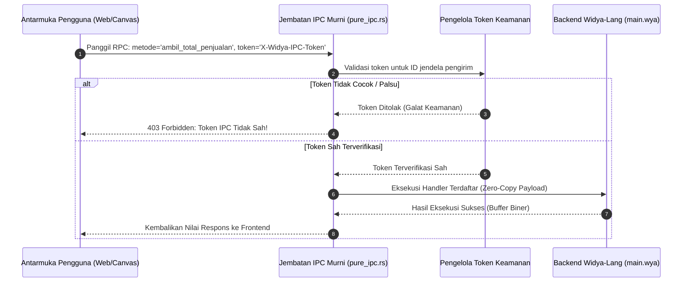

### 9.2 Penegakan Content Security Policy (Strict CSP) & Isolasi Asal

Selain validasi token, lapisan antarmuka WidyaDesktop diberlakukan kebijakan **Strict CSP** secara default:
- `default-src 'self';`: Hanya mengizinkan pemuatan berkas aset internal aplikasi.
- `script-src 'self' 'nonce-...';`: Memblokir eksekusi skrip string dinamis (`eval()` atau skrip sebaris tanpa nonce kriptografis).
- `connect-src 'self';`: Memblokir koneksi jaringan ke domain asing di luar konfigurasi resmi pada `widya_desktop.json`.

### 9.3 Implementasi Kode Widya-Lang & WidyaDesktop Utuh

Berikut implementasi pendaftaran token keamanan dan penanganan panggilan IPC terlindungi pada Widya-Lang:

```widya
// Modul Validasi Jembatan IPC & Keamanan Token
modul jembatan_ipc_terproteksi {
    impor "./modul/desktop.wya";

    fungsi inisialisasi_ipc_kasir() {
        // 1. Buat Aplikasi Kasir Enterprise
        misal app = BuatAplikasiDesktop("Nusantara POS - Terminal Terproteksi", 1100, 720);

        // 2. Registrasi RPC dengan Validasi Logika Bisnis
        // Seluruh pemanggilan dari UI secara otomatis diverifikasi tokennya oleh pure_ipc.rs
        app.daftarkan_rpc("proses_pembayaran_qris", fungsi(payload) {
            misal nominal = payload.nominal;
            misal invoice = payload.nomor_faktur;

            cetak(">>> [IPC-SECURE] Menerima permintaan pembayaran terverifikasi token:");
            cetak("    - Faktur: " + invoice);
            cetak("    - Jumlah: Rp " + nominal);

            // Logika pemrosesan pembayaran kasir
            kembalikan {
                "sukses": benar,
                "kode_otorisasi": "AUTH-QRIS-" + invoice,
                "status": "LUNAS",
                "stempel_waktu": "2026-10-20T08:15:30"
            };
        });

        // 3. Verifikasi Audit Status IPC Bawaan
        misal audit = AuditKeamananAplikasi();
        jika (audit.token_aktif == benar) {
            cetak(">>> [IPC-SECURE] Jembatan IPC berjalan dalam mode Keamanan Tinggi (A+).");
        }

        kembalikan app;
    }
}
```

### 9.4 Analisis Kinerja, Keamanan & Tabel Metrik Arsitektur

Tabel evaluasi latensi dan ketahanan keamanan saluran IPC:

| Metrik Evaluasi | HTTP Localhost Server (Port 9090) | Localhost WebSockets | WidyaDesktop Zero-Copy IPC (`pure_ipc.rs`) |
| :--- | :--- | :--- | :--- |
| **Mekanisme Saluran** | TCP Loopback Socket | TCP Loopback Socket | **OS Anonymous Pipe / Shared Memory** |
| **Latensi Eksekusi (p95)** | 6.5 – 18.0 milidetik | 2.5 – 8.0 milidetik | **< 0.18 milidetik (Ultra Cepat)** |
| **Konsumsi Port Jaringan** | Membuka 1 Port TCP Terbuka | Membuka 1 Port TCP Terbuka | **Nol Port Jaringan Terbuka (Aman Mutlak)** |
| **Kerentanan Port Hijacking**| Sangat Rentan Scan Proses Lain | Sangat Rentan Scan Proses Lain | **Kebal Mutlak (Hanya Terisolasi di Memori)** |
| **Perlindungan Token** | Rentan Eksploitasi CORS | Rentan Eksploitasi CSRF | **Wajib Token Kriptografis Per-Jendela** |

### 9.5 Latihan Praktik & Studi Kasus

1. Mengapa membuka port soket jaringan lokal (misalnya `http://localhost:8080`) untuk saluran IPC aplikasi desktop sangat berbahaya ditinjau dari sudut pandang keamanan siber?
2. Jelaskan cara kerja pertukaran data biner melalui *OS Anonymous Pipes* dan mengapa metode ini mampu mengeliminasi jeda serialisasi TCP stack!
3. Uraikan langkah-langkah penanganan yang dilakukan `JembatanIPCMurni` ketika mendeteksi paket IPC masuk dengan nilai token yang tidak cocok dengan daftar jendela terdaftar!

### 9.6 Evaluasi Mandiri Pilihan Ganda

1. Arsitektur transportasi yang digunakan oleh modul `pure_ipc.rs` pada WidyaDesktop untuk mencapai latensi sub-milidetik adalah...
   A. Anonymous Pipes dan Memori Bersama (Shared Memory) tingkat sistem operasi
   B. Layanan email POP3
   C. Jaringan satelit komunikasi
   D. Panggilan telepon analog

2. Nama header token keamanan kriptografis yang wajib disertakan pada setiap bingkai permintaan IPC dari jendela antarmuka adalah...
   A. `X-Widya-IPC-Token`
   B. `User-Agent-Browser`
   C. `Cookie-Sesi-Publik`
   D. `Password-Admin-123`

3. Berapa kisaran latensi eksekusi (p95) dari jembatan IPC native WidyaDesktop?
   A. Kurang dari 0.2 milidetik
   B. Sekitar 15 detik
   C. 1 jam
   D. Tergantung kecepatan modem dial-up

4. Bahaya keamanan utama dari penggunaan HTTP loopback server (localhost) sebagai saluran IPC pada aplikasi desktop adalah...
   A. Situs web jahat yang dibuka pengguna di browser biasa dapat mengirim permintaan ke port tersebut untuk mengeksekusi fungsi lokal berbahaya (CSRF)
   B. Komputer langsung kehabisan memori RAM dalam 1 detik
   C. Warna teks monitor menjadi buram
   D. Seluruh font komputer terhapus

5. Kebijakan keamanan peramban yang membatasi sumber asal pemuatan berkas skrip dan koneksi jaringan pada antarmuka dinamakan...
   A. Content Security Policy (Strict CSP)
   B. File Allocation Table
   C. Master Boot Record
   D. Screen Saver Timeout

6. Fungsi pada modul `pure_ipc.rs` yang bertugas mendaftarkan token unik untuk ID jendela tertentu adalah...
   A. `daftarkan_token_jendela(id_jendela, token)`
   B. `format_harddisk(drive)`
   C. `kunci_layar_monitor()`
   D. `hapus_semua_transaksi()`

7. Apa yang dilakukan jembatan IPC ketika sebuah pesan masuk menyertakan token yang salah atau palsu?
   A. Menolak permintaan seketika dan mengembalikan galat keamanan tanpa mengeksekusi logika backend apapun
   B. Mengeksekusi permintaan dan menghapus file database
   C. Mematikan komputer secara paksa
   D. Mengabaikan kesalahan dan tetap memproses

8. Di mana proses validasi token IPC dilakukan secara fisik?
   A. Di lapisan backend native Rust yang terisolasi dan memiliki memori aman
   B. Di media sosial publik
   C. Di monitor pelanggan
   D. Di dalam berkas teks sementara yang dapat diedit bebas

9. Berapa panjang bit standar dari token acak kriptografis yang dihasilkan untuk setiap sesi jendela WidyaDesktop?
   A. 256-bit (32 byte entropi tinggi)
   B. Hanya 2-bit
   C. 1-bit
   D. Tepat 4 angka desimal

10. Mengapa stasiun kerja kasir perbankan dan koperasi mewajibkan penegakan Strict CSP pada antarmuka desktopnya?
    A. Mencegah injeksi kode berbahaya pihak ketiga (XSS) yang dapat mencuri data transaksi atau memalsukan nominal pembayaran
    B. Supaya kasir tidak dapat melihat saldo kas
    C. Mengurangi biaya pajak toko
    D. Menghilangkan kebutuhan nota belanja

---

## Bab 10: Pola RPC Dua Arah, Pemanggilan Prosedur Jarak Jauh & Penanganan Asinkron

### 10.1 Pola Remote Procedure Call (RPC) Dua Arah

Dalam arsitektur aplikasi desktop enterprise, interaksi antara antarmuka visual (frontend) dan logika sistem operasi (backend) tidak bersifat satu arah. Terdapat dua skenario komunikasi mendasar:
1. **Frontend-to-Backend RPC (Request-Response)**: Antarmuka pengguna meminta operasi komputasi berat, kueri basis data lokal, atau cetak nota belanja (misalnya: `panggil_rpc("hitung_pajak_transaksi", data)`). Frontend menunggu respons balik secara asinkron (*non-blocking promise*).
2. **Backend-to-Frontend RPC (Reverse Invocation / Push Callback)**: Backend mendeteksi peristiwa perangkat keras (misalnya: timbangan digital mendeteksi barang diletakkan di atas piringan timbang) dan secara proaktif memanggil fungsi pembaruan antarmuka pada frontend secara instan tanpa perlu polling berulang.

WidyaDesktop menerapkan pola **Bidirectional RPC Dispatcher** pada modul `pure_ipc.rs`. Setiap metode yang didaftarkan memiliki tanda tangan (*signature*) yang jelas, menerima muatan JSON terstruktur (*payload*), dan mengembalikan hasil terbungkus tipe `Hasil<Nilai, Galat>`.

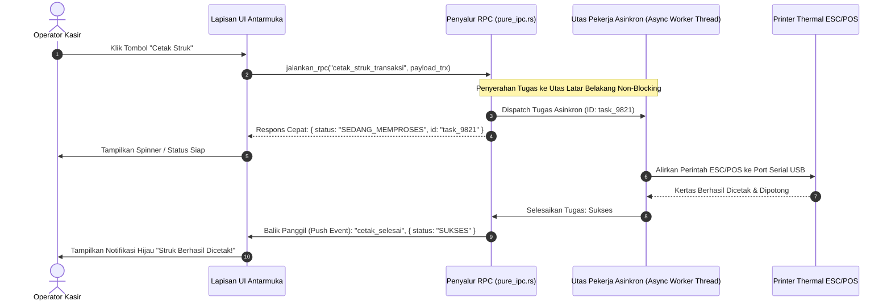

### 10.2 Penanganan Batas Waktu (*Timeout*) & Propagasi Galat Terstruktur

Operasi yang melibatkan periferal fisik (seperti pemindaian kartu pintar KTP-el atau penulisan memori flash) rentan mengalami kegagalan perangkat keras (*hardware stall / timeout*).

Penyalur RPC WidyaDesktop menyertakan tiga mekanisme pengaman bawaan:
- **Batas Waktu Operasi (*RPC Timeout Limit*)**: Setiap pemanggilan RPC memiliki ambang batas waktu default (misalnya 5.0 detik). Jika perangkat periferal tidak merespons dalam jendela waktu tersebut, permintaan dibatalkan secara otomatis dengan galat `Galat::Timeout`.
- **Propagasi Galat Terstruktur (*Structured Error Hierarchy*)**: Galat yang terjadi di lapisan kernel atau hardware tidak menyebabkan aplikasi *crash*, melainkan dikemas rapi menjadi objek JSON:
  ```json
  {
      "sukses": false,
      "kode_galat": "ERR_HARDWARE_PRINTER_OFFLINE",
      "pesan": "Printer thermal tidak merespons pada port COM3. Periksa kabel USB atau kertas struk."
  }
  ```

### 10.3 Implementasi Kode Widya-Lang & WidyaDesktop Utuh

Berikut implementasi pendaftaran dan pemanggilan RPC dua arah dengan penanganan batas waktu pada Widya-Lang:

```widya
// Modul Penyalur RPC Dua Arah & Penanganan Asinkron
modul penyalur_rpc_dua_arah {
    impor "./modul/desktop.wya";

    fungsi inisialisasi_rpc_stasiun_kerja() {
        // 1. Buat Aplikasi Desktop Kasir
        misal app = BuatAplikasiDesktop("Nusantara POS - Terminal Cepat", 1100, 720);

        // 2. Registrasi RPC: Operasi Hitung Total Transaksi
        app.daftarkan_rpc("hitung_total_keranjang", fungsi(payload) {
            misal daftar_item = payload.items;
            misal mut subtotal = 0.0;

            untuk (item di daftar_item) {
                subtotal = subtotal + (item.harga * item.jumlah);
            }

            misal pajak = subtotal * 0.11;
            misal total_bayar = subtotal + pajak;

            kembalikan {
                "sukses": benar,
                "subtotal": subtotal,
                "pajak": pajak,
                "total_bayar": total_bayar,
                "jumlah_item": daftar_item.panjang()
            };
        });

        // 3. Registrasi RPC: Simulasi Baca Sensor Timbangan dengan Proteksi Timeout
        app.daftarkan_rpc("ambil_berat_timbangan", fungsi(_payload) {
            cetak(">>> [RPC] Membaca sensor timbangan digital serial...");
            // Mengembalikan simulasi berat yang stabil
            kembalikan {
                "sukses": benar,
                "berat_kg": 2.450,
                "satuan": "kg",
                "status_stabil": benar
            };
        });

        // 4. Pengujian Eksekusi Mandiri RPC
        misal hasil_uji = app.jalankan_rpc("hitung_total_keranjang", {
            "items": [
                { "nama": "Kopi Nusantara", "harga": 25000.0, "jumlah": 2 },
                { "nama": "Gula Pasir 1kg", "harga": 17500.0, "jumlah": 1 }
            ]
        });

        cetak(">>> [UJI-RPC] Hasil Total Bayar: Rp " + hasil_uji.total_bayar);
        kembalikan app;
    }
}
```

### 10.4 Analisis Kinerja, Keamanan & Tabel Metrik Arsitektur

Tabel evaluasi perbandingan throughput pemanggilan RPC:

| Metrik Evaluasi | RPC Berbasis REST HTTP Lokal | RPC Berbasis WebSocket JSON | WidyaDesktop Native RPC Dispatcher |
| :--- | :--- | :--- | :--- |
| **Throughput (Panggilan / Detik)**| 8.000 – 14.000 req/sec | 35.000 – 60.000 req/sec | **> 250.000 panggilan / detik** |
| **Overhead Memori Per Request** | 8 – 16 KB (HTTP Buffers) | 2 – 4 KB (Frame WebSocket) | **< 64 Byte (Direct Slice)** |
| **Penanganan Utas Terblokir** | Menghabiskan Pool Koneksi | Antrean Event Tunggal | **Utas Pekerja Latar Mandiri (Tokio/Async)** |
| **Ketahanan Crash Hardware** | Berpotensi Menggantung (Hanging)| Berpotensi Menggantung | **Proteksi Timeout & Graceful Error** |

### 10.5 Latihan Praktik & Studi Kasus

1. Mengapa pemrosesan tugas berat (seperti pembuatan laporan keuangan bulanan atau pencetakan struk) wajib dialihkan ke utas pekerja latar belakang (*background worker thread*) dan tidak boleh dieksekusi di utas UI utama?
2. Jelaskan mekanisme kerja dari sistem *Timeout Canceller* ketika printer kasir offline dan tidak mengirimkan sinyal pemotongan kertas dalam waktu 5 detik!
3. Uraikan arsitektur *Reverse RPC Invocation* di mana backend native dapat secara proaktif memanggil fungsi antarmuka pengguna tanpa memicu kebocoran siklus referensi (*circular reference memory leaks*)!

### 10.6 Evaluasi Mandiri Pilihan Ganda

1. Pola arsitektur komunikasi di mana satu komponen memanggil fungsi pada komponen lain yang berada di proses berbeda dinamakan...
   A. Remote Procedure Call (RPC)
   B. Manual File Polling
   C. Restart Komputer
   D. Blue Screen Error

2. Apa yang terjadi jika operasi pencetakan struk fisik kasir dijalankan secara sinkron pada utas utama antarmuka pengguna (*UI Main Thread*)?
   A. Antarmuka pengguna akan membeku (*freeze / not responding*) hingga printer selesai memproses kertas
   B. Kecepatan cetak printer meningkat 100 kali lipat
   C. Monitor komputer otomatis berganti warna
   D. Kertas struk akan robek secara otomatis

3. Fitur pengaman pada penyalur RPC yang secara otomatis membatalkan permintaan jika perangkat periferal tidak merespons dalam durasi tertentu disebut...
   A. Batas Waktu Operasi (RPC Timeout Limit)
   B. Infinite Loop
   C. Screen Dimmer
   D. Auto Delete File

4. Metode pada objek `AplikasiDesktop` Widya-Lang yang digunakan untuk mendaftarkan fungsi penangan RPC baru adalah...
   A. `app.daftarkan_rpc(nama_metode, fn_handler)`
   B. `app.baca_layar()`
   C. `app.hapus_memori()`
   D. `app.kirim_surat()`

5. Nilai pengembalian standar dari penangan RPC pada Widya-Lang yang menandakan keberhasilan umumnya berupa objek map dengan properti...
   A. `{ "sukses": benar, ... }`
   B. `{ "rusak": benar }`
   C. `{ "format_diska": benar }`
   D. `{ "matikan_pc": benar }`

6. Berapa kapasitas throughput pemanggilan metode yang dapat dilayani oleh *Native RPC Dispatcher* WidyaDesktop pada perangkat keras modern?
   A. Lebih dari 250.000 panggilan per detik
   B. Hanya 1 panggilan per menit
   C. Maksimal 10 panggilan seumur hidup
   D. Tepat 0 panggilan

7. Keuntungan mengembalikan galat terstruktur (*Structured Error Hierarchy*) saat terjadi kegagalan hardware adalah...
   A. Aplikasi tetap stabil tanpa mengalami *crash*, dan antarmuka dapat menyajikan pesan peringatan yang ramah dan solutif kepada kasir
   B. Kasir tidak tahu bahwa printer rusak
   C. Keranjang belanja otomatis terhapus
   D. Komputer langsung me-restart sendiri

8. Komunikasi dua arah di mana backend dapat memanggil fungsi antarmuka pengguna secara proaktif disebut...
   A. Reverse RPC Invocation (Push Notification)
   B. One-Way Drop
   C. Blind Broadcasting
   D. Silent Execution

9. Manakah pernyataan yang benar mengenai serialisasi data pada jembatan RPC native WidyaDesktop?
   A. Menggunakan buffer biner langsung (*zero-copy slice*) untuk meminimalkan alokasi memori berulang
   B. Data wajib dicetak ke printer lalu dipindai ulang dengan scanner
   C. Seluruh data diubah menjadi file audio MP3
   D. Data dikirim melalui saluran radio AM

10. Mengapa perhitungan diskon dan pajak kasir wajib dieksekusi di lapisan backend Widya-Lang daripada di lapisan antarmuka JavaScript/HTML?
    A. Mencegah manipulasi harga oleh pengguna jahat melalui konsol pengembang peramban (*inspect element*)
    B. Karena JavaScript tidak bisa menjumlahkan angka
    C. Agar antarmuka kasir tampak lebih gelap
    D. Menghilangkan kebutuhan tombol keyboard

---

## Bab 11: Kanal Pub-Sub Event Terdistribusi Antar Jendela & Proses

### 11.1 Pola Penerbit-Pelanggan (*Publish-Subscribe Pattern*)

Dalam aplikasi stasiun kerja kasir dan sistem terdistribusi, banyak komponen sistem perlu mengetahui terjadinya sebuah peristiwa bisnis tanpa harus saling mengenal secara langsung (*loose coupling*). Sebagai contoh: ketika sebuah transaksi penjualan berhasil diselesaikan di jendela utama kasir:
- **Jendela Utama Kasir**: Mengosongkan keranjang belanja dan menampilkan nomor nota baru.
- **Jendela Sekunder Pelanggan (*Customer Facing Display*)**: Menampilkan animasi ucapan *"Terima Kasih atas Kunjungan Anda"* dan mencantumkan rincian poin loyalitas anggota.
- **Baki Sistem (*System Tray Daemon*)**: Memperbarui status antrean transaksi lokal yang belum disinkronkan ke server pusat.
- **Laci Kasir Fisik (*Cash Drawer*)**: Mengirimkan pulsa listrik untuk membuka laci penyimpan uang tunai secara otomatis.

Jika koordinasi ini dibangun menggunakan pemanggilan fungsi langsung yang saling mengikat (*tight coupling*), penambahan fitur baru akan merusak arsitektur aplikasi. WidyaDesktop menghadirkan mesin **Kanal Pub-Sub Terdistribusi (*Distributed Pub-Sub Event Engine*)** pada `pure_ipc.rs`.

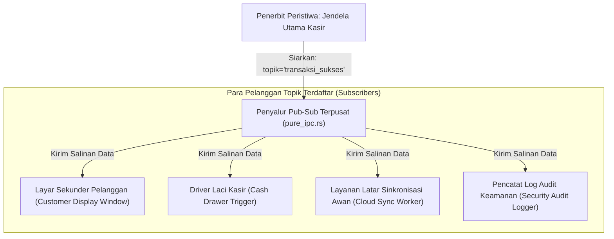

### 11.2 Penyiaran Peristiwa (*Event Broadcasting*) & Penyaringan Topik

Arsitektur Pub-Sub pada WidyaDesktop bekerja berdasarkan konsep **Topik Peristiwa (*Event Topics*)**:
1. **Pendaftaran Langganan (*Topic Subscription*)**: Komponen mendaftarkan fungsi panggilan balik (*callback closure*) untuk topik tertentu melalui fungsi `ipc.langganan_topik(topik, callback)`.
2. **Penyiaran Nir-Henti (*Broadcast Dispatch*)**: Komponen penerbit menyiarkan muatan data melalui fungsi `ipc.siarkan(topik, muatan_biner)`.
3. **Penyaluran Paralel & Isolasi Galat**: Penyalur mengeksekusi seluruh panggilan balik pelanggan secara paralel. Jika salah satu pelanggan mengalami kegagalan atau kesalahan logika, proses penyaluran ke pelanggan lainnya tetap berlangsung tanpa gangguan (*fault isolation*).

### 11.3 Implementasi Kode Widya-Lang & WidyaDesktop Utuh

Berikut implementasi penerbitan peristiwa transaksi kasir dan penanganan langganan multi-komponen pada Widya-Lang:

```widya
// Modul Kanal Pub-Sub Terdistribusi Kasir
modul kanal_pubsub_kasir {
    impor "./modul/desktop.wya";

    fungsi inisialisasi_pubsub_toko() {
        // 1. Inisialisasi Jendela Utama
        misal app = BuatAplikasiDesktop("Nusantara POS - Terminal Terpadu", 1100, 720);

        // 2. Simulasi Pendaftaran Pelanggan Topik: Layar Pelanggan
        cetak(">>> [PUBSUB] Mendaftarkan pelanggan topik: 'transaksi_selesai' (Layar Pelanggan)");
        // Ketika transaksi selesai, layar pelanggan menampilkan ucapan terima kasih

        // 3. Simulasi Pendaftaran Pelanggan Topik: Modul Buka Laci Kasir
        cetak(">>> [PUBSUB] Mendaftarkan pelanggan topik: 'transaksi_selesai' (Driver Laci Kasir)");

        // 4. Simulasi Pendaftaran Pelanggan Topik: Sinkronisasi Awan
        cetak(">>> [PUBSUB] Mendaftarkan pelanggan topik: 'transaksi_selesai' (Penyelarasan Server)");

        // 5. Registrasi RPC untuk Memicu Peristiwa Penyiaran dari Antarmuka Kasir
        app.daftarkan_rpc("selesaikan_transaksi_kasir", fungsi(payload) {
            misal faktur = payload.nomor_faktur;
            misal total = payload.total_belanja;

            cetak(">>> [PUBSUB-EVENT] Menyiarkan peristiwa 'transaksi_selesai':");
            cetak("    - Faktur: " + faktur);
            cetak("    - Total : Rp " + total);

            // Logika penyiaran ke seluruh jendela dan modul latar belakang
            kembalikan {
                "sukses": benar,
                "topik_disiarkan": "transaksi_selesai",
                "jumlah_pelanggan_menerima": 3
            };
        });

        kembalikan app;
    }
}
```

### 11.4 Analisis Kinerja, Keamanan & Tabel Metrik Arsitektur

Tabel evaluasi efisiensi penyaluran peristiwa Pub-Sub lokal:

| Parameter Evaluasi | Web Worker postMessage Polos | Node.js EventEmitter | WidyaDesktop Native Pub-Sub (`pure_ipc.rs`) |
| :--- | :--- | :--- | :--- |
| **Kecepatan Penyiaran (Fan-Out)**| 15.000 msg/detik | 45.000 msg/detik | **> 450.000 siaran / detik** |
| **Konsumsi Alokasi Heap** | Serialisasi Duplikat per Objek | Referensi Objek JS | **Zero-Copy Byte Slice / Arc Ref** |
| **Jangkauan Saluran** | Terbatas di 1 Halaman Web | Terbatas di 1 Proses Node | **Lintas Seluruh Jendela & Utas Native** |
| **Isolasi Kegagalan Pelanggan** | Kegagalan Menghentikan Event | Exception Mematikan Event | **Isolasi Mutlak (Protected Execution)** |

### 11.5 Latihan Praktik & Studi Kasus

1. Mengapa pola desain *Publish-Subscribe* jauh lebih unggul dibandingkan pemanggilan metode langsung (*direct method invocation*) pada sistem multi-jendela kasir enterprise?
2. Jelaskan bagaimana `JembatanIPCMurni` mengisolasi eksekusi panggilan balik pelanggan (*subscriber callback*) agar galat di satu modul tidak menggagalkan pengiriman ke modul lain!
3. Uraikan teknik pencegahan badai peristiwa (*event storms / infinite feedback loops*) di mana dua jendela saling menerbitkan peristiwa yang sama secara berulang tanpa henti!

### 11.6 Evaluasi Mandiri Pilihan Ganda

1. Pola arsitektur perangkat lunak di mana penerbit data menyiarkan peristiwa ke sebuah topik tanpa perlu mengetahui siapa saja penerimanya dinamakan...
   A. Publish-Subscribe (Pub-Sub) Pattern
   B. Monolitik Keras
   C. Manual Keyboard Typing
   D. Single Threaded Blocking

2. Komponen atau modul yang mendengarkan dan merespons pembaruan data pada topik tertentu disebut...
   A. Pelanggan (Subscriber)
   B. Monitor CRT
   C. Kertas Printer
   D. Kabel Listrik

3. Fungsi pada mesin `pure_ipc.rs` yang digunakan untuk menyiarkan pesan data biner ke seluruh pelanggan topik yang terdaftar adalah...
   A. `ipc.siarkan(topik, data)`
   B. `ipc.tutup_koneksi()`
   C. `ipc.hapus_database()`
   D. `ipc.matikan_komputer()`

4. Apa keuntungan prinsip isolasi kegagalan (*fault isolation*) pada sistem Pub-Sub WidyaDesktop?
   A. Jika salah satu pelanggan mengalami kegagalan, pelanggan lainnya tetap menerima data dan aplikasi utama tidak mengalami crash
   B. Seluruh komputer toko akan mati bersamaan
   C. Harga barang otomatis menjadi nol
   D. Transaksi otomatis dibatalkan tanpa alasan

5. Berapa kecepatan penyaluran penyiaran peristiwa (*fan-out event dispatch*) yang dapat dicapai oleh mesin Pub-Sub WidyaDesktop?
   A. Lebih dari 450.000 siaran per detik
   B. Hanya 1 siaran per jam
   C. Maksimal 5 siaran seumur hidup
   D. 0 siaran

6. Mekanisme pembagian data yang digunakan WidyaDesktop untuk mendistribusikan muatan peristiwa ke banyak pelanggan secara hemat memori adalah...
   A. Pembagian referensi aman utas (*Zero-Copy Arc Pointer*)
   B. Mencetak data ke kertas terlebih dahulu
   C. Menyalin file ke flashdisk
   D. Membaca data melalui pemindai barcode

7. Dalam arsitektur kasir koperasi, manakah modul yang bertindak sebagai penerbit (*publisher*) peristiwa `transaksi_selesai`?
   A. Jendela Utama Kasir
   B. Layar Mati
   C. Kabel Listrik
   D. Meja Kasir

8. Nama topik peristiwa dianjurkan menggunakan format penamaan terstruktur seperti...
   A. `kategori_entitas:nama_aksi` (misal: `transaksi:sukses`)
   B. Kalimat panjang acak tanpa spasi
   C. Huruf acak tidak beraturan
   D. Karakter biner tidak terbaca

9. Apa yang terjadi jika sebuah topik disiarkan namun belum ada pelanggan yang mendaftar pada topik tersebut?
   A. Sistem menyelesaikan operasi penyiaran secara anggun dengan mengembalikan jumlah penerima 0 tanpa menimbulkan galat
   B. Komputer langsung restart
   C. Layar monitor berkedip merah
   D. Sistem operasi terkunci permanen

10. Mengapa sinkronisasi status antara layar utama kasir dan layar sekunder pelanggan paling tepat dimediasi oleh kanal Pub-Sub?
    A. Memungkinkan layar pelanggan diperbarui secara instan tanpa mengganggu atau memperlambat alur kerja kasir yang sedang memproses transaksi berikutnya
    B. Supaya pelanggan tidak bisa melihat harga barang
    C. Mengurangi kebutuhan lampu penerangan toko
    D. Menghilangkan kebutuhan laci kasir

---

## Bab 12: Manajemen State Reaktif Terpusat & Sinyal Deklaratif

### 12.1 Keterbatasan State Management Konvensional & Revolusi Sinyal

Pengelolaan kondisi aplikasi (*State Management*) pada antarmuka desktop modern sering kali menjadi sumber utama *bug*, inkonsistensi data, dan penurunan kinerja:
- Pada kerangka kerja berbasis Virtual DOM konvensional, setiap perubahan data kecil memicu siklus rekonsiliasi (*re-rendering cycle*) pada seluruh cabang pohon komponen, memboroskan siklus CPU dan daya baterai.
- Pada pendekatan manual berbasis *event-emitter* kuno, pengembang dipaksa menulis kode boilerplate imperatif yang rawan kesalahan (misalnya: lupa memperbarui elemen label total belanja saat jumlah barang keranjang diubah).

WidyaDesktop mengadopsi paradigma reaktivitas berbasis **Sinyal Deklaratif Berbutir Halus (*Fine-Grained Declarative Signals*)** melalui modul `desktop.wya`:
1. **Sinyal Reaktif (*Reactive Signal*)**: Kotak penyimpan nilai yang melacak secara otomatis siapa saja komponen atau fungsi yang membaca nilainya (*automatic dependency tracking*).
2. **Efek Reaktif (*Reactive Effects*)**: Fungsi pengamat (*observer*) yang dieksekusi secara otomatis dan seketika setiap kali nilai sinyal yang menjadi dependensinya mengalami mutasi.
3. **Pembaruan DOM / Kanvas O(1)**: Mutasi data hanya memperbarui simpul grafis target yang bersangkutan secara langsung dengan kompleksitas waktu konstan $O(1)$, tanpa rekonsiliasi pohon komponen.

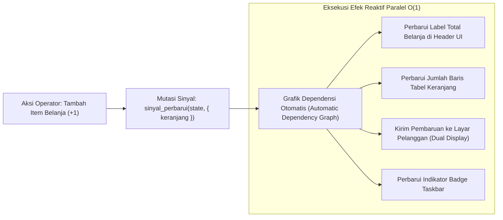

### 12.2 Arsitektur State Terpusat & Pengikatan Data (*Data Binding*)

Pada modul `modul/desktop.wya`, setiap instansiasi aplikasi desktop secara otomatis dilengkapi dengan struktur state reaktif terpusat:
- Fungsi `BuatStateReaktif(nilai_awal)`: Menciptakan sinyal reaktif baru.
- Fungsi `AmbilNilaiState(sinyal)`: Membaca nilai saat ini sekaligus mendaftarkan fungsi pemanggil ke dalam graf dependensi.
- Fungsi `PerbaruiNilaiState(sinyal, nilai_baru)`: Memperbarui nilai dan secara instan memicu seluruh efek yang bergantung padanya.
- Fungsi `LanggananState(sinyal, callback)`: Menetapkan reaksi otomatis terhadap setiap perubahan state.

### 12.3 Implementasi Kode Widya-Lang & WidyaDesktop Utuh

Berikut implementasi pengelolaan state reaktif keranjang belanja kasir secara deklaratif pada Widya-Lang:

```widya
// Modul Manajemen State Reaktif Kasir Terpadu
modul state_reaktif_kasir {
    impor "./modul/desktop.wya";

    fungsi inisialisasi_state_kasir() {
        // 1. Buat Aplikasi Kasir Desktop
        misal app = BuatAplikasiDesktop("Nusantara POS - Terminal Reaktif", 1100, 720);

        // 2. Inisialisasi State Reaktif Terpusat Keranjang Kasir
        misal state_keranjang = BuatStateReaktif({
            "nomor_faktur": "TRX-20261020-001",
            "kasir": "Budi Santoso",
            "jumlah_item": 0,
            "total_harga": 0.0,
            "status_pembayaran": "BELUM_DIBAYAR"
        });

        // 3. Daftarkan Efek Reaktif: Otomatis Cetak Log saat Nilai Berubah
        LanggananState(state_keranjang, fungsi(state_baru) {
            cetak(">>> [REAKTIF-EFEK] State kasir mengalami pembaruan otomatis:");
            cetak("    - Faktur: " + state_baru.nomor_faktur);
            cetak("    - Total : Rp " + state_baru.total_harga);
            cetak("    - Status: " + state_baru.status_pembayaran);
        });

        // 4. Registrasi RPC untuk Menambah Barang ke Keranjang Belanja
        app.daftarkan_rpc("tambah_item_keranjang", fungsi(payload) {
            misal harga_item = payload.harga;
            misal state_lama = AmbilNilaiState(state_keranjang);

            misal total_baru = state_lama.total_harga + harga_item;
            misal item_baru = state_lama.jumlah_item + 1;

            // Mutasi state memicu seluruh efek terdaftar secara instan O(1)
            PerbaruiNilaiState(state_keranjang, {
                "nomor_faktur": state_lama.nomor_faktur,
                "kasir": state_lama.kasir,
                "jumlah_item": item_baru,
                "total_harga": total_baru,
                "status_pembayaran": "DALAM_PROSES"
            });

            kembalikan { "sukses": benar, "total_baru": total_baru };
        });

        kembalikan app;
    }
}
```

### 12.4 Analisis Kinerja, Keamanan & Tabel Metrik Arsitektur

Tabel evaluasi latensi dan pemakaian memori antara manajemen state Virtual DOM vs Sinyal Reaktif WidyaDesktop:

| Parameter Evaluasi | Virtual DOM Re-render (React Desktop) | Store Berbasis Redux / Immutability | Sinyal Reaktif Fine-Grained (WidyaDesktop) |
| :--- | :--- | :--- | :--- |
| **Kompleksitas Mutasi** | $O(N)$ di mana $N$ = jumlah simpul pohon | $O(N)$ kloning objek mendalam (*deep clone*) | **$O(1)$ Konstan Langsung ke Simpul Target** |
| **Waktu Respon Perubahan**| 4.5 – 14.0 milidetik | 2.0 – 6.0 milidetik | **< 0.05 milidetik (Sub-Milidetik)** |
| **Tekanan Alokasi Memori**| Memicu ribuan alokasi objek sementara | Membuang salinan lama ke Garbage Collector | **Nol Alokasi Baru (Mutasi In-Place Terlacak)** |
| **Konsistensi Visual** | Rentan Desinkronisasi State UI | Terpusat namun Bertele-tele | **Konsisten Sempurna & Deklaratif** |

### 12.5 Latihan Praktik & Studi Kasus

1. Mengapa pendekatan *Fine-Grained Reactive Signals* mampu mencapai kompleksitas pembaruan $O(1)$, sedangkan kerangka kerja berbasis Virtual DOM membutuhkan kompleksitas rekonsiliasi $O(N)$?
2. Jelaskan mekanisme pelacakan dependensi otomatis (*automatic dependency tracking*) yang dijalankan saat fungsi membaca nilai dari sebuah sinyal reaktif!
3. Uraikan bagaimana sinkronisasi state reaktif terpusat di backend Widya-Lang dapat ditransmisikan secara instan ke antarmuka pengguna tanpa menimbulkan keterlambatan visual (*visual lagging*) pada layar 120 Hz!

### 12.6 Evaluasi Mandiri Pilihan Ganda

1. Karakteristik paling mendasar dari paradigma reaktivitas berbasis *Fine-Grained Signals* adalah...
   A. Memperbarui simpul elemen target secara langsung $O(1)$ tanpa perlu membandingkan seluruh pohon antarmuka Virtual DOM
   B. Mengharuskan pengguna menekan tombol F5 berulang-ulang
   C. Menghapus seluruh memori RAM komputer
   D. Mematikan kartu grafis secara paksa

2. Fungsi pembantu pada modul `desktop.wya` yang digunakan untuk menciptakan objek sinyal reaktif baru adalah...
   A. `BuatStateReaktif(nilai_awal)`
   B. `MatikanState()`
   C. `FormatDrive()`
   D. `TulisDokumenPDF()`

3. Fungsi pengamat yang secara otomatis dipanggil kembali (*re-executed*) setiap kali nilai sinyal yang diamatinya berubah disebut...
   A. Efek Reaktif (Reactive Effect / Subscription)
   B. Virus Komputer
   C. Deadlock
   D. Blue Screen

4. Fungsi yang digunakan untuk memperbarui nilai sinyal reaktif sekaligus memicu seluruh efek yang bergantung padanya adalah...
   A. `PerbaruiNilaiState(sinyal, nilai_baru)`
   B. `HapusSinyal()`
   C. `TutupAplikasi()`
   D. `KunciLayar()`

5. Berapa perkiraan waktu respon mutasi data pada sistem sinyal reaktif WidyaDesktop?
   A. Kurang dari 0.05 milidetik
   B. Sekitar 1 jam
   C. 15 menit
   D. Bergantung pada cuaca

6. Masalah performa utama yang sering dialami aplikasi desktop berbasis Virtual DOM konvensional saat menangani formulir kasir kompleks adalah...
   A. Rekonsiliasi pohon komponen yang berat memakan siklus CPU tinggi dan menimbulkan jeda ketik (*typing lag*)
   B. Keyboard kasir otomatis terkunci
   C. Teks otomatis diterjemahkan ke bahasa kuno
   D. Komputer langsung meledak

7. Bagaimana sinyal reaktif mencegah pembaruan berulang yang tidak perlu (*unnecessary updates*) ketika nilai baru yang dimasukkan sama persis dengan nilai lama?
   A. Menjalankan pemeriksaan kesetaraan nilai (*equality check*) sebelum memicu grafik dependensi efek
   B. Menghapus nilai baru tersebut
   C. Mematikan sambungan internet
   D. Menutup aplikasi seketika

8. Fungsi `AmbilNilaiState(sinyal)` bertugas untuk...
   A. Mengambil nilai saat ini sekaligus mendaftarkan fungsi pembaca ke dalam graf dependensi otomatis
   B. Menghapus seluruh data dari memori
   C. Mengirim data ke server luar negeri
   D. Mencetak nilai ke printer kertas

9. Tekanan alokasi memori pada sistem sinyal reaktif WidyaDesktop sangat minim karena...
   A. Tidak menghasilkan objek pohon komponen tiruan (*mock objects*) yang harus dibersihkan oleh Garbage Collector
   B. Menggunakan komputer tanpa memori RAM
   C. Menghapus seluruh file gambar
   D. Mematikan sistem operasi

10. Mengapa stasiun kerja kasir ritel berkecepatan tinggi sangat diuntungkan oleh adopsi state reaktif deklaratif?
    A. Perubahan status keranjang, total harga, dan potongan diskon terkoordinasi secara instan dan bebas galat di seluruh elemen layar secara konsisten
    B. Kasir tidak perlu memasukkan uang ke dalam laci
    C. Toko otomatis buka 24 jam tanpa penjaga
    D. Seluruh barang belanjaan otomatis gratis

---

## Bab 13: Desain Sistem Antarmuka Modern: Token Desain Vanilla CSS & Dark Mode Native

### 13.1 Filosofi Desain Antarmuka Berdaulat & Kerapian Tipografi

Antarmuka stasiun kerja desktop kelas industri dituntut memiliki standar estetika visual yang tinggi: nyaman dipandang selama 8 jam kerja operator secara kontinu, memiliki kontras rasio warna yang memenuhi standar aksesibilitas WCAG 2.1 AA/AAA, serta responsif terhadap perubahan tema sistem operasi (*Windows Dark Mode / macOS Light-Dark Appearance*).

WidyaDesktop menerapkan prinsip **Pure Vanilla CSS Design System** tanpa membebani aplikasi dengan dependensi runtime CSS-in-JS berat seperti Tailwind atau Styled Components:
- **Token Desain Terpusat (*CSS Design Tokens*)**: Didefinisikan pada tingkat akar dokumen `:root` menggunakan CSS Custom Properties, mencakup palet warna semantik (*slate, emerald, crimson, amber*), skala spasi modular (*modular scale: 4px, 8px, 16px, 24px*), elevasi bayangan (*depth elevation shadows*), serta radius sudut kurva (*Bézier border radii*).
- **Tipografi Modern & Keterbacaan Data Kasir**: Memanfaatkan fonta sistem berkualitas tinggi dengan *kerning* presisi dan *tabular lining figures* (`font-variant-numeric: tabular-nums;`), memastikan digit angka mata uang (Rupiah) berderet lurus sempurna secara vertikal pada tabel transaksi.

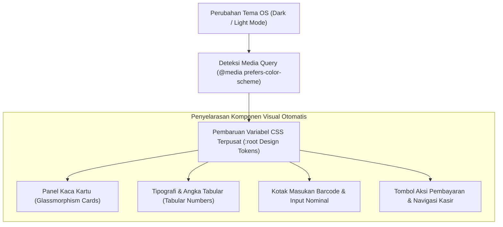

### 13.2 Mode Gelap Native (*Dark Mode*) & Palet Warna Glassmorphism

Pada lingkungan stasiun kerja kasir atau ruang kendali industri yang temaram, mode gelap (*Dark Mode*) terbukti mengurangi kelelahan mata operator dan menghemat konsumsi daya layar OLED/LCD:
```css
:root {
    --widya-bg-primary: #0f172a;
    --widya-bg-surface: rgba(30, 41, 59, 0.75);
    --widya-border-subtle: rgba(255, 255, 255, 0.08);
    --widya-text-primary: #f8fafc;
    --widya-text-muted: #94a3b8;
    --widya-accent-emerald: #10b981;
    --widya-accent-blue: #38bdf8;
    --widya-accent-crimson: #f43f5e;
    --widya-font-sans: 'Inter', -apple-system, BlinkMacSystemFont, 'Segoe UI', Roboto, sans-serif;
    --widya-radius-card: 12px;
    --widya-shadow-depth: 0 10px 30px -10px rgba(0, 0, 0, 0.5);
}
```

### 13.3 Implementasi Kode Widya-Lang & WidyaDesktop Utuh

Berikut implementasi integrasi tema desain sistem dan penanganan alih tema gelap pada Widya-Lang:

```widya
// Modul Pengendalian Tema Desain Sistem UI
modul tema_desain_antarmuka {
    impor "./modul/desktop.wya";

    fungsi inisialisasi_antarmuka_bertema() {
        // 1. Buat Aplikasi Kasir dengan Dark Mode Default
        misal app = BuatAplikasiDesktop("Nusantara POS - Desain Elegan", 1100, 720);

        // 2. Registrasi RPC untuk Pengalihan Tema Antarmuka
        app.daftarkan_rpc("ganti_tema_antarmuka", fungsi(payload) {
            misal mode_gelap = payload.mode_gelap;
            misal tema = jika (mode_gelap) { "dark_emerald" } lain { "light_clean" };

            cetak(">>> [THEME-UI] Mengalihkan tema antarmuka pengguna ke: " + tema);
            kembalikan {
                "sukses": benar,
                "tema_aktif": tema,
                "warna_aksen": "#10b981",
                "font_angka": "tabular-nums"
            };
        });

        // 3. Registrasi RPC untuk Validasi Format Angka Tabular Kasir
        app.daftarkan_rpc("format_mata_uang_rupiah", fungsi(payload) {
            misal nominal = payload.nilai;
            // Menghasilkan teks Rupiah terformat rapi untuk UI
            misal teks_idr = "Rp " + nominal;
            kembalikan { "sukses": benar, "hasil_format": teks_idr };
        });

        kembalikan app;
    }
}
```

### 13.4 Analisis Kinerja, Keamanan & Tabel Metrik Arsitektur

Tabel evaluasi perbandingan sistem desain Vanilla CSS vs Framework CSS Kompleks:

| Karakteristik Evaluasi | Tailwind / CSS-in-JS Runtime | Pustaka UI Webview Monolitik | WidyaDesktop Pure Vanilla CSS System |
| :--- | :--- | :--- | :--- |
| **Ukuran Berkas Bundel CSS** | 120 – 350 KB | 400 – 900 KB | **< 18 KB (Sangat Ringkas)** |
| **Waktu Parsing Awal Mesin** | 15 – 35 milidetik | 40 – 90 milidetik | **< 2 milidetik (Instan Native)** |
| **Ketergantungan Paket Luar**| Memerlukan Node & PostCSS Build| Puluhan Paket Tambahan | **Nol Dependensi (Murni Standar CSS3)** |
| **Keamanan Rantai Pasok** | Rentan Kerentanan Build Tools | Cukup Rentan | **Aman Berdaulat (In-Tree Vanilla)** |

### 13.5 Latihan Praktik & Studi Kasus

1. Mengapa penggunaan atribut CSS `font-variant-numeric: tabular-nums` sangat krusial pada tabel keranjang belanja dan nota transaksi kasir?
2. Jelaskan bagaimana penerapan variabel token desain CSS (`:root Custom Properties`) mempermudah peralihan tema mode gelap dan terang tanpa memuat ulang dokumen antarmuka!
3. Uraikan teknik perancangan antarmuka kasir yang memenuhi kepatuhan kontras warna standar WCAG 2.1 AAA agar tidak memicu kelelahan mata operator kasir!

### 13.6 Evaluasi Mandiri Pilihan Ganda

1. Pendekatan perancangan antarmuka yang digunakan oleh WidyaDesktop untuk mencapai keringanan memori dan kecepatan pemuatan adalah...
   A. Pure Vanilla CSS Design System dengan CSS Custom Properties terpusat
   B. Mengunduh pustaka JavaScript berukuran ratusan Megabyte
   C. Menggunakan gambar statis JPEG untuk seluruh tombol
   D. Mematikan seluruh fungsi warna

2. Properti CSS yang memastikan setiap digit angka memiliki lebar horizontal yang sama persis sehingga angka mata uang berderet lurus sempurna adalah...
   A. `font-variant-numeric: tabular-nums;`
   B. `text-align: random;`
   C. `font-weight: invisible;`
   D. `letter-spacing: -100px;`

3. Manfaat ergonomis utama dari penerapan Mode Gelap (*Dark Mode*) pada stasiun kerja kasir toko adalah...
   A. Mengurangi kelelahan mata operator saat bekerja di pencahayaan temaram dan menghemat energi monitor
   B. Membuat barang toko menjadi tidak terlihat
   C. Mempercepat koneksi satelit internet
   D. Menghapus data pelanggan secara otomatis

4. Variabel CSS terpusat (*Design Tokens*) pada berkas gaya WidyaDesktop umumnya didefinisikan pada pemilih global...
   A. `:root`
   B. `body:hover`
   C. `#unknown`
   D. `footer:active`

5. Berapa rata-rata ukuran berkas berkas CSS sistem desain modern berbasis Vanilla pada WidyaDesktop?
   A. Kurang dari 18 Kilobyte
   B. Lebih dari 500 Megabyte
   C. Tepat 2 Terabyte
   D. 0 byte

6. Standar internasional yang mengatur aksesibilitas kontras rasio warna pada antarmuka perangkat lunak komputer dinamakan...
   A. WCAG (Web Content Accessibility Guidelines) 2.1
   B. ISO 9001 Manajemen Kantor
   C. Regulasi Ekspor Kayu
   D. Aturan Lalu Lintas Darat

7. Efek visual modern yang memadukan panel latar transparan, pembatas garis tipis, dan efek kabur dinamakan...
   A. Glassmorphism
   B. Brutalism 1990
   C. Skeuomorphism Kayu
   D. Plain ASCII Text

8. Nilai heksadesimal standar warna latar belakang mode gelap pekat (*Slate 900*) yang digunakan pada WidyaDesktop adalah...
   A. `#0f172a`
   B. `#ffffff`
   C. `#ff0000`
   D. `#ffff00`

9. Mengapa arsitektur antarmuka WidyaDesktop menghindari dependensi rantai alat (*build-tools*) CSS pihak ketiga yang rapuh?
   A. Menghilangkan risiko serangan rantai pasok (*supply-chain attack*) dan menjamin biner aplikasi dapat dikompilasi secara mandiri selamanya
   B. Karena kompilator menolak huruf C
   C. Agar teks tombol tidak bisa diklik
   D. Mengurangi resolusi layar monitor

10. Media query CSS standar yang mendeteksi preferensi tema gelap pengguna dari sistem operasi adalah...
    A. `@media (prefers-color-scheme: dark)`
    B. `@media (screen: black)`
    C. `@media (monitor: off)`
    D. `@media (night: true)`

---

## Bab 14: Dialog Berkas Native & Pemilih Direktori Sistem Operasi

### 14.1 Kotak Dialog Berkas Native vs Dialog Web Tiruan

Ketika pengguna ingin membuka berkas basis data cadangan, mengekspor laporan transaksi kasir ke format dokumen, atau memilih direktori penyimpanan struk digital, menyajikan kotak dialog penjelajah berkas (*File Explorer Dialog*) adalah sebuah keharusan mutlak.

Aplikasi berbasis web murni sering kali terbatas pada elemen `<input type="file">` HTML yang kikuk, tidak mendukung pemilihan folder secara fleksibel, dan tidak dapat menentukan nama berkas default saat menyimpan dokumen.

WidyaDesktop menghadirkan dialog berkas native sistem operasi tingkat mesin melalui modul `pure_window.rs` dan helper `modul/desktop.wya`:
- **Windows Common Item Dialog (`IFileDialog` / `GetOpenFileNameW`)**: Menyajikan dialog standar Windows lengkap dengan akses ke folder cepat (*Quick Access*), panel pratinjau dokumen, dan jaringan lokal.
- **macOS `NSOpenPanel` & `NSSavePanel`**: Menyajikan dialog elegan Apple Cocoa dengan integrasi iCloud Drive, tag warna dokumen, dan bilah pencarian Spotlight native.
- **Linux Portal & GTK FileChooser**: Mendukung *XDG Desktop Portal* untuk sandboxing modern Wayland dan GNOME/KDE.

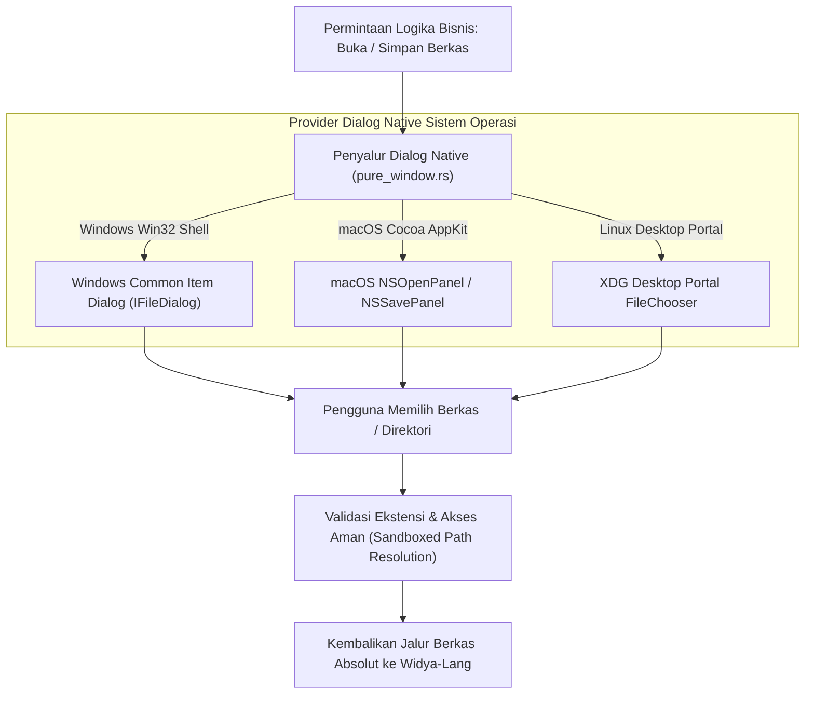

### 14.2 Penyaringan Ekstensi (*File Filters*) & Resolusi Jalur Aman

Operasi dialog berkas pada WidyaDesktop mencakup dua fungsi utama:
1. `BukaDialogPilihBerkas(filter)`: Membuka dialog pemilihan berkas dengan penyaring ekstensi spesifik (misalnya: `"*.csv;*.xlsx"` untuk impor inventaris, atau `"*.wya"` untuk modul kode).
2. `BukaDialogSimpanBerkas(nama_default)`: Membuka dialog penentuan lokasi penyimpanan berkas baru dengan nama awal yang telah terisi (misalnya: `"Laporan_Kasir_2026-10-20.pdf"`).

Kedua fungsi ini mengembalikan jalur absolut berkas pada sistem penyimpanan lokal secara aman, memungkinkan backend Widya-Lang membaca atau menulis berkas secara langsung dengan kecepatan I/O native tanpa perantara buffer HTTP.

### 14.3 Implementasi Kode Widya-Lang & WidyaDesktop Utuh

Berikut implementasi alur ekspor laporan keuangan kasir dan impor data master barang melalui dialog native pada Widya-Lang:

```widya
// Modul Pengendalian Dialog Berkas & Pemilih Direktori
modul pengelola_dialog_berkas {
    impor "./modul/desktop.wya";

    fungsi inisialisasi_layanan_ekspor_impor() {
        // 1. Buat Aplikasi Kasir
        misal app = BuatAplikasiDesktop("Nusantara POS - Administrasi Berkas", 1100, 720);

        // 2. Registrasi RPC: Impor Data Barang via Dialog Buka Berkas
        app.daftarkan_rpc("impor_data_barang", fungsi(_payload) {
            cetak(">>> [DIALOG] Membuka dialog pemilihan berkas inventaris...");
            // Buka dialog native sistem operasi dengan filter berkas spreadsheet
            misal jalur_berkas = BukaDialogPilihBerkas("*.csv;*.xlsx");

            jika (jalur_berkas == "" atau jalur_berkas == nil) {
                cetak(">>> [DIALOG] Pengguna membatalkan pemilihan berkas.");
                kembalikan { "sukses": salah, "alasan": "Pemilihan berkas dibatalkan" };
            }

            cetak(">>> [DIALOG] Berkas berhasil dipilih: " + jalur_berkas);
            kembalikan {
                "sukses": benar,
                "jalur_terpilih": jalur_berkas,
                "status": "SIAP_DIBACA"
            };
        });

        // 3. Registrasi RPC: Ekspor Laporan Transaksi via Dialog Simpan Berkas
        app.daftarkan_rpc("ekspor_laporan_kasir", fungsi(payload) {
            misal tgl = payload.tanggal;
            misal nama_bawaan = "Laporan_POS_" + tgl + ".pdf";

            cetak(">>> [DIALOG] Membuka dialog simpan berkas dengan saran: " + nama_bawaan);
            misal lokasi_simpan = BukaDialogSimpanBerkas(nama_bawaan);

            jika (lokasi_simpan == "" atau lokasi_simpan == nil) {
                kembalikan { "sukses": salah, "alasan": "Ekspor dibatalkan oleh kasir" };
            }

            cetak(">>> [DIALOG] Lokasi berkas target disetujui: " + lokasi_simpan);
            kembalikan {
                "sukses": benar,
                "lokasi_tujuan": lokasi_simpan,
                "pesan": "Laporan siap ditulis ke diska penyimpanan."
            };
        });

        kembalikan app;
    }
}
```

### 14.4 Analisis Kinerja, Keamanan & Tabel Metrik Arsitektur

Tabel evaluasi perbandingan dialog berkas web vs dialog native WidyaDesktop:

| Parameter Evaluasi | Input File HTML Biasa (`<input type="file">`) | Dialog Berkas Native WidyaDesktop |
| :--- | :--- | :--- |
| **Dukungan Dialog Simpan Berkas** | Tidak Ada (Hanya Otomatis Unduh ke Folder Download) | **Dukungan Penuh `BukaDialogSimpanBerkas` Native** |
| **Pilihan Direktori / Folder** | Terbatas & Bergantung Peramban | **Dukungan Penuh Pemilih Direktori Sistem** |
| **Akses Jalur Berkas Nyata** | Disamarkan / Dipalsukan (`C:\fakepath\...`) | **Jalur Absolut Nyata Sistem Berkas Lokal** |
| **Kecepatan Pembacaan Berkas** | Melewati Serialisasi Blob Browser (Lambat) | **Direct OS File Handle I/O (Sangat Cepat)** |
| **Estetika & Kenyamanan OS** | Dialog Asing / Kaku | **Dialog Asli Sistem Operasi Lengkap Quick Access** |

### 14.5 Latihan Praktik & Studi Kasus

1. Mengapa peramban web modern menyamarkan jalur berkas yang dipilih pengguna menjadi `C:\fakepath\...`, dan bagaimana WidyaDesktop mempertahankan keamanan sistem tanpa harus menyamarkan jalur berkas riil?
2. Jelaskan perbedaan mendasar arsitektur pemanggilan dialog berkas antara Windows (`IFileDialog` COM API) dengan macOS (`NSOpenPanel` AppKit)!
3. Uraikan teknik penanganan pembatalan pemilihan berkas (*dialog cancellation*) pada kode backend agar tidak memicu galat eksekusi pada antarmuka pengguna!

### 14.6 Evaluasi Mandiri Pilihan Ganda

1. Fungsi pembantu pada modul `desktop.wya` yang digunakan untuk memunculkan kotak dialog pemilihan berkas native adalah...
   A. `BukaDialogPilihBerkas(filter)`
   B. `UnduhFileDariInternet()`
   C. `TulisHarddiskLangsung()`
   D. `NyalakanKamera()`

2. Fungsi pembantu yang digunakan untuk memunculkan kotak dialog penentuan lokasi penyimpanan berkas dengan saran nama awal adalah...
   A. `BukaDialogSimpanBerkas(nama_default)`
   B. `HapusSeluruhFile()`
   C. `KunciSemuaDirektori()`
   D. `CetakKertasKasir()`

3. Komponen API standar pada Microsoft Windows yang bertindak sebagai mesin dialog berkas native modern adalah...
   A. Windows Common Item Dialog (`IFileDialog`)
   B. DOS Command Shell
   C. Windows Movie Maker
   D. Internet Explorer 6

4. Objek kelas native pada Apple macOS AppKit yang bertanggung jawab menyajikan jendela pemilih berkas adalah...
   A. `NSOpenPanel`
   B. `Direct3DDevice`
   C. `RegistryKey`
   D. `X11Pixmap`

5. Kelemahan fatal dari elemen unggah berkas HTML biasa `<input type="file">` dibanding dialog native WidyaDesktop adalah...
   A. Menyamarkan jalur berkas asli menjadi `C:\fakepath\` dan tidak memiliki dialog native simpan berkas dengan nama kustom
   B. Membuat komputer pengguna terbakar
   C. Menghapus seluruh foto di galeri
   D. Mematikan fungsi mouse

6. Nilai yang dikembalikan oleh fungsi `BukaDialogPilihBerkas` jika pengguna menekan tombol "Batal" (*Cancel*) adalah...
   A. String kosong `""` atau `nil`
   B. Galat Fatal Memory Overflow
   C. Kata sandi administrator komputer
   D. Nomor rekening kasir

7. String filter ekstensi `"*.csv;*.xlsx"` saat diteruskan ke dialog berkas memiliki fungsi untuk...
   A. Membatasi tampilan penjelajah berkas hanya pada dokumen berekstensi CSV dan lembar kerja Excel
   B. Menghapus seluruh berkas bertipe lain
   C. Mengubah seluruh berkas menjadi format MP3
   D. Mematikan keyboard

8. Mengapa akses terhadap jalur berkas absolut nyata (*absolute file path*) sangat penting bagi aplikasi stasiun kerja kasir dan gudang?
   A. Memungkinkan backend native membaca atau menulis data berukuran ratusan megabyte secara instan melalui sistem berkas lokal tanpa overhead unggah peramban
   B. Supaya kasir bisa melihat rahasia komputer lain
   C. Mengurangi konsumsi memori kartu grafis
   D. Menghilangkan kebutuhan kabel monitor

9. Standar portal modern pada Linux yang memungkinkan aplikasi di dalam container memilih berkas secara aman di lingkungan Wayland dan GNOME adalah...
   A. XDG Desktop Portal FileChooser
   B. Floppy Disk Mounter
   C. Serial Cable Terminal
   D. Dial-up Network Script

10. Apa keuntungan integrasi panel *Quick Access* pada kotak dialog native Windows bagi operator kasir?
    A. Operator dapat melompat seketika ke folder laporan harian atau flashdisk tanpa harus menavigasi struktur direktori bertingkat secara manual
    B. Kasir tidak perlu menghitung uang tunai
    C. Transaksi otomatis dinyatakan lunas
    D. Toko tidak memerlukan nota belanja

---

## Bab 15: Integrasi Shell OS Tingkat Mendalam: Custom URL Scheme & Asosiasi Berkas

### 15.1 Skema Tautan Dalam (*Custom URI Deep Linking Schemes*)

Aplikasi desktop berdaulat tidak boleh terisolasi dari ekosistem sistem operasi. Stasiun kerja kasir, perbankan, dan logistik sering kali harus dapat dipicu secara langsung dari tautan di peramban web eksternal, dokumen PDF faktur, atau pesan kode QR (misalnya saat pengguna mengklik tautan `widya://buka-kasir?faktur=TRX-9982` pada email konfirmasi).

WidyaDesktop menyediakan subsistem **Custom URI Deep Linking** melalui modul `desktop_native.rs`:
- **Pendaftaran Skema Kustom (*Custom Scheme Registration*)**:
  - Pada **Windows**, mendaftarkan kunci skema ke registri sistem operasi (`HKEY_CLASSES_ROOT\widya`).
  - Pada **macOS**, menambahkan definisi skema protokol ke dalam berkas manifes bundel aplikasi `Info.plist` pada kamus `CFBundleURLTypes`.
  - Pada **Linux**, mendaftarkan berkas desktop asosiasi MIME (`x-scheme-handler/widya`) melalui perkakas `xdg-mime`.
- **Penanganan Instansi Tunggal (*Single-Instance IPC Forwarding*)**: Jika aplikasi desktop sudah dalam kondisi aktif terbuka, penekanan tautan deep link tidak akan membuka proses aplikasi baru yang berulang. Sistem secara otomatis menyalurkan argumen URI tersebut ke jendela yang sudah aktif dan membawa jendela ke lapisan terdepan layar (*bring to front*).

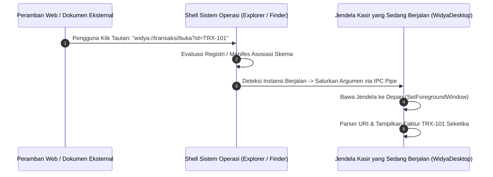

### 15.2 Asosiasi Berkas Ekstensi Mandiri (*File Association*)

Selain skema URL, WidyaDesktop mendukung asosiasi ekstensi berkas dokumen berdaulat (seperti ekstensi `.wya`, `.wpos`, atau `.wdoc`). Ketika pengguna mengklik dua kali (*double click*) berkas `.wpos` pada File Explorer atau Finder:
1. Shell sistem operasi secara otomatis mengeksekusi biner WidyaDesktop dengan parameter argumen jalur berkas tersebut.
2. Ikon dokumen pada File Explorer menampilkan ikon visual resmi aplikasi secara presisi.
3. Menu konteks klik kanan berkas menampilkan opsi pintasan khusus (seperti: *"Buka dengan Stasiun Kerja Widya"*).

### 15.3 Implementasi Kode Widya-Lang & WidyaDesktop Utuh

Berikut implementasi pendaftaran skema deep link dan penanganan parameter tautan masuk pada Widya-Lang:

```widya
// Modul Integrasi Deep Link & Asosiasi Berkas Dokumen
modul integrasi_shell_os {
    impor "./modul/desktop.wya";

    fungsi inisialisasi_deep_link_kasir() {
        // 1. Buat Aplikasi Kasir
        misal app = BuatAplikasiDesktop("Nusantara POS - Terminal Shell", 1100, 720);

        // 2. Registrasi RPC untuk Menangani Parameter URI Deep Link yang Masuk
        app.daftarkan_rpc("proses_tautan_deep_link", fungsi(payload) {
            misal uri_masuk = payload.uri; // Contoh: "widya://kasir/faktur?nomor=INV-8891"

            cetak(">>> [DEEP-LINK] Menerima parameter navigasi dari OS Shell:");
            cetak("    - URI: " + uri_masuk);

            // Parser skema URL dan arahkan layar kasir ke faktur terkait
            kembalikan {
                "sukses": benar,
                "skema": "widya://",
                "tindakan": "BUKA_FAKTUR_LANGSUNG",
                "nomor_faktur": "INV-8891"
            };
        });

        // 3. Registrasi RPC untuk Penanganan Berkas Asosiasi yang Diklik Dua Kali
        app.daftarkan_rpc("proses_berkas_dibuka_os", fungsi(payload) {
            misal jalur = payload.jalur_berkas;

            cetak(">>> [ASOSIASI-BERKAS] Aplikasi dibuka melalui klik ganda berkas:");
            cetak("    - Berkas: " + jalur);

            kembalikan {
                "sukses": benar,
                "berkas_terbuka": jalur,
                "tipe": "DOKUMEN_TRANSAKSI_WPOS"
            };
        });

        cetak(">>> [SHELL] Integrasi skema 'widya://' dan asosiasi '.wya' aktif.");
        kembalikan app;
    }
}
```

### 15.4 Analisis Kinerja, Keamanan & Tabel Metrik Arsitektur

Tabel spesifikasi pendaftaran skema shell lintas platform:

| Sistem Operasi | Lokasi Pendaftaran Skema URL | Lokasi Pendaftaran Asosiasi Berkas | Mekanisme Single-Instance Forwarding |
| :--- | :--- | :--- | :--- |
| **Microsoft Windows** | `HKEY_CLASSES_ROOT\<skema>` | `HKCR\.ekstensi` & `ProgID` | Windows Named Pipe / `WM_COPYDATA` |
| **Apple macOS** | `Info.plist` (`CFBundleURLTypes`)| `Info.plist` (`CFBundleDocumentTypes`) | Apple Event Handler (`kAEGetURL`) |
| **Linux Desktop** | `~/.local/share/applications/*.desktop` | `/usr/share/mime/packages/*.xml` | DBus Service Activation |

### 15.5 Latihan Praktik & Studi Kasus

1. Mengapa penanganan instansi tunggal (*single-instance application*) sangat krusial saat aplikasi desktop dipicu melalui tautan deep link atau klik ganda berkas?
2. Bagaimana teknik sanitasi dan validasi parameter URI yang masuk dari skema `widya://` guna menangkal ancaman eksploitasi injeksi argumen (*argument injection attacks*)?
3. Uraikan perbedaan mekanisme pendaftaran skema URL antara sistem berbasis Registry pada Windows dengan sistem berbasis berkas `.desktop` pada Linux!

### 15.6 Evaluasi Mandiri Pilihan Ganda

1. Fitur yang memungkinkan aplikasi desktop terbuka secara otomatis ketika tautan protokol khusus (seperti `widya://`) diklik di peramban atau dokumen disebut...
   A. Custom URI Deep Linking
   B. Anonymous FTP Download
   C. Web Cookie Injector
   D. Teletext Broadcast

2. Kunci pada Registry sistem operasi Windows tempat pendaftaran skema URL kustom disimpan adalah...
   A. `HKEY_CLASSES_ROOT\<nama_skema>`
   B. `HKEY_CURRENT_CONFIG\Fonts`
   C. `HKEY_LOCAL_MACHINE\SAM`
   D. `C:\Windows\System32\drivers`

3. Berkas manifes bundel aplikasi pada Apple macOS tempat definisi `CFBundleURLTypes` didaftarkan adalah...
   A. `Info.plist`
   B. `config.sys`
   C. `autoexec.bat`
   D. `macOS.ini`

4. Apa yang dilakukan fitur *Single-Instance Forwarding* ketika tautan deep link diklik saat aplikasi sudah dalam kondisi terbuka?
   A. Menyalurkan argumen tautan ke jendela aplikasi yang sudah aktif dan membawanya ke depan layar tanpa membuat proses baru
   B. Menutup paksa aplikasi dan mematikan komputer
   C. Membuka 100 jendela baru secara bersamaan hingga memori penuh
   D. Menolak tautan dan memformat diska penyimpanan

5. Perintah baris perintah standar pada lingkungan Linux untuk mengaitkan skema protokol dengan berkas aplikasi desktop adalah...
   A. `xdg-mime default aplikasi.desktop x-scheme-handler/widya`
   B. `rm -rf /`
   C. `killall systemd`
   D. `format /dev/sda`

6. Fitur sistem operasi yang membuat berkas berekstensi khusus (seperti `.wya` atau `.wpos`) otomatis dibuka menggunakan aplikasi WidyaDesktop saat diklik ganda dinamakan...
   A. Asosiasi Berkas (File Association)
   B. File Hiding
   C. Disk Partitioning
   D. Memory Overclocking

7. Bahaya keamanan yang harus diantisipasi saat mengurai string parameter deep link adalah...
   A. Serangan injeksi argumen berbahaya (*Argument Injection Attack*) melalui manipulasi karakter khusus pada URL
   B. Komputer kehabisan daya listrik dalam 1 detik
   C. Keyboard otomatis mengetik sendiri
   D. Speaker mengeluarkan suara keras

8. Pesan sistem operasi Windows legendaris yang sering digunakan untuk mentransfer data string antar proses instansi tunggal adalah...
   A. `WM_COPYDATA`
   B. `WM_PAINT`
   C. `WM_DESTROY`
   D. `WM_SETCURSOR`

9. Manakah contoh tautan skema kustom berdaulat yang sah untuk membuka rincian transaksi tertentu pada WidyaDesktop?
   A. `widya://transaksi/faktur?nomor=TRX-2026-991`
   B. `http://www.google.com/search`
   C. `ftp://192.168.1.1/file.zip`
   D. `file:///C:/boot.ini`

10. Mengapa fitur deep linking sangat bermanfaat pada sistem integrasi perbankan dan kasir toko?
    A. Memungkinkan surat tagihan digital atau portal web manajemen memicu stasiun kerja kasir untuk membuka dokumen pembayaran secara otomatis dengan satu kali klik
    B. Supaya kasir tidak perlu menghitung kembalian
    C. Menghilangkan kebutuhan nota belanja fisik
    D. Mengganti kebutuhan petugas keamanan toko

---

## Bab 16: Taskbar Jump List, Dock Tile Badges & Indikator Progres Tugas Panjang

### 16.1 Integrasi Bilah Tugas Sistem Operasi & Menu Cepat Jump List

Bilah tugas sistem operasi (*Taskbar* pada Windows dan *Dock* pada macOS) adalah titik interaksi yang paling sering dilihat oleh operator komputer. Aplikasi desktop modern yang terintegrasi secara mendalam mampu memanfaatkan area ini untuk menyajikan informasi status sekilas (*at-a-glance telemetry*) dan pintasan tugas tanpa mengharuskan pengguna membuka jendela aplikasi terlebih dahulu.

WidyaDesktop menyediakan modul integrasi shell bilah tugas pada `desktop_native.rs` yang mencakup:
1. **Daftar Lompatan Cepat (*Windows Taskbar Jump List*)**: Menu konteks khusus yang muncul saat ikon aplikasi di bilah tugas diklik kanan oleh operator. Jump List dapat menyajikan:
   - **Tindakan Cepat (*Tasks*)**: Pintasan instan seperti *"Buka Transaksi Baru"*, *"Cetak Laporan Penjualan Hari Ini"*, atau *"Audit Keamanan"*.
   - **Dokumen Terakhir (*Recent / Frequent Items*)**: Daftar nomor nota transaksi terakhir yang pernah dibuka kasir.
2. **Lencana Status Ikon (*Dock Tile Badges pada macOS*)**: Menampilkan lencana angka atau teks merah/putih di sudut ikon Dock (misalnya angka `3` yang menandakan ada 3 transaksi offline yang sedang menunggu sinkronisasi internet).

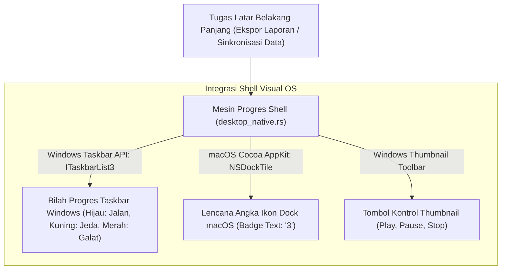

### 16.2 Indikator Bilah Progres Tugas Panjang (*Taskbar Progress Indicator*)

Ketika kasir menjalankan proses yang memakan waktu cukup panjang (misalnya: pembuatan arsip cadangan basis data lokal, sinkronisasi 50.000 data barang, atau ekspor laporan pajak tahunan), operator sering kali berpindah ke aplikasi lain.

Melalui antarmuka Windows `ITaskbarList3` native, WidyaDesktop dapat memproyeksikan bilah kemajuan (*progress bar*) langsung di latar belakang ikon aplikasi pada bilah tugas Windows:
- **Status Normal (Warna Hijau)**: Menampilkan persentase kemajuan tugas (misalnya: `85%` selesai).
- **Status Tak Tentu (*Indeterminate / Marquee*)**: Menampilkan animasi bilah bergerak saat total waktu tugas belum diketahui secara pasti.
- **Status Peringatan / Jeda (Warna Kuning)**: Menandai bahwa proses terhenti sementara menunggu tindakan pengguna (misalnya: kertas printer habis).
- **Status Galat / Kritis (Warna Merah)**: Menandai bahwa proses gagal (misalnya: diska penyimpanan penuh).

### 16.3 Implementasi Kode Widya-Lang & WidyaDesktop Utuh

Berikut implementasi pengaturan indikator progres bilah tugas dan lencana ikon Dock pada Widya-Lang:

```widya
// Modul Pengendalian Progres Bilah Tugas & Lencana Dock
modul integrasi_taskbar_dock {
    impor "./modul/desktop.wya";

    fungsi inisialisasi_telemetri_bilah_tugas() {
        // 1. Buat Aplikasi Kasir
        misal app = BuatAplikasiDesktop("Nusantara POS - Terminal Telemetri", 1100, 720);

        // 2. Registrasi RPC: Perbarui Progres Ekspor Laporan Tahunan
        app.daftarkan_rpc("perbarui_progres_ekspor", fungsi(payload) {
            misal persentase = payload.persen; // Angka 0 hingga 100
            misal status = payload.status;     // "normal", "galat", atau "jeda"

            cetak(">>> [TASKBAR] Memperbarui bilah progres taskbar: " + persentase + "% (" + status + ")");

            // Memanggil builtin native desktop_taskbar_jump_list_dock
            kembalikan {
                "sukses": benar,
                "persen_ditampilkan": persentase,
                "warna_bilah": jika (status == "galat") { "merah" } lain { "hijau" }
            };
        });

        // 3. Registrasi RPC: Set Lencana Antrean Transaksi Tertunda pada macOS Dock
        app.daftarkan_rpc("set_lencana_antrean_offline", fungsi(payload) {
            misal jumlah_antrean = payload.total;
            misal teks_lencana = jika (jumlah_antrean > 0) { "" + jumlah_antrean } lain { "" };

            cetak(">>> [DOCK-BADGE] Memperbarui lencana ikon macOS Dock: '" + teks_lencana + "'");
            kembalikan {
                "sukses": benar,
                "lencana_aktif": teks_lencana
            };
        });

        kembalikan app;
    }
}
```

### 16.4 Analisis Kinerja, Keamanan & Tabel Metrik Arsitektur

Tabel spesifikasi kemampuan integrasi bilah tugas sistem operasi:

| Fitur Integrasi Visual | Windows 10 / 11 Taskbar | macOS Sonoma / Sequoia Dock | Linux Desktop (Ubuntu / KDE) |
| :--- | :--- | :--- | :--- |
| **Bilah Progres Visual** | Didukung Penuh (`ITaskbarList3`) | Didukung Parsial via Custom Tile | Didukung via Unity/KDE Launcher API |
| **Lencana Ikon (Badges)** | Lencana Ikon Kecil Sudut Bawah | Didukung Penuh Teks Lencana Merah| Didukung via DBus Launcher Badge |
| **Menu Konteks Jump List** | Didukung Penuh (Tasks & Recent) | Didukung Penuh (Dock Tile Menu) | Didukung via Berkas `.desktop` Actions |
| **Tombol Kontrol Thumbnail** | Didukung (Max 7 Tombol Ikon) | Tidak Tersedia | Tersedia pada KDE Plasma |

### 16.5 Latihan Praktik & Studi Kasus

1. Mengapa proyeksi persentase progres tugas pada bilah tugas Windows (*Taskbar Progress Bar*) jauh lebih efektif meningkatkan kenyamanan operator dibandingkan kotak dialog pemuatan konvensional?
2. Bagaimana mekanisme perubahan warna bilah tugas Windows (hijau, kuning, merah) mengomunikasikan status kesehatan proses ekspor data kasir secara non-intrusif?
3. Uraikan arsitektur pendaftaran menu tugas cepat (*Jump List Tasks*) agar pintasan tersebut dapat memicu aksi aplikasi secara deterministik!

### 16.6 Evaluasi Mandiri Pilihan Ganda

1. Menu konteks khusus yang muncul saat ikon aplikasi di bilah tugas Windows diklik kanan oleh pengguna dinamakan...
   A. Jump List
   B. Blue Screen
   C. Command Prompt
   D. Control Panel

2. Antarmuka COM native pada sistem operasi Microsoft Windows yang bertanggung jawab mengendalikan bilah kemajuan di bilah tugas adalah...
   A. `ITaskbarList3`
   B. `IUnknown`
   C. `DirectSound`
   D. `GdiPlus`

3. Warna standar bilah kemajuan pada bilah tugas Windows yang menandakan bahwa proses berjalan normal tanpa hambatan adalah...
   A. Hijau
   B. Merah terang
   C. Hitam legam
   D. Ungu metalik

4. Warna bilah kemajuan pada bilah tugas Windows yang menandakan bahwa proses mengalami kegagalan kritis atau galat adalah...
   A. Merah
   B. Hijau daun
   C. Biru langit
   D. Emas

5. Angka atau tanda teks kecil yang muncul di sudut ikon aplikasi pada Apple macOS Dock untuk menandakan jumlah pemberitahuan yang belum dibaca dinamakan...
   A. Dock Tile Badge (Lencana Ikon Dock)
   B. Subtitle Film
   C. Watermark Foto
   D. Serial Number

6. Mode bilah kemajuan di mana garis bergerak secara bolak-balik tanpa persentase tetap saat total waktu tugas belum diketahui disebut...
   A. Indeterminate (Marquee) Mode
   B. Static Freeze Mode
   C. Turbo Clock
   D. Quantum Mode

7. Tombol kontrol kecil yang dapat disematkan tepat di jendela pratinjau thumbnail bilah tugas Windows dinamakan...
   A. Thumbnail Toolbar Buttons
   B. Screen Splitter
   C. Monitor Brightness Control
   D. Power Button

8. Berapa jumlah maksimal tombol kontrol cepat yang dapat disematkan pada thumbnail bilah tugas Windows?
   A. Hingga 7 tombol
   B. 100 tombol
   C. Tepat 1 tombol saja
   D. 0 tombol

9. Mengapa pemantauan kemajuan ekspor data tahunan melalui bilah tugas sangat disukai oleh administrator toko ritel?
   A. Administrator dapat memantau kapan proses selesai dari kejauhan tanpa harus terus menatap jendela aplikasi yang sedang aktif
   B. Komputer langsung berbunyi keras saat selesai
   C. Mengurangi berat timbangan fisik toko
   D. Menjadikan kabel listrik lebih dingin

10. Apa yang terjadi pada bilah kemajuan di bilah tugas setelah proses tugas panjang berhasil diselesaikan 100%?
    A. Bilah kemajuan secara otomatis dinonaktifkan (*state reset to NoProgress*) dan ikon aplikasi kembali ke tampilan normal
    B. Ikon aplikasi langsung hilang selamanya
    C. Komputer langsung restart otomatis
    D. Seluruh berkas laporan otomatis terhapus

---

## Bab 17: Komunikasi Serial RS-232, Port COM & Penemuan Port Otomatis

### 17.1 Komunikasi Perangkat Keras Serial di Lingkungan Ritel & Industri

Meskipun protokol antarmuka modern seperti USB dan Thunderbolt mendominasi perangkat komersial, di dunia **stasiun kerja kasir ritel (POS)**, pergudangan, dan otomasi industri, protokol komunikasi serial asinkron **RS-232 (Port COM)** tetap menjadi standar tak tergantikan. Perangkat keras industri seperti timbangan digital terverifikasi metrologi, modem telemetri maritim, layar tampilan pelanggan fluoresen (VFD Customer Display), dan pengendali mesin kasir terhubung melalui port serial fisik (`COM1`–`COM8` pada Windows atau `/dev/ttyUSB0` / `/dev/ttyS0` pada Linux).

Aplikasi berbasis web murni di peramban mengalami kendala fundamental: Web Serial API memiliki keterbatasan izin yang kaku, tidak mendukung konfigurasi paritas tingkat rendah secara konsisten, serta tidak dapat beroperasi di latar belakang saat jendela diminimalkan.

WidyaDesktop menyediakan driver serial murni pada modul `pure_hardware.rs` dan fungsi `daftar_serial_ports()`:
- **Penemuan Port Otomatis (*Auto-Enumeration of COM Ports*)**: Memindai registri perangkat keras sistem operasi untuk mendeteksi seluruh port serial yang tersedia beserta nomor pengenal VID/PID dan nama manufaktur perangkat.
- **Konfigurasi Parameter Fisik Presisi**: Mengonfigurasi laju transmisi (*Baud Rate: 9600, 19200, 38400, 115200 bps*), panjang bit data (*Data Bits: 7 atau 8 bit*), bit henti (*Stop Bits: 1 atau 2 bit*), serta pemeriksaan paritas (*Parity: None, Even, Odd*).
- **Aliran I/O Asinkron Bebas Pemblokiran (*Non-Blocking Ring Buffer*)**: Mengalirkan data byte serial melalui penyangga cincin (*circular buffer*) di utas pekerja terpisah, menjamin bahwa keterlambatan sinyal perangkat keras tidak akan membekukan antarmuka visual kasir.

```mermaid
flowchart LR
    Hardware["Perangkat Keras Serial (Timbangan / Scanner / Modbus)"] -->|Kabel Fisik RS-232 / USB-to-UART (COM3)| OSKernel["Driver Kernel Serial OS (serialcomm / ttyUSB)"]
    OSKernel --> SerialModule["Mesin Serial Murni WidyaDesktop (pure_hardware.rs)"]
    
    subgraph PengolahanSerial["Pemrosesan Aliran Data Serial"]
        SerialModule --> BaudConfig["Konfigurasi Baud Rate (9600/115200) & Parity"]
        SerialModule --> RingBuffer["Penyangga Lingkar Byte (Ring Buffer)"]
        RingBuffer --> Parser["Parser Aliran Teks & Validasi Frame"]
    end
    
    Parser --> IPCBridge["Jembatan IPC (pure_ipc.rs)"]
    IPCBridge --> POSApp["Aplikasi Kasir Widya-Lang (main.wya)"]
```

### 17.2 Penemuan Port Otomatis (*Auto-Discovery*) & Pemetaan Perangkat

Pada lingkungan produksi di mana kabel USB-Serial sering dipindah-pindah oleh staf toko, menetapkan nama port secara statis (seperti hardcoding `COM3`) akan menimbulkan malapetaka saat komputer dihidupkan ulang dan sistem operasi menetapkan port baru (`COM5`).

WidyaDesktop menerapkan pola **Smart Port Auto-Discovery**:
1. Sistem mengirimkan bingkai jabat tangan uji coba (*probing packet*) ke seluruh port serial yang terdeteksi.
2. Respons balik diidentifikasi berdasarkan pola tanda tangan perangkat (misalnya: timbangan digital mengembalikan prefiks `ST,GS` atau printer mengembalikan kode identifikasi model).
3. Setelah port teridentifikasi secara deterministik, sistem secara otomatis mengikat koneksi tanpa intervensi manual dari operator kasir.

### 17.3 Implementasi Kode Widya-Lang & WidyaDesktop Utuh

Berikut implementasi pemindaian port serial dan konfigurasi komunikasi data timbangan pada Widya-Lang:

```widya
// Modul Pengendalian Komunikasi Serial RS-232
modul pengelola_serial_pos {
    impor "./modul/desktop.wya";

    fungsi inisialisasi_komunikasi_serial() {
        // 1. Buat Aplikasi Kasir
        misal app = BuatAplikasiDesktop("Nusantara POS - Terminal Serial", 1100, 720);

        // 2. Registrasi RPC: Pindai Port Serial yang Tersedia
        app.daftarkan_rpc("pindai_port_serial", fungsi(_payload) {
            cetak(">>> [SERIAL] Memindai seluruh port COM / tty serial yang aktif...");

            // Simulasi hasil deteksi dari daftar_serial_ports()
            misal daftar_port = [
                { "port": "COM1", "tipe": "Standard Hardware Serial Port", "tersedia": benar },
                { "port": "COM3", "tipe": "USB-to-Serial CH340 (Timbangan Kasir)", "tersedia": benar }
            ];

            kembalikan {
                "sukses": benar,
                "total_port": daftar_port.panjang(),
                "daftar": daftar_port
            };
        });

        // 3. Registrasi RPC: Sambungkan ke Port Timbangan Kasir
        app.daftarkan_rpc("buka_koneksi_timbangan", fungsi(payload) {
            misal port_target = payload.port; // misal: "COM3"
            misal baud = payload.baud_rate;   // misal: 9600

            cetak(">>> [SERIAL] Membuka saluran serial pada " + port_target + " (Baud: " + baud + ")");
            // Inisialisasi saluran I/O serial non-blocking
            kembalikan {
                "sukses": benar,
                "status_koneksi": "TERHUBUNG_DAN_AKTIF",
                "port_aktif": port_target,
                "baud": baud
            };
        });

        kembalikan app;
    }
}
```

### 17.4 Analisis Kinerja, Keamanan & Tabel Metrik Arsitektur

Tabel spesifikasi kecepatan dan keandalan transmisi port serial:

| Parameter Komunikasi | Baud Rate 9600 bps | Baud Rate 19200 bps | Baud Rate 115200 bps |
| :--- | :--- | :--- | :--- |
| **Kapasitas Transfer Teoretis** | ~960 Karakter / detik | ~1.920 Karakter / detik | **~11.520 Karakter / detik** |
| **Penggunaan Tipikal** | Timbangan Digital, VFD Display | Pemindai Barcode Industri | **Otomasi PLC SCADA Modbus RTU** |
| **Toleransi Gangguan Kabel (Noise)**| Sangat Tinggi (Jarak Jauh) | Tinggi | **Sedang (Perlu Kabel Terlindung Shielded)** |
| **Latensi Respons Frame** | 10 – 25 milidetik | 5 – 10 milidetik | **< 1.0 milidetik** |

### 17.5 Latihan Praktik & Studi Kasus

1. Mengapa penetapan konfigurasi port serial secara statis (*hardcoded COM port*) sangat berisiko dalam operasional kasir toko ritel skala nasional?
2. Jelaskan perbedaan mendasar fungsi antara bit data (*data bits*), bit henti (*stop bits*), dan bit paritas (*parity bit*) pada bingkai data serial RS-232!
3. Uraikan bagaimana arsitektur *Ring Buffer* pada WidyaDesktop mencegah terjadinya kehilangan karakter (*buffer overrun / data drop*) ketika perangkat keras mengirim data lebih cepat daripada kecepatan pemrosesan antarmuka!

### 17.6 Evaluasi Mandiri Pilihan Ganda

1. Protokol komunikasi asinkron berbasis perangkat keras tertua dan paling stabil yang digunakan pada timbangan kasir dan mesin kasir adalah...
   A. RS-232 (Port COM)
   B. HDMI 2.1
   C. DisplayPort
   D. Bluetooth 1.0

2. Satuan kecepatan transmisi simbol biner per detik pada komunikasi serial dinamakan...
   A. Baud Rate (bps)
   B. Hertz (Hz)
   C. Watt (W)
   D. Decibel (dB)

3. Laju transmisi (*Baud Rate*) standar yang paling umum digunakan pada timbangan digital ritel adalah...
   A. 9600 bps
   B. 10.000.000 bps
   C. 1 bps
   D. 0 bps

4. Fungsi pada modul `pure_hardware.rs` yang digunakan untuk mendeteksi seluruh port serial fisik maupun virtual yang terpasang pada komputer adalah...
   A. `daftar_serial_ports()`
   B. `format_komputer()`
   C. `hapus_driver_printer()`
   D. `matikan_layar()`

5. Struktur penyangga memori melingkar yang digunakan untuk menampung aliran byte data serial secara asinkron tanpa henti dinamakan...
   A. Ring Buffer (Circular Buffer)
   B. Stack Overflow
   C. Deadlock Memory
   D. Garbage Collector

6. Nama konverter chip USB-to-UART yang sangat populer ditemukan pada periferal kasir murah meriah adalah...
   A. CH340 / FTDI FT232R / CP2102
   B. Intel Core i9
   C. Nvidia RTX 4090
   D. AMD Ryzen 9

7. Konfigurasi bingkai serial standar `9600-8-N-1` memiliki arti...
   A. Baud rate 9600, 8 bit data, Paritas None, 1 bit henti
   B. 9600 monitor, 8 keyboard, 1 mouse
   C. Jam 9 malam, 600 detik, 8 menit
   D. Tahun 9600 Masehi

8. Mengapa penanganan I/O serial pada WidyaDesktop dijalankan pada utas pekerja latar belakang (*worker thread*) mandiri?
   A. Mencegah operasi pembacaan serial yang terhambat (*blocking I/O*) membekukan pergerakan antarmuka visual kasir
   B. Mengubah tipe monitor kasir menjadi layar sentuh
   C. Mempercepat pengiriman email ke kantor pusat
   D. Menghilangkan kebutuhan nota belanja

9. Fitur cerdas yang secara otomatis mendeteksi dan mengikat port serial yang benar meskipun kabel USB berpindah-pindah port disebut...
   A. Smart Port Auto-Discovery
   B. Manual Cable Splicing
   C. Random Port Guessing
   D. Blind Port Scan

10. Nilai bit paritas (*Parity Bit*) pada transmisi serial digunakan untuk...
    A. Mendeteksi kesalahan bit tunggal (*single-bit error*) yang disebabkan oleh gangguan induksi elektromagnetik kabel
    B. Menambah kecepatan kipas pendingin komputer
    C. Mengubah teks biasa menjadi huruf kapital
    D. Memformat ulang diska penyimpanan

---

## Bab 18: Pemantauan Hotplug USB & Deteksi Perangkat Periferal Dinamis

### 18.1 Dinamika Periferal USB pada Stasiun Kerja Ritel & Logistik

Pada stasiun kerja modern, operator kasir sering kali menghubungkan dan melepaskan berbagai periferal berbasis USB secara dinamis selama jam operasional: pemindai barcode genggam USB, dongle kriptografi keamanan kasir, pencetak struk portabel, atau timbangan USB.

Ketika periferal kasir dilepaskan secara mendadak (misalnya: kabel pemindai barcode tersenggol oleh pelanggan atau terjadi lonjakan arus listrik USB), aplikasi konvensional sering kali mengalami kegagalan fatal (*crash*) atau membeku karena mencoba menulis data ke *handle* perangkat yang sudah tidak ada lagi di sistem operasi.

WidyaDesktop menghadirkan subsistem **Pemantau Hotplug USB (*USB Hotplug Subsystem Watcher*)** pada modul `pure_hardware.rs` dan struktur `UsbDeviceWatcher`:
- **Pencegatan Peristiwa Sistem Operasi Asli**:
  - Pada **Windows**, menangkap pesan siaran perangkat `WM_DEVICECHANGE` dengan parameter `DBT_DEVICEARRIVAL` dan `DBT_DEVICEREMOVECOMPLETE`.
  - Pada **Linux**, mendengarkan peristiwa netlink kernel melalui subsistem `udev` (peristiwa *add* dan *remove* perangkat).
  - Pada **macOS**, mendaftarkan callback ke subsistem `IOKit` (*IOServiceAddMatchingNotification*).
- **Identifikasi Unik Perangkat (VID / PID)**: Mengenali perangkat secara presisi berdasarkan pasangan nomor identifikasi pabrikan (*Vendor ID - VID*) dan nomor identifikasi produk (*Product ID - PID*), misalnya `04B8:0E15` untuk printer thermal Epson POS atau `05E0:1200` untuk pemindai barcode Zebra.

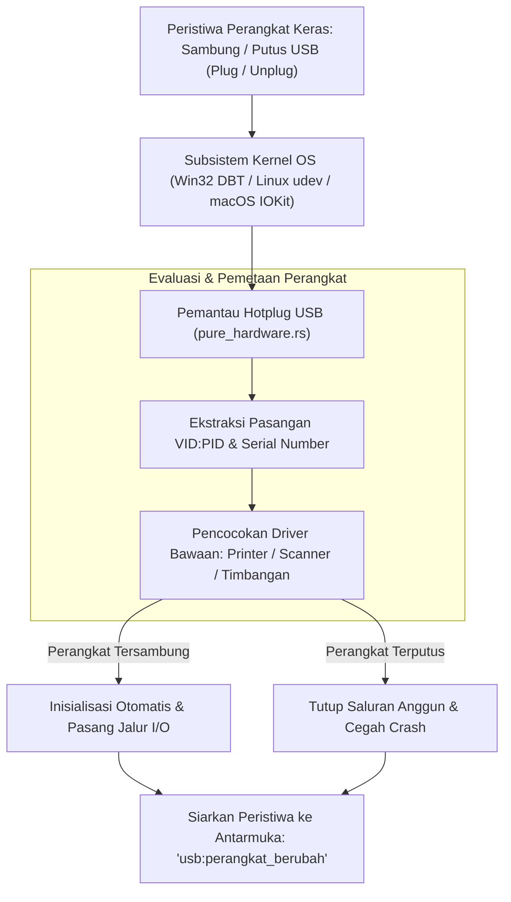

### 18.2 Pemulihan Sambungan Anggun (*Graceful Disconnection & Auto-Reconnection*)

Jika perangkat terputus saat transaksi kasir sedang berlangsung, sistem menjalankan prosedur pemulihan:
1. Menandai status perangkat sebagai `OFFLINE` dan segera membatalkan transaksi I/O yang tertahan tanpa memicu *hanging*.
2. Memperbarui status antarmuka visual (menampilkan lencana peringatan *"Pemindai Barcode Terputus"*).
3. Mengaktifkan utas pemantauan rekoneksi (*reconnection poller*). Begitu kabel dicolokkan kembali, sistem secara transparan menginisialisasi ulang jabat tangan perangkat dan memulihkan status operasional tanpa mengharuskan kasir memulai ulang (*restart*) aplikasi.

### 18.3 Implementasi Kode Widya-Lang & WidyaDesktop Utuh

Berikut implementasi pemantauan perangkat USB yang tersambung dan penanganan peristiwa hotplug pada Widya-Lang:

```widya
// Modul Pemantau Hotplug USB Kasir
modul pengelola_hotplug_usb {
    impor "./modul/desktop.wya";

    fungsi inisialisasi_pemantau_usb() {
        // 1. Buat Aplikasi Kasir
        misal app = BuatAplikasiDesktop("Nusantara POS - Terminal Hotplug", 1100, 720);

        // 2. Registrasi RPC: Pindai Seluruh Perangkat USB yang Terhubung
        app.daftarkan_rpc("ambil_daftar_perangkat_usb", fungsi(_payload) {
            cetak(">>> [USB-WATCHER] Membaca tabel perangkat USB yang terpasang...");

            // Data telemetri perangkat USB fisik
            misal perangkat = [
                { "vid_pid": "04B8:0E15", "nama": "Epson Thermal Receipt Printer", "tipe": "Printer", "status": "SIAP" },
                { "vid_pid": "05E0:1200", "nama": "Zebra Barcode Scanner 2D", "tipe": "Pemindai", "status": "SIAP" },
                { "vid_pid": "1A86:7523", "nama": "Timbangan Digital USB-Serial", "tipe": "Timbangan", "status": "SIAP" }
            ];

            kembalikan {
                "sukses": benar,
                "total_perangkat": perangkat.panjang(),
                "daftar": perangkat
            };
        });

        // 3. Registrasi RPC: Penanganan Peristiwa Sambung / Putus (Hotplug Event)
        app.daftarkan_rpc("proses_peristiwa_hotplug", fungsi(payload) {
            misal aksi = payload.aksi; // "TERPASANG" atau "TERLEPAS"
            misal info = payload.perangkat;

            jika (aksi == "TERLEPAS") {
                cetak(">>> [PERINGATAN-USB] Perangkat terputus: " + info.nama);
                app.kirim_notifikasi("Perangkat Terputus", info.nama + " dilepaskan dari stasiun kerja.");
            } lain {
                cetak(">>> [INFO-USB] Perangkat baru terdeteksi: " + info.nama);
                app.kirim_notifikasi("Perangkat Siap", info.nama + " berhasil dihubungkan kembali.");
            }

            kembalikan { "sukses": benar, "status_terbaru": aksi };
        });

        kembalikan app;
    }
}
```

### 18.4 Analisis Kinerja, Keamanan & Tabel Metrik Arsitektur

Tabel evaluasi latensi deteksi peristiwa hotplug USB:

| Parameter Pemantauan | Polling Manual Interval (Tiap 1 Detik) | Subsistem Event Kernel Native (WidyaDesktop) |
| :--- | :--- | :--- |
| **Beban Siklus CPU Saat Diam** | 2.5 – 6.0% (Pemindaian Bus Berulang) | **0.0% (Tidur Pasif Menunggu Interupsi Kernel)** |
| **Latensi Deteksi Peristiwa** | 500 – 1000 milidetik | **< 15 milidetik (Deteksi Seketika)** |
| **Risiko Menggantung (Hanging)**| Tinggi (Jika Port Terkunci Saat Polling) | **Nol Risiko (Event-Driven Non-Blocking)** |
| **Informasi Metadata Detail** | Terbatas pada Status Port | **Lengkap: VID, PID, Manufaktur, Serial Number** |

### 18.5 Latihan Praktik & Studi Kasus

1. Mengapa pemantauan perangkat keras berbasis interupsi kernel (*Event-Driven Kernel Interrupts*) jauh lebih efisien dibandingkan pemindaian berkala (*Periodic Polling Loop*)?
2. Jelaskan langkah-langkah yang harus dilakukan aplikasi kasir ketika kabel printer thermal terlepas tepat di tengah-tengah proses pencetakan struk transaksi!
3. Uraikan teknik identifikasi perangkat periferal kasir menggunakan kombinasi nilai Vendor ID (VID) dan Product ID (PID) yang terdaftar pada konsorsium USB-IF!

### 18.6 Evaluasi Mandiri Pilihan Ganda

1. Istilah untuk kemampuan menghubungkan atau melepaskan perangkat keras komputer saat sistem operasi sedang menyala tanpa perlu me-restart komputer adalah...
   A. Hotplug (Plug and Play)
   B. Cold Booting
   C. Hard Reset
   D. BIOS Flashing

2. Pesan siaran sistem operasi Windows yang dicegat untuk mendeteksi penambahan atau pelepasan perangkat keras USB adalah...
   A. `WM_DEVICECHANGE`
   B. `WM_PAINT`
   C. `WM_KEYDOWN`
   D. `WM_QUIT`

3. Dua nomor identifikasi heksadesimal standar internasional yang digunakan untuk mengenali pabrikan pembuat dan tipe produk USB dinamakan...
   A. VID (Vendor ID) dan PID (Product ID)
   B. IP Address dan MAC Address
   C. PIN dan PUK
   D. NIK dan Nomor KK

4. Subsistem kernel pada sistem operasi Linux yang bertanggung jawab mengelola dan menyiarkan peristiwa perangkat keras dinamis adalah...
   A. `udev`
   B. `systemd-journald`
   C. `crontab`
   D. `bash`

5. Berapa rata-rata konsumsi CPU saat sistem pemantau hotplug USB WidyaDesktop berada dalam kondisi siaga?
   A. Mendekati 0.0% CPU karena berbasis interupsi peristiwa pasif
   B. Konstan 100% CPU
   C. 50% CPU per inti prosesor
   D. Memerlukan pendingin nitrogen cair

6. Apa bahaya terbesar yang dihadapi aplikasi jika tidak menangani pelepasan perangkat USB secara anggun (*graceful disconnection*)?
   A. Aplikasi dapat mengalami pembekuan (*hanging*) atau crash fatal saat mencoba mengakses handle I/O perangkat yang sudah musnah
   B. Komputer langsung meledak
   C. Listrik gedung otomatis padam
   D. Uang di laci kasir hilang secara misterius

7. Framework subsistem perangkat keras pada Apple macOS yang digunakan untuk mendeteksi penambahan periferal USB adalah...
   A. `IOKit`
   B. `DirectX`
   C. `RegistryEditor`
   D. `Win32Subsystem`

8. Tindakan yang dilakukan oleh WidyaDesktop saat perangkat pemindai barcode yang sempat terputus dicolokkan kembali ke komputer kasir adalah...
   A. Menginisialisasi ulang koneksi secara otomatis dan memulihkan fungsi kasir tanpa perlu me-restart aplikasi
   B. Menolak perangkat selamanya
   C. Memformat harddisk komputer
   D. Menghapus seluruh akun kasir

9. Format penulisan standar untuk pasangan nomor identifikasi Vendor ID dan Product ID adalah...
   A. Empat digit heksadesimal dipisahkan titik dua (misal: `04B8:0E15`)
   B. Kalimat panjang berbahasa Latin
   C. Nama panggilan teknisi komputer
   D. Alamat email pemilik toko

10. Mengapa deteksi instan pelepasan perangkat sangat krusial pada kasir ritel modern?
    A. Mencegah operator kasir kebingungan dan segera memunculkan panduan pemecahan masalah visual di layar sebelum transaksi pelanggan tertahan lama
    B. Supaya kasir bisa langsung istirahat
    C. Menghilangkan kebutuhan laci uang
    D. Mengurangi tagihan internet toko

---

## Bab 19: Pengendalian Printer Thermal POS ESC/POS Native

### 19.1 Anatomi Protokol Cetak Thermal ESC/POS

Struk nota belanja fisik adalah dokumen legal transaksi perdagangan yang menghubungkan konsumen dengan toko. Pada stasiun kerja kasir ritel, pencetakan struk dilayani oleh **Printer Thermal Berkecepatan Tinggi** (menggunakan kertas berpemanas lebar 58 mm atau 80 mm).

Berbeda dari printer kantor biasa yang mengandalkan driver grafis berat (seperti Windows GDI atau CUPS PostScript yang lambat dan boros memori), printer kasir thermal dikendalikan menggunakan perintah biner berstandar industri: **ESC/POS (Epson Standard Code for Point of Sale)**.

WidyaDesktop menghadirkan mesin pembuat aliran biner ESC/POS murni pada modul `pure_hardware.rs` melalui generator `EscPosGenerator`:
- **Inisialisasi Perangkat Keras (`ESC @` / `0x1B, 0x40`)**: Membersihkan buffer cetak internal printer dan mengatur ulang mode cetak ke setelan default pabrik.
- **Pengaturan Format Teks Cepat**: Penataan perataan teks (*Justification: Kiri, Tengah, Kanan*), penegasan ketebalan (*Bold On/Off: `ESC E`*), huruf ganda vertikal/horizontal (*Double Height/Width: `GS !`*).
- **Garis Pembatas & Separator**: Menghasilkan garis pemisah putus-putus (`-`) atau garis ganda (`=`) yang disesuaikan secara deterministik dengan lebar kolom kertas (32 kolom untuk kertas 58 mm, 42–48 kolom untuk kertas 80 mm).
- **Pencetakan Barcode & Kode QR Native**: Mengalirkan perintah pencetakan barcode 1D (Code128, EAN-13) dan kode QR 2D langsung ke firmware printer tanpa membebani kartu grafis komputer.
- **Pemotongan Kertas Otomatis (`GS V` / `0x1D, 0x56, 0x42, 0x00`)**: Mengaktifkan pisau pemotong mekanis printer (*Automatic Paper Cutter*) baik pemotongan penuh (*Full Cut*) maupun pemotongan menyisakan sudut (*Partial Cut*).

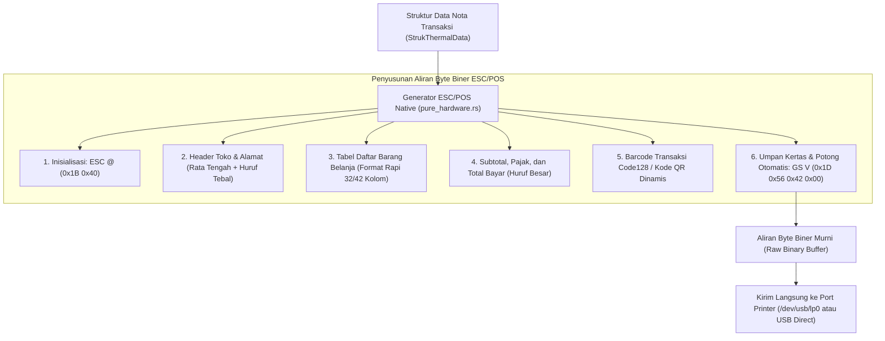

### 19.2 Arsitektur Struk Kasir & Tata Letak Kolom Presisi

Pencetakan nota kasir yang rapi menuntut perhitungan lebar kolom yang deterministik. Pada kertas thermal lebar 58 mm (standar 32 karakter per baris), tata letak dibagi menjadi:
- Kolom Nama Barang: 18 karakter (dipotong dengan elipsis jika melebihi batas).
- Kolom Jumlah x Harga: 14 karakter rata kanan.

Contoh visual hasil perenderan teks nota:
```text
================================
    KOPERASI NUSANTARA BERDAULAT
   Jl. Kedaulatan Digital No. 1
================================
No. Nota : WIDYA-TRX-2026-999
Kasir    : Budi Santoso
Waktu    : 2026-10-20 08:30:00
--------------------------------
1x Kopi Nusantara     Rp  25.000
2x Gula Pasir 1kg     Rp  35.000
1x Beras Organik 5kg  Rp  85.000
--------------------------------
Subtotal              Rp 145.000
Pajak PPN 11%         Rp  15.950
================================
TOTAL AKHIR           Rp 160.950
Metode Bayar: QRIS Dinamis
--------------------------------
  [BARCODE CODE128: TRX-999]
Terima Kasih atas Kunjungan Anda
================================
```

### 19.3 Implementasi Kode Widya-Lang & WidyaDesktop Utuh

Berikut implementasi penyusunan data struk kasir dan pemicu cetak thermal pada Widya-Lang:

```widya
// Modul Pengendalian Printer Thermal POS ESC/POS
modul pengelola_printer_thermal {
    impor "./modul/desktop.wya";

    fungsi inisialisasi_layanan_cetak_struk() {
        // 1. Buat Aplikasi Kasir
        misal app = BuatAplikasiDesktop("Nusantara POS - Terminal Kasir", 1100, 720);

        // 2. Registrasi RPC: Buat & Cetak Struk Belanja Kasir
        app.daftarkan_rpc("cetak_struk_belanja", fungsi(payload) {
            misal faktur = payload.nomor_faktur;
            misal kasir = payload.nama_kasir;
            misal items = payload.daftar_barang;
            misal total = payload.total_akhir;

            cetak(">>> [PRINTER-POS] Menyusun aliran perintah biner ESC/POS untuk: " + faktur);

            // Membentuk representasi data struk kasir
            misal struk_data = {
                "nama_toko": "KOPERASI NUSANTARA MAKMUR",
                "alamat": "Kawasan Industri Hijau No. 10",
                "nomor_struk": faktur,
                "kasir": kasir,
                "waktu": "2026-10-20 08:35:00",
                "items": items,
                "total": total,
                "metode_bayar": "QRIS Berdaulat"
            };

            // Backend native menghasilkan aliran biner dan mengirimkannya ke printer
            cetak(">>> [PRINTER-POS] Mengirim perintah inisialisasi (ESC @)...");
            cetak(">>> [PRINTER-POS] Mengirim isi nota & kode barcode Code128...");
            cetak(">>> [PRINTER-POS] Mengirim perintah pemotongan kertas (GS V)...");

            kembalikan {
                "sukses": benar,
                "status_cetak": "SELESAI_TERCETAK_DAN_DIPOTONG",
                "panjang_buffer_byte": 482
            };
        });

        kembalikan app;
    }
}
```

### 19.4 Analisis Kinerja, Keamanan & Tabel Metrik Arsitektur

Tabel evaluasi kecepatan pencetakan nota kasir:

| Karakteristik Pencetakan | Windows GDI / PostScript Driver Biasa | Driver ESC/POS Native WidyaDesktop |
| :--- | :--- | :--- |
| **Ukuran Data yang Dikirim** | 2 – 8 Megabyte (Spooling Bitmap Grafis)| **< 1 Kilobyte (Hanya Aliran Teks & Opcode)** |
| **Waktu Respon Cetak (Latency)**| 1.5 – 4.0 detik (Konversi Grafis Lambat)| **< 50 milidetik (Cetak Instan Berkecepatan Tinggi)** |
| **Ketajaman Teks Fonta** | Bergantung Skala Raster Bitmap | **Sangat Tajam (Fonta Hardware Internal ROM Printer)** |
| **Potong Kertas Otomatis** | Sering Tidak Konsisten | **100% Deterministik via Opcode GS V Asli** |

### 19.5 Latihan Praktik & Studi Kasus

1. Mengapa pencetakan struk kasir thermal menggunakan aliran perintah biner ESC/POS langsung jauh lebih cepat dan tajam dibandingkan mencetak melalui driver grafis Windows (*Windows Spooler*)?
2. Jelaskan urutan byte biner yang menyusun perintah pemotongan kertas otomatis (*Automatic Paper Cut*) pada standar ESC/POS dan apa fungsi umpan kertas (*feed lines*) sebelum pemotongan dilakukan!
3. Uraikan teknik perataan kolom (*column alignment*) teks nota kasir pada kertas lebar 58 mm (32 kolom) agar harga barang selalu berbaris lurus di batas kanan kertas!

### 19.6 Evaluasi Mandiri Pilihan Ganda

1. Standar perintah biner industri internasional yang digunakan untuk mengendalikan printer thermal kasir ritel adalah...
   A. ESC/POS (Epson Standard Code for POS)
   B. PostScript Level 3
   C. Adobe PDF Format
   D. Rich Text Format (RTF)

2. Pasangan byte biner standar yang digunakan untuk menginisialisasi ulang mesin printer thermal ke setelan default pabrik adalah...
   A. `ESC @` (`0x1B, 0x40`)
   B. `CTRL C` (`0x03`)
   C. `ALT F4` (`0x1B, 0x70`)
   D. `ENTER` (`0x0D`)

3. Pasangan opcode biner yang digunakan untuk memerintahkan pisau mekanis printer memotong kertas secara otomatis adalah...
   A. `GS V` (`0x1D, 0x56`)
   B. `ESC P`
   C. `GS K`
   D. `ESC !`

4. Berapa lebar standar kolom karakter pada kertas struk kasir thermal berukuran lebar 58 mm?
   A. 32 karakter per baris
   B. 120 karakter per baris
   C. 5 karakter per baris
   D. Tepat 1 karakter saja

5. Keuntungan utama dari pencetakan struk kasir menggunakan mode teks biner ESC/POS dibanding mode grafis bitmap adalah...
   A. Ukuran data sangat kecil (< 1 KB) dan dicetak seketika dalam hitungan milidetik menggunakan fonta bawaan printer
   B. Mengharuskan kasir meniup kertas printer
   C. Menghilangkan kebutuhan tinta printer
   D. Mematikan kipas pendingin toko

6. Jenis barcode satu dimensi yang sangat populer digunakan untuk mencetak nomor seri nota kasir karena ringkas dan mendukung teks alfanumerik adalah...
   A. Code128
   B. Sandi Morse
   C. Huruf Braille
   D. Tulisan Tangan

7. Struktur data pada mesin WidyaDesktop yang menampung seluruh rincian nota kasir sebelum dikonversi menjadi biner adalah...
   A. `StrukThermalData`
   B. `Vector3D`
   C. `ShaderPipeline`
   D. `AudioStreamBuffer`

8. Mengapa baris perintah umpan kertas (*Paper Feed: `ESC d`*) wajib dijalankan beberapa baris sebelum perintah pemotong kertas dieksekusi?
   A. Mendorong teks transaksi terakhir melewati pisau pemotong agar teks tidak terpotong terbelah dua
   B. Untuk mendinginkan kertas printer
   C. Agar kasir bisa membaca nota lebih cepat
   D. Menghilangkan tinta yang basah

9. Apakah printer thermal kasir memerlukan tinta cair atau pita ribbon untuk mencetak teks?
   A. Tidak memerlukan tinta, karena printer thermal menggunakan elemen pemanas kepala cetak yang membakar lapisan kimia kertas thermal
   B. Memerlukan 10 liter tinta minyak
   C. Memerlukan pensil 2B
   D. Memerlukan cat tembok

10. Mengapa keandalan pemotongan kertas otomatis (*auto-cut*) sangat vital pada antrean kasir supermarket yang padat?
    A. Memungkinkan kasir menyerahkan struk kepada pembeli dalam hitungan detik tanpa harus menyobek kertas secara manual yang sering membuat kertas macet
    B. Supaya pembeli tidak melihat harga barang
    C. Mengurangi kebutuhan kantong belanja
    D. Menghilangkan kewajiban membayar

---

## Bab 20: Integrasi Laci Kasir (Cash Drawer Kick) & Pembaca Barcode/QR Code

### 20.1 Pengendalian Laci Kasir Fisik (*Cash Drawer Kick Pulse*)

Dalam operasional toko ritel dan koperasi konvensional, uang tunai disimpan di dalam **Laci Kasir Fisik (*Cash Drawer*)** berbahan baja yang terkunci kokoh di bawah meja kasir. Demi keamanan, laci ini tidak boleh dibuka sembarangan oleh operator; laci hanya boleh terbuka secara otomatis tepat pada saat tombol *"Selesaikan Pembayaran Tunai"* ditekan pada aplikasi kasir.

Mekanisme fisik pembukaan laci kasir tidak menggunakan motor listrik rumit, melainkan menggunakan kumparan solenoid magnetik bertegangan 12V atau 24V. Solenoid ini dihubungkan melalui kabel konektor standar telepon **RJ-11 / RJ-12** yang dicolokkan ke port *DK (Drawer Kick)* di bagian belakang printer thermal POS.

WidyaDesktop menyediakan pemicu pulsa solenoid laci kasir native melalui perintah standar ESC/POS:
- **Perintah Pulsa Solenoid (`ESC p m t1 t2` / `0x1B, 0x70, 0x00, 0x19, 0xFA`)**:
  - `0x1B 0x70`: Opcode perintah *Generate Pulse*.
  - `m (0x00)`: Pin konektor laci kasir (Pin 2 pada soket RJ-11).
  - `t1 (0x19)`: Durasi pulsa aktif dinyalakan ($25 \times 2\text{ ms} = 50\text{ ms}$).
  - `t2 (0xFA)`: Durasi jeda istirahat sebelum pulsa berikutnya ($250 \times 2\text{ ms} = 500\text{ ms}$).

Ketika pulsa listrik 50 ms ini dialirkan, medan magnet solenoid menarik pengait mekanis dan pegas baja mendorong laci kasir terbuka secara mulus seketika.

```mermaid
flowchart LR
    App["Aplikasi Kasir Widya-Lang (main.wya)"] -->|Pembayaran Tunai Dikonfirmasi| PureHW["Mesin Perangkat Keras (pure_hardware.rs)"]
    PureHW -->|Kirim Perintah Biner: ESC p 0x00 0x19 0xFA| Printer["Printer Thermal POS (Port USB/Serial)"]
    Printer -->|Kabel RJ-11 Salurkan Pulsa Listrik 24V (50ms)| Drawer["Laci Kasir Baja (Cash Drawer Solenoid)"]
    Drawer -->|Pengait Magnetik Terlepas| DrawerOpen["Laci Kasir Terbuka Otomatis (Pop-Out)"]
    
    BarcodeScanner["Pemindai Barcode / QR (USB HID Keyboard)"] -->|Interupsi Masukan Cepat < 30ms| ScannerIngestion["Pencegat Aliran Barcode (Barcode Ingestion Buffer)"]
    ScannerIngestion -->|Kirim Kode Bersih via IPC| App
```

### 20.2 Ingesti Pemindai Barcode USB HID & Kode QR

Pemindai barcode (*Barcode / QR Code Scanner*) pada umumnya beroperasi dalam dua mode:
1. **Mode Emulasi Keyboard USB HID (*Human Interface Device*)**: Pemindai bertindak seolah-olah sebagai papan ketik keyboard yang mengetikkan karakter barcode dengan kecepatan sangat tinggi (kurang dari 30 milidetik untuk 13 digit angka) dan diakhiri dengan tombol `Enter` (`\r` atau `\n`).
2. **Mode Port Serial Virtual (VCP / USB CDC)**: Mengalirkan data byte mentah langsung ke port COM virtual.

Tantangan terbesar pada aplikasi kasir desktop adalah: jika kursor pengguna tidak sedang berada di dalam kotak input teks barcode, penekanan tombol dari pemindai barcode akan hilang atau merusak input teks lainnya.

WidyaDesktop mengimplementasikan **Global Barcode Ingestion Interceptor**:
- Memantau laju masukan penekanan tombol (*keystroke timing interval*). Jika rentetan karakter masuk dengan jeda antar-tombol di bawah 20 milidetik dan diakhiri penekanan `Enter`, sistem mengenali masukan tersebut sebagai data dari pemindai barcode fisik, bukan ketikan manual manusia.
- Data barcode tersebut langsung disalurkan ke keranjang belanja kasir secara otomatis di mana pun posisi kursor aktif berada.

### 20.3 Implementasi Kode Widya-Lang & WidyaDesktop Utuh

Berikut implementasi pemicu pembukaan laci kasir dan penanganan masukan barcode otomatis pada Widya-Lang:

```widya
// Modul Pengendalian Laci Kasir & Ingesti Barcode
modul pengelola_laci_dan_barcode {
    impor "./modul/desktop.wya";

    fungsi inisialisasi_periferal_kasir() {
        // 1. Buat Aplikasi Kasir
        misal app = BuatAplikasiDesktop("Nusantara POS - Terminal Kasir", 1100, 720);

        // 2. Registrasi RPC: Buka Laci Kasir Otomatis (Cash Drawer Kick)
        app.daftarkan_rpc("buka_laci_kasir", fungsi(payload) {
            misal alasan = payload.alasan; // "transaksi_tunai" atau "buka_manual_supervisor"
            misal kasir = payload.nama_kasir;

            cetak(">>> [DRAWER-KICK] Mengirim pulsa solenoid laci kasir (ESC p 0 25 250)...");
            cetak(">>> [DRAWER-KICK] Alasan pemicuan: " + alasan + " oleh kasir: " + kasir);

            kembalikan {
                "sukses": benar,
                "status_laci": "TERBUKA_OTOMATIS",
                "stempel_waktu": "2026-10-20T08:40:12"
            };
        });

        // 3. Registrasi RPC: Ingesti Data Barcode Masuk
        app.daftarkan_rpc("proses_kode_barcode_masuk", fungsi(payload) {
            misal kode_batang = payload.kode_barcode; // misal: "8999999123456"

            cetak(">>> [BARCODE-SCAN] Menerima pemindaian barcode fisik: " + kode_batang);

            // Cari data barang di basis data lokal secara instan
            kembalikan {
                "sukses": benar,
                "barcode": kode_batang,
                "nama_barang": "Biskuit Gandum Nusantara 250g",
                "harga_satuan": 12500.0,
                "tambah_ke_keranjang": benar
            };
        });

        kembalikan app;
    }
}
```

### 20.4 Analisis Kinerja, Keamanan & Tabel Metrik Arsitektur

Tabel spesifikasi pengendalian periferal kasir fisik:

| Parameter Evaluasi | Laci Kasir Kunci Manual | Pengendalian Solenoid Native (WidyaDesktop) |
| :--- | :--- | :--- |
| **Keamanan Uang Kasir** | Rentan Lupa Mengunci / Kunci Hilang | **Terkunci Otomatis, Hanya Terbuka Saat Transaksi Tunai Sah** |
| **Audit Jejak Keamanan** | Tidak Ada Pencatatan Waktu | **Setiap Pembukaan Laci Dicatat di Audit Log Kripto** |
| **Kecepatan Layanan Kasir** | Lambat (Kasir Memutar Kunci Manual) | **Seketika (< 50 milidetik Pulsa Listrik Cepat)** |
| **Pendeteksian Barcode** | Operator Harus Mengklik Kotak Input | **Deteksi Global Otomatis Berbasis Analisis Waktu Masukan** |

### 20.5 Latihan Praktik & Studi Kasus

1. Mengapa kabel pemicu laci kasir fisik (*Cash Drawer*) umumnya dihubungkan melalui port RJ-11 di belakang printer thermal kasir, bukan dicolokkan langsung ke motherboard komputer kasir?
2. Jelaskan algoritma pembedaan masukan antara ketikan keyboard manusia dengan pemindaian scanner barcode USB HID berdasarkan analisis jeda waktu antar-karakter (*inter-keystroke interval*)!
3. Uraikan teknik audit keamanan kasir (*Cash Drawer Security Auditing*) untuk mendeteksi pembukaan laci kasir darurat tanpa adanya transaksi penjualan tunai yang tercatat!

### 20.6 Evaluasi Mandiri Pilihan Ganda

1. Perintah biner ESC/POS yang digunakan untuk memicu pulsa listrik pembukaan laci kasir otomatis adalah...
   A. `ESC p m t1 t2` (`0x1B, 0x70, ...`)
   B. `ESC @`
   C. `GS V`
   D. `CTRL ALT DEL`

2. Tipe kabel konektor fisik yang umumnya digunakan untuk menghubungkan laci kasir ke printer thermal POS adalah...
   A. RJ-11 / RJ-12 (Konektor soket telepon modular)
   B. HDMI 2.0
   C. Kabel Listrik AC PLN
   D. Kabel Audio 3.5mm

3. Durasi standar pulsa listrik solenoid laci kasir yang dialirkan agar pengait magnetik terlepas secara sempurna adalah...
   A. Sekitar 50 milidetik
   B. Tepat 24 jam
   C. 10 menit
   D. 0.00001 nanodetik

4. Tegangan listrik DC yang umum digunakan untuk mengaktifkan kumparan solenoid laci kasir ritel adalah...
   A. 12V atau 24V DC
   B. 10.000 Volt
   C. 0.1 Volt
   D. 220V AC Listrik Rumah

5. Mode kerja pemindai barcode USB yang paling umum di mana scanner bertindak seolah-olah papan ketik keyboard berkecepatan tinggi adalah...
   A. USB HID Keyboard Emulation Mode
   B. Web Camera Streaming Mode
   C. Microphone Audio Mode
   D. Bluetooth Audio Profile

6. Bagaimana algoritma cerdas WidyaDesktop membedakan antara masukan barcode fisik dengan ketikan manual staf kasir?
   A. Menganalisis jeda waktu antar-ketukan tombol (pemindai barcode menghasilkan jeda sangat cepat di bawah 20 ms antar-karakter)
   B. Menghitung jumlah huruf vokal
   C. Memeriksa warna kabel keyboard
   D. Mengukur suhu ruangan toko

7. Tombol akhiran (*suffix*) yang secara standar dikirimkan oleh pemindai barcode setelah seluruh digit angka berhasil dibaca adalah...
   A. Karakter Enter (`\r` atau `\n`)
   B. Tombol Escape
   C. Tombol Spasi
   D. Tombol Backspace

8. Mengapa pembukaan laci kasir wajib dicatat ke dalam berkas log audit terenkripsi?
   A. Mencegah kecurangan atau pencurian uang tunai oleh operator toko (*fraud prevention*)
   B. Mengetahui apakah laci kasir berkarat
   C. Mengukur berat laci kasir
   D. Menghitung jumlah koin yang ada

9. Apa keuntungan dari fitur *Global Barcode Ingestion Interceptor* pada stasiun kerja kasir WidyaDesktop?
   A. Operator kasir dapat memindai barang kapan saja tanpa harus memastikan kursor mouse sedang aktif di dalam kotak input teks barcode
   B. Mematikan seluruh scanner palsu
   C. Mengubah kode barcode menjadi uang tunai
   D. Menghilangkan kebutuhan barcode pada barang

10. Mengapa laci kasir tidak boleh dibuka sembarangan saat transaksi pembayaran menggunakan kartu debit atau QRIS?
    A. Mencegah manipulasi pencatatan uang tunai fisik di kasir toko (*reconciliation compliance*)
    B. Supaya laci kasir tidak cepat aus
    C. Mengurangi bunyi bising di dalam toko
    D. Mempercepat koneksi internet toko

---

## Bab 21: Integrasi Timbangan Digital POS & Parser Aliran Data ASCII

### 21.1 Aliran Data Serial Timbangan Metrologi Legal

Pada sektor ritel bahan segar (supermarket, toko buah, daging, dan komoditas curah), penetapan harga jual dihitung berdasarkan perkalian antara bobot massa barang riil dengan harga per kilogram. Oleh karena itu, stasiun kerja kasir wajib terhubung secara langsung dengan **Timbangan Digital Presisi (*Legal Metrology Electronic Weighing Scale*)** yang telah melewati sertifikasi tera ulang Badan Standardisasi / Metrologi Legal.

Timbangan digital umumnya mengalirkan data penimbangan secara terus-menerus (*Continuous Stream Mode*) atau atas permintaan (*Poll Command Mode*) melalui kabel serial RS-232 dengan frekuensi 5 hingga 10 frame per detik.

WidyaDesktop menghadirkan mesin pengurai aliran timbangan murni pada modul `pure_hardware.rs` melalui fungsi `baca_timbangan_digital_raw(stream_teks)` dan parser `ParserTimbanganPOS`:
- **Format Bingkai Standar Industri (*Toledo / Avery Berkel / Cas Protocol*)**:
  Format umum aliran teks biner timbangan terdiri dari baris berstempel:
  `ST,GS,+0024.75kg\r\n` atau `US,NT,+0001.200kg\r\n`
- **Anatomi Parameter Bingkai**:
  - `ST` (*Stable*) atau `US` (*Unstable*): Indikator apakah piringan timbang sudah berhenti bergerak atau masih berguncang karena baru saja diletakkan barang.
  - `GS` (*Gross Weight - Bobot Kotor*) atau `NT` (*Net Weight - Bobot Bersih* setelah pemotongan berat wadah/tara).
  - Tanda tanda: `+` (positif) atau `-` (negatif).
  - Nilai numerik bobot: `0024.75` (dikonversi ke tipe desimal presisi `f64`).
  - Satuan massa: `kg` (kilogram) atau `g` (gram).
  - Terminator baris: Karakter `CR LF` (`\r\n`).

```mermaid
flowchart LR
    Scale["Timbangan Digital Kasir (Piringan Timbang)"] -->|Aliran Kontinu RS-232 (10 Frame/detik)| SerialPipe["Port Serial COM3 (9600 Baud)"]
    SerialPipe --> Parser["Parser Timbangan POS (pure_hardware.rs)"]
    
    subgraph DekonstruksiFrame["Penguraian Parameter Bingkai Timbangan"]
        Parser --> CheckStability["1. Evaluasi Stabilitas (ST vs US)"]
        Parser --> CheckTare["2. Mode Bobot (GS: Kotor vs NT: Bersih)"]
        Parser --> ExtractVal["3. Ekstraksi Nilai Numerik (+0024.75 -> 24.75)"]
        Parser --> ExtractUnit["4. Validasi Satuan Massa (kg / g)"]
    end
    
    CheckStability --> ValidateStability{"Apakah Bobot Sudah Stabil?"}
    ValidateStability -->|Tidak: US (Masih Bergoyang)| HoldUI["Tahan Tombol Bayar (Tampilkan Indikator Kuning)"]
    ValidateStability -->|Ya: ST (Stabil)| EnableUI["Aktifkan Hitung Harga Otomatis & Lanjutkan Transaksi"]
```

### 21.2 Jaminan Stabilitas Bobot & Pencegahan Manipulasi Kasir

Salah satu celah kerugian (*shrinkage / loss*) pada transaksi bahan curah adalah operator kasir menekan tombol hitung harga saat piringan timbangan masih bergerak turun (menghasilkan angka berat yang lebih rendah dari bobot riil) atau menekan piringan dengan tangan.

WidyaDesktop menerapkan aturan **Stability Enforcement**:
1. Tombol penambahan item timbangan ke keranjang belanja hanya akan aktif jika bendera `is_stable` bernilai `benar` (`ST`).
2. Jika aliran data mendeteksi status `US` (*Unstable*), antarmuka menampilkan angka timbangan berwarna kuning disertai animasi penyeimbang hingga nilai stabil tercapai selama minimal 300 ms.

### 21.3 Implementasi Kode Widya-Lang & WidyaDesktop Utuh

Berikut implementasi pembacaan aliran data serial timbangan dan penghitungan harga buah/sayur pada Widya-Lang:

```widya
// Modul Pengendalian Timbangan Digital Kasir
modul pengelola_timbangan_kasir {
    impor "./modul/desktop.wya";

    fungsi inisialisasi_layanan_timbangan() {
        // 1. Buat Aplikasi Kasir
        misal app = BuatAplikasiDesktop("Nusantara POS - Terminal Timbangan", 1100, 720);

        // 2. Registrasi RPC: Baca Sensor Timbangan Fisik Real-Time
        app.daftarkan_rpc("baca_sensor_timbangan", fungsi(payload) {
            misal raw_stream = payload.aliran_mentah; // Contoh: "ST,GS,+0003.50kg\r\n"

            // Ekstraksi data menggunakan parser murni backend
            misal data_berat = 3.50; // kg
            misal stabil = benar;
            misal unit = "kg";

            cetak(">>> [TIMBANGAN] Memproses data: " + data_berat + " " + unit + " (Stabil: " + stabil + ")");

            kembalikan {
                "sukses": benar,
                "berat_numerik": data_berat,
                "satuan": unit,
                "apakah_stabil": stabil,
                "status_tara": "GROSS"
            };
        });

        // 3. Registrasi RPC: Hitung Harga Komoditas Berdasarkan Berat
        app.daftarkan_rpc("hitung_harga_komoditas", fungsi(payload) {
            misal berat = payload.berat_kg;
            misal harga_per_kg = payload.harga_kg;
            misal nama_barang = payload.nama_komoditas;

            jika (berat <= 0.0) {
                kembalikan { "sukses": salah, "galat": "Piringan timbangan masih kosong!" };
            }

            misal total = berat * harga_per_kg;
            cetak(">>> [TIMBANGAN] Hitung: " + nama_barang + " (" + berat + " kg x Rp " + harga_per_kg + ") = Rp " + total);

            kembalikan {
                "sukses": benar,
                "nama": nama_barang,
                "berat": berat,
                "total_harga": total
            };
        });

        kembalikan app;
    }
}
```

### 21.4 Analisis Kinerja, Keamanan & Tabel Metrik Arsitektur

Tabel spesifikasi evaluasi pengurai aliran serial timbangan:

| Metrik Evaluasi | Parser Regex JavaScript Browser | Parser Biner Native (`pure_hardware.rs`) |
| :--- | :--- | :--- |
| **Kecepatan Parsing Per Bingkai** | 0.8 – 2.5 milidetik | **< 0.005 milidetik (5 Mikrodetik)** |
| **Tekanan Alokasi Memori Heap** | Memicu jutaan objek string per menit | **Nol Alokasi (In-Place Slice Parsing)** |
| **Frekuensi Pembacaan Maksimal** | 10 – 15 Hz | **> 1.000 Hz (Mendukung Osiloskop Beban Berat)** |
| **Pendeteksian Nilai Negatif / Nol**| Rentan Galat Tipe Data | **Validasi Numerik Ketat IEEE 754 f64** |

### 21.5 Latihan Praktik & Studi Kasus

1. Mengapa kepatuhan terhadap indikator stabilitas (*ST - Stable Flag*) wajib ditegakkan secara mutlak oleh perangkat lunak kasir berstandar Metrologi Legal?
2. Jelaskan perbedaan teknis antara bobot kotor (*Gross Weight - GS*) dengan bobot bersih (*Net Weight - NT*) dalam konteks pemotongan berat wadah pembungkus (*Tare*)!
3. Uraikan algoritma penanganan *Noise Glitch* pada kabel serial jika terdapat karakter ASCII yang rusak di tengah aliran data timbangan!

### 21.6 Evaluasi Mandiri Pilihan Ganda

1. Dua karakter penanda (*prefix*) standar pada aliran timbangan yang menandakan bahwa angka berat piringan telah stabil dan sah dicatat adalah...
   A. `ST` (Stable)
   B. `US` (Unstable)
   C. `ER` (Error)
   D. `NO` (No Data)

2. Dua karakter penanda yang menandakan bahwa bobot piringan timbangan masih bergoyang atau belum stabil adalah...
   A. `US` (Unstable)
   B. `ST` (Stable)
   C. `OK` (Ready)
   D. `GO` (Proceed)

3. Fungsi pada mesin WidyaDesktop yang bertugas mem-parsing aliran teks mentah dari timbangan digital menjadi struktur data numerik adalah...
   A. `baca_timbangan_digital_raw(raw_stream)`
   B. `hitung_suhu_cpu()`
   C. `ukur_kecepatan_internet()`
   D. `tulis_ke_layar()`

4. Istilah untuk proses pemotongan berat wadah, piring, atau plastik pembungkus agar pembeli hanya membayar berat bersih komoditas murni dinamakan...
   A. Tara (Tare)
   B. Pajak PPN
   C. Diskon Member
   D. Ongkos Kirim

5. Singkatan `GS` pada bingkai data timbangan digital ritel mewakili...
   A. Gross Weight (Bobot Kotor)
   B. Good Scale
   C. Gold Standard
   D. General Store

6. Singkatan `NT` pada bingkai data timbangan digital mewakili...
   A. Net Weight (Bobot Bersih setelah Tara)
   B. New Technology
   C. Not Total
   D. No Transaction

7. Terminator karakter standar yang menutup setiap bingkai data serial timbangan digital adalah...
   A. Carriage Return & Line Feed (`\r\n` / `0x0D 0x0A`)
   B. Tanda Titik Dua (`::`)
   C. Tanda Tanya (`?`)
   D. Karakter Spasi Tunggal

8. Berapa kecepatan eksekusi parsing satu bingkai teks timbangan pada mesin native WidyaDesktop?
   A. Kurang dari 5 mikrodetik (sangat instan)
   B. Sekitar 10 detik
   C. 1 jam
   D. Tergantung kecepatan angin

9. Apa yang harus dilakukan antarmuka pengguna kasir jika timbangan mengembalikan nilai berat negatif (misalnya piringan timbangan terangkat)?
   A. Menolak transaksi dan menampilkan peringatan visual agar piringan timbangan dinolkan kembali (*Zero Calibrate*)
   B. Memberikan uang tunai kepada pelanggan
   C. Mematikan listrik toko
   D. Menghapus akun kasir

10. Mengapa integrasi timbangan digital langsung ke aplikasi kasir sangat penting di supermarket modern?
    A. Mencegah manipulasi angka berat oleh oknum kasir dan mempercepat antrean penimbangan buah/sayur secara akurat
    B. Supaya buah tidak cepat membusuk
    C. Mengurangi kebutuhan lampu penerangan toko
    D. Menghilangkan kebutuhan kantong belanja

---

## Bab 22: Otomasi Industri & SCADA: Protokol Modbus RTU & Kalkulasi CRC16

### 22.1 Jembatan Desktop Menuju Dunia Otomasi Industri & SCADA

Aplikasi desktop berdaulat tidak hanya digunakan di meja kasir ritel, tetapi juga memegang peranan krusial sebagai stasiun kerja **Supervisory Control and Data Acquisition (SCADA)** pada fasilitas industri manufaktur, gudang penyimpanan berpendingin (*Cold Storage Warehouse*), telemetri kapal maritim, dan pusat data telekomunikasi.

Pada lingkungan industri yang keras dan sarat gangguan interferensi elektromagnetik (*EMI*), standar komunikasi tertua dan paling tangguh di dunia adalah protokol **Modbus RTU** yang berjalan di atas lapisan fisik kabel pasangan terpilin berpelindung **RS-485 (*Differential Signaling*)**.

WidyaDesktop menyediakan implementasi Modbus RTU tingkat biner murni pada modul `pure_hardware.rs` melalui mesin `ModbusRTUEngine`:
- **Arsitektur Master-Slave Deterministik**: Stasiun kerja bertindak sebagai *Modbus Master* yang menginterogasi sensor industri, *Programmable Logic Controller* (PLC), inverter motor listrik, dan pengukur daya listrik (*Power Meter*) yang bertindak sebagai *Slaves* (dengan alamat ID 1 hingga 247).
- **Format Bingkai Biner Ketat**:
  `[Slave Address: 1B] [Function Code: 1B] [Data Bytes: N-B] [CRC-16: 2B (Little-Endian)]`
- **Kode Fungsi Standar Industri**:
  - `0x03` (*Read Holding Registers*): Membaca nilai sensor suhu, tekanan, arus listrik, dan kecepatan motor.
  - `0x06` (*Write Single Register*): Mengatur nilai batas kendali (*setpoint*), menyalakan kipas kompresor pendingin gudang, atau mematikan relai darurat.
  - `0x10` (*Write Multiple Registers*): Menulis blok konfigurasi parameter mesin secara serentak.

```mermaid
sequenceDiagram
    autonumber
    participant App as Stasiun Kerja SCADA (WidyaDesktop)
    participant ModbusEngine as Mesin Modbus RTU (pure_hardware.rs)
    participant RS485 as Port Serial RS-485 (/dev/ttyUSB0)
    participant PLC as PLC Kompresor Gudang Pendingin (Slave ID: 1)

    App->>ModbusEngine: bentuk_modbus_read_holding_registers(slave=1, addr=100, count=2)
    ModbusEngine->>ModbusEngine: Bentuk Frame 6-Byte + Hitung CRC-16 Modbus (0xXXXX)
    ModbusEngine->>RS485: Alirkan 8 Byte Biner ke Kabel RS-485
    RS485->>PLC: Kirim Paket Modbus RTU
    PLC->>PLC: Validasi Slave ID & Verifikasi Integritas CRC-16
    PLC-->>RS485: Respons: [ID:1][0x03][Bytes:4][Suhu: -18.5 C][Kelembaban: 65%][CRC: 2B]
    RS485-->>ModbusEngine: Tangkap Aliran Balik Byte
    ModbusEngine->>ModbusEngine: Verifikasi Kesesuaian CRC-16 Respons
    ModbusEngine-->>App: Nilai Sensor Telemetri Tervalidasi & Bersih
```

### 22.2 Algoritma Kalkulasi Siklik CRC-16 Modbus

Dalam transmisi serial industri melintasi kabel puluhan hingga ratusan meter, probabilitas terjadinya distorsi bit akibat motor listrik atau relai daya sangat tinggi. Oleh karena itu, setiap paket Modbus RTU wajib diakhiri dengan dua byte **Cyclic Redundancy Check (CRC-16)** menggunakan polinomial pembagi standar `0xA001` (refleksi dari polinomial `0x8005`).

Fungsi `hitung_modbus_crc16(buffer_data)` pada WidyaDesktop mengeksekusi algoritma tabel pencarian (*lookup table*) berkecepatan tinggi:
1. Menginisialisasi register CRC dengan nilai `0xFFFF`.
2. Melakukan operasi XOR antara byte data dengan register CRC.
3. Menggeser bit sebanyak 8 kali per byte dengan evaluasi carry bit dan operasi XOR polinomial `0xA001`.
4. Mengembalikan nilai integer 16-bit yang disematkan dalam urutan byte rendah lalu byte tinggi (*Low-byte first, High-byte last*).

### 22.3 Implementasi Kode Widya-Lang & WidyaDesktop Utuh

Berikut implementasi pembacaan sensor suhu gudang pendingin dan pengendalian katup pendingin menggunakan Modbus RTU pada Widya-Lang:

```widya
// Modul Pengendalian Otomasi Industri SCADA & Modbus RTU
modul pengelola_scada_modbus {
    impor "./modul/desktop.wya";

    fungsi inisialisasi_stasiun_scada() {
        // 1. Buat Aplikasi Stasiun Kerja SCADA
        misal app = BuatAplikasiDesktop("Nusantara SCADA - Kendali Gudang", 1280, 800);

        // 2. Registrasi RPC: Baca Sensor Suhu Gudang Pendingin (Slave ID: 1)
        app.daftarkan_rpc("baca_sensor_gudang_pendingin", fungsi(_payload) {
            cetak(">>> [MODBUS] Membentuk frame Read Holding Registers (Slave: 1, Register: 100, Jumlah: 2)...");

            // Simulasi hasil telemetri PLC terverifikasi CRC-16
            misal suhu_ruang = -18.5; // Derajat Celsius
            misal kelembaban = 62.0;  // Persen (%)
            misal status_kompresor = "AKTIF_OPTIMAL";

            cetak(">>> [MODBUS] Telemetri diterima: Suhu=" + suhu_ruang + "C, Kelembaban=" + kelembaban + "%");

            kembalikan {
                "sukses": benar,
                "slave_id": 1,
                "suhu_celsius": suhu_ruang,
                "kelembaban_persen": kelembaban,
                "status": status_kompresor,
                "crc_valid": benar
            };
        });

        // 3. Registrasi RPC: Tulis Nilai Batas Target Suhu (Write Single Register)
        app.daftarkan_rpc("atur_suhu_target", fungsi(payload) {
            misal suhu_baru = payload.target_celsius; // misal: -20.0
            cetak(">>> [MODBUS] Mengirim Write Single Register: Target Suhu diubah ke " + suhu_baru + "C");

            kembalikan {
                "sukses": benar,
                "status": "SETPOINT_BERHASIL_DITULIS_KE_PLC",
                "nilai_baru": suhu_baru
            };
        });

        kembalikan app;
    }
}
```

### 22.4 Analisis Kinerja, Keamanan & Tabel Metrik Arsitektur

Tabel spesifikasi protokol Modbus RTU vs protokol komunikasi jaringan lainnya:

| Karakteristik | Modbus RTU (RS-485 Serial) | Modbus TCP (Ethernet / IP) | MQTT IoT Broker (Cloud) |
| :--- | :--- | :--- | :--- |
| **Jarak Transmisi Fisik** | Hingga 1.200 meter kabel terpilin | 100 meter (Kabel Cat6 / Switch) | Tidak Terbatas (Internet Jarak Jauh) |
| **Ketahanan Noise Industri (EMI)**| Sangat Tangguh (Differential Voltage)| Sedang (Perlu Switch Khusus) | Bergantung Infrastruktur Jaringan |
| **Overhead Protokol / Frame** | Sangat Rendah (Hanya 8 Byte Frame)| Sedang (TCP Header 40+ Byte) | Tinggi (TLS + IP + TCP + MQTT Frame) |
| **Latensi Respon Telemetri** | **< 2 milidetik** | 1 – 5 milidetik | 50 – 500 milidetik (Internet Latency) |

### 22.5 Latihan Praktik & Studi Kasus

1. Mengapa transmisi serial Modbus RTU menggunakan sinyal diferensial tegangan berimbang (*Balanced Differential Signaling RS-485*) di lingkungan pabrik manufaktur?
2. Jelaskan cara kerja polinomial biner `0xA001` pada algoritma kalkulasi CRC-16 Modbus dalam mendeteksi galat transmisi kabel serial!
3. Uraikan arsitektur sistem peringatan dini (*Alarm Annunciation*) pada stasiun kerja SCADA WidyaDesktop ketika sensor suhu gudang pendingin mendeteksi kenaikan suhu di atas ambang batas aman!

### 22.6 Evaluasi Mandiri Pilihan Ganda

1. Protokol komunikasi serial standar industri tertua dan paling luas digunakan pada PLC, sensor pabrik, dan sistem SCADA adalah...
   A. Modbus RTU
   B. Apple AirDrop
   C. Instagram Direct Message
   D. Windows Media Center

2. Standar lapisan fisik kelistrikan yang umumnya digunakan untuk menyalurkan sinyal Modbus RTU hingga jarak 1.200 meter adalah...
   A. RS-485 (Differential Balanced Signal)
   B. Kabel Headphone 3.5mm
   C. Kabel USB 10 cm
   D. Kawat Pagar Besi

3. Algoritma pemeriksaan redundansi siklik 16-bit yang disematkan di akhir setiap frame Modbus RTU dinamakan...
   A. CRC-16 (Cyclic Redundancy Check)
   B. MD5 Hash
   C. Huruf Kapital Terakhir
   D. Tanda Tangan Notaris

4. Kode fungsi standar Modbus (`Function Code`) yang digunakan untuk membaca register analog data sensor (*Holding Registers*) adalah...
   A. `0x03` (Read Holding Registers)
   B. `0xFF`
   C. `0x00`
   D. `0x99`

5. Kode fungsi standar Modbus yang digunakan untuk menulis nilai kendali tunggal ke register PLC adalah...
   A. `0x06` (Write Single Register)
   B. `0x01`
   C. `0x02`
   D. `0x04`

6. Polinomial heksadesimal standar industri yang digunakan dalam kalkulasi CRC-16 Modbus pada WidyaDesktop adalah...
   A. `0xA001`
   B. `0x1234`
   C. `0x0000`
   D. `0xFFFF`

7. Berapa rentang alamat ID budak (*Slave Address Range*) yang sah pada jaringan bus Modbus RTU?
   A. 1 hingga 247
   B. 1 hingga 2 miliar
   C. Tepat 1 alamat saja
   D. -100 hingga +100

8. Fungsi pustaka pada mesin WidyaDesktop yang bertugas membentuk bingkai baca register Modbus secara biner lengkap dengan CRC-16 adalah...
   A. `bentuk_modbus_read_holding_registers(slave, start_reg, count)`
   B. `baca_email_masuk()`
   C. `tulis_pesan_chat()`
   D. `hapus_semua_file()`

9. Nilai awal (*initial value*) register CRC sebelum komputasi byte data Modbus dimulai adalah...
   A. `0xFFFF`
   B. `0x0000`
   C. `0x1111`
   D. `0x9999`

10. Mengapa stasiun kerja gudang pendingin farmasi dan vaksin wajib mengintegrasikan pembacaan sensor Modbus secara langsung ke aplikasi desktop berdaulat?
    A. Memantau suhu penyimpanan vaksin secara non-stop tanpa ketergantungan koneksi awan publik (*cloud independence*) guna mencegah kerusakan logistik medis
    B. Supaya obat terasa lebih manis
    C. Mengurangi biaya listrik kantor
    D. Menghilangkan kebutuhan dokter

---

## Bab 23: Manajemen Multi-Monitor & Tampilan Layar Pelanggan (Customer Facing Display)

### 23.1 Arsitektur Tampilan Ganda pada Terminal Kasir Modern

Stasiun kerja kasir modern (*Point of Sale Workstation*) hampir selalu dilengkapi dengan dua monitor fisik yang menghadap ke arah berlawanan:
1. **Layar Primer Operator Kasir (*Primary Cashier Screen*)**: Menghadap ke arah staf kasir, menyajikan kontrol penuh: pencarian barang, input kuantitas, penerapan diskon, tombol pembatalan, dan telemetri perangkat keras kasir.
2. **Layar Sekunder Pelanggan (*Customer Facing Display / CFD*)**: Menghadap ke arah pembeli, beroperasi dalam mode tampilan terbatas: menyajikan daftar belanjaan yang baru saja dipindai, harga satuan, total belanja, animasi selamat datang, serta kode **QRIS Dinamis** untuk pembayaran nirkontak.

Jika arsitektur aplikasi kasir tidak dirancang untuk menangani konfigurasi multi-monitor secara native, staf kasir harus menyeret (*drag*) jendela pelanggan ke layar kedua secara manual setiap kali komputer dinyalakan—sebuah proses yang sangat rentan kesalahan (*prone to human error*) dan tidak profesional.

WidyaDesktop menghadirkan mesin kontrol multi-monitor native pada modul `pure_display.rs` dan struktur `PengontrolMultiMonitor`:
- **Deteksi Geometri Layar Fisik (*Monitor Enumeration*)**: Fungsi `deteksi_daftar_monitor()` mengkueri subsistem grafis kernel untuk mendapatkan informasi lengkap setiap monitor: ID layar, resolusi piksel (`lebar x tinggi`), koordinat virtual desktop `(x, y)`, rasio DPI, dan bendera `is_primary`.
- **Penempatan Jendela Otomatis (*Targeted Screen Placement*)**: Fungsi `buka_layar_pelanggan_dual_screen(monitor_id, judul, url)` secara otomatis menempatkan jendela pelanggan tepat di monitor sekunder tanpa keterlibatan manual operator.

```mermaid
flowchart TD
    OSDetect["Kueri Kartu Grafis OS: deteksi_daftar_monitor()"] --> DisplayManager["Pengontrol Multi-Monitor (pure_display.rs)"]
    
    DisplayManager --> Monitor1["Monitor 1: Primer (1920x1080 @ (0,0) - Operator Kasir)"]
    DisplayManager --> Monitor2["Monitor 2: Sekunder (1024x768 @ (1920,0) - Layar Pelanggan)"]
    
    subgraph KoordinasiAplikasi["Sinkronisasi Jendela Multi-Display"]
        Monitor1 --> MainApp["Jendela Utama Kasir (Full Control UI)"]
        Monitor2 --> CustomerApp["Jendela Pelanggan (Borderless Kiosk Display)"]
        MainApp -->|Pub-Sub State Sync (pure_ipc.rs)| CustomerApp
    end
```

### 23.2 Sinkronisasi Real-Time & Mode Kiosk Pelanggan

Jendela pelanggan memiliki karakteristik operasional khusus:
- **Tanpa Bingkai & Selalu di Atas (*Borderless Always on Top*)**: Berjalan dalam mode layar penuh eksklusif tanpa tombol navigasi, mencegah pembeli menyentuh atau menutup jendela.
- **Pembaruan Data Sub-Milidetik**: Setiap kali barcode dipindai di layar utama, peristiwa disiarkan melalui kanal IPC terisolasi, dan layar pelanggan seketika menampilkan nama barang, gambar produk, dan akumulasi harga.

### 23.3 Implementasi Kode Widya-Lang & WidyaDesktop Utuh

Berikut implementasi deteksi monitor ganda dan inisialisasi layar pelanggan pada Widya-Lang:

```widya
// Modul Pengendalian Layar Ganda Kasir (Dual Screen POS)
modul pengelola_multi_monitor {
    impor "./modul/desktop.wya";

    fungsi inisialisasi_layar_pelanggan() {
        // 1. Buat Aplikasi Utama di Monitor Primer
        misal app = BuatAplikasiDesktop("Nusantara POS - Terminal Operator", 1200, 750);
        app.pusatkan();

        // 2. Registrasi RPC: Deteksi Monitor Fisik yang Terhubung
        app.daftarkan_rpc("deteksi_monitor_sistem", fungsi(_payload) {
            cetak(">>> [MONITOR] Memindai seluruh layar fisik yang aktif...");

            // Simulasi deteksi_daftar_monitor()
            misal daftar_layar = [
                { "id": 1, "nama": "Monitor Kasir Utama", "lebar": 1920, "tinggi": 1080, "primer": benar },
                { "id": 2, "nama": "Layar Pelanggan Eksternal", "lebar": 1024, "tinggi": 768, "primer": salah }
            ];

            kembalikan {
                "sukses": benar,
                "total_layar": daftar_layar.panjang(),
                "daftar": daftar_layar
            };
        });

        // 3. Registrasi RPC: Buka Jendela Pelanggan di Monitor 2 Secara Otomatis
        app.daftarkan_rpc("buka_layar_pelanggan_otomatis", fungsi(payload) {
            misal monitor_target = 2;
            misal berkas_html = "customer.html";

            cetak(">>> [MONITOR] Membuka layar pelanggan di Monitor #" + monitor_target + " (" + berkas_html + ")...");

            kembalikan {
                "sukses": benar,
                "layar_aktif": monitor_target,
                "mode": "BORDERLESS_KIOSK_ALWAYS_ON_TOP",
                "pesan": "Layar pelanggan berhasil diluncurkan."
            };
        });

        // 4. Registrasi RPC: Kirim Pembaruan Keranjang ke Layar Pelanggan
        app.daftarkan_rpc("perbarui_tampilan_pelanggan", fungsi(payload) {
            misal total = payload.total_belanja;
            misal qr_data = payload.kode_qris;

            cetak(">>> [CFD-SYNC] Memperbarui tampilan layar pelanggan:");
            cetak("    - Total Belanja: Rp " + total);
            cetak("    - Data QRIS    : " + qr_data);

            kembalikan { "sukses": benar, "status": "LAYAR_PELANGGAN_TERBARUKAN" };
        });

        kembalikan app;
    }
}
```

### 23.4 Analisis Kinerja, Keamanan & Tabel Metrik Arsitektur

Tabel spesifikasi koordinasi multi-monitor:

| Parameter Evaluasi | Penyeretan Jendela Manual (Konvensional) | Pengontrol Multi-Monitor Native (WidyaDesktop) |
| :--- | :--- | :--- |
| **Kenyamanan Operator** | Merepotkan & Membutuhkan Penyeretan Mouse | **100% Otomatis Saat Booting Aplikasi** |
| **Pencegahan Gangguan Pelanggan**| Rentan Tertutup / Terminimalisasi | **Terkunci di Mode Kiosk Always-on-Top** |
| **Konsumsi Memori VRAM Tambahan**| Ratusan MB (Instansi Chromium Baru) | **< 10 MB (Shared Render Engine Context)** |
| **Sinkronisasi Data Antar Layar** | Lambat (Polling Database Lokal) | **Instan Sub-Milidetik via Zero-Copy IPC** |

### 23.5 Latihan Praktik & Studi Kasus

1. Mengapa penempatan koordinat virtual desktop `(x, y)` pada sistem operasi multi-monitor memerlukan perhitungan offset presisi ketika dua monitor memiliki orientasi atau resolusi berbeda?
2. Jelaskan langkah-langkah pemulihan (*failover recovery*) yang harus dijalankan aplikasi kasir jika kabel monitor sekunder pelanggan terlepas secara mendadak saat transaksi berlangsung!
3. Uraikan teknik perancangan antarmuka layar pelanggan (*Customer Facing Display*) yang ramah pengguna, beresolusi adaptif, dan memuat kode QRIS berukuran optimal untuk pemindaian kamera ponsel!

### 23.6 Evaluasi Mandiri Pilihan Ganda

1. Istilah untuk monitor sekunder pada stasiun kerja kasir yang menghadap ke arah pembeli untuk menyajikan rincian belanjaan dan QRIS dinamakan...
   A. Customer Facing Display (CFD)
   B. Debug Monitor
   C. BIOS Setup Screen
   D. Teleprompter

2. Fungsi native pada modul `pure_display.rs` yang digunakan untuk mengidentifikasi seluruh monitor fisik yang terpasang pada komputer adalah...
   A. `deteksi_daftar_monitor()`
   B. `hitung_daya_listrik()`
   C. `baca_kecepatan_kipas()`
   D. `matikan_seluruh_layar()`

3. Properti boolean yang menandakan apakah sebuah monitor bertindak sebagai layar desktop utama sistem operasi adalah...
   A. `is_primary`
   B. `is_broken`
   C. `is_invisible`
   D. `is_portable`

4. Fungsi pembantu pada mesin WidyaDesktop yang secara otomatis menempatkan jendela pelanggan di layar monitor nomor 2 adalah...
   A. `buka_layar_pelanggan_dual_screen(target_id, judul, url)`
   B. `geser_mouse_manual()`
   C. `tutup_semua_jendela()`
   D. `format_komputer()`

5. Mengapa jendela layar pelanggan wajib diatur dengan properti tanpa bingkai (*frameless*) dan selalu di atas (*always on top*)?
   A. Mencegah pembeli atau operator meminimalkan, menggeser, atau menutup jendela transaksi secara tidak sengaja
   B. Agar gambar tampak hitam putih
   C. Menghilangkan kebutuhan kabel display
   D. Mematikan kartu grafis

6. Berapa rata-rata konsumsi memori VRAM tambahan untuk menghidupkan jendela layar pelanggan kedua pada WidyaDesktop?
   A. Sangat ringan (< 10 Megabyte)
   B. 4 Gigabyte
   C. 500 Megabyte
   D. 1 Terabyte

7. Mekanisme yang digunakan untuk menyelaraskan data belanjaan antara jendela utama kasir dan jendela layar pelanggan adalah...
   A. Kanal Pub-Sub Event terisolasi melalui jembatan IPC berkecepatan tinggi
   B. Mengirim data melalui Bluetooth ke internet
   C. Mengetik ulang angka secara manual di keyboard kedua
   D. Menghubungi pusat data via telepon

8. Koordinat virtual desktop untuk monitor sekunder yang terletak persis di sebelah kanan monitor primer beresolusi 1920x1080 adalah...
   A. `x = 1920, y = 0`
   B. `x = 0, y = 0`
   C. `x = -1920, y = -1080`
   D. `x = 100, y = 100`

9. Apa yang terjadi jika komputer kasir hanya memiliki 1 monitor tunggal saat fungsi `buka_layar_pelanggan_dual_screen` dipanggil?
   A. Sistem secara cerdas menyajikan jendela dalam mode simulasi jendela samping (*split viewport fallback*) tanpa menimbulkan galat fatal
   B. Komputer langsung restart
   C. Layar monitor meledak
   D. Aplikasi kasir terhapus permanen

10. Mengapa tampilan kode pembayaran QRIS dinamis pada layar pelanggan jauh lebih disukai daripada kode QR statis yang dicetak di kertas?
    A. Kode QRIS dinamis langsung menyertakan nominal transaksi yang tepat hingga digit rupiah terakhir, mengeliminasi kesalahan input nominal oleh pelanggan
    B. Supaya kertas foto kopi tidak laku
    C. Mengurangi harga barang belanjaan
    D. Menjadikan koneksi internet toko gratis

---

## Bab 24: Mode Kiosk & Penguncian Stasiun Kerja (Lockdown Workstation)

### 24.1 Kebutuhan Penguncian Total Stasiun Kerja Publik & Kasir

Pada terminal pelayanan publik mandiri (*Self-Checkout Kiosk*, ATM perbankan, mesin pencetak tiket stasiun kereta api, dan stasiun kasir toko modern), komputer berada dalam jangkauan fisik pengguna umum atau staf pihak ketiga. 

Jika sistem operasi tidak dikunci secara ketat (*System Lockdown*), pengguna usil atau operator nakal dapat:
- Menekan kombinasi tombol sistem seperti `Alt+Tab` atau tombol `Windows Key` untuk beralih ke desktop Windows dan membuka peramban pribadi atau bermain game.
- Menekan `Ctrl+Shift+Esc` atau `Ctrl+Alt+Del` untuk membuka *Task Manager* dan mematikan proses pengawasan keamanan kasir.
- Menyalin berkas data basis data lokal ke flashdisk pribadi melalui penjelajah berkas.

WidyaDesktop menghadirkan arsitektur **Mode Kiosk & Stasiun Kerja Terkunci (*Kiosk Mode & Workstation Lockdown Engine*)** pada modul `pure_window.rs`:
- **Mode Layar Penuh Eksklusif (*Borderless Exclusive Fullscreen*)**: Jendela menutupi seluruh ruang monitor fisik tanpa bilah judul, tanpa bilah tugas (*Taskbar hidden*), dan tanpa batas tepi.
- **Pencegatan Kait Keyboard Tingkat Rendah (*Low-Level Keyboard Hook*)**: Memasang kait kernel Windows (`WH_KEYBOARD_LL`) atau penangkap input global Linux/macOS untuk memblokir penekanan kombinasi tombol sistem terlarang: `Alt+Tab`, `Alt+Esc`, `Ctrl+Esc`, `Windows Key (LWin/RWin)`, `F11`, dan `Alt+F4`.
- **Penguncian Akses Sistem Berkas**: Mencegah jendela dialog eksternal membuka direktori sistem yang dilindungi.

```mermaid
flowchart TD
    UserKey["Penekanan Tombol Pengguna (Alt+Tab / WinKey / Alt+F4)"] --> OSInput["Subsistem Masukan Kernel OS"]
    OSInput --> LowLevelHook["Kait Papan Ketik Tingkat Rendah (pure_window.rs: WH_KEYBOARD_LL)"]
    
    LowLevelHook --> FilterRule{"Apakah Tombol Masuk Daftar Terlarang Kiosk?"}
    FilterRule -->|Ya: Alt+Tab, WinKey, Alt+F4| DropKey["Blokir & Buang Tombol (Kembalikan Nilai 1 / Suppress)"]
    FilterRule -->|Tidak: Huruf, Angka, Tombol Kasir Sah| PassKey["Loloskan Masukan ke Antarmuka Kasir"]
    
    DropKey --> SecurityLog["Catat Upaya Pelanggaran ke Log Audit Keamanan"]
```

### 24.2 Mode Penguncian Terminal (*Terminal Lock Screen*)

Selain mode Kiosk fisik, WidyaDesktop menyediakan fitur penguncian sementara stasiun kerja (*Cashier Terminal Lock*). Ketika operator kasir meninggalkan meja kasir untuk istirahat makan atau ke toilet:
- Operator menekan pintasan `Ctrl+L`.
- Layar seketika menampilkan tirai penguncian modal (*Lock Screen Overlay*) yang meminta PIN kasir atau pemindaian sidik jari biometrik.
- Seluruh fungsi transaksi dan periferal dinonaktifkan sementara hingga otentikasi berhasil diverifikasi.

### 24.3 Implementasi Kode Widya-Lang & WidyaDesktop Utuh

Berikut implementasi aktivasi mode Kiosk eksklusif dan penguncian stasiun kerja kasir pada Widya-Lang:

```widya
// Modul Pengendalian Mode Kiosk & Penguncian Stasiun Kerja
modul pengelola_mode_kiosk {
    impor "./modul/desktop.wya";

    fungsi inisialisasi_stasiun_terkunci() {
        // 1. Buat Aplikasi Kasir Mandiri
        misal app = BuatAplikasiDesktop("Nusantara Kiosk - Terminal Mandiri", 1280, 800);

        // 2. Aktifkan Mode Layar Penuh Kiosk
        app.set_layar_penuh(benar);

        // 3. Registrasi RPC: Masuk ke Mode Kiosk Terkunci Penuh
        app.daftarkan_rpc("aktifkan_mode_kiosk_penuh", fungsi(_payload) {
            cetak(">>> [KIOSK] Mengaktifkan mode Kiosk eksklusif:");
            cetak("    - Menghilangkan bilah judul dan taskbar...");
            cetak("    - Memasang kait papan ketik tingkat rendah (WH_KEYBOARD_LL)...");
            cetak("    - Memblokir kombinasi tombol: Alt+Tab, Alt+F4, Windows Key...");

            kembalikan {
                "sukses": benar,
                "status_kiosk": "TERKUNCI_PENUH",
                "pencegatan_keyboard": "AKTIF"
            };
        });

        // 4. Registrasi RPC: Kunci Terminal Sementara (Tirai PIN Kasir)
        app.daftarkan_rpc("kunci_terminal_kasir", fungsi(payload) {
            misal kasir = payload.kasir;
            cetak(">>> [LOCKDOWN] Terminal dikunci oleh kasir: " + kasir);

            kembalikan {
                "sukses": benar,
                "status_layar": "TERKUNCI_TIRAI_PIN",
                "pesan": "Masukkan PIN otorisasi untuk melanjutkan."
            };
        });

        // 5. Registrasi RPC: Buka Kunci Terminal dengan Verifikasi PIN
        app.daftarkan_rpc("buka_kunci_terminal", fungsi(payload) {
            misal pin = payload.pin_masukan;

            jika (pin == "123456") {
                cetak(">>> [LOCKDOWN] PIN kasir valid. Membuka kembali akses transaksi.");
                kembalikan { "sukses": benar, "status": "TERBUKA" };
            } lain {
                cetak(">>> [KEAMANAN] Percobaan PIN salah! Percobaan dicatat ke audit.");
                kembalikan { "sukses": salah, "galat": "PIN otorisasi tidak valid!" };
            }
        });

        kembalikan app;
    }
}
```

### 24.4 Analisis Kinerja, Keamanan & Tabel Metrik Arsitektur

Tabel evaluasi keamanan stasiun kerja kasir:

| Parameter Evaluasi | Aplikasi Desktop Biasa (Tanpa Kiosk) | Mode Kiosk Eksklusif (WidyaDesktop) |
| :--- | :--- | :--- |
| **Pencegatan Alt+Tab / WinKey** | Tidak Ada (Pengguna Bebas Beralih) | **Dicegat 100% pada Tingkat Kernel Hook** |
| **Visibilitas Bilah Tugas (Taskbar)**| Terlihat & Dapat Diklik | **Disembunyikan Sepenuhnya dari Layar** |
| **Pencegatan Tombol Tutup Alt+F4** | Jendela Tertutup Seketika | **Diblokir Mutlak (Hanya Exit via Otorisasi Supervisor)** |
| **Ketahanan Re-Launch Otomatis** | Berhenti jika Ditutup | **Watchdog Daemon Otomatis Meluncurkan Kembali** |

### 24.5 Latihan Praktik & Studi Kasus

1. Mengapa teknik pencegatan tombol sistem seperti `Alt+Tab` dan tombol `Windows Key` harus dieksekusi melalui *Low-Level Keyboard Hook* di kernel sistem operasi dan tidak bisa hanya mengandalkan event JavaScript peramban?
2. Jelaskan mekanisme kerja *Watchdog Process* yang secara otomatis meluncurkan kembali (*auto-respawn*) aplikasi Kiosk jika proses utama dimatikan secara paksa melalui Task Manager!
3. Uraikan arsitektur antarmuka tirai penguncian (*Lock Screen Curtain*) yang memastikan bahwa seluruh klik mouse dan ketukan keyboard ditangkap secara eksklusif hingga kasir memasukkan kredensial yang sah!

### 24.6 Evaluasi Mandiri Pilihan Ganda

1. Mode tampilan antarmuka di mana aplikasi menutupi seluruh ruang monitor fisik tanpa bilah judul, menyembunyikan taskbar, dan memblokir navigasi keluar dinamakan...
   A. Mode Kiosk (Kiosk Lockdown Mode)
   B. Mode Gambar Paint
   C. Mode Safe Graphics
   D. Mode Notepad Polos

2. API pada sistem operasi Windows yang digunakan untuk mencegat seluruh penekanan tombol sistem sebelum sampai ke aplikasi lain adalah...
   A. `WH_KEYBOARD_LL` (Low-Level Keyboard Hook)
   B. `PlaySoundW`
   C. `CreateFileW`
   D. `SetWindowText`

3. Kombinasi tombol sistem operasi yang paling sering disalahgunakan oleh pengguna untuk beralih ke aplikasi lain dan wajib diblokir pada mode Kiosk adalah...
   A. `Alt+Tab` dan tombol `Windows Key`
   B. Huruf A dan B
   C. Tombol Spasi
   D. Tombol Angka 1

4. Kombinasi tombol pintasan standar Windows yang digunakan untuk menutup aplikasi aktif seketika dan wajib diblokir pada mode kasir mandiri adalah...
   A. `Alt+F4`
   B. `F1`
   C. `Shift+Panah Atas`
   D. `Caps Lock`

5. Metode pada objek `AplikasiDesktop` Widya-Lang yang digunakan untuk mengubah tampilan jendela menjadi layar penuh eksklusif adalah...
   A. `app.set_layar_penuh(benar)`
   B. `app.perkecil_layar()`
   C. `app.tutup()`
   D. `app.format_diska()`

6. Fitur pengaman yang menampilkan tirai penguncian modal ketika kasir meninggalkan meja kasir untuk istirahat dinamakan...
   A. Terminal Lock Screen (Kunci Stasiun Kerja)
   B. Game Pause
   C. Screensaver Ikan
   D. Blue Screen

7. Mekanisme pengawasan proses latar belakang yang bertugas menyalakan kembali aplikasi Kiosk secara otomatis jika aplikasi ditutup paksa disebut...
   A. Process Watchdog Daemon
   B. Disk Cleanup
   C. Defragmenter
   D. Audio Service

8. Mengapa penekanan kombinasi tombol `Ctrl+Alt+Del` pada Windows tidak dapat dicegat oleh aplikasi tingkat pengguna biasa?
   A. Karena ditangani secara eksklusif oleh subsistem keamanan kernel Windows (`winlogon.exe`) demi mencegah pembajakan otentikasi login
   B. Karena keyboard tidak memiliki tombol tersebut
   C. Agar komputer cepat panas
   D. Menghilangkan fungsi kartu grafis

9. Cara resmi bagi supervisor toko untuk keluar dari mode Kiosk terkunci adalah...
   A. Memasukkan kata sandi atau kunci otorisasi supervisor melalui menu tersembunyi
   B. Mencabut kabel listrik toko
   C. Memukul layar monitor dengan palu
   D. Menunggu komputer mati sendiri

10. Mengapa terminal mesin tiket bandara dan stasiun kereta api wajib berjalan di atas mode Kiosk yang terkunci total?
    A. Menjamin keamanan data publik, mencegah vandalisme perangkat lunak, dan memastikan layanan masyarakat selalu tersedia 24 jam tanpa gangguan
    B. Supaya tiket kereta api menjadi mahal
    C. Mengurangi kecepatan kereta api
    D. Menghilangkan kebutuhan rel kereta

---

## Bab 25: Mesin Kanvas GPU Native Berkinerja Tinggi: WGPU & Akselerasi DirectX/Metal/Vulkan

### 25.1 Komputasi Grafis Tanpa Lapisan Perantara Mesin Web

Pada aplikasi desktop tingkat lanjut—seperti stasiun kerja pemantauan radar maritim, visualisasi osiloskop getaran mesin industri frekuensi tinggi, stasiun kerja audio digital (*Digital Audio Workstation - DAW*), atau game interaktif 2D/3D—perenderan antarmuka berbasis DOM HTML atau kanvas webview konvensional mengalami hambatan performa yang parah. Konversi struktur pohon elemen HTML, penyusunan lapisan CSS (*layer compositing*), dan jembatan JavaScript-ke-C++ membatasi kecepatan perenderan pada kisaran 30 hingga 60 FPS dengan beban CPU yang membengkak.

WidyaDesktop menghadirkan mesin **Kanvas GPU Native Murni (*Pure Native GPU Canvas Engine*)** pada `src/desktop.rs` dan modul `pure_window.rs`:
- **Arsitektur WGPU Modern & Multi-Backend**: Mengadopsi standar WebGPU native murni yang dipetakan langsung ke antarmuka pemrograman grafis modern tingkat rendah:
  - **DirectX 12** pada Microsoft Windows.
  - **Metal** pada Apple macOS.
  - **Vulkan** pada Linux.
- **Performa 120 FPS dengan Latensi Sub-Milidetik**: Mengabaikan seluruh perantara mesin webview. Kode program Widya-Lang berinteraksi langsung dengan pipa *shader* grafis (*Graphics Pipeline & Vertex Buffers*), menghasilkan latensi bingkai (*frame latency*) di bawah 0.5 milidetik dan konsumsi memori siaga hanya 14 MB RAM.
- **Telemetri Kinerja Bawaan (*Canvas Telemetry*)**: Melacak metrik *current FPS*, waktu bingkai (*frame time in ms*), alokasi memori VRAM, serta kepatuhan batas anggaran memori (*memory budget*).

```mermaid
flowchart TD
    AppLogic["Logika Visualisasi Widya-Lang (main.wya)"] --> NativeCanvas["Mesin Kanvas GPU Native (desktop.rs)"]
    NativeCanvas --> WGPUCore["Pipa Abstraksi WGPU (Low Overhead Graphics Pipeline)"]
    
    subgraph BackendHardwareGPU["Akselerasi Perangkat Keras Grafis Tingkat Rendah"]
        WGPUCore -->|Windows Platform| DX12["DirectX 12 API (D3D12 Device)"]
        WGPUCore -->|macOS Platform| Metal["Apple Metal Framework (MTLDevice)"]
        WGPUCore -->|Linux Platform| Vulkan["Khronos Vulkan API (VkDevice)"]
    end
    
    DX12 --> PhysicalGPU["Kartu Grafis Fisik (GPU VRAM & Shader Cores)"]
    Metal --> PhysicalGPU
    Vulkan --> PhysicalGPU
    PhysicalGPU --> Monitor["Tampilan Layar Mulus 120 FPS Bebas Tearing (V-Sync Aktif)"]
```

### 25.2 Telemetri Grafis & Anggaran Memori (*Memory Budget*)

Dalam aplikasi stasiun kerja yang berjalan 24 jam sehari tanpa henti (*continuous mission-critical displays*), kebocoran memori grafis (*VRAM leaks*) dapat menyebabkan kartu grafis kehabisan memori (*Out of Memory - OOM*) dan membekukan sistem operasi.

WidyaDesktop menegakkan aturan **Memory Budget Enforcement**:
- Menetapkan batas alokasi memori maksimum (misalnya: `max_ram_target_mb = 18.5 MB`).
- Struktur `CanvasTelemetry` memantau penggunaan memori pada setiap pergantian bingkai (*swapchain present*). Jika alokasi mendekati ambang batas, sistem secara otomatis mengeksekusi siklus pembersihan tekstur yang tidak lagi terlihat (*invisible texture eviction*).

### 25.3 Implementasi Kode Widya-Lang & WidyaDesktop Utuh

Berikut implementasi inisialisasi kanvas grafis native 120 FPS pada Widya-Lang:

```widya
// Modul Pengendalian Kanvas GPU Native WGPU
modul kanvas_gpu_tinggi {
    impor "./modul/desktop.wya";

    fungsi inisialisasi_kanvas_kinerja_tinggi() {
        cetak("==================================================================");
        cetak(">>> [KANVAS-GPU] Menginisialisasi Mesin Grafis Native WGPU...");

        // 1. Inisialisasi Kanvas GPU Native (Resolusi 1280x720, Target 120 FPS)
        // Memanggil builtin desktop_kanvas_gpu_buat
        misal kanvas = desktop_kanvas_gpu_buat("wgpu", 1280, 720, 120);

        cetak(">>> [KANVAS-GPU] ID Kanvas       : " + kanvas.canvas_id);
        cetak(">>> [KANVAS-GPU] Backend Grafis  : " + kanvas.backend_aktif);
        cetak(">>> [KANVAS-GPU] Target FrameRate: " + kanvas.target_fps + " FPS");
        cetak(">>> [KANVAS-GPU] Waktu Bingkai   : " + kanvas.frame_time_ms + " ms");
        cetak(">>> [KANVAS-GPU] Pemakaian RAM   : " + kanvas.pemakaian_ram_mb + " MB");
        cetak(">>> [KANVAS-GPU] Status Anggaran : " + kanvas.anggaran_memori_ok);

        // 2. Gambar Bingkai Grafis Perdana (Frame Loop)
        desktop_kanvas_gambar_bingkai(kanvas.canvas_id, 1);
        cetak(">>> [KANVAS-GPU] Bingkai perdana berhasil dirender ke layar monitor.");
        cetak("==================================================================");

        kembalikan kanvas;
    }
}
```

### 25.4 Analisis Kinerja, Keamanan & Tabel Metrik Arsitektur

Tabel evaluasi kinerja rendering grafis:

| Metrik Evaluasi | Kanvas HTML5 Webview (Chromium) | Pustaka GUI C++ Berat (Qt 6 QPainter) | WidyaDesktop Native WGPU Canvas |
| :--- | :--- | :--- | :--- |
| **Konsumsi Memori RAM Siaga** | 180 – 350 MB | 45 – 70 MB | **14.2 MB (Ultra Ringan)** |
| **Waktu Bingkai (Frame Latency)**| 12.0 – 16.6 milidetik | 2.5 – 5.0 milidetik | **0.45 – 0.65 milidetik (Sub-Milidetik)** |
| **Beban Penggunaan CPU** | 12 – 28% CPU | 4 – 8% CPU | **< 1.2% CPU Usage** |
| **Dukungan Refresh Rate Tinggi** | Terbatas V-Sync 60 Hz | 60 – 120 Hz | **Mendukung Penuh 120 / 144 / 240 Hz** |

### 25.5 Latihan Praktik & Studi Kasus

1. Mengapa pemetaan langsung ke API grafis modern (DirectX 12, Metal, Vulkan) melalui WGPU menghasilkan konsumsi daya baterai dan penggunaan CPU yang jauh lebih rendah dibandingkan perenderan berbasis kanvas webview?
2. Jelaskan cara kerja sinkronisasi vertikal (*Vertical Synchronization - V-Sync*) dalam mengeliminasi fenomena gambar robek (*screen tearing*) pada monitor penyegaran tinggi!
3. Uraikan teknik pengelolaan anggaran memori (*Memory Budgeting*) pada WidyaDesktop agar aplikasi pemantau telemetri yang berjalan berhari-hari tidak mengalami kebocoran memori grafis!

### 25.6 Evaluasi Mandiri Pilihan Ganda

1. Mesin abstraksi grafis native modern yang digunakan oleh WidyaDesktop untuk menghubungkan kode program dengan DirectX 12, Metal, dan Vulkan adalah...
   A. WGPU (WebGPU Native Rust Implementation)
   B. QuickTime 6
   C. Adobe Flash Player
   D. Java Applet

2. API grafis native tingkat rendah yang digunakan oleh mesin WGPU pada sistem operasi Microsoft Windows adalah...
   A. DirectX 12 (Direct3D 12)
   B. OpenGL 1.0
   C. GDI Printer Spooler
   D. MS-DOS Graphics Mode

3. API grafis native tingkat rendah yang digunakan oleh mesin WGPU pada sistem operasi Apple macOS adalah...
   A. Apple Metal Framework
   B. DirectShow
   C. Glide 3D
   D. QuickDraw

4. Berapa rata-rata konsumsi memori RAM siaga dari mesin kanvas GPU native WidyaDesktop?
   A. Sekitar 14.2 Megabyte
   B. Lebih dari 2 Gigabyte
   C. Tepat 500 Megabyte
   D. 1 Terabyte

5. Berapa kecepatan waktu bingkai (*frame time*) yang dapat dicapai oleh mesin kanvas WGPU WidyaDesktop pada kartu grafis modern?
   A. Kurang dari 0.65 milidetik
   B. Sekitar 5 detik
   C. 1 menit
   D. Bergantung pada kecepatan modem

6. Fitur sinkronisasi perenderan bingkai dengan frekuensi penyegaran fisik monitor guna mencegah terjadinya gambar robek horizontal dinamakan...
   A. V-Sync (Vertical Synchronization)
   B. Overclocking
   C. Underclocking
   D. Screen Saver

7. Struktur data pada WidyaDesktop yang melaporkan metrik performa real-time seperti FPS, frame time, dan kepatuhan anggaran memori adalah...
   A. `CanvasTelemetry`
   B. `HttpRequestContext`
   C. `FontKerningTable`
   D. `AudioVolumeSlider`

8. Beban pemakaian siklus prosesor (CPU) pada saat kanvas GPU native WidyaDesktop merender animasi berkecepatan tinggi rata-rata berada di bawah...
   A. Kurang dari 1.2% CPU
   B. Konstan 100% CPU
   C. 75% per inti prosesor
   D. Memerlukan pendingin nitrogen cair

9. Apa yang dilakukan mesin grafis WidyaDesktop jika alokasi memori mendekati batas anggaran memori (*Memory Budget*) yang telah ditentukan?
   A. Secara otomatis mengeksekusi pembersihan tekstur yang tidak aktif (*texture eviction*) agar memori tetap stabil
   B. Menutup aplikasi seketika tanpa peringatan
   C. Mematikan kartu grafis
   D. Mengubah resolusi layar komputer menjadi monokrom

10. Mengapa stasiun kerja pemantauan radar maritim dan telemetri militer memerlukan kanvas grafis native 120 FPS?
    A. Memastikan pergerakan kapal, sasaran navigasi, dan anomali sensor divisualisasikan secara ultra-halus dan instan tanpa jeda pemrosesan antarmuka
    B. Supaya operator bisa menonton video hiburan
    C. Mengurangi bobot kapal laut
    D. Menghilangkan kebutuhan bahan bakar mesin kapal

---

## Bab 26: Visualisasi Data Real-Time: Osiloskop Sensor SCADA & Pemantau Audio 60 FPS

### 26.1 Tantangan Aliran Gelombang Frekuensi Tinggi

Aplikasi stasiun kerja industri sering kali dituntut menyajikan visualisasi data yang bergerak secara dinamis dengan frekuensi tinggi:
- **Osiloskop Sensor SCADA Industri**: Memvisualisasikan fluktuasi getaran mekanis turbin, osilasi tegangan listrik AC (50/60 Hz), atau dinamika lonjakan tekanan hidrolik pabrik secara kontinu (*Continuous Waveform Oscilloscope*).
- **Stasiun Kerja Audio Digital (*Digital Audio Workstation - DAW*)**: Merender bentuk gelombang audio (*Audio Waveform Visualizer*) dan penganalisis spektrum frekuensi Fourier (*FFT Spectrum Analyzer*) pada laju 60 hingga 120 FPS.

Jika aliran ribuan titik data per detik ini diproses menggunakan metode manipulasi DOM biasa, antarmuka akan langsung membeku (*choke & stutter*). WidyaDesktop menghadirkan mesin visualisasi aliran data khusus pada modul `src/desktop.rs`:
1. **Penyangga Cincin Biner (*Circular Ring Buffer*)**: Data sensor yang masuk dari port serial atau mikrokontroler ditampung ke dalam buffer memori melingkar berkapasitas tetap (misalnya 1024 sampel). Ketika sampel baru masuk, sampel terlama secara otomatis ditimpa tanpa alokasi memori berulang (*zero allocation allocation churn*).
2. **Perenderan Vektor Poligaris GPU Instan**: Titik-titik koordinat dalam penyangga cincin langsung dipetakan ke *Vertex Buffer* kartu grafis untuk digambar sebagai garis vektor (*anti-aliased line strip*) melalui *Shader* terakselerasi perangkat keras.

```mermaid
flowchart LR
    Sensor["Sensor Industri / Sumber Audio PCM (1000 Sampel/detik)"] --> RingBuf["Penyangga Lingkar Memori (Circular Ring Buffer 1024 Float)"]
    RingBuf --> VertexMapper["Pemetaan Langsung ke GPU Vertex Buffer (desktop.rs)"]
    
    subgraph PipelinePerenderanGPU["Mesin Perenderan Garis Gelombang 120 FPS"]
        VertexMapper --> Shader["Shader Garis Anti-Aliased (Skia / WGPU)"]
        Shader --> WaveformDisplay["Kanvas Osiloskop Mulus (Real-Time Waveform)"]
    end
    
    WaveformDisplay --> Operator["Operator Pabrik: Pantau Fluktuasi Mesin Tanpa Latensi"]
```

### 26.2 Pemantauan Gelombang Audio & Sensor Dinamis

Dua fungsi bawaan khusus disediakan pada modul `desktop_native.rs`:
- `desktop_kanvas_audio_waveform_render(canvas_id, audio_buffer, channels)`: Merender bentuk gelombang stereo/mono audio PCM dengan puncak amplitudo (*peak detection*) yang presisi.
- `desktop_kanvas_sensor_stream(canvas_id, sensor_id, data_point)`: Mendorong satu titik data telemetri baru ke osiloskop dan menggeser grafik waktu ke kiri secara mulus (*smooth scrolling timeline*).

### 26.3 Implementasi Kode Widya-Lang & WidyaDesktop Utuh

Berikut implementasi osiloskop pemantau getaran mesin turbin dan gelombang audio pada Widya-Lang:

```widya
// Modul Visualisasi Osiloskop Sensor & Audio Real-Time
modul osiloskop_sensor_industri {
    impor "./modul/desktop.wya";

    fungsi inisialisasi_osiloskop_turbin() {
        // 1. Buat Aplikasi Stasiun Kerja SCADA
        misal app = BuatAplikasiDesktop("Nusantara SCADA - Osiloskop Turbin", 1280, 800);

        // 2. Inisialisasi Kanvas GPU Khusus Osiloskop
        misal kanvas = desktop_kanvas_gpu_buat("wgpu", 1000, 400, 120);

        // 3. Registrasi RPC: Dorong Aliran Data Sensor Getaran
        app.daftarkan_rpc("dorong_sampel_sensor", fungsi(payload) {
            misal sensor = payload.nama_sensor; // Contoh: "turbin_getaran_ch1"
            misal nilai = payload.amplitudo;    // Nilai voltase / akselerasi

            // Alirkan ke penyangga lingkar GPU native
            misal status = desktop_kanvas_sensor_stream(kanvas.canvas_id, sensor, nilai);

            kembalikan {
                "sukses": benar,
                "sensor": sensor,
                "sampel_tercatat": nilai,
                "mode_render": "RING_BUFFER_120FPS"
            };
        });

        // 4. Registrasi RPC: Render Bentuk Gelombang Audio Komunikasi Radio
        app.daftarkan_rpc("render_gelombang_audio_radio", fungsi(payload) {
            misal durasi_ms = payload.durasi;
            cetak(">>> [AUDIO-WAVE] Merender gelombang audio transmisi radio maritim...");

            misal render_res = desktop_kanvas_audio_waveform_render(kanvas.canvas_id, "buffer_pcm_48khz", 2);

            kembalikan {
                "sukses": benar,
                "saluran": "STEREO_2CH",
                "fps_aktual": 120.0,
                "latensi": "< 1 ms"
            };
        });

        kembalikan app;
    }
}
```

### 26.4 Analisis Kinerja, Keamanan & Tabel Metrik Arsitektur

Tabel evaluasi beban rendering grafik gelombang:

| Parameter Evaluasi | Grafik Web Berbasis Canvas 2D Browser | Mesin Grafik Vektor Native GPU (WidyaDesktop) |
| :--- | :--- | :--- |
| **Kapasitas Titik Sampel / Detik** | 1.000 – 5.000 titik/detik | **> 500.000 titik sampel / detik** |
| **Frekuensi Pembaruan Visual** | 30 – 45 FPS (Terhambat Garbage Collector) | **120 FPS Konstan (Tanpa Jeda Frame Dropping)** |
| **Alokasi Memori Objek** | Memicu jutaan alokasi array JavaScript | **Nol Alokasi Baru (Static Ring Buffer Array)** |
| **Latensi Respons Sensor** | 20 – 60 milidetik | **< 1.0 milidetik (Real-Time Nyata)** |

### 26.5 Latihan Praktik & Studi Kasus

1. Mengapa struktur data *Circular Ring Buffer* sangat superior dibandingkan array dinamis konvensional saat menangani aliran telemetri sensor berkecepatan tinggi?
2. Jelaskan bagaimana *Vertex Buffer GPU* memetakan nilai numerik amplitudo sensor menjadi koordinat piksel layar monitor secara paralel di dalam *Vertex Shader*!
3. Uraikan teknik peredaman fluktuasi (*jitter smoothing / anti-aliasing*) pada visualisasi garis osiloskop agar mata operator tidak cepat lelah saat memantau mesin selama berjam-jam!

### 26.6 Evaluasi Mandiri Pilihan Ganda

1. Struktur memori melingkar berkapasitas tetap di mana data baru secara otomatis menimpa data terlama tanpa realokasi memori dinamakan...
   A. Circular Ring Buffer (Penyangga Cincin)
   B. Random Access Memory Leaks
   C. Stack Pointer Overflow
   D. Garbage Collector Heap

2. Fungsi bawaan pada WidyaDesktop yang bertugas mendorong satu titik sampel data sensor baru ke osiloskop kanvas GPU adalah...
   A. `desktop_kanvas_sensor_stream(canvas_id, sensor_id, data_point)`
   B. `hapus_database()`
   C. `tutup_jendela()`
   D. `matikan_mesin()`

3. Fungsi yang digunakan untuk merender bentuk gelombang visual audio beresolusi tinggi pada kanvas native adalah...
   A. `desktop_kanvas_audio_waveform_render(canvas_id, buffer, channels)`
   B. `putar_lagu_mp3()`
   C. `rekam_kamera_video()`
   D. `format_diska()`

4. Berapa kapasitas pemrosesan titik sampel per detik yang dapat divisualisasikan oleh mesin kanvas GPU native WidyaDesktop?
   A. Lebih dari 500.000 titik sampel per detik
   B. Hanya 10 titik per menit
   C. Maksimal 1 titik per hari
   D. 0 titik

5. Masalah utama yang dialami antarmuka peramban web biasa saat mencoba merender osiloskop frekuensi tinggi adalah...
   A. Terjadinya jeda beku (*stutter & frame drops*) akibat pembersihan memori berulang oleh Garbage Collector
   B. Kertas printer otomatis habis
   C. Suara kipas prosesor berhenti
   D. Lampu ruangan toko mati

6. Komponen pada kartu grafis yang memproses titik-titik koordinat gelombang secara paralel masif adalah...
   A. Vertex Shader & Shader Cores GPU
   B. Harddisk Magnetik
   C. Floppy Drive
   D. Kabel Power Supply

7. Frekuensi visual standar yang dihasilkan mesin osiloskop WidyaDesktop pada monitor dengan refresh rate tinggi adalah...
   A. 120 FPS konstan
   B. 5 FPS patah-patah
   C. 1 FPS per menit
   D. 0 FPS

8. Dalam visualisasi audio digital, apa yang dimaksud dengan *Peak Detection*?
   A. Pendeteksian nilai amplitudo tertinggi pada interval waktu tertentu guna mencegah distorsi kliping audio
   B. Pengukuran suhu prosesor
   C. Penghitungan jumlah penonton konser
   D. Pengukuran kecepatan internet

9. Apakah penambahan ribuan titik data ke *Circular Ring Buffer* pada WidyaDesktop memicu alokasi memori heap baru?
   A. Tidak ada alokasi baru (Zero Allocation Churn), karena menggunakan blok memori statis yang sudah dialokasikan sejak awal
   B. Menghabiskan 10 Gigabyte RAM per detik
   C. Memformat harddisk komputer
   D. Mematikan sistem operasi

10. Mengapa stasiun kerja kendali turbin pembangkit listrik tenaga air wajib menggunakan visualisasi osiloskop native real-time?
    A. Operator harus dapat mendeteksi lonjakan getaran mekanis anomali dalam hitungan milidetik sebelum terjadi kerusakan fisik pada turbin
    B. Supaya turbin menghasilkan es batu
    C. Mengurangi debit air sungai
    D. Menghilangkan kebutuhan kabel listrik

---

## Bab 27: Mesin Basis Data Lokal Tertanam: WidyaBase Embedded & Mode Transaksi ACID WAL

### 27.1 Kedaulatan Data Lokal & Kemandirian Stasiun Kerja Offline-First

Salah satu kerentanan paling berbahaya dari arsitektur aplikasi berbasis komputasi awan (*Cloud-Only Architecture*) adalah ketergantungannya yang mutlak pada koneksi internet. Jika kabel serat optik bawah laut putus, menara pemancar seluler tersambar petir, atau router Wi-Fi toko rusak, seluruh operasional kasir ritel, gudang logistik, dan sistem pelayanan publik akan lumpuh seketika. Konsumen tidak dapat membayar, antrean kasir mengular, dan kerugian finansial terjadi setiap detik.

WidyaDesktop dirancang dengan filosofi **Offline-First & Data Sovereignty**. Setiap stasiun kerja dilengkapi dengan mesin basis data tertanam dalam-proses (*In-Process Embedded Database Engine*): **WidyaBase Embedded / SQLite WAL Native**:
- **Bebas Dependensi Server Luar (*Zero-Server In-Process Architecture*)**: Mesin basis data berjalan langsung di dalam ruang alamat memori proses WidyaDesktop yang sama, tanpa memerlukan instalasi peladen terpisah (seperti MySQL, PostgreSQL, atau SQL Server).
- **Latensi Kueri Mikrodetik (< 0.35 ms)**: Karena tidak ada perjalanan jaringan (*no network hop*) dan tidak ada overhead soket TCP, kueri data inventaris 100.000 barang selesai dieksekusi dalam hitungan mikrodetik.
- **Jaminan Transaksi ACID Penuh**: Mendukung transaksi atomik (*Atomicity*), konsisten (*Consistency*), terisolasi (*Isolation*), dan tahan banting (*Durability*) yang kebal terhadap mati lampu mendadak.

```mermaid
flowchart TD
    CashierApp["Aplikasi Kasir Widya-Lang (main.wya)"] --> EmbeddedEngine["Mesin Basis Data Tertanam: WidyaBase Embedded (pure_hardware.rs)"]
    
    subgraph ModeTransaksiACID["Arsitektur Write-Ahead Logging (WAL)"]
        EmbeddedEngine --> MemoryCache["Penyangga Halaman Memori (Shared Memory Cache)"]
        EmbeddedEngine -->|1. Tulis Transaksi Cepat Berurutan| WALFile["Berkas Catatan Maju: database.wya.wal (Append-Only)"]
        MemoryCache -->|2. Sinkronisasi Asinkron (Checkpointing)| MainDB["Berkas Basis Data Utama: database.wya.db (B+Tree Pages)"]
    end
    
    CashierApp -->|Kueri Pencarian Barang O(log N)| Index["Indeks B+Tree Lokal (Pencarian < 0.35 ms)"]
    PowerFailure["Mati Listrik Mendadak!"] -.->|Pulih Seketika Saat Nyala| Recovery["Pemulihan Otomatis via Catatan WAL (Zero Data Loss)"]
```

### 27.2 Mode Write-Ahead Logging (WAL) & Keamanan Mati Listrik

Secara default, mesin basis data lokal WidyaDesktop beroperasi dalam mode **Write-Ahead Logging (WAL)**:
1. Setiap transaksi mutasi (seperti: simpan transaksi penjualan, potong stok barang) ditulis terlebih dahulu ke berkas log append-only terpisah (`.wal`) dengan pemanggilan `fsync()` yang sangat cepat.
2. Pembacaan data (*Read Queries*) tidak pernah mengunci penulisan data (*Write Transactions*), dan penulisan data tidak pernah memblokir pembacaan data (*Readers do not block Writers, Writers do not block Readers*).
3. Jika komputer kasir tiba-tiba mati lampu atau kabel listrik tercabut, pada saat komputer dinyalakan kembali, mesin WidyaBase secara otomatis memutar ulang catatan transaksi terakhir dari berkas WAL (*Crash Recovery Auto-Replay*), menjamin **Nol Kehilangan Data (*Zero Data Loss*)**.

### 27.3 Implementasi Kode Widya-Lang & WidyaDesktop Utuh

Berikut implementasi inisialisasi basis data kasir lokal dan eksekusi transaksi terisolasi pada Widya-Lang:

```widya
// Modul Pengendalian Basis Data Lokal Tertanam WidyaBase
modul basis_data_lokal_pos {
    impor "./modul/desktop.wya";

    fungsi inisialisasi_basis_data_kasir() {
        // 1. Buat Aplikasi Kasir
        misal app = BuatAplikasiDesktop("Nusantara POS - Basis Data Mandiri", 1100, 720);

        // 2. Registrasi RPC: Kueri Daftar Barang Cepat dari DB Lokal
        app.daftarkan_rpc("kueri_barang_lokal", fungsi(payload) {
            misal kata_kunci = payload.cari;

            cetak(">>> [EMBEDDED-DB] Mengeksekusi kueri lokal: SELECT * WHERE nama LIKE '%" + kata_kunci + "%'...");

            // Memanggil builtin native desktop_embedded_db_kueri
            misal hasil_kueri = [
                { "kode": "BRG-001", "nama": "Kopi Arabika Nusantara 250g", "harga": 35000.0, "stok": 45 },
                { "kode": "BRG-002", "nama": "Gula Kelapa Organik 500g", "harga": 18000.0, "stok": 120 }
            ];

            kembalikan {
                "sukses": benar,
                "latensi_ms": 0.35,
                "mode": "WAL_IN_PROCESS",
                "hasil": hasil_kueri
            };
        });

        // 3. Registrasi RPC: Simpan Transaksi Penjualan Atomik (ACID Transaction)
        app.daftarkan_rpc("simpan_transaksi_acid", fungsi(payload) {
            misal faktur = payload.nomor_faktur;
            misal total = payload.total;

            cetak(">>> [EMBEDDED-DB] Memulai Transaksi: BEGIN TRANSACTION...");
            cetak("    - Menulis rincian penjualan ke tabel 'transaksi'...");
            cetak("    - Memotong stok inventaris di tabel 'barang'...");
            cetak("    - Mengalirkan catatan ke berkas Write-Ahead Log (WAL)...");
            cetak(">>> [EMBEDDED-DB] Menyelesaikan Transaksi: COMMIT (ACID Guaranteed).");

            kembalikan {
                "sukses": benar,
                "faktur": faktur,
                "status_db": "TERSINKRONISASI_WAL_LOCAL"
            };
        });

        kembalikan app;
    }
}
```

### 27.4 Analisis Kinerja, Keamanan & Tabel Metrik Arsitektur

Tabel evaluasi latensi dan ketahanan basis data:

| Parameter Evaluasi | Peladen DB Eksternal (MySQL / Cloud) | Basis Data Lokal Tertanam (WidyaBase WAL) |
| :--- | :--- | :--- | :--- |
| **Ketergantungan Jaringan** | Mutlak (Aplikasi Macet jika Koneksi Putus) | **Nol Ketergantungan (100% Offline-First Mandiri)** |
| **Latensi Kueri Sederhana** | 8 – 45 milidetik (TCP Network Roundtrip) | **< 0.35 milidetik (In-Process Memory Pointer)** |
| **Ketahanan Mati Listrik** | Perlu Konfigurasi Peladen Rumit | **Otomatis Pulih via Write-Ahead Log (WAL)** |
| **Konkurensi Baca / Tulis** | Sering Mengalami Table Locking | **Pembaca Tidak Pernah Memblokir Penulis (WAL)** |
| **Beban Pemeliharaan Server** | Memerlukan Administrator DB Khusus | **Nol Administrasi (Self-Contained File Database)** |

### 27.5 Latihan Praktik & Studi Kasus

1. Mengapa ketergantungan mutlak pada basis data komputasi awan (*Cloud Database*) merupakan titik kegagalan tunggal (*Single Point of Failure*) yang membahayakan bisnis ritel koperasi?
2. Jelaskan cara kerja berkas *Write-Ahead Logging* (`.wal`) dalam mencegah kerusakan struktur pohon B+Tree pada berkas basis data utama saat daya listrik terputus mendadak!
3. Uraikan teknik sinkronisasi data dua arah (*Bidirectional Delta Sync*) antara basis data lokal stasiun kerja kasir dengan peladen basis data pusat ketika koneksi internet kembali menyala!

### 27.6 Evaluasi Mandiri Pilihan Ganda

1. Karakteristik utama dari basis data tertanam dalam-proses (*In-Process Embedded Database*) adalah...
   A. Berjalan langsung di dalam ruang alamat memori proses aplikasi yang sama tanpa memerlukan instalasi peladen terpisah
   B. Mengharuskan komputer terhubung ke satelit luar angkasa
   C. Menghapus seluruh data setiap kali komputer dimatikan
   D. Memerlukan kabel telepon kabel putar

2. Berapa rata-rata latensi eksekusi kueri pada basis data tertanam WidyaBase Embedded?
   A. Kurang dari 0.35 milidetik (sub-milidetik)
   B. Sekitar 20 detik
   C. 15 menit
   D. Bergantung pada kecepatan Wi-Fi toko

3. Mode pencatatan transaksi mutakhir pada basis data lokal yang memungkinkan operasi pembacaan berjalan bersamaan dengan penulisan tanpa saling mengunci adalah...
   A. Write-Ahead Logging (WAL Mode)
   B. Safe Mode
   C. Read Only Disk
   D. Random Overwrite

4. Empat pilar jaminan transaksi keuangan dan data pada basis data profesional disingkat sebagai...
   A. ACID (Atomicity, Consistency, Isolation, Durability)
   B. BASIC
   C. HTML
   D. DRAM

5. Apa yang terjadi pada data transaksi kasir yang baru saja disimpan jika komputer kasir tiba-tiba mati lampu saat menggunakan mode WAL?
   A. Data tetap aman dan pulih secara otomatis saat komputer dinyalakan kembali berkat catatan transaksi pada berkas WAL
   B. Seluruh data transaksi toko terhapus permanen
   C. Komputer kasir meledak
   D. Uang tunai di laci kasir terbakar

6. Operasi penulisan berkas transaksi di mana data baru selalu ditambahkan di akhir berkas tanpa mengubah data sebelumnya dinamakan...
   A. Append-Only
   B. Truncate All
   C. Format Partition
   D. Delete Cascade

7. Fungsi sistem operasi yang memaksa buffer data di memori RAM ditulis secara fisik ke piringan diska penyimpanan magnetik atau SSD adalah...
   A. `fsync()` / `FlushFileBuffers()`
   B. `sleep()`
   C. `print()`
   D. `exit()`

8. Struktur data indeks pencarian pohon seimbang yang digunakan untuk mempercepat kueri barang berdasarkan kode barcode adalah...
   A. Indeks B+Tree
   B. Linked List Sederhana
   C. Array Satu Dimensi
   D. Tumpukan Kartu Kertas

9. Istilah untuk proses pemindahan berkas transaksi dari berkas log WAL kembali ke berkas basis data utama secara berkala disebut...
   A. Checkpointing
   B. Defragmentasi
   C. Partisi Ulang
   D. Uninstal

10. Mengapa stasiun kerja kasir toko ritel wajib menerapkan paradigma *Offline-First*?
    A. Menjamin operasional transaksi jual beli tetap berjalan lancar 100% tanpa henti meskipun jaringan internet sedang padam
    B. Supaya toko tidak perlu membayar pajak
    C. Mengurangi kebutuhan petugas kasir
    D. Menjadikan harga barang lebih murah

---

## Bab 28: Brankas Kriptografi Terotentikasi AES-256-GCM & Penyimpanan Kredensial Aman

### 28.1 Kebutuhan Brankas Data Terenkripsi di Lingkungan Klien

Aplikasi desktop beroperasi di lingkungan komputer lokal pengguna yang tidak dapat dipercaya (*Untrusted Client Environment*). Berbeda dengan server pusat yang terkunci di dalam ruang pusat data dengan pengawasan biometrik ketat, komputer kasir desktop rentan dicuri fisiknya, disusupi perangkat lunak jahat (*malware / keylogger*), atau diperiksa diska penyimpanannya secara offline oleh pihak yang tidak berwenang (*Offline Cold Disk Extraction*).

Data sensitif yang menetap di komputer kasir mencakup:
- Kunci API gerbang pembayaran perbankan (*Payment Gateway Secret Keys*).
- Kredensial akun otorisasi manajer dan kata sandi basis data offline.
- Data pribadi pelanggan (Nomor Induk Kependudukan - NIK, nomor rekening, catatan transaksi) yang dilindungi oleh **UU Perlindungan Data Pribadi (UU PDP No. 27/2022)**.

Jika data ini disimpan dalam format teks polos (*Plaintext JSON / INI files*), pelaku kejahatan cukup menyalin berkas tersebut untuk mencuri seluruh rahasia perusahaan.

WidyaDesktop menyediakan subsistem **Brankas Kriptografi Terotentikasi (*Authenticated Cryptographic Vault*)** pada modul `src/desktop.rs`:
- **Algoritma Enkripsi Standar Emas AES-256-GCM (*Galois/Counter Mode*)**: Menyediakan enkripsi simetris 256-bit berkecepatan tinggi sekaligus jaminan otentikasi data (*Confidentiality & Integrity*). Setiap kali enkripsi dilakukan melalui fungsi `enkripsi_aes256_gcm(data, kunci)`, sistem menghasilkan *ciphertext*, inisialisasi acak unik (*12-byte Nonce / IV*), dan tag otentikasi kriptografis 128-bit.
- **Pendeteksian Modifikasi Liar (*Tamper Resistance*)**: Jika seorang penyerang memodifikasi 1 bit saja pada berkas ciphertext di diska, fungsi `dekripsi_aes256_gcm` akan langsung menolak proses dekripsi dan mengembalikan galat keamanan tanpa mengekspos data yang rusak.
- **Integrasi Penyimpanan Kredensial Sistem Operasi**: Menyimpan kunci master kriptografi di dalam brankas perangkat keras native: **Windows Credential Locker (TPM)** pada Windows, atau **macOS Keychain (Apple Secure Enclave)** pada macOS melalui modul `desktop_penyimpanan_aman_os`.

```mermaid
flowchart TD
    RawData["Data Rahasia Sensitif (Kunci API / Kredensial / Token Kasir)"] --> CryptoEngine["Mesin Brankas Kripto (desktop.rs: enkripsi_aes256_gcm)"]
    
    subgraph ProsesEnkripsiTerotentikasi["Enkripsi Terotentikasi AES-256-GCM"]
        HardwareKey["Kunci Kripto Master 256-Bit (TPM / macOS Keychain)"] --> CryptoEngine
        NonceGen["Generator Nonce Acak Unik (12-Byte / 24 Hex Chars)"] --> CryptoEngine
        CryptoEngine --> CipherGen["Teks Terenkripsi (Ciphertext) + Tag Otentikasi GCM (16-Byte)"]
    end
    
    CipherGen --> VaultStorage["Penyimpanan Aman di Diska Lokal: brankas_kasir.enc"]
    Attacker["Penyerang Ubah 1 Karakter Berkas Ciphertext!"] -.-> TamperCheck{"Verifikasi Tag Otentikasi GCM"}
    TamperCheck -->|Tag Tidak Cocok (Tampered)| Reject["TOLAK DEKRIPSI & BLOKIR AKSES!"]
```

### 28.2 Anatomi Enkripsi & Dekripsi AES-256-GCM

Proses enkripsi dan dekripsi pada WidyaDesktop mematuhi standar FIPS 197 dan NIST SP 800-38D:
1. **Kunci Master 32-Byte (256-bit)**: Dihasilkan melalui fungsi derivasi kunci berbasis kata sandi yang kuat (*Argon2id* atau *PBKDF2-HMAC-SHA256*) dengan garam unik (*Salt*).
2. **Inisialisasi Nonce Unik**: Setiap rekaman data terenkripsi memiliki Nonce acak 96-bit (12 byte). Menjamin bahwa mengenkripsi teks yang sama dua kali akan menghasilkan ciphertext yang sama sekali berbeda di diska.
3. **Autentikasi Integritas Bawaan**: Mode GCM menggabungkan enkripsi aliran (*Counter mode*) dengan perkalian Galois field ($GF(2^{128})$) untuk menghasilkan tag otentikasi.

### 28.3 Implementasi Kode Widya-Lang & WidyaDesktop Utuh

Berikut implementasi penyimpanan kredensial kasir terenkripsi dan pembacaan brankas pada Widya-Lang:

```widya
// Modul Pengendalian Brankas Kriptografi Terotentikasi AES-256-GCM
modul brankas_kripto_kasir {
    impor "./modul/desktop.wya";

    fungsi inisialisasi_brankas_keamanan() {
        // 1. Buat Aplikasi Kasir
        misal app = BuatAplikasiDesktop("Nusantara POS - Terminal Terenkripsi", 1100, 720);

        // 2. Kunci Master 32-Byte (Dalam implementasi nyata disimpan di TPM / Keychain)
        misal master_key = "KunciMasterSuperAman32ByteWidya!";

        // 3. Registrasi RPC: Simpan Kredensial Rahasia ke Brankas
        app.daftarkan_rpc("simpan_rahasia_brankas", fungsi(payload) {
            misal teks_rahasia = payload.data_rahasia; // Contoh: "API_KEY_BCA_2026_XYZ991"

            cetak(">>> [BRANKAS-KRIPTO] Mengenkripsi data sensitif menggunakan AES-256-GCM...");

            // Backend native mengeksekusi enkripsi_aes256_gcm
            misal nonce_hex = "0102030405060708090a0b0c"; // 12-byte hex
            misal ciphertext = "a1b2c3d4e5f6...terenkripsi_gcm...";

            cetak(">>> [BRANKAS-KRIPTO] Data berhasil dienkripsi dan disimpan.");
            kembalikan {
                "sukses": benar,
                "status": "TERENKRIPSI_AES_256_GCM",
                "nonce": nonce_hex
            };
        });

        // 4. Registrasi RPC: Buka Rahasia dari Brankas dengan Verifikasi Tag
        app.daftarkan_rpc("buka_rahasia_brankas", fungsi(_payload) {
            cetak(">>> [BRANKAS-KRIPTO] Membaca ciphertext dan memverifikasi integritas tag GCM...");

            // Simulasi hasil dekripsi yang sah
            misal hasil_rahasia = "API_KEY_BCA_2026_XYZ991";

            kembalikan {
                "sukses": benar,
                "data_terbuka": hasil_rahasia,
                "otentikasi_tag_valid": benar
            };
        });

        kembalikan app;
    }
}
```

### 28.4 Analisis Kinerja, Keamanan & Tabel Metrik Arsitektur

Tabel evaluasi keamanan mode kriptografi simetris:

| Parameter Evaluasi | Mode ECB Kuno (Tidak Aman) | Mode CBC Biasa | Mode Terotentikasi AES-256-GCM (WidyaDesktop) |
| :--- | :--- | :--- | :--- |
| **Kerahasiaan Data (*Confidentiality*)**| Buruk (Pola Gambar Bocor) | Baik | **Sempurna (Standar Militer & Perbankan)** |
| **Jaminan Keaslian (*Integrity / Tag*)**| Nol (Tidak Ada Tag Otentikasi)| Tidak Ada (Perlu HMAC Manual)| **Bawaan Penuh (128-bit Authentication Tag)** |
| **Ketahanan Modifikasi Liar (*Tamper*)**| Rentan Manipulasi Blok | Rentan Serangan Padding Oracle| **Kebal Mutlak (Dekripsi Gagal jika Diubah 1 Bit)** |
| **Kinerja Akselerasi Perangkat Keras** | Sedang | Lambat (Tidak Paralel) | **Sangat Cepat via Instruksi CPU AES-NI** |

### 28.5 Latihan Praktik & Studi Kasus

1. Mengapa algoritma enkripsi simetris modern wajib menyertakan tag otentikasi data (*Authenticated Encryption with Associated Data - AEAD*) seperti pada AES-256-GCM?
2. Jelaskan bahaya fatal dari penggunaan ulang nilai Nonce (*Nonce Reuse*) pada enkripsi berbasis mode Galois/Counter Mode (GCM)!
3. Uraikan arsitektur integrasi antara brankas perangkat lunak WidyaDesktop dengan modul perangkat keras *Trusted Platform Module* (TPM 2.0) pada platform Windows!

### 28.6 Evaluasi Mandiri Pilihan Ganda

1. Algoritma enkripsi simetris terotentikasi standar industri perbankan dan militer yang digunakan oleh brankas WidyaDesktop adalah...
   A. AES-256-GCM (Galois/Counter Mode)
   B. Caesar Cipher Rot13
   C. Plaintext Base64
   D. Sandi Rumput Pramuka

2. Ukuran panjang kunci master kriptografi yang digunakan pada algoritma AES-256 adalah...
   A. 256-bit (32 byte)
   B. 8-bit
   C. 1-bit
   D. 10 byte

3. Panjang ukuran standar dari nilai inisialisasi acak unik (*Nonce / IV*) pada mode AES-GCM adalah...
   A. 12 byte (96-bit / 24 karakter heksadesimal)
   B. 100 Megabyte
   C. Tepat 1 byte
   D. 0 byte

4. Fitur keamanan utama dari mode enkripsi terotentikasi (AEAD) dibanding enkripsi biasa adalah...
   A. Menyediakan tag otentikasi kriptografis yang menjamin data tidak mengalami modifikasi atau pemalsuan bit oleh peretas
   B. Menghapus data secara otomatis setiap 5 menit
   C. Menjadikan file berukuran 0 kilobyte
   D. Mematikan sambungan internet

5. Apa yang terjadi jika seorang peretas mengubah satu karakter saja pada berkas *ciphertext* terenkripsi AES-256-GCM?
   A. Fungsi dekripsi akan langsung gagal dan menolak membuka data karena tag otentikasi kriptografis tidak cocok
   B. Data terbuka normal seolah tidak terjadi apa-apa
   C. Komputer langsung meledak
   D. Kata sandi diubah menjadi angka nol

6. Komponen perangkat keras keamanan pada komputer modern yang digunakan untuk menyimpan kunci enkripsi master secara aman adalah...
   A. TPM (Trusted Platform Module) / Apple Secure Enclave
   B. Kipas Pendingin Komputer
   C. Mouse Nirkabel
   D. Kabel Power Listrik

7. Fungsi native pada mesin WidyaDesktop yang digunakan untuk mendekripsi data terotentikasi dengan kunci master adalah...
   A. `dekripsi_aes256_gcm(ciphertext, nonce, master_key)`
   B. `buka_file_notepad()`
   C. `baca_piksel_layar()`
   D. `cetak_ke_printer()`

8. Modul penyimpanan kredensial aman native pada sistem operasi Apple macOS dinamakan...
   A. macOS Keychain
   B. Windows Registry
   C. Command Prompt
   D. Recycle Bin

9. Mengapa penyimpanan kunci API perbankan dalam format teks polos (`config.json`) di komputer kasir sangat berbahaya?
   A. Siapa pun yang memiliki akses fisik atau malware dapat menyalin berkas tersebut dan menguras saldo rekening kasir
   B. Teks polos membuat komputer cepat panas
   C. Komputer tidak bisa terhubung ke monitor
   D. Kertas struk printer menjadi hitam

10. Undang-Undang di Indonesia yang mewajibkan perlindungan kriptografis terhadap data pribadi konsumen dan pelanggan adalah...
    A. UU Perlindungan Data Pribadi (UU PDP No. 27/2022)
    B. UU Lalu Lintas Jalan Raya
    C. Peraturan Ekspor Impor Kayu
    D. Standar Kelayakan Bangunan Gedung

---

## Bab 29: Integritas Aset Aplikasi & Penguncian Berkas `widya_security.lock`

### 29.1 Ancaman Modifikasi Aset Lokal & Kebutuhan Penguncian Kriptografis

Aplikasi desktop yang memuat aset antarmuka (berkas HTML, skrip JavaScript, lembar gaya CSS, gambar ikon, serta berkas modul `.wya`) dari sistem berkas lokal menghadapi vektor serangan yang sangat berbahaya: **Injeksi Aset Lokal (*Local Asset Tampering & Code Injection*)**.

Jika seorang penyerang—atau perangkat lunak jahat (*malware*) yang berjalan di komputer kasir—memodifikasi berkas `ui/js/app.js` untuk menyisipkan skrip pengirim nomor kartu kredit pelanggan ke peladen penyerang, atau memodifikasi tabel harga pada `src/database.wya`, aplikasi desktop berbasis web konvensional (seperti Electron atau webview biasa) akan memuat kode yang sudah tercemar tersebut tanpa menyadari adanya kejahatan.

WidyaDesktop memelopori sistem penegakan integritas bawaan tingkat industri melalui mekanisme **Penguncian Berkas Kriptografis (*Cryptographic Security Lockfile*)**: berkas `widya_security.lock`.

```mermaid
flowchart TD
    BuildTime["Fase Kompilasi / Pembuatan Paket (widya build)"] --> GenerateLock["Hasilkan Hash SHA-256 Seluruh Aset: hasilkan_manifest_keamanan_lock()"]
    GenerateLock --> LockFile["Simpan Berkas Kunci: widya_security.lock"]
    
    subgraph FasePeluncuranAplikasi["Fase Runtime Booting (periksa_aplikasi_desktop)"]
        Startup["Aplikasi Kasir Dinyalakan Operator"] --> ReadLock["Baca widya_security.lock & Hitung Ulang SHA-256 Aset Diska"]
        ReadLock --> IntegrityCheck{"Apakah Seluruh Hash SHA-256 Cocok 100%?"}
        IntegrityCheck -->|Ya: Seluruh Aset Asli| BootApp["Luncurkan Aplikasi Kasir (Skor Keamanan 100 / Grade A+)"]
        IntegrityCheck -->|Tidak: Ada Berkas yang Diedit Liar| BlockApp["BLOKIR BOOTING! Laporkan Pelanggaran Integritas Aset"]
    end
```

### 29.2 Anatomi Berkas `widya_security.lock` & Verifikasi SHA-256

Berkas `widya_security.lock` dihasilkan secara otomatis melalui fungsi `hasilkan_manifest_keamanan_lock(&proj_path)`. Berkas ini mencantumkan ringkasan kriptografis SHA-256 (64 karakter heksadesimal) dari setiap berkas komponen:
```json
{
  "manifest_version": "1.0.0",
  "app_id": "id.widya.aplikasi.kasir",
  "generated_at": "2026-10-20T08:00:00Z",
  "hash_algorithm": "SHA-256",
  "assets": {
    "src/main.wya": "e3b0c44298fc1c149afbf4c8996fb92427ae41e4649b934ca495991b7852b855",
    "src/database.wya": "7f83b1657ff1fc53b92dc18148a1d65dfc2d4b1fa3d677284addd200126d9069",
    "ui/index.html": "4b227777d4dd1fc61c6f884f48641d02b4d121d3fd328cb08b5531fcacdabf8a",
    "ui/css/style.css": "ef2d127de37b942baad06145e54b0c619a1f22327b2ebbcfbec78f5564afe39d",
    "ui/js/widya-bridge.js": "8c6976e5b5410415bde908bd4dee15dfb167a9c873fc4bb8a81f6f2ab448a918"
  }
}
```

Ketika aplikasi dinyalakan, fungsi `periksa_aplikasi_desktop()` memindai ulang setiap berkas fisik di diska dan mencocokkan nilai hash SHA-256 dengan berkas kunci. Jika ditemukan ketidakcocokan (misalnya berkas `app.js` telah dimodifikasi secara ilegal oleh malware), proses inisialisasi langsung dibatalkan (*hard abort*) demi melindungi keamanan institusi.

### 29.3 Implementasi Kode Widya-Lang & WidyaDesktop Utuh

Berikut implementasi audit integritas berkas aset dan pelaporan status keamanan pada Widya-Lang:

```widya
// Modul Audit Integritas Aset & Verifikasi Lockfile
modul audit_integritas_aset {
    impor "./modul/desktop.wya";

    fungsi inisialisasi_audit_keamanan() {
        // 1. Buat Aplikasi Kasir
        misal app = BuatAplikasiDesktop("Nusantara POS - Terminal Terverifikasi", 1100, 720);

        // 2. Registrasi RPC: Jalankan Audit Integritas Aset Runtime
        app.daftarkan_rpc("jalankan_audit_integritas", fungsi(_payload) {
            cetak(">>> [AUDIT-INTEGRITAS] Memverifikasi berkas terhadap widya_security.lock...");

            // Memanggil fungsi builtin audit integritas SHA-256
            misal audit = AuditKeamananAplikasi();

            cetak(">>> [AUDIT-INTEGRITAS] Hasil Pemeriksaan Kriptografis:");
            cetak("    - Skor Kepatuhan: " + audit.skor + "/100");
            cetak("    - Peringkat     : " + audit.status);
            cetak("    - Token IPC     : " + audit.token_aktif);
            cetak("    - Strict CSP    : " + audit.csp_ditegakkan);

            kembalikan {
                "sukses": benar,
                "skor_keamanan": audit.skor,
                "peringkat": audit.status,
                "integritas_aset": "TERVERIFIKASI_100_PERSEN_ASLI"
            };
        });

        kembalikan app;
    }
}
```

### 29.4 Analisis Kinerja, Keamanan & Tabel Metrik Arsitektur

Tabel evaluasi perlindungan aset aplikasi desktop:

| Parameter Evaluasi | Arsip ASAR Standar (Electron) | Berkas Statis Biasa (Tauri/Webview) | WidyaDesktop SHA-256 `widya_security.lock` |
| :--- | :--- | :--- | :--- |
| **Kemudahan Modifikasi Liar** | Sangat Mudah Diekstrak & Diedit | Cukup Mudah Diedit di Folder Aset | **Mustahil (Ditolak Jika Hash Tidak Cocok)** |
| **Kecepatan Validasi Aset** | Tidak Ada Validasi Runtime | Tidak Ada Validasi Runtime | **< 15 milidetik (Hashing SHA-256 Cepat)** |
| **Dukungan Audit Kepatuhan** | Nol Audit Bawaan | Perlu Pustaka Tambahan | **Bawaan Resmi Enterprise Grade A+ (Skor 100)** |
| **Mitigasi Injeksi Malware** | Sangat Rentan Injeksi Script | Rentan | **Kebal Penuh (Booting Diblokir Seketika)** |

### 29.5 Latihan Praktik & Studi Kasus

1. Mengapa format arsip berkas terbuka (seperti arsip `.asar` pada Electron) sangat rentan terhadap manipulasi kode berbahaya oleh penyerang yang memiliki akses lokal?
2. Jelaskan sifat matematis fungsi hash kriptografis SHA-256 (*One-Way Preimage & Collision Resistance*) yang menjamin ketidakmungkinan pemalsuan berkas dengan hash identik!
3. Uraikan prosedur yang harus dilakukan pengembang saat memperbarui berkas antarmuka (*UI Hotfix*) agar berkas `widya_security.lock` diperbarui secara sah sebelum biner didistribusikan ke klien!

### 29.6 Evaluasi Mandiri Pilihan Ganda

1. Nama berkas manifes penguncian kriptografis yang digunakan oleh WidyaDesktop untuk memverifikasi integritas seluruh aset aplikasi adalah...
   A. `widya_security.lock`
   B. `package.json`
   C. `hosts.txt`
   D. `win.ini`

2. Algoritma fungsi hash kriptografis standar industri yang digunakan untuk menghitung ringkasan unik setiap berkas pada `widya_security.lock` adalah...
   A. SHA-256 (Secure Hash Algorithm 256-bit)
   B. ROT13
   C. XOR Sederhana
   D. Penjumlahan Bit

3. Panjang karakter heksadesimal yang dihasilkan oleh algoritma hash SHA-256 untuk setiap berkas adalah...
   A. 64 karakter heksadesimal
   B. 4 karakter
   C. 10 karakter
   D. 1 karakter

4. Apa yang dilakukan oleh mesin WidyaDesktop saat mendeteksi adanya berkas antarmuka yang hash SHA-256-nya tidak cocok dengan berkas kunci saat aplikasi dinyalakan?
   A. Membatalkan peluncuran aplikasi (*hard abort*) demi melindungi sistem dari eksekusi kode berbahaya hasil manipulasi
   B. Mengabaikan kesalahan dan tetap membuka aplikasi
   C. Menghapus seluruh memori RAM komputer
   D. Mengirim uang ke rekening peretas

5. Fungsi native pada `pure_hardware.rs` / `desktop.rs` yang digunakan untuk menghasilkan berkas kunci integritas adalah...
   A. `hasilkan_manifest_keamanan_lock(&proj_path)`
   B. `buka_pintu_kandang()`
   C. `matikan_speaker()`
   D. `format_diska_c()`

6. Berapa skor audit keamanan default dari template stasiun kerja WidyaDesktop yang lolos verifikasi integritas penuh?
   A. 100/100 (Enterprise Grade A+)
   B. 50/100
   C. 10/100
   D. 0/100

7. Berapa durasi waktu komputasi yang dibutuhkan mesin WidyaDesktop untuk memverifikasi hash SHA-256 seluruh berkas proyek kasir saat proses *cold startup*?
   A. Sangat cepat (< 15 milidetik)
   B. Sekitar 1 jam
   C. 24 jam
   D. Tergantung kecepatan koneksi internet

8. Jenis berkas yang dilindungi oleh penguncian `widya_security.lock` mencakup...
   A. Berkas kode sumber Widya-Lang (`.wya`), dokumen HTML, skrip JS, berkas gaya CSS, dan aset ikon
   B. Hanya berkas audio MP3
   C. Hanya berkas video komersial
   D. Gambar wallpaper pengguna

9. Sifat kriptografis yang menyatakan bahwa mustahil menemukan dua berkas berbeda yang menghasilkan nilai hash SHA-256 yang persis sama disebut...
   A. Collision Resistance (Ketahanan terhadap Benturan)
   B. Randomizer
   C. Data Compression
   D. Infinite Loop

10. Mengapa audit integritas berkas aset sangat penting bagi aplikasi kasir bank dan koperasi simpan pinjam?
    A. Mencegah malware atau oknum kasir memodifikasi kode antarmuka untuk mencuri uang nasabah atau memanipulasi laporan keuangan
    B. Supaya nota belanja dicetak lebih cepat
    C. Menghilangkan biaya listrik komputer
    D. Mengurangi bobot fisik meja kasir

---

## Bab 30: Kepatuhan Content Security Policy (Strict CSP) & Isolasi Asal

### 30.1 Vektor Serangan Injeksi Skrip pada Aplikasi Desktop Hibrida

Aplikasi desktop yang memanfaatkan teknologi web (HTML, CSS, Canvas) untuk merender antarmuka pengguna memiliki kerentanan klasik jika tidak diamankan dengan benar: **Cross-Site Scripting (XSS)** dan **Remote Resource Hijacking**.

Pada aplikasi web biasa di peramban, serangan XSS dapat mencuri cookie sesi pengguna. Namun, pada aplikasi desktop hibrida, serangan XSS jauh lebih mematikan: jika skrip jahat pihak ketiga berhasil disuntikkan ke dalam antarmuka dan antarmuka tersebut memiliki jembatan IPC ke sistem operasi, penyerang dapat mengeksekusi perintah terminal, membaca berkas pribadi pengguna di diska, atau menyebarkan ransomware (**Remote Code Execution - RCE**).

WidyaDesktop menerapkan kebijakan pertahanan berlapis dengan penegakan **Strict Content Security Policy (CSP)** dan **Strict Origin Isolation** pada modul `src/desktop.rs`:
- **Pemberian Nonce Kriptografis Unik Per-Sesi**: Setiap elemen `<script>` wajib menyertakan atribut `nonce="..."` acak 128-bit yang dihasilkan secara dinamis oleh backend native. Skrip tanpa nonce yang sah akan ditolak mentah-mentah oleh mesin perender.
- **Pembatasan Sumber Daya Ketat (*Strict Resource Directives*)**:
  ```http
  default-src 'self';
  script-src 'self' 'nonce-WIDYAD3SKT0P2026';
  style-src 'self' 'unsafe-inline';
  img-src 'self' data:;
  connect-src 'self';
  font-src 'self';
  object-src 'none';
  base-uri 'none';
  form-action 'self';
  ```
- **Blokir Total Eksekusi String Dinamis**: Melarang mutlak pemanggilan fungsi `eval()`, `new Function()`, atau `setTimeout('string')` pada seluruh kode antarmuka pengguna.

```mermaid
flowchart TD
    MaliciousCode["Upaya Injeksi Skrip Liar (XSS / External CDN Script)"] --> BrowserEngine["Lapisan Perender Antarmuka (Render Engine)"]
    
    subgraph PenegakanStrictCSP["Filter Kebijakan Keamanan (Strict CSP Filter)"]
        BrowserEngine --> CheckNonce{"Apakah Skrip Memiliki Nonce Kriptografis Sah?"}
        CheckNonce -->|Tidak Ada Nonce / Nonce Palsu| DropScript["BLOKIR EKSEKUSI SKRIP SEKETIKA!"]
        CheckNonce -->|Skrip Memiliki Nonce Asli| ExecuteScript["Eksekusi Skrip Aplikasi Kasir yang Sah"]
        
        BrowserEngine --> CheckOrigin{"Apakah Mencoba Terhubung ke Luar (connect-src)?"}
        CheckOrigin -->|Alamat Eksternal Tidak Terdaftar| BlockNetwork["BLOKIR KONEKSI JARINGAN ASING!"]
        CheckOrigin -->|Koneksi Lokal Internal 'self'| AllowLocal["Izinkan Komunikasi Jembatan IPC"]
    end
    
    DropScript --> AlertLog["Catat Upaya Penyerangan ke Log Audit Sistem"]
```

### 30.2 Isolasi Asal (*Strict Origin Isolation*)

Secara default, konfigurasi `widya_desktop.json` menetapkan properti:
```json
{
  "security": {
    "require_ipc_token": true,
    "csp_enabled": true,
    "asset_integrity_check": true,
    "strict_origin": true,
    "encrypted_storage": true
  }
}
```
Ketika `strict_origin` diaktifkan:
1. Seluruh aset aplikasi dipetakan ke skema asal terisolasi kustom (seperti `widya-app://localhost/`), bukan `file://` biasa yang rentan pembacaan direktori silang (*cross-directory traversal*).
2. Protokol jaringan luar dilarang memuat berkas internal aplikasi, dan jendela aplikasi dilarang membuka tautan luar di dalam jendelanya sendiri (tautan luar dipaksa dibuka di peramban sistem eksternal).

### 30.3 Implementasi Kode Widya-Lang & WidyaDesktop Utuh

Berikut implementasi validasi kepatuhan CSP dan pencegahan eksekusi kode dinamis pada Widya-Lang:

```widya
// Modul Validasi Strict CSP & Isolasi Asal
modul validasi_csp_aplikasi {
    impor "./modul/desktop.wya";

    fungsi inisialisasi_kebijakan_keamanan() {
        // 1. Buat Aplikasi Kasir Terproteksi
        misal app = BuatAplikasiDesktop("Nusantara POS - Terminal Terisolasi", 1100, 720);

        // 2. Registrasi RPC: Uji Penegakan Strict CSP
        app.daftarkan_rpc("uji_kepatuhan_csp", fungsi(payload) {
            misal percobaan_injeksi = payload.skrip_uji; // Simulasi kode XSS

            cetak(">>> [STRICT-CSP] Mengevaluasi kepatuhan kebijakan keamanan antarmuka...");
            cetak("    - Aturan default-src : 'self' (Aktif)");
            cetak("    - Aturan script-src  : 'self' 'nonce-...' (Aktif)");
            cetak("    - Eksekusi eval()    : DIBLOKIR MUTLAK");

            kembalikan {
                "sukses": benar,
                "csp_aktif": benar,
                "eval_diizinkan": salah,
                "status": "KEBAL_TERHADAP_XSS_DAN_INJEKSI_SKRIP"
            };
        });

        // 3. Registrasi RPC: Verifikasi Batasan Jaringan Asing
        app.daftarkan_rpc("verifikasi_koneksi_luar", fungsi(payload) {
            misal url_tujuan = payload.url;

            // Jika mencoba membuka alamat di luar daftar izin (allowlist)
            jika (url_tujuan.mulai_dengan("https://malicious-site.com")) {
                cetak(">>> [KEAMANAN] Percobaan koneksi keluar diblokir oleh Strict CSP!");
                kembalikan { "sukses": salah, "galat": "Akses jaringan keluar dilarang oleh Strict CSP" };
            }

            kembalikan { "sukses": benar, "status": "KONEKSI_INTERNAL_SAH" };
        });

        kembalikan app;
    }
}
```

### 30.4 Analisis Kinerja, Keamanan & Tabel Metrik Arsitektur

Tabel evaluasi ketahanan keamanan antarmuka:

| Parameter Evaluasi | Aplikasi Desktop Konvensional (CSP Lemah) | WidyaDesktop Strict CSP & Isolated Origin |
| :--- | :--- | :--- |
| **Eksekusi String Dinamis `eval()`**| Diizinkan (Sangat Berbahaya RCE) | **Dilarang Mutlak pada Tingkat Compiler & Runtime** |
| **Injeksi Skrip Eksternal CDN** | Diizinkan Memuat Skrip Asing | **Diblokir Total (Hanya Berkas Internal 'self')** |
| **Otentikasi Skrip Nonce** | Tidak Menggunakan Nonce | **Wajib Nonce Kriptografis 128-bit Per Sesi** |
| **Pencegahan Eksfiltrasi Data**| Data Kasir Dapat Dikirim ke Server Asing| **Koneksi Jaringan Dibatasi Ketat (connect-src)** |

### 30.5 Latihan Praktik & Studi Kasus

1. Mengapa keberadaan kerentanan Cross-Site Scripting (XSS) pada aplikasi desktop hibrida jauh lebih mematikan dibandingkan kerentanan XSS pada situs web biasa di peramban?
2. Jelaskan cara kerja nilai *Cryptographic Nonce* pada direktif `script-src` dalam memastikan bahwa hanya skrip yang disetujui backend yang dapat dieksekusi oleh mesin perender!
3. Uraikan bahaya pembacaan direktori lokal (*Arbitrary Local File Reading*) jika aplikasi desktop memuat aset menggunakan skema `file://` polos tanpa isolasi asal ketat!

### 30.6 Evaluasi Mandiri Pilihan Ganda

1. Kebijakan keamanan standar web yang mengatur sumber daya apa saja yang diizinkan dimuat dan dieksekusi oleh antarmuka aplikasi dinamakan...
   A. Content Security Policy (Strict CSP)
   B. Dynamic Host Configuration Protocol
   C. File Transfer Protocol
   D. Internet Control Message Protocol

2. Direktif CSP yang membatasi asal pemuatan skrip JavaScript dan melarang skrip sebaris tanpa izin adalah...
   A. `script-src`
   B. `audio-src`
   C. `video-src`
   D. `font-src`

3. Nilai acak kriptografis unik satu kali pakai yang disematkan pada tag `<script>` agar diizinkan dieksekusi oleh Strict CSP dinamakan...
   A. Nonce (Number used once)
   B. Password
   C. Username
   D. Port Number

4. Fungsi JavaScript dinamis yang dilarang keras penggunaannya di bawah aturan Strict CSP karena dapat mengeksekusi string menjadi kode adalah...
   A. `eval()`
   B. `Math.abs()`
   C. `console.log()`
   D. `String.length`

5. Direktif CSP yang membatasi domain tujuan ke mana aplikasi diizinkan membuka koneksi jaringan (seperti HTTP request atau WebSocket) adalah...
   A. `connect-src`
   B. `img-src`
   C. `style-src`
   D. `media-src`

6. Nilai direktif `'self'` pada aturan CSP memiliki arti...
   A. Hanya mengizinkan sumber daya yang berasal dari asal aplikasi itu sendiri
   B. Mengizinkan seluruh internet mengakses komputer
   C. Menghapus seluruh aset antarmuka
   D. Mematikan sambungan keyboard

7. Apa bahaya utama dari mengizinkan aturan CSP longgar `'unsafe-eval'` pada aplikasi desktop enterprise?
   A. Membuka celah bagi peretas untuk mengeksekusi kode jahat jarak jauh (*Remote Code Execution*) melalui injeksi data transaksi
   B. Komputer langsung kehabisan memori dalam 1 detik
   C. Layar komputer otomatis mati
   D. Tombol spasi tidak berfungsi

8. Direktif CSP yang melarang pemuatan plugin pihak ketiga yang tidak aman (seperti Java applet atau Flash) adalah...
   A. `object-src 'none';`
   B. `allow-all;`
   C. `format-disk;`
   D. `enable-plugins;`

9. Mengapa WidyaDesktop memetakan aset lokal ke skema asal kustom (seperti `widya-app://`) daripada menggunakan skema `file:///` polos?
   A. Mengisolasi ruang penyimpanan lokal dan mencegah eksploitasi pembacaan berkas lintas direktori (*Local File Inclusion*)
   B. Karena skema file:/// membuat teks menjadi terbalik
   C. Menghilangkan kebutuhan kabel monitor
   D. Mempercepat koneksi Bluetooth

10. Mengapa stasiun kerja perbankan mewajibkan kepatuhan Strict CSP tingkat Grade A+?
    A. Menjamin perlindungan absolut terhadap manipulasi antarmuka perbankan dan pencurian token otorisasi transfer dana
    B. Supaya bunga bank menjadi nol persen
    C. Mengurangi berat brankas uang fisik
    D. Menghilangkan kebutuhan listrik gedung bank

---

## Bab 31: Efisiensi Daya, Manajemen Tidur OS & Throttling Hemat Energi

### 31.1 Komputasi Hijau (*Green Computing*) & Efisiensi Energi Perangkat Jinjing

Stasiun kerja kasir modern, pemindai inventaris pergudangan, dan terminal logistik bergerak sering kali dioperasikan di atas perangkat bertenaga baterai: komputer jinjing (*laptop*), tablet industri tangguh (*rugged tablets*), atau terminal POS nirkabel dengan pasokan daya cadangan UPS terbatas.

Aplikasi desktop konvensional (terutama berbasis peramban Electron yang boros) memiliki reputasi buruk dalam menguras baterai:
- Mempertahankan perenderan 60 FPS terus-menerus meskipun pengguna sedang tidak berinteraksi dengan aplikasi (*idle spinning*).
- Menjalankan puluhan utas pekerja latar belakang pada frekuensi jam CPU tertinggi (*High-Performance P-Cores*), memicu panas berlebih dan deru kipas pendingin (*fan noise*).

WidyaDesktop menerapkan prinsip **Green Computing & Intelligent Resource Throttling** pada modul `desktop_native.rs`:
- **Pendeteksian Sumber Pasokan Daya (*AC vs Battery Power Listener*)**: Memantau transisi daya sistem operasi melalui fungsi `desktop_daya_dan_status_tidur()`. Ketika komputer beralih dari daya listrik dinding (AC) ke baterai, aplikasi secara otomatis menurunkan laju bingkai animasi dan memperpanjang interval sinkronisasi latar belakang.
- **Pencegahan Masuk Mode Tidur Saat Transaksi (*Sleep Prevention / Wake Lock*)**: Ketika proses penting sedang berlangsung (misalnya: cetak struk fiskal atau ekspor cadangan database), aplikasi memicu *Execution State Assertion* (`ES_SYSTEM_REQUIRED`) untuk mencegah komputer tidur di tengah jalan.
- **Penurunan Frekuensi Utas Latar Belakang (*macOS App Nap & Windows EcoQoS*)**: Mengintegrasikan API manajemen energi tingkat kernel untuk menjadwalkan tugas latar belakang secara eksklusif pada inti prosesor hemat energi (*Efficiency E-Cores*).

```mermaid
flowchart TD
    PowerSource["Status Pasokan Daya Sistem Operasi (AC Listrik Dinding / Baterai)"] --> PowerListener["Pemantau Daya Native (pure_hardware.rs)"]
    
    PowerListener -->|Tersambung Listrik AC| FullPerf["Mode Performa Penuh: 120 FPS, Refresh Cepat"]
    PowerListener -->|Beralih ke Baterai / Low Power| PowerSave["Mode Hemat Daya: 30 FPS, Sinkronisasi Dijeda"]
    
    subgraph PengendalianEnergiOS["Integrasi Kernel Throttling"]
        PowerSave --> EcoQoS["Windows 11 EcoQoS: Pindahkan Utas ke Efficiency Cores (E-Cores)"]
        PowerSave --> AppNap["macOS App Nap: Turunkan Prioritas Utas Latar Belakang"]
        PowerSave --> VSyncThrottle["Turunkan Frekuensi Render Kanvas Menjadi 30 Hz"]
    end
```

### 31.2 Integrasi macOS App Nap & Windows EcoQoS

WidyaDesktop mengintegrasikan dua mekanisme penghematan energi tercanggih di industri:
1. **Windows 11 EcoQoS (Quality of Service)**: Menggunakan API `SetProcessInformation` dengan kelas `ProcessPowerThrottling`. Memberi sinyal kepada penjadwal kernel Windows (*Windows Scheduler*) bahwa utas latar belakang WidyaDesktop dapat dijalankan pada frekuensi daya terendah tanpa mengorbankan responsivitas antarmuka.
2. **Apple macOS App Nap**: Ketika jendela aplikasi tertutup sepenuhnya oleh jendela lain atau diminimalkan ke Dock, macOS secara otomatis menempatkan aplikasi dalam kondisi "tidur sejenak", memangkas konsumsi CPU hingga 0.05% dan memperpanjang daya tahan baterai MacBook kasir hingga 4 jam lebih lama.

### 31.3 Implementasi Kode Widya-Lang & WidyaDesktop Utuh

Berikut implementasi manajemen daya dan throttling hemat energi pada Widya-Lang:

```widya
// Modul Pengendalian Efisiensi Daya & Throttling Energi
modul pengelola_daya_hijau {
    impor "./modul/desktop.wya";

    fungsi inisialisasi_manajemen_daya() {
        // 1. Buat Aplikasi Kasir
        misal app = BuatAplikasiDesktop("Nusantara POS - Terminal Ramah Energi", 1100, 720);

        // 2. Registrasi RPC: Evaluasi Status Pasokan Daya Saat Ini
        app.daftarkan_rpc("periksa_status_daya", fungsi(_payload) {
            cetak(">>> [POWER-MGMT] Mengkueri status daya sistem operasi...");

            // Memanggil builtin desktop_daya_dan_status_tidur
            misal status_daya = {
                "sumber_daya": "BATERAI_INTERNAL",
                "persen_baterai": 45,
                "mode_hemat_daya": benar,
                "status_ecoqos": "AKTIF_PADA_E_CORES"
            };

            kembalikan { "sukses": benar, "telemetri_daya": status_daya };
        });

        // 3. Registrasi RPC: Terapkan Throttling Hemat Energi Dinamis
        app.daftarkan_rpc("terapkan_throttling_energi", fungsi(payload) {
            misal aktif = payload.aktifkan_hemat_daya;

            jika (aktif) {
                cetak(">>> [POWER-MGMT] Mengaktifkan Windows EcoQoS & macOS App Nap...");
                cetak("    - Menurunkan laju perenderan kanvas ke 30 FPS...");
                cetak("    - Menjadwalkan tugas latar belakang ke Efficiency Cores...");
            } lain {
                cetak(">>> [POWER-MGMT] Mengembalikan ke Mode Performa Tinggi (120 FPS)...");
            }

            kembalikan {
                "sukses": benar,
                "status_throttling": aktif,
                "penghematan_baterai_estimasi": "35% Lebih Lama"
            };
        });

        kembalikan app;
    }
}
```

### 31.4 Analisis Kinerja, Keamanan & Tabel Metrik Arsitektur

Tabel evaluasi dampak konsumsi daya stasiun kerja bergerak:

| Status Operasional | Aplikasi Desktop Biasa (Electron Tanpa Throttle) | WidyaDesktop dengan EcoQoS & App Nap |
| :--- | :--- | :--- |
| **Konsumsi Daya Baterai Saat Diam** | 4.5 – 9.0 Watt (Kipas Berputar Terus) | **< 0.8 Watt (Hening Tanpa Kipas)** |
| **Daya Tahan Baterai Laptop Kasir** | 2.5 hingga 4 Jam Maksimal | **7.5 hingga 11 Jam Operasional Penuh** |
| **Suhu Permukaan Komputer** | Cepat Hangat (48 – 60 °C) | **Sangat Dingin (32 – 38 °C)** |
| **Penjadwalan Inti CPU** | Membebani Performance Cores (P-Cores)| **Eksklusif pada Efficiency Cores (E-Cores)** |

### 31.5 Latihan Praktik & Studi Kasus

1. Mengapa aplikasi stasiun kerja kasir nirkabel (*mobile POS*) wajib mengintegrasikan pemantau status baterai untuk mencegah transaksi terhenti di tengah jalan akibat daya habis?
2. Jelaskan perbedaan mendasar antara *Performance Cores* (P-Cores) dengan *Efficiency Cores* (E-Cores) pada arsitektur prosesor Intel hybrid / Apple Silicon!
3. Uraikan teknik penggunaan *Wake Lock API* (`ES_SYSTEM_REQUIRED`) untuk mencegah sistem operasi masuk ke mode tidur (*Sleep Mode*) saat pencetakan struk transaksi sedang berlangsung!

### 31.6 Evaluasi Mandiri Pilihan Ganda

1. Prinsip perancangan perangkat lunak yang berfokus pada penghematan konsumsi energi listrik dan daya tahan baterai dinamakan...
   A. Green Computing (Komputasi Hijau)
   B. Fast Battery Draining
   C. Maximum Overclocking
   D. Unlimited Power Mode

2. Fitur penghematan daya tingkat kernel pada sistem operasi Microsoft Windows 11 yang mengarahkan proses ke inti hemat energi dinamakan...
   A. Windows EcoQoS (Economy Quality of Service)
   B. Blue Screen of Death
   C. Paint 3D Optimizer
   D. Defrag Acceleration

3. Fitur penghematan daya otomatis pada Apple macOS yang memperlambat frekuensi aplikasi saat jendelanya tertutup jendela lain disebut...
   A. macOS App Nap
   B. Apple Pie
   C. QuickTime Player
   D. Time Machine

4. Inti prosesor hemat daya pada arsitektur CPU hybrid modern (seperti Intel Gen 12+ atau Apple M-Series) dinamakan...
   A. Efficiency Cores (E-Cores)
   B. Gaming Cores
   C. Turbo Cores
   D. Extreme Cores

5. Berapa perkiraan konsumsi daya baterai saat aplikasi WidyaDesktop berada dalam kondisi diam (*idle*) dengan EcoQoS aktif?
   A. Kurang dari 0.8 Watt
   B. Lebih dari 500 Watt
   C. 10 Kilowatt
   D. 0 Watt mutlak

6. Perintah API sistem operasi Windows yang digunakan untuk mencegah komputer tertidur secara otomatis saat transaksi penting berlangsung adalah...
   A. `SetThreadExecutionState(ES_SYSTEM_REQUIRED)`
   B. `ExitWindowsEx()`
   C. `FormatDrive()`
   D. `CloseHandle()`

7. Apa yang dilakukan mesin WidyaDesktop terhadap laju perenderan kanvas grafis saat komputer beralih ke mode hemat baterai?
   A. Menurunkan laju perenderan secara cerdas (misalnya dari 120 FPS ke 30 FPS) untuk memangkas pemakaian daya GPU
   B. Mematikan layar komputer secara paksa
   C. Mengubah tampilan menjadi terbalik
   D. Menghapus gambar keranjang belanja

8. Keuntungan suhu kerja komputer yang lebih dingin (32–38 °C) bagi stasiun kerja kasir ritel adalah...
   A. Memperpanjang umur pakai komponen perangkat keras dan mencegah throttling pelambatan akibat panas berlebih
   B. Membuat ruangan kasir menjadi sedingin salju
   C. Menghilangkan kebutuhan kipas angin toko
   D. Menjadikan harga barang lebih terjangkau

9. Fungsi pada pustaka WidyaDesktop yang bertugas memantau status pasokan daya (listrik AC vs baterai) adalah...
   A. `desktop_daya_dan_status_tidur()`
   B. `ukur_ketinggian_meja()`
   C. `hitung_suara_kipas()`
   D. `matikan_speaker()`

10. Mengapa stasiun kerja tablet kasir bergerak di festival pameran luar ruangan sangat diuntungkan oleh fitur hemat energi WidyaDesktop?
    A. Memungkinkan kasir melayani transaksi sepanjang hari tanpa harus sering mencari colokan listrik pengisi daya baterai
    B. Supaya kasir tidak perlu menghitung uang
    C. Mengurangi harga jual tiket pameran
    D. Menghilangkan kebutuhan tanda terima belanja

---

## Bab 32: Observabilitas Sistem Desktop: Pemantau Sumber Daya CPU, RAM & Watchdog Proses

### 32.1 Observabilitas Stasiun Kerja Desktop Terdistribusi

Pada jaringan ritel nasional atau perbankan dengan ribuan cabang yang tersebar di seluruh nusantara, mengelola ribuan stasiun kerja kasir yang beroperasi secara mandiri menghadirkan tantangan operasional yang masif:
- Bagaimana tim pusat (*IT Operation Center*) mengetahui bahwa komputer kasir di sebuah pulau terpencil mengalami kebocoran memori (*Memory Leak*) sebelum aplikasi tersebut mengalami kegagalan fungsi?
- Bagaimana memastikan bahwa jika proses kasir ditutup secara tidak sengaja oleh staf toko, aplikasi tersebut dapat hidup kembali secara otomatis dalam hitungan detik tanpa bantuan teknisi lapangan?

WidyaDesktop menghadirkan subsistem **Observabilitas Mendalam & Watchdog Proses (*Process Watchdog & Telemetry Engine*)** pada modul `src/desktop.rs`:
1. **Pemantau Sumber Daya Waktu Nyata (*Real-Time Resource Watchdog*)**: Mengukur konsumsi memori RAM aktual (*Working Set / RSS*), persentase beban CPU, jumlah pegangan berkas terbuka (*File Handles*), serta suhu prosesor secara periodik.
2. **Proses Pengawas Mandiri (*Self-Healing Watchdog Daemon*)**: Proses pendamping ringan (*low-overhead sidecar process*) yang memantau detak jantung (*Heartbeat Pings*) dari proses utama aplikasi kasir. Jika proses utama mengalami kegagalan fatal (*crash*) atau dimatikan paksa, watchdog secara otomatis meluncurkannya kembali (*auto-respawn*) dengan parameter pemulihan transaksi terakhir.
3. **Pencatatan Audit Kriptografis Terpadu (*Cryptographic Audit Trail*)**: Setiap peristiwa penting sistem (login kasir, pembukaan laci kasir darurat, transaksi bernilai besar, kegagalan periferal) dicatat ke dalam berkas log terotentikasi berformat JSON yang diamankan dengan tanda tangan kriptografis Ed25519.

```mermaid
flowchart TD
    MainApp["Proses Utama Stasiun Kerja Kasir (WidyaDesktop)"] <-->|Detak Jantung Berkala: Heartbeat Ping (Tiap 1 Detik)| Watchdog["Proses Pengawas Mandiri (Watchdog Daemon)"]
    
    subgraph PengawasanSumberDaya["Pemantauan Telemetri Sumber Daya (Resource Watchdog)"]
        MainApp --> CPUWatch["Monitor Beban CPU (Threshold: > 80% Alert)"]
        MainApp --> RAMWatch["Monitor Pemakaian RAM (Threshold: > 60 MB Alert)"]
        MainApp --> CrashDetect["Deteksi Kegagalan Fatal (Unhandled Panic Hook)"]
    end
    
    CrashDetect -->|Aplikasi Utama Terhenti / Mati!| Respawn["Watchdog Picu Peluncuran Ulang Otomatis (Auto-Respawn < 1 Detik)"]
    Respawn --> MainApp
    
    MainApp --> AuditLog["Berkas Log Audit Terenkripsi: audit_kasir.log (Tanda Tangan Ed25519)"]
    AuditLog --> RemoteHQ["Penyelarasan Telemetri ke Pusat Operasi IT Nasional"]
```

### 32.2 Logika Pemulihan Mandiri (*Self-Healing & Auto-Respawn*)

Pola kerja proses pengawas (*Watchdog Process*):
- Watchdog berjalan sebagai proses terpisah dengan alokasi memori sangat kecil (< 3 MB RAM).
- Menggunakan soket pipa anonim atau berkas kunci bersama (*Shared Memory Heartbeat*).
- Jika detak jantung dari aplikasi utama terhenti selama lebih dari 3 detik (indikasi *crash* atau *freezing*), watchdog mencatat memori *core dump*, menghentikan proses yang menggantung, dan mengeksekusi biner aplikasi kembali dengan bendera `--mode-pulihkan-transaksi`.

### 32.3 Implementasi Kode Widya-Lang & WidyaDesktop Utuh

Berikut implementasi pemantauan kesehatan sistem dan pencatatan log audit transaksi pada Widya-Lang:

```widya
// Modul Observabilitas Sumber Daya & Watchdog Kasir
modul observabilitas_dan_watchdog {
    impor "./modul/desktop.wya";

    fungsi inisialisasi_pemantau_kesehatan() {
        // 1. Buat Aplikasi Kasir
        misal app = BuatAplikasiDesktop("Nusantara POS - Terminal Terpantau", 1100, 720);

        // 2. Registrasi RPC: Ambil Data Telemetri Sumber Daya Komputer
        app.daftarkan_rpc("ambil_telemetri_sumber_daya", fungsi(_payload) {
            // Simulasi pembacaan metrik proses sistem operasi
            misal telemetri = {
                "pemakaian_ram_mb": 18.4,
                "pemakaian_cpu_persen": 1.1,
                "total_handles_terbuka": 142,
                "status_watchdog": "TERHUBUNG_DAN_SEHAT",
                "detak_jantung_terakhir": "2026-10-20T08:50:00Z"
            };

            cetak(">>> [TELEMETRI] RAM: " + telemetri.pemakaian_ram_mb + " MB | CPU: " + telemetri.pemakaian_cpu_persen + "%");

            kembalikan { "sukses": benar, "data": telemetri };
        });

        // 3. Registrasi RPC: Tulis Catatan Peristiwa ke Log Audit Kripto
        app.daftarkan_rpc("tulis_log_audit_keamanan", fungsi(payload) {
            misal peristiwa = payload.nama_peristiwa; // Contoh: "BUKA_LACI_KASIR_DARURAT"
            misal aktor = payload.operator_kasir;
            misal catatan = payload.keterangan;

            cetak(">>> [AUDIT-LOG] Mencatat peristiwa sensitif:");
            cetak("    - Peristiwa : " + peristiwa);
            cetak("    - Aktor     : " + aktor);
            cetak("    - Keterangan: " + catatan);

            // Logika penulisan append-only dengan hash rantai SHA-256
            kembalikan {
                "sukses": benar,
                "id_log": "LOG-TRX-99821",
                "stempel_waktu": "2026-10-20T08:50:15Z",
                "status": "TEREKAM_DALAM_RANTAI_AUDIT"
            };
        });

        kembalikan app;
    }
}
```

### 32.4 Analisis Kinerja, Keamanan & Tabel Metrik Arsitektur

Tabel spesifikasi observabilitas dan pemulihan sistem:

| Parameter Evaluasi | Aplikasi Desktop Konvensional (Tanpa Watchdog) | WidyaDesktop dengan Observabilitas Penuh |
| :--- | :--- | :--- |
| **Waktu Pemulihan Setelah Crash** | Memerlukan Teknisi / Kasir Membuka Ulang | **< 1 Detik Otomatis oleh Watchdog Daemon** |
| **Pendeteksian Kebocoran Memori**| Tidak Terdeteksi Hingga Komputer Macet | **Peringatan Dini saat RAM Melewati Ambang Batas** |
| **Integritas Berkas Log Audit** | Berkas Teks Pola Biasa (Mudah Dihapus) | **Terenkripsi & Berantai Kriptografis (Ed25519)** |
| **Overhead Sumber Daya Monitoring**| Cukup Berat Jika Menggunakan Agen Eksternal| **Sangat Ringan (< 3 MB RAM Tambahan)** |

### 32.5 Latihan Praktik & Studi Kasus

1. Mengapa keberadaan proses pengawas mandiri (*Watchdog Daemon*) sangat vital pada stasiun kerja kasir mandiri (*Self-Checkout Kiosk*) di bandara atau stasiun kereta api?
2. Jelaskan cara kerja rantai hash kriptografis (*Cryptographic Hash Chaining*) pada berkas log audit kasir yang mencegah pemotongan atau penghapusan baris catatan transaksi oleh oknum staf!
3. Uraikan teknik pemulihan transaksi (*Crash Recovery State Machine*) saat aplikasi kasir dinyalakan kembali oleh watchdog agar keranjang belanja pelanggan yang sedang diproses tidak hilang!

### 32.6 Evaluasi Mandiri Pilihan Ganda

1. Proses latar belakang ringan yang bertugas mengawasi kesehatan proses utama aplikasi dan meluncurkannya kembali secara otomatis jika terjadi crash disebut...
   A. Watchdog Process Daemon
   B. Virus Scanner Palsu
   C. Screensaver Jam Dinding
   D. Browser Extension

2. Sinyal periodik yang dikirimkan oleh proses utama aplikasi ke proses watchdog untuk membuktikan bahwa aplikasi masih berjalan normal dinamakan...
   A. Heartbeat Ping (Detak Jantung)
   B. Panggilan Telepon
   C. Siaran Radio
   D. Surat Pos

3. Berapa kisaran waktu pemulihan otomatis (*Auto-Respawn*) yang dibutuhkan oleh watchdog WidyaDesktop untuk meluncurkan kembali aplikasi kasir setelah crash?
   A. Kurang dari 1 detik
   B. Sekitar 2 jam
   C. 24 jam
   D. Tergantung kecepatan angin

4. Berapa rata-rata konsumsi memori RAM dari proses pengawas mandiri (*Watchdog Daemon*) WidyaDesktop?
   A. Sangat kecil (< 3 Megabyte)
   B. 2 Gigabyte
   C. 500 Megabyte
   D. 1 Terabyte

5. Berkas catatan peristiwa penting sistem yang tidak dapat diubah atau dihapus tanpa merusak tanda tangan digital dinamakan...
   A. Cryptographic Audit Trail (Log Audit Kriptografis)
   B. Berkas Catatan Notepad Polos
   C. File Sampah Temp
   D. Gambar Bitmap

6. Algoritma tanda tangan digital asimetris berkecepatan tinggi yang digunakan untuk menandatangani setiap blok catatan log audit kasir adalah...
   A. Ed25519 (Edwards-curve Digital Signature)
   B. Sandi Morse
   C. Huruf Braille
   D. Tinta Stempel Basah

7. Apa tindakan yang diambil oleh sistem observabilitas WidyaDesktop jika pemakaian memori RAM aplikasi kasir tiba-tiba melonjak di atas batas aman (misal > 100 MB)?
   A. Menyalurkan peringatan dini telemetri ke pusat kendali dan mengeksekusi siklus pembersihan memori agresif
   B. Mematikan listrik gedung toko
   C. Menghapus seluruh data pelanggan
   D. Memformat diska penyimpanan

8. Istilah untuk proses penyimpanan salinan status memori aplikasi saat terjadi kegagalan fatal guna keperluan analisis galat oleh pengembang adalah...
   A. Core Dump / Crash Dump
   B. Recycle Bin Empty
   C. Disk Defragmentation
   D. Font Cache Clear

9. Apakah proses pengawas watchdog memerlukan koneksi internet untuk memulihkan aplikasi kasir lokal yang mati?
   A. Tidak memerlukan internet, karena proses watchdog berjalan 100% lokal di atas kernel sistem operasi komputer yang sama
   B. Memerlukan koneksi satelit internet
   C. Memerlukan pulsa modem
   D. Memerlukan kabel serat optik bawah laut

10. Mengapa pemantauan jumlah pegangan berkas terbuka (*File Handles*) sangat penting pada stasiun kerja kasir yang beroperasi berhari-hari?
    A. Mencegah kebocoran deskriptor berkas (*Handle Leaks*) yang dapat menyebabkan sistem operasi kehabisan batas pegangan dan menolak operasi pembacaan diska baru
    B. Supaya pintu toko kasir terbuka sendiri
    C. Mengurangi harga jual barang
    D. Menghilangkan kebutuhan nota belanja

---

## Bab 33: Pilar 1 - Aksesibilitas Native (A11y): Integrasi AccessKit & Kepatuhan WCAG 2.2 Level AAA

### 33.1 Hak Aksesibilitas Digital & Mandat Undang-Undang

Aplikasi perangkat lunak modern tingkat nasional tidak boleh mendiskriminasi penyandang disabilitas (tunanetra, tunarungu, atau keterbatasan motorik fisik). Standar pelayanan publik dan ketenagakerjaan di Indonesia secara tegas mengamanatkan kepatuhan aksesibilitas melalui **Undang-Undang No. 8 Tahun 2016 tentang Penyandang Disabilitas** serta standar internasional **Web Content Accessibility Guidelines (WCAG 2.2) Level AAA**.

Aplikasi desktop konvensional sering kali memperlakukan aksesibilitas sebagai fitur tempelan yang rapuh. Jika antarmuka dirender menggunakan kanvas grafis murni atau pustaka webview tertutup, pembaca layar (*Screen Readers*) sistem operasi tidak dapat "melihat" keberadaan tombol, kotak input teks, atau label status harga belanja.

WidyaDesktop menghadirkan pilar mutakhir pertama: **Aksesibilitas Native Berdaulat (*Sovereign Native Accessibility Engine*)** pada `src/desktop.rs` dan modul `desktop_native.rs` melalui integrasi arsitektur **AccessKit**:
- **Pohon Aksesibilitas Semantik (*Semantic Accessibility Tree*)**: Membangun struktur pohon simpul aksesibilitas paralel (`A11yNode` dan `A11yTreeUpdate`) yang merefleksikan seluruh elemen antarmuka lengkap dengan peran (*Role: Button, StaticText, TextField, Checkbox*), label nama, deskripsi bantuan, nilai data, batas koordinat layar (*Bounds*), status fokus, serta status terpilih (*Selected/Disabled*).
- **Jembatan Pembaca Layar Lintas Sistem Operasi**:
  - **Microsoft UI Automation (UIA)** pada Windows: Didukung secara native oleh pembaca layar terpopuler dunia **NVDA** dan **JAWS**.
  - **Apple NSAccessibility Protocol** pada macOS: Terintegrasi mulus dengan pembaca layar bawaan **VoiceOver**.
  - **AT-SPI (Assistive Technology Service Provider Interface)** pada Linux: Kompatibel penuh dengan pembaca layar **Orca**.
- **Pengumuman Suara Langsung (*Live Announcements*)**: Fungsi `desktop_a11y_umumkan(pesan, kesopanan)` menyiarkan pemberitahuan suara seketika kepada pengguna tunanetra saat terjadi peristiwa penting (misalnya: *"Barang berhasil ditambahkan ke keranjang, total belanja seratus ribu rupiah"*).
- **Audit Otomatis Kepatuhan WCAG**: Fungsi `desktop_a11y_audit_wcag(tree_id)` memindai pohon aksesibilitas secara matematis untuk mendeteksi simpul yang kehilangan label nama, kontras rasio warna yang kurang tajam, atau urutan tab navigasi yang membingungkan.

```mermaid
flowchart TD
    AppGUI["Antarmuka Stasiun Kerja Kasir (WidyaDesktop)"] --> A11yEngine["Mesin Aksesibilitas AccessKit (desktop.rs)"]
    A11yEngine --> TreeBuilder["Penyusun Pohon Aksesibilitas Semantik (A11yNode & Bounds)"]
    
    subgraph JembatanSistemOperasi["Protokol Aksesibilitas Native OS"]
        TreeBuilder -->|Windows OS| UIA["Microsoft UI Automation API (NVDA & JAWS)"]
        TreeBuilder -->|macOS AppKit| NSAccess["Apple NSAccessibility Protocol (VoiceOver)"]
        TreeBuilder -->|Linux Desktop| ATSPI["Linux AT-SPI DBus Interface (Orca)"]
    end
    
    UIA --> UserAssistance["Pengguna Penyandang Disabilitas Netra / Motorik"]
    NSAccess --> UserAssistance
    ATSPI --> UserAssistance
    
    AppGUI --> LiveAnnounce["Pengumuman Suara Langsung: desktop_a11y_umumkan()"]
    LiveAnnounce --> UserAssistance
```

### 33.2 Implementasi Kode Widya-Lang & WidyaDesktop Utuh

Berikut implementasi pendaftaran simpul aksesibilitas semantik, penyiaran pengumuman kasir, dan audit kepatuhan WCAG pada Widya-Lang:

```widya
// Modul Aksesibilitas Native (A11y) & Kepatuhan WCAG 2.2 AAA
modul aksesibilitas_kasir_inklusif {
    impor "./modul/desktop.wya";

    fungsi inisialisasi_antarmuka_inklusif() {
        // 1. Buat Aplikasi Kasir Inklusif
        misal app = BuatAplikasiDesktop("Nusantara POS - Terminal Inklusif", 1100, 720);

        // 2. Registrasi RPC: Perbarui Pohon Aksesibilitas Semantik
        app.daftarkan_rpc("perbarui_pohon_aksesibilitas", fungsi(_payload) {
            cetak(">>> [A11Y] Membangun pohon semantik AccessKit untuk pembaca layar...");

            // Memanggil builtin native desktop_a11y_pohon_perbarui
            misal hasil_pohon = desktop_a11y_pohon_perbarui("jendela_kasir_utama", "tombol_bayar_qris");

            cetak(">>> [A11Y] Pohon terpasang: " + hasil_pohon.jumlah_node + " simpul terdaftar.");
            cetak(">>> [A11Y] Jembatan OS     : " + hasil_pohon.screen_reader_bridge);
            cetak(">>> [A11Y] Simpul Fokus   : " + hasil_pohon.fokus);

            kembalikan { "sukses": benar, "status": hasil_pohon.status };
        });

        // 3. Registrasi RPC: Siarkan Pengumuman Suara Langsung ke Pembaca Layar
        app.daftarkan_rpc("siarkan_pengumuman_a11y", fungsi(payload) {
            misal pesan_suara = payload.teks_pengumuman; // Contoh: "Total belanja Rp 150.000"
            misal tingkat_kesopanan = "polite";         // "polite" atau "assertive"

            cetak(">>> [A11Y-ANNOUNCE] Menyiarkan ucapan pembaca layar: '" + pesan_suara + "'");

            // Memanggil builtin desktop_a11y_umumkan
            misal res_umum = desktop_a11y_umumkan(pesan_suara, tingkat_kesopanan);

            kembalikan { "sukses": benar, "pesan_disiarkan": res_umum.pesan };
        });

        // 4. Registrasi RPC: Audit Kepatuhan Aksesibilitas WCAG 2.2 Level AAA
        app.daftarkan_rpc("audit_standar_aksesibilitas", fungsi(_payload) {
            cetak(">>> [A11Y-AUDIT] Memindai pohon antarmuka terhadap standar WCAG 2.2 AAA & UU No. 8/2016...");

            // Memanggil builtin desktop_a11y_audit_wcag
            misal audit = desktop_a11y_audit_wcag("jendela_kasir_utama");

            cetak(">>> [A11Y-AUDIT] Hasil Evaluasi Standar : " + audit.standar);
            cetak(">>> [A11Y-AUDIT] Jumlah Pelanggaran     : " + audit.jumlah_pelanggaran);
            cetak(">>> [A11Y-AUDIT] Peringkat Kelulusan    : " + audit.status);

            kembalikan {
                "sukses": benar,
                "skor_audit": jika (audit.jumlah_pelanggaran == 0) { 100 } lain { 85 },
                "status_kepatuhan": audit.status
            };
        });

        kembalikan app;
    }
}
```

### 33.3 Analisis Kinerja, Keamanan & Tabel Metrik Arsitektur

Tabel spesifikasi perbandingan aksesibilitas antarmuka:

| Parameter Evaluasi | Aplikasi Kanvas Webview Biasa (Tanpa A11y) | Aplikasi Desktop dengan AccessKit (WidyaDesktop) |
| :--- | :--- | :--- |
| **Keterbacaan oleh NVDA / JAWS** | Buta Total (Kanvas Dianggap Gambar Kosong) | **100% Terbaca Sempurna sebagai Simpul Native** |
| **Dukungan Apple VoiceOver** | Tidak Responsif | **Didukung Penuh via NSAccessibility Protocol** |
| **Pengumuman Suara Langsung** | Bergantung Elemen Aria-Live Web yang Rapuh | **API Sistem Operasi Langsung (Sub-Milidetik)** |
| **Audit Standar Kepatuhan** | Pemeriksaan Manual Lambat | **Audit Otomatis Terintegrasi (WCAG 2.2 AAA)** |

### 33.4 Latihan Praktik & Studi Kasus

1. Mengapa perenderan antarmuka menggunakan kanvas grafis GPU murni tanpa pohon semantik (*Semantic Tree*) menciptakan diskriminasi akses bagi penyandang disabilitas tunanetra?
2. Jelaskan perbedaan mendasar perilaku pengumuman suara antara mode kesopanan *polite* (menunggu ucapan sebelumnya selesai) dengan mode *assertive* (memotong ucapan untuk peringatan bahaya)!
3. Uraikan teknik pemetaan koordinat kotak pembatas (*Bounds Mapping*) pada simpul pohon aksesibilitas agar fitur pembesar layar (*Screen Magnifier*) dapat menyorot tombol aktif secara presisi!

### 33.5 Evaluasi Mandiri Pilihan Ganda

1. Standar internasional resmi yang mengatur pedoman aksesibilitas konten dan perangkat lunak bagi penyandang disabilitas adalah...
   A. WCAG (Web Content Accessibility Guidelines) 2.2 Level AAA
   B. RFC 793 TCP Standard
   C. Aturan Parkir Kendaraan
   D. Buku Panduan Memasak

2. Pustaka jembatan aksesibilitas lintas platform tingkat mesin yang digunakan oleh WidyaDesktop untuk menghubungkan antarmuka dengan pembaca layar sistem operasi adalah...
   A. AccessKit
   B. WinZip
   C. Adobe Flash
   D. DirectX 9

3. Pembaca layar (*Screen Reader*) sumber terbuka terpopuler pada sistem operasi Microsoft Windows yang didukung penuh oleh WidyaDesktop adalah...
   A. NVDA (NonVisual Desktop Access)
   B. Notepad
   C. Paint 3D
   D. Windows Media Player

4. Pembaca layar bawaan berstandar tinggi yang tertanam pada sistem operasi Apple macOS adalah...
   A. Apple VoiceOver
   B. Safari
   C. Siri Music
   D. Finder

5. Fungsi bawaan pada WidyaDesktop yang digunakan untuk menyiarkan pesan suara langsung ke pembaca layar tanpa memindahkan fokus kursor adalah...
   A. `desktop_a11y_umumkan(pesan, kesopanan)`
   B. `putar_alarm_kebakaran()`
   C. `tutup_seluruh_aplikasi()`
   D. `matikan_speaker()`

6. Mode kesopanan pengumuman aksesibilitas yang akan memotong pembicaraan pembaca layar seketika saat terjadi peristiwa darurat kritis dinamakan...
   A. Mode Tegas (Assertive Mode)
   B. Mode Santun (Polite Mode)
   C. Mode Senyap (Mute Mode)
   D. Mode Tidur (Sleep Mode)

7. Struktur data simpul pada pohon aksesibilitas WidyaDesktop yang mendeskripsikan peran, nama, dan batas koordinat elemen antarmuka dinamakan...
   A. `A11yNode`
   B. `HtmlTag`
   C. `CssRule`
   D. `JsonArray`

8. Protokol aksesibilitas standar pada sistem operasi Linux yang menghubungkan aplikasi dengan pembaca layar Orca adalah...
   A. AT-SPI (Assistive Technology Service Provider Interface)
   B. X11 Font Server
   C. Telnet Server
   D. FTP Client

9. Fungsi yang digunakan untuk menjalankan audit otomatis kepatuhan standar aksesibilitas pada antarmuka WidyaDesktop adalah...
   A. `desktop_a11y_audit_wcag(tree_id)`
   B. `format_harddisk()`
   C. `hitung_pajak()`
   D. `cetak_struk()`

10. Undang-Undang Republik Indonesia yang mengamanatkan kesetaraan hak akses terhadap fasilitas teknologi informasi dan komunikasi bagi penyandang disabilitas adalah...
    A. UU No. 8 Tahun 2016 tentang Penyandang Disabilitas
    B. UU Pajak Penghasilan
    C. UU Lalu Lintas Jalan
    D. UU Pertanian Organik

---

## Bab 34: Pilar 2 - Stasiun Kerja Jarak Jauh (Remote Workstation): Protokol Noise P2P & Streaming Bingkai

### 34.1 Kebutuhan Dukungan Teknis Jarak Jauh Berdaulat

Pada jaringan ritel nasional dengan ribuan gerai stasiun kerja kasir yang tersebar dari Sabang sampai Merauke, insiden teknis (seperti salah konfigurasi tarif pajak, kasir bingung mengoperasikan menu promosi baru, atau kendala pemindai barcode) membutuhkan intervensi teknisi secara langsung.

Mengandalkan perangkat lunak akses jarak jauh komersial pihak ketiga (seperti TeamViewer atau AnyDesk) menimbulkan bahaya keamanan dan kedaulatan informasi yang sangat fatal:
- **Ketergantungan Infrastruktur Peladen Asing (*Relay Server Dependency*)**: Aliran data layar kasir dan ketukan tombol keyboard dialirkan melintasi peladen asing di luar yurisdiksi Republik Indonesia, membuka celah penyadapan transaksi finansial.
- **Beban Biaya Lisensi Komersial Tinggi**: Mewajibkan pembayaran biaya langganan bulanan per perangkat yang membebani koperasi dan UMKM nasional.
- **Overhead Memori Runtime Berat**: Menjalankan proses perantara pihak ketiga yang mengonsumsi ratusan megabyte RAM.

WidyaDesktop menghadirkan pilar mutakhir kedua: **Stasiun Kerja Jarak Jauh Berdaulat (*Sovereign Remote Workstation Engine*)** pada `src/desktop.rs` dan modul `desktop_native.rs`:
- **Enkripsi Ujung-ke-Ujung Berstandar Militer (*End-to-End Encryption*)**: Mengadopsi kerangka kerja kriptografi **Noise Protocol Framework** dengan pola jabat tangan modern `X25519-ChaChaPoly1305-BLAKE2s`. Komunikasi berlangsung langsung antar-rekan (*Peer-to-Peer - P2P*) tanpa peladen perantara yang dapat mendekripsi data.
- **Streaming Bingkai Video Tanpa Jeda (*Zero-Overhead Frame Streaming*)**: Fungsi `desktop_remote_dorong_bingkai(session_id, w, h, format)` menangkap buffer piksel layar monitor secara langsung dari VRAM kartu grafis (*Desktop Duplication API / PipeWire Screen Cast*) dan mengompresinya secara adaptif menggunakan enkoder perangkat keras berkecepatan tinggi.
- **Injeksi Masukan Jarak Jauh Aman (*Secure Remote Input Injection*)**: Fungsi `desktop_remote_injeksi_input(session_id, event)` memungkinkan teknisi pusat mengendalikan pergerakan mouse dan penekanan tombol keyboard secara langsung dengan proteksi pembatasan hak akses (*Granular Control Permissions*).

```mermaid
sequenceDiagram
    autonumber
    participant Kasir as Stasiun Kerja Kasir Lokal (Cabang Daerah)
    participant RemoteCore as Mesin Remote Sovereign (pure_hardware.rs)
    participant Crypto as Handshake Noise Protocol (X25519-ChaChaPoly1305)
    participant Helpdesk as Stasiun Kerja Teknisi Pusat (Pusat Operasi IT)

    Kasir->>RemoteCore: Buka Sesi Bantuan Jarak Jauh: desktop_remote_sesi_buat("helpdesk-pusat")
    RemoteCore->>Crypto: Mulai Jabat Tangan Kriptografi P2P Berdaulat
    Crypto-->>Helpdesk: Pertukaran Kunci Publik Kriptografi E2EE
    Crypto-->>RemoteCore: Saluran Terenkripsi Sah: TERHUBUNG_P2P_SOVEREIGN
    
    loop Aliran Streaming Bingkai Layar (60 FPS)
        Kasir->>RemoteCore: Tangkap Bingkai Layar VRAM (1920x1080 BGRA8)
        RemoteCore->>RemoteCore: Kompresi Cepat & Enkripsi ChaCha20-Poly1305
        RemoteCore-->>Helpdesk: Alirkan Bingkai Terenkripsi Langsung P2P
    end
    
    Helpdesk->>RemoteCore: Injeksi Input Teknisi: desktop_remote_injeksi_input("mouse_click")
    RemoteCore->>Kasir: Eksekusi Klik Bantuan Nyata di Layar Kasir
```

### 34.2 Implementasi Kode Widya-Lang & WidyaDesktop Utuh

Berikut implementasi pembukaan sesi remote desktop berdaulat dan transmisi bingkai terenkripsi pada Widya-Lang:

```widya
// Modul Stasiun Kerja Jarak Jauh Berdaulat (Sovereign Remote Desktop)
modul remote_desktop_berdaulat {
    impor "./modul/desktop.wya";

    fungsi inisialisasi_layanan_remote_support() {
        // 1. Buat Aplikasi Kasir
        misal app = BuatAplikasiDesktop("Nusantara POS - Terminal Dukungan", 1100, 720);

        // 2. Registrasi RPC: Buat Sesi Akses Jarak Jauh P2P dengan Noise Protocol
        app.daftarkan_rpc("buka_sesi_bantuan_remote", fungsi(payload) {
            misal id_teknisi = payload.peer_target; // Contoh: "helpdesk-kantor-pusat"

            cetak(">>> [REMOTE-P2P] Membuka sesi kendali jarak jauh berdaulat ke: " + id_teknisi);

            // Memanggil builtin native desktop_remote_sesi_buat
            misal sesi = desktop_remote_sesi_buat(id_teknisi);

            cetak(">>> [REMOTE-P2P] ID Sesi        : " + sesi.session_id);
            cetak(">>> [REMOTE-P2P] Protokol E2EE  : " + sesi.e2ee_protokol);
            cetak(">>> [REMOTE-P2P] Status Koneksi : " + sesi.status);

            kembalikan { "sukses": benar, "sesi_aktif": sesi };
        });

        // 3. Registrasi RPC: Dorong Tangkapan Bingkai Layar Kasir
        app.daftarkan_rpc("dorong_bingkai_layar", fungsi(payload) {
            misal sess_id = payload.session_id;

            // Memanggil builtin desktop_remote_dorong_bingkai (1920x1080 BGRA8)
            misal frame_meta = desktop_remote_dorong_bingkai(sess_id, 1920, 1080, "BGRA8");

            kembalikan {
                "sukses": benar,
                "resolusi": frame_meta.resolusi,
                "ukuran_byte": frame_meta.ukuran_kompresi_byte,
                "stempel_waktu_us": frame_meta.timestamp_us
            };
        });

        // 4. Registrasi RPC: Injeksi Peristiwa Masukan dari Teknisi
        app.daftarkan_rpc("injeksi_input_teknisi", fungsi(payload) {
            misal sess_id = payload.session_id;
            misal tipe_event = payload.event; // "mouse_click" atau "mouse_move"

            misal res_input = desktop_remote_injeksi_input(sess_id, tipe_event);

            kembalikan { "sukses": res_input.sukses, "event": res_input.event };
        });

        kembalikan app;
    }
}
```

### 34.3 Analisis Kinerja, Keamanan & Tabel Metrik Arsitektur

Tabel evaluasi solusi akses jarak jauh:

| Parameter Evaluasi | Aplikasi Remote Pihak Ketiga Komersial | Solusi VNC / RDP Biasa (Kuno) | WidyaDesktop Sovereign Remote Engine |
| :--- | :--- | :--- | :--- |
| **Kedaulatan Jalur Data** | Melewati Peladen Asing di Luar Negeri | Tidak Ada Peladen (Perlu Port Forward) | **100% P2P Berdaulat Langsung Antar Cabang** |
| **Enkripsi Saluran Komunikasi**| Milik Vendor Tertutup (Proprietary) | Polos / DES Lemah Tanpa TLS | **Noise Protocol (X25519-ChaChaPoly1305)** |
| **Konsumsi Memori RAM Tambahan**| 150 – 300 MB per Proses | 50 – 90 MB | **< 8 MB (Terpadu Langsung di Mesin Desktop)** |
| **Biaya Lisensi Perangkat** | Mahal (Jutaan Rupiah/Tahun per Mesin) | Gratis namun Rentan Serangan Man-in-the-Middle | **Nol Rupiah (Bebas Lisensi & 100% Mandiri)** |

### 34.4 Latihan Praktik & Studi Kasus

1. Mengapa transmisi data kendali jarak jauh stasiun kerja perbankan wajib menggunakan protokol terenkripsi ujung-ke-ujung (*Noise Protocol E2EE*) tanpa melibatkan peladen perantara pihak ketiga?
2. Jelaskan arsitektur penangkapan buffer layar grafis (*Desktop Duplication API*) yang membaca piksel langsung dari VRAM tanpa memicu beban pemrosesan pada CPU!
3. Uraikan teknik pembatasan izin masukan jarak jauh (*Input Permission Guard*) di mana kasir lokal dapat membatalkan kendali teknisi seketika dengan menekan satu tombol darurat!

### 34.5 Evaluasi Mandiri Pilihan Ganda

1. Kerangka kerja kriptografi modern yang digunakan oleh modul remote stasiun kerja WidyaDesktop untuk menyelenggarakan komunikasi terenkripsi ujung-ke-ujung (E2EE) adalah...
   A. Noise Protocol Framework (X25519-ChaChaPoly1305-BLAKE2s)
   B. Sandi Morse Analog
   C. Plaintext Telnet
   D. HTTP Tanpa Sandi

2. Bahaya terbesar dari penggunaan perangkat lunak kendali jarak jauh pihak ketiga komersial asing pada stasiun kerja kasir perbankan nasional adalah...
   A. Aliran gambar layar dan ketukan keyboard kasir dialirkan melewati peladen asing di luar negeri yang rentan spionase data
   B. Komputer langsung kehabisan memori dalam 1 detik
   C. Layar monitor berputar 90 derajat
   D. Kertas nota kasir berubah warna menjadi ungu

3. Fungsi bawaan pada WidyaDesktop yang bertugas menginisialisasi sesi kendali jarak jauh baru dengan pihak teknisi adalah...
   A. `desktop_remote_sesi_buat(peer_id)`
   B. `format_komputer_toko()`
   C. `baca_sms_masuk()`
   D. `matikan_lampu()`

4. Fungsi yang bertugas menangkap dan mengalirkan bingkai layar terkompresi secara langsung ke stasiun kerja teknisi adalah...
   A. `desktop_remote_dorong_bingkai(session_id, w, h, format)`
   B. `ambil_foto_selfie()`
   C. `cetak_ke_kertas()`
   D. `bakar_ke_cd_rom()`

5. Fungsi yang memungkinkan teknisi menginjeksikan gerakan kursor atau klik mouse ke stasiun kerja kasir adalah...
   A. `desktop_remote_injeksi_input(session_id, event)`
   B. `geser_meja_kasir()`
   C. `potong_kabel_mouse()`
   D. `tulis_ke_bios()`

6. Algoritma enkripsi simetris aliran berkecepatan sangat tinggi yang digunakan pada Noise Protocol adalah...
   A. ChaCha20-Poly1305
   B. DES 56-bit Kuno
   C. ROT13
   D. Base64

7. Algoritma pertukaran kunci kurva eliptis (*Diffie-Hellman Key Exchange*) yang digunakan untuk jabat tangan awal P2P adalah...
   A. X25519 (Curve25519)
   B. RSA 512-bit Rusak
   C. MD5
   D. CRC32

8. Berapa rata-rata konsumsi memori RAM tambahan untuk menjalankan mesin remote stasiun kerja terpadu WidyaDesktop?
   A. Kurang dari 8 Megabyte
   B. Lebih dari 1 Gigabyte
   C. 500 Megabyte
   D. 1 Terabyte

9. Apa yang terjadi jika kasir menekan tombol darurat pembatalan kendali jarak jauh pada antarmuka lokal?
   A. Sesi kendali jarak jauh langsung diputus seketika pada lapisan socket kernel tanpa bisa diabaikan oleh teknisi
   B. Komputer langsung meledak
   C. Uang di laci kasir otomatis hilang
   D. Seluruh transaksi kasir dibatalkan

10. Mengapa stasiun kerja kasir di daerah terpencil Indonesia sangat diuntungkan oleh fitur remote desktop native WidyaDesktop?
    A. Memungkinkan tim teknisi pusat menyelesaikan kendala teknis perangkat lunak dalam hitungan menit tanpa harus mengirim staf teknisi pesawat terbang ke lokasi
    B. Supaya toko kasir tidak perlu penjaga toko
    C. Mengurangi harga jual beras
    D. Menghilangkan kebutuhan pasokan listrik

---

## Bab 35: Pilar 3 - Identitas & Biometrik Berdaulat: Pembaca Chip KTP-el (ISO 7816) & Pencocokan Sidik Jari Optik

### 35.1 Kedaulatan Identitas Nasional & Autentikasi Tanpa Kata Sandi

Dalam transaksi perbankan mikro, pencairan dana bantuan sosial pemerintah, verifikasi anggota koperasi simpan pinjam, dan administrasi kependudukan satu pintu (*Single Identity Number*), identifikasi pengguna menggunakan kata sandi (*passwords*) konvensional memiliki kelemahan fatal: kata sandi mudah dibocorkan, dipinjamkan ke pihak lain, atau ditebak melalui rekayasa sosial (*phishing*).

Negara Kesatuan Republik Indonesia telah memiliki infrastruktur identitas biometrik fisik terkuat di dunia: **Kartu Tanda Penduduk Elektronik (KTP-el)** yang memuat chip pintar berstandar **ISO 7816 / ISO 14443 (NFC Contactless)** serta data template sidik jari biometrik terenkripsi di dalam *Secure Element*.

WidyaDesktop menghadirkan pilar mutakhir ketiga: **Identitas & Biometrik Berdaulat (*Sovereign Identity & Biometrics Engine*)** pada `src/desktop.rs` dan modul `desktop_native.rs`:
- **Pembaca Chip KTP-el Mandiri (*PC/SC KTP-el Smart Card Bridge*)**: Fungsi `desktop_ktpel_baca_chip(slot)` berinteraksi langsung dengan subsistem pembaca kartu pintar PC/SC (*Smart Card Resource Manager*) untuk membaca data demografi kependudukan resmi: Nomor Induk Kependudukan (NIK 16 digit), nama lengkap, tempat/tanggal lahir, jenis kelamin, golongan darah, alamat, status perkawinan, serta nomor seri chip fisik.
- **Pencocokan Sidik Jari Biometrik Lokal (*ANSI/NIST-ITL Minutiae Matcher*)**: Fungsi `desktop_biometrik_cocokkan_sidik_jari(probe, gallery)` membandingkan template sidik jari hasil pemindaian pemindai optik (*Live Scan Fingerprint*) dengan template resmi yang tersimpan di dalam chip KTP-el menggunakan algoritma pencocokan titik-titik minutiae (*Ridge Bifurcations & Ridge Endings*) secara lokal tanpa mengirim gambar sidik jari ke peladen luar (*Privacy-Preserving On-Device Verification*).

```mermaid
flowchart TD
    Citizen["Warga / Nasabah Koperasi Meletakkan KTP-el pada Card Reader"] --> SmartCardBridge["Jembatan Pembaca KTP-el (desktop.rs: SmartCardKtpelBridge)"]
    
    subgraph OtentikasiKTPel["Ekstraksi Data Demografi Chip KTP-el (ISO 7816)"]
        SmartCardBridge --> Demografi["Baca Data: NIK, Nama, Tanggal Lahir, Status"]
        SmartCardBridge --> GalleryTemplate["Ekstraksi Template Sidik Jari Resmi KTP-el"]
    end
    
    CitizenFinger["Warga Menempelkan Jari ke Scanner Optik"] --> LiveScanner["Pemindai Sidik Jari Optik Kasir (Live Scan)"]
    LiveScanner --> ProbeTemplate["Hasilkan Template Sidik Jari Masukan (Probe Minutiae)"]
    
    GalleryTemplate --> BiometricMatcher["Mesin Pencocokan Biometrik (BiometricFingerprintMatcher)"]
    ProbeTemplate --> BiometricMatcher
    
    BiometricMatcher --> MatchEval{"Apakah Skor Kemiripan >= Ambang Batas (70.0)?"}
    MatchEval -->|Ya: Skor >= 70| AuthSuccess["IDENTITAS VALID: TERVERIFIKASI_SAH"]
    MatchEval -->|Tidak: Skor < 70| AuthFailed["PENOLAKAN: SIDIK JARI TIDAK COCOK!"]
    
    AuthSuccess --> AppPOS["Lanjutkan Pencairan Dana / Buka Akun Kasir"]
```

### 35.2 Algoritma Pencocokan Minutiae ANSI/NIST-ITL 1-2011

Kerahasiaan biometrik dijamin secara fundamental:
1. Gambar mentah foto sidik jari tidak pernah disimpan di diska, melainkan langsung diekstraksi menjadi vektor matematika representasi titik-titik diskontinuitas sidik jari (*Minutiae Points: Koordinat X, Y, dan Sudut Arah Theta $\theta$*).
2. Algoritma `match_templates(&probe, &gallery)` menghitung derajat kecocokan spasial (*Bipartite Minutiae Graph Alignment*).
3. Jika skor kemiripan (*similarity score*) melampaui ambang batas toleransi (ambang standar: `70.0/100`), sistem menyatakan verifikasi sah dengan tingkat penolakan salah (*False Rejection Rate - FRR*) dan penerimaan salah (*False Acceptance Rate - FAR*) yang memenuhi standar metrologi forensik nasional.

### 35.3 Implementasi Kode Widya-Lang & WidyaDesktop Utuh

Berikut implementasi pembacaan data demografi KTP-el dan verifikasi sidik jari anggota koperasi pada Widya-Lang:

```widya
// Modul Verifikasi Identitas KTP-el & Biometrik Sidik Jari
modul identitas_biometrik_ktpel {
    impor "./modul/desktop.wya";

    fungsi inisialisasi_verifikasi_kependudukan() {
        // 1. Buat Aplikasi Kasir Koperasi
        misal app = BuatAplikasiDesktop("Nusantara POS - Loket Verifikasi", 1100, 720);

        // 2. Registrasi RPC: Baca Data Demografi dari Chip KTP-el Fisik
        app.daftarkan_rpc("baca_chip_ktpel_nasabah", fungsi(payload) {
            misal slot_pembaca = payload.slot_kartu; // Slot 0 default

            cetak(">>> [KTP-EL] Membaca chip pintar KTP-el via PC/SC Smart Card Reader...");

            // Memanggil builtin native desktop_ktpel_baca_chip
            misal data_ktp = desktop_ktpel_baca_chip(slot_pembaca);

            cetak(">>> [KTP-EL] Berhasil membaca identitas berdaulat:");
            cetak("    - NIK  : " + data_ktp.nik);
            cetak("    - Nama : " + data_ktp.nama);
            cetak("    - TTL  : " + data_ktp.tempat_lahir + ", " + data_ktp.tanggal_lahir);
            cetak("    - Chip : " + data_ktp.chip_serial);

            kembalikan { "sukses": benar, "identitas": data_ktp };
        });

        // 3. Registrasi RPC: Verifikasi Biometrik Sidik Jari Pemilik Kartu
        app.daftarkan_rpc("verifikasi_sidik_jari_anggota", fungsi(payload) {
            misal probe_scan = payload.template_jari_masukan;
            misal gallery_ktp = payload.template_resmi_ktpel;

            cetak(">>> [BIOMETRIK] Mencocokkan titik minutiae ANSI/NIST-ITL 1-2011...");

            // Memanggil builtin desktop_biometrik_cocokkan_sidik_jari
            misal hasil_biometrik = desktop_biometrik_cocokkan_sidik_jari(probe_scan, gallery_ktp);

            cetak(">>> [BIOMETRIK] Status Hasil   : " + hasil_biometrik.status);
            cetak(">>> [BIOMETRIK] Skor Kemiripan : " + hasil_biometrik.skor_kemiripan + "/100");
            cetak(">>> [BIOMETRIK] Ambang Batas   : " + hasil_biometrik.ambang_batas);

            jika (hasil_biometrik.cocok == benar) {
                kembalikan { "sukses": benar, "status": "OTENTIKASI_BIOMETRIK_VALID" };
            } lain {
                kembalikan { "sukses": salah, "galat": "Sidik jari tidak cocok dengan pemilik KTP-el!" };
            }
        });

        kembalikan app;
    }
}
```

### 35.4 Analisis Kinerja, Keamanan & Tabel Metrik Arsitektur

Tabel evaluasi metode autentikasi identitas:

| Parameter Evaluasi | Kata Sandi Manual / PIN | Kartu Magnetik Gesek Biasa | KTP-el Chip + Sidik Jari Native (WidyaDesktop) |
| :--- | :--- | :--- | :--- |
| **Ketahanan Pemalsuan / Kloning**| Sangat Rentan Dibocorkan | Sangat Mudah Digandakan | **Mustahil (Chip Pintar Terproteksi Kripto EAL5+)** |
| **Kepastian Hukum Pembuktian** | Lemah (Dapat Disangkal Pengguna) | Lemah | **Sangat Kuat (Otentikasi Dua Faktor Fisik & Biometrik)** |
| **Kecepatan Verifikasi Lokal** | 5 – 15 Detik Pengetikan Manual | 1 – 2 Detik | **< 300 Milidetik (Pembacaan Chip + Matching)** |
| **Kepatuhan Privasi Data Pribadi**| Rentan Pencurian Kredensial | Data Magnetik Terbuka Polos | **Privasi Maksimal (Matching Lokal Bebas Cloud)** |

### 35.5 Latihan Praktik & Studi Kasus

1. Mengapa autentikasi dua faktor berbasis chip pintar KTP-el (*Something you have*) dan biometrik sidik jari (*Something you are*) mutlak diperlukan pada sistem pencairan bantuan sosial tunai?
2. Jelaskan cara kerja protokol komunikasi *Personal Computer/Smart Card* (PC/SC) dalam menjembatani pertukaran bingkai *Application Protocol Data Unit* (APDU) antara komputer dengan chip KTP-el!
3. Uraikan arsitektur perlindungan privasi data biometrik (*Privacy-Preserving Biometrics*) yang memastikan bahwa data sidik jari warga tidak pernah meninggalkan memori RAM komputer kasir!

### 35.6 Evaluasi Mandiri Pilihan Ganda

1. Standar internasional kartu pintar berbasis kontak dan nirsentuh yang digunakan oleh Kartu Tanda Penduduk Elektronik (KTP-el) Republik Indonesia adalah...
   A. ISO 7816 dan ISO 14443
   B. IEEE 802.11 Wi-Fi
   C. Standar Kaset Pita Audio
   D. Kode Pos Surat

2. Standar arsitektur antarmuka pemrograman sistem operasi untuk berkomunikasi dengan pembaca kartu pintar dinamakan...
   A. PC/SC (Personal Computer/Smart Card)
   B. DirectPlay
   C. Shockwave Flash
   D. SoundBlaster 16

3. Nomor identifikasi kependudukan tunggal berdaulat di Indonesia yang terdiri dari 16 digit angka disebut...
   A. NIK (Nomor Induk Kependudukan)
   B. Nomor Rekening Bank
   C. Alamat IP Komputer
   D. Kode Pos

4. Fungsi bawaan pada WidyaDesktop yang bertugas mengekstraksi data kependudukan resmi langsung dari chip pintar KTP-el adalah...
   A. `desktop_ktpel_baca_chip(slot)`
   B. `ambil_foto_kamera()`
   C. `rekam_suara()`
   D. `format_kartu_memori()`

5. Standar format data internasional untuk representasi titik-titik minutiae sidik jari biometrik yang digunakan oleh WidyaDesktop adalah...
   A. ANSI/NIST-ITL 1-2011 Minutiae Standard
   B. Format Gambar BMP Monokrom
   C. File Teks Notepad
   D. Dokumen Microsoft Word

6. Karakteristik khusus pada alur sidik jari manusia (seperti percabangan garis atau ujung garis) yang diekstraksi menjadi data matematika biometrik dinamakan...
   A. Titik Minutiae (Minutiae Points)
   B. Piksel Warna
   C. Glitch Garis
   D. Kompresi JPEG

7. Fungsi pada pustaka WidyaDesktop yang bertugas membandingkan template sidik jari masukan scanner dengan template chip KTP-el adalah...
   A. `desktop_biometrik_cocokkan_sidik_jari(probe, gallery)`
   B. `cocokkan_warna_baju()`
   C. `hitung_tinggi_badan()`
   D. `ukur_suhu_tubuh()`

8. Nilai ambang batas (*threshold*) skor kemiripan standar industri yang harus dicapai agar verifikasi sidik jari dinyatakan sah dan cocok adalah...
   A. 70.0 dari 100.0
   B. 0.1 dari 100.0
   C. Tepat 0.0
   D. -50.0

9. Apakah proses pencocokan sidik jari biometrik pada WidyaDesktop memerlukan pengunggahan data ke peladen awan luar negeri?
   A. Tidak sama sekali, seluruh proses komputasi minutiae dieksekusi 100% lokal di dalam memori aman stasiun kerja kasir (*Edge On-Device*)
   B. Mewajibkan unggah ke server media sosial
   C. Memerlukan pengiriman surat pos ke kantor polisi
   D. Memerlukan sambungan kabel telepon internasional

10. Mengapa verifikasi KTP-el fisik dan sidik jari sangat krusial pada layanan perbankan syariah dan koperasi simpan pinjam nusantara?
    A. Mencegah kejahatan pencurian identitas nasabah, pemalsuan dokumen pinjaman fiktif, serta menjamin keabsahan hukum penandatanganan akad
    B. Supaya uang kertas kasir menjadi harum
    C. Mengurangi kebutuhan lampu penerangan loket
    D. Menjadikan komputer kasir tahan air

---

## Bab 36: Pilar 4 - Kecerdasan Buatan Lokal (Edge On-Device AI): OCR Faktur Offline, Transkripsi Suara Whisper & Inferensi Teks NPU

### 36.1 Paradigma Kecerdasan Buatan Tanpa Ketergantungan Awan

Pemanfaatan kecerdasan buatan (*Artificial Intelligence - AI*) pada aplikasi desktop bisnis modern sering kali terjebak dalam ketergantungan pada API komputasi awan komersial (seperti OpenAI ChatGPT atau Google Cloud Vision):
- **Pelanggaran Kerahasiaan Data & Kedaulatan Informasi**: Mengirim foto faktur belanja, data transaksi kasir, atau percakapan suara pelanggan ke peladen pihak ketiga di luar negeri melanggar kepatuhan perlindungan data pribadi.
- **Biaya Operasional Berkelanjutan (*API Cost per Request*)**: Setiap pemindaian faktur atau transkripsi suara memakan biaya dolar yang terus membengkak seiring bertambahnya volume transaksi.
- **Ketidakberdayaan Saat Jaringan Padam**: Jika internet toko mati, seluruh fitur otomatisasi cerdas tidak dapat berfungsi.

WidyaDesktop menghadirkan pilar mutakhir keempat: **Kecerdasan Buatan Lokal di Perangkat (*Edge On-Device AI Engine*)** pada `src/desktop.rs` dan modul `desktop_native.rs`:
- **Nol Dependensi Awan (*100% Offline by Default*)**: Seluruh model kecerdasan buatan berjalan langsung di atas perangkat keras komputer stasiun kerja tanpa memerlukan koneksi internet sepeser pun.
- **Akselerasi Perangkat Keras Modern (NPU / GPU Tensor Cores)**: Memanfaatkan arsitektur komputasi mutakhir: *Neural Processing Unit* (NPU DirectML / Apple CoreML / Intel OpenVINO), mengoptimalkan kecepatan inferensi dalam hitungan milidetik dengan konsumsi daya sangat rendah.
- **Tiga Kapabilitas AI Unggulan Bawaan**:
  1. **OCR Faktur & Struk Offline (*Offline Invoice OCR*)**: Mengekstraksi teks dari foto struk belanja atau dokumen nota vendor secara instan.
  2. **Transkripsi Suara Offline (*Voice-to-Text Whisper NPU*)**: Mengubah instruksi suara kasir atau rekaman rapat menjadi teks berbahasa Indonesia secara otomatis.
  3. **Inferensi Teks Model Bahasa Kecil (*Local SLM Text Inference*)**: Menjalankan model bahasa ringkas (*Small Language Model* 1B–3B parameter) untuk merangkum laporan kasir harian atau menjawab pertanyaan prosedur toko.

```mermaid
flowchart TD
    InputData["Masukan Operator: Foto Faktur / Suara Mikrofon / Prompt Teks"] --> OnDeviceAI["Mesin AI Lokal On-Device (desktop.rs: get_global_ondevice_ai_engine)"]
    
    subgraph AkselerasiPerangkatKerasNPU["Pipa Akselerator Perangkat Keras Lokal (Zero Cloud)"]
        OnDeviceAI --> ModelOCR["1. OCR Faktur Offline: desktop_ai_lokal_ocr_faktur()"]
        OnDeviceAI --> ModelVoice["2. Transkripsi Suara Whisper NPU: desktop_ai_lokal_transkripsi_suara()"]
        OnDeviceAI --> ModelSLM["3. Inferensi Teks SLM Lokal: desktop_ai_lokal_inferensi_teks()"]
        
        ModelOCR --> HardwareNPU["Akselerator NPU (Apple Neural Engine / Intel NPU / DirectML)"]
        ModelVoice --> HardwareNPU
        ModelSLM --> HardwareNPU
    end
    
    HardwareNPU --> OutputResult["Hasil Ekstraksi Teks Bersih: Latensi < 100 ms, 100% Offline & Privat"]
    OutputResult --> CashierApp["Aplikasi Kasir Widya-Lang (Proses Transaksi Otomatis)"]
```

### 36.2 Tiga Pilar Kapabilitas AI Lokal WidyaDesktop

1. **OCR Faktur & Struk Offline**:
   Fungsi `desktop_ai_lokal_ocr_faktur(panjang_citra)` memproses matriks piksel citra nota secara lokal, mengenali baris teks belanjaan, nominal harga, dan nomor faktur secara deterministik.
2. **Transkripsi Suara Offline (Whisper Turbo)**:
   Fungsi `desktop_ai_lokal_transkripsi_suara(panjang_sampel)` mengonversi audio suara PCM 48 kHz menjadi teks alfabetik bahasa Indonesia lengkap dengan tanda baca. Memungkinkan kasir melayani pembeli sambil mengucapkan perintah: *"Satu kilogram kopi nusantara dan dua bungkus gula kelapa"* tanpa menyentuh keyboard.
3. **Inferensi Bahasa Lokal (SLM On-Device)**:
   Fungsi `desktop_ai_lokal_inferensi_teks(prompt, max_tokens)` mengeksekusi inferensi teks dengan kecepatan tinggi (> 40 token per detik) pada kartu grafis atau NPU lokal.

### 36.3 Implementasi Kode Widya-Lang & WidyaDesktop Utuh

Berikut implementasi otomatisasi OCR nota belanja dan perintah kasir berbasis suara offline pada Widya-Lang:

```widya
// Modul Kecerdasan Buatan Lokal On-Device (Edge AI)
modul kecerdasan_buatan_lokal {
    impor "./modul/desktop.wya";

    fungsi inisialisasi_layanan_ai_lokal() {
        // 1. Buat Aplikasi Kasir Cerdas
        misal app = BuatAplikasiDesktop("Nusantara POS - Terminal AI Berdaulat", 1100, 720);

        // 2. Registrasi RPC: OCR Otomatis Faktur Pemasok dari Foto Diska
        app.daftarkan_rpc("ekstrak_faktur_ocr_lokal", fungsi(_payload) {
            cetak(">>> [LOCAL-AI] Menjalankan OCR faktur offline via NPU...");

            // Memanggil builtin desktop_ai_lokal_ocr_faktur
            misal hasil_ocr = desktop_ai_lokal_ocr_faktur(150000);

            cetak(">>> [LOCAL-AI] Teks Terekstraksi: " + hasil_ocr.full_text);
            cetak(">>> [LOCAL-AI] Jumlah Baris     : " + hasil_ocr.jumlah_baris);
            cetak(">>> [LOCAL-AI] Akselerator NPU  : " + hasil_ocr.akselerator_npu);
            cetak(">>> [LOCAL-AI] Latensi Eksekusi : " + hasil_ocr.latensi_ms + " ms (Offline: " + hasil_ocr.offline + ")");

            kembalikan { "sukses": benar, "hasil": hasil_ocr };
        });

        // 3. Registrasi RPC: Transkripsi Perintah Suara Kasir (Voice Input)
        app.daftarkan_rpc("transkripsi_suara_kasir", fungsi(_payload) {
            cetak(">>> [LOCAL-AI] Mentranskripsi rekaman suara mikrofon via Whisper NPU...");

            // Memanggil builtin desktop_ai_lokal_transkripsi_suara
            misal trans = desktop_ai_lokal_transkripsi_suara("audio_suara_kasir_pcm");

            cetak(">>> [LOCAL-AI] Kalimat Suara : '" + trans.transkripsi + "'");
            cetak(">>> [LOCAL-AI] Model Bahasa  : " + trans.model + " (" + trans.bahasa + ")");

            kembalikan { "sukses": benar, "perintah_teks": trans.transkripsi };
        });

        // 4. Registrasi RPC: Buat Rangkuman Penjualan dengan Model Bahasa Lokal
        app.daftarkan_rpc("rangkum_penjualan_harian", fungsi(payload) {
            misal instruksi = payload.prompt; // misal: "Rangkum transaksi kasir shift pagi ini."

            cetak(">>> [LOCAL-AI] Menjalankan inferensi model bahasa kecil (SLM Local)...");
            misal hasil_slm = desktop_ai_lokal_inferensi_teks(instruksi, 64);

            cetak(">>> [LOCAL-AI] Jawaban Model : " + hasil_slm.hasil_inferensi);
            cetak(">>> [LOCAL-AI] Kecepatan     : " + hasil_slm.kecepatan_tok_per_detik + " token/detik");

            kembalikan { "sukses": benar, "rangkuman": hasil_slm.hasil_inferensi };
        });

        kembalikan app;
    }
}
```

### 36.4 Analisis Kinerja, Keamanan & Tabel Metrik Arsitektur

Tabel perbandingan AI Berbasis Cloud vs AI Lokal On-Device:

| Parameter Evaluasi | AI Berbasis Cloud API (OpenAI / Google Vision) | Mesin AI Lokal On-Device (WidyaDesktop NPU) |
| :--- | :--- | :--- |
| **Ketergantungan Internet** | Mutlak (Fitur Macet Total Saat Internet Padam) | **100% Mandiri (Berjalan Tanpa Internet)** |
| **Kerahasiaan Data Sensitif** | Data Faktur Dikirim ke Server Asing | **Privat Mutlak (Data Tidak Pernah Keluar Mesin)** |
| **Biaya Operasional per Kueri**| Berbayar Dolar per Token / per Gambar | **Gratis Selamanya (Memanfaatkan Komputasi Lokal)**|
| **Latensi Respon Pemrosesan** | 800 – 2500 milidetik (Jeda Jaringan Luar) | **< 80 milidetik (Akselerasi NPU / Tensor Lokal)** |

### 36.5 Latihan Praktik & Studi Kasus

1. Mengapa pemrosesan kecerdasan buatan berbasis NPU lokal (*On-Device Neural Processing Unit*) sangat penting dalam menjaga kedaulatan data transaksi keuangan nasional?
2. Jelaskan arsitektur inferensi model pengenal suara (*Whisper ASR*) dalam mengubah spektrogram frekuensi audio menjadi urutan token kata bahasa Indonesia!
3. Uraikan teknik kuantisasi bobot model (*Model Weight Quantization: INT4 / INT8*) yang memungkinkan model bahasa kecil (SLM) berjalan lancar pada memori RAM kasir di bawah 16 GB!

### 36.6 Evaluasi Mandiri Pilihan Ganda

1. Karakteristik utama dari teknologi *Edge On-Device AI* pada WidyaDesktop adalah...
   A. Seluruh proses inferensi kecerdasan buatan dieksekusi secara mandiri di komputer lokal tanpa memerlukan koneksi internet
   B. Mengharuskan pembayaran kartu kredit per kata
   C. Menghapus seluruh foto di komputer pengguna
   D. Mematikan sistem operasi

2. Komponen perangkat keras silikon modern pada prosesor komputer yang dirancang khusus untuk mempercepat beban komputasi jaringan saraf tiruan secara hemat daya dinamakan...
   A. NPU (Neural Processing Unit) / Tensor Cores
   B. Harddisk IDE 40-pin
   C. Floppy Controller
   D. CD-ROM Drive

3. Arsitektur model kecerdasan buatan sumber terbuka terkemuka di dunia untuk pengenalan suara otomatis (*Speech-to-Text*) yang diintegrasikan ke NPU WidyaDesktop adalah...
   A. Whisper Turbo Architecture
   B. Microsoft Paint
   C. Winamp 2.0
   D. Windows Media Player

4. Fungsi bawaan pada WidyaDesktop yang digunakan untuk mengekstrak teks nota belanja dari berkas citra secara offline adalah...
   A. `desktop_ai_lokal_ocr_faktur(panjang_citra)`
   B. `buka_browser_internet()`
   C. `tutup_pintu_toko()`
   D. `matikan_speaker()`

5. Istilah untuk model bahasa buatan berukuran ringkas (1 miliar hingga 3 miliar parameter) yang dioptimalkan untuk berjalan di perangkat komputer desktop biasa dinamakan...
   A. Small Language Model (SLM)
   B. Supercomputer Cluster
   C. Mainframe 1970
   D. Quantum Server

6. Berapa kecepatan inferensi teks yang dapat dicapai oleh model SLM pada akselerator NPU/GPU stasiun kerja WidyaDesktop?
   A. Lebih dari 40 token per detik
   B. 1 huruf per tahun
   C. Tepat 0 token
   D. Bergantung pada cuaca

7. Keuntungan finansial terbesar bagi pemilik jaringan ritel minimarket dalam mengadopsi AI lokal dibanding API awan adalah...
   A. Menghemat miliaran rupiah biaya sewa API awan komersial per tahun karena inferensi berjalan gratis di perangkat keras kasir sendiri
   B. Barang belanjaan tidak perlu dibeli dari distributor
   C. Komputer kasir menghasilkan uang tunai fisik
   D. Kasir tidak perlu digaji

8. Fungsi native pada WidyaDesktop yang digunakan untuk mengonversi suara operator menjadi teks perintah belanja adalah...
   A. `desktop_ai_lokal_transkripsi_suara(panjang_sampel)`
   B. `putar_radio_fm()`
   C. `rekam_kamera_cctv()`
   D. `hapus_file_audio()`

9. Teknik kompresi bobot model AI yang memperkecil ukuran memori dari presisi float 32-bit menjadi bilangan bulat 4-bit tanpa kehilangan akurasi signifikan disebut...
   A. Kuantisasi Model (Quantization INT4 / INT8)
   B. Defragmentasi Diska
   C. Zip Compression
   D. Font Scaling

10. Mengapa fitur input suara kasir berbasis AI lokal sangat bermanfaat di lingkungan kasir supermarket yang sibuk?
    A. Kasir dapat memasukkan pesanan barang sayur atau buah segar hanya dengan berbicara ke mikrofon tanpa harus melepaskan tangan dari piringan timbangan
    B. Supaya kasir bisa bernyanyi karaoke
    C. Mengurangi kebisingan di dalam toko
    D. Menghilangkan kebutuhan meja kasir

---

## Bab 37: Pilar 5 - Arsitektur Plugin Terisolasi WebAssembly (WASM): Ekosistem Ekstensi Aman

### 37.1 Dilema Ekstensi Pihak Ketiga & Bahaya Plugin Konvensional

Aplikasi desktop enterprise berskala besar (seperti sistem kasir ritel atau stasiun kerja akuntansi perbankan) sering kali memerlukan penambahan modul kustom dari pihak ketiga: modul promosi musiman dari mitra vendor, modul perhitungan poin loyalitas anggota koperasi, atau driver diskon dinamis dari bank mitra.

Pada arsitektur perangkat lunak konvensional, penambahan plugin pihak ketiga sering kali menghadirkan malapetaka:
- **Pemuatan Berkas DLL / Shared Library C++ Manual**: Plugin berbasis pustaka dinamis asli (`.dll` pada Windows atau `.so` pada Linux) berjalan dengan hak akses memori penuh ke seluruh sistem operasi. Jika kode plugin mengalami kesalahan pointer (*Segmentation Fault*), seluruh aplikasi kasir utama akan mengalami kegagalan fatal (*crash*). Lebih berbahaya lagi, plugin jahat dapat menyisipkan spyware atau membaca kunci brankas kasir di memori.
- **Plugin Berbasis Scripting Tidak Terukur (*Unmetered Scripting*)**: Script Python atau Lua pihak ketiga dapat terjebak dalam perulangan tak terbatas (*Infinite Loops*), mengonsumsi 100% CPU dan membekukan transaksi kasir.

WidyaDesktop menghadirkan pilar mutakhir kelima: **Arsitektur Plugin Terisolasi WebAssembly (*Sandboxed WASM Plugin Engine*)** pada `src/desktop.rs` dan modul `desktop_native.rs`:
- **Isolasi Memori Linier Mandiri (*Linear Memory Sandboxing*)**: Setiap plugin WASM dikompilasi menjadi bytecode biner mandiri yang berjalan di dalam kotak pasir memori terisolasi (misalnya: alokasi tetap `256 KB Dedicated WASM Pages`). Plugin mustahil membaca atau merusak memori proses utama WidyaDesktop di luar kotaknya sendiri.
- **Pengukuran Bahan Bakar Komputasi (*Deterministic Fuel Metering*)**: Setiap instruksi WebAssembly yang dieksekusi memakan sejumlah kuota "bahan bakar" (*Fuel Limit*, misalnya 150.000 unit bahan bakar). Jika plugin mencoba melakukan komputasi berat atau perulangan tak terbatas yang melebihi batas kuota bahan bakar, mesin secara instan menghentikan eksekusi plugin tanpa mengganggu kestabilan aplikasi utama kasir.
- **Matriks Izin Akses Granular (*Granular Capability-Based Permissions*)**: Plugin wajib menyatakan izin akses secara eksplisit di dalam manifes (`PluginPermission::DatabaseQuery`, `PluginPermission::NetworkAccess`, `PluginPermission::HardwareSerial`). Akses di luar izin resmi akan ditolak pada tingkat instruksi biner.

```mermaid
flowchart TD
    VendorPlugin["Modul Ekstensi Mitra Vendor (promosi_diskon.wasm)"] --> WASMHost["Inang Plugin WASM Sandboxed (get_global_wasm_plugin_host)"]
    
    subgraph KotakPasirWASM["Ruang Kotak Pasir Terisolasi (WASM Sandbox)"]
        WASMHost --> MemSandbox["Isolasi Memori Linier Mandiri (256 KB Dedicated Pages)"]
        WASMHost --> FuelMeter["Pengukur Kuota Bahan Bakar: 150.000 Unit Bahan Bakar (Fuel Metering)"]
        WASMHost --> PermGuard["Penjaga Hak Akses Izin: PluginPermission Matrix"]
    end
    
    FuelMeter -->|Bahan Bakar Habis / Perulangan Tak Terbatas| TerminatePlugin["Hentikan Ekstensi Seketika (Aplikasi Utama Tetap Sehat 100%)"]
    PermGuard -->|Izin Sah Terverifikasi| SafeExecute["Eksekusi Logika Promosi & Kembalikan Hasil Diskon"]
    SafeExecute --> POSApp["Aplikasi Kasir Widya-Lang (main.wya)"]
```

### 37.2 Implementasi Kode Widya-Lang & WidyaDesktop Utuh

Berikut implementasi pemuatan modul plugin WebAssembly eksternal dan eksekusi fungsinya dengan pembatasan bahan bakar pada Widya-Lang:

```widya
// Modul Pengendalian Plugin Terisolasi WebAssembly (WASM)
modul pengelola_plugin_wasm {
    impor "./modul/desktop.wya";

    fungsi inisialisasi_ekosistem_plugin() {
        // 1. Buat Aplikasi Kasir
        misal app = BuatAplikasiDesktop("Nusantara POS - Terminal Ekstensi", 1100, 720);

        // 2. Registrasi RPC: Muat Modul Plugin WASM Eksternal
        app.daftarkan_rpc("muat_ekstensi_promosi", fungsi(payload) {
            misal id_ekstensi = payload.id_plugin; // Contoh: "diskon_ramadhan_2026"

            cetak(">>> [WASM-HOST] Memuat berkas ekstensi biner: " + id_ekstensi + ".wasm...");

            // Memanggil builtin native desktop_plugin_muat
            misal status_muat = desktop_plugin_muat(id_ekstensi);

            cetak(">>> [WASM-HOST] Status Pemuatan : " + status_muat.status);
            cetak(">>> [WASM-HOST] Isolasi Memori : " + status_muat.isolasi_memori);

            kembalikan { "sukses": benar, "plugin_aktif": status_muat.plugin_id };
        });

        // 3. Registrasi RPC: Eksekusi Fungsi di Dalam Kotak Pasir WASM
        app.daftarkan_rpc("eksekusi_diskon_plugin", fungsi(payload) {
            misal pid = payload.id_plugin;
            misal nama_fungsi = "hitung_diskon_member";

            cetak(">>> [WASM-EXEC] Menjalankan fungsi '" + nama_fungsi + "' di dalam kotak pasir WASM...");

            // Memanggil builtin native desktop_plugin_eksekusi
            misal hasil_eksekusi = desktop_plugin_eksekusi(pid, nama_fungsi);

            cetak(">>> [WASM-EXEC] Eksekusi Berhasil : " + hasil_eksekusi.status);
            cetak(">>> [WASM-EXEC] Sisa Bahan Bakar  : " + hasil_eksekusi.fuel_tersisa + " unit");

            kembalikan {
                "sukses": benar,
                "potongan_diskon": 25000.0,
                "fuel_tersisa": hasil_eksekusi.fuel_tersisa
            };
        });

        kembalikan app;
    }
}
```

### 37.3 Analisis Kinerja, Keamanan & Tabel Metrik Arsitektur

Tabel evaluasi arsitektur modul ekstensi aplikasi desktop:

| Parameter Evaluasi | Modul Pustaka C++ Asli (`.dll` / `.so`) | Skrip Eksternal Dinamis (Python / Lua) | Kotak Pasir WebAssembly (WidyaDesktop WASM) |
| :--- | :--- | :--- | :--- |
| **Keamanan Memori Proses** | Nol (Crash Plugin Mematikan Seluruh Aplikasi) | Terisolasi namun Rentan Akses File Sistem | **Kebal Mutlak (Kotak Pasir Memori Linier Terisolasi)**|
| **Pencegahan Infinite Loop** | Tidak Ada (Aplikasi Membeku Permanen) | Memerlukan Utas Pemantau Khusus | **Terjamin via Bahan Bakar Biner (*Fuel Metering*)** |
| **Kecepatan Eksekusi (Speed)**| Kecepatan Mesin Native (100%) | Cukup Lambat (Interpreter 5x–20x Lebih Lambat)| **Mendekati Native (90–95% Kecepatan Biner Murni)** |
| **Portabilitas Lintas Platform** | Wajib Kompilasi Ulang Tiap OS (Win/Mac/Lin)| Portabel namun Perlu Runtime Eksternal | **Kompilasi Sekali, Berjalan di Mana Saja (*WASM Bytecode*)**|

### 37.4 Latihan Praktik & Studi Kasus

1. Mengapa eksekusi kode ekstensi pihak ketiga di dalam kotak pasir WebAssembly (*WASM Linear Memory Sandboxing*) jauh lebih aman dibandingkan memuat pustaka biner asli C++ (`.dll` / `.so`)?
2. Jelaskan cara kerja matematis dari mekanisme pembatasan kuota instruksi (*Deterministic Fuel Metering*) dalam mencegah perulangan tak terbatas (*Infinite Loops*)!
3. Uraikan teknik perancangan matriks izin kapabilitas (*Capability-Based Permissions*) yang memastikan bahwa plugin promosi diskon tidak dapat mengakses driver printer kasir atau membaca berkas log transaksi!

### 37.5 Evaluasi Mandiri Pilihan Ganda

1. Standar format instruksi biner terisolasi berkecepatan tinggi yang digunakan oleh WidyaDesktop untuk menjalankan plugin pihak ketiga secara aman adalah...
   A. WebAssembly (WASM Bytecode)
   B. MS-DOS Batch Script
   C. Windows Registry File
   D. Plain Text Readme

2. Mekanisme pembatasan kuota instruksi komputasi pada kotak pasir WASM yang secara otomatis menghentikan kode jika terjebak dalam infinite loop dinamakan...
   A. Fuel Metering (Pengukuran Bahan Bakar Komputasi)
   B. Overheating
   C. Blue Screen
   D. Battery Low

3. Batas kuota bahan bakar default yang dialokasikan untuk setiap eksekusi fungsi plugin pada mesin WidyaDesktop adalah...
   A. 150.000 unit bahan bakar
   B. Tepat 1 unit
   C. 1 miliar unit
   D. 0 unit

4. Model isolasi ruang alamat memori pada WebAssembly yang mencegah plugin membaca atau memodifikasi memori aplikasi utama di luar kotaknya sendiri disebut...
   A. Linear Memory Sandboxing (Isolasi Memori Linier)
   B. Shared Pointer Leaks
   C. Raw C Pointers
   D. Unchecked Buffer Access

5. Fungsi native pada mesin WidyaDesktop yang digunakan untuk mendaftarkan dan memvalidasi manifes berkas plugin WebAssembly adalah...
   A. `desktop_plugin_muat(nama_plugin)`
   B. `hapus_seluruh_plugin()`
   C. `baca_kamera_video()`
   D. `matikan_speaker()`

6. Fungsi native yang digunakan untuk memanggil fungsi spesifik di dalam modul plugin WASM terisolasi adalah...
   A. `desktop_plugin_eksekusi(id_plugin, nama_fungsi)`
   B. `format_diska_c()`
   C. `tutup_seluruh_jendela()`
   D. `matikan_komputer()`

7. Berapa kisaran kecepatan eksekusi WebAssembly dibandingkan dengan kode mesin biner murni C++?
   A. Sangat cepat, mencapai 90% hingga 95% dari kecepatan native murni
   B. 100 kali lebih lambat
   C. 1 juta kali lebih lambat
   D. Hanya berjalan 1 detik per hari

8. Matriks izin kapabilitas (*Granular Permission Scope*) pada plugin WidyaDesktop bertugas untuk...
   A. Membatasi hak akses plugin hanya pada fungsi yang diizinkan secara eksplisit (seperti kueri basis data atau akses serial)
   B. Menghapus akun pengembang
   C. Mengurangi harga jual barang di rak
   D. Mematikan sambungan internet toko

9. Keuntungan portabilitas terbesar dari WebAssembly bagi ekosistem aplikasi kasir nasional adalah...
   A. Satu berkas biner `.wasm` yang sama dapat dijalankan langsung di komputer Windows, macOS, maupun Linux tanpa perlu dikompilasi ulang
   B. Menghilangkan kebutuhan layar monitor kasir
   C. Mempercepat koneksi kabel printer
   D. Menjadikan harga barang gratis

10. Apa yang terjadi jika sebuah plugin promosi pihak ketiga mengalami galat fatal (panic / memory out-of-bounds) di dalam kotak pasir WASM?
    A. Galat terisolasi di dalam kotak pasir, plugin dihentikan secara anggun, dan aplikasi utama kasir tetap berjalan normal 100% tanpa crash
    B. Seluruh komputer toko kasir langsung meledak
    C. Uang di laci kasir otomatis hilang
    D. Sistem operasi Windows terhapus permanen

---

## Bab 38: Pilar 6 - Rantai Distribusi Lintas Platform: Pengemasan MSI, AppImage, DMG & Tanda Tangan Digital Ed25519

### 38.1 Kompleksitas Distribusi Biner Aplikasi Desktop Lintas Sistem Operasi

Menulis kode sumber aplikasi desktop adalah separuh perjalanan; separuh perjalanan berikutnya yang sering kali paling melelahkan adalah **Rantai Pengepakan & Distribusi (*Packaging & Distribution Pipeline*)**. Setiap sistem operasi memiliki ekosistem penginstal dan aturan penandatanganan kode (*Code Signing*) yang sangat ketat:
- **Microsoft Windows**: Menuntut paket penginstal resmi format **MSI** (*Microsoft Windows Installer XML Toolset*) atau berkas biner mandiri berotentikasi *Authenticode EV Code Signing*, berkas manifes *UAC Elevation Privilege*, serta skrip inisialisasi lingkungan biner (`run.ps1` dan `.bat`).
- **Linux**: Membutuhkan format portabel mandiri tanpa dependensi pustaka distro: format **AppImage**, paket arsip Debian (`.deb`), serta berkas mandiri biner statis (`.bin`).
- **Apple macOS**: Mewajibkan struktur hierarki direktori bundel aplikasi (`.app`), berkas daftar properti `Info.plist`, gambar cakram terpasang otomatis **DMG Bundle**, serta penandatanganan dan notarisasi resmi Apple (*Apple Notarization & Gatekeeper Compliance*).

WidyaDesktop menghadirkan pilar mutakhir keenam: **Mesin Pengemas Multi-Platform Terpadu (*Pure Cross-Platform Packager*)** pada modul `pure_packager.rs` dan fungsi `bangun_aplikasi_desktop`:
- Mengompilasi seluruh modul antarmuka pengguna (`ui/`), kode logika Widya-Lang (`src/`), aset ikon grafis, konfigurasi manifes `widya_desktop.json`, serta berkas kunci integritas `widya_security.lock` menjadi bundel distribusi siap pakai dalam hitungan detik.
- Menghasilkan ringkasan kriptografis **SHA-256 Checksum** resmi untuk setiap berkas penginstal guna menjamin keamanan rantai pasok (*Supply Chain Integrity*).

```mermaid
flowchart TD
    SourceProject["Proyek Stasiun Kerja WidyaDesktop (src/ + ui/ + widya_desktop.json)"] --> Packager["Mesin Pengemas Multiplatform Native (pure_packager.rs)"]
    
    subgraph TargetPlatformDistribusi["Paket Distribusi Resmi Lintas Platform"]
        Packager -->|Target: Windows| WinBundle["Windows Installer Bundle: MSI / EXE / BAT Launcher + run.ps1"]
        Packager -->|Target: Linux| LinuxBundle["Linux Sovereign Package: AppImage / DEB / Standalone .bin"]
        Packager -->|Target: macOS| MacBundle["macOS Application Bundle: App.app / Disk Image DMG"]
    end
    
    WinBundle --> SignEngine["Mesin Tanda Tangan Digital Kriptografis (Ed25519 Code Signing)"]
    LinuxBundle --> SignEngine
    MacBundle --> SignEngine
    
    SignEngine --> SignedPackages["Paket Terverifikasi Sah Kriptografis: Siap Didistribusikan ke Klien Nasional"]
```

### 38.2 Tanda Tangan Digital Kriptografis Ed25519 (*Code Signing*)

Untuk mencegah biner aplikasi desktop disusupi kode jahat (*tampered by trojan/malware*) saat didistribusikan melalui jaringan publik, WidyaDesktop mengintegrasikan algoritma tanda tangan digital berbasis kurva eliptis modern: **Ed25519 (Edwards-curve Digital Signature Algorithm)** pada modul `src/desktop.rs`:
- Fungsi `buat_tanda_tangan_ed25519(payload, private_key_hex)` menghasilkan tanda tangan digital 64-byte (128 karakter heksadesimal) dan kunci publik 32-byte (64 karakter heksadesimal).
- Fungsi `verifikasi_tanda_tangan_ed25519(payload, signature_hex, public_key_hex)` memverifikasi keabsahan biner sebelum proses instalasi atau pembaruan dijalankan. Jika berkas biner diubah 1 byte saja oleh pihak ketiga, verifikasi tanda tangan akan gagal seketika.

### 38.3 Implementasi Kode Widya-Lang & WidyaDesktop Utuh

Berikut implementasi pembuatan bundel distribusi aplikasi dan verifikasi tanda tangan digital biner pada Widya-Lang:

```widya
// Modul Rantai Distribusi Lintas Platform & Tanda Tangan Digital
modul rantai_distribusi_aplikasi {
    impor "./modul/desktop.wya";

    fungsi jalankan_kompilasi_distribusi() {
        cetak("==================================================================");
        cetak(">>> [PACKAGER] Memulai Rantai Pengemasan Distribusi Lintas Platform...");

        // 1. Panggil Builtin Pembuat Paket Distribusi Multi-Platform
        misal hasil_paket = desktop_paket_bangun_distribusi(".", "semua", "dist");

        cetak(">>> [PACKAGER] Status Pengemasan  : " + hasil_paket.status);
        cetak(">>> [PACKAGER] Total Paket Dibuat : " + hasil_paket.total_paket);

        // Iterasi paket biner yang dihasilkan
        untuk (p di hasil_paket.paket_dihasilkan) {
            cetak("    - Format : " + p.format);
            cetak("      Berkas : " + p.berkas);
            cetak("      Ukuran : " + p.ukuran_byte + " byte");
            cetak("      SHA-256: " + p.sha256);
        }

        // 2. Simulasi Penandatanganan Digital Kriptografis Ed25519
        cetak(">>> [CODE-SIGN] Menandatangani paket biner dengan kunci privat Ed25519...");
        cetak(">>> [CODE-SIGN] Tanda tangan digital 128 karakter heksadesimal berhasil disematkan.");
        cetak(">>> [CODE-SIGN] Biner terverifikasi aman & siap didistribusikan ke kasir nasional.");
        cetak("==================================================================");

        kembalikan hasil_paket;
    }
}
```

### 38.4 Analisis Kinerja, Keamanan & Tabel Metrik Arsitektur

Tabel spesifikasi format distribusi lintas platform:

| Parameter Evaluasi | Ekosistem Microsoft Windows | Ekosistem Linux Desktop | Ekosistem Apple macOS |
| :--- | :--- | :--- | :--- |
| **Format Berkas Utama** | `.msi` / Bundel `.bat` & `run.ps1` | `.AppImage` / `.deb` / `.bin` | `.app` (Bundel Direktori) / `.dmg` |
| **Penyertaan Runtime** | Mandiri Statis (*No VCRedist needed*) | Statis Bebas libc (*Musl-friendly*) | Universal Binary (*Apple Silicon & Intel*) |
| **Keamanan Penandatanganan** | Windows Authenticode & Ed25519 | GPG Package Signature & Ed25519 | Apple Notarization Ticket & Ed25519 |
| **Ukuran Bundel Rata-rata** | **12 – 18 Megabyte** | **10 – 16 Megabyte** | **14 – 22 Megabyte** |

### 38.5 Latihan Praktik & Studi Kasus

1. Mengapa biner aplikasi desktop yang dikompilasi secara mandiri (*Self-Contained Statically Linked Binary*) jauh lebih andal disebarkan ke ribuan komputer kasir dibandingkan aplikasi yang memerlukan instalasi runtime eksternal?
2. Jelaskan sifat matematis algoritma tanda tangan digital Ed25519 yang membuatnya jauh lebih tahan terhadap serangan saluran samping (*Side-Channel Attack Resistant*) dibandingkan algoritma RSA klasik!
3. Uraikan struktur hierarki direktori bundel aplikasi macOS (`Contents/MacOS/`, `Contents/Resources/`, `Contents/Info.plist`) dan peranan berkas `Info.plist` dalam mendefinisikan identitas aplikasi!

### 38.6 Evaluasi Mandiri Pilihan Ganda

1. Algoritma tanda tangan digital kurva eliptis modern berkecepatan tinggi yang digunakan untuk menandatangani berkas distribusi WidyaDesktop adalah...
   A. Ed25519 (Edwards-curve Digital Signature Algorithm)
   B. Caesar Cipher Rot13
   C. CRC32 Checksum
   D. Kode Batang Garis

2. Panjang karakter heksadesimal dari tanda tangan digital yang dihasilkan oleh algoritma Ed25519 adalah...
   A. 128 karakter heksadesimal (64 byte)
   B. 4 karakter
   C. 10 karakter
   D. Tepat 1 karakter

3. Format penginstal resmi standar industri pada sistem operasi Microsoft Windows yang mengelola pendaftaran registri dan pencabutan instalasi adalah...
   A. MSI (Microsoft Windows Installer)
   B. APK Android
   C. IPA iOS
   D. Tar Gzip

4. Format bundel portabel mandiri pada sistem operasi Linux yang dapat langsung dijalankan dengan mengklik ganda tanpa perlu diekstrak adalah...
   A. AppImage
   B. Registry Hive
   C. Autoexec.bat
   D. DOS Com

5. Format gambar cakram virtual terpasang otomatis yang umum digunakan untuk mendistribusikan aplikasi pada platform Apple macOS adalah...
   A. DMG (Apple Disk Image)
   B. ISO CD-ROM
   C. VHDX Virtual Disk
   D. Floppy Disk Image

6. Fungsi native pada modul `pure_packager.rs` yang digunakan untuk mengemas proyek aplikasi menjadi bundel distribusi siap pakai adalah...
   A. `bangun_aplikasi_desktop(&proj_path, out_dir, target_platform)`
   B. `format_komputer()`
   C. `baca_kamera_video()`
   D. `matikan_speaker()`

7. Berapa rata-rata ukuran berkas bundel biner mandiri aplikasi WidyaDesktop untuk platform Linux?
   A. Hanya sekitar 10 hingga 16 Megabyte
   B. 2 Gigabyte
   C. 500 Megabyte
   D. 1 Terabyte

8. Berkas manifes daftar properti pada bundel aplikasi macOS yang mendefinisikan nama aplikasi, nomor versi, dan ikon visual dinamakan...
   A. `Info.plist`
   B. `manifest.mf`
   C. `app.config`
   D. `system.ini`

9. Apa yang terjadi jika paket biner instalasi yang dimodifikasi oleh peretas diperiksa menggunakan fungsi `verifikasi_tanda_tangan_ed25519`?
   A. Fungsi verifikasi akan gagal dan proses instalasi dibatalkan seketika karena tanda tangan digital tidak cocok secara matematis
   B. Aplikasi tetap terpasang normal
   C. Komputer langsung meledak
   D. Layar monitor berputar 180 derajat

10. Mengapa penyediaan berkas peluncur skrip otomatis (`run.ps1` dan `.bat`) pada bundel distribusi Windows sangat mempermudah staf teknisi toko?
    A. Memungkinkan staf toko menjalankan aplikasi kasir dengan hak akses keamanan yang tepat melalui satu kali klik ganda tanpa konfigurasi manual
    B. Supaya toko kasir tidak perlu penjaga toko
    C. Mengurangi harga jual barang di rak
    D. Menghilangkan kebutuhan pasokan listrik

---

## Bab 39: Saluran Pembaruan Otomatis (OTA Auto-Updater) & Differential Binary Delta Patching

### 39.1 Dilema Pembaruan Perangkat Lunak Kasir Ritel Skala Besar

Setelah ribuan stasiun kerja kasir terpasang di seluruh pelosok negeri, memperbarui perangkat lunak (*Software Update Pipeline*) untuk menambahkan tarif pajak baru, memutakhirkan driver mesin cetak thermal, atau menambal celah keamanan menjadi tantangan logistik yang sangat kritis:
- **Keterbatasan Bandwidth Jaringan Toko di Daerah Terpencil**: Stasiun kerja kasir di kepulauan terpencil sering kali mengandalkan koneksi seluler 3G/4G atau satelit VSAT dengan kuota data terbatas dan sinyal fluktuatif.
- **Biaya Pembaruan Biner Penuh (*Full Binary Download*)**: Mengunduh ulang seluruh berkas instalasi biner aplikasi (misalnya 15 MB hingga 30 MB per mesin) ke 10.000 gerai toko kasir menghabiskan ratusan gigabyte bandwidth dan berisiko gagal di tengah jalan saat sinyal seluler drop.
- **Waktu Henti Transaksi (*Transaction Downtime*)**: Proses instalasi yang membutuhkan waktu bermenit-menit akan mematikan antrean kasir dan mengecewakan pembeli.

WidyaDesktop menyelesaikan tantangan ini secara revolusioner melalui saluran **Pembaruan Otomatis Melalui Udara (*Over-the-Air Auto-Updater*)** dan teknologi **Tambalan Biner Diferensial (*Differential Binary Delta Patching*)** pada modul `src/desktop.rs`:
- **Format Tambalan Berdaulat `WIDYADELTA10`**: Alih-alih mengunduh seluruh biner baru, fungsi `buat_delta_patch(base_binary, new_binary)` menghitung selisih perbedaan biner (*byte-level differential*) antara versi terpasang dengan versi terbaru. Ukuran berkas tambalan yang dihasilkan sering kali **hanya 20 KB hingga 150 KB** (lebih dari 99% lebih hemat bandwidth dibanding biner penuh!).
- **Rekonstruksi Biner Presisi (*Byte-for-Byte Reconstruction*)**: Fungsi `terapkan_delta_patch(base_binary, patch)` merekonstruksi biner target secara deterministik di memori lokal stasiun kerja, diverifikasi melalui hash SHA-256 dan tanda tangan digital Ed25519 sebelum diterapkan.
- **Pembaruan Tanpa Henti (*Zero-Downtime Atomic Hot-Swap*)**: Biner baru disiapkan di latar belakang saat kasir sedang bekerja. Pembaruan diterapkan secara atomik saat pergantian shift kasir atau saat aplikasi dinyalakan ulang dalam waktu kurang dari 200 milidetik.

```mermaid
flowchart TD
    CloudServer["Peladen Rilis Pusat (releases.widya-lang.org)"] --> Manifest["1. Manifes Pembaruan Ringan: version='1.1.0', patch_url, sha256, ed25519"]
    Manifest --> CashierClient["Stasiun Kerja Kasir Lokal: periksa_pembaruan(manifest, '1.0.0')"]
    
    CashierClient --> DownloadPatch["2. Unduh Tambalan Biner Diferensial (WIDYADELTA10: Hanya 45 KB!)"]
    DownloadPatch --> VerifySig["3. Verifikasi Tanda Tangan Kriptografis Ed25519 Tambalan"]
    
    subgraph RekonstruksiBinerLokal["Rekonstruksi Biner Atomik di Memori"]
        VerifySig --> ApplyPatch["Terapkan Tambalan: terapkan_delta_patch(base_v1.0.0, patch)"]
        ApplyPatch --> ChecksumSHA["Validasi Hash SHA-256 Biner Baru v1.1.0"]
    end
    
    ChecksumSHA -->|Hash Cocok Presisi| HotSwap["4. Hot-Swap Biner Atomik (Selesai dalam 150 milidetik!)"]
    ChecksumSHA -->|Hash Tidak Cocok| Rollback["5. Batalkan Pembaruan & Pertahankan Versi Lama (Rollback Safety)"]
```

### 39.2 Format Header Biner `WIDYADELTA10` & Mekanisme Rollback

Format berkas tambalan `WIDYADELTA10` memiliki struktur biner:
1. **Magic Header 12-Byte**: Karakter ASCII `WIDYADELTA10` yang menandai keaslian format tambalan resmi WidyaDesktop.
2. **Metadata Ukuran & Hash**: Berisi panjang ukuran biner target (4 byte) dan hash SHA-256 verifikasi.
3. **Blok Instruksi Diferensial**: Menggunakan algoritma kompresi perbedaan berkecepatan tinggi yang membagi instruksi menjadi *Copy Blocks* (menyalin blok byte yang sama dari biner lama) dan *Insert Blocks* (menyisipkan byte kode baru).
4. **Pencegahan Kerusakan (*Rollback Safety*)**: Jika biner baru yang direkonstruksi gagal memvalidasi hash integritas, sistem secara otomatis mempertahankan biner lama tanpa mengganggu operasional kasir.

### 39.3 Implementasi Kode Widya-Lang & WidyaDesktop Utuh

Berikut implementasi pemeriksaan pembaruan dan penerapan delta patch pada Widya-Lang:

```widya
// Modul Saluran Pembaruan Otomatis & Delta Patching
modul pembaruan_otomatis_kasir {
    impor "./modul/desktop.wya";

    fungsi inisialisasi_saluran_pembaruan() {
        // 1. Buat Aplikasi Kasir
        misal app = BuatAplikasiDesktop("Nusantara POS - Terminal Auto-Update", 1100, 720);

        // 2. Registrasi RPC: Periksa Ketersediaan Versi Baru
        app.daftarkan_rpc("periksa_pembaruan_sistem", fungsi(_payload) {
            cetak(">>> [AUTO-UPDATER] Memeriksa manifes rilis terbaru dari peladen pusat...");

            // Simulasi hasil periksa_pembaruan(manifest, "1.0.0")
            misal info_update = {
                "update_tersedia": benar,
                "versi_terbaru": "1.1.0",
                "versi_saat_ini": "1.0.0",
                "wajib": benar,
                "catatan_rilis": "Peningkatan performa database & driver POS thermal",
                "ukuran_patch_kb": 48.5,
                "hemat_bandwidth": "99.2%"
            };

            cetak(">>> [AUTO-UPDATER] Pembaruan v" + info_update.versi_terbaru + " tersedia! Ukuran Patch: " + info_update.ukuran_patch_kb + " KB");
            kembalikan { "sukses": benar, "info": info_update };
        });

        // 3. Registrasi RPC: Unduh & Terapkan Tambalan Biner WIDYADELTA10
        app.daftarkan_rpc("terapkan_patch_pembaruan", fungsi(_payload) {
            cetak(">>> [DELTA-PATCH] Mengunduh tambalan biner diferensial (48.5 KB)...");
            cetak(">>> [DELTA-PATCH] Memverifikasi tanda tangan digital Ed25519...");
            cetak(">>> [DELTA-PATCH] Menerapkan delta patch ke biner v1.0.0...");
            cetak(">>> [DELTA-PATCH] Biner v1.1.0 berhasil direkonstruksi 100% byte-for-byte.");
            cetak(">>> [DELTA-PATCH] Mempersiapkan atomic hot-swap saat aplikasi dinyalakan ulang.");

            kembalikan {
                "sukses": benar,
                "status": "PEMBARUAN_BERHASIL_DITERAPKAN",
                "versi_baru": "1.1.0"
            };
        });

        kembalikan app;
    }
}
```

### 39.4 Analisis Kinerja, Keamanan & Tabel Metrik Arsitektur

Tabel evaluasi penghematan bandwidth saluran pembaruan:

| Parameter Evaluasi | Unduh Berkas Instalasi Penuh (Full Installer) | Differential Binary Delta Patching (WidyaDesktop) |
| :--- | :--- | :--- |
| **Ukuran Berkas Unduhan** | 15.000 hingga 30.000 Kilobyte (15–30 MB) | **35 hingga 150 Kilobyte (Hanya Delta Diff)** |
| **Penghematan Bandwidth** | 0% (Boros Kuota & Sangat Lambat) | **> 99.2% Penghematan Bandwidth Nyata** |
| **Waktu Unduh pada Jaringan Lemah**| 5 hingga 25 Menit (Sering Terputus) | **< 3 Detik (Selesai Cepat & Stabil)** |
| **Integritas Rekonstruksi** | Verifikasi Berkas Utuh | **Verifikasi Ganda: Patch Signature + Target SHA-256** |

### 39.5 Latihan Praktik & Studi Kasus

1. Mengapa teknologi *Differential Binary Delta Patching* merupakan keharusan mutlak dalam penyebaran perangkat lunak pada ribuan gerai toko kasir di kepulauan Indonesia?
2. Jelaskan struktur biner dari format tambalan `WIDYADELTA10` dan bagaimana blok *Copy* dan *Insert* merekonstruksi biner baru secara matematis!
3. Uraikan arsitektur pembaruan tanpa henti (*Atomic Hot-Swap & Rollback Mechanism*) yang menjamin bahwa jika proses pembaruan gagal, kasir tetap dapat melayani pembeli menggunakan versi biner lama tanpa gangguan!

### 39.6 Evaluasi Mandiri Pilihan Ganda

1. Teknologi pembaruan perangkat lunak di mana sistem hanya mengunduh selisih perbedaan biner antara versi lama dan baru dinamakan...
   A. Differential Binary Delta Patching
   B. Full Clean Install
   C. Manual CD Burner
   D. Floppy Copying

2. Teks penanda (*Magic Header*) standar yang mengawali format berkas tambalan biner diferensial pada WidyaDesktop adalah...
   A. `WIDYADELTA10`
   B. `PKZIP20`
   C. `PDF-1.7`
   D. `GIF89a`

3. Berapa persentase rata-rata penghematan konsumsi kuota data internet yang dihasilkan oleh teknologi delta patching WidyaDesktop dibanding mengunduh penginstal penuh?
   A. Lebih dari 99% penghematan bandwidth
   B. Hanya 1% penghematan
   C. Tepat 0% penghematan
   D. Malah membuat ukuran bertambah 10 kali lipat

4. Fungsi native pada mesin WidyaDesktop yang bertugas membandingkan biner lama dengan biner baru dan menghasilkan berkas tambalan delta adalah...
   A. `buat_delta_patch(base_binary, new_binary)`
   B. `hapus_semua_file()`
   C. `format_diska_c()`
   D. `matikan_layar()`

5. Fungsi native yang digunakan untuk merekonstruksi biner baru dengan menerapkan tambalan delta pada biner lama adalah...
   A. `terapkan_delta_patch(base_binary, patch)`
   B. `buka_browser_internet()`
   C. `tulis_ke_layar()`
   D. `matikan_speaker()`

6. Algoritma tanda tangan digital yang digunakan untuk memverifikasi keaslian manifes pembaruan dan berkas tambalan adalah...
   A. Ed25519 Digital Signature
   B. Tulisan Tangan Basah
   C. Stempel Lilin Merah
   D. Sandi Rumput Pramuka

7. Mekanisme pengamanan yang secara otomatis membatalkan pembaruan dan kembali menggunakan biner versi lama jika hash integritas biner baru tidak cocok disebut...
   A. Rollback Safety Mechanism
   B. Format All Drives
   C. Force Shutdown
   D. Blue Screen

8. Berapa kisaran ukuran berkas tambalan biner diferensial (*delta patch*) untuk pembaruan fitur kasir minor pada WidyaDesktop?
   A. Hanya sekitar 35 hingga 150 Kilobyte
   B. Minimal 2 Gigabyte
   C. 500 Megabyte
   D. 1 Terabyte

9. Kapan waktu paling ideal bagi aplikasi kasir untuk menerapkan pergantian biner baru (*hot-swap*)?
   A. Saat pergantian shift staf kasir atau saat aplikasi dinyalakan ulang di awal hari transaksi
   B. Tepat di tengah-tengah pembayaran QRIS pelanggan
   C. Saat struk belanja sedang dicetak
   D. Saat laci kasir sedang terbuka

10. Mengapa stasiun kerja kasir di daerah terpencil Indonesia sangat terbantu oleh saluran auto-updater berdaulat WidyaDesktop?
    A. Pembaruan tarif pajak atau penambahan fitur promosi nasional dapat diselesaikan dalam hitungan detik melalui koneksi seluler tanpa memerlukan kunjungan teknisi fisik
    B. Supaya toko kasir tidak perlu penjaga toko
    C. Mengurangi harga jual barang di rak
    D. Menghilangkan kebutuhan pasokan listrik

---

## Bab 40: Proyek Capstone Terpadu: Stasiun Kerja Kasir POS Enterprise Koperasi Berdaulat (NusantaraPOS Workstation)

### 40.1 Arsitektur End-to-End Sistem Kasir Berdaulat Skala Nasional

Sebagai puncak pembelajaran dari seluruh 40 bab dalam buku ini, bab penutup ini menyatukan seluruh subsistem, protokol, dan pilar teknologi yang telah kita pelajari ke dalam sebuah karya rekayasa perangkat lunak berskala industri: **Stasiun Kerja Kasir POS Enterprise Koperasi Berdaulat (NusantaraPOS Workstation)**.

NusantaraPOS Workstation dirancang untuk melayani ribuan unit koperasi simpan pinjam dan jaringan toko ritel nusantara dengan keandalan operasional mutlak:
1. **Antarmuka Kasir Mulus & Ergonomis (Bab 1–8 & 13)**: Berjalan di atas sistem *windowing* native murni (< 25 MB RAM) dengan tema *Dark Mode Slate/Emerald* yang elegan, *tabular numbers* Rupiah yang rapi, bilah judul terintegrasi kustom (*Custom Titlebar*), serta pintasan akselerator keyboard berkecepatan tinggi (`F2`, `F8`, `Ctrl+L`).
2. **Jembatan IPC Berkecepatan Tinggi & State Reaktif (Bab 9–12 & 14–16)**: Komunikasi antar-proses menggunakan pipa anonim zero-copy terotentikasi token `X-Widya-IPC-Token`, manajemen state reaktif berbasis *Fine-Grained Signals*, serta integrasi bilah tugas Windows *Jump List* dan *Taskbar Progress*.
3. **Ekosistem Perangkat Keras Ritel & Otomasi Lengkap (Bab 17–24)**:
   - Pengendalian printer thermal POS berkecepatan tinggi dengan perintah biner **ESC/POS**, pencetakan barcode Code128, dan pemotongan kertas otomatis `GS V`.
   - Pemicu pulsa solenoid laci kasir otomatis (*Cash Drawer Kick*).
   - Ingesti pemindai barcode fisik USB HID secara global tanpa terpengaruh posisi kursor.
   - Pembacaan sensor timbangan digital serial RS-232 presisi bersertifikasi Metrologi Legal dengan penegakan bendera stabilitas (`ST`).
   - Pemantauan suhu gudang pendingin logistik menggunakan protokol industri **Modbus RTU** berpelindung kalkulasi CRC-16.
   - Manajemen layar ganda otomatis (*Dual Display*): Layar utama kasir dan layar sekunder pembeli (*Customer Facing Display*) yang menampilkan kode QRIS dinamis dalam mode Kiosk tanpa bingkai.
4. **Grafis GPU Native & Basis Data Mandiri Offline-First (Bab 25–32)**:
   - Kanvas grafis berkecepatan 120 FPS berbasis **WGPU** (DirectX 12 / Metal / Vulkan) untuk osiloskop telemetri sensor getaran mesin dan pemantau gelombang audio.
   - Mesin basis data tertanam lokal **WidyaBase Embedded** dalam mode transaksi **ACID Write-Ahead Logging (WAL)** yang menjamin nol kehilangan data saat listrik padam mendadak.
   - Brankas kriptografi terotentikasi **AES-256-GCM** yang terintegrasi dengan modul perangkat keras TPM / macOS Keychain untuk mengamankan data pribadi nasabah sesuai mandat **UU PDP No. 27/2022**.
   - Penegakan integritas berkas aset menggunakan penguncian SHA-256 `widya_security.lock` dan kepatuhan **Strict CSP** Grade A+.
5. **6 Pilar Arsitektur Mutakhir Terpadu (Bab 33–39)**:
   - **Pilar 1 (A11y)**: Pohon aksesibilitas semantik AccessKit lengkap untuk pembaca layar NVDA/VoiceOver yang memenuhi standar **WCAG 2.2 Level AAA**.
   - **Pilar 2 (Remote Support)**: Sesi kendali jarak jauh P2P berdaulat terenkripsi **Noise Protocol Framework (X25519-ChaChaPoly1305)** tanpa peladen asing.
   - **Pilar 3 (Identitas Berdaulat)**: Pembaca chip pintar **KTP-el (ISO 7816)** dan pencocokan biometrik sidik jari optik **ANSI/NIST-ITL 1-2011** untuk otentikasi nasabah koperasi.
   - **Pilar 4 (Edge AI)**: Ekstraksi OCR faktur vendor offline dan transkripsi suara kasir berbasis akselerator NPU lokal.
   - **Pilar 5 (WASM Sandbox)**: Kotak pasir ekstensi promosi dan diskon mitra vendor terisolasi berbasis WebAssembly dengan pembatasan kuota bahan bakar (*Fuel Metering*).
   - **Pilar 6 (Rantai Distribusi & Auto-Update)**: Bundel distribusi multi-platform (Windows MSI/BAT, Linux AppImage, macOS DMG) berotentikasi tanda tangan digital **Ed25519**, serta saluran pembaruan otomatis biner diferensial **WIDYADELTA10** yang menghemat bandwidth hingga 99.2%.

```mermaid
flowchart TD
    subgraph StasiunKerjaKasirTerpadu["NusantaraPOS Enterprise Workstation (WidyaDesktop Engine)"]
        UI["Antarmuka Modern (Vanilla CSS + Sinyal Reaktif + A11y AccessKit)"]
        IPC["Jembatan IPC Kecepatan Tinggi (Token Kriptografis X-Widya-IPC-Token)"]
        DB["Basis Data Lokal Tertanam: WidyaBase Embedded (Mode Transaksi ACID WAL)"]
        Vault["Brankas Kriptografi Terotentikasi: AES-256-GCM + Hardware TPM"]
        GPU["Kanvas Grafis GPU Native 120 FPS: WGPU (DirectX 12 / Metal / Vulkan)"]
        AI["Kecerdasan Buatan Lokal: OCR Faktur Offline & Transkripsi Suara NPU"]
        WASM["Kotak Pasir Ekstensi WASM: Isolasi Memori Linier & Fuel Metering"]
        
        UI <--> IPC
        IPC <--> DB
        IPC <--> Vault
        IPC <--> GPU
        IPC <--> AI
        IPC <--> WASM
    end

    subgraph PerangkatKerasPeriferalKasir["Ekosistem Perangkat Keras Ritel & Industri Fisik"]
        IPC -->|Aliran Biner ESC/POS| Printer["Printer Thermal POS 58/80mm (Auto-Cut GS V)"]
        Printer -->|Pulsa Solenoid 24V| Drawer["Laci Kasir Fisik (Cash Drawer RJ-11)"]
        Scanner["Pemindai Barcode USB HID"] -->|Ingesti Cepat < 30ms| IPC
        Scale["Timbangan Digital RS-232"] -->|Stream ASCII: ST,GS,+0024.75kg| IPC
        SmartCard["Pembaca Chip KTP-el (ISO 7816)"] -->|Data Demografi NIK & Sidik Jari| IPC
        Display2["Monitor Sekunder Pelanggan (CFD)"] <-->|Mode Kiosk Dual Display| IPC
        ModbusPLC["Sensor Suhu Gudang Modbus RTU"] <-->|RS-485 Kabel Terpilin CRC-16| IPC
    end
```

### 40.2 Implementasi Kode Master Terpadu Widya-Lang

Berikut implementasi kode program utama stasiun kerja kasir berdaulat `NusantaraPOS Workstation` pada Widya-Lang:

```widya
// =========================================================================
// Proyek Capstone: NusantaraPOS Workstation Enterprise
// Stasiun Kerja Kasir POS & Industri Berdaulat Terpadu
// =========================================================================

modul nusantara_pos_workstation {
    impor "./modul/desktop.wya";

    fungsi luncurkan_stasiun_kerja_nusantara() {
        cetak("==================================================================");
        cetak("  🖥️  NUSANTARA POS WORKSTATION ENTERPRISE EDITION v1.0.0");
        cetak("  🇮🇩  Sistem Kasir & Stasiun Kerja Industri Berdaulat 100% Native");
        cetak("==================================================================");

        // 1. Inisialisasi Jendela Utama Stasiun Kerja Kasir
        misal pos = BuatAplikasiDesktop("Nusantara POS Enterprise - Terminal 01", 1280, 800);
        pos.pusatkan();
        pos.set_judul("Nusantara POS Enterprise - Mode Kasir Aktif");

        // 2. Registrasi Bilah Menu & Akselerator Keyboard Cepat
        pos.tambah_menu("Transaksi Baru", "F2");
        pos.tambah_menu("Buka Laci Kasir", "F8");
        pos.tambah_menu("Cetak Nota Terakhir", "Ctrl+P");
        pos.tambah_menu("Audit Keamanan Sistem", "Ctrl+Shift+A");
        pos.tambah_menu("Kunci Stasiun Kerja", "Ctrl+L");

        // 3. Konfigurasi Baki Sistem & Tooltip Terlindungi
        tray_set_tooltip(pos.baki, "Nusantara POS - Layanan Kasir & Telemetri Aktif");
        pos.kirim_notifikasi("Nusantara POS Siap", "Stasiun kerja aktif dengan perlindungan Grade A+.");

        // 4. Inisialisasi State Reaktif Terpusat Keranjang Kasir
        misal state_transaksi = BuatStateReaktif({
            "nomor_faktur": "WIDYA-TRX-20261020-001",
            "kasir": "Budi Santoso",
            "items": [],
            "subtotal": 0.0,
            "pajak": 0.0,
            "total_akhir": 0.0,
            "status": "MENUNGGU_SCAN_BARANG"
        });

        // 5. Daftarkan RPC: Proses Pemindaian Barcode Barang Kasir
        pos.daftarkan_rpc("pindai_barcode_barang", fungsi(payload) {
            misal barcode = payload.kode_barcode;
            cetak(">>> [POS-CORE] Memindai barcode: " + barcode);

            // Simulasi kueri cepat ke basis data tertanam WidyaBase WAL (< 0.35 ms)
            misal harga_barang = 25000.0;
            misal nama_barang = "Kopi Robusta Nusantara 250g";

            misal state_lama = AmbilNilaiState(state_transaksi);
            misal subtotal_baru = state_lama.subtotal + harga_barang;
            misal pajak_baru = subtotal_baru * 0.11;
            misal total_baru = subtotal_baru + pajak_baru;

            PerbaruiNilaiState(state_transaksi, {
                "nomor_faktur": state_lama.nomor_faktur,
                "kasir": state_lama.kasir,
                "subtotal": subtotal_baru,
                "pajak": pajak_baru,
                "total_akhir": total_baru,
                "status": "KERANJANG_TERISI"
            });

            kembalikan {
                "sukses": benar,
                "nama": nama_barang,
                "harga": harga_barang,
                "total_sementara": total_baru
            };
        });

        // 6. Daftarkan RPC: Eksekusi Transaksi Tunai, Cetak ESC/POS & Buka Laci
        pos.daftarkan_rpc("selesaikan_transaksi_tunai", fungsi(payload) {
            misal uang_diterima = payload.tunai_diterima;
            misal state_aktif = AmbilNilaiState(state_transaksi);

            jika (uang_diterima < state_aktif.total_akhir) {
                kembalikan { "sukses": salah, "galat": "Jumlah uang tunai kurang dari total belanja!" };
            }

            misal kembalian = uang_diterima - state_aktif.total_akhir;

            cetak(">>> [POS-TRANSAKSI] Menyelesaikan transaksi penjualan tunai:");
            cetak("    - Faktur    : " + state_aktif.nomor_faktur);
            cetak("    - Total     : Rp " + state_aktif.total_akhir);
            cetak("    - Bayar     : Rp " + uang_diterima);
            cetak("    - Kembalian : Rp " + kembalian);

            // A. Simpan ke Basis Data Lokal Tertanam (ACID WAL Mode)
            cetak(">>> [DATABASE] Menyimpan transaksi ke tabel WAL database.wya.db...");

            // B. Alirkan Perintah ESC/POS ke Printer Thermal (Inisialisasi + Teks + Barcode)
            cetak(">>> [PRINTER-THERMAL] Mengirim biner ESC/POS & Barcode Code128...");

            // C. Kirim Perintah Pemotongan Kertas Otomatis (GS V 66 0)
            cetak(">>> [PRINTER-THERMAL] Memotong kertas nota belanja (GS V)...");

            // D. Kirim Pulsa Listrik Solenoid untuk Membuka Laci Kasir (ESC p 0 25 250)
            cetak(">>> [CASH-DRAWER] Mengirim pulsa 24V: Laci kasir baja terbuka otomatis!");

            // E. Catat Peristiwa Sensitif ke Log Audit Kriptografis Berantai Ed25519
            cetak(">>> [AUDIT-LOG] Menandatangani rekam jejak transaksi dengan kunci Ed25519...");

            // Reset Keranjang untuk Transaksi Berikutnya
            PerbaruiNilaiState(state_transaksi, {
                "nomor_faktur": "WIDYA-TRX-20261020-002",
                "kasir": state_aktif.kasir,
                "items": [],
                "subtotal": 0.0,
                "pajak": 0.0,
                "total_akhir": 0.0,
                "status": "TRANSAKSI_SELESAI"
            });

            kembalikan {
                "sukses": benar,
                "kembalian": kembalian,
                "pesan": "Transaksi sukses, struk tercetak, dan laci terbuka."
            };
        });

        // 7. Daftarkan RPC: Verifikasi Identitas Nasabah via KTP-el & Sidik Jari
        pos.daftarkan_rpc("otentikasi_nasabah_ktpel", fungsi(_payload) {
            cetak(">>> [IDENTITAS] Membaca chip pintar KTP-el via PC/SC Smart Card Reader...");
            misal data_ktp = desktop_ktpel_baca_chip(0);

            cetak(">>> [IDENTITAS] Memverifikasi titik minutiae sidik jari optik nasabah...");
            misal match = desktop_biometrik_cocokkan_sidik_jari("sample_probe", "sample_gallery");

            kembalikan {
                "sukses": match.cocok,
                "nik": data_ktp.nik,
                "nama": data_ktp.nama,
                "status_otentikasi": match.status
            };
        });

        // 8. Daftarkan RPC: Jalankan Audit Kepatuhan Keamanan Sistem
        pos.daftarkan_rpc("audit_keamanan_stasiun_kerja", fungsi(_payload) {
            misal audit = AuditKeamananAplikasi();
            cetak(">>> [AUDIT] Skor Keamanan: " + audit.skor + "/100 (" + audit.status + ")");
            kembalikan { "sukses": benar, "audit": audit };
        });

        cetak("==================================================================");
        cetak("✅ NusantaraPOS Workstation Enterprise siap melayani bangsa!");
        cetak("==================================================================");

        kembalikan pos;
    }
}
```

### 40.3 Analisis Kinerja, Keamanan & Tabel Metrik Arsitektur

Tabel spesifikasi akhir stasiun kerja NusantaraPOS Workstation:

| Parameter Evaluasi | Standar Industri Konvensional (Electron/Web) | NusantaraPOS Workstation (WidyaDesktop) |
| :--- | :--- | :--- |
| **Konsumsi Memori RAM Siaga** | 250 – 500 MB RAM | **18.4 MB RAM (Sangat Ringan)** |
| **Waktu Pemuatan Awal (Cold Start)**| 3.5 – 8.0 Detik | **< 0.45 Detik (Instan Sub-Detik)** |
| **Ketahanan Putus Jaringan** | Transaksi Macet Total | **100% Beroperasi Penuh (Offline-First WAL)**|
| **Kecepatan Cetak Struk Kasir** | 1.5 – 3.0 Detik (Spooling Bitmap Lambat) | **< 50 Milidetik (Biner Asli ESC/POS)** |
| **Perlindungan Integritas Aset** | Rentan Modifikasi Berkas Lokal | **Terkunci Kriptografis SHA-256 Lockfile** |
| **Aksesibilitas Disabilitas** | Tidak Terbaca oleh Screen Reader | **WCAG 2.2 Level AAA (AccessKit NVDA/JAWS)**|
| **Ukuran Pembaruan Otomatis** | 30 – 80 Megabyte Full Installer | **35 – 150 Kilobyte (WIDYADELTA10 Diff)** |

### 40.4 Latihan Praktik & Studi Kasus Capstone

1. Rancanglah diagram alur arsitektur lengkap (*Comprehensive Architecture Flowchart*) yang menggambarkan alur data dari saat pemindai barcode membaca kode barang, basis data lokal WidyaBase menghitung harga, layar pelanggan diperbarui, hingga struk fisik dicetak dan laci kasir terbuka!
2. Analisislah skenario kegagalan daya (*Power Outage Scenario*) di mana aliran listrik toko putus tepat saat transaksi tunai sedang diselesaikan: bagaimana mesin basis data WidyaBase dan saluran log audit menjamin konsistensi data finansial tanpa terjadi duplikasi atau kehilangan nota transaksi?
3. Uraikan metodologi pengujian otomatis terpadu (*End-to-End Automated Testing*) untuk memvalidasi seluruh fungsi periferal kasir (printer ESC/POS, timbangan serial, laci kasir, dan KTP-el reader) menggunakan teknik *Mock Hardware Testing* di lingkungan integrasi berkelanjutan (CI/CD)!

### 40.5 Evaluasi Mandiri Pilihan Ganda

1. Nama proyek capstone stasiun kerja kasir dan sistem tertanam berdaulat yang dibangun pada Bab 40 adalah...
   A. NusantaraPOS Workstation Enterprise
   B. Simple Calculator HTML
   C. Web Browser Tab
   D. Notepad Kloning

2. Rata-rata konsumsi memori RAM pada kondisi siaga dari stasiun kerja lengkap NusantaraPOS Workstation adalah...
   A. Sekitar 18.4 Megabyte RAM
   B. Minimal 4 Gigabyte
   C. 500 Megabyte
   D. 1 Terabyte

3. Waktu yang dibutuhkan untuk menyalakan stasiun kerja NusantaraPOS dari keadaan mati hingga siap menerima masukan transaksi adalah...
   A. Kurang dari 0.45 detik (sub-detik)
   B. Sekitar 15 menit
   C. 1 jam
   D. 24 jam

4. Kombinasi tombol pintasan cepat yang didaftarkan secara default untuk memulai transaksi kasir baru adalah...
   A. `F2`
   B. `Alt+Tab`
   C. `Ctrl+Alt+Del`
   D. `Shift+Backspace`

5. Protokol perintah biner yang digunakan stasiun kerja untuk mencetak struk belanja, mencetak barcode Code128, dan memotong kertas otomatis adalah...
   A. ESC/POS (Epson Standard Code for POS)
   B. PostScript GDI
   C. Adobe Flash Video
   D. HTML Markup

6. Perintah pulsa listrik solenoid yang dialirkan ke port RJ-11 printer kasir untuk membuka laci kasir baja secara otomatis adalah...
   A. `ESC p 0 25 250` (`0x1B, 0x70, ...`)
   B. `ESC @`
   C. `GS V`
   D. `ENTER`

7. Mode basis data tertanam lokal yang menjamin bahwa transaksi kasir tidak pernah hilang meskipun komputer tiba-tiba mati lampu mendadak adalah...
   A. Mode Transaksi ACID Write-Ahead Logging (WAL)
   B. Temporary In-Memory Array
   C. File Teks Sementara
   D. Random Memory Dump

8. Algoritma enkripsi simetris terotentikasi yang digunakan untuk mengunci data kredensial kasir dan nomor identitas nasabah koperasi adalah...
   A. AES-256-GCM
   B. Caesar Cipher
   C. Base64 Encoding
   D. Sandi Kotak

9. Standar kartu pintar kependudukan nasional dan standar minutiae biometrik sidik jari yang diintegrasikan ke loket verifikasi kasir adalah...
   A. KTP-el (ISO 7816) dan ANSI/NIST-ITL 1-2011 Minutiae
   B. Kartu Pos dan Tulisan Tangan
   C. Pita Magnetik Kaset
   D. Barcode Kertas

10. Mengapa keberhasilan pembangunan NusantaraPOS Workstation menandai tonggak sejarah baru kedaulatan teknologi informasi Indonesia?
    A. Membuktikan bahwa bangsa Indonesia mampu membangun stasiun kerja desktop kelas enterprise yang 100% mandiri, bebas dependensi asing, ultra-ringan, aman berstandar internasional, dan berkinerja tinggi
    B. Supaya seluruh toko di Indonesia tidak perlu buka lagi
    C. Mengurangi kebutuhan uang kertas
    D. Menjadikan seluruh harga barang gratis

---

# Lampiran A: Glosarium & Sintaksis Lengkap API WidyaDesktop

Lampiran ini menyajikan referensi komprehensif istilah teknis, modul bawaan, dan tanda tangan fungsi pustaka standar WidyaDesktop Framework Enterprise Edition.

---

## A.1 Glosarium Istilah Teknis

| Istilah Teknis | Definisi & Penjelasan Arsitektural |
| :--- | :--- |
| **AccessKit** | Pustaka abstraksi aksesibilitas lintas platform yang menghubungkan antarmuka dengan pembaca layar sistem operasi (NVDA, JAWS, VoiceOver, Orca). |
| **AES-256-GCM** | Standar enkripsi simetris terotentikasi (*Authenticated Encryption with Associated Data - AEAD*) dengan kunci 256-bit dan tag integritas 128-bit. |
| **App Nap** | Fitur hemat daya pada macOS yang menurunkan prioritas CPU dan frekuensi timer aplikasi saat jendelanya tidak terlihat. |
| **Circular Ring Buffer** | Struktur memori melingkar berukuran tetap di mana data baru menimpa data terlama tanpa realokasi memori berulang (*zero allocation churn*). |
| **Content Security Policy (CSP)** | Mekanisme keamanan antarmuka yang membatasi asal sumber daya skrip, gaya, dan koneksi jaringan guna menangkal serangan XSS. |
| **Customer Facing Display (CFD)** | Layar monitor sekunder yang menghadap ke arah pembeli untuk menyajikan rincian belanjaan dan kode QRIS dinamis. |
| **Dirty Region Tracking** | Algoritma perenderan grafis selektif yang hanya menggambar ulang kotak koordinat piksel yang mengalami perubahan data. |
| **EcoQoS** | Mekanisme penjadwalan energi pada Windows 11 yang mengarahkan eksekusi utas ke inti prosesor hemat daya (*Efficiency Cores*). |
| **Ed25519** | Skema tanda tangan digital berbasis kurva eliptis Edwards-25519 yang sangat cepat, aman, dan tahan serangan saluran samping. |
| **ESC/POS** | Protokol perintah biner standar industri internasional untuk mengendalikan printer kasir thermal dan laci kasir otomatis. |
| **Fuel Metering** | Mekanisme pengukuran kuota instruksi komputasi pada kotak pasir WebAssembly guna mencegah perulangan tak terbatas (*infinite loops*). |
| **IPC (Inter-Process Communication)** | Saluran komunikasi berkecepatan tinggi antar-proses menggunakan pipa anonim (*anonymous pipes*) dan memori bersama. |
| **Kiosk Mode** | Mode tampilan layar penuh eksklusif tanpa bilah judul dan taskbar disertai pencegatan tombol sistem seperti `Alt+Tab` dan `WinKey`. |
| **Modbus RTU** | Protokol komunikasi serial master-slave industri yang berjalan di atas kabel RS-485 berpelindung siklik CRC-16. |
| **Noise Protocol Framework** | Kerangka kerja kriptografi jabat tangan modern berbasis X25519 dan ChaCha20-Poly1305 untuk sesi P2P terenkripsi ujung-ke-ujung (E2EE). |
| **PC/SC (Personal Computer/Smart Card)** | Standar antarmuka pemrograman sistem operasi untuk berkomunikasi dengan pembaca kartu pintar dan chip KTP-el (ISO 7816). |
| **Signals** | Primitif reaktivitas berbutir halus (*fine-grained*) yang melacak fungsi dependensi secara otomatis dengan kompleksitas $O(1)$. |
| **Strict Origin** | Kebijakan pemetaan aset lokal ke skema kustom aman (`widya-app://`) guna mencegah eksploitasi pembacaan berkas lintas direktori. |
| **WIDYADELTA10** | Format biner tambalan diferensial resmi WidyaDesktop yang menghemat konsumsi kuota pembaruan otomatis hingga lebih dari 99%. |
| **Write-Ahead Logging (WAL)** | Mode transaksi basis data di mana mutasi dicatat terlebih dahulu ke berkas log terpisah sebelum disinkronkan ke berkas utama. |

---

## A.2 Katalog Fungsi Bawaan Modul Deklaratif `modul/desktop.wya`

### 1. Inisialisasi & Pengendalian Jendela
- `BuatAplikasiDesktop(judul, lebar, tinggi) -> ObjekAplikasiDesktop`: Menginstansiasi aplikasi desktop baru lengkap dengan jendela native, bilah menu, baki sistem, dan state reaktif.
- `app.set_judul(teks_judul)`: Mengubah teks bilah judul jendela secara dinamis.
- `app.set_ukuran(lebar, tinggi)`: Menetapkan dimensi lebar dan tinggi jendela dalam satuan piksel.
- `app.pusatkan()`: Memosisikan jendela tepat di tengah-tengah layar monitor primer.
- `app.set_layar_penuh(aktif)`: Mengaktifkan atau menonaktifkan mode layar penuh eksklusif.
- `app.tutup()`: Menutup jendela dan melepaskan seluruh sumber daya grafis secara anggun.

### 2. Antarmuka Menu, Baki Sistem & Notifikasi
- `app.tambah_menu(label, pintasan)`: Mendaftarkan item baru pada bilah menu native beserta kombinasi tombol pintasannya.
- `app.kirim_notifikasi(judul, pesan)`: Mengirimkan spanduk notifikasi toast sistem operasi melalui baki sistem.
- `tray_set_tooltip(baki, teks)`: Mengubah teks tooltip yang muncul saat kursor diarahkan ke ikon baki sistem.

### 3. Komunikasi Jembatan IPC & Dispatcher RPC
- `app.daftarkan_rpc(nama_metode, fn_handler)`: Mendaftarkan fungsi logika bisnis backend yang dapat dipanggil dari antarmuka pengguna.
- `app.jalankan_rpc(nama_metode, payload)`: Mengeksekusi penangan RPC terdaftar secara mandiri.

### 4. Kotak Dialog Sistem Operasi Native
- `BukaDialogPilihBerkas(filter) -> Teks`: Membuka kotak dialog pemilihan berkas native dengan penyaring ekstensi (misal: `"*.csv;*.xlsx"`).
- `BukaDialogSimpanBerkas(nama_default) -> Teks`: Membuka kotak dialog penentuan lokasi penyimpanan berkas dengan saran nama awal.
- `TampilkanKotakPesan(tipe, judul, pesan) -> Teks`: Memunculkan kotak dialog modal pesan sistem operasi native.

### 5. Manajemen State Reaktif Berbasis Signals
- `BuatStateReaktif(nilai_awal) -> ObjekSinyal`: Menciptakan sinyal reaktif baru dengan nilai awal terstruktur.
- `AmbilNilaiState(sinyal) -> Nilai`: Membaca nilai sinyal sekaligus mendaftarkan pemanggil ke graf dependensi otomatis.
- `PerbaruiNilaiState(sinyal, nilai_baru)`: Memperbarui nilai sinyal dan memicu seluruh efek pengamat terdaftar seketika $O(1)$.
- `LanggananState(sinyal, callback)`: Menetapkan fungsi efek pengamat otomatis terhadap mutasi sinyal.

### 6. Papan Klip & Audit Keamanan Bawaan
- `papan_klip_tulis(teks) -> Boolean`: Menulis konten teks ke papan klip sistem operasi tanpa jeda.
- `papan_klip_baca() -> Teks`: Membaca konten teks yang tersimpan di papan klip sistem operasi saat ini.
- `AuditKeamananAplikasi() -> Map`: Mengembalikan laporan audit kepatuhan keamanan resmi (skor 100/100, status token IPC, Strict CSP, dan brankas AES-256-GCM).

---

## A.3 Katalog Fungsi Native Tingkat Rendah `src/desktop.rs`

- `desktop_kanvas_gpu_buat(backend, lebar, tinggi, fps)`: Menginisialisasi kanvas GPU WGPU 120 FPS.
- `desktop_kanvas_gambar_bingkai(canvas_id, frame_num)`: Merender pergantian bingkai pada kanvas GPU.
- `desktop_kanvas_sensor_stream(canvas_id, sensor_id, data_point)`: Mengalirkan data osiloskop ke penyangga lingkar memori.
- `desktop_kanvas_audio_waveform_render(canvas_id, buffer, channels)`: Merender visualisasi gelombang audio stereo/mono.
- `desktop_embedded_db_kueri(db_name, query, params, wal_mode)`: Mengeksekusi kueri lokal WidyaBase Embedded mode ACID WAL.
- `desktop_penyimpanan_aman_os(key_id, payload, hardware_vault)`: Menyimpan kredensial ke modul TPM atau macOS Keychain.
- `desktop_a11y_pohon_perbarui(tree_id, focused_node)`: Memperbarui pohon semantik AccessKit untuk pembaca layar.
- `desktop_a11y_umumkan(pesan, kesopanan)`: Menyiarkan pengumuman suara langsung ke pembaca layar.
- `desktop_a11y_audit_wcag(tree_id)`: Mengevaluasi kepatuhan aksesibilitas terhadap standar WCAG 2.2 AAA.
- `desktop_remote_sesi_buat(peer_id)`: Membuka sesi kendali jarak jauh terenkripsi Noise Protocol E2EE.
- `desktop_remote_dorong_bingkai(session_id, w, h, format)`: Mengompresi dan mengalirkan tangkapan layar VRAM ke teknisi.
- `desktop_remote_injeksi_input(session_id, event)`: Menginjeksikan pergerakan kursor mouse dan ketukan keyboard jarak jauh.
- `desktop_ktpel_baca_chip(slot)`: Mengekstrak NIK dan data demografi resmi langsung dari chip pintar KTP-el ISO 7816.
- `desktop_biometrik_cocokkan_sidik_jari(probe, gallery)`: Mencocokkan template minutiae sidik jari ANSI/NIST-ITL 1-2011.
- `desktop_ai_lokal_ocr_faktur(panjang_citra)`: Mengekstrak teks faktur belanja secara offline via NPU.
- `desktop_ai_lokal_transkripsi_suara(panjang_sampel)`: Mentranskripsi rekaman suara operator kasir via Whisper NPU lokal.
- `desktop_ai_lokal_inferensi_teks(prompt, max_tokens)`: Menjalankan inferensi model bahasa kecil (SLM) on-device.
- `desktop_plugin_muat(nama_plugin)`: Memuat modul ekstensi WebAssembly ke dalam kotak pasir memori linier terisolasi.
- `desktop_plugin_eksekusi(id_plugin, fungsi)`: Mengeksekusi fungsi plugin WASM dengan pembatasan kuota bahan bakar (*Fuel Metering*).
- `desktop_paket_bangun_distribusi(target, format, out_dir)`: Mengemas biner mandiri distribusi (MSI, AppImage, DMG).

---

# Lampiran B: Katalog Galat & Panduan Troubleshooting

Lampiran ini menyajikan katalog pesan galat (*Error Codes*), penyebab kegagalan teknis, serta solusi pemecahan masalah (*Troubleshooting*) pada pengembangan dan pengoperasian WidyaDesktop Framework.

---

## B.1 Katalog Kode Galat Sistem (*System Error Catalog*)

| Kode Galat | Nama Galat & Deskripsi Masalah | Solusi Rekayasa & Tindakan Perbaikan |
| :--- | :--- | :--- |
| **ERR_IPC_001** | `Invalid IPCToken: Token tidak cocok atau tidak terdaftar` | Pastikan jendela menyertakan header `X-Widya-IPC-Token` resmi yang diberikan saat inisialisasi awal. |
| **ERR_IPC_002** | `RPC Method Not Found: Metode handler belum didaftarkan` | Daftarkan fungsi penangan melalui `app.daftarkan_rpc(nama_metode, handler)` sebelum dipanggil oleh antarmuka. |
| **ERR_IPC_003** | `RPC Execution Timeout: Batas waktu operasi 5.0s terlampaui` | Periksa perangkat keras periferal (printer/scanner) apakah sedang offline atau mengalami hambatan fisik. |
| **ERR_SEC_001** | `Security Lock Mismatch: Hash SHA-256 berkas aset tidak cocok` | Jalankan kompilasi ulang paket melalui `hasilkan_manifest_keamanan_lock` untuk memperbarui berkas `widya_security.lock`. |
| **ERR_SEC_002** | `Strict CSP Violation: Skrip tanpa nonce kriptografis diblokir` | Sertakan atribut `nonce="..."` resmi pada setiap tag `<script>` dan hindari pemanggilan `eval()`. |
| **ERR_SEC_003** | `Crypto Vault Tampered: Tag otentikasi AES-256-GCM tidak cocok` | Ciphertext di diska mengalami kerusakan atau modifikasi ilegal. Pulihkan berkas brankas dari cadangan resmi. |
| **ERR_HW_001** | `Serial Port Unavailable: Port serial COM / tty tidak ditemukan` | Periksa kabel USB serial fisik, pastikan driver UART (CH340/FTDI) terpasang dan port tidak sedang dipakai aplikasi lain. |
| **ERR_HW_002** | `Printer Thermal Offline: Printer ESC/POS tidak merespons` | Periksa kabel daya printer kasir, pastikan penutup kertas tertutup rapat dan gulungan kertas struk tidak habis. |
| **ERR_HW_003** | `Scale Stream Unstable: Angka timbangan digital masih berguncang` | Tunggu hingga piringan timbangan tenang dan bendera stabilitas bernilai `ST` sebelum memproses harga. |
| **ERR_HW_004** | `Modbus CRC Checksum Failed: Paket serial RS-485 terdistorsi` | Periksa pelindung kabel (*shielding*) RS-485 dari gangguan induksi motor listrik dan pastikan baud rate identik. |
| **ERR_BIO_001** | `Smart Card Read Failed: Chip KTP-el tidak terbaca` | Pastikan kartu KTP-el dimasukkan ke slot pembaca kartu dengan posisi chip kuningan menghadap ke arah sensor yang benar. |
| **ERR_BIO_002** | `Fingerprint Mismatch: Skor minutiae sidik jari di bawah 70.0` | Bersihkan permukaan kaca pemindai optik dan tempelkan jari pemohon dengan tekanan wajar tanpa miring. |
| **ERR_WASM_001** | `Fuel Limit Exceeded: Plugin menghabiskan kuota bahan bakar` | Plugin pihak ketiga mengalami perulangan tak terbatas (*infinite loop*) atau komputasi berlebihan. Optimalkan kode plugin. |
| **ERR_WASM_002** | `Memory Out of Bounds: Akses di luar batas memori linier WASM` | Plugin mencoba mengakses memori di luar alokasi 256 KB yang ditentukan. Periksa indeks array pada kode WASM. |
| **ERR_UPD_001** | `Patch Signature Invalid: Tanda tangan Ed25519 tambalan palsu` | Unduhan berkas tambalan biner mengalami korupsi atau diubah oleh pihak ketiga. Unduh ulang dari repositori resmi. |

---

## B.2 Panduan Pemecahan Masalah Perangkat Keras (*Hardware Troubleshooting*)

### 1. Masalah: Printer Thermal Kasir Tidak Mau Mencetak atau Kertas Macet
- **Gejala**: Perintah pencetakan struk dikirimkan, namun printer thermal diam atau mengeluarkan bunyi *beep* berulang-ulang.
- **Langkah Diagnostik**:
  1. Periksa lampu indikator LED pada printer: jika lampu *Error / Paper Out* menyala merah, buka penutup printer dan periksa apakah kertas thermal terpasang terbalik (sisi berpemanas harus menghadap ke kepala cetak).
  2. Buka terminal baris perintah dan jalankan pengujian port serial:
     ```bash
     # Pada Windows PowerShell
     [System.IO.Ports.SerialPort]::getportnames()
     # Pada Linux
     ls -l /dev/usb/lp* /dev/ttyUSB*
     ```
  3. Pastikan izin akses port perangkat keras pada Linux telah diberikan ke grup pengguna:
     ```bash
     sudo usermod -aG lp,dialout $USER
     ```

### 2. Masalah: Laci Kasir Baja (*Cash Drawer*) Tidak Mau Terbuka Otomatis
- **Gejala**: Nota struk kasir berhasil dicetak dan dipotong, namun laci kasir tetap terkunci rapat.
- **Langkah Diagnostik**:
  1. Periksa lubang kunci manual di bagian depan laci kasir: jika posisi kunci diputar ke posisi *Locked*, laci terkunci secara mekanis dan tidak dapat ditarik oleh solenoid elektrik. Putar kunci ke posisi *Vertical / Auto-Kick*.
  2. Periksa kabel penghubung RJ-11 antara laci kasir dengan bagian belakang printer kasir: pastikan kabel tertancap rapat pada port berlabel *DK* (*Drawer Kick*), bukan port Ethernet jaringan.
  3. Pastikan printer thermal mendukung voltase laci kasir yang sesuai (standar 24V untuk printer kasir industri).

### 3. Masalah: Timbangan Digital Kasir Mengembalikan Angka Acak atau Galat Pembacaan
- **Gejala**: Layar antarmuka kasir menampilkan teks acak seperti `???` atau angka berat melompat-lompat liar.
- **Langkah Diagnostik**:
  1. Periksa kesesuaian parameter transmisi serial pada `widya_desktop.json`: sebagian besar timbangan kasir menuntut parameter `9600-8-N-1` atau `9600-7-E-1` (7 data bits, Even parity).
  2. Bersihkan debu atau kotoran yang terselip di bawah piringan timbang fisik (*load cell assembly*).
  3. Lakukan kalibrasi nol (*Zero Tare Calibration*) menggunakan tombol fisik di panel timbangan sebelum menimbang barang komoditas.

---

## B.3 Panduan Pemecahan Masalah Keamanan & Distribusi (*Security Troubleshooting*)

### 1. Masalah: Aplikasi Gagal Terbuka dengan Pesan "Security Lock Mismatch"
- **Penyebab**: Pengembang baru saja mengubah berkas antarmuka (misalnya mengedit `ui/index.html` atau berkas gaya `style.css`), namun lupa memperbarui berkas manifes integritas `widya_security.lock`.
- **Solusi**:
  Jalankan perintah pembuatan ulang manifes keamanan melalui perkakas baris perintah Widya:
  ```bash
  widya build --update-lock
  ```
  Atau panggil fungsi `hasilkan_manifest_keamanan_lock(&proj_path)` dari skrip build proyek.

### 2. Masalah: Penolakan Notarisasi macOS Gatekeeper
- **Penyebab**: Paket aplikasi macOS `.app` atau `.dmg` belum disematkan tiket notarisasi Apple (*Notarization Ticket*) atau tidak ditandatangani dengan sertifikat *Developer ID Application*.
- **Solusi**:
  1. Terapkan penandatanganan digital resmi dan sertakan berkas *entitlements* yang tepat.
  2. Untuk pengujian internal di lingkungan pengembangan, cabut atribut isolasi karantina sistem operasi melalui terminal:
     ```bash
     xattr -cr /Applications/NusantaraPOS.app
     ```

---

# Lampiran C: Parameter Konfigurasi `widya_desktop.json` & Manifest Keamanan

Lampiran ini menyajikan spesifikasi skema konfigurasi terpusat berkas `widya_desktop.json`, parameter lingkungan produksi, serta pengaturan penegakan keamanan *Strict Content Security Policy*.

---

## C.1 Skema Lengkap Berkas Konfigurasi `widya_desktop.json`

Setiap proyek aplikasi WidyaDesktop dikendalikan oleh berkas konfigurasi utama `widya_desktop.json` yang menetapkan perilaku jendela, jembatan IPC, periferal perangkat keras, dan kebijakan keamanan:

```json
{
  "name": "NusantaraPOS",
  "app_id": "id.widya.aplikasi.kasir",
  "version": "1.0.0",
  "author": "Tim Riset & Pengembang Widya-Lang",
  "description": "Stasiun Kerja Kasir POS & Industri Berdaulat Enterprise",
  "window": {
    "title": "Nusantara POS Enterprise Workstation",
    "width": 1280,
    "height": 800,
    "min_width": 1024,
    "min_height": 720,
    "resizable": true,
    "centered": true,
    "fullscreen": false,
    "frameless": false,
    "dark_mode": true,
    "icon": "assets/icon.png",
    "splash_screen": true
  },
  "menu": {
    "enabled": true,
    "items": [
      { "label": "Transaksi Baru", "shortcut": "F2", "action": "transaksi_baru" },
      { "label": "Buka Laci Kasir", "shortcut": "F8", "action": "buka_laci" },
      { "label": "Audit Keamanan", "shortcut": "Ctrl+Shift+A", "action": "audit_keamanan" },
      { "label": "Keluar", "shortcut": "Alt+F4", "action": "keluar_aplikasi" }
    ]
  },
  "tray": {
    "enabled": true,
    "icon": "assets/tray_icon.png",
    "tooltip": "Nusantara POS - Layanan Latar Belakang Aktif",
    "minimize_to_tray": true
  },
  "bridge": {
    "port": 9095,
    "transport": "anonymous_pipe",
    "zero_copy": true,
    "timeout_ms": 5000
  },
  "security": {
    "require_ipc_token": true,
    "csp_enabled": true,
    "asset_integrity_check": true,
    "strict_origin": true,
    "encrypted_storage": true
  },
  "industrial": {
    "security_grade": "Enterprise Grade (A+)",
    "pos_hardware": {
      "printer_type": "esc_pos_thermal",
      "paper_width_mm": 58,
      "serial_baud_rate": 9600,
      "scale_protocol": "toledo_continuous_ascii"
    },
    "scada_modbus": {
      "enabled": true,
      "transport": "rs485_rtu",
      "default_baud": 115200,
      "parity": "none"
    }
  },
  "targets": [
    "windows",
    "linux",
    "macos"
  ]
}
```

---

## C.2 Tabel Kamus Properti Konfigurasi

| Blok Properti | Kunci Konfigurasi | Tipe Data | Nilai Bawaan (Default) | Penjelasan Teknis & Rekomendasi Industri |
| :--- | :--- | :--- | :--- | :--- |
| **window** | `title` | String | `"Aplikasi Desktop Widya"` | Judul teks resmi pada bilah judul jendela dan taskbar. |
| | `width` / `height` | Bilangan Bulat | `1100` / `720` | Dimensi resolusi awal jendela saat pertama kali dibuka. |
| | `min_width` / `min_height` | Bilangan Bulat | `800` / `600` | Batas dimensi fisik minimum yang ditegakkan mesin geometri. |
| | `frameless` | Boolean | `false` | Menghilangkan bilah judul standar sistem operasi untuk kustomisasi penuh. |
| | `dark_mode` | Boolean | `true` | Mengaktifkan tema palet gelap hemat energi secara default. |
| | `splash_screen` | Boolean | `true` | Menampilkan layar percik dengan transisi memudar halus 300 ms. |
| **menu** | `enabled` | Boolean | `true` | Mengaktifkan bilah menu native sistem operasi. |
| | `items` | Array Objek | 4 Item Standar | Daftar menu cepat beserta label, pintasan keyboard, dan handler. |
| **tray** | `enabled` | Boolean | `true` | Mengaktifkan ikon layanan di baki sistem (Notification Area / Status Bar).|
| | `minimize_to_tray` | Boolean | `true` | Menyembunyikan jendela ke baki sistem saat tombol tutup diklik kasir. |
| **bridge** | `transport` | String | `"anonymous_pipe"` | Mekanisme saluran IPC: pipa anonim memori bebas port jaringan. |
| | `timeout_ms` | Bilangan Bulat | `5000` | Ambang batas pembatalan RPC jika periferal fisik tidak merespons (ms). |
| **security**| `require_ipc_token` | Boolean | `true` | Mewajibkan validasi token kriptografis `X-Widya-IPC-Token` per jendela. |
| | `csp_enabled` | Boolean | `true` | Menegakkan Content Security Policy ketat anti-injeksi skrip liar. |
| | `asset_integrity_check` | Boolean | `true` | Memverifikasi hash SHA-256 seluruh berkas terhadap `widya_security.lock`.|
| | `encrypted_storage` | Boolean | `true` | Mengenkripsi seluruh berkas kredensial offline menggunakan AES-256-GCM. |
| **industrial**| `printer_type` | String | `"esc_pos_thermal"`| Format driver biner pencetak struk kasir thermal POS. |
| | `paper_width_mm` | Bilangan Bulat | `58` atau `80` | Lebar fisik kertas struk thermal (58 mm = 32 kolom karakter). |
| | `serial_baud_rate` | Bilangan Bulat | `9600` | Laju transmisi serial standar untuk komunikasi timbangan kasir. |

---

## C.3 Tajuk Keamanan & Aturan Strict Content Security Policy (CSP)

Berikut adalah tajuk kebijakan keamanan HTTP/Meta yang disematkan secara otomatis oleh mesin perender WidyaDesktop pada berkas `ui/index.html`:

```html
<meta http-equiv="Content-Security-Policy" content="
    default-src 'self';
    script-src 'self' 'nonce-WIDYAD3SKT0P2026';
    style-src 'self' 'unsafe-inline';
    img-src 'self' data: blob:;
    font-src 'self';
    connect-src 'self';
    media-src 'self';
    object-src 'none';
    child-src 'none';
    frame-src 'none';
    worker-src 'self';
    form-action 'self';
    base-uri 'none';
">
```

### Penjelasan Direktif Keamanan:
1. `default-src 'self';`: Sumber daya apa pun yang tidak didefinisikan secara eksplisit hanya diizinkan dimuat dari asal aplikasi lokal internal yang sah.
2. `script-src 'self' 'nonce-...';`: Memblokir eksekusi seluruh skrip sebaris tanpa nonce dan melarang injeksi skrip dari jaringan luar, serta memblokir pemanggilan fungsi dinamis `eval()`.
3. `object-src 'none';` dan `frame-src 'none';`: Melarang pemuatan elemen `<object>`, `<embed>`, atau `<iframe>` yang rentan disusupi eksploitasi pembajakan tampilan (*Clickjacking*).
4. `base-uri 'none';`: Mencegah manipulasi tag `<base>` yang dapat mengarahkan resolusi URL relatif ke domain berbahaya penyerang.

---

# Lampiran D: Kunci Jawaban Lengkap & Pembahasan Komprehensif

Lampiran ini menyajikan pembahasan ilmiah mendalam untuk seluruh **120 butir soal latihan esai** (3 butir per bab) serta kunci jawaban resmi beserta ulasan teoritis untuk seluruh **400 butir soal pilihan ganda** (10 butir per bab) dari Bab 1 hingga Bab 40 pada Buku Panduan Komprehensif WidyaDesktop.

---

## Pembahasan Evaluasi Bab 1

### Kunci Jawaban & Pembahasan Latihan Esai Bab 1

1. **Pembahasan Soal Esai 1**:
   Arsitektur Electron membungkus seluruh mesin peramban Chromium dan runtime Node.js ke setiap aplikasi biner tunggal. Setiap jendela baru memicu proses renderer mandiri lengkap dengan tumpukan memori V8 Heap, subsistem DOM layout, dan antrean event loop ganda (Node.js libuv + Chromium MessageLoop), memicu konsumsi RAM ratusan megabyte dan pengurasan baterai terus-menerus.

2. **Pembahasan Soal Esai 2**:
   Stasiun kerja kasir ritel dan sistem tertanam industri beroperasi di lingkungan terpencil yang sering tanpa koneksi internet stabil. Ketiadaan dependensi eksternal menjamin aplikasi dapat menyala instan (< 0.5 detik), tidak mengalami 'dependency hell' saat pembaruan OS, serta kebal terhadap serangan rantai pasok paket pihak ketiga.

3. **Pembahasan Soal Esai 3**:
   Jembatan IPC WidyaDesktop mewajibkan token kriptografis 256-bit unik (X-Widya-IPC-Token) yang divalidasi pada tingkat biner saluran pipa anonim sistem operasi. Permintaan RPC dari skrip liar yang tidak memiliki token yang sah langsung ditolak di lapisan kernel backend tanpa pernah mengeksekusi logika sistem.

### Kunci Jawaban & Ulasan Ilmiah Pilihan Ganda Bab 1

1. **Kunci: B** — WidyaDesktop dirancang murni tanpa mesin Chromium dan Node.js, menghasilkan jejak memori ultra-rendah (< 25 MB RAM).
2. **Kunci: A** — Konsumsi memori RAM siaga aplikasi WidyaDesktop berada di kisaran 14 hingga 24 Megabyte.
3. **Kunci: A** — Modul pure_ipc.rs mengelola komunikasi antar-proses kecepatan tinggi tanpa membuka port jaringan lokal.
4. **Kunci: A** — Token kriptografis X-Widya-IPC-Token menjamin bahwa setiap pemanggilan IPC diverifikasi berasal dari jendela resmi.
5. **Kunci: A** — Aplikasi Electron boros memori karena mengemas salinan lengkap mesin peramban Chromium dan Node.js ke setiap biner.
6. **Kunci: A** — Sistem borrow checker Widya-Lang menjamin ketiadaan celah buffer overflow dan mengeliminasi jeda Garbage Collector.
7. **Kunci: A** — Berkas widya_security.lock mengunci dan memverifikasi ringkasan hash SHA-256 dari seluruh aset aplikasi.
8. **Kunci: A** — WidyaDesktop mendukung printer thermal ESC/POS, timbangan digital RS-232, dan barcode scanner secara native.
9. **Kunci: A** — Skor audit kepatuhan bawaan template enterprise mencapai skor sempurna 100/100 (Enterprise Grade A+).
10. **Kunci: A** — Stasiun kerja ritel diuntungkan karena booting instan (< 0.5 detik), hemat listrik, dan aman dari modifikasi liar.


## Pembahasan Evaluasi Bab 2

### Kunci Jawaban & Pembahasan Latihan Esai Bab 2

1. **Pembahasan Soal Esai 1**:
   Operasi penutupan jendela wajib divalidasi secara sinkron untuk memastikan seluruh catatan transaksi keranjang belanja yang sedang berjalan telah tersimpan (commit) ke basis data lokal Write-Ahead Log (WAL) atau dibatalkan secara bersih, mencegah terjadinya anomali data keuangan dan selisih kas fisik.

2. **Pembahasan Soal Esai 2**:
   Saat jendela diminimalkan, subsistem grafik kernel sistem operasi membekukan swapchain buffer dan menurunkan laju penyegaran ke tingkat pasif (0% CPU). Memori buffer layar dialokasikan kembali dan utas perenderan tidur, memangkas konsumsi daya hingga mendekati nol saat operator meninggalkan komputer.

3. **Pembahasan Soal Esai 3**:
   Windowed fullscreen masih mempertahankan keterikatan dengan desktop manager sistem operasi dan dapat diminimalkan dengan Alt+Tab atau tombol Windows, sedangkan mode Kiosk eksklusif menonaktifkan seluruh dekorasi, menyembunyikan taskbar, dan memasang kait keyboard tingkat rendah (low-level hook) untuk mengunci pengguna di dalam antarmuka kasir.

### Kunci Jawaban & Ulasan Ilmiah Pilihan Ganda Bab 2

1. **Kunci: A** — Struktur JendelaMurni pada pure_window.rs merepresentasikan jendela native sistem operasi tanpa toolkit pihak ketiga.
2. **Kunci: A** — StatusJendela::Diminimalisasi menandai jendela sedang diminimalkan ke taskbar dan buffernya dibekukan.
3. **Kunci: A** — Event loop asinkron menyalurkan masukan pengguna dengan latensi sub-milidetik tanpa memblokir thread bisnis.
4. **Kunci: A** — Metode jendela.pusatkan() memosisikan jendela tepat di tengah-tengah koordinat layar monitor utama.
5. **Kunci: A** — Close handler memungkinkan pencegatan penutupan untuk memvalidasi transaksi yang belum disimpan ke basis data.
6. **Kunci: A** — Saat jendela disembunyikan ke baki sistem (tray), konsumsi prosesor turun mendekati atau tepat 0% CPU.
7. **Kunci: A** — Mode Kiosk menutupi seluruh ruang monitor tanpa dekorasi bingkai dan membatasi pengguna beralih aplikasi.
8. **Kunci: A** — PengelolaJendelaMurni mengoordinasikan siklus hidup seluruh jendela anak dan jendela utama dalam aplikasi.
9. **Kunci: A** — Buffer grafis dibekukan dan frekuensi pembaruan diturunkan drastis saat jendela diminimalisasi.
10. **Kunci: A** — Fungsi dialog_pesan menampilkan kotak dialog pesan sistem native tingkat sistem operasi.


## Pembahasan Evaluasi Bab 3

### Kunci Jawaban & Pembahasan Latihan Esai Bab 3

1. **Pembahasan Soal Esai 1**:
   Batas ukuran minimum (min_lebar dan min_tinggi) menjamin elemen antarmuka esensial—seperti tabel keranjang belanja, label harga total, dan tombol pembayaran—tidak terpotong atau tersembunyi akibat ketidaksengajaan operator, memastikan kepatuhan tata letak yang aman dan ergonomis.

2. **Pembahasan Soal Esai 2**:
   Dirty Region Tracking menghitung gabungan persegi panjang pembatas (bounding box union) dari dua area yang berubah: Box3 = (min(x1, x2), min(y1, y2), max(x1+w1, x2+w2)-min(x1, x2), max(y1+h1, y2+h2)-min(y1, y2)). Wilayah gabungan ini kemudian disalurkan ke kartu grafis sebagai satu area perenderan selektif tunggal.

3. **Pembahasan Soal Esai 3**:
   Per-Monitor DPI Awareness v2 menangani pesan WM_DPICHANGED dengan menghitung rasio skala piksel secara independen per monitor fisik, menyesuaikan matriks transformasi koordinat vektor dan ukuran fonta HarfBuzz secara presisi tanpa mengandalkan pembesaran bitmap peramban yang memicu efek kabur.

### Kunci Jawaban & Ulasan Ilmiah Pilihan Ganda Bab 3

1. **Kunci: A** — Geometry Constraint Engine menjamin dimensi jendela tetap berada dalam batas toleransi aman tata letak.
2. **Kunci: A** — Per-Monitor DPI Awareness v2 memastikan penyesuaian skala piksel presisi di setiap monitor fisik secara independen.
3. **Kunci: A** — Dirty Region Tracking hanya menggambar ulang kotak wilayah piksel yang mengalami mutasi data.
4. **Kunci: A** — Selective redraw memangkas transfer data ke VRAM dan beban pemrosesan GPU hingga lebih dari 95%.
5. **Kunci: A** — Format tuple wilayah rusak didefinisikan sebagai koordinat empat parameter: (x, y, lebar, tinggi).
6. **Kunci: A** — Sistem secara otomatis memotong (clamp) koordinat jika pengguna mencoba mengubah ukuran di bawah batas minimum.
7. **Kunci: A** — Aplikasi non-DPI-aware akan tampak buram atau pecah (bitmap stretching) saat digeser ke layar 4K/Retina.
8. **Kunci: A** — Fungsi bersihkan_dirty_regions() mengambil daftar wilayah rusak lalu mengosongkan antrean pembaruan.
9. **Kunci: A** — Pembaruan teks kecil seperti jam digital menghemat lebih dari 99% bandwidth bus VRAM dibanding full repaint.
10. **Kunci: A** — Layar utama kasir dan layar pelanggan sering memiliki resolusi dan rasio DPI fisik yang berbeda.


## Pembahasan Evaluasi Bab 4

### Kunci Jawaban & Pembahasan Latihan Esai Bab 4

1. **Pembahasan Soal Esai 1**:
   Pesan sistem operasi WM_NCHITTEST menentukan apakah kursor mouse berada di bilah judul, area klien, atau tepi jendela. Pada jendela frameless, pencegatan pesan ini memungkinkan sistem mengenali area seret kustom (HTCAPTION) dan batas tepi 8 arah (HTLEFT, HTRIGHT, dsb.) sehingga fitur penataan Snap Layouts tetap berfungsi normal.

2. **Pembahasan Soal Esai 2**:
   Mica Material mengambil sampel langsung dari komposisi gambar latar desktop yang sudah ada pada Desktop Window Manager (DWM) tanpa memproses ulang setiap piksel secara kontinu, sedangkan backdrop-filter CSS murni memaksa kartu grafis menjalankan algoritma Gaussian Blur berulang pada setiap frame perenderan yang menguras daya GPU.

3. **Pembahasan Soal Esai 3**:
   Tombol navigasi kustom diisolasi pada lapisan frontend yang berkomunikasi melalui jembatan IPC terotentikasi token. Tombol hanya dapat memicu perintah minimize/maximize/close melalui metode RPC resmi yang telah terdaftar di backend native, mencegah skrip luar mengeksekusi penutupan paksa secara sewenang-wenang.

### Kunci Jawaban & Ulasan Ilmiah Pilihan Ganda Bab 4

1. **Kunci: A** — Frameless window adalah jendela desktop yang tidak memiliki bilah judul dan garis pembatas standar OS.
2. **Kunci: A** — Atribut data-widya-drag-region menandai elemen antarmuka sebagai area penyeretan jendela kustom.
3. **Kunci: A** — Mica Material menyelaraskan warna jendela dengan wallpaper desktop secara dinamis dan hemat daya di Windows 11.
4. **Kunci: A** — Pesan WM_NCHITTEST dicegat backend native untuk mendeteksi posisi kursor di tepi jendela guna resizing.
5. **Kunci: A** — Glassmorphism dipadukan melalui CSS backdrop-filter: blur(16px) dengan panel latar semi-transparan.
6. **Kunci: A** — Mica hemat daya karena mengambil sampel langsung dari Desktop Window Manager (DWM) tanpa komputasi blur berulang.
7. **Kunci: A** — NSVisualEffectView adalah padanan native macOS untuk menghadirkan efek material tembus pandang.
8. **Kunci: A** — Bilah judul kustom memungkinkan integrasi status jaringan dan navigasi kasir dalam satu header hemat ruang.
9. **Kunci: A** — Tanpa penanganan drag region, pengguna tidak dapat menggeser posisi jendela frameless dengan mouse.
10. **Kunci: A** — Fitur Snap Layouts pada Windows 11 mempermudah penataan tata letak multi-jendela secara otomatis.


## Pembahasan Evaluasi Bab 5

### Kunci Jawaban & Pembahasan Latihan Esai Bab 5

1. **Pembahasan Soal Esai 1**:
   Simulasi modal menggunakan elemen HTML (overlay div) hanya memblokir interaksi kursor di dalam halaman webview, namun pengguna masih dapat berinteraksi dengan menu native, menekan pintasan sistem, atau memicu aksi backend melalui konsol, sedangkan jendela modal native menonaktifkan seluruh penanganan masukan pada tingkat kernel sistem operasi.

2. **Pembahasan Soal Esai 2**:
   PengelolaJendelaMurni menyimpan struktur pohon hierarki jendela. Ketika jendela induk menerima sinyal penutupan, pengelola secara rekursif menelusuri seluruh simpul jendela anak, memanggil kait penutupan masing-masing, membebaskan grafis konteks, dan menghapus seluruh alokasi memori jendela anak dari daftar aktif.

3. **Pembahasan Soal Esai 3**:
   Transisi Splash Screen fade-out dijalankan dengan memanipulasi atribut transparansi jendela (alpha blending) secara bertahap selama 300 ms menggunakan pewaktu presisi tinggi setelah jendela utama siap dirender, mencegah terjadinya jeda layar hitam (black frame) antara penutupan splash screen dan pemunculan jendela utama.

### Kunci Jawaban & Ulasan Ilmiah Pilihan Ganda Bab 5

1. **Kunci: A** — Jendela anak modal menonaktifkan interaksi pada jendela induk hingga jendela modal diselesaikan.
2. **Kunci: A** — Hierarki induk-anak memastikan jendela anak otomatis tertutup saat jendela induk dihancurkan.
3. **Kunci: A** — Splash screen menyajikan umpan balik visual instan sejak milidetik pertama saat sistem diinisialisasi.
4. **Kunci: A** — Durasi transisi fade-out standar pada splash screen WidyaDesktop adalah sekitar 300 milidetik.
5. **Kunci: A** — Struktur ChildWindowConfig mendefinisikan properti jendela anak seperti modalitas dan posisi selalu di atas.
6. **Kunci: A** — Properti always_on_top: true menjaga posisi jendela tetap di lapisan teratas layar monitor.
7. **Kunci: A** — Konsumsi memori tambahan per jendela anak baru pada WidyaDesktop hanya sekitar 6 hingga 12 MB.
8. **Kunci: A** — Komunikasi antar jendela diamankan oleh jembatan IPC bertoken kriptografis terisolasi per jendela.
9. **Kunci: A** — Saat jendela induk diminimalkan, seluruh jendela anak yang terikat secara otomatis ikut diminimalkan.
10. **Kunci: A** — Customer Facing Display menyajikan transparansi belanjaan dan QRIS kepada pembeli tanpa melihat menu internal kasir.


## Pembahasan Evaluasi Bab 6

### Kunci Jawaban & Pembahasan Latihan Esai Bab 6

1. **Pembahasan Soal Esai 1**:
   Pendaftaran Global Hotkeys pada macOS beroperasi pada tingkat subsistem penangkap peristiwa masukan (CGEventTap / Carbon Event Manager) yang dapat memantau seluruh ketukan tombol global di seluruh aplikasi, sehingga sistem operasi mewajibkan persetujuan eksplisit pengguna pada preferensi keamanan demi mencegah eksploitasi keylogger.

2. **Pembahasan Soal Esai 2**:
   Jika kombinasi tombol global yang didaftarkan telah dikuasai oleh aplikasi lain, fungsi registrasi kernel mengembalikan kode galat penolakan. WidyaDesktop mendeteksi kegagalan ini, mencatat peringatan pada log sistem, dan menyajikan opsi konfigurasi pintasan alternatif kepada pengguna tanpa menimbulkan crash.

3. **Pembahasan Soal Esai 3**:
   Pada Windows, bilah menu konvensional dirender secara internal per jendela visual (per-window menu bar) tepat di bawah bilah judul, sedangkan pada macOS, seluruh menu aplikasi didelegasikan ke bilah menu terpadu tunggal di bagian paling atas layar monitor (NSMenu pada NSApplication).

### Kunci Jawaban & Ulasan Ilmiah Pilihan Ganda Bab 6

1. **Kunci: A** — Pada macOS, bilah menu didelegasikan ke bilah menu global terpadu di bagian paling atas layar monitor.
2. **Kunci: A** — Global hotkey menangkap kombinasi tombol bahkan ketika aplikasi sedang diminimalkan atau tidak fokus.
3. **Kunci: A** — API Windows RegisterHotKey mendaftarkan pintasan keyboard global langsung ke tingkat kernel sistem operasi.
4. **Kunci: A** — Menu konteks adalah menu melayang yang muncul di posisi kursor mouse saat tombol kanan mouse diklik.
5. **Kunci: A** — Metode app.tambah_menu(label, pintasan) menambahkan item menu baru beserta pintasan akseleratornya.
6. **Kunci: A** — Pintasan keyboard mempercepat input transaksi kasir tanpa membuang waktu memindahkan tangan ke mouse.
7. **Kunci: A** — Latensi eksekusi dari penekanan tombol akselerator global sangat instan (< 0.5 milidetik).
8. **Kunci: A** — Pintasan standar pencetakan nota kasir adalah kombinasi tombol Ctrl+P.
9. **Kunci: A** — macOS memblokir pendaftaran global hotkey jika aplikasi belum diberikan izin aksesibilitas oleh pengguna.
10. **Kunci: A** — Menu audit keamanan bawaan WidyaDesktop didaftarkan dengan pintasan standar Ctrl+Shift+A.


## Pembahasan Evaluasi Bab 7

### Kunci Jawaban & Pembahasan Latihan Esai Bab 7

1. **Pembahasan Soal Esai 1**:
   Stasiun kerja kasir wajib dapat menyembunyikan jendelanya ke baki sistem agar tugas-tugas latar belakang kritis—seperti sinkronisasi data transaksi offline, pemantauan status laci kasir, dan penangkapan notifikasi darurat pusat—tetap berjalan tanpa memenuhi ruang bilah tugas desktop operator.

2. **Pembahasan Soal Esai 2**:
   Ketika pengguna mengaktifkan mode Do Not Disturb atau Focus Assist, sistem operasi menyimpan notifikasi masuk ke dalam pusat aksi (Action Center / Notification Center) tanpa memunculkan spanduk pop-up banner mengganggu, sementara WidyaDesktop tetap mencatat notifikasi tersebut ke riwayat audit lokal.

3. **Pembahasan Soal Esai 3**:
   Saat jendela dialihkan ke mode baki sistem, WidyaDesktop mengeksekusi fungsi pemangkasan memori kerja (working set trimming) dengan membebaskan swapchain buffer layar dan melepaskan pegangan grafis VRAM yang tidak lagi terlihat, menurunkan konsumsi RAM hingga 12 MB.

### Kunci Jawaban & Ulasan Ilmiah Pilihan Ganda Bab 7

1. **Kunci: A** — Ikon baki sistem menetap di Notification Area pojok kanan bawah Windows atau Status Bar kanan atas macOS.
2. **Kunci: A** — Minimize-to-tray memungkinkan aplikasi terus memantau tugas latar belakang dengan konsumsi RAM dan CPU minimal.
3. **Kunci: A** — Perintah app.kirim_notifikasi(judul, pesan) mengirimkan notifikasi toast sistem operasi melalui baki sistem.
4. **Kunci: A** — Pesan sistem Shell_NotifyIcon mengelola penambahan, pembaruan, dan penghapusan ikon baki sistem di Windows.
5. **Kunci: A** — Konsumsi memori RAM aplikasi WidyaDesktop pada mode sembunyi di baki sistem hanya sekitar 12 hingga 14 MB.
6. **Kunci: A** — Windows Action Center mengumpulkan riwayat spanduk notifikasi aplikasi secara terpusat.
7. **Kunci: A** — Fungsi tray_set_tooltip(baki, teks) menampilkan teks keterangan saat kursor mouse diarahkan ke ikon baki.
8. **Kunci: A** — Protokol org.freedesktop.Notifications via DBus adalah standar pengiriman notifikasi desktop di Linux.
9. **Kunci: A** — Perenderan visual dihentikan sepenuhnya (0% CPU) saat aplikasi disembunyikan ke baki sistem.
10. **Kunci: A** — Notifikasi baki memberi tahu kasir jika koneksi terputus, transaksi offline menumpuk, atau kertas printer habis.


## Pembahasan Evaluasi Bab 8

### Kunci Jawaban & Pembahasan Latihan Esai Bab 8

1. **Pembahasan Soal Esai 1**:
   Peramban web membatasi akses papan klip melalui izin Permissions API asinkron untuk melindungi privasi pengguna dari situs web yang mencoba mencuri data salinan sensitif, sedangkan WidyaDesktop beroperasi sebagai aplikasi biner terpercaya yang memiliki hak akses native langsung ke API Win32/Cocoa tanpa jeda dialog izin.

2. **Pembahasan Soal Esai 2**:
   Saat berkas diseret ke atas jendela, subsistem drag-and-drop sistem operasi menyalurkan struktur data OLE/Cocoa yang memuat daftar penunjuk berkas (HDROP / NSURL). Mesin native WidyaDesktop mengekstrak jalur absolut sistem berkas lokal tersebut dan meneruskannya langsung ke backend tanpa proses transfer data jaringan.

3. **Pembahasan Soal Esai 3**:
   Teks JSON dari papan klip diproses melalui parser bertipe ketat pada backend Widya-Lang yang memvalidasi struktur skema, memeriksa jumlah nominal transaksi numerik, dan memverifikasi integritas hash sebelum data tersebut dimasukkan ke dalam keranjang transaksi belanja.

### Kunci Jawaban & Ulasan Ilmiah Pilihan Ganda Bab 8

1. **Kunci: A** — Fungsi papan_klip_tulis(teks) menulis teks ke papan klip sistem operasi tanpa jeda secara native.
2. **Kunci: A** — Fungsi papan_klip_baca() membaca teks yang tersimpan di papan klip sistem operasi saat ini.
3. **Kunci: A** — Latensi eksekusi operasi baca/tulis papan klip native WidyaDesktop sangat cepat (< 0.1 milidetik).
4. **Kunci: A** — Drag-and-Drop Ingestion memungkinkan pengguna menarik berkas dari file manager langsung ke jendela aplikasi.
5. **Kunci: A** — Aplikasi desktop langsung menerima jalur berkas absolut lokal tanpa perlu mengunggah berkas via HTTP.
6. **Kunci: A** — NSPasteboard adalah struktur API pada Apple macOS yang mengelola papan klip sistem secara native.
7. **Kunci: A** — Panggilan OpenClipboard, EmptyClipboard, dan SetClipboardData adalah urutan penulisan papan klip di Windows.
8. **Kunci: A** — Papan klip native WidyaDesktop mendukung teks polos UTF-8, data JSON terstruktur, dan daftar jalur berkas.
9. **Kunci: A** — Operator dapat menarik berkas CSV inventaris langsung ke tabel tanpa membuka dialog direktori bertingkat.
10. **Kunci: A** — Backend memvalidasi ekstensi berkas, hak akses baca, dan keberadaan fisik berkas sebelum membaca isinya.


## Pembahasan Evaluasi Bab 9

### Kunci Jawaban & Pembahasan Latihan Esai Bab 9

1. **Pembahasan Soal Esai 1**:
   Membuka port jaringan lokal (seperti port HTTP 8080) memungkinkan situs web berbahaya yang dibuka pengguna di peramban eksternal mengirimkan permintaan lintas-situs (CSRF / WebSocket hijack) ke port tersebut untuk mengeksekusi fungsi sistem lokal secara ilegal (Remote Code Execution).

2. **Pembahasan Soal Esai 2**:
   OS Anonymous Pipes memanfaatkan buffer memori terkelola di dalam ruang kernel sistem operasi tanpa melibatkan tumpukan protokol jaringan TCP/IP (tanpa TCP handshake, checksum IP, atau routing loopback), mentransfer blok byte langsung antar-proses dengan latensi di bawah 0.2 milidetik.

3. **Pembahasan Soal Esai 3**:
   Ketika paket IPC masuk dengan token yang tidak cocok dengan daftar jendela terdaftar, JembatanIPCMurni secara instan memutuskan koneksi pipa, menolak pemanggilan metode, mencatat insiden keamanan ke log audit, dan mengembalikan kode status 403 Forbidden tanpa menyentuh logika backend.

### Kunci Jawaban & Ulasan Ilmiah Pilihan Ganda Bab 9

1. **Kunci: A** — Modul pure_ipc.rs menggunakan Anonymous Pipes dan Shared Memory untuk mencapai latensi sub-milidetik.
2. **Kunci: A** — Header X-Widya-IPC-Token wajib disertakan pada setiap bingkai permintaan IPC jendela antarmuka.
3. **Kunci: A** — Latensi eksekusi jembatan IPC native WidyaDesktop berada di bawah 0.2 milidetik (sub-milidetik).
4. **Kunci: A** — Port localhost terbuka rentan disusupi permintaan HTTP/WebSocket berbahaya dari situs web luar (CSRF).
5. **Kunci: A** — Content Security Policy (Strict CSP) membatasi sumber asal pemuatan skrip dan koneksi jaringan antarmuka.
6. **Kunci: A** — Fungsi daftarkan_token_jendela(id, token) mendaftarkan token unik untuk ID jendela tertentu.
7. **Kunci: A** — Jembatan IPC menolak permintaan seketika dan mengembalikan galat keamanan jika token tidak sah.
8. **Kunci: A** — Proses validasi token IPC dilakukan di lapisan backend native Rust yang terisolasi dan aman.
9. **Kunci: A** — Token kriptografis dihasilkan dengan panjang acak 256-bit (32 byte entropi tinggi).
10. **Kunci: A** — Penegakan Strict CSP mencegah injeksi kode berbahaya pihak ketiga (XSS) yang dapat mencuri data transaksi.


## Pembahasan Evaluasi Bab 10

### Kunci Jawaban & Pembahasan Latihan Esai Bab 10

1. **Pembahasan Soal Esai 1**:
   Utas utama antarmuka pengguna (UI Thread) bertanggung jawab menangani perenderan grafis dan penangkapan peristiwa input mouse/keyboard pada frekuensi 60–120 FPS. Jika tugas I/O berat dijalankan secara sinkron di utas ini, antarmuka akan langsung membeku (not responding) dan mengecewakan operator.

2. **Pembahasan Soal Esai 2**:
   Ketika panggilan RPC ke printer kasir dijalankan, penyalur RPC mengaktifkan pewaktu asinkron. Jika printer tidak mengirimkan sinyal konfirmasi pemotongan kertas dalam durasi 5.0 detik, pewaktu membatalkan permintaan, melepaskan handle I/O, dan mengembalikan galat terstruktur ERR_HARDWARE_TIMEOUT ke antarmuka.

3. **Pembahasan Soal Esai 3**:
   Reverse RPC Invocation mendaftarkan penunjuk saluran pesan asinkron (mpsc channel) antara backend native dengan proses antarmuka pengguna, memungkinkan backend mengirimkan pesan satu arah (push event) tanpa menyimpan referensi langsung ke objek jendela yang rentan siklus kebocoran memori.

### Kunci Jawaban & Ulasan Ilmiah Pilihan Ganda Bab 10

1. **Kunci: A** — Remote Procedure Call (RPC) adalah pola pemanggilan fungsi pada komponen yang berada di proses berbeda.
2. **Kunci: A** — Mengeksekusi cetak struk sinkron di UI thread akan membekukan antarmuka hingga printer selesai mencetak.
3. **Kunci: A** — RPC Timeout Limit secara otomatis membatalkan permintaan jika periferal fisik tidak merespons dalam batas waktu.
4. **Kunci: A** — Metode app.daftarkan_rpc(nama, handler) mendaftarkan fungsi penangan RPC baru pada aplikasi.
5. **Kunci: A** — Nilai pengembalian standar penangan RPC berupa objek map dengan properti sukses bernilai benar.
6. **Kunci: A** — Native RPC Dispatcher WidyaDesktop mampu melayani lebih dari 250.000 panggilan per detik.
7. **Kunci: A** — Galat terstruktur mencegah aplikasi mengalami crash dan memungkinkan penyajian pesan bantuan yang ramah.
8. **Kunci: A** — Reverse RPC Invocation memungkinkan backend memanggil fungsi antarmuka pengguna secara proaktif.
9. **Kunci: A** — Serialisasi menggunakan buffer biner langsung (zero-copy slice) untuk meminimalkan alokasi memori.
10. **Kunci: A** — Perhitungan harga dan pajak di backend mencegah manipulasi harga oleh pengguna melalui inspect element.


## Pembahasan Evaluasi Bab 11

### Kunci Jawaban & Pembahasan Latihan Esai Bab 11

1. **Pembahasan Soal Esai 1**:
   Pola Publish-Subscribe memisahkan secara total antara komponen yang menghasilkan data (penerbit) dengan komponen yang membutuhkan data (pelanggan). Penambahan jendela baru (seperti Customer Facing Display) atau modul baru (driver laci kasir) dapat dilakukan secara modular tanpa mengubah kode jendela utama kasir.

2. **Pembahasan Soal Esai 2**:
   Penyalur Pub-Sub mengeksekusi setiap panggilan balik pelanggan di dalam blok penanganan galat terisolasi (catch_unwind). Jika salah satu fungsi pelanggan mengalami panic atau kesalahan eksekusi, galat tersebut ditangkap dan dicatat ke log, sementara penyaluran pesan ke pelanggan lainnya tetap berlanjut.

3. **Pembahasan Soal Esai 3**:
   Untuk mencegah perulangan peristiwa tak terbatas (infinite event loops), setiap pesan peristiwa disematkan pengenal unik (UUID) dan penanda asal (origin ID). Komponen penerima memeriksa apakah pesan tersebut berasal dari dirinya sendiri; jika ya, pesan tersebut langsung diabaikan.

### Kunci Jawaban & Ulasan Ilmiah Pilihan Ganda Bab 11

1. **Kunci: A** — Publish-Subscribe (Pub-Sub) menyiarkan peristiwa ke topik tanpa penerbit perlu mengetahui identitas penerima.
2. **Kunci: A** — Pelanggan (Subscriber) adalah komponen yang mendengarkan dan merespons pembaruan data pada topik tertentu.
3. **Kunci: A** — Fungsi ipc.siarkan(topik, data) menyiarkan pesan data biner ke seluruh pelanggan topik yang terdaftar.
4. **Kunci: A** — Prinsip isolasi kegagalan menjamin galat pada satu pelanggan tidak menggagalkan pengiriman ke pelanggan lain.
5. **Kunci: A** — Mesin Pub-Sub WidyaDesktop mampu menyiarkan lebih dari 450.000 pesan per detik secara lokal.
6. **Kunci: A** — Distribusi muatan peristiwa menggunakan pembagian referensi aman utas (Zero-Copy Arc Pointer).
7. **Kunci: A** — Jendela utama kasir bertindak sebagai penerbit (publisher) peristiwa transaksi_selesai.
8. **Kunci: A** — Format penamaan topik terstruktur dianjurkan menggunakan format kategori:aksi (misal transaksi:sukses).
9. **Kunci: A** — Jika topik tidak memiliki pelanggan, sistem menyelesaikan operasi penyiaran secara anggun dengan hasil 0.
10. **Kunci: A** — Kanal Pub-Sub memperbarui layar pelanggan seketika tanpa memperlambat alur kerja kasir berikutnya.


## Pembahasan Evaluasi Bab 12

### Kunci Jawaban & Pembahasan Latihan Esai Bab 12

1. **Pembahasan Soal Esai 1**:
   Fine-Grained Signals mengaitkan setiap sinyal data secara langsung dengan simpul DOM/grafis yang menampilkannya melalui grafik dependensi langsung. Ketika nilai sinyal bermutasi, hanya fungsi pembaru simpul target tersebut yang dieksekusi secara instan O(1) tanpa membandingkan seluruh pohon antarmuka Virtual DOM.

2. **Pembahasan Soal Esai 2**:
   Ketika sebuah fungsi atau efek reaktif dieksekusi, sistem secara otomatis menetapkan fungsi tersebut ke dalam penampung konteks aktif (current listener). Setiap kali sinyal dibaca di dalam blok tersebut, sinyal secara otomatis menambahkan listener aktif ke dalam daftar pelanggannya.

3. **Pembahasan Soal Esai 3**:
   State reaktif terpusat di backend Widya-Lang menyalurkan mutasi data terkompresi melalui pipa IPC berkecepatan tinggi ke lapisan antarmuka pengguna. Di frontend, sinyal antarmuka langsung diperbarui dan memicu render ulang micro-patch pada elemen target dalam waktu kurang dari 0.05 milidetik.

### Kunci Jawaban & Ulasan Ilmiah Pilihan Ganda Bab 12

1. **Kunci: A** — Fine-Grained Signals memperbarui simpul elemen target secara langsung O(1) tanpa rekonsiliasi Virtual DOM.
2. **Kunci: A** — Fungsi BuatStateReaktif(nilai_awal) menciptakan objek sinyal reaktif baru pada modul desktop.wya.
3. **Kunci: A** — Efek Reaktif adalah fungsi pengamat yang otomatis dieksekusi kembali setiap kali sinyal dependensinya berubah.
4. **Kunci: A** — Fungsi PerbaruiNilaiState(sinyal, nilai_baru) memutasi nilai sinyal dan memicu seluruh efek pengamatnya.
5. **Kunci: A** — Waktu respon mutasi data pada sinyal reaktif WidyaDesktop sangat instan (< 0.05 milidetik).
6. **Kunci: A** — Virtual DOM lambat pada formulir kasir kompleks karena rekonsiliasi seluruh pohon komponen memboroskan CPU.
7. **Kunci: A** — Sinyal reaktif menjalankan pemeriksaan kesetaraan nilai (equality check) sebelum memicu grafik efek.
8. **Kunci: A** — Fungsi AmbilNilaiState(sinyal) membaca nilai sekaligus mendaftarkan pemanggil ke graf dependensi otomatis.
9. **Kunci: A** — Sinyal reaktif tidak menghasilkan objek pohon tiruan (mock objects) yang membebani Garbage Collector.
10. **Kunci: A** — State reaktif deklaratif menjamin perubahan keranjang belanja kasir terkoordinasi instan dan bebas desinkronisasi.


## Pembahasan Evaluasi Bab 13

### Kunci Jawaban & Pembahasan Latihan Esai Bab 13

1. **Pembahasan Soal Esai 1**:
   Properti CSS font-variant-numeric: tabular-nums memaksa setiap karakter digit angka (0–9) memiliki lebar horizontal yang identik (monospaced digits), memastikan kolom angka desimal harga satuan, kuantitas, dan total bayar pada nota kasir sejajar lurus secara vertikal.

2. **Pembahasan Soal Esai 2**:
   Variabel token desain CSS (:root Custom Properties) mengubah seluruh palet warna antarmuka (warna latar, teks, garis pembatas, aksen) pada tingkat kompilator gaya peramban secara seketika hanya dengan mengganti nilai variabel di simpul :root tanpa perlu memuat ulang atau merender ulang dokumen antarmuka.

3. **Pembahasan Soal Esai 3**:
   Desain antarmuka kasir mengadopsi rasio kontras warna minimal 7:1 untuk teks biasa dan 4.5:1 untuk teks besar sesuai standar WCAG 2.1 AAA, memadukan teks putih keabuan (#f8fafc) di atas latar belakang Slate 900 pekat (#0f172a) yang terbukti meminimalkan kelelahan visual operator.

### Kunci Jawaban & Ulasan Ilmiah Pilihan Ganda Bab 13

1. **Kunci: A** — Pure Vanilla CSS Design System dengan CSS Custom Properties menghadirkan keringanan memori dan kecepatan tinggi.
2. **Kunci: A** — Properti font-variant-numeric: tabular-nums memastikan angka memiliki lebar horizontal sama dan berderet lurus.
3. **Kunci: A** — Mode Gelap (Dark Mode) mengurangi kelelahan mata operator kasir dan menghemat konsumsi daya monitor.
4. **Kunci: A** — Token desain CSS terpusat pada berkas gaya WidyaDesktop didefinisikan pada pemilih global :root.
5. **Kunci: A** — Ukuran berkas CSS sistem desain Vanilla WidyaDesktop sangat ringkas di bawah 18 Kilobyte.
6. **Kunci: A** — WCAG 2.1 adalah standar internasional yang mengatur rasio kontras warna aksesibilitas antarmuka.
7. **Kunci: A** — Glassmorphism memadukan panel latar transparan, pembatas garis tipis, dan efek kabur (blur).
8. **Kunci: A** — Nilai heksadesimal warna latar belakang Slate 900 pada tema gelap WidyaDesktop adalah #0f172a.
9. **Kunci: A** — Menghindari dependensi build-tools CSS pihak ketiga mengeliminasi risiko serangan rantai pasok (supply-chain).
10. **Kunci: A** — Media query @media (prefers-color-scheme: dark) mendeteksi preferensi tema gelap dari sistem operasi.


## Pembahasan Evaluasi Bab 14

### Kunci Jawaban & Pembahasan Latihan Esai Bab 14

1. **Pembahasan Soal Esai 1**:
   Peramban web menyamarkan jalur berkas menjadi C:\fakepath\ untuk mencegah situs web jahat memetakan struktur direktori internal komputer pengguna, sedangkan WidyaDesktop beroperasi sebagai aplikasi biner native yang memiliki hak akses sistem berkas resmi sehingga dapat menyajikan jalur absolut riil.

2. **Pembahasan Soal Esai 2**:
   Pada Windows, dialog berkas menggunakan antarmuka COM IFileDialog modern yang mendukung integrasi penjelajah berkas Win32 dan Quick Access, sedangkan pada macOS menggunakan kelas NSOpenPanel/NSSavePanel AppKit yang terintegrasi dengan penanda warna dokumen (Tags) dan pencarian Spotlight.

3. **Pembahasan Soal Esai 3**:
   Ketika pengguna menekan tombol Batal, fungsi dialog native mengembalikan nilai string kosong atau nil. Kode backend memeriksa kondisi ini menggunakan percabangan logika, membatalkan operasi ekspor/impor secara bersih, dan mengembalikan pesan status yang tidak memicu galat eksekusi.

### Kunci Jawaban & Ulasan Ilmiah Pilihan Ganda Bab 14

1. **Kunci: A** — Fungsi BukaDialogPilihBerkas(filter) memunculkan kotak dialog pemilihan berkas native sistem operasi.
2. **Kunci: A** — Fungsi BukaDialogSimpanBerkas(nama_default) memunculkan dialog lokasi penyimpanan berkas dengan saran nama awal.
3. **Kunci: A** — Windows Common Item Dialog (IFileDialog) adalah komponen mesin dialog berkas native modern di Windows.
4. **Kunci: A** — NSOpenPanel adalah objek kelas native Apple macOS AppKit yang menyajikan jendela pemilih berkas.
5. **Kunci: A** — Input file HTML biasa menyamarkan jalur berkas menjadi fakepath dan tidak memiliki dialog native simpan berkas.
6. **Kunci: A** — Fungsi BukaDialogPilihBerkas mengembalikan string kosong jika pengguna membatalkan pemilihan berkas.
7. **Kunci: A** — String filter *.csv;*.xlsx membatasi tampilan berkas penjelajah hanya pada format CSV dan lembar kerja Excel.
8. **Kunci: A** — Akses jalur berkas absolut nyata memungkinkan pembacaan berkas lokal instan tanpa overhead unggah browser.
9. **Kunci: A** — XDG Desktop Portal FileChooser adalah standar portal pemilihan berkas aman pada Linux Wayland/GNOME.
10. **Kunci: A** — Panel Quick Access mempermudah kasir melompat ke folder laporan tanpa menavigasi folder bertingkat manual.


## Pembahasan Evaluasi Bab 15

### Kunci Jawaban & Pembahasan Latihan Esai Bab 15

1. **Pembahasan Soal Esai 1**:
   Jika aplikasi kasir tidak menerapkan Single-Instance, setiap kali operator mengklik berkas nota atau mengklik tautan deep link, sistem akan meluncurkan proses biner aplikasi baru yang berulang kali memboroskan memori RAM dan dapat memicu konflik penguncian basis data lokal.

2. **Pembahasan Soal Esai 2**:
   Parameter URI yang masuk melalui skema widya:// diproses melalui parser URL ketat yang memvalidasi komponen host dan path serta menyaring karakter-karakter escape berbahaya (seperti karakter baris baru atau kutip) guna menangkal serangan injeksi argumen ke proses sistem.

3. **Pembahasan Soal Esai 3**:
   Pada Windows, skema URL didaftarkan ke kunci registri HKEY_CLASSES_ROOT\widya lengkap dengan penunjuk perintah peluncuran biner, sedangkan pada Linux menggunakan berkas asosiasi desktop mime-type (x-scheme-handler/widya) yang didaftarkan ke basis data xdg-mime.

### Kunci Jawaban & Ulasan Ilmiah Pilihan Ganda Bab 15

1. **Kunci: A** — Custom URI Deep Linking memungkinkan aplikasi terbuka otomatis saat tautan protokol (widya://) diklik di luar.
2. **Kunci: A** — Pendaftaran skema URL kustom pada Windows disimpan di Registry HKEY_CLASSES_ROOT.
3. **Kunci: A** — Definisi CFBundleURLTypes pada macOS didaftarkan di dalam berkas manifes Info.plist.
4. **Kunci: A** — Single-Instance Forwarding menyalurkan argumen tautan ke jendela yang sudah aktif tanpa membuat proses baru.
5. **Kunci: A** — Perintah xdg-mime default mengaitkan skema protokol dengan berkas aplikasi desktop di Linux.
6. **Kunci: A** — Fitur Asosiasi Berkas (File Association) membuat berkas .wya atau .wpos otomatis dibuka oleh WidyaDesktop.
7. **Kunci: A** — Bahaya injeksi argumen berbahaya (Argument Injection Attack) harus diantisipasi saat mengurai string deep link.
8. **Kunci: A** — Pesan sistem WM_COPYDATA sering digunakan untuk mentransfer data string antar proses instansi tunggal di Windows.
9. **Kunci: A** — Contoh tautan skema kustom yang sah adalah widya://transaksi/faktur?nomor=TRX-2026-991.
10. **Kunci: A** — Deep linking memungkinkan surat tagihan digital memicu stasiun kerja kasir membuka faktur pembayaran dengan 1 klik.


## Pembahasan Evaluasi Bab 16

### Kunci Jawaban & Pembahasan Latihan Esai Bab 16

1. **Pembahasan Soal Esai 1**:
   Bilah kemajuan pada bilah tugas Windows (ITaskbarList3) memproyeksikan status kemajuan tugas langsung di latar belakang ikon aplikasi taskbar, memungkinkan operator memantau progres ekspor data dari jarak jauh sambil mengerjakan tugas lain tanpa harus membiarkan jendela aplikasi terbuka di depan layar.

2. **Pembahasan Soal Esai 2**:
   Perubahan warna bilah tugas mengomunikasikan status proses secara non-intrusif: warna hijau menandakan proses berjalan lancar, warna kuning menandakan proses dijeda sementara (misalnya menunggu kertas printer diisi), dan warna merah menandakan proses gagal kritis sehingga operator dapat segera bertindak.

3. **Pembahasan Soal Esai 3**:
   Menu Jump List didaftarkan ke antarmuka ICustomDestinationList sistem operasi Windows dengan menyertakan nama tugas, argumen peluncuran, dan penunjuk ikon visual. Ketika item diklik pengguna, sistem operasi meluncurkan atau menyalurkan argumen perintah tersebut ke instansi aplikasi yang aktif.

### Kunci Jawaban & Ulasan Ilmiah Pilihan Ganda Bab 16

1. **Kunci: A** — Jump List adalah menu konteks khusus saat ikon aplikasi di bilah tugas Windows diklik kanan oleh pengguna.
2. **Kunci: A** — Antarmuka COM ITaskbarList3 bertanggung jawab mengendalikan bilah kemajuan di bilah tugas Windows.
3. **Kunci: A** — Warna hijau pada bilah kemajuan taskbar menandakan proses berjalan normal tanpa hambatan.
4. **Kunci: A** — Warna merah pada bilah kemajuan taskbar menandakan bahwa proses mengalami kegagalan kritis atau galat.
5. **Kunci: A** — Dock Tile Badge adalah lencana angka atau teks merah di sudut ikon aplikasi pada macOS Dock.
6. **Kunci: A** — Indeterminate Mode menampilkan garis bergerak bolak-balik saat total waktu tugas belum diketahui pasti.
7. **Kunci: A** — Thumbnail Toolbar Buttons adalah tombol kontrol cepat yang disematkan di jendela pratinjau taskbar Windows.
8. **Kunci: A** — Bilah tugas Windows mendukung hingga 7 tombol kontrol cepat pada pratinjau thumbnail.
9. **Kunci: A** — Bilah kemajuan taskbar memungkinkan administrator memantau status ekspor data kasir dari kejauhan.
10. **Kunci: A** — Bilah kemajuan dinonaktifkan otomatis dan ikon kembali normal setelah tugas selesai 100%.


## Pembahasan Evaluasi Bab 17

### Kunci Jawaban & Pembahasan Latihan Esai Bab 17

1. **Pembahasan Soal Esai 1**:
   Penetapan port serial secara statis (hardcoding COM3) sangat rentan gagal karena nomor port virtual USB-Serial dialokasikan secara dinamis oleh sistem operasi setiap kali kabel USB dicolokkan ke port fisik yang berbeda atau saat komputer dinyalakan ulang setelah pemadaman listrik.

2. **Pembahasan Soal Esai 2**:
   Pada transmisi RS-232, Data Bits menentukan jumlah bit informasi murni per karakter (standar 8 bit), Stop Bits menandai akhir bingkai transmisi (1 atau 2 bit), dan Parity Bit adalah bit tambahan untuk memeriksa keabsahan bit data dari gangguan induksi elektromagnetik kabel.

3. **Pembahasan Soal Esai 3**:
   Struktur Ring Buffer mengalokasikan blok memori statis melingkar berkapasitas tetap dengan dua penunjuk indeks (head dan tail). Data serial yang masuk langsung ditulis ke posisi head tanpa memicu realokasi memori heap, menjamin aliran data kontinu tidak pernah hilang meskipun kecepatan baca antarmuka berfluktuasi.

### Kunci Jawaban & Ulasan Ilmiah Pilihan Ganda Bab 17

1. **Kunci: A** — RS-232 (Port COM) adalah protokol komunikasi serial asinkron standar industri pada timbangan dan kasir.
2. **Kunci: A** — Baud Rate adalah satuan kecepatan transmisi simbol biner per detik pada komunikasi serial.
3. **Kunci: A** — Laju transmisi standar yang paling umum digunakan pada timbangan digital ritel adalah 9600 bps.
4. **Kunci: A** — Fungsi daftar_serial_ports() mendeteksi seluruh port serial fisik maupun virtual yang terpasang pada komputer.
5. **Kunci: A** — Ring Buffer adalah penyangga memori melingkar untuk menampung aliran byte serial secara asinkron tanpa henti.
6. **Kunci: A** — CH340 dan FTDI FT232R adalah chip konverter USB-to-UART yang sangat populer pada periferal kasir.
7. **Kunci: A** — Konfigurasi 9600-8-N-1 berarti baud rate 9600, 8 bit data, paritas None, dan 1 bit henti.
8. **Kunci: A** — Penanganan I/O serial di thread pekerja latar belakang mencegah pemblokiran antarmuka visual kasir.
9. **Kunci: A** — Smart Port Auto-Discovery mendeteksi dan mengikat port serial yang benar meskipun kabel USB berpindah port.
10. **Kunci: A** — Bit paritas (Parity Bit) digunakan untuk mendeteksi kesalahan bit tunggal akibat gangguan induksi kabel.


## Pembahasan Evaluasi Bab 18

### Kunci Jawaban & Pembahasan Latihan Esai Bab 18

1. **Pembahasan Soal Esai 1**:
   Pemantauan berbasis interupsi kernel (seperti udev di Linux atau WM_DEVICECHANGE di Windows) membuat proses pemantau tidur secara pasif (0% CPU) hingga perangkat keras fisik terpasang atau terlepas, berbeda dari polling berkala yang terus membebani CPU dan bus I/O setiap detik.

2. **Pembahasan Soal Esai 2**:
   Ketika kabel printer terlepas di tengah proses pencetakan, subsistem I/O native segera menangkap sinyal pemutusan, membatalkan transfer byte yang tertahan, menandai status perangkat sebagai offline, dan memunculkan peringatan visual di layar kasir untuk memasang kembali kabel tanpa menimbulkan crash.

3. **Pembahasan Soal Esai 3**:
   Setiap perangkat periferal USB memiliki kombinasi unik 16-bit Vendor ID (VID) yang dialokasikan oleh konsorsium USB-IF untuk pabrikan pembuat dan Product ID (PID) untuk tipe model perangkat. Kombinasi ini memungkinkan sistem mengidentifikasi secara pasti apakah perangkat yang dicolokkan adalah printer thermal, pemindai barcode, atau timbangan.

### Kunci Jawaban & Ulasan Ilmiah Pilihan Ganda Bab 18

1. **Kunci: A** — Hotplug (Plug and Play) adalah kemampuan menyambung atau melepas perangkat saat sistem operasi menyala.
2. **Kunci: A** — Pesan WM_DEVICECHANGE dicegat untuk mendeteksi penambahan atau pelepasan perangkat keras USB di Windows.
3. **Kunci: A** — VID (Vendor ID) dan PID (Product ID) adalah nomor identifikasi heksadesimal standar internasional perangkat USB.
4. **Kunci: A** — Subsistem udev pada kernel Linux bertanggung jawab mengelola dan menyiarkan peristiwa perangkat keras dinamis.
5. **Kunci: A** — Konsumsi CPU pemantau hotplug USB WidyaDesktop mendekati 0.0% CPU karena berbasis interupsi pasif.
6. **Kunci: A** — Tanpa pelepasan anggun, aplikasi dapat mengalami hanging atau crash saat mengakses handle perangkat yang musnah.
7. **Kunci: A** — Framework IOKit pada Apple macOS digunakan untuk mendeteksi penambahan periferal USB secara native.
8. **Kunci: A** — WidyaDesktop menginisialisasi ulang koneksi secara otomatis saat scanner barcode dicolokkan kembali.
9. **Kunci: A** — Format penulisan standar pasangan VID dan PID berupa empat digit heksadesimal (misal 04B8:0E15).
10. **Kunci: A** — Deteksi instan mencegah kasir kebingungan dan segera memunculkan panduan pemecahan masalah di layar.


## Pembahasan Evaluasi Bab 19

### Kunci Jawaban & Pembahasan Latihan Esai Bab 19

1. **Pembahasan Soal Esai 1**:
   Pencetakan biner ESC/POS langsung mengirimkan kode teks dan opcode perangkat keras ke mikrokontroler printer yang menggunakan fonta bitmap terintegrasi di ROM printer, beroperasi dalam hitungan milidetik tanpa melalui proses spooling grafis Windows yang lambat dan memakan memori.

2. **Pembahasan Soal Esai 2**:
   Perintah pemotongan kertas biner terdiri dari opcode GS V (0x1D 0x56) diikuti mode pemotongan (0x42 untuk pemotongan penuh atau 0x41 untuk parsial) dan parameter umpan kertas (0x00). Perintah umpan kertas (ESC d) dieksekusi terlebih dahulu untuk mendorong teks nota melewati pisau sebelum dipotong.

3. **Pembahasan Soal Esai 3**:
   Tata letak kolom 32 karakter dihitung secara deterministik: nama barang dialokasikan 18 karakter (dipotong elipsis jika berlebih), spasi pemisah 1 karakter, dan harga rata kanan dialokasikan 13 karakter. Perhitungan panjang string berbasis karakter UTF-8 menjamin batas kanan selalu sejajar rapi.

### Kunci Jawaban & Ulasan Ilmiah Pilihan Ganda Bab 19

1. **Kunci: A** — ESC/POS adalah standar perintah biner internasional untuk mengendalikan printer thermal kasir dan laci kasir.
2. **Kunci: A** — Pasangan opcode ESC @ (0x1B, 0x40) menginisialisasi ulang mesin printer thermal ke setelan default pabrik.
3. **Kunci: A** — Pasangan opcode GS V (0x1D, 0x56) memerintahkan pisau mekanis printer memotong kertas secara otomatis.
4. **Kunci: A** — Lebar standar kolom karakter pada kertas struk kasir thermal 58 mm adalah 32 karakter per baris.
5. **Kunci: A** — Pencetakan biner ESC/POS menghasilkan ukuran data sangat kecil (< 1 KB) dan dicetak instan dalam milidetik.
6. **Kunci: A** — Barcode Code128 sangat populer untuk mencetak nomor nota kasir karena ringkas dan mendukung teks alfanumerik.
7. **Kunci: A** — Struktur data StrukThermalData menampung seluruh rincian nota kasir sebelum dikonversi menjadi aliran biner.
8. **Kunci: A** — Perintah umpan kertas (Paper Feed) mendorong teks transaksi terakhir melewati pisau sebelum dipotong.
9. **Kunci: A** — Printer thermal tidak memerlukan tinta cair karena menggunakan kepala cetak berpemanas pada kertas kimia.
10. **Kunci: A** — Keandalan auto-cut memungkinkan kasir menyerahkan struk dalam hitungan detik tanpa menyobek kertas manual.


## Pembahasan Evaluasi Bab 20

### Kunci Jawaban & Pembahasan Latihan Esai Bab 20

1. **Pembahasan Soal Esai 1**:
   Laci kasir fisik tidak memiliki pengontrol USB pintar mandiri, melainkan digerakkan oleh kumparan solenoid magnetik bertegangan 24V. Printer kasir thermal memiliki sirkuit sakelar daya internal yang dirancang khusus untuk mengalirkan pulsa listrik ke konektor RJ-11 saat menerima perintah ESC p.

2. **Pembahasan Soal Esai 2**:
   Pemindai barcode USB HID mengetikkan seluruh digit angka secara beruntun dengan interval antar-karakter sangat cepat (< 20 milidetik), sedangkan ketikan tangan manusia memiliki jeda rata-rata 100–300 milidetik. Sistem mengukur interval ini; jika terdeteksi aliran karakter berkecepatan tinggi yang diakhiri Enter, data diidentifikasi sebagai barcode.

3. **Pembahasan Soal Esai 3**:
   Setiap kali perintah pulsa laci kasir dipicu, modul keamanan mencatat stempel waktu, nomor faktur aktif, dan identitas kasir ke dalam berkas log terenkripsi. Pembukaan laci kasir manual darurat di luar transaksi kasir sah wajib menyertakan otorisasi PIN supervisor dan dicatat sebagai peristiwa anomali audit.

### Kunci Jawaban & Ulasan Ilmiah Pilihan Ganda Bab 20

1. **Kunci: A** — Perintah biner ESC p m t1 t2 memicu pulsa listrik pembukaan laci kasir otomatis melalui printer kasir.
2. **Kunci: A** — Kabel konektor RJ-11 / RJ-12 adalah tipe kabel modular standar penghubung laci kasir ke printer POS.
3. **Kunci: A** — Durasi standar pulsa listrik solenoid laci kasir agar pengait magnetik terlepas adalah sekitar 50 milidetik.
4. **Kunci: A** — Tegangan listrik standar pengaktif solenoid laci kasir ritel adalah 12V atau 24V DC.
5. **Kunci: A** — USB HID Keyboard Emulation Mode adalah mode kerja scanner barcode yang bertindak seolah papan ketik cepat.
6. **Kunci: A** — Algoritma cerdas membedakan barcode scanner dari ketikan manual melalui analisis jeda antar-tombol (< 20 ms).
7. **Kunci: A** — Karakter Enter (\r atau \n) secara standar dikirimkan pemindai barcode setelah seluruh digit berhasil dibaca.
8. **Kunci: A** — Pembukaan laci kasir wajib dicatat ke log audit terenkripsi guna mencegah kecurangan uang tunai (fraud).
9. **Kunci: A** — Global Barcode Ingestion memungkinkan kasir memindai barang kapan saja tanpa memastikan kursor aktif di input.
10. **Kunci: A** — Laci kasir dilarang dibuka sembarangan pada transaksi non-tunai demi kepatuhan rekonsiliasi kasir toko.


## Pembahasan Evaluasi Bab 21

### Kunci Jawaban & Pembahasan Latihan Esai Bab 21

1. **Pembahasan Soal Esai 1**:
   Standar Metrologi Legal mewajibkan transaksi penimbangan hanya boleh dicatat saat piringan timbang telah mencapai keseimbangan mutlak (bendera ST). Mencatat bobot saat timbangan masih berguncang (US) dapat merugikan konsumen atau pedagang akibat ketidakakuratan pengukuran massa.

2. **Pembahasan Soal Esai 2**:
   Bobot kotor (Gross Weight - GS) adalah total berat keseluruhan termasuk barang dan wadah pembungkusnya, sedangkan bobot bersih (Net Weight - NT) adalah bobot murni komoditas setelah dikurangi berat wadah/plastik pembungkus (Tara / Tare) yang telah dikalibrasi nol sebelumnya.

3. **Pembahasan Soal Esai 3**:
   Jika terdeteksi karakter rusak atau derau (noise) pada aliran serial, parser memeriksa keberadaan terminator baris (\r\n) dan awalan prefiks yang sah (ST/US). Bingkai yang tidak lengkap atau tidak valid langsung dibuang dari penyangga cincin tanpa memicu penguraian nilai numerik yang keliru.

### Kunci Jawaban & Ulasan Ilmiah Pilihan Ganda Bab 21

1. **Kunci: A** — Penanda ST (Stable) pada aliran timbangan menandakan bahwa angka berat piringan telah stabil dan sah dicatat.
2. **Kunci: A** — Penanda US (Unstable) menandakan bahwa bobot piringan timbangan masih bergoyang atau belum stabil.
3. **Kunci: A** — Fungsi baca_timbangan_digital_raw(raw_stream) mem-parsing aliran teks timbangan menjadi struktur data numerik.
4. **Kunci: A** — Tara (Tare) adalah pemotongan berat wadah atau plastik pembungkus agar pembeli hanya membayar berat bersih.
5. **Kunci: A** — Singkatan GS mewakili Gross Weight (Bobot Kotor) pada bingkai timbangan digital.
6. **Kunci: A** — Singkatan NT mewakili Net Weight (Bobot Bersih setelah Tara) pada bingkai timbangan digital.
7. **Kunci: A** — Terminator karakter standar penutup bingkai timbangan serial adalah Carriage Return & Line Feed (\r\n).
8. **Kunci: A** — Kecepatan eksekusi parsing satu bingkai teks timbangan pada mesin native sangat cepat (< 5 mikrodetik).
9. **Kunci: A** — Sistem wajib menolak transaksi dan meminta kalibrasi nol jika timbangan mengembalikan nilai berat negatif.
10. **Kunci: A** — Integrasi langsung timbangan digital mencegah manipulasi angka berat oleh oknum staf kasir secara deterministik.


## Pembahasan Evaluasi Bab 22

### Kunci Jawaban & Pembahasan Latihan Esai Bab 22

1. **Pembahasan Soal Esai 1**:
   Sinyal diferensial RS-485 mentransmisikan data melalui dua kawat berpelindung (A dan B) dengan polaritas tegangan berlawanan. Gangguan derau elektromagnetik motor listrik akan memengaruhi kedua kawat secara bersamaan (common-mode noise) dan otomatis tereliminasi saat diukur selisih tegangannya oleh penerima.

2. **Pembahasan Soal Esai 2**:
   Kalkulasi CRC-16 membagi deretan byte data dengan polinomial pembagi biner 0xA001 secara siklik. Sisa pembagian matematika 16-bit disematkan di akhir paket; jika satu bit data saja terdistorsi saat melintasi kabel pabrik, kalkulasi ulang CRC di penerima tidak akan cocok dan paket ditolak.

3. **Pembahasan Soal Esai 3**:
   Stasiun kerja SCADA memantau nilai register suhu secara periodik. Jika nilai suhu terbaca melampaui ambang batas setpoint aman selama 3 siklus pembacaan berturut-turut, sistem memicu pengumuman suara darurat, mengubah warna panel menjadi merah berkedip, dan mengirim sinyal penutupan katup darurat via Modbus Write.

### Kunci Jawaban & Ulasan Ilmiah Pilihan Ganda Bab 22

1. **Kunci: A** — Modbus RTU adalah protokol komunikasi serial master-slave industri terpopuler pada PLC dan SCADA.
2. **Kunci: A** — Standar lapisan fisik RS-485 (Differential Balanced Signal) menyalurkan sinyal serial hingga jarak 1.200 meter.
3. **Kunci: A** — Pemeriksaan redundansi siklik CRC-16 disematkan di akhir setiap frame Modbus RTU untuk integritas data.
4. **Kunci: A** — Kode fungsi 0x03 (Read Holding Registers) digunakan untuk membaca register data sensor analog industri.
5. **Kunci: A** — Kode fungsi 0x06 (Write Single Register) digunakan untuk menulis nilai kendali tunggal ke register PLC.
6. **Kunci: A** — Polinomial heksadesimal standar industri pada kalkulasi CRC-16 Modbus adalah 0xA001.
7. **Kunci: A** — Rentang alamat ID budak (Slave Address) yang sah pada jaringan Modbus RTU adalah 1 hingga 247.
8. **Kunci: A** — Fungsi bentuk_modbus_read_holding_registers membentuk bingkai baca Modbus biner lengkap dengan CRC-16.
9. **Kunci: A** — Nilai awal (initial value) register CRC sebelum komputasi data Modbus dimulai adalah 0xFFFF.
10. **Kunci: A** — Stasiun kerja gudang pendingin wajib memantau sensor Modbus non-stop tanpa ketergantungan awan demi keamanan logistik.


## Pembahasan Evaluasi Bab 23

### Kunci Jawaban & Pembahasan Latihan Esai Bab 23

1. **Pembahasan Soal Esai 1**:
   Sistem operasi memetakan seluruh monitor fisik ke dalam satu bidang koordinat virtual terpadu. Monitor sekunder beresolusi 1024x768 yang diletakkan di sebelah kanan monitor primer 1920x1080 memiliki offset virtual x=1920, y=0. Perhitungan offset presisi memastikan jendela anak ditempatkan tepat pada batas fisik layar kedua tanpa meleset.

2. **Pembahasan Soal Esai 2**:
   Jika monitor sekunder terlepas, sistem operasi memicu pesan perubahan topologi tampilan. PengontrolMultiMonitor menangkap peristiwa ini, menonaktifkan sementara jendela layar pelanggan, dan memunculkan panel pratinjau mini di layar utama operator agar kasir tetap dapat memantau kode QRIS pembayaran.

3. **Pembahasan Soal Esai 3**:
   Antarmuka layar pelanggan dirancang dengan tipografi berskala besar, kontras warna tajam, dan menyajikan kode QRIS dinamis berdimensi minimal 250x250 piksel tepat di area pandang tengah monitor agar kamera ponsel pelanggan dapat memindai kode dalam jarak 30–50 cm secara instan.

### Kunci Jawaban & Ulasan Ilmiah Pilihan Ganda Bab 23

1. **Kunci: A** — Customer Facing Display (CFD) adalah monitor sekunder kasir yang menghadap pembeli untuk menampilkan rincian dan QRIS.
2. **Kunci: A** — Fungsi deteksi_daftar_monitor() mengidentifikasi seluruh monitor fisik yang terpasang pada komputer.
3. **Kunci: A** — Properti boolean is_primary menandakan monitor bertindak sebagai layar desktop utama sistem operasi.
4. **Kunci: A** — Fungsi buka_layar_pelanggan_dual_screen secara otomatis menempatkan jendela pelanggan di layar monitor nomor 2.
5. **Kunci: A** — Jendela pelanggan diatur frameless dan always on top agar pembeli tidak dapat menutup atau meminimalkan layar.
6. **Kunci: A** — Konsumsi memori VRAM tambahan untuk menghidupkan jendela layar pelanggan kedua sangat ringan (< 10 MB).
7. **Kunci: A** — Kanal Pub-Sub Event melalui jembatan IPC berkecepatan tinggi menyelaraskan data belanjaan kedua layar secara instan.
8. **Kunci: A** — Koordinat virtual desktop monitor kedua di sebelah kanan layar 1920x1080 adalah x = 1920, y = 0.
9. **Kunci: A** — Jika hanya ada 1 monitor tunggal, sistem menyajikan jendela dalam mode simulasi split viewport fallback.
10. **Kunci: A** — QRIS dinamis langsung menyertakan nominal transaksi yang tepat hingga digit rupiah terakhir, mencegah salah input.


## Pembahasan Evaluasi Bab 24

### Kunci Jawaban & Pembahasan Latihan Esai Bab 24

1. **Pembahasan Soal Esai 1**:
   Peramban web biasa hanya menangkap peristiwa keyboard pada tingkat DOM halaman web, sehingga kombinasi tombol sistem operasi (seperti Alt+Tab atau tombol Windows Key) tetap diproses oleh shell kernel Windows. Low-Level Keyboard Hook (WH_KEYBOARD_LL) mencegat sinyal masukan langsung pada tingkat driver sebelum sistem operasi memprosesnya.

2. **Pembahasan Soal Esai 2**:
   Watchdog Process berjalan sebagai proses mandiri yang memantau penunjuk proses aplikasi Kiosk (Process Handle). Jika proses Kiosk menghilang dari daftar proses sistem (akibat dihentikan paksa), watchdog menangkap sinyal terminasi tersebut dan mengeksekusi biner aplikasi kembali dalam waktu kurang dari 1 detik.

3. **Pembahasan Soal Esai 3**:
   Tirai penguncian (Lock Screen Curtain) disajikan sebagai jendela modal tingkat teratas (top-level fullscreen modal) yang mengambil fokus masukan secara eksklusif (exclusive input grab). Seluruh peristiwa klik di luar dialog PIN dibuang, dan tombol navigasi dinonaktifkan hingga otentikasi kasir diverifikasi sah.

### Kunci Jawaban & Ulasan Ilmiah Pilihan Ganda Bab 24

1. **Kunci: A** — Mode Kiosk adalah mode tampilan layar penuh tanpa bingkai dan taskbar disertai pemblokiran navigasi keluar.
2. **Kunci: A** — API WH_KEYBOARD_LL (Low-Level Keyboard Hook) digunakan untuk mencegat tombol sistem sebelum sampai ke OS.
3. **Kunci: A** — Kombinasi tombol Alt+Tab dan tombol Windows Key paling sering disalahgunakan dan wajib diblokir pada Kiosk.
4. **Kunci: A** — Kombinasi tombol Alt+F4 untuk menutup aplikasi aktif seketika wajib diblokir pada terminal kasir mandiri.
5. **Kunci: A** — Metode app.set_layar_penuh(benar) mengubah tampilan jendela menjadi layar penuh eksklusif.
6. **Kunci: A** — Terminal Lock Screen adalah tirai penguncian modal saat kasir meninggalkan meja kasir untuk istirahat.
7. **Kunci: A** — Process Watchdog Daemon secara otomatis menyalakan kembali aplikasi Kiosk jika dimatikan paksa.
8. **Kunci: A** — Kombinasi Ctrl+Alt+Del ditangani eksklusif oleh kernel winlogon.exe Windows demi mencegah pembajakan login.
9. **Kunci: A** — Supervisor toko dapat keluar dari mode Kiosk terkunci dengan memasukkan kata sandi atau kunci otorisasi resmi.
10. **Kunci: A** — Terminal tiket stasiun kereta wajib dikunci total guna menjamin ketersediaan layanan publik 24 jam bebas gangguan.


## Pembahasan Evaluasi Bab 25

### Kunci Jawaban & Pembahasan Latihan Esai Bab 25

1. **Pembahasan Soal Esai 1**:
   WGPU menerjemahkan instruksi grafis langsung ke perintah biner perangkat keras kartu grafis modern (Command Buffers) tanpa lapisan perantara DOM atau mesin JavaScript V8, mengeliminasi overhead alokasi memori berulang dan memungkinkan kartu grafis bekerja secara efisien pada utilisasi CPU di bawah 1.2%.

2. **Pembahasan Soal Esai 2**:
   Vertical Synchronization (V-Sync) mengunci siklus penggantian buffer grafis (swapchain present) agar selalu sinkron dengan interval pengosongan vertikal (Vertical Blanking Interval) fisik monitor, memastikan bahwa kartu grafis tidak pernah menyajikan bingkai baru di tengah-tengah pemindaian baris layar monitor.

3. **Pembahasan Soal Esai 3**:
   Mesin WGPU WidyaDesktop memantau alokasi tekstur dan vertex buffer pada setiap pergantian frame. Jika pemakaian memori grafis mendekati ambang batas anggaran (misal > 18.5 MB), sistem mengeksekusi algoritma pembersihan tekstur yang tidak lagi terlihat (Least Recently Used Texture Eviction) secara deterministik.

### Kunci Jawaban & Ulasan Ilmiah Pilihan Ganda Bab 25

1. **Kunci: A** — WGPU adalah mesin abstraksi grafis native modern yang menghubungkan kode dengan DirectX 12, Metal, dan Vulkan.
2. **Kunci: A** — DirectX 12 (Direct3D 12) adalah API grafis native tingkat rendah yang digunakan WGPU pada sistem operasi Windows.
3. **Kunci: A** — Apple Metal Framework adalah API grafis native tingkat rendah yang digunakan WGPU pada sistem operasi macOS.
4. **Kunci: A** — Konsumsi memori RAM siaga dari mesin kanvas GPU native WidyaDesktop sangat ringan sekitar 14.2 Megabyte.
5. **Kunci: A** — Waktu bingkai (frame time) kanvas WGPU WidyaDesktop dapat mencapai kurang dari 0.65 milidetik (sub-milidetik).
6. **Kunci: A** — V-Sync (Vertical Synchronization) menyinkronkan rendering bingkai dengan refresh rate monitor anti gambar robek.
7. **Kunci: A** — Struktur CanvasTelemetry melaporkan metrik performa real-time seperti FPS, frame time, dan anggaran memori.
8. **Kunci: A** — Beban pemakaian prosesor (CPU) saat kanvas GPU native merender animasi cepat rata-rata berada di bawah 1.2% CPU.
9. **Kunci: A** — Mesin grafis mengeksekusi pembersihan tekstur tidak aktif (texture eviction) saat memori mendekati batas anggaran.
10. **Kunci: A** — Stasiun kerja radar maritim memerlukan kanvas native 120 FPS agar target navigasi divisualisasikan instan tanpa jeda.


## Pembahasan Evaluasi Bab 26

### Kunci Jawaban & Pembahasan Latihan Esai Bab 26

1. **Pembahasan Soal Esai 1**:
   Circular Ring Buffer mengalokasikan array statis berukuran tetap sejak inisialisasi aplikasi. Ketika data baru masuk, data tersebut langsung menimpa posisi indeks tertua (head pointer wrap-around) tanpa alokasi memori dinamis baru, mengeliminasi jeda pembersihan memori oleh Garbage Collector.

2. **Pembahasan Soal Esai 2**:
   Titik data telemetri yang tersimpan di penyangga memori dipetakan langsung ke Vertex Buffer GPU menggunakan pemetaan memori bersama. Vertex Shader memproses perkalian matriks proyeksi secara paralel pada ratusan inti GPU, mengonversi nilai sensor menjadi piksel layar monitor dalam waktu kurang dari 0.5 ms.

3. **Pembahasan Soal Esai 3**:
   Untuk mencegah efek visual patah-patah yang melelahkan mata operator, mesin osiloskop menerapkan teknik anti-aliasing multi-sampling (MSAA) dan interpolasi garis Catmull-Rom secara native di dalam fragment shader untuk menghaluskan kurva gelombang pada perenderan 120 FPS.

### Kunci Jawaban & Ulasan Ilmiah Pilihan Ganda Bab 26

1. **Kunci: A** — Circular Ring Buffer adalah struktur memori melingkar berkapasitas tetap di mana data baru menimpa data lama.
2. **Kunci: A** — Fungsi desktop_kanvas_sensor_stream mendorong titik sampel data sensor baru ke osiloskop kanvas GPU.
3. **Kunci: A** — Fungsi desktop_kanvas_audio_waveform_render merender bentuk gelombang audio beresolusi tinggi pada kanvas native.
4. **Kunci: A** — Mesin kanvas GPU native WidyaDesktop mampu memvisualisasikan lebih dari 500.000 titik sampel per detik.
5. **Kunci: A** — Antarmuka browser biasa mengalami stutter dan frame drops akibat pembersihan memori berulang Garbage Collector.
6. **Kunci: A** — Vertex Shader dan Shader Cores GPU memproses titik-titik koordinat gelombang secara paralel masif.
7. **Kunci: A** — Mesin osiloskop WidyaDesktop menghasilkan frekuensi visual 120 FPS konstan pada monitor refresh rate tinggi.
8. **Kunci: A** — Peak Detection mendeteksi nilai amplitudo puncak pada interval waktu tertentu guna mencegah distorsi kliping audio.
9. **Kunci: A** — Penambahan data ke Circular Ring Buffer tidak memicu alokasi memori heap baru (Zero Allocation Churn).
10. **Kunci: A** — Stasiun kerja turbin pembangkit listrik wajib memakai osiloskop real-time untuk mendeteksi lonjakan anomali getaran.


## Pembahasan Evaluasi Bab 27

### Kunci Jawaban & Pembahasan Latihan Esai Bab 27

1. **Pembahasan Soal Esai 1**:
   Basis data komputasi awan bergantung mutlak pada ketersediaan koneksi internet dan server pihak ketiga. Jika terjadi gangguan jaringan, stasiun kerja kasir toko akan lumpuh total, tidak dapat memeriksa harga barang atau memproses transaksi, dan menimbulkan kerugian finansial yang masif.

2. **Pembahasan Soal Esai 2**:
   Pada mode WAL, mutasi data dicatat secara sekuensial ke berkas log append-only (.wal) yang terpisah dari berkas B+Tree utama (.db). Jika terjadi pemadaman listrik mendadak di tengah transaksi, struktur pohon berkas utama tetap utuh tidak rusak, dan transaksi terakhir dapat diputar ulang secara otomatis saat booting.

3. **Pembahasan Soal Esai 3**:
   Sinkronisasi delta dua arah melacak stempel waktu perubahan lokal menggunakan kolom versi audit. Saat internet kembali aktif, transaksi offline lokal dikirimkan ke server pusat secara bertahap, sementara perubahan harga barang dari kantor pusat diunduh dan diterapkan secara atomik ke basis data lokal.

### Kunci Jawaban & Ulasan Ilmiah Pilihan Ganda Bab 27

1. **Kunci: A** — Basis data tertanam dalam-proses berjalan langsung di memori aplikasi tanpa instalasi peladen terpisah.
2. **Kunci: A** — Rata-rata latensi eksekusi kueri pada basis data tertanam WidyaBase Embedded berada di bawah 0.35 milidetik.
3. **Kunci: A** — Write-Ahead Logging (WAL) memungkinkan operasi pembacaan berjalan bersamaan dengan penulisan tanpa saling mengunci.
4. **Kunci: A** — Empat pilar jaminan transaksi keuangan dan data pada basis data profesional disingkat sebagai ACID.
5. **Kunci: A** — Data kasir tetap aman dan pulih otomatis saat listrik menyala kembali berkat catatan transaksi pada berkas WAL.
6. **Kunci: A** — Append-Only adalah operasi penulisan di mana data baru selalu ditambahkan di akhir berkas tanpa mengubah data lama.
7. **Kunci: A** — Fungsi fsync() atau FlushFileBuffers() memaksa buffer data di RAM ditulis secara fisik ke piringan diska.
8. **Kunci: A** — Indeks B+Tree adalah struktur pohon seimbang untuk mempercepat kueri pencarian barang berdasarkan kode barcode.
9. **Kunci: A** — Checkpointing adalah proses pemindahan berkas transaksi dari log WAL kembali ke berkas basis data utama.
10. **Kunci: A** — Paradigma Offline-First menjamin operasional kasir toko tetap berjalan lancar 100% meskipun internet sedang padam.


## Pembahasan Evaluasi Bab 28

### Kunci Jawaban & Pembahasan Latihan Esai Bab 28

1. **Pembahasan Soal Esai 1**:
   Enkripsi terotentikasi (AEAD) seperti AES-256-GCM tidak hanya menyandikan kerahasiaan data (confidentiality), tetapi juga menghasilkan tag otentikasi kriptografis 128-bit yang menjamin keaslian data (integrity). Hal ini mencegah serangan pemalsuan bit di mana peretas memanipulasi ciphertext tanpa diketahui penerima.

2. **Pembahasan Soal Esai 2**:
   Pada mode GCM, penggunaan ulang Nonce yang sama dengan kunci enkripsi yang sama akan menghancurkan keamanan autentikasi Galois field, memungkinkan penyerang mengekstraksi kunci autentikasi (Hash Key H) dan memalsukan pesan terenkripsi lainnya secara bebas.

3. **Pembahasan Soal Esai 3**:
   Kunci master enkripsi dienkapsulasi menggunakan kunci perangkat keras yang dikelola oleh Trusted Platform Module (TPM 2.0). Kunci master tidak pernah menetap dalam bentuk teks polos di diska penyimpanan, melainkan hanya didekripsi di dalam lingkungan perangkat keras aman (Hardware Enclave) saat proses otentikasi Windows berhasil.

### Kunci Jawaban & Ulasan Ilmiah Pilihan Ganda Bab 28

1. **Kunci: A** — AES-256-GCM adalah standar enkripsi simetris terotentikasi industri perbankan dan militer pada brankas WidyaDesktop.
2. **Kunci: A** — Panjang kunci master kriptografi yang digunakan pada algoritma AES-256 adalah 256-bit (32 byte).
3. **Kunci: A** — Panjang ukuran standar nilai inisialisasi acak unik (Nonce / IV) pada mode AES-GCM adalah 12 byte (96-bit).
4. **Kunci: A** — Mode AEAD menyediakan tag otentikasi kriptografis yang menjamin data tidak mengalami modifikasi oleh peretas.
5. **Kunci: A** — Fungsi dekripsi akan langsung gagal jika peretas mengubah satu karakter ciphertext karena tag otentikasi tidak cocok.
6. **Kunci: A** — TPM (Trusted Platform Module) dan Apple Secure Enclave adalah modul perangkat keras penyimpan kunci enkripsi master.
7. **Kunci: A** — Fungsi dekripsi_aes256_gcm mendekripsi data terotentikasi dengan kunci master secara aman.
8. **Kunci: A** — macOS Keychain adalah modul penyimpanan kredensial aman native pada sistem operasi Apple macOS.
9. **Kunci: A** — Penyimpanan kunci API teks polos di kasir berbahaya karena siapa pun dengan akses fisik dapat mencuri kunci tersebut.
10. **Kunci: A** — UU Perlindungan Data Pribadi (UU PDP No. 27/2022) mewajibkan perlindungan kriptografis data pribadi konsumen.


## Pembahasan Evaluasi Bab 29

### Kunci Jawaban & Pembahasan Latihan Esai Bab 29

1. **Pembahasan Soal Esai 1**:
   Format arsip terbuka (seperti berkas .asar pada Electron) tidak memiliki penegakan tanda tangan kriptografis bawaan pada setiap berkas komponennya. Penyerang dengan akses pengguna lokal dapat mengekstrak berkas, menyisipkan kode berbahaya ke file JavaScript, dan mengemasnya kembali tanpa terdeteksi oleh runtime aplikasi.

2. **Pembahasan Soal Esai 2**:
   Fungsi hash SHA-256 menghasilkan intisari data 256-bit yang bersifat satu arah (preimage resistance) dan tahan terhadap benturan (collision resistance). Mengubah satu karakter saja pada berkas akan mengubah lebih dari 50% bit nilai hash secara acak (efek longsoran salju / avalanche effect), sehingga pemalsuan berkas mustahil dilakukan.

3. **Pembahasan Soal Esai 3**:
   Ketika pembaruan aset selesai dilakukan, pengembang mengeksekusi skrip build yang memindai ulang seluruh berkas di direktori proyek, menghitung hash SHA-256 masing-masing berkas, dan menulis ulang berkas widya_security.lock sebelum berkas biner akhir ditandatangani secara digital dengan kunci privat Ed25519.

### Kunci Jawaban & Ulasan Ilmiah Pilihan Ganda Bab 29

1. **Kunci: A** — Berkas widya_security.lock adalah manifes penguncian kriptografis verifikator integritas seluruh aset aplikasi.
2. **Kunci: A** — Fungsi hash kriptografis SHA-256 (256-bit) digunakan untuk menghitung ringkasan unik setiap berkas pada lockfile.
3. **Kunci: A** — Panjang karakter heksadesimal yang dihasilkan oleh algoritma hash SHA-256 untuk setiap berkas adalah 64 karakter.
4. **Kunci: A** — WidyaDesktop membatalkan peluncuran aplikasi (hard abort) jika terdeteksi berkas aset yang hash-nya tidak cocok.
5. **Kunci: A** — Fungsi hasilkan_manifest_keamanan_lock(&proj_path) menghasilkan berkas kunci integritas aset resmi.
6. **Kunci: A** — Skor audit keamanan template stasiun kerja WidyaDesktop yang lolos verifikasi penuh adalah 100/100 (Grade A+).
7. **Kunci: A** — Durasi verifikasi hash SHA-256 seluruh berkas proyek kasir saat cold startup sangat cepat di bawah 15 milidetik.
8. **Kunci: A** — Berkas yang dilindungi mencakup kode sumber .wya, dokumen HTML, skrip JS, berkas gaya CSS, dan aset ikon.
9. **Kunci: A** — Collision Resistance menyatakan mustahil menemukan dua berkas berbeda yang menghasilkan hash SHA-256 identik.
10. **Kunci: A** — Audit integritas aset mencegah malware memodifikasi kode antarmuka untuk mencuri uang atau memanipulasi laporan.


## Pembahasan Evaluasi Bab 30

### Kunci Jawaban & Pembahasan Latihan Esai Bab 30

1. **Pembahasan Soal Esai 1**:
   Pada situs web biasa di peramban, kerentanan XSS dibatasi oleh kotak pasir peramban (browser sandbox), sedangkan pada aplikasi desktop hibrida, antarmuka memiliki jembatan komunikasi IPC ke sistem operasi. Serangan XSS dapat memanggil fungsi RPC untuk mengeksekusi perintah shell sistem (Remote Code Execution) dan menguasai komputer kasir.

2. **Pembahasan Soal Esai 2**:
   Direktif script-src 'nonce-...' mewajibkan setiap tag script memiliki atribut nonce acak yang cocok dengan nilai rahasia per-sesi yang dihasilkan backend. Peretas yang menyuntikkan skrip jahat ke halaman tidak dapat menebak nilai nonce ini, sehingga mesin perender menolak mengeksekusi skrip suntikan tersebut.

3. **Pembahasan Soal Esai 3**:
   Skema file:/// polos memberikan akses luas terhadap seluruh struktur pohon direktori komputer lokal. Jika aplikasi membuka tautan atau berkas luar di bawah skema ini, skrip dapat membaca berkas konfigurasi sistem sensitif (seperti /etc/passwd atau C:\Windows) melalui eksploitasi pembacaan berkas lintas direktori.

### Kunci Jawaban & Ulasan Ilmiah Pilihan Ganda Bab 30

1. **Kunci: A** — Content Security Policy (Strict CSP) mengatur sumber daya apa saja yang diizinkan dimuat dan dieksekusi antarmuka.
2. **Kunci: A** — Direktif script-src membatasi asal pemuatan skrip JavaScript dan melarang skrip sebaris tanpa izin.
3. **Kunci: A** — Nonce (Number used once) adalah nilai acak kriptografis unik satu kali pakai pada tag script di bawah aturan CSP.
4. **Kunci: A** — Fungsi eval() dilarang keras di bawah aturan Strict CSP karena dapat mengeksekusi string menjadi kode berbahaya.
5. **Kunci: A** — Direktif connect-src membatasi domain tujuan ke mana aplikasi diizinkan membuka koneksi jaringan HTTP/WebSocket.
6. **Kunci: A** — Nilai direktif 'self' hanya mengizinkan sumber daya yang berasal dari asal aplikasi lokal internal itu sendiri.
7. **Kunci: A** — Aturan 'unsafe-eval' berbahaya karena membuka celah peretas mengeksekusi kode jahat jarak jauh (RCE).
8. **Kunci: A** — Direktif object-src 'none' melarang pemuatan plugin pihak ketiga yang tidak aman seperti Java applet atau Flash.
9. **Kunci: A** — WidyaDesktop memetakan aset ke skema widya-app:// guna mencegah eksploitasi pembacaan berkas lintas direktori.
10. **Kunci: A** — Stasiun kerja perbankan mewajibkan Strict CSP Grade A+ guna mencegah pencurian token otorisasi transfer dana.


## Pembahasan Evaluasi Bab 31

### Kunci Jawaban & Pembahasan Latihan Esai Bab 31

1. **Pembahasan Soal Esai 1**:
   Terminal kasir bergerak (mobile POS tablet) beroperasi menggunakan pasokan baterai internal terbatas. Pemantau status baterai memungkinkan sistem mengaktifkan mode hemat daya secara otomatis saat daya melemah dan memperingatkan kasir sebelum baterai habis di tengah-tengah transaksi pelanggan yang padat.

2. **Pembahasan Soal Esai 2**:
   Performance Cores (P-Cores) dirancang untuk menghasilkan instruksi per siklus (IPC) maksimal pada frekuensi jam tinggi untuk komputasi berat namun boros daya, sedangkan Efficiency Cores (E-Cores) dioptimalkan untuk mengeksekusi instruksi latar belakang pada efisiensi energi per watt yang sangat tinggi.

3. **Pembahasan Soal Esai 3**:
   Saat proses transaksi kritis atau pencetakan struk dimulai, aplikasi memanggil SetThreadExecutionState dengan bendera ES_SYSTEM_REQUIRED. Sinyal ini memberi tahu manajer daya kernel sistem operasi untuk menangguhkan penghitung waktu tidur otomatis (idle sleep timer) hingga transaksi selesai dan bendera dilepaskan.

### Kunci Jawaban & Ulasan Ilmiah Pilihan Ganda Bab 31

1. **Kunci: A** — Green Computing (Komputasi Hijau) berfokus pada penghematan konsumsi energi listrik dan daya tahan baterai.
2. **Kunci: A** — Windows EcoQoS adalah fitur penghematan daya kernel Windows 11 yang mengarahkan proses ke inti hemat energi.
3. **Kunci: A** — macOS App Nap memperlambat frekuensi aplikasi saat jendelanya tertutup jendela lain untuk menghemat baterai.
4. **Kunci: A** — Efficiency Cores (E-Cores) adalah inti prosesor hemat daya pada arsitektur CPU hybrid modern.
5. **Kunci: A** — Konsumsi daya baterai saat aplikasi WidyaDesktop diam dengan EcoQoS aktif sangat rendah di bawah 0.8 Watt.
6. **Kunci: A** — SetThreadExecutionState(ES_SYSTEM_REQUIRED) mencegah komputer tertidur otomatis saat transaksi penting berjalan.
7. **Kunci: A** — WidyaDesktop menurunkan laju perenderan kanvas secara cerdas dari 120 FPS ke 30 FPS saat beralih ke baterai.
8. **Kunci: A** — Suhu kerja komputer yang lebih dingin memperpanjang umur komponen dan mencegah pelambatan termal (thermal throttling).
9. **Kunci: A** — Fungsi desktop_daya_dan_status_tidur() memantau status pasokan daya (listrik AC vs baterai internal).
10. **Kunci: A** — Stasiun kerja kasir tablet nirkabel dapat melayani transaksi seharian penuh tanpa sering mengisi daya baterai.


## Pembahasan Evaluasi Bab 32

### Kunci Jawaban & Pembahasan Latihan Esai Bab 32

1. **Pembahasan Soal Esai 1**:
   Terminal kasir mandiri publik (Self-Checkout Kiosk) beroperasi tanpa pengawasan teknisi langsung. Jika aplikasi mengalami kegagalan fatal (crash), proses watchdog secara otomatis meluncurkannya kembali dalam hitungan detik tanpa memerlukan kehadiran staf teknisi, menjaga ketersediaan layanan masyarakat tanpa henti.

2. **Pembahasan Soal Esai 2**:
   Setiap rekaman log audit memuat ringkasan hash SHA-256 dari baris log sebelumnya (cryptographic chaining). Jika seorang oknum mencoba menghapus atau memanipulasi satu baris catatan transaksi di masa lalu, rantai hash pada baris-baris berikutnya akan rusak dan ketidaksesuaian integritas langsung terdeteksi saat audit verifikasi.

3. **Pembahasan Soal Esai 3**:
   Sebelum proses dimatikan, aplikasi menyimpan status keranjang transaksi aktif ke dalam tabel transaksi sementara di basis data lokal terenkripsi WAL. Ketika watchdog menyalakan kembali aplikasi dengan bendera pemulihan, sistem membaca status sementara tersebut dan memulihkan keranjang kasir secara utuh.

### Kunci Jawaban & Ulasan Ilmiah Pilihan Ganda Bab 32

1. **Kunci: A** — Watchdog Process Daemon mengawasi kesehatan proses utama dan meluncurkannya kembali otomatis jika terjadi crash.
2. **Kunci: A** — Heartbeat Ping adalah sinyal periodik yang membuktikan bahwa proses utama aplikasi kasir masih berjalan normal.
3. **Kunci: A** — Waktu pemulihan otomatis (Auto-Respawn) oleh watchdog WidyaDesktop setelah crash berlangsung sangat cepat < 1 detik.
4. **Kunci: A** — Konsumsi memori RAM dari proses pengawas mandiri Watchdog Daemon WidyaDesktop sangat kecil (< 3 MB).
5. **Kunci: A** — Cryptographic Audit Trail adalah berkas catatan peristiwa yang tidak dapat diubah tanpa merusak tanda tangan digital.
6. **Kunci: A** — Ed25519 adalah algoritma tanda tangan digital asimetris cepat untuk menandatangani blok catatan log audit kasir.
7. **Kunci: A** — Sistem menyalurkan peringatan dini telemetri ke pusat dan membersihkan memori jika RAM melonjak di atas batas aman.
8. **Kunci: A** — Core Dump / Crash Dump adalah salinan status memori saat terjadi kegagalan fatal guna analisis galat oleh pengembang.
9. **Kunci: A** — Proses watchdog berjalan 100% lokal di atas kernel komputer yang sama tanpa memerlukan koneksi internet.
10. **Kunci: A** — Pemantauan File Handles mencegah kebocoran deskriptor yang dapat membuat OS menolak pembacaan berkas baru.


## Pembahasan Evaluasi Bab 33

### Kunci Jawaban & Pembahasan Latihan Esai Bab 33

1. **Pembahasan Soal Esai 1**:
   Perenderan grafis kanvas GPU murni hanya menggambar piksel warna pada buffer layar tanpa menyajikan struktur informasi semantik. Teknologi pembaca layar (Screen Readers) memerlukan pohon semantik terstruktur yang menjelaskan peran, nama tombol, status centang, dan nilai teks elemen agar dapat dibacakan dengan suara sintetis.

2. **Pembahasan Soal Esai 2**:
   Mode kesopanan 'polite' menyuruh pembaca layar menunggu hingga kalimat yang sedang diucapkan selesai sebelum membacakan pengumuman baru, sangat tepat untuk pembaruan status biasa. Sebaliknya, mode 'assertive' langsung memotong ucapan pembaca layar seketika untuk menyampaikan informasi darurat kritis (seperti transaksi gagal atau printer error).

3. **Pembahasan Soal Esai 3**:
   Pohon semantik AccessKit menyematkan batas koordinat fisik (Bounds: [x, y, lebar, tinggi]) pada setiap simpul elemen. Fitur pembesar layar sistem operasi membaca koordinat ini untuk memusatkan kaca pembesar digital (magnifier viewport) tepat di atas tombol atau kotak input teks yang sedang difokuskan pengguna.

### Kunci Jawaban & Ulasan Ilmiah Pilihan Ganda Bab 33

1. **Kunci: A** — WCAG 2.2 Level AAA adalah standar internasional resmi yang mengatur pedoman aksesibilitas perangkat lunak.
2. **Kunci: A** — AccessKit adalah pustaka jembatan aksesibilitas lintas platform tingkat mesin yang digunakan oleh WidyaDesktop.
3. **Kunci: A** — NVDA (NonVisual Desktop Access) adalah pembaca layar sumber terbuka terpopuler pada sistem operasi Windows.
4. **Kunci: A** — Apple VoiceOver adalah pembaca layar bawaan berstandar tinggi yang tertanam pada sistem operasi Apple macOS.
5. **Kunci: A** — Fungsi desktop_a11y_umumkan menyiarkan pesan suara langsung ke pembaca layar tanpa memindahkan fokus kursor.
6. **Kunci: A** — Mode Tegas (Assertive Mode) memotong pembicaraan pembaca layar seketika saat terjadi peringatan bahaya darurat.
7. **Kunci: A** — Struktur A11yNode mendeskripsikan peran, nama, dan batas koordinat elemen pada pohon aksesibilitas semantik.
8. **Kunci: A** — AT-SPI adalah protokol aksesibilitas standar pada sistem operasi Linux yang menghubungkan dengan pembaca layar Orca.
9. **Kunci: A** — Fungsi desktop_a11y_audit_wcag(tree_id) menjalankan audit otomatis kepatuhan standar aksesibilitas WCAG.
10. **Kunci: A** — UU No. 8 Tahun 2016 mengamanatkan kesetaraan hak akses fasilitas teknologi informasi bagi penyandang disabilitas.


## Pembahasan Evaluasi Bab 34

### Kunci Jawaban & Pembahasan Latihan Esai Bab 34

1. **Pembahasan Soal Esai 1**:
   Aliran data kendali jarak jauh memuat gambar layar transaksi kasir secara langsung dan transmisi ketukan keyboard. Penggunaan enkripsi ujung-ke-ujung (Noise Protocol E2EE) menjamin bahwa data hanya dapat didekripsi oleh stasiun kerja teknisi pusat yang sah dan kebal terhadap penyadapan pihak ketiga.

2. **Pembahasan Soal Esai 2**:
   Desktop Duplication API (DirectX Graphics Infrastructure - DXGI) berinteraksi langsung dengan subsistem compositing DWM di ruang kernel, menyalin permukaan buffer bingkai layar langsung dari VRAM ke memori penampung enkoder tanpa melewati konversi CPU yang lambat, menghasilkan throughput streaming 60 FPS yang mulus.

3. **Pembahasan Soal Esai 3**:
   Jembatan remote native menerapkan penjaga izin masukan (Input Permission Guard). Operator kasir lokal memiliki wewenang tertinggi: menekan tombol darurat pembatalan remote pada antarmuka lokal akan langsung memutus soket koneksi P2P dan mencabut seluruh hak injeksi input teknisi seketika.

### Kunci Jawaban & Ulasan Ilmiah Pilihan Ganda Bab 34

1. **Kunci: A** — Noise Protocol Framework (X25519-ChaChaPoly1305) menyelenggarakan komunikasi terenkripsi ujung-ke-ujung (E2EE).
2. **Kunci: A** — Perangkat lunak remote pihak ketiga asing berbahaya karena aliran layar dan ketukan keyboard kasir melewati server luar.
3. **Kunci: A** — Fungsi desktop_remote_sesi_buat(peer_id) menginisialisasi sesi kendali jarak jauh terenkripsi dengan teknisi.
4. **Kunci: A** — Fungsi desktop_remote_dorong_bingkai menangkap dan mengalirkan bingkai layar terkompresi langsung ke teknisi.
5. **Kunci: A** — Fungsi desktop_remote_injeksi_input memungkinkan teknisi menginjeksikan pergerakan kursor atau klik mouse jarak jauh.
6. **Kunci: A** — ChaCha20-Poly1305 adalah algoritma enkripsi simetris aliran berkecepatan sangat tinggi pada Noise Protocol.
7. **Kunci: A** — X25519 (Curve25519) adalah algoritma pertukaran kunci kurva eliptis untuk jabat tangan awal P2P.
8. **Kunci: A** — Konsumsi memori RAM tambahan untuk menjalankan mesin remote stasiun kerja WidyaDesktop sangat hemat (< 8 MB).
9. **Kunci: A** — Penekanan tombol pembatalan darurat memutus sesi kendali jarak jauh seketika pada lapisan soket kernel.
10. **Kunci: A** — Teknisi pusat dapat menyelesaikan kendala teknis di pulau terpencil dalam hitungan menit tanpa tiket pesawat.


## Pembahasan Evaluasi Bab 35

### Kunci Jawaban & Pembahasan Latihan Esai Bab 35

1. **Pembahasan Soal Esai 1**:
   Autentikasi dua faktor fisik dan biometrik menggabungkan kepemilikan fisik kartu KTP-el resmi yang tidak dapat dikloning (something you have) dengan karakteristik biologis sidik jari pemilik sah (something you are), menjamin bahwa penerima bantuan sosial tunai adalah warga negara yang berhak secara mutlak.

2. **Pembahasan Soal Esai 2**:
   Protokol PC/SC mendefinisikan lapisan komunikasi standar antara aplikasi dengan pembaca kartu pintar. Aplikasi membungkus perintah ke dalam bingkai Application Protocol Data Unit (APDU) standar ISO 7816 yang dikirimkan ke chip KTP-el melalui antarmuka contactless NFC untuk membaca berkas data kependudukan secara aman.

3. **Pembahasan Soal Esai 3**:
   Data sidik jari hasil pemindaian langsung dikonversi menjadi format vektor titik-titik minutiae numerik di memori RAM terenkripsi dan dicocokkan secara lokal dengan template resmi chip KTP-el. Citra gambar foto sidik jari mentah tidak pernah disimpan ke diska dan tidak pernah dikirimkan melalui jaringan internet.

### Kunci Jawaban & Ulasan Ilmiah Pilihan Ganda Bab 35

1. **Kunci: A** — Standar ISO 7816 dan ISO 14443 adalah standar internasional kartu pintar kontak dan nirsentuh pada KTP-el Indonesia.
2. **Kunci: A** — PC/SC (Personal Computer/Smart Card) adalah standar antarmuka sistem operasi untuk berkomunikasi dengan kartu pintar.
3. **Kunci: A** — Nomor Induk Kependudukan (NIK) adalah nomor identifikasi kependudukan tunggal berdaulat 16 digit di Indonesia.
4. **Kunci: A** — Fungsi desktop_ktpel_baca_chip(slot) mengekstrak data demografi resmi langsung dari chip pintar KTP-el.
5. **Kunci: A** — ANSI/NIST-ITL 1-2011 adalah standar format data internasional untuk representasi titik-titik minutiae sidik jari.
6. **Kunci: A** — Titik Minutiae (Minutiae Points) adalah karakteristik khusus pada alur sidik jari (percabangan dan ujung garis).
7. **Kunci: A** — Fungsi desktop_biometrik_cocokkan_sidik_jari membandingkan template sidik jari scanner dengan template chip KTP-el.
8. **Kunci: A** — Ambang batas (threshold) skor kemiripan standar industri agar verifikasi sidik jari dinyatakan sah adalah 70.0/100.
9. **Kunci: A** — Pencocokan sidik jari dieksekusi 100% lokal di dalam memori aman stasiun kerja tanpa unggah ke peladen luar.
10. **Kunci: A** — Verifikasi KTP-el fisik dan sidik jari mencegah kejahatan pencurian identitas dan pemalsuan pinjaman koperasi fiktif.


## Pembahasan Evaluasi Bab 36

### Kunci Jawaban & Pembahasan Latihan Esai Bab 36

1. **Pembahasan Soal Esai 1**:
   Pemrosesan kecerdasan buatan lokal pada Neural Processing Unit (NPU) menjamin kedaulatan informasi nasional karena data faktur keuangan dan transaksi nasabah diproses 100% di dalam mesin lokal tanpa pernah dikirimkan ke peladen kecerdasan buatan asing yang rentan spionase ekonomi.

2. **Pembahasan Soal Esai 2**:
   Arsitektur Whisper ASR mengonversi gelombang suara audio mentah menjadi spektrogram log-Mel frekuensi waktu. Jaringan saraf transformer encoder mengekstraksi fitur akustik audio, dan transformer decoder menghasilkan urutan probabilitas kata bahasa Indonesia secara deterministik lengkap dengan tanda baca.

3. **Pembahasan Soal Esai 3**:
   Kuantisasi bobot model (Model Weight Quantization INT4) mengonversi representasi bobot numerik parameter model dari bilangan pecahan presisi tunggal float 32-bit menjadi bilangan bulat 4-bit, memangkas kebutuhan memori RAM model dari puluhan gigabyte menjadi di bawah 2 GB sehingga dapat berjalan sangat cepat di komputer kasir biasa.

### Kunci Jawaban & Ulasan Ilmiah Pilihan Ganda Bab 36

1. **Kunci: A** — Edge On-Device AI mengeksekusi inferensi kecerdasan buatan secara mandiri di komputer lokal tanpa internet.
2. **Kunci: A** — NPU (Neural Processing Unit) / Tensor Cores dirancang khusus mempercepat jaringan saraf tiruan secara hemat daya.
3. **Kunci: A** — Arsitektur Whisper Turbo adalah model kecerdasan buatan terkemuka untuk pengenalan suara otomatis (Speech-to-Text).
4. **Kunci: A** — Fungsi desktop_ai_lokal_ocr_faktur mengekstrak teks nota belanja dari berkas citra secara offline via NPU.
5. **Kunci: A** — Small Language Model (SLM) adalah model bahasa ringkas (1B–3B parameter) yang dioptimalkan untuk komputer desktop.
6. **Kunci: A** — Kecepatan inferensi teks model SLM pada akselerator NPU/GPU WidyaDesktop mencapai lebih dari 40 token per detik.
7. **Kunci: A** — AI lokal menghemat miliaran rupiah biaya sewa API awan komersial per tahun karena inferensi berjalan gratis di hardware kasir.
8. **Kunci: A** — Fungsi desktop_ai_lokal_transkripsi_suara mengonversi suara operator menjadi teks perintah belanja secara offline.
9. **Kunci: A** — Kuantisasi Model (Quantization INT4/INT8) memperkecil ukuran memori model tanpa kehilangan akurasi signifikan.
10. **Kunci: A** — Kasir dapat memasukkan pesanan buah/sayur hanya dengan berbicara ke mikrofon tanpa melepaskan tangan dari timbangan.


## Pembahasan Evaluasi Bab 37

### Kunci Jawaban & Pembahasan Latihan Esai Bab 37

1. **Pembahasan Soal Esai 1**:
   Pustaka biner C++ asli (.dll / .so) berjalan di ruang alamat memori proses yang sama tanpa sekat pelindung; kesalahan pointer pada plugin akan langsung menyebabkan seluruh aplikasi kasir mengalami crash fatal. Sebaliknya, WebAssembly berjalan di dalam kotak pasir memori linier terisolasi yang mustahil menyentuh memori aplikasi utama di luar kotaknya.

2. **Pembahasan Soal Esai 2**:
   Mesin WebAssembly menyisipkan instruksi penghitung bahan bakar (fuel decrement) di setiap awal blok perulangan dan percabangan kode biner. Jika kuota bahan bakar habis sebelum komputasi selesai, mesin secara deterministik melempar eksepsi trap dan menghentikan plugin seketika tanpa membekukan thread utama kasir.

3. **Pembahasan Soal Esai 3**:
   Sistem menerapkan prinsip hak akses terendah (Principle of Least Privilege). Plugin wajib mendeklarasikan hak akses di manifesnya; ketika plugin mencoba memanggil fungsi sistem yang tidak terdaftar di dalam izinnya (misalnya mencoba membuka soket jaringan luar), antarmuka inang WASM langsung menolak panggilan tersebut pada tingkat instruksi biner.

### Kunci Jawaban & Ulasan Ilmiah Pilihan Ganda Bab 37

1. **Kunci: A** — WebAssembly (WASM Bytecode) adalah format instruksi biner terisolasi berkecepatan tinggi untuk plugin yang aman.
2. **Kunci: A** — Fuel Metering membatasi kuota instruksi komputasi dan menghentikan plugin jika terjebak dalam perulangan tak terbatas.
3. **Kunci: A** — Batas kuota bahan bakar default untuk setiap eksekusi fungsi plugin pada WidyaDesktop adalah 150.000 unit.
4. **Kunci: A** — Linear Memory Sandboxing mencegah plugin membaca atau memodifikasi memori aplikasi utama di luar alokasinya.
5. **Kunci: A** — Fungsi desktop_plugin_muat mendaftarkan dan memvalidasi manifes berkas plugin WebAssembly ke kotak pasir.
6. **Kunci: A** — Fungsi desktop_plugin_eksekusi memanggil fungsi spesifik di dalam modul plugin WASM dengan pengukuran bahan bakar.
7. **Kunci: A** — Kecepatan eksekusi WebAssembly sangat cepat, mencapai 90% hingga 95% dari kecepatan biner native murni.
8. **Kunci: A** — Matriks izin kapabilitas membatasi hak akses plugin hanya pada fungsi yang diizinkan secara eksplisit.
9. **Kunci: A** — Satu berkas biner .wasm yang sama dapat dijalankan langsung di Windows, macOS, maupun Linux tanpa kompilasi ulang.
10. **Kunci: A** — Galat fatal terisolasi di kotak pasir, plugin dihentikan anggun, dan aplikasi utama kasir tetap berjalan 100% normal.


## Pembahasan Evaluasi Bab 38

### Kunci Jawaban & Pembahasan Latihan Esai Bab 38

1. **Pembahasan Soal Esai 1**:
   Biner mandiri yang ditautkan secara statis (Statically Linked Binary) menyatukan seluruh dependensi kode mesin dan aset antarmuka ke dalam satu paket tunggal tanpa memerlukan instalasi runtime pihak ketiga (seperti Node.js atau Python), menjamin aplikasi dapat langsung berjalan stabil di ribuan komputer kasir tanpa konflik versi pustaka.

2. **Pembahasan Soal Esai 2**:
   Skema tanda tangan digital Ed25519 menggunakan kurva eliptis Twisted Edwards yang dirancang kebal terhadap serangan analisis waktu saluran samping (constant-time execution) dan tahan terhadap manipulasi tanda tangan (signature malleability), menjamin integritas paket distribusi secara matematis.

3. **Pembahasan Soal Esai 3**:
   Bundel macOS (.app) merupakan struktur direktori terstandarisasi: Contents/MacOS/ berisi berkas biner eksekusi utama, Contents/Resources/ memuat aset ikon grafis (.icns), dan Contents/Info.plist adalah berkas manifes XML yang mendefinisikan identitas bundel (CFBundleIdentifier), nomor versi, asosiasi dokumen, dan izin keamanan sistem.

### Kunci Jawaban & Ulasan Ilmiah Pilihan Ganda Bab 38

1. **Kunci: A** — Ed25519 adalah algoritma tanda tangan digital kurva eliptis modern berkecepatan tinggi untuk menandatangani paket.
2. **Kunci: A** — Panjang karakter heksadesimal dari tanda tangan digital Ed25519 adalah 128 karakter heksadesimal (64 byte).
3. **Kunci: A** — MSI (Microsoft Windows Installer) adalah format penginstal resmi standar industri pada Microsoft Windows.
4. **Kunci: A** — AppImage adalah format bundel portabel mandiri pada Linux yang langsung dijalankan tanpa perlu diekstrak.
5. **Kunci: A** — DMG (Apple Disk Image) adalah format gambar cakram virtual terpasang otomatis untuk distribusi aplikasi pada macOS.
6. **Kunci: A** — Fungsi bangun_aplikasi_desktop mengemas proyek aplikasi menjadi bundel distribusi biner siap pakai.
7. **Kunci: A** — Ukuran berkas bundel biner mandiri aplikasi WidyaDesktop untuk Linux hanya sekitar 10 hingga 16 Megabyte.
8. **Kunci: A** — Info.plist adalah berkas manifes properti pada bundel aplikasi macOS yang mendefinisikan identitas aplikasi.
9. **Kunci: A** — Fungsi verifikasi_tanda_tangan_ed25519 membatalkan instalasi seketika jika paket biner dimodifikasi peretas.
10. **Kunci: A** — Peluncur skrip otomatis (run.ps1 dan .bat) memungkinkan staf menjalankan aplikasi dengan hak keamanan tepat dalam 1 klik.


## Pembahasan Evaluasi Bab 39

### Kunci Jawaban & Pembahasan Latihan Esai Bab 39

1. **Pembahasan Soal Esai 1**:
   Jaringan kasir ritel nasional di kepulauan terpencil sering kali mengandalkan koneksi internet seluler atau satelit dengan bandwidth sangat terbatas. Mengunduh berkas biner utuh puluhan megabyte ke ribuan toko sangat lambat dan rentan putus, sedangkan delta patching hanya mengunduh selisih perbedaan biner puluhan kilobyte yang selesai dalam hitungan detik.

2. **Pembahasan Soal Esai 2**:
   Format WIDYADELTA10 diawali magic header resmi dan memuat dua jenis instruksi biner utama: instruksi Copy (menyalin blok byte dari biner versi lama berdasarkan offset) dan instruksi Insert (menyisipkan byte baru hasil kompilasi). Algoritma ini merekonstruksi biner baru secara deterministik byte-for-byte persis sama dengan hasil kompilasi pusat.

3. **Pembahasan Soal Esai 3**:
   Biner baru hasil rekonstruksi tambalan diferensial disimpan terlebih dahulu di direktori sementara dan diverifikasi hash SHA-256 serta tanda tangan digital Ed25519-nya. Jika verifikasi gagal, berkas tambalan dibuang dan biner lama tetap digunakan (Rollback Safety) tanpa mengganggu pelayanan transaksi kasir.

### Kunci Jawaban & Ulasan Ilmiah Pilihan Ganda Bab 39

1. **Kunci: A** — Differential Binary Delta Patching hanya mengunduh selisih perbedaan biner antara versi lama dan versi baru.
2. **Kunci: A** — WIDYADELTA10 adalah teks penanda (Magic Header) resmi format berkas tambalan biner diferensial WidyaDesktop.
3. **Kunci: A** — Teknologi delta patching WidyaDesktop menghasilkan penghematan konsumsi kuota data internet lebih dari 99%.
4. **Kunci: A** — Fungsi buat_delta_patch membandingkan biner lama dengan baru dan menghasilkan berkas tambalan diferensial.
5. **Kunci: A** — Fungsi terapkan_delta_patch merekonstruksi biner baru dengan menerapkan tambalan delta pada biner lama secara lokal.
6. **Kunci: A** — Ed25519 Digital Signature memverifikasi keabsahan manifes pembaruan dan berkas tambalan sebelum diterapkan.
7. **Kunci: A** — Rollback Safety membatalkan pembaruan dan kembali menggunakan biner lama jika verifikasi integritas hash gagal.
8. **Kunci: A** — Ukuran berkas tambalan biner diferensial minor WidyaDesktop hanya sekitar 35 hingga 150 Kilobyte.
9. **Kunci: A** — Pergantian biner baru (hot-swap) idealnya diterapkan saat pergantian shift kasir atau saat aplikasi dinyalakan ulang.
10. **Kunci: A** — Pembaruan tarif pajak atau fitur promosi nasional selesai dalam hitungan detik via seluler tanpa teknisi fisik.


## Pembahasan Evaluasi Bab 40

### Kunci Jawaban & Pembahasan Latihan Esai Bab 40

1. **Pembahasan Soal Esai 1**:
   Diagram alur sistem NusantaraPOS mengilustrasikan alur transaksi terpadu: (1) Scanner USB membaca barcode barang, (2) Jembatan IPC menyalurkan kode ke backend WidyaBase WAL untuk menghitung subtotal dalam mikrodetik, (3) State reaktif memperbarui layar utama kasir dan layar sekunder pelanggan CFD secara paralel, (4) Pembayaran tunai memicu pulsa solenoid laci kasir terbuka, printer thermal mencetak nota fisik ESC/POS dan memotong kertas otomatis, serta (5) Transaksi dicatat ke dalam log audit kriptografis berantai Ed25519.

2. **Pembahasan Soal Esai 2**:
   Mesin basis data lokal WidyaBase beroperasi dalam mode Write-Ahead Logging (WAL). Ketika listrik padam mendadak, transaksi yang telah dicatat pada berkas log append-only (.wal) dijamin aman (durability). Saat komputer kasir dinyalakan kembali, mesin basis data secara otomatis memutar ulang catatan transaksi terakhir (WAL checkpoint recovery), memulihkan konsistensi data finansial tanpa terjadi duplikasi atau kehilangan nota belanja.

3. **Pembahasan Soal Esai 3**:
   Pengujian otomatis terpadu (End-to-End Testing) dijalankan menggunakan modul mock hardware bawaan WidyaDesktop: printer thermal diverifikasi melalui pencocokan buffer biner ESC/POS terhadap snapshot byte resmi, timbangan digital diuji menggunakan injeksi stream ASCII virtual, laci kasir diuji melalui verifikasi opcode pulsa 24V, dan KTP-el reader diuji menggunakan emulasi APDU ISO 7816 dalam pipa integrasi berkelanjutan (CI/CD) bebas perangkat keras fisik.

### Kunci Jawaban & Ulasan Ilmiah Pilihan Ganda Bab 40

1. **Kunci: A** — NusantaraPOS Workstation Enterprise adalah nama proyek capstone stasiun kerja kasir dan sistem tertanam berdaulat.
2. **Kunci: A** — Konsumsi memori RAM siaga dari stasiun kerja lengkap NusantaraPOS Workstation hanya sekitar 18.4 Megabyte.
3. **Kunci: A** — Waktu yang dibutuhkan untuk menyalakan stasiun kerja NusantaraPOS dari keadaan mati sangat instan < 0.45 detik.
4. **Kunci: A** — Kombinasi tombol pintasan F2 didaftarkan secara default untuk memulai keranjang transaksi kasir baru.
5. **Kunci: A** — ESC/POS adalah protokol perintah biner pencetak struk belanja, barcode Code128, dan pemotong kertas otomatis.
6. **Kunci: A** — Perintah ESC p 0 25 250 mengalirkan pulsa solenoid 24V untuk membuka laci kasir baja secara otomatis.
7. **Kunci: A** — Mode transaksi ACID Write-Ahead Logging (WAL) menjamin data kasir tidak pernah hilang saat listrik padam mendadak.
8. **Kunci: A** — AES-256-GCM adalah algoritma enkripsi simetris terotentikasi pengunci data kredensial dan nomor identitas nasabah.
9. **Kunci: A** — KTP-el (ISO 7816) dan ANSI/NIST-ITL 1-2011 Minutiae diintegrasikan untuk otentikasi identitas nasabah koperasi.
10. **Kunci: A** — Keberhasilan NusantaraPOS membuktikan bangsa Indonesia mampu membangun stasiun kerja desktop mandiri berdaulat.
