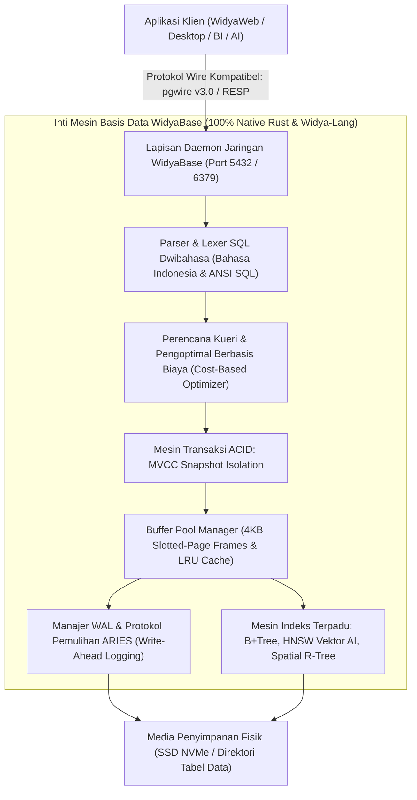

## Bab 1: Filosofi & Arsitektur Terpadu Mesin Basis Data WidyaBase

### 1.1 Kedaulatan Data & Evolusi Basis Data Terpadu

Data adalah minyak baru dan aset paling berharga dalam tatanan kedaulatan digital nasional. Selama beberapa dekade, infrastruktur perbankan, kependudukan, perpajakan, dan pertahanan nasional bergantung secara rentan pada perangkat lunak basis data relasional berbayar asing (seperti Oracle, IBM DB2, Microsoft SQL Server) atau perangkat lunak sumber terbuka multinasional yang sarat dengan jejak dependensi runtime yang kompleks.

**WidyaBase** lahir sebagai jawaban kedaulatan bangsa: sebuah mesin basis data terpadu (*Unified Multi-Modal Database Engine*) skala industri yang dibangun 100% menggunakan bahasa pemrograman berdaulat Widya-Lang dan Rust native murni.



Prinsip fundamental arsitektur WidyaBase:
1. **Multi-Modal Tanpa Silo**: Menggabungkan data relasional tabel (SQL), dokumen bersarang (JSONB), deret waktu (*time-series*), spasial (GIS), graf hubungan (*graph*), dan vektor semantik kecerdasan buatan (*AI embeddings HNSW*) ke dalam satu mesin terpadu tanpa perlu sinkronisasi ETL yang rumit.
2. **Kepatuhan ACID Mutlak**: Menjamin empat pilar transaksional: *Atomicity* (keutuhan transaksi), *Consistency* (konsistensi skema dan batasan), *Isolation* (isolasi konkurensi via MVCC), dan *Durability* (daya tahan data via Write-Ahead Log berorientasi fsync).
3. **Kompatibilitas Ekosistem Industri**: Mendukung *wire protocol* standar PostgreSQL (`pgwire v3.0`) dan Redis (`RESP`), memungkinkan aplikasi yang sudah ada beralih ke WidyaBase secara mulus tanpa menulis ulang kode program klien.

### 1.2 Implementasi Kode Program Utuh

Berikut implementasi inisialisasi mesin basis data WidyaBase dan eksekusi transaksi tabel relasional menggunakan Widya-Lang:

```widya
// Modul Inisialisasi Inti Basis Data WidyaBase
modul inisialisasi_widyabase {
    impor ekosistem::widyabase::{WidyaBase, OpsiKonfigurasi, TransaksiACID};

    fungsi jalankan_server_basis_data() -> Hasil<Boolean, Teks> {
        cetak("==================================================================");
        cetak("  MEMULAI WIDYABASE UNIFIED DATABASE SERVER v0.1.0                ");
        cetak("  Kedaulatan Penyimpanan Data Transaksional Nasional              ");
        cetak("==================================================================");

        // 1. Konfigurasi direktori penyimpanan data dan ukuran buffer pool
        misal konfigurasi = OpsiKonfigurasi {
            jalur_data: "/var/lib/widyabase/data",
            ukuran_buffer_pool_mb: 512,
            halaman_kb: 4,
            port_pgwire: 5432,
            aktifkan_wal: benar
        };

        cetak("[WIDYABASE] Membuka mesin penyimpanan di:", konfigurasi.jalur_data);
        misal db = WidyaBase::buka(konfigurasi)?;

        // 2. Membuat tabel kedaulatan kependudukan
        misal kueri_buat_tabel = "
            BUAT TABEL data_kependudukan (
                nik TEKS KUNCI_UTAMA,
                nama_lengkap TEKS TIDAK_KOSONG,
                kode_wilayah ANGKA,
                saldo_digital ANGKA,
                status_aktif BOOLEAN
            );
        ";
        db.eksekusi_sql(kueri_buat_tabel)?;
        cetak("[SKEMA] Tabel 'data_kependudukan' berhasil dibuat dengan skema ACID.");

        // 3. Memulai transaksi ACID terisolasi (Begin Transaction)
        misal mut tx = db.mulai_transaksi()?;
        cetak("[TRANSAKSI] Transaksi ID #101 dimulai dengan Snapshot Isolation.");

        tx.eksekusi("SISIP KE DALAM data_kependudukan NILAI ('317101001', 'Raden Wijaya', 3171, 5000000, BENAR);")?;
        tx.eksekusi("SISIP KE DALAM data_kependudukan NILAI ('317101002', 'Dyah Pitaloka', 3171, 7500000, BENAR);")?;

        // 4. Komit permanen ke disk via WAL
        tx.komit()?;
        cetak("[KOMIT] Transaksi ID #101 berhasil dikomit permanen ke WAL dan Slotted-Page.");

        kembalikan Hasil::Sukses(benar);
    }
}

modul utama {
    fungsi utama() {
        misal hasil = inisialisasi_widyabase::jalankan_server_basis_data();
        cocokkan hasil {
            Hasil::Sukses(_) => cetak("[SUKSES] WidyaBase siap melayani kueri analitik dan transaksional."),
            Hasil::Gagal(e) => cetak("[GALAT DATABASE]", e)
        }
    }
}
```

### 1.3 Rangkuman Desain & Analisis Rekayasa Sistem

Perbandingan arsitektural antara Basis Data Asing Konvensional dengan WidyaBase:

| Kriteria Sistem | Basis Data Tradisional (Oracle / MySQL) | Ekosistem Terfragmentasi (Polyglot) | WidyaBase Unified Engine |
| :--- | :--- | :--- | :--- |
| **Kedaulatan Kode Sumber** | Tertutup / Lisensi Korporasi Asing | Terpecah banyak pustaka terpisah | 100% Berdaulat (Native Rust/Widya) |
| **Dukungan Multi-Modal** | Tambahan (*Bolt-on extensions*) | Menggunakan 4-5 server basis data berbeda | Terpadu Asli (*Single Unified Engine*) |
| **Bahasa SQL** | ANSI SQL Bahasa Inggris saja | Sintaksis bervariasi | Dwibahasa (Bahasa Indonesia & ANSI) |
| **Penyelarasan AI Vektor** | Membutuhkan database vektor eksternal | Ekstraksi ETL lambat | HNSW Vektor Terintegrasi Langsung |
| **Protokol Wire Jaringan** | Protokol hak milik (*Proprietary*) | Beragam driver | Kompatibel pgwire v3.0 (Drop-in) |

### 1.4 Latihan Mandiri & Evaluasi Pemahaman Sistem

1. Jelaskan bagaimana filosofi *Unified Multi-Modal Database Engine* pada WidyaBase mengeliminasi kompleksitas arsitektur *polyglot persistence* yang membebani tim pengembang dan administrator basis data!
2. Apa keuntungan strategis dari dukungan protokol biner *pgwire v3.0* pada WidyaBase terhadap integrasi aplikasi perbankan dan analitik yang telah ada sebelumnya?
3. Rancanglah sebuah skema basis data pada WidyaBase yang mengombinasikan kolom relasional tabular dengan dokumen `JSONB` dan vektor embeddings `Larik<Desimal>` dalam satu baris tabel yang sama!

### 1.5 Latihan Soal Pilihan Ganda (10 Soal)

1. Filosofi desain utama yang mendasari mesin basis data WidyaBase adalah...
   A. Basis data relasional dokumen teks biasa
   B. Unified Multi-Modal Database Engine dengan dukungan transaksi ACID penuh dan kedaulatan data nasional
   C. File spreadsheet berbasis CSV
   D. Sistem berkas sementara di memori RAM

2. Empat pilar jaminan transaksional yang dipenuhi oleh mesin WidyaBase dikenal dengan akronim...
   A. BASE
   B. ACID (Atomicity, Consistency, Isolation, Durability)
   C. CRUD
   D. REST

3. Protokol jaringan klien (*Wire Protocol*) industri yang didukung secara kompatibel oleh WidyaBase untuk memudahkan integrasi langsung dengan pustaka klien yang ada adalah...
   A. Protokol HTTP/0.9
   B. PostgreSQL pgwire v3.0 dan Redis RESP
   C. FTP
   D. Telnet

4. Ukuran standar halaman penyimpanan disk (*Slotted-Page Storage*) pada mesin WidyaBase adalah...
   A. 512 byte
   B. 4 Kilobyte (4 KB)
   C. 64 Kilobyte
   D. 1 Megabyte

5. Kapabilitas bahasa kueri pada parser WidyaBase yang membedakannya secara unik dari basis data komersial lainnya adalah...
   A. Hanya menerima angka biner 0 dan 1
   B. Mendukung SQL Dwibahasa (Perintah resmi Bahasa Indonesia baku dan ANSI SQL standar internasional)
   C. Hanya mendukung perintah berbasis klik mouse
   D. Menggunakan format perintah XML

6. Mekanisme konkurensi data yang memungkinkan pembaca membaca data tanpa memblokir penulis dan penulis menulis tanpa memblokir pembaca adalah...
   A. Global Table Locking
   B. Multi-Version Concurrency Control (MVCC) dengan Snapshot Isolation
   C. Single Thread Execution
   D. Semaphore Biner

7. Komponen yang bertugas mencatat seluruh operasi perubahan data ke media simpan berurutan sebelum halaman data dialirkan ke disk dinamakan...
   A. Write-Ahead Log (WAL)
   B. Recycle Bin
   C. Temp Directory
   D. Cookie Cache

8. Struktur indeks bawaan pada WidyaBase yang digunakan untuk pencarian kemiripan semantik berbasis kecerdasan buatan (*AI Vector Search*) adalah...
   A. HNSW (Hierarchical Navigable Small World)
   B. Array 1D
   C. B-Tree
   D. Linked List

9. Apakah biner mesin basis data WidyaBase bergantung pada runtime engine Java Virtual Machine atau Python?
   A. Ya, membutuhkan JVM versi 17
   B. Tidak, WidyaBase dibangun 100% native Rust murni tanpa runtime eksternal
   C. Hanya jika dijalankan pada sistem operasi 32-bit
   D. Tergantung koneksi jaringan internet

10. Mengapa kehadiran basis data mandiri berdaulat seperti WidyaBase sangat krusial bagi ketahanan ekonomi dan pertahanan siber nasional?
    A. Menjamin seluruh data strategis warga negara dan transaksi keuangan nasional tersimpan pada sistem penyimpanan yang aman, mandiri, dan bebas dari celah penyusupan pihak asing
    B. Menghapus kebutuhan pembayaran pajak daerah
    C. Mengurangi kebutuhan memori kartu grafis komputer
    D. Membatasi pengetikan kueri hanya pada jam kerja kantor
