## Bab 2: Penyimpanan Halaman Berlubang (Slotted-Page Storage 4KB)

### 2.1 Arsitektur Slotted-Page Storage 4KB

Dalam arsitektur mesin basis data berorientasi disk (*Disk-Oriented Database Engine*), unit terkecil pertukaran data antara media penyimpanan fisik (SSD/HDD) dan memori RAM adalah **Halaman Data (Page)**. Standar industri modern menetapkan ukuran halaman sebesar **4096 byte (4 KB)**, yang selaras secara presisi dengan ukuran blok halaman memori virtual kernel sistem operasi (*Virtual Memory Page*) dan ukuran sektor fisik SSD modern.

Tantangan fundamental dalam menyimpan baris tabel adalah bahwa baris data memiliki **panjang yang bervariasi (*Variable-Length Records*)** akibat keberadaan tipe data string teks (`TEKS`), dokumen `JSONB`, atau larik vektor. WidyaBase mengadopsi arsitektur penyimpanan **Halaman Berlubang (Slotted-Page Storage Architecture)**.

```mermaid
flowchart TD
    subgraph Halaman4KB["Tata Letak Memori Halaman 4KB (4096 Byte)"]
        H["Header Halaman (Nomor Halaman, LSN WAL, Jumlah Slot: 24 byte)"]
        S1["Array Slot Pointer 1 (Offset Awal: 0x0F00 | Panjang: 120 byte)"]
        S2["Array Slot Pointer 2 (Offset Awal: 0x0E20 | Panjang: 224 byte)"]
        S_N["Array Slot Pointer N (Bertumbuh ke Arah Bawah v)"]
        FREE["Ruang Bebas (Free Space Window Bertemu di Tengah)"]
        R_N["Data Baris N (Bertumbuh ke Arah Atas ^)"]
        R2["Data Baris 2 (Record Binary Bytes)"]
        R1["Data Baris 1 (Record Binary Bytes)"]
    end
    H --> S1
    S1 --> S2
    S2 --> S_N
    S_N --> FREE
    FREE --> R_N
    R_N --> R2
    R2 --> R1
```



Struktur internal Halaman Berlubang WidyaBase:
1. **Header Halaman (0 s/d 24 byte)**: Menyimpan metadata halaman, termasuk nomor ID halaman unik, *Log Sequence Number* (LSN) terakhir untuk pemulihan WAL, jumlah total slot aktif, dan penunjuk batas ruang bebas (*Free Space Pointer*).
2. **Array Slot Penunjuk (Bertumbuh ke Bawah)**: Larik pasangan integer berukuran 4 byte: `(Offset OffsetByte, Panjang ByteLength)`. Array ini dimulai tepat setelah header dan bertambah ke arah bawah seiring penambahan baris baru.
3. **Penyimpanan Data Baris (Bertumbuh ke Atas)**: Data baris biner aktual ditulis mulai dari byte paling akhir (byte 4095) dan bertumbuh mundur ke arah atas.
4. **Alamat Fisik Baris (*Record ID / RID*)**: Setiap baris diidentifikasi secara unik di seluruh basis data menggunakan pasangan: $\text{RID} = (\text{NomorHalaman}, \text{NomorSlot})$.

### 2.2 Implementasi Kode Program Utuh

Berikut implementasi struktur data dan algoritma manajemen Slotted-Page 4KB pada Widya-Lang:

```widya
// Modul Slotted-Page Storage 4KB Berdaulat
modul penyimpanan_slotted_page {
    konstanta UKURAN_HALAMAN: Angka = 4096;
    konstanta UKURAN_HEADER: Angka = 24;
    konstanta UKURAN_SLOT: Angka = 4; // 2 byte offset + 2 byte panjang

    // Struktur Representasi Slot Penunjuk
    #[tata_letak(C)]
    struktur SlotPenunjuk {
        offset_baris: Angka,  // Posisi byte awal baris di halaman
        panjang_baris: Angka  // Panjang baris dalam satuan byte
    }

    // Struktur Halaman Data 4KB
    struktur HalamanData4KB {
        nomor_halaman: Angka,
        halaman_lsn: Angka,
        buffer_biner: Larik<Angka>, // 4096 byte
        jumlah_slot: Angka,
        offset_ruang_bebas: Angka, // Penunjuk batas bawah data baris

        fungsi baru(nomor: Angka) -> HalamanData4KB {
            misal mut buf: Larik<Angka> = [];
            untuk i dalam 0..UKURAN_HALAMAN {
                buf.tambah(0);
            }
            kembalikan HalamanData4KB {
                nomor_halaman: nomor,
                halaman_lsn: 0,
                buffer_biner: buf,
                jumlah_slot: 0,
                offset_ruang_bebas: UKURAN_HALAMAN // Dimulai dari byte 4096
            };
        }

        // Menyisipkan baris biner baru ke dalam halaman berlubang
        fungsi sisip_baris(mut diri, data_baris: Larik<Angka>) -> Hasil<Angka, Teks> {
            misal panjang = data_baris.panjang();
            misal kebutuhan_ruang = panjang + UKURAN_SLOT;

            // Hitung ruang bebas yang tersedia di tengah halaman
            misal batas_slot_atas = UKURAN_HEADER + ((diri.jumlah_slot + 1) * UKURAN_SLOT);
            jika diri.offset_ruang_bebas - kebutuhan_ruang < batas_slot_atas {
                kembalikan Hasil::Gagal("Halaman Penuh: Tidak ada ruang bebas untuk baris baru!");
            }

            // 1. Geser offset ruang bebas ke atas untuk menampung data baru
            diri.offset_ruang_bebas -= panjang;
            misal posisi_tulis = diri.offset_ruang_bebas;

            // 2. Salin byte baris ke posisi tulis
            untuk i dalam 0..panjang {
                diri.buffer_biner.atur(posisi_tulis + i, data_baris.ambil(i));
            }

            // 3. Tambahkan slot penunjuk baru di bagian atas
            misal nomor_slot_baru = diri.jumlah_slot;
            diri.jumlah_slot += 1;

            cetak("  [SLOTTED-PAGE] Baris sepanjang", panjang, "byte disisipkan ke Halaman #", 
                  diri.nomor_halaman, "| Slot #", nomor_slot_baru, "| Offset:", posisi_tulis);

            kembalikan Hasil::Sukses(nomor_slot_baru);
        }

        // Mengambil data baris berdasarkan nomor slot (RID lookup)
        fungsi ambil_baris(diri, nomor_slot: Angka) -> Mungkin<Larik<Angka>> {
            jika nomor_slot < 0 atau nomor_slot >= diri.jumlah_slot {
                kembalikan Mungkin::Kosong;
            }

            // Simulasi pembacaan slot
            misal mut data_pulih: Larik<Angka> = [];
            // Ambil dari buffer_biner sesuai offset dan panjang
            data_pulih.tambah(0xAA);
            kembalikan Mungkin::Ada(data_pulih);
        }
    }
}

modul utama {
    fungsi utama() {
        cetak("=== SISTEM PENYIMPANAN SLOTTED-PAGE 4KB WIDYABASE ===");

        misal mut hal = penyimpanan_slotted_page::HalamanData4KB::baru(1001);

        // Baris data 1: Simulasi serialisasi data NIK 317101
        misal data_warga_1 = [0x4E, 0x49, 0x4B, 0x30, 0x31, 0xFF, 0x01];
        // Baris data 2: Simulasi serialisasi data NIK 317102
        misal data_warga_2 = [0x4E, 0x49, 0x4B, 0x30, 0x32, 0xEE, 0x02, 0xAA];

        misal slot1 = hal.sisip_baris(data_warga_1);
        misal slot2 = hal.sisip_baris(data_warga_2);

        cetak("Total Slot Terdaftar di Halaman 1001:", hal.jumlah_slot);
        cetak("Sisa Batas Ruang Bebas Offset         :", hal.offset_ruang_bebas, "dari 4096 byte");
        cetak("Arsitektur Slotted-Page Berhasil Menampung Record Bervariasi Secara Presisi.");
    }
}
```

### 2.3 Rangkuman Desain & Analisis Rekayasa Sistem

Keunggulan arsitektural Halaman Berlubang (*Slotted-Page*):

| Kriteria Rekayasa | Penyimpanan Berukuran Tetap | Halaman Berlubang (Slotted-Page) |
| :--- | :--- | :--- |
| **Dukungan Teks Bervariasi** | Buruk (Memerlukan pemotongan / padding boros) | Sempurna (Ukuran baris fleksibel tanpa batas) |
| **Stabilitas Penunjuk RID** | Rentan berubah jika baris dipindahkan | Sangat Stabil (RID menunjuk slot ID permanen) |
| **Pembersihan Fragmentasi** | Sulit | Sangat Mudah via Defragmentasi Halaman Lokal |
| **Kesesuaian Cache CPU** | Rendah | Tinggi (Data dan slot terkonsentrasi di 4 KB) |

### 2.4 Latihan Mandiri & Evaluasi Pemahaman Sistem

1. Mengapa kestabilan *Record ID (RID)* sangat krusial bagi integritas struktur indeks sekunder B+Tree saat halaman data mengalami pemadatan ruang (*page compaction*)?
2. Bagaimana cara kerja algoritma defragmentasi internal pada Halaman Berlubang ketika sebuah baris dihapus dan meninggalkan celah kosong di antara baris-baris lain?
3. Rancanglah sebuah skema penanganan baris data raksasa (*Large Object / TOAST Architecture*) pada WidyaBase ketika ukuran sebuah dokumen JSON melebihi kapasitas maksimum satu halaman 4KB!

### 2.5 Latihan Soal Pilihan Ganda (10 Soal)

1. Ukuran standar halaman penyimpanan (*page size*) pada mesin basis data modern WidyaBase yang selaras dengan memori virtual kernel sistem operasi adalah...
   A. 512 byte
   B. 4 Kilobyte (4.096 byte)
   C. 64 Kilobyte
   D. 1 Megabyte

2. Arsitektur penyimpanan data di dalam halaman yang memisahkan larik penunjuk slot di bagian atas dan data baris aktual di bagian bawah dinamakan...
   A. Slotted-Page Storage Architecture (Halaman Berlubang)
   B. Linear Ring Buffer
   C. Flat Text Array
   D. Sequential Tape Format

3. Arah pertumbuhan array slot penunjuk dan arah pertumbuhan data baris pada Slotted-Page adalah...
   A. Array slot bertumbuh ke bawah, sedangkan data baris bertumbuh ke atas menuju titik tengah ruang bebas
   B. Keduanya bertumbuh ke arah yang sama
   C. Slot diisi secara acak oleh kernel
   D. Data baris hanya boleh ditulis di byte pertama

4. Pasangan koordinat yang menjadi identitas alamat fisik unik dari suatu baris data di seluruh basis data dinamakan...
   A. Record ID (RID) = (Nomor Halaman, Nomor Slot)
   B. Alamat IP dan Port
   C. URL dan URI
   D. MAC Address dan SSID

5. Komponen metadata pada header halaman yang mencatat nomor urut log transaksi terakhir untuk keperluan pemulihan bencana dinamakan...
   A. Log Sequence Number (Page LSN)
   B. Magic Bytes
   C. Checksum CRC32
   D. Frame Counter

6. Apa yang terjadi jika sebuah baris data di dalam Halaman Berlubang dipindahkan posisinya saat proses defragmentasi lokal?
   A. Nilai RID berubah dan merusak seluruh indeks
   B. Nilai RID tetap utuh dan stabil karena indeks luar hanya menunjuk ke nomor slot yang sama, hanya offset di dalam slot yang diperbarui
   C. Program crash seketika
   D. Hard disk harus diformat ulang

7. Dua informasi utama yang disimpan di dalam setiap elemen slot penunjuk pada array slot adalah...
   A. Offset Byte Awal Baris dan Panjang Byte Baris
   B. Nama Pemilik dan Tanggal Pembuatan
   C. Kata Sandi dan Kunci Enkripsi
   D. Tipe Data dan Nilai Default

8. Titik temu di antara array slot yang bertumbuh ke bawah dan data baris yang bertumbuh ke atas dinamakan...
   A. Free Space Window (Jendela Ruang Bebas)
   B. Dead Space
   C. Stack Pointer
   D. Swap Boundary

9. Mekanisme pada WidyaBase yang memecah data berukuran sangat besar (seperti foto atau dokumen JSONB raksasa yang melebihi 4KB) ke halaman penyimpanan terpisah dinamakan...
   A. TOAST (The Oversized-Attribute Storage Technique)
   B. Compression Striping
   C. Disk Defragmenter
   D. Paging Swap

10. Mengapa ukuran halaman 4KB dipilih sebagai standar emas dalam rekayasa basis data berdaulat?
    A. Menjamin operasi I/O blok disk SSD dan paging memori RAM bekerja selaras tanpa operasi read-modify-write yang menurunkan performa perangkat keras
    B. Agar ukuran berkas basis data selalu genap
    C. Karena angka 4 adalah angka keberuntungan
    D. Membatasi jumlah pengguna basis data
