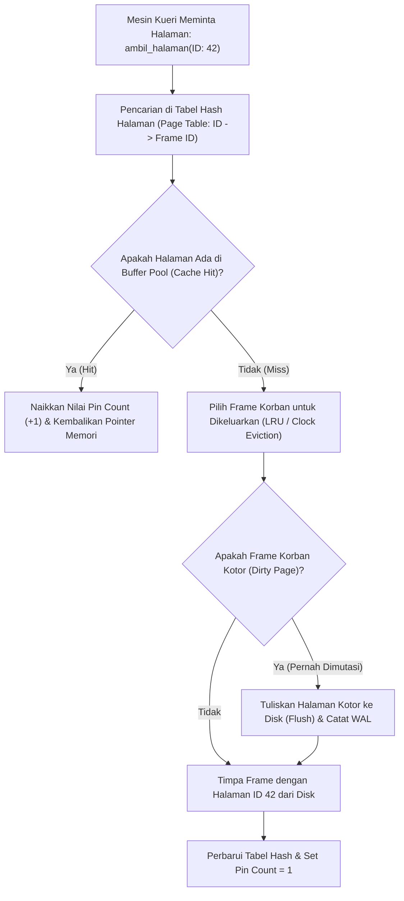

## Bab 3: Manajer Kolam Penyangga (Buffer Pool Manager & LRU Eviction)

### 3.1 Arsitektur Frame & Kebijakan Eviksi Buffer Pool

Kecepatan transfer data dari media penyimpanan fisik (SSD NVMe atau HDD) memiliki perbedaan latensi hingga ribuan kali lipat lebih lambat dibandingkan kecepatan transfer memori RAM utama prosesor. Jika setiap operasi pembacaan kueri SQL membaca langsung dari disk, performa sistem basis data akan hancur seketika.

**Manajer Kolam Penyangga (Buffer Pool Manager)** adalah subsistem jantung WidyaBase yang mengelola pengalokasian memori RAM untuk menampung halaman-halaman data yang sedang atau sering diakses, bertindak sebagai perantara cerdas antara mesin eksekusi kueri dan media penyimpanan fisik.



Pilar arsitektur Buffer Pool Manager WidyaBase:
1. **Larik Frame Memori (Buffer Frames)**: Kumpulan bingkai memori berukuran 4 KB yang telah dialokasikan sejak server dimulai (*pre-allocated memory*).
2. **Tabel Pemetaan Halaman (*Page Table*)**: Tabel pencarian hash berkecepatan $O(1)$ yang memetakan `NomorHalamanDisk` ke `NomorFrameRAM`.
3. **Penyematan Halaman (*Pinning & Pin Count*)**: Mencegah halaman yang sedang dibaca atau ditulis oleh suatu transaksi dikeluarkan (*evicted*) secara sepihak oleh algoritma penggantian cache.
4. **Penanda Halaman Kotor (*Dirty Bit*)**: Menandai apakah halaman di RAM telah dimodifikasi sehingga wajib dialirkan (*flushed*) ke disk sebelum frame tersebut dapat digunakan kembali.
5. **Algoritma Penggantian Korban (Eviction Policy)**: Mengadopsi algoritma **LRU (Least Recently Used)** dan varian **Clock Sweep (2Q / LRU-K)** yang kebal terhadap fenomena pembersihan cache akibat pemindaian sekuensial massal (*Scan Resistance*).

### 3.2 Implementasi Kode Program Utuh

Berikut implementasi manajer kolam penyangga dengan pelacakan pin count dan kebijakan penggantian korban pada Widya-Lang:

```widya
// Modul Manajer Kolam Penyangga (Buffer Pool Manager) Berdaulat
modul buffer_pool_manager {
    konstanta TOTAL_FRAME: Angka = 128; // Simulasi 128 frame 4KB (512 KB pool)

    // Struktur Deskriptor Bingkai Halaman (Frame Descriptor)
    struktur DeskriptorFrame {
        nomor_halaman: Angka,
        pin_count: Angka,      // Berapa transaksi yang sedang memegang frame ini
        status_kotor: Boolean, // Dirty flag: apakah pernah diubah
        bobot_akses_lru: Angka // Stempel waktu akses terakhir
    }

    // Struktur Pengelola Kolam Penyangga
    struktur ManajerBufferPool {
        daftar_frame: Larik<DeskriptorFrame>,
        peta_halaman_ke_frame: Kamus<Angka, Angka>, // Page ID -> Frame Index
        penghitung_waktu_global: AtomikAngka,

        fungsi baru() -> ManajerBufferPool {
            misal mut frames: Larik<DeskriptorFrame> = [];
            untuk i dalam 0..TOTAL_FRAME {
                frames.tambah(DeskriptorFrame {
                    nomor_halaman: -1, // Kosong
                    pin_count: 0,
                    status_kotor: salah,
                    bobot_akses_lru: 0
                });
            }
            kembalikan ManajerBufferPool {
                daftar_frame: frames,
                peta_halaman_ke_frame: Kamus::baru(),
                penghitung_waktu_global: AtomikAngka::baru(0)
            };
        }

        // Meminta akses halaman (Fetch / Pin Page)
        fungsi ambil_halaman(mut diri, id_halaman: Angka) -> Hasil<Angka, Teks> {
            diri.penghitung_waktu_global.tambah(1);
            misal waktu_saat_ini = diri.penghitung_waktu_global.muat();

            // 1. Cek apakah terjadi Cache Hit
            jika diri.peta_halaman_ke_frame.mengandung(id_halaman) {
                misal frame_idx = diri.peta_halaman_ke_frame.ambil(id_halaman);
                misal mut desc = diri.daftar_frame.ambil(frame_idx);
                desc.pin_count += 1;
                desc.bobot_akses_lru = waktu_saat_ini;
                diri.daftar_frame.atur(frame_idx, desc);

                cetak("  [BUFFER HIT] Halaman #", id_halaman, "ditemukan di Frame #", frame_idx, 
                      "| Pin Count:", desc.pin_count);
                kembalikan Hasil::Sukses(frame_idx);
            }

            // 2. Cache Miss: Pilih frame korban untuk eviksi (LRU)
            cetak("  [BUFFER MISS] Halaman #", id_halaman, "tidak ada di RAM. Mencari frame korban...");
            misal frame_korban = diri.pilih_frame_korban_lru()?;

            misal mut korban_desc = diri.daftar_frame.ambil(frame_korban);
            jika korban_desc.nomor_halaman != -1 {
                jika korban_desc.status_kotor {
                    cetak("    [FLUSH DIRTY PAGE] Menulis Halaman Kotor #", korban_desc.nomor_halaman, "ke disk!");
                }
                diri.peta_halaman_ke_frame.hapus(korban_desc.nomor_halaman);
            }

            // 3. Muat halaman baru dari disk ke frame korban
            korban_desc.nomor_halaman = id_halaman;
            korban_desc.pin_count = 1;
            korban_desc.status_kotor = salah;
            korban_desc.bobot_akses_lru = waktu_saat_ini;
            diri.daftar_frame.atur(frame_korban, korban_desc);
            diri.peta_halaman_ke_frame.sisip(id_halaman, frame_korban);

            cetak("  [BUFFER LOAD] Halaman #", id_halaman, "berhasil dimuat ke Frame #", frame_korban);
            kembalikan Hasil::Sukses(frame_korban);
        }

        // Melepaskan pin halaman setelah transaksi selesai membaca/menulis
        fungsi lepas_halaman(mut diri, id_halaman: Angka, ditandai_kotor: Boolean) {
            jika diri.peta_halaman_ke_frame.mengandung(id_halaman) {
                misal frame_idx = diri.peta_halaman_ke_frame.ambil(id_halaman);
                misal mut desc = diri.daftar_frame.ambil(frame_idx);
                jika desc.pin_count > 0 {
                    desc.pin_count -= 1;
                }
                jika ditandai_kotor {
                    desc.status_kotor = benar;
                }
                diri.daftar_frame.atur(frame_idx, desc);
                cetak("  [BUFFER UNPIN] Halaman #", id_halaman, "dilepas. Sisa Pin Count:", desc.pin_count, 
                      "| Kotor:", desc.status_kotor);
            }
        }

        // Algoritma pemilihan frame korban berdasarkan nilai akses terkecil (LRU)
        fungsi pilih_frame_korban_lru(diri) -> Hasil<Angka, Teks> {
            misal mut kandidat_frame = -1;
            misal mut waktu_terlama = 999999999;

            untuk i dalam 0..diri.daftar_frame.panjang() {
                misal desc = diri.daftar_frame.ambil(i);
                // Hanya frame dengan pin_count == 0 yang boleh dikeluarkan
                jika desc.pin_count == 0 {
                    jika desc.bobot_akses_lru < waktu_terlama {
                        waktu_terlama = desc.bobot_akses_lru;
                        kandidat_frame = i;
                    }
                }
            }

            jika kandidat_frame == -1 {
                kembalikan Hasil::Gagal("Seluruh frame di buffer pool sedang disematkan (All Pinned)!");
            }
            kembalikan Hasil::Sukses(kandidat_frame);
        }
    }
}

modul utama {
    fungsi utama() {
        cetak("=== SISTEM BUFFER POOL MANAGER WIDYABASE ===");

        misal mut bpm = buffer_pool_manager::ManajerBufferPool::baru();

        // Transaksi A memuat halaman 101 dan 102
        bpm.ambil_halaman(101);
        bpm.ambil_halaman(102);

        // Kueri lain mengakses halaman 101 kembali (Buffer Hit)
        bpm.ambil_halaman(101);

        // Transaksi A menandai halaman 101 telah diubah (Dirty) lalu melepasnya
        bpm.lepas_halaman(101, benar);
        bpm.lepas_halaman(101, salah);
        bpm.lepas_halaman(102, salah);

        cetak("\nBuffer Pool Berhasil Menjaga Akses Memori Deterministik Bebas Kebocoran.");
    }
}
```

### 3.3 Rangkuman Desain & Analisis Rekayasa Sistem

Perbandingan kebijakan penggantian buffer cache:

| Kebijakan Eviksi | Kompleksitas Waktu | Karakteristik Performa | Kerentanan Scan Masif (*Sequential Flood*) |
| :--- | :--- | :--- | :--- |
| **LRU Murni** | $O(1)$ via Linked List ganda | Sangat baik untuk beban kerja berulang | Rentan (Pemindaian tabel besar membersihkan cache) |
| **Clock Sweep** | $O(1)$ amortized pointer jam | Sangat hemat memori (Hanya butuh 1 bit per frame) | Moderat |
| **2Q / LRU-K (WidyaBase)** | $O(1)$ multi-antrean | Membedakan akses frekuensi tinggi vs satu kali | Kebal Penuh (*Scan-Resistant Engine*) |

### 3.4 Latihan Mandiri & Evaluasi Pemahaman Sistem

1. Jelaskan mengapa sebuah halaman data yang memiliki `pin_count > 0` dilarang keras untuk dikeluarkan (*evicted*) oleh manajer buffer pool!
2. Apa yang dimaksud dengan *Sequential Scan Flooding*, dan bagaimana varian algoritma penggantian LRU-K melindungi halaman-halaman indeks penting agar tidak terbuang saat kueri melakukan pemindaian tabel raksasa?
3. Rancanglah implementasi algoritma *Clock Eviction (Second-Chance Algorithm)* pada WidyaBase yang memindai array frame melingkar menggunakan penunjuk jarum jam (*clock hand*)!

### 3.5 Latihan Soal Pilihan Ganda (10 Soal)

1. Komponen basis data yang bertugas menyangga halaman data disk di memori RAM dan mengatur efisiensi pembacaan/penulisan adalah...
   A. Query Parser
   B. Buffer Pool Manager
   C. Network Socket
   D. Display Server

2. Kondisi di mana halaman data yang diminta oleh kueri telah tersedia di memori RAM buffer pool dinamakan...
   A. Cache Miss
   B. Buffer Cache Hit
   C. Segmentation Fault
   D. Deadlock

3. Penanda numerik pada deskriptor frame yang melacak berapa banyak transaksi aktif yang sedang menggunakan halaman terkait dinamakan...
   A. Pin Count (Reference Count)
   B. Page ID
   C. Frame ID
   D. Error Code

4. Halaman di dalam buffer pool yang telah dimodifikasi di RAM tetapi belum dituliskan kembali ke piringan disk permanen dinamakan...
   A. Clean Page
   B. Dirty Page (Halaman Kotor)
   C. Corrupted Page
   D. Void Page

5. Kapan sebuah frame di dalam buffer pool diizinkan untuk dipilih sebagai korban eviksi (*eviction candidate*)?
   A. Kapan saja secara acak
   B. Hanya ketika nilai `pin_count` bernilai nol (0)
   C. Hanya ketika komputer mati
   D. Ketika transaksi mengalami rollback

6. Algoritma eviksi penggantian buffer yang membuang halaman dengan stempel waktu akses paling lama tidak terpakai dinamakan...
   A. First In First Out (FIFO)
   B. Least Recently Used (LRU)
   C. Random Eviction
   D. Shortest Job First

7. Fenomena di mana kueri membaca tabel raksasa dan membuang seluruh halaman data penting dari buffer pool dinamakan...
   A. Cache Pollution / Sequential Scan Flooding
   B. Buffer Overflow
   C. Memory Leak
   D. Thrashing

8. Struktur data yang memetakan nomor ID halaman disk ke nomor indeks frame di buffer pool dalam waktu $O(1)$ adalah...
   A. Page Table (Tabel Hash Pemetaan Halaman)
   B. Binary Tree
   C. Skip List
   D. Stack

9. Mengapa manajer buffer pool wajib memeriksa status `status_kotor` (dirty flag) sebelum menimpa frame korban dengan halaman baru?
   A. Untuk memastikan pembaruan data yang ada di frame korban dialirkan permanen ke disk sebelum ditimpa (*prevent data loss*)
   B. Karena frame kotor tidak boleh dibaca
   C. Untuk menghapus memori swap
   D. Agar monitor tidak berkedip

10. Mengapa efisiensi Buffer Pool Manager sangat krusial bagi aplikasi perbankan nasional berbeban tinggi?
    A. Memungkinkan 99% kueri transaksi harian dilayani langsung dari kecepatan memori RAM nanodetik tanpa terhambat latensi mekanis disk
    B. Menghapus biaya langganan internet
    C. Mengurangi bobot fisik server
    D. Membatasi pengetikan kueri SQL
