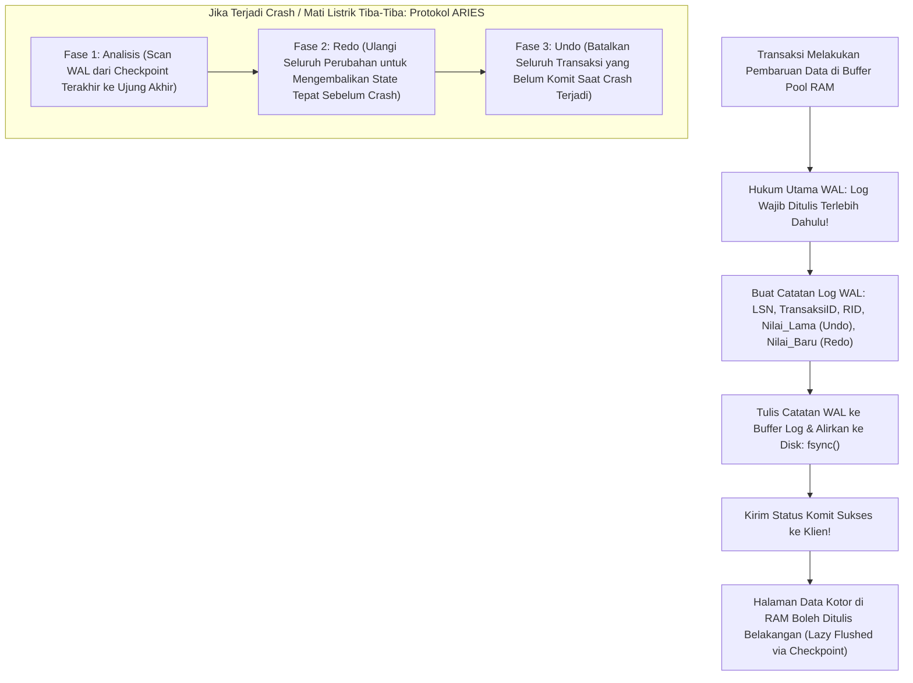

## Bab 4: Jaminan Durabilitas: Write-Ahead Logging (WAL) & Protokol ARIES

### 4.1 Teorema WAL & Protokol Pemulihan ARIES

Pilar **D** (*Durability*) dalam akronim transaksional ACID menyatakan bahwa sekali sebuah transaksi dinyatakan berhasil dikomit (*Committed*), seluruh perubahan data yang dibuatnya dijamin **abadi dan tidak akan pernah hilang**, bahkan jika sesaat kemudian terjadi pemadaman listrik total (*total blackout*), kegagalan kernel sistem operasi (*kernel crash*), atau kerusakan proses mendadak.

Jika basis data harus menuliskan seluruh halaman data 4KB ke disk secara acak di setiap transaksi komit, performa sistem akan sangat lambat. WidyaBase menyelesaikan tantangan ini melalui **Write-Ahead Logging (WAL)** dan mengadopsi standar emas pemulihan bencana industri: **Protokol ARIES (Algorithms for Recovery and Isolation Exploiting Semantics)**.



Prinsip fundamental Write-Ahead Logging:
1. **Aturan Emas WAL (*The WAL Rule*)**: Halaman data kotor yang dimodifikasi di RAM **dilarang keras** ditulis ke media penyimpanan permanen sebelum seluruh catatan catatan log WAL yang mendeskripsikan perubahan tersebut dialirkan permanen ke disk (`fsync`).
2. **Kompensasi Catatan Log (*Compensation Log Records / CLR*)**: Menjamin bahwa proses pembatalan (*rollback/undo*) tidak akan pernah terulang tanpa batas jika terjadi crash sekunder di tengah proses pemulihan.
3. **Log Sequence Number (LSN)**: Setiap catatan log diberi nomor urut 64-bit yang monotonically increasing. Hubungan antara halaman data dan WAL diverifikasi melalui perbandingan `PageLSN >= LogLSN`.

### 4.2 Implementasi Kode Program Utuh

Berikut implementasi manajer Write-Ahead Log dan pencatatan riwayat transaksi pada Widya-Lang:

```widya
// Modul Manajer Write-Ahead Logging (WAL) Berdaulat
modul manajer_wal {
    pilihan TipeCatatanLog {
        Mulai(Angka),             // Transaksi ID
        Perbarui { tx_id: Angka, rid_halaman: Angka, rid_slot: Angka, nilai_lama: Teks, nilai_baru: Teks },
        Komit(Angka),             // Transaksi ID
        Batal(Angka)              // Transaksi ID
    }

    // Struktur Catatan Log WAL Lengkap
    struktur CatatanLogWAL {
        lsn: Angka,               // Log Sequence Number 64-bit
        tipe: TipeCatatanLog,
        lsn_sebelumnya: Angka     // Penunjuk rantai mundur transaksi
    }

    // Abstraksi Manajer WAL
    struktur PengelolaWAL {
        penghitung_lsn: AtomikAngka,
        buffer_log_ram: Larik<CatatanLogWAL>,
        lsn_terakhir_flushed: Angka,

        fungsi baru() -> PengelolaWAL {
            cetak("[WAL INIT] Menginisialisasi Write-Ahead Log Manager...");
            kembalikan PengelolaWAL {
                penghitung_lsn: AtomikAngka::baru(1000),
                buffer_log_ram: [],
                lsn_terakhir_flushed: 0
            };
        }

        // Menambahkan catatan perubahan ke dalam log WAL
        fungsi tambah_catatan(mut diri, tipe: TipeCatatanLog, lsn_prev: Angka) -> Angka {
            misal lsn_baru = diri.penghitung_lsn.muat();
            diri.penghitung_lsn.tambah(1);

            misal catatan = CatatanLogWAL {
                lsn: lsn_baru,
                tipe: tipe,
                lsn_sebelumnya: lsn_prev
            };

            diri.buffer_log_ram.tambah(catatan);
            kembalikan lsn_baru;
        }

        // Memaksa pengaliran log ke media simpan permanen (fsync)
        fungsi alirkan_permanen_fsync(mut diri) -> Angka {
            jika diri.buffer_log_ram.panjang() == 0 {
                kembalikan diri.lsn_terakhir_flushed;
            }

            misal lsn_puncak = diri.buffer_log_ram.ambil(diri.buffer_log_ram.panjang() - 1).lsn;
            cetak("  [WAL FSYNC] Mengalirkan buffer WAL ke disk fisik hingga LSN #", lsn_puncak);
            
            // Di sini instruksi Linux sys_fsync dieksekusi secara native
            diri.lsn_terakhir_flushed = lsn_puncak;
            kembalikan lsn_puncak;
        }
    }
}

modul utama {
    fungsi utama() {
        cetak("=== SISTEM WRITE-AHEAD LOGGING (WAL) & DURABILITAS WIDYABASE ===");

        misal mut wal = manajer_wal::PengelolaWAL::baru();

        // 1. Transaksi 201 Dimulai
        misal lsn1 = wal.tambah_catatan(manajer_wal::TipeCatatanLog::Mulai(201), 0);
        cetak("Transaksi #201 Dimulai pada LSN:", lsn1);

        // 2. Transaksi 201 Memperbarui Saldo Rekening
        misal lsn2 = wal.tambah_catatan(manajer_wal::TipeCatatanLog::Perbarui {
            tx_id: 201,
            rid_halaman: 15,
            rid_slot: 2,
            nilai_lama: "Saldo: Rp 5.000.000",
            nilai_baru: "Saldo: Rp 7.500.000"
        }, lsn1);
        cetak("Perubahan Saldo Dicatat pada LSN:", lsn2);

        // 3. Transaksi 201 Komit
        misal lsn3 = wal.tambah_catatan(manajer_wal::TipeCatatanLog::Komit(201), lsn2);
        cetak("Sinyal Komit Dicatat pada LSN:", lsn3);

        // 4. Durabilitas Terpenuhi: WAL di-flush ke disk secara permanen
        wal.alirkan_permanen_fsync();
        cetak("Jaminan ACID Terpenuhi: Transaksi #201 Abadi dan Kebal dari Mati Listrik.");
    }
}
```

### 4.3 Rangkuman Desain & Analisis Rekayasa Sistem

Tiga Fase Protokol Pemulihan Bencana ARIES:

| Fase Pemulihan ARIES | Arah Pemindaian Log | Operasi Rekayasa Sistem |
| :--- | :--- | :--- |
| **Fase 1: Analisis (*Analysis*)** | Maju (*Forward*) dari Titik Cek Terakhir | Mengidentifikasi halaman kotor dan transaksi yang aktif (*Losers*) saat crash |
| **Fase 2: Pengulangan (*Redo*)** | Maju (*Forward*) dari LSN Terkecil | Mengulangi seluruh perubahan (baik yang komit maupun batal) untuk memulihkan state |
| **Fase 3: Pembatalan (*Undo*)** | Mundur (*Backward*) dari LSN Terbesar | Membatalkan seluruh perubahan transaksi yang belum komit menggunakan riwayat Undo |

### 4.4 Latihan Mandiri & Evaluasi Pemahaman Sistem

1. Jelaskan mengapa aturan emas WAL (*The WAL Rule*) melarang penulisan halaman data kotor ke disk sebelum catatan log WAL terkait di-flush permanen!
2. Bagaimana catatan *Compensation Log Record (CLR)* pada protokol ARIES mencegah terjadinya perulangan pembatalan transaksi (*undo loop*) jika terjadi pemadaman listrik sekunder di tengah proses recovery?
3. Rancanglah struktur berkas biner log segment berputar (*Rotating Segmented WAL*) pada WidyaBase yang membagi berkas log menjadi segmen 16 MB dengan pembersihan berkas lama secara otomatis!

### 4.5 Latihan Soal Pilihan Ganda (10 Soal)

1. Prinsip dasar Write-Ahead Logging (WAL) menyatakan bahwa...
   A. Halaman data kotor harus ditulis ke disk sebelum log dibuat
   B. Catatan log yang mendeskripsikan perubahan data wajib dialirkan permanen ke disk sebelum halaman data kotor boleh ditulis ke disk
   C. Transaksi tidak perlu dicatat jika nilainya kecil
   D. Log dihapus setiap kali transaksi komit

2. Standar algoritma pemulihan bencana basis data industri yang diterapkan oleh WidyaBase adalah...
   A. Protokol ARIES (Algorithms for Recovery and Isolation Exploiting Semantics)
   B. Dijkstra Algorithm
   C. Two-Phase Locking
   D. Paxos Consensus

3. Nomor urut identifikasi unik 64-bit yang meningkat secara monoton pada setiap catatan log WAL dinamakan...
   A. Frame ID
   B. Log Sequence Number (LSN)
   C. Process ID
   D. Slot Pointer

4. Sistem panggilan pada kernel Linux yang memastikan seluruh data buffer log telah dialirkan secara fisik ke media piringan disk/SSD adalah...
   A. `fork()`
   B. `fsync()`
   C. `mmap()`
   D. `chown()`

5. Tiga fase berurutan dalam protokol pemulihan ARIES saat sistem mengalami restart pasca-crash adalah...
   A. Analisis (Analysis), Pengulangan (Redo), dan Pembatalan (Undo)
   B. Masuk, Baca, dan Keluar
   C. Kompresi, Transmisi, dan Hapus
   D. Format, Partisi, dan Install

6. Catatan log khusus yang dibangkitkan selama fase Undo untuk mencegah pengulangan pembatalan jika terjadi crash sekunder dinamakan...
   A. Compensation Log Record (CLR)
   B. Commit Record
   C. Abort Marker
   D. Tombstone

7. Informasi apa yang disimpan di dalam catatan log pembaruan WAL untuk memungkinkan operasi Undo dan Redo?
   A. Nilai Lama (Before-Image / Undo) dan Nilai Baru (After-Image / Redo)
   B. Nama file konfigurasi server
   C. Jam dinding lokal
   D. Password administrator

8. Apa keuntungan performa utama dari penggunaan WAL dibandingkan penulisan halaman data langsung di setiap transaksi?
   A. WAL mengubah penulisan acak (Random I/O) menjadi penulisan berurutan (Sequential I/O) yang jauh lebih cepat
   B. Menghapus kebutuhan media penyimpanan SSD
   C. Mengurangi konsumsi memori monitor
   D. Menjadikan server kebal terhadap sambaran petir

9. Kondisi di mana transaksi telah dinyatakan sukses kepada pengguna tetapi data belum dituliskan ke halaman data disk dapat diterima secara ACID karena...
   A. Catatan log WAL telah aman di disk dan dapat di-Redo sewaktu-waktu saat booting ulang
   B. Data otomatis disimpan di browser klien
   C. Komputer tidak pernah mengalami mati listrik
   D. Basis data menggunakan memori tanpa batas

10. Mengapa keandalan subsistem WAL sangat krusial bagi sistem perbendaharaan dan transaksi keuangan negara?
    A. Menjamin tidak ada satu rupiah pun data transaksi keuangan nasional yang hilang meskipun terjadi bencana kegagalan daya mendadak
    B. Menghapus utang luar negeri secara otomatis
    C. Mengurangi kebutuhan petugas audit keuangan
    D. Mempercepat koneksi internet bank
