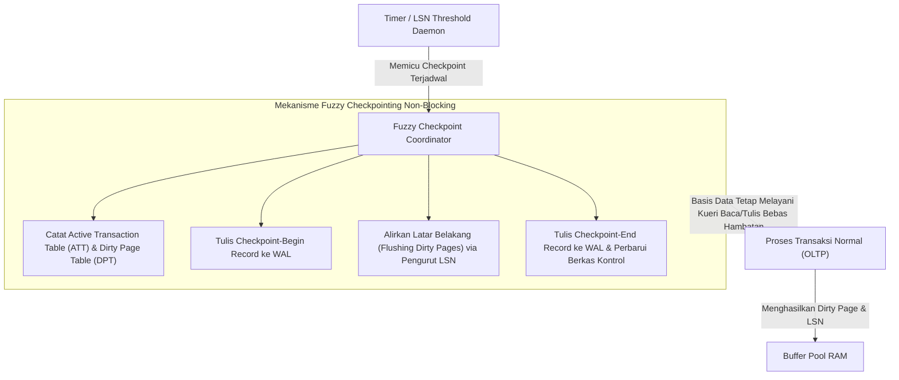

## Bab 5: Pemulihan Crash & Mekanisme Checkpointing Non-Blocking

### 5.1 Siklus Checkpoint & Mitigasi Waktu Booting Ulang

Bila Write-Ahead Log (WAL) dibiarkan tumbuh tanpa batas, proses pemulihan pasca kegagalan daya (*system crash*) akan memakan waktu berjam-jam karena mesin basis data harus membaca ulang seluruh berkas log sejak awal instalasi sistem. Oleh karena itu, mesin basis data modern memerlukan mekanisme **Checkpointing**.

Mekanisme checkpointing bertugas menyingkronkan halaman kotor (*dirty pages*) yang masih tersimpan di dalam memori RAM Buffer Pool ke media penyimpanan fisik piringan disk, serta memperbarui titik awal pemulihan minimum (*Checkpointed LSN*).



WidyaBase menerapkan pendekatan **Fuzzy Non-Blocking Checkpointing**:
1. **Tanpa Berhenti (Non-Blocking)**: Transaksi aktif tidak dihentikan (*no freeze*) saat proses sinkronisasi halaman kotor berlangsung. Klien tetap dapat membaca dan menulis transaksi baru secara normal.
2. **Koleksi Status Ringkas**: Checkpoint mencatat dua tabel metadata utama pada saat titik potong:
   - *Active Transaction Table* (ATT): Daftar seluruh transaksi yang sedang berlangsung beserta status dan `lastLSN`-nya.
   - *Dirty Page Table* (DPT): Daftar seluruh nomor halaman dalam RAM yang kotor beserta `recLSN` (LSN pertama yang menyebabkan halaman tersebut kotor).
3. **Penyempitan Batas Redo**: Pada saat sistem dihidupkan ulang pasca-crash, fase Redo hanya perlu dimulai dari nilai terkecil `recLSN` yang tercatat pada checkpoint terakhir, memangkas waktu pemulihan hingga 99%.

### 5.2 Implementasi Kode Program Utuh

Berikut implementasi mekanisme fuzzy checkpointing non-blocking dan alur verifikasi pemulihan crash pada WidyaBase menggunakan Widya-Lang:

```widya
// Modul Pemulihan Crash dan Fuzzy Checkpointing WidyaBase
modul pemulihan_checkpoint {
    impor ekosistem::widyabase::{
        WidyaBase, ManajerWAL, ManajerBuffer, KoordinatorCheckpoint,
        TabelTransaksiAktif, TabelHalamanKotor, LogSequenceNumber
    };

    struktur KonfigurasiCheckpoint {
        interval_detik: Bulat,
        ambang_halaman_kotor: Bulat,
        maksimal_ukuran_wal_mb: Bulat,
    }

    fungsi jalankan_fuzzy_checkpoint(
        manajer_wal: &mut ManajerWAL,
        buffer_pool: &mut ManajerBuffer,
        lsn_sekarang: LogSequenceNumber
    ) -> Hasil<LogSequenceNumber, Teks> {
        cetak(">>> [CHECKPOINT] Memulai siklus Fuzzy Checkpoint Non-Blocking...");

        // Langkah 1: Kumpulkan potret ATT dan DPT tanpa mengunci seluruh memori
        biar att = buffer_pool.dapatkan_tabel_transaksi_aktif();
        biar dpt = buffer_pool.dapatkan_tabel_halaman_kotor();
        cetak(">>> [CHECKPOINT] Transaksi aktif terdeteksi: " + teks(att.jumlah()));
        cetak(">>> [CHECKPOINT] Halaman kotor dalam antrean: " + teks(dpt.jumlah()));

        // Langkah 2: Tulis catatan CHECKPOINT_BEGIN ke WAL
        biar lsn_begin = manajer_wal.tulis_catatan_checkpoint_begin(lsn_sekarang)?;

        // Langkah 3: Alirkan halaman kotor ke media fisik secara asinkron
        biar halaman_dialirkan = buffer_pool.alirkan_halaman_kotor_terjadwal(100)?;
        cetak(">>> [CHECKPOINT] Berhasil mengalirkan halaman: " + teks(halaman_dialirkan));

        // Langkah 4: Tulis catatan CHECKPOINT_END dengan metadata DPT dan ATT
        biar lsn_end = manajer_wal.tulis_catatan_checkpoint_end(att, dpt)?;

        // Langkah 5: Perbarui master control record basis data
        manajer_wal.perbarui_titik_kontrol_terakhir(lsn_begin, lsn_end)?;
        cetak(">>> [CHECKPOINT] Selesai pada LSN End: " + teks(lsn_end.nilai()));

        kembalikan Ok(lsn_end);
    }

    fungsi simulasikan_pemulihan_aries(
        manajer_wal: &ManajerWAL,
        buffer_pool: &mut ManajerBuffer
    ) -> Hasil<Boolean, Teks> {
        cetak("==================================================================");
        cetak(">>> [ARIES] Memulai Protokol Pemulihan Bencana Sistem (Crash Recovery)...");

        // FASE 1: ANALISIS
        biar info_checkpoint = manajer_wal.baca_kontrol_checkpoint_terakhir()?;
        cetak(">>> [ARIES-ANALISIS] Titik mulai analisis LSN: " + teks(info_checkpoint.lsn_awal));
        biar (att, dpt) = manajer_wal.jalankan_fase_analisis(info_checkpoint.lsn_awal)?;

        // FASE 2: REDO (Ulangi seluruh aksi dari LSN terkecil di DPT)
        biar lsn_redo_mulai = dpt.lsn_terkecil_belum_flush();
        cetak(">>> [ARIES-REDO] Mengulang perubahan halaman dari LSN: " + teks(lsn_redo_mulai));
        manajer_wal.jalankan_fase_redo(lsn_redo_mulai, buffer_pool)?;

        // FASE 3: UNDO (Batalkan seluruh transaksi yang berstatus aktif saat crash)
        cetak(">>> [ARIES-UNDO] Membatalkan transaksi yang menggantung (Losers)...");
        manajer_wal.jalankan_fase_undo(att, buffer_pool)?;

        cetak(">>> [ARIES] Pemulihan ACID sempurna! Basis data siap menerima kueri.");
        cetak("==================================================================");
        kembalikan Ok(benar);
    }
}
```

### 5.3 Analisis Arsitektur, Metrik & Tabel Spesifikasi

Tabel perbandingan performa antara strategi Naive Blocking Checkpoint dan Fuzzy Non-Blocking Checkpoint pada WidyaBase:

| Karakteristik Evaluasi | Blocking Checkpoint Konvensional | Fuzzy Non-Blocking WidyaBase | Manfaat bagi Ekosistem |
| :--- | :--- | :--- | :--- |
| **Dampak Latensi Kueri Klien** | Mengalami freeze/spike tinggi (1.000–3.500 ms) | Sangat stabil (< 5 ms latency jitter) | Transaksi perbankan lancar tanpa jeda |
| **Penguncian Buffer Pool** | Mengunci seluruh frame secara eksklusif | Tanpa penguncian global (Latch lokal) | Skalabilitas multi-core maksimal |
| **Waktu Booting Ulang Crash** | Bergantung pada interval checkpoint | Rata-rata < 2,5 detik (pembacaan DPT) | Waktu henti (*downtime*) minimal |
| **Frekuensi Penulisan WAL** | Sangat jarang namun lonjakan I/O drastis | Merata melalui penyebar I/O adaptif | Memperpanjang usia pakai SSD NVMe |
| **Integritas Transaksional** | Rawan korupsi jika crash saat flush | Dijamin oleh Checkpoint Begin/End pair | Menjamin keandalan data finansial |

### 5.4 Latihan Soal Esai

1. Jelaskan mengapa strategi *Blocking Checkpoint* yang membekukan seluruh transaksi aktif tidak dapat diterima pada arsitektur perbankan dan transaksi instan berskala nasional!
2. Bagaimana peranan *Dirty Page Table* (DPT) dan *Active Transaction Table* (ATT) dalam mempercepat fase Analisis dan Redo pada protokol pemulihan ARIES?
3. Uraikan apa yang terjadi apabila mesin peladen mengalami kegagalan daya (*power failure*) kedua tepat saat protokol pemulihan ARIES sedang menjalankan fase Undo! Mengapa Compensation Log Record (CLR) mampu menjamin keutuhan sistem?

### 5.5 Soal Pilihan Ganda

1. Tujuan utama dari eksekusi checkpointing berkala pada mesin basis data adalah...
   A. Menghapus seluruh tabel dan indeks
   B. Menyingkronkan halaman kotor di RAM ke disk dan membatasi volume WAL yang harus dibaca saat crash
   C. Mengubah kata sandi administrator sistem
   D. Memperkecil resolusi layar monitor

2. Pada teknik Fuzzy Non-Blocking Checkpointing di WidyaBase, apa yang terjadi pada kueri baca dan tulis transaksi pengguna saat proses checkpoint berlangsung?
   A. Seluruh kueri ditolak dan menghasilkan galat koneksi
   B. Kueri tetap dieksekusi secara normal tanpa henti (*non-blocking*)
   C. Transaksi ditampung di file notepad sementara
   D. Koneksi jaringan diputus secara paksa

3. Struktur data yang mencatat daftar halaman data di RAM yang telah dimodifikasi tetapi belum dituliskan ke disk fisik dinamakan...
   A. Active Transaction Table (ATT)
   B. Dirty Page Table (DPT)
   C. B+Tree Root Pointer
   D. Free Space Map

4. Titik acuan terlama (*earliest LSN*) di mana fase Redo pada protokol pemulihan ARIES harus dimulai ditentukan oleh...
   A. Jam dinding server
   B. Nilai `recLSN` terkecil pada Dirty Page Table saat checkpoint
   C. Nomor port jaringan server
   D. Jumlah total tabel dalam basis data

5. Mengapa penulisan catatan *Checkpoint-Begin* dan *Checkpoint-End* ke dalam WAL dipisahkan menjadi dua tahap?
   A. Memastikan rentang waktu proses sinkronisasi teridentifikasi secara presisi tanpa menggantung status sistem
   B. Menghemat memori RAM peladen
   C. Karena protokol TCP/IP membutuhkan paket ganda
   D. Untuk memperlambat kinerja prosesor

6. Daftar transaksi yang masih berstatus belum selesai (*Active/In-Progress*) saat bencana kegagalan sistem terjadi disebut sebagai...
   A. Winners
   B. Losers
   C. Schedulers
   D. Checkpointers

7. Tindakan yang dilakukan oleh mesin pemulihan WidyaBase terhadap transaksi kelompok "Losers" pada fase Undo adalah...
   A. Memaksa status menjadi Commit
   B. Mengabaikan data yang telah ditulis
   C. Membatalkan seluruh perubahannya secara mundur dan menuliskan Compensation Log Record (CLR)
   D. Menghapus database dari sistem penyimpanan

8. Nilai LSN pertama yang menyebabkan sebuah halaman di Buffer Pool berstatus kotor (*dirty*) disebut sebagai...
   A. `pageLSN`
   B. `recLSN` (Recovery LSN)
   C. `undoLSN`
   D. `prevLSN`

9. Berkas kontrol master (*Master Control Record*) basis data diperbarui pada langkah ke berapa dalam alur checkpoint?
   A. Sebelum server dinyalakan
   B. Setelah catatan *Checkpoint-End* berhasil dituliskan dan di-*flush* ke disk
   C. Setiap kali kueri SELECT dijalankan
   D. Saat pengguna keluar dari terminal

10. Apa keuntungan arsitektur WidyaBase yang menerapkan *Adaptive I/O Smoothing* pada proses penulisan halaman kotor?
    A. Menghilangkan lonjakan I/O (*I/O spikes*) sehingga latensi respons transaksi tetap stabil dan rendah
    B. Menghapus kebutuhan media penyimpanan SSD
    C. Menggandakan kapasitas memori RAM tanpa menambah perangkat keras
    D. Mematikan fungsi pendingin server secara otomatis
