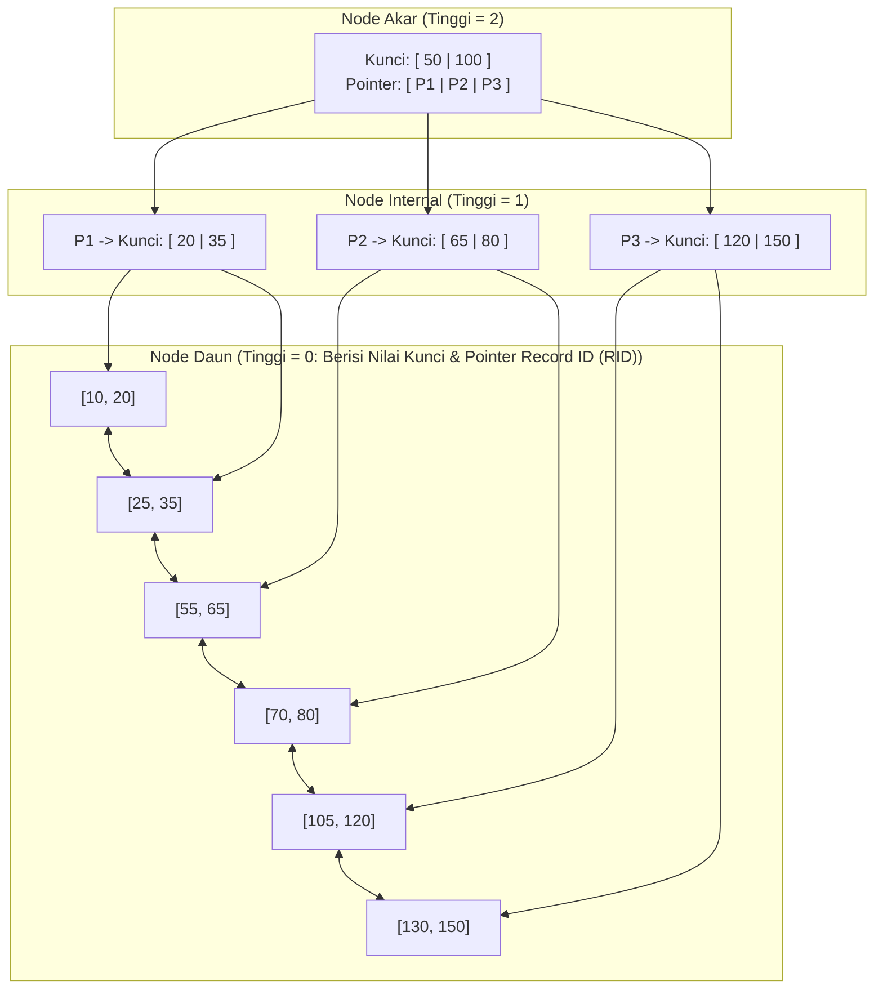

## Bab 7: Struktur Data B+Tree & Pengindeksan Berkecepatan Tinggi

### 7.1 Keunggulan B+Tree: Keseimbangan Pohon & Pemindaian Rentang Cepat

Pengindeksan adalah tulang punggung dari akselerasi pemrosesan kueri basis data. Tanpa indeks, setiap operasi pencarian catatan tertentu harus melakukan pemindaian menyeluruh terhadap seluruh tabel (*Full Table Scan*), yang membutuhkan waktu linear $O(N)$ dan menghabiskan jutaan operasi I/O piringan disk.

WidyaBase menerapkan struktur data pohon seimbang **B+Tree** (*B-Plus Tree*) yang dioptimalkan untuk ukuran blok halaman penyimpanan 4KB:
- **Seluruh Kunci Data Tersimpan di Daun (*Leaf Nodes*)**: Node internal hanya berfungsi sebagai penunjuk navigasi pencarian (*routing keys*).
- **Rantai Daun Tertaut Ganda (*Doubly-Linked Leaf Chain*)**: Seluruh node daun saling terhubung satu sama lain via pointer `prev_page` dan `next_page`. Hal ini membuat pemindaian rentang (*range scan* seperti `WHERE tanggal ANTARA '2026-01-01' DAN '2026-01-31'`) sangat cepat $O(\log N + K)$ tanpa perlu kembali melintasi akar pohon.



Fitur utama implementasi B+Tree di WidyaBase:
1. **Daya Muat Kunci Tinggi (*High Fan-Out*)**: Dengan ukuran halaman 4KB dan ukuran kunci rata-rata 16 byte, setiap node mampu menampung ratusan cabang anak. Pohon setinggi 3 tingkat mampu mengindeks puluhan juta baris data dengan maksimal 3–4 kali pembacaan blok memori.
2. **Pemisahan Node Dinamis (*Page Split*)**: Ketika node daun penuh (mencapai kapasitas 4KB), pohon secara otomatis membagi node daun menjadi dua bagian berukuran seimbang (50%-50%) dan mempromosikan kunci tengah ke node induk.
3. **Penyusutan & Penggabungan (*Page Merge*)**: Jika penghapusan baris data menyebabkan utilisasi node turun di bawah ambang batas minimum (50%), WidyaBase melakukan peminjaman kunci dari node saudara atau penggabungan (*merge*) untuk menghemat memori.

### 7.2 Implementasi Kode Program Utuh

Berikut implementasi traversal pencarian dan penyisipan data pada struktur pohon B+Tree di WidyaBase:

```widya
// Modul Struktur Data B+Tree WidyaBase
modul mesin_btree {
    impor ekosistem::widyabase::{
        WidyaBase, HalamanID, SlotID, RecordID,
        KunciIndeks, NodeBTree, HeaderNodeBTree
    };

    konstanta KAPASITAS_MAKSIMAL_KUNCI: Bulat = 250;

    struktur HasilCariBTree {
        halaman_daun: HalamanID,
        indeks_slot: Bulat,
        ditemukan: Boolean,
        rid: RecordID,
    }

    fungsi cari_kunci_btree(
        akar_halaman_id: HalamanID,
        kunci_target: &KunciIndeks,
        mesin: &WidyaBase
    ) -> Hasil<HasilCariBTree, Teks> {
        biar mut halaman_kini_id = akar_halaman_id;

        ulang {
            biar node = mesin.baca_halaman_btree(halaman_kini_id)?;

            // Jika kita sudah berada di node daun, lakukan pencarian biner lokal
            jika node.header.apakah_daun {
                biar hasil_lokal = node.cari_biner_kunci(kunci_target);
                jika hasil_lokal.ditemukan {
                    kembalikan Ok(HasilCariBTree {
                        halaman_daun: halaman_kini_id,
                        indeks_slot: hasil_lokal.indeks,
                        ditemukan: benar,
                        rid: node.dapatkan_rid(hasil_lokal.indeks),
                    });
                } selain_itu {
                    kembalikan Ok(HasilCariBTree {
                        halaman_daun: halaman_kini_id,
                        indeks_slot: hasil_lokal.indeks,
                        ditemukan: salah,
                        rid: RecordID::kosong(),
                    });
                }
            }

            // Jika node internal, temukan pointer cabang anak yang sesuai
            halaman_kini_id = node.temukan_cabang_anak(kunci_target);
        }
    }

    fungsi sisipkan_kunci_btree(
        akar_id: &mut HalamanID,
        kunci: KunciIndeks,
        rid: RecordID,
        mesin: &mut WidyaBase
    ) -> Hasil<Boolean, Teks> {
        cetak(">>> [BTREE] Menyisipkan kunci: " + teks(kunci.nilai_numerik()));

        // Cari daun tujuan penyisipan
        biar hasil = cari_kunci_btree(*akar_id, &kunci, mesin)?;
        biar mut node_daun = mesin.baca_halaman_btree_mut(hasil.halaman_daun)?;

        jika node_daun.jumlah_kunci() < KAPASITAS_MAKSIMAL_KUNCI {
            // Masih ada ruang, sisipkan langsung secara berurutan
            node_daun.sisipkan_berurutan(kunci, rid)?;
            mesin.tandai_kotor(hasil.halaman_daun)?;
            kembalikan Ok(benar);
        } selain_itu {
            // Node daun penuh: Lakukan Pemisahan Halaman (Page Split)
            cetak(">>> [BTREE] Node penuh! Memulai pemisahan halaman 50/50...");
            biar halaman_baru_id = mesin.alokasikan_halaman_baru()?;
            biar mut node_baru = NodeBTree::buat_daun(halaman_baru_id);

            // Bagi kunci dan pindahkan separuh ke node baru
            biar kunci_promosi = node_daun.bagi_dua_dengan(&mut node_baru);

            // Perbarui rantai pointer daun tertaut ganda
            node_baru.header.next_page = node_daun.header.next_page;
            node_baru.header.prev_page = hasil.halaman_daun;
            node_daun.header.next_page = halaman_baru_id;

            // Promosikan kunci ke node induk atau buat akar baru bila akar terbelah
            mesin.promosikan_kunci_ke_induk(kunci_promosi, hasil.halaman_daun, halaman_baru_id, akar_id)?;

            kembalikan Ok(benar);
        }
    }
}
```

### 7.3 Analisis Arsitektur, Metrik & Tabel Spesifikasi

Tabel perbandingan kompleksitas komputasi dan struktur pengindeksan pada WidyaBase:

| Metode Akses / Indeks | Pencarian Kesetaraan ($=$) | Pemindaian Rentang ($<, >$) | Kompleksitas Ruang | Kasus Penggunaan Optimal |
| :--- | :--- | :--- | :--- | :--- |
| **Pindaian Tabel Penuh (SeqScan)** | $O(N)$ (Sangat Lambat) | $O(N)$ | $O(1)$ | Tabel mikro (< 100 baris) |
| **B+Tree Indeks (WidyaBase)** | $O(\log N)$ (Rata-rata 3 I/O) | $O(\log N + K)$ | $O(N)$ | Kunci utama, tanggal, angka, teks |
| **Hash Indeks** | $O(1)$ (Sangat Cepat) | Tidak Mendukung Rentang | $O(N)$ | Pencarian kesetaraan murni |
| **Spatial R-Tree** | $O(\log N)$ | $O(\log N + K)$ Spasial | $O(N)$ | Koordinat GPS, poligon peta |
| **HNSW Vektor AI** | $O(\log N)$ Hampiran | Tidak Relevan | $O(N \cdot M)$ | Kemiripan semantik AI (*embeddings*) |

### 7.4 Latihan Soal Esai

1. Mengapa struktur pohon B+Tree jauh lebih disukai dalam perancangan mesin basis data disk dibandingkan pohon pencarian biner seimbang seperti AVL Tree atau Red-Black Tree?
2. Jelaskan bagaimana pointer daun tertaut ganda (*doubly-linked leaf nodes*) pada B+Tree mempercepat eksekusi kueri agregasi dan pemfilteran rentang!
3. Uraikan mekanisme *Page Split* saat node daun B+Tree kehabisan ruang tampung, serta bagaimana algoritma menangani pemisahan berantai hingga node akar (*root split*)!

### 7.5 Soal Pilihan Ganda

1. Perbedaan struktural paling fundamental antara B-Tree standar dan B+Tree adalah...
   A. Pada B+Tree, seluruh data/RID disimpan hanya pada node daun, sedangkan node internal hanya menyimpan kunci pemandu
   B. B-Tree tidak dapat disimpan di memori RAM
   C. B+Tree tidak memiliki cabang anak
   D. B-Tree hanya dapat digunakan untuk data bertipe teks

2. Kompleksitas waktu untuk menemukan sebuah catatan acak pada indeks B+Tree berukuran $N$ baris data adalah...
   A. $O(N)$
   B. $O(\log N)$
   C. $O(N^2)$
   D. $O(1)$

3. Hubungan antar node daun pada B+Tree dihubungkan menggunakan struktur...
   A. Lingkaran tertutup tak berujung
   B. Rantai pointer tertaut ganda (*doubly-linked list*)
   C. Jaringan peer-to-peer
   D. Tumpukan (Stack)

4. Ketika node daun B+Tree mencapai kapasitas maksimal 4KB dan menerima penyisipan data baru, proses yang dijalankan sistem adalah...
   A. Menggugurkan transaksi pengguna (*Abort*)
   B. Pemisahan Halaman (*Page Split*) dengan membagi kunci 50/50 dan mempromosikan kunci tengah
   C. Menghapus data paling lama
   D. Memformat ulang indeks tabel

5. Berapakah rata-rata kedalaman pohon B+Tree pada WidyaBase untuk mengindeks 50 juta baris data dengan kapasitas cabang (*fan-out*) ratusan kunci per node?
   A. Sekitar 3 hingga 4 tingkat
   B. 500 tingkat
   C. 10.000 tingkat
   D. 1 tingkat saja

6. Algoritma pencarian yang digunakan untuk menemukan posisi kunci di dalam sebuah node B+Tree berkapasitas 250 kunci adalah...
   A. Pencarian Acak (*Random Search*)
   B. Pencarian Biner (*Binary Search*)
   C. Pencarian Linear Sekuensial
   D. Pencarian Luap (*Flood Fill*)

7. Operasi kueri SQL yang paling diuntungkan oleh keberadaan pointer sekuensial antar node daun B+Tree adalah...
   A. Pemindaian rentang nilai seperti klausa `BETWEEN` atau operator perbandingan rentang tanggal
   B. Operasi pembuatan tabel baru
   C. Penutupan koneksi basis data
   D. Penggantian nama basis data

8. Apa yang terjadi jika node akar (*root node*) pada B+Tree mengalami pemisahan (*split*)?
   A. Basis data mengalami crash total
   B. Sebuah node akar baru dibentuk di atasnya sehingga tinggi pohon (*tree height*) bertambah 1 tingkat
   C. Seluruh data pohon dihapus
   D. Ukuran halaman berubah dari 4KB menjadi 1MB

9. Indeks yang dibangun di atas lebih dari satu kolom tabel (misalnya: `KOTA, TANGGAL_LAHIR`) dinamakan sebagai...
   A. Single Index
   B. Composite / Multi-Column Index
   C. Virtual Pointer
   D. Null Pointer

10. Mengapa pemakaian indeks B+Tree pada kolom tabel yang frekuensi penulisan (*INSERT/UPDATE*)-nya sangat tinggi harus dipertimbangkan secara cermat?
    A. Karena setiap operasi penulisan memerlukan pembaruan struktur pohon dan berpotensi memicu page split
    B. Menjadikan server kehilangan koneksi internet
    C. Mengurangi kapasitas layar tampilan
    D. Menghapus hak akses pengguna root
