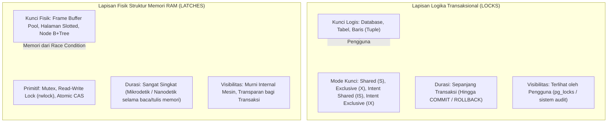

## Bab 8: Penguncian, Hierarki Latch & Pencegahan Deadlock

### 8.1 Perbedaan Mendasar Antara Lock & Latch

Dalam rekayasa sistem basis data tingkat tinggi, istilah *Lock* dan *Latch* sering kali disalahartikan karena sama-sama diterjemahkan sebagai "kunci". Padahal keduanya beroperasi pada lapisan abstraksi, tujuan, dan durasi yang sangat berbeda.

Kegagalan membedakan keduanya akan mengakibatkan kebuntuan sistem (*system hang*), latensi transaksi yang melonjak, atau korupsi struktur memori.



Prinsip hierarki penguncian pada WidyaBase:
1. **Hierarki Kunci Berbutir Halus (*Granular Lock Hierarchy*)**: Untuk menghindari penguncian tabel secara serampangan (*table lock escalation*), WidyaBase menerapkan penguncian niat (*Intent Locks*):
   - `IS` (*Intent Shared*): Menandakan transaksi berniat membaca baris di level bawah.
   - `IX` (*Intent Exclusive*): Menandakan transaksi berniat memodifikasi baris di level bawah.
   - `S` (*Shared Lock*): Kunci berbagi untuk pembacaan bersama.
   - `X` (*Exclusive Lock*): Kunci eksklusif untuk modifikasi data tunggal.
2. **Protokol Pencegahan Kebuntuan (*Deadlock Prevention & Detection*)**:
   - *Wait-For Graph (WFG)*: Daemon latar belakang secara berkala (misalnya setiap 500 ms) memeriksa siklus ketergantungan antar transaksi.
   - *Deadlock Victim Selection*: Bila siklus terdeteksi, sistem memilih transaksi dengan biaya pemulihan terendah (*cheapest transaction*) untuk dibatalkan (*Abort/Rollback*), sehingga transaksi lain dapat melanjutkan proses.
3. **Penyusuran Pohon Latch Bebas Buntu (*Crabbing / Coupling Protocol*)**: Saat menelusuri pohon B+Tree, sistem memegang latch node induk hingga latch node anak berhasil diperoleh secara aman, lalu segera melepaskan latch node induk untuk memaksimalkan konkurensi antar thread.

### 8.2 Implementasi Kode Program Utuh

Berikut implementasi manajer kunci hierarkis dan algoritma deteksi deadlock siklus graf pada WidyaBase:

```widya
// Modul Manajer Kunci Logis dan Deteksi Deadlock WidyaBase
modul manajer_kunci {
    impor ekosistem::widyabase::{
        WidyaBase, TransaksiID, SumberDayaID, ModeKunci,
        TabelKunci, GrafTungguTransaksi
    };

    struktur PermintaanKunci {
        id_transaksi: TransaksiID,
        sumber_daya: SumberDayaID,
        mode: ModeKunci,
    }

    fungsi minta_kunci_transaksional(
        permintaan: PermintaanKunci,
        tabel_kunci: &mut TabelKunci,
        graf_tunggu: &mut GrafTungguTransaksi
    ) -> Hasil<Boolean, Teks> {
        cetak(">>> [LOCK] Transaksi T" + teks(permintaan.id_transaksi) + 
              " meminta kunci mode: " + permintaan.mode.nama() + 
              " pada sumber daya: " + permintaan.sumber_daya.identitas());

        // Periksa kompatibilitas matriks kunci
        jika tabel_kunci.apakah_kompatibel(&permintaan.sumber_daya, permintaan.mode) {
            tabel_kunci.berikan_kunci(permintaan)?;
            cetak(">>> [LOCK] Kunci berhasil diberikan seketika.");
            kembalikan Ok(benar);
        } selain_itu {
            cetak(">>> [LOCK] Terjadi konflik! Transaksi harus mengantre.");
            biar pemegang_kunci = tabel_kunci.dapatkan_pemegang_kunci_saat_ini(&permintaan.sumber_daya);

            // Tambahkan sisi ketergantungan pada Wait-For Graph (T_pemohon -> T_pemegang)
            untuk pemegang di pemegang_kunci {
                graf_tunggu.tambah_sisi(permintaan.id_transaksi, pemegang);
            }

            // Periksa keberadaan siklus deadlock seketika
            jika graf_tunggu.deteksi_siklus_deadlock() {
                cetak(">>> [DEADLOCK] PERINGATAN: Siklus kebuntuan transaksi terdeteksi!");
                biar korban = graf_tunggu.pilih_korban_biaya_terendah();
                cetak(">>> [DEADLOCK] Memilih korban T" + teks(korban) + " untuk digugurkan.");
                kembalikan Salah("GalatDeadlock: Transaksi T" + teks(korban) + " digugurkan.");
            }

            kembalikan Ok(salah); // Menunggu pemegang melepaskan kunci
        }
    }

    fungsi lepaskan_seluruh_kunci_transaksi(
        id_transaksi: TransaksiID,
        tabel_kunci: &mut TabelKunci,
        graf_tunggu: &mut GrafTungguTransaksi
    ) -> Hasil<Bulat, Teks> {
        biar jumlah_dilepas = tabel_kunci.lepaskan_kunci_transaksi(id_transaksi)?;
        graf_tunggu.hapus_node_transaksi(id_transaksi);
        cetak(">>> [LOCK] Melepaskan " + teks(jumlah_dilepas) + " kunci milik T" + teks(id_transaksi));
        kembalikan Ok(jumlah_dilepas);
    }
}
```

### 8.3 Analisis Arsitektur, Metrik & Tabel Spesifikasi

Tabel matriks kompatibilitas mode kunci logis (*Lock Compatibility Matrix*) pada WidyaBase:

| Mode Diminta \ Mode Dimiliki | IS (Intent Shared) | IX (Intent Exclusive) | S (Shared) | SIX (Shared Intent Exclusive) | X (Exclusive) |
| :--- | :--- | :--- | :--- | :--- | :--- |
| **IS** | **Kompatibel** | **Kompatibel** | **Kompatibel** | **Kompatibel** | Konflik |
| **IX** | **Kompatibel** | **Kompatibel** | Konflik | Konflik | Konflik |
| **S** | **Kompatibel** | Konflik | **Kompatibel** | Konflik | Konflik |
| **SIX** | **Kompatibel** | Konflik | Konflik | Konflik | Konflik |
| **X** | Konflik | Konflik | Konflik | Konflik | Konflik |

### 8.4 Latihan Soal Esai

1. Terangkan perbedaan fundamental antara *Lock* dan *Latch* dari aspek durasi hidup, mekanisme penguncian, serta visibilitasnya terhadap pengguna akhir basis data!
2. Bagaimana mekanisme kerja *Wait-For Graph* (WFG) dalam mendeteksi kebuntuan transaksi (*deadlock*)? Parameter apa yang dipertimbangkan mesin dalam memilih transaksi "korban" (*deadlock victim*)?
3. Uraikan teknik penelusuran pohon *Latch Crabbing* (juga dikenal sebagai *Lock Coupling*) pada indeks B+Tree! Mengapa teknik ini mampu mencegah *deadlock* tingkat fisik antar utas memori?

### 8.5 Soal Pilihan Ganda

1. Karakteristik yang membedakan Latch dari Lock adalah...
   A. Latch melindungi integritas struktur data memori fisik dalam durasi mikrodetik tanpa terlihat oleh transaksi logika
   B. Latch hanya berlaku untuk kueri SQL SELECT
   C. Latch dapat diatur melalui perintah SQL pengguna
   D. Latch bertahan hingga transaksi dikomit

2. Mode kunci yang menandakan niat suatu transaksi untuk melakukan modifikasi data pada tingkat hierarki baris yang lebih rendah dinamakan...
   A. Shared (S)
   B. Intent Exclusive (IX)
   C. Exclusive (X)
   D. Null (N)

3. Berdasarkan matriks kompatibilitas kunci, mode kunci Exclusive (X) kompatibel dengan mode kunci...
   A. Shared (S)
   B. Intent Shared (IS)
   C. Tidak kompatibel dengan mode kunci apapun
   D. Intent Exclusive (IX)

4. Struktur data graf berarah yang digunakan oleh manajer konkurensi untuk memodelkan transaksi mana yang sedang menunggu transaksi lain disebut...
   A. Wait-For Graph (WFG)
   B. B+Tree Graph
   C. Spatial Network
   D. Buffer Graph

5. Tindakan yang diambil oleh mesin WidyaBase ketika mendeteksi adanya siklus tertutup pada Wait-For Graph adalah...
   A. Menutup seluruh sistem operasi peladen
   B. Memilih transaksi korban (*victim*) berdasarkan biaya paling ringan dan membatalkannya (*Rollback*)
   C. Membiarkan transaksi macet selamanya
   D. Menghapus indeks B+Tree

6. Teknik penelusuran pohon B+Tree di mana sebuah thread hanya melepaskan latch pada node induk setelah berhasil memperoleh latch pada node anak disebut...
   A. Latch Crabbing / Coupling
   B. Page Split
   C. Random Hopping
   D. Full Scan

7. Algoritma pencegahan kebuntuan berbasis stempel waktu di mana transaksi yang lebih tua menunggu transaksi yang lebih muda, tetapi transaksi yang lebih muda langsung digugurkan dinamakan...
   A. Wait-Die
   B. Wound-Wait
   C. Round-Robin
   D. First In First Out

8. Kunci logis tingkat baris (*Row-Level Lock*) biasanya dipertahankan hingga kapan?
   A. Hingga pembacaan baris selesai
   B. Hingga transaksi berakhir secara tuntas melalui COMMIT atau ROLLBACK
   C. Selama 10 detik
   D. Sampai memori RAM penuh

9. Pengeskalasian kunci (*Lock Escalation*) terjadi ketika...
   A. Sistem menaikkan ribuan kunci baris menjadi satu kunci tabel tunggal untuk menghemat alokasi memori tabel kunci
   B. Transaksi dibatalkan secara sepihak
   C. Database dihubungkan ke server awan
   D. Pengguna mengganti nama tabel

10. Mengapa penerapan Intent Lock (IS / IX) pada tingkat tabel sangat krusial sebelum transaksi mengunci baris data individual?
    A. Mencegah transaksi lain mengunci tabel secara eksklusif (misal saat operasi `ALTER TABLE` atau `TRUNCATE`) tanpa harus memeriksa jutaan baris satu per satu
    B. Mempercepat koneksi kabel LAN
    C. Mengurangi panas pada unit pemroses grafis (GPU)
    D. Menjadikan query teks dapat dibaca otomatis
