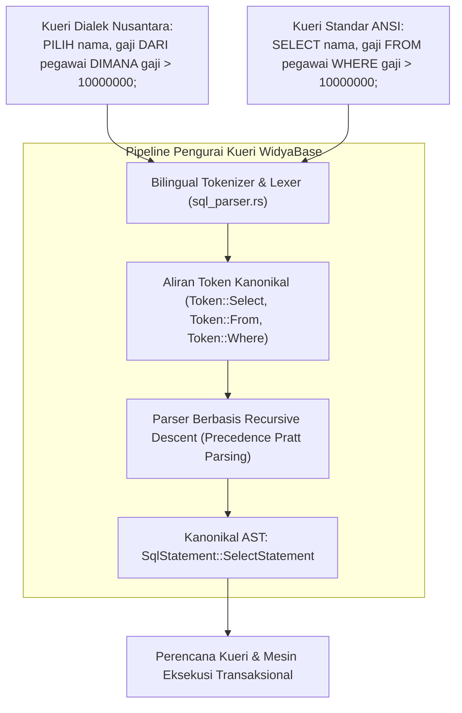

## Bab 9: Lexer, Parser & Dialek SQL Dwibahasa

### 9.1 Kedaulatan Sintaksis: Dialek Nusantara & Standar ANSI

Salah satu terobosan paling unik dan revolusioner dari WidyaBase adalah mesin **Bilingual SQL Lexer & Parser**. Untuk pertama kalinya dalam sejarah rekayasa perangkat lunak basis data tingkat industri, para insinyur dan akademisi dapat mengekspresikan kueri data relasional menggunakan kosa kata Bahasa Indonesia baku (Dialek Nusantara) secara simetris berdampingan dengan dialek ANSI SQL standar internasional.

Kedua dialek tersebut diperlakukan sebagai warga negara kelas satu (*first-class citizens*) dan menghasilkan representasi Pohon Sintaksis Abstrak (*Abstract Syntax Tree* / AST) kanonikal yang 100% identik tanpa degradasi performa.



Prinsip rancangan parser dwibahasa WidyaBase:
1. **Pemetaan Token Satu-ke-Satu (*Isomorphic Token Mapping*)**: Kata kunci Bahasa Indonesia seperti `PILIH` dipetakan ke varian token yang persis sama dengan kata kunci `SELECT`. Begitu pula dengan `DARI` $\leftrightarrow$ `FROM`, `DIMANA` $\leftrightarrow$ `WHERE`, `SISIP_KE` $\leftrightarrow$ `INSERT INTO`, `PERBARUI` $\leftrightarrow$ `UPDATE`, dan `HAPUS_DARI` $\leftrightarrow$ `DELETE FROM`.
2. **Penanganan Kasus Tanpa Sensitivitas Huruf (*Case-Insensitive*)**: Parser menerima huruf besar, huruf kecil, maupun campuran (misalnya `pilih`, `PILIH`, `Select`, `select`).
3. **Pemberian Pesan Galat Kontekstual Dwibahasa**: Jika terjadi kesalahan pengetikan sintaksis, mesin pelacak galat (*error reporter*) mendeteksi bahasa pengantar kueri dan menampilkan pesan kesalahan ramah pengguna dalam Bahasa Indonesia lengkap dengan petunjuk perbaikan nomor baris dan kolom.

### 9.2 Implementasi Kode Program Utuh

Berikut implementasi demonstrasi eksekusi kueri SQL dwibahasa pada WidyaBase menggunakan Widya-Lang:

```widya
// Modul Demonstrasi Eksekusi SQL Dwibahasa WidyaBase
modul parser_dwibahasa {
    impor ekosistem::widyabase::{WidyaBase, HasilKueri, BarisData};

    fungsi jalankan_kueri_dwibahasa(mesin: &mut WidyaBase) -> Hasil<Boolean, Teks> {
        cetak("==================================================================");
        cetak(">>> [SQL-DWIBAHASA] Menguji Kueri Dialek Nusantara dan Standar ANSI...");

        // 1. Eksekusi DDL Menggunakan Dialek Nusantara
        biar sql_buat_tabel = "
            BUAT TABEL pegawai_bumn (
                id BULAT KUNCI_UTAMA,
                nama TEKS TIDAK_KOSONG,
                divisi TEKS,
                gaji DESIMAL,
                status_aktif BOOLEAN
            );
        ";
        cetak(">>> [DDL-NUSANTARA] Mengeksekusi pembuatan tabel...");
        mesin.eksekusi_sql(sql_buat_tabel)?;

        // 2. Eksekusi DML Penyisipan Data Menggunakan Dialek Nusantara
        biar sql_sisip = "
            SISIP_KE pegawai_bumn (id, nama, divisi, gaji, status_aktif)
            NILAI (101, 'Budi Santoso', 'Teknologi Informasi', 18500000.0, BENAR),
                  (102, 'Siti Aminah', 'Keuangan', 15000000.0, BENAR),
                  (103, 'Ahmad Fauzi', 'Operasional', 9500000.0, BENAR);
        ";
        cetak(">>> [DML-NUSANTARA] Menyisipkan catatan data pegawai...");
        mesin.eksekusi_sql(sql_sisip)?;

        // 3. Eksekusi DQL Pemilihan Data Menggunakan Dialek Nusantara
        biar sql_pilih = "
            PILIH nama, gaji, divisi 
            DARI pegawai_bumn 
            DIMANA gaji >= 15000000.0 DAN status_aktif = BENAR 
            URUTKAN_BERDASARKAN gaji MENURUN;
        ";
        cetak(">>> [DQL-NUSANTARA] Menjalankan kueri seleksi bernilai tinggi...");
        biar hasil_nusantara: HasilKueri = mesin.kueri_sql(sql_pilih)?;
        cetak(">>> [HASIL] Ditemukan " + teks(hasil_nusantara.jumlah_baris()) + " baris data:");
        untuk baris di hasil_nusantara.baris_data() {
            cetak("  - " + baris.ambil_teks("nama") + " | Rp " + teks(baris.ambil_desimal("gaji")) + " | Divisi: " + baris.ambil_teks("divisi"));
        }

        // 4. Eksekusi Kueri Ekuivalen Menggunakan Standar Global ANSI SQL
        biar sql_ansi = "
            SELECT nama, gaji 
            FROM pegawai_bumn 
            WHERE gaji < 10000000.0;
        ";
        cetak(">>> [DQL-ANSI] Menjalankan kueri standar global...");
        biar hasil_ansi: HasilKueri = mesin.kueri_sql(sql_ansi)?;
        cetak(">>> [HASIL] Ditemukan " + teks(hasil_ansi.jumlah_baris()) + " baris:");
        untuk baris di hasil_ansi.baris_data() {
            cetak("  - " + baris.ambil_teks("nama") + " | Rp " + teks(baris.ambil_desimal("gaji")));
        }

        cetak(">>> [SUKSES] Seluruh variasi kueri dwibahasa menghasilkan AST identik!");
        cetak("==================================================================");
        kembalikan Ok(benar);
    }
}
```

### 9.3 Analisis Arsitektur, Metrik & Tabel Spesifikasi

Tabel korespondensi leksikal Dialek Nusantara dan Standar Internasional ANSI SQL di WidyaBase:

| Kategori Perintah | Kata Kunci Dialek Nusantara | Standar ANSI Internasional | Representasi Token Internal |
| :--- | :--- | :--- | :--- |
| **Kueri Data (DQL)** | `PILIH`, `DARI`, `DIMANA` | `SELECT`, `FROM`, `WHERE` | `Token::Select`, `Token::From`, `Token::Where` |
| **Manipulasi (DML)** | `SISIP_KE`, `NILAI`, `PERBARUI`, `ATUR` | `INSERT INTO`, `VALUES`, `UPDATE`, `SET` | `Token::Insert`, `Token::Values`, `Token::Update` |
| **Penghapusan** | `HAPUS_DARI`, `KOSONGKAN` | `DELETE FROM`, `TRUNCATE` | `Token::Delete`, `Token::Truncate` |
| **Definisi Skema (DDL)**| `BUAT TABEL`, `HAPUS TABEL` | `CREATE TABLE`, `DROP TABLE` | `Token::Create`, `Token::Drop` |
| **Pengurutan & Batas** | `URUTKAN_BERDASARKAN`, `MENAIK`, `MENURUN` | `ORDER BY`, `ASC`, `DESC` | `Token::Order`, `Token::Asc`, `Token::Desc` |
| **Logika & Pembanding** | `DAN`, `ATAU`, `BUKAN`, `SEPERTI`, `ANTARA` | `AND`, `OR`, `NOT`, `LIKE`, `BETWEEN` | `Token::And`, `Token::Or`, `Token::Not`, `Token::Like` |

### 9.4 Latihan Soal Esai

1. Mengapa dukungan dialek SQL dwibahasa pada WidyaBase tidak menimbulkan overhead penurunan kecepatan (*parsing performance penalty*) dibandingkan parser monobahasa konvensional?
2. Bagaimana teknik *Recursive Descent Parsing* yang dikombinasikan dengan *Pratt Precedence Parsing* menangani ekspresi logika berbobot rumit (misalnya perpaduan operator matematika, kurung buka/tutup, dan klausa `DAN`/`ATAU`)?
3. Jelaskan pentingnya pesan kesalahan gramatikal kueri dwibahasa bagi percepatan kurikulum pendidikan rekayasa perangkat lunak dan literasi data nasional di Indonesia!

### 9.5 Soal Pilihan Ganda

1. Kata kunci Dialek Nusantara pada WidyaBase yang merupakan padanan langsung dari perintah ANSI SQL `SELECT` adalah...
   A. `AMBIL`
   B. `PILIH`
   C. `LIHAT`
   D. `CARI`

2. Klausa yang digunakan untuk menyaring baris data berdasarkan kriteria tertentu pada Dialek Nusantara adalah...
   A. `DENGAN`
   B. `KONDISI`
   C. `DIMANA`
   D. `FILTER`

3. Padanan kata kunci untuk operasi penyisipan data `INSERT INTO` dalam Dialek Nusantara adalah...
   A. `MASUKKAN`
   B. `SISIP_KE`
   C. `TAMBAH`
   D. `ISI`

4. Bagaimana cara parser WidyaBase memperlakukan kueri yang ditulis dalam huruf besar (`PILIH`) dan huruf kecil (`pilih`)?
   A. Menganggapnya sebagai dua perintah yang berbeda
   B. Memperlakukan keduanya secara setara (*case-insensitive*) dan memetakannya ke token yang sama
   C. Menolak kueri yang menggunakan huruf kecil
   D. Mengubah tipe data menjadi teks

5. Struktur data pohon hierarkis yang dihasilkan oleh parser setelah memeriksa validitas tata bahasa kueri dinamakan...
   A. Binary Search Tree (BST)
   B. Abstract Syntax Tree (AST)
   C. Hash Map
   D. Adjacency Matrix

6. Padanan kata kunci untuk klausa pengurutan data `ORDER BY ... DESC` pada Dialek Nusantara adalah...
   A. `SUSUN_DARI ... BAWAH`
   B. `URUTKAN_BERDASARKAN ... MENURUN`
   C. `SORTIR ... REVERSE`
   D. `TATA ... Z_KE_A`

7. Operator logika `DAN`, `ATAU`, dan `BUKAN` pada Dialek Nusantara menghasilkan token internal yang identik dengan...
   A. `AND`, `OR`, `NOT`
   B. `PLUS`, `MINUS`, `TIMES`
   C. `IF`, `THEN`, `ELSE`
   D. `TRUE`, `FALSE`, `NULL`

8. Tahap pertama dalam kompilasi kueri SQL yang bertugas memecah barisan teks mentah menjadi serangkaian potongan kata bermakna (token) dinamakan...
   A. Evaluasi Semantik
   B. Analisis Leksikal (*Lexical Analysis / Tokenizer*)
   C. Optimasi Biaya
   D. Eksekusi I/O

9. Kata kunci DDL untuk membuat tabel baru dalam Dialek Nusantara adalah...
   A. `CIPTAKAN STRUKTUR`
   B. `BUAT TABEL`
   C. `INISIALISASI_ENTITAS`
   D. `BARU TABEL`

10. Mengapa kueri campuran (misalnya kata kunci Nusantara digabung dengan nama kolom dan fungsi matematika internasional) tetap dapat diproses dengan sempurna oleh WidyaBase?
    A. Karena lexer membedakan secara tegas antara token kata kunci bahasa, nama pengenal (*identifier*), dan konstanta literal
    B. Karena semua kueri diubah menjadi bahasa rakitan (assembly) terlebih dahulu
    C. Karena basis data menggunakan penerjemah daring pihak ketiga
    D. Karena basis data menonaktifkan aturan tata bahasa
