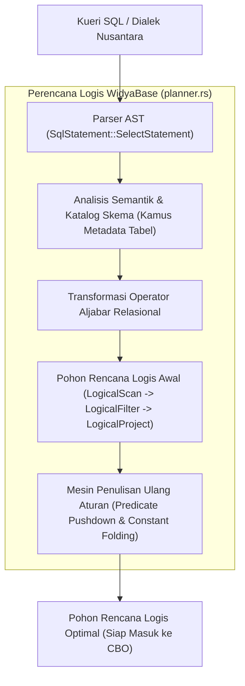

## Bab 10: Perencana Logis & Pohon Sintaksis Abstrak (AST Query Plan)

### 10.1 Dari Sintaksis Menjadi Rencana Eksekusi Logis

Setelah kueri pengguna berhasil melewati tahap penguraian leksikal dan sintaksis oleh parser, mesin basis data menghasilkan representasi gramatikal berupa Pohon Sintaksis Abstrak (*Abstract Syntax Tree* / AST). Namun, AST semata belum mengetahui cara terbaik untuk mengeksekusi kueri tersebut di atas media penyimpanan fisik.

Di sinilah **Perencana Logis** (*Logical Query Planner*) mengambil alih:
1. **Pemeriksaan Semantik (*Semantic Analysis & Catalog Binding*)**: Memvalidasi apakah tabel yang disebut benar-benar ada di katalog metadata, apakah nama kolom valid, dan apakah tipe data kompatibel.
2. **Transformasi Aljabar Relasional**: Mengubah simpul-simpul AST menjadi pohon operator aljabar relasional logis (*Logical Plan Tree*).
3. **Penyederhanaan Logika (*Rule-Based Rewriting*)**: Menerapkan aturan ekuivalensi matematis seperti eliminasi predikat redundan, pelipatan konstanta (*constant folding* misalnya `1 + 1` disederhanakan menjadi `2`), dan penurunan predikat filter (*predicate pushdown*).



Hirarki operator rencana logis di WidyaBase:
- `LogicalScan`: Membaca entitas tabel relasional tertentu.
- `LogicalFilter`: Mengevaluasi ekspresi predikat seleksi ($\sigma$).
- `LogicalProject`: Memilih dan mentransformasi daftar kolom luaran ($\pi$).
- `LogicalJoin`: Menggabungkan dua relasi berdasarkan predikat relasional ($owtie$).
- `LogicalAggregate`: Menghitung fungsi agregasi seperti `JUMLAH`, `RATA_RATA`, `HITUNG` beserta klausul pengelompokan.

### 10.2 Implementasi Kode Program Utuh

Berikut implementasi representasi simpul Pohon Rencana Logis dan transformasi penulisan ulang aturan pada WidyaBase:

```widya
// Modul Perencana Logis dan Penulisan Ulang Kueri WidyaBase
modul perencana_logis {
    impor ekosistem::widyabase::{
        WidyaBase, OperatorLogis, EkspresiLogis, SkemaTabel,
        TipeData, NilaiKonstanta, PengenalKolom
    };

    struktur RencanaLogis {
        akar: OperatorLogis,
        skema_keluaran: SkemaTabel,
    }

    fungsi bangun_rencana_logis_dasar(
        nama_tabel: Teks,
        predikat_filter: EkspresiLogis,
        kolom_proyeksi: Daftar<Teks>,
        katalog: &WidyaBase
    ) -> Hasil<RencanaLogis, Teks> {
        cetak(">>> [PLANNER-LOGIS] Memvalidasi semantik tabel: " + nama_tabel);
        biar skema_asal = katalog.dapatkan_skema_tabel(&nama_tabel)?;

        // 1. Operator Dasar: Pindaian Tabel (LogicalScan)
        biar operator_scan = OperatorLogis::PindaianTabel {
            tabel: nama_tabel,
            skema: skema_asal.klon(),
        };

        // 2. Operator Penyaring: LogicalFilter (Sigma)
        biar operator_filter = OperatorLogis::Filter {
            masukan: Kotak::buat(operator_scan),
            predikat: predikat_filter,
        };

        // 3. Operator Proyeksi: LogicalProject (Pi)
        biar operator_project = OperatorLogis::Proyeksi {
            masukan: Kotak::buat(operator_filter),
            kolom: kolom_proyeksi,
        };

        cetak(">>> [PLANNER-LOGIS] Pohon rencana logis awal berhasil dibentuk.");
        kembalikan Ok(RencanaLogis {
            akar: operator_project,
            skema_keluaran: skema_asal.proyeksikan(&kolom_proyeksi)?,
        });
    }

    fungsi optimasi_aturan_penurunan_predikat(
        rencana: &mut RencanaLogis
    ) -> Hasil<Boolean, Teks> {
        cetak(">>> [RULE-OPTIMIZER] Menerapkan optimasi 'Predicate Pushdown'...");
        // Memindahkan evaluasi filter sedekat mungkin ke operator pemindaian data
        // sehingga baris data yang dibaca dari disk tereliminasi sedini mungkin
        rencana.akar.dorong_predikat_ke_bawah();
        cetak(">>> [RULE-OPTIMIZER] Menerapkan pelipatan konstanta matematis...");
        rencana.akar.lipat_konstanta_ekspresi();
        kembalikan Ok(benar);
    }
}
```

### 10.3 Analisis Arsitektur, Metrik & Tabel Spesifikasi

Tabel aturan transformasi aljabar relasional penulisan ulang kueri pada WidyaBase:

| Nama Aturan (*Rewrite Rule*) | Bentuk Aljabar Asli | Bentuk Aljabar Tertransformasi | Manfaat Penghematan I/O & CPU |
| :--- | :--- | :--- | :--- |
| **Predicate Pushdown** | $\sigma_{cond}(R owtie S)$ | $(\sigma_{cond}(R)) owtie S$ | Memangkas 90%+ baris sebelum operasi Join yang mahal |
| **Projection Pushdown** | $\pi_{A}(Scan(R))$ | $Scan(R 	ext{ hanya kolom } A)$ | Menghemat transfer memori RAM dan lebar baris data |
| **Constant Folding** | $x > 1000 	imes 60$ | $x > 60000$ | Menghindari komputasi berulang di setiap evaluasi baris |
| **Dead Predicate Elimination** | $P 	ext{ DAN BENAR}$ | $P$ | Menyederhanakan kedalaman pohon evaluasi logika |
| **Subquery Flattening** | $R owtie (	ext{Subquery } S)$ | Semi-Join / Inner-Join Flat | Menghindari eksekusi subkueri berkorelasi per baris ($O(N^2)$) |

### 10.4 Latihan Soal Esai

1. Terangkan perbedaan mendasar antara representasi kueri pada tingkat AST (*Abstract Syntax Tree*) dan Pohon Rencana Logis (*Logical Query Plan*)!
2. Mengapa aturan *Predicate Pushdown* dianggap sebagai salah satu teknik optimasi kueri paling berdampak dalam penghematan sumber daya komputasi basis data?
3. Apa yang dimaksud dengan *Constant Folding* dan *Catalog Binding*? Berikan contoh skenario bagaimana katalog metadata mencegah eksekusi kueri yang salah sebelum menyentuh lapisan penyimpanan!

### 10.5 Soal Pilihan Ganda

1. Proses verifikasi apakah kolom dan tabel yang tercantum pada kueri benar-benar ada di dalam basis data dinamakan...
   A. Analisis Semantik (*Semantic Analysis & Catalog Binding*)
   B. Kompilasi JIT
   C. Defragmentasi Memori
   D. Penulisan WAL

2. Notasi simbol matematika aljabar relasional yang merepresentasikan operasi seleksi baris (*Filter*) adalah...
   A. Simbol Pi ($\pi$)
   B. Simbol Sigma ($\sigma$)
   C. Simbol Theta ($	heta$)
   D. Simbol Omega ($\omega$)

3. Notasi simbol matematika aljabar relasional yang merepresentasikan operasi proyeksi pemilihan kolom (*Project*) adalah...
   A. Simbol Pi ($\pi$)
   B. Simbol Sigma ($\sigma$)
   C. Simbol Delta ($\Delta$)
   D. Simbol Lambda ($\lambda$)

4. Teknik optimasi berbasis aturan (*Rule-Based Optimization*) yang memindahkan filter seleksi sedekat mungkin ke operator pemindaian tabel disebut...
   A. Predicate Pushdown
   B. Table Escalation
   C. Buffer Replacement
   D. Root Splitting

5. Proses mengevaluasi ekspresi statis seperti `3600 * 24` menjadi nilai tetap `86400` pada saat perencanaan kueri dinamakan...
   A. Deadlock Detection
   B. Constant Folding
   C. Slotted Packing
   D. Latch Crabbing

6. Mengapa operasi proyeksi kolom (*Projection Pushdown*) sangat menguntungkan bila tabel data disimpan dalam format kolom (*columnar*)?
   A. Sistem hanya perlu membaca kolom-kolom yang diminta tanpa menyentuh kolom lainnya di disk
   B. Menghapus kebutuhan indeks B+Tree
   C. Membuat kueri menjadi lebih singkat
   D. Memperbesar ukuran layar aplikasi

7. Operator aljabar relasional yang bertugas menggabungkan baris data dari dua relasi berbeda berdasarkan kondisi kesetaraan kunci adalah...
   A. LogicalFilter
   B. LogicalJoin
   C. LogicalLimit
   D. LogicalSort

8. Pada rencana kueri logis, urutan simpul operator biasanya dieksekusi secara konseptual dari...
   A. Dari daun (paling bawah/Scan) mengalir ke atas menuju akar (Project)
   B. Dari kanan ke kiri secara acak
   C. Dari file konfigurasi server
   D. Tergantung kecepatan kipas prosesor

9. Apa fungsi dari katalog metadata skema (*System Catalog*) pada mesin WidyaBase?
   A. Menyimpan definisi struktur tabel, tipe data kolom, indeks, dan batasan integritas kunci asing
   B. Menampung log transaksi harian
   C. Menyimpan cadangan file sistem operasi
   D. Mengatur alamat IP pengguna

10. Subkueri berkorelasi (*correlated subquery*) yang tidak dioptimalkan dapat menyebabkan kompleksitas eksekusi sebesar...
    A. $O(1)$
    B. $O(N 	imes M)$ atau kuadratik karena subkueri dieksekusi ulang untuk setiap baris tabel induk
    C. $O(\log N)$
    D. $O(0)$
