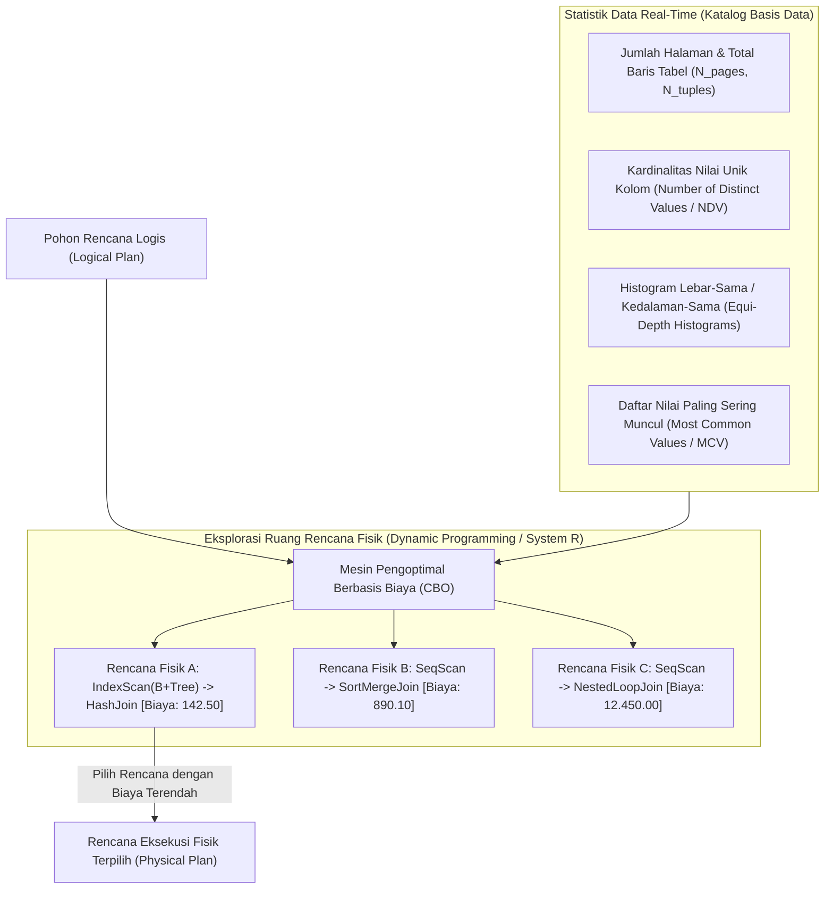

## Bab 11: Pengoptimal Berbasis Biaya (Cost-Based Optimizer / CBO)

### 11.1 Mengapa Aturan Saja Tidak Cukup: Peran Vital Statistik

Optimasi berbasis aturan (*Rule-Based Optimizer* / RBO) dapat merapikan ekspresi logika, tetapi RBO bersifat "buta" terhadap realitas data di dalam piringan disk: RBO tidak mengetahui apakah sebuah tabel berisi 10 baris atau 100 juta baris, dan tidak tahu apakah nilai suatu kolom tersebar merata atau memiliki ketimpangan ekstrem (*data skew*).

WidyaBase menghadirkan **Cost-Based Optimizer** (CBO) mutakhir yang memodelkan biaya fisik eksekusi (*Cost Model*) berdasarkan:
- **Biaya Akses I/O Halaman Disk**: Jumlah transfer blok halaman 4KB dari media SSD NVMe ke RAM Buffer Pool.
- **Biaya Pemrosesan CPU**: Jumlah siklus instruksi CPU untuk mengevaluasi predikat ekspresi, membandingkan kunci baris, dan mengomputasi fungsi hash.



Pilar utama CBO di WidyaBase:
1. **Histogram Kedalaman-Sama (*Equi-Depth Histogram*)**: Membagi rentang nilai kolom ke dalam ember-ember (*buckets*) dengan jumlah baris yang sama. Histogram ini memberikan estimasi selektivitas kueri rentang yang sangat presisi ($S = rac{	ext{baris terpilih}}{	ext{total baris}}$).
2. **Koleksi Nilai Populer (*Most Common Values* / MCV)**: Menyimpan frekuensi kemunculan nilai-nilai yang mendominasi data (misalnya: kolom `status = 'SUKSES'` mencakup 92% data), mencegah kesalahan asumsi distribusi seragam.
3. **Pencarian Rencana Optimal Menggunakan Pemrograman Dinamis (*System R Algorithm*)**: Menemukan urutan gabungan (*Join Order*) terbaik untuk kueri banyak tabel ($N$ relasi) tanpa terjebak dalam ledakan kombinatorial faktorial $O(N!)$.

### 11.2 Implementasi Kode Program Utuh

Berikut implementasi estimasi biaya I/O dan CPU serta pemilihan jalur akses fisik pada CBO WidyaBase:

```widya
// Modul Pengoptimal Berbasis Biaya (Cost-Based Optimizer) WidyaBase
modul pengoptimal_biaya {
    impor ekosistem::widyabase::{
        WidyaBase, StatistikTabel, HistogramKolom, JalurAksesFisik,
        OperatorFisik, NilaiBiaya
    };

    konstanta BIAYA_BACA_HALAMAN_SEKUENSIAL: Pecahan = 1.0;
    konstanta BIAYA_BACA_HALAMAN_ACAK: Pecahan = 4.0;
    konstanta BIAYA_EVALUASI_CPU_TUPEL: Pecahan = 0.01;
    konstanta BIAYA_OPERATOR_CPU: Pecahan = 0.0025;

    fungsi estimasi_biaya_seq_scan(
        statistik: &StatistikTabel
    ) -> NilaiBiaya {
        biar biaya_io = (statistik.jumlah_halaman sebagai Pecahan) * BIAYA_BACA_HALAMAN_SEKUENSIAL;
        biar biaya_cpu = (statistik.jumlah_baris sebagai Pecahan) * BIAYA_EVALUASI_CPU_TUPEL;
        kembalikan NilaiBiaya(biaya_io + biaya_cpu);
    }

    fungsi estimasi_biaya_index_scan(
        statistik: &StatistikTabel,
        selektivitas: Pecahan,
        tinggi_btree: Bulat
    ) -> NilaiBiaya {
        // Akses pohon indeks dari akar ke daun
        biar biaya_io_indeks = (tinggi_btree sebagai Pecahan) * BIAYA_BACA_HALAMAN_ACAK;

        // Estimasi jumlah halaman data acak yang disentuh berdasarkan selektivitas
        biar estimasi_baris = (statistik.jumlah_baris sebagai Pecahan) * selektivitas;
        biar biaya_io_halaman_data = estimasi_baris * BIAYA_BACA_HALAMAN_ACAK;
        biar biaya_cpu = estimasi_baris * BIAYA_OPERATOR_CPU;

        kembalikan NilaiBiaya(biaya_io_indeks + biaya_io_halaman_data + biaya_cpu);
    }

    fungsi pilih_jalur_akses_terbaik(
        nama_tabel: Teks,
        nama_kolom: Teks,
        selektivitas: Pecahan,
        mesin: &WidyaBase
    ) -> Hasil<JalurAksesFisik, Teks> {
        biar statistik = mesin.ambil_statistik_tabel(&nama_tabel)?;
        biar info_indeks = mesin.cek_keberadaan_indeks(&nama_tabel, &nama_kolom);

        biar biaya_seq_scan = estimasi_biaya_seq_scan(&statistik);
        cetak(">>> [CBO] Biaya Pemindaian Sekuensial (SeqScan): " + teks(biaya_seq_scan.nilai()));

        jika info_indeks.tersedia {
            biar biaya_index = estimasi_biaya_index_scan(&statistik, selektivitas, info_indeks.tinggi_pohon);
            cetak(">>> [CBO] Biaya Pemindaian Indeks (IndexScan): " + teks(biaya_index.nilai()));

            jika biaya_index.nilai() < biaya_seq_scan.nilai() {
                cetak(">>> [CBO] KEPUTUSAN: Memilih IndexScan (Lebih hemat biaya).");
                kembalikan Ok(JalurAksesFisik::PindaianIndeks(info_indeks.nama_indeks));
            }
        }

        cetak(">>> [CBO] KEPUTUSAN: Memilih SeqScan (Data tabel kecil atau selektivitas tinggi).");
        kembalikan Ok(JalurAksesFisik::PindaianSekuensial);
    }
}
```

### 11.3 Analisis Arsitektur, Metrik & Tabel Spesifikasi

Tabel perbandingan formula biaya operator fisik pada Cost-Based Optimizer WidyaBase:

| Operator Fisik | Formula Komponen I/O | Formula Komponen CPU | Kondisi Menjadi Pilihan Optimal |
| :--- | :--- | :--- | :--- |
| **Pindaian Sekuensial (SeqScan)** | $N_{pages} 	imes 1.0$ | $N_{tuples} 	imes 0.01$ | Mengambil > 15–20% dari total baris tabel |
| **Pindaian Indeks (IndexScan)** | $(H_{tree} + N_{tuples} \cdot S) 	imes 4.0$ | $N_{tuples} \cdot S 	imes 0.0025$ | Mengambil < 5% baris (sangat selektif) |
| **Pindaian Hanya-Indeks (Index-Only)**| $(H_{tree} + N_{index\_pages} \cdot S) 	imes 1.0$ | $N_{tuples} \cdot S 	imes 0.0025$ | Seluruh kolom kueri tercakup dalam indeks |
| **Pindaian Bitmap (Bitmap Scan)** | $N_{index\_pages} 	imes 1.0 + N_{bitmap\_pages} 	imes 1.0$| $N_{tuples} 	imes 0.005$ | Menggabungkan beberapa indeks via operator AND/OR |

### 11.4 Latihan Soal Esai

1. Mengapa kueri yang memiliki indeks pada suatu kolom tetap dapat diputuskan oleh CBO untuk menggunakan pemindaian sekuensial penuh (*SeqScan*) daripada pemindaian indeks?
2. Bagaimana struktur *Equi-Depth Histogram* dan daftar *Most Common Values* (MCV) bekerja sama dalam mengestimasi selektivitas kueri data yang mengalami ketimpangan distribusi (*skewed data*)?
3. Terangkan trade-off antara akurasi model biaya CBO dengan waktu yang dihabiskan untuk merencanakan kueri (*planning time*) pada sistem OLTP berskala jutaan kueri per detik!

### 11.5 Soal Pilihan Ganda

1. Dua komponen beban komputasi fisik yang menjadi dasar perhitungan model biaya pada CBO adalah...
   A. I/O Media Penyimpanan (Halaman Disk) dan Siklus Pemrosesan CPU
   B. Ukuran Layar Monitor dan Mouse
   C. Kecepatan Download Internet dan Kuota Data
   D. Panjang Kabel LAN dan Suhu Ruangan

2. Mengapa biaya pembacaan halaman secara acak (*Random I/O*) diberi bobot nilai lebih tinggi (misal 4.0) dibandingkan pembacaan sekuensial (1.0)?
   A. Karena pembacaan acak memerlukan pergeseran head piringan atau memicu overhead latency addressing I/O
   B. Karena angka 4 adalah angka keberuntungan
   C. Karena pembacaan sekuensial tidak menggunakan memori
   D. Karena harddisk berputar lebih lambat saat membaca acak

3. Struktur statistik yang menyimpan nilai-nilai kolom yang paling mendominasi beserta persentase frekuensinya dinamakan...
   A. B+Tree Root
   B. Most Common Values (MCV)
   C. Free Space Map
   D. WAL Buffer

4. Jenis histogram di mana setiap ember (*bucket*) menampung jumlah baris data yang kira-kira sama banyak disebut...
   A. Equi-Width Histogram
   B. Equi-Depth Histogram
   C. Random Histogram
   D. Bell Curve Histogram

5. Perintah administratif yang dijalankan pengguna untuk memperbarui statistik tabel dan histogram di katalog basis data adalah...
   A. `REBOOT SYSTEM`
   B. `ANALISIS TABEL` (atau `ANALYZE` pada SQL standar)
   C. `FORMAT DISK`
   D. `RESET COUNTER`

6. Selektivitas kueri ($S$) didefinisikan secara matematis sebagai...
   A. Rasio perkiraan jumlah baris yang lolos kualifikasi filter dibagi dengan total keseluruhan baris tabel
   B. Jumlah kolom dikalikan jumlah tabel
   C. Ukuran file basis data dalam megabyte
   D. Kecepatan clock CPU dibagi memori RAM

7. Pendekatan pencarian ruang rencana eksekusi gabungan (*Join Order*) klasik yang memangkas rencana bernilai buruk pada setiap tahapan sub-gabungan adalah...
   A. Algoritma Genetika Acak
   B. Pemrograman Dinamis (Algoritma System R)
   C. Linear Regression
   D. Algoritma Bubble Sort

8. Kondisi di mana indeks B+Tree mencakup seluruh kolom yang diminta dalam klausa SELECT dan WHERE sehingga tabel data tidak perlu dibaca sama sekali disebut...
   A. Table Scan
   B. Index-Only Scan (Covering Index)
   C. Bitmap Lossy Scan
   D. Vacuum Scan

9. Apa dampak negatif yang timbul apabila statistik tabel tidak pernah diperbarui selama bertahun-tahun pada sistem yang bertumbuh pesat?
   A. CBO menghasilkan perkiraan biaya yang meleset drastis sehingga memilih rencana eksekusi fisik yang sangat lambat
   B. Komputer server otomatis terkunci
   C. Bahasa pemrograman Widya-Lang tidak bisa dikompilasi
   D. Transaksi ACID otomatis dinonaktifkan

10. Mengapa pada sistem pemrosesan transaksi daring (OLTP) berlatensi rendah, waktu kompilasi dan perencanaan CBO dibatasi (*timeout/early pruning*)?
    A. Agar waktu perencanaan kueri (*planning time*) tidak lebih lama daripada waktu eksekusi kueri itu sendiri
    B. Supaya data otomatis terhapus
    C. Untuk menghindari koneksi wifi terputus
    D. Karena sistem operasi melarang kalkulasi matematika rumit
