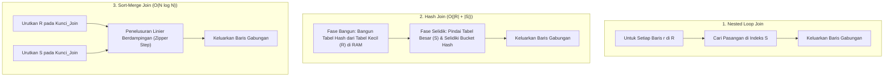

## Bab 12: Strategi Algoritma Join Relasional

### 12.1 Spektrum Algoritma Penggabungan Relasi Data

Operasi penggabungan dua relasi (*Join*) merupakan salah satu operasi paling intensif komputasi dalam sistem basis data relasional. Menghubungkan relasi $R$ (relasi luar / *outer*) dengan relasi $S$ (relasi dalam / *inner*) secara naif akan memerlukan perbandingan produk Cartesian berorde kuadratik $O(|R| 	imes |S|)$, yang akan melumpuhkan performa peladen seketika jika kedua tabel memiliki jutaan baris.

WidyaBase mengimplementasikan tiga pilar strategi algoritma Join fisik:
1. **Nested Loop Join (Loop Bersarang)**: Memindai relasi luar dan mencari pasangan yang cocok di relasi dalam. Sangat efisien jika relasi dalam memiliki indeks B+Tree (*Index Nested Loop Join*).
2. **Hash Join (Penggabungan Berbasis Hash)**: Menggunakan tabel hash di memori RAM. Terdiri atas dua fase: Fase Bangun (*Build Phase*) dan Fase Selidik (*Probe Phase*). Sangat ideal untuk kueri berukuran besar tanpa indeks terurut.
3. **Sort-Merge Join (Penggabungan Urut & Padukan)**: Mengurutkan kedua relasi berdasarkan kunci gabungan, lalu menelusuri keduanya secara linier seirama seperti resleting (*zipper scan*).



Karakteristik komparatif di WidyaBase:
- **Index Nested Loop Join**: Pilihan terbaik ketika relasi luar berukuran sangat kecil (misal 1 baris hasil pencarian filter ID) dan relasi dalam diindeks dengan B+Tree: kompleksitas hanya $O(|R| \log |S|)$.
- **Grace Hash Join**: Jika tabel hash pada fase bangun melebihi alokasi memori RAM kerja (*work_mem*), WidyaBase secara otomatis mempartisi data ke dalam berkas sementara piringan disk (*disk spilling*) berbasis fungsi hash rekursif.
- **Merge Join**: Sangat dominan ketika kedua masukan telah terurut secara alami oleh indeks B+Tree atau klausa `URUTKAN_BERDASARKAN`, menghilangkan fase pengurutan (*sort overhead*).

### 12.2 Implementasi Kode Program Utuh

Berikut implementasi logika eksekutor Hash Join dan Sort-Merge Join pada WidyaBase menggunakan Widya-Lang:

```widya
// Modul Strategi Algoritma Join Relasional WidyaBase
modul algoritma_join {
    impor ekosistem::widyabase::{
        WidyaBase, BarisData, TabelData, NilaiKolom,
        TabelHashMemori, IteratorRelasi
    };

    fungsi eksekusi_hash_join(
        mut relasi_bangun: IteratorRelasi, // Biasanya relasi yang lebih kecil
        mut relasi_selidik: IteratorRelasi, // Relasi yang lebih besar
        kunci_join: Teks
    ) -> Hasil<Daftar<BarisData>, Teks> {
        cetak(">>> [HASH-JOIN] Memulai Fase Bangun (Build Phase)...");
        biar mut tabel_hash = TabelHashMemori::buat();
        biar mut jumlah_bangun = 0;

        // FASE 1: BANGUN (Memasukkan seluruh baris relasi kecil ke Hash Table RAM)
        selama biar Ada(baris) = relasi_bangun.berikutnya() {
            biar nilai_kunci = baris.ambil_nilai(&kunci_join);
            tabel_hash.sisipkan(nilai_kunci, baris);
            jumlah_bangun = jumlah_bangun + 1;
        }
        cetak(">>> [HASH-JOIN] Tabel hash selesai dibangun dengan " + teks(jumlah_bangun) + " entri.");

        // FASE 2: SELIDIK (Membaca baris relasi besar dan mencocokkan hash bucket)
        cetak(">>> [HASH-JOIN] Memulai Fase Selidik (Probe Phase)...");
        biar mut hasil_gabungan: Daftar<BarisData> = [];

        selama biar Ada(baris_luar) = relasi_selidik.berikutnya() {
            biar nilai_kunci = baris_luar.ambil_nilai(&kunci_join);
            biar pasangan = tabel_hash.temukan(&nilai_kunci);

            untuk baris_dalam di pasangan {
                biar baris_padu = BarisData::gabungkan(&baris_luar, baris_dalam);
                hasil_gabungan.tambah(baris_padu);
            }
        }

        cetak(">>> [HASH-JOIN] Selesai! Menghasilkan " + teks(hasil_gabungan.panjang()) + " baris gabungan.");
        kembalikan Ok(hasil_gabungan);
    }

    fungsi eksekusi_sort_merge_join(
        mut masukan_a_terurut: IteratorRelasi,
        mut masukan_b_terurut: IteratorRelasi,
        kunci_join: Teks
    ) -> Hasil<Daftar<BarisData>, Teks> {
        cetak(">>> [MERGE-JOIN] Menelusuri dua relasi terurut secara linier seirama...");
        biar mut hasil: Daftar<BarisData> = [];

        biar mut kursor_a = masukan_a_terurut.berikutnya();
        biar mut kursor_b = masukan_b_terurut.berikutnya();

        selama kursor_a.ada() && kursor_b.ada() {
            biar baris_a = kursor_a.buka();
            biar baris_b = kursor_b.buka();

            biar val_a = baris_a.ambil_nilai(&kunci_join);
            biar val_b = baris_b.ambil_nilai(&kunci_join);

            jika val_a == val_b {
                // Pasangan cocok ditemukan
                hasil.tambah(BarisData::gabungkan(&baris_a, &baris_b));
                kursor_b = masukan_b_terurut.berikutnya();
            } selain_jika val_a < val_b {
                kursor_a = masukan_a_terurut.berikutnya();
            } selain_itu {
                kursor_b = masukan_b_terurut.berikutnya();
            }
        }

        cetak(">>> [MERGE-JOIN] Selesai dengan " + teks(hasil.panjang()) + " baris hasil.");
        kembalikan Ok(hasil);
    }
}
```

### 12.3 Analisis Arsitektur, Metrik & Tabel Spesifikasi

Tabel perbandingan algoritma penggabungan relasi fisik pada WidyaBase:

| Karakteristik Evaluasi | Nested Loop Join (Indeks) | Hash Join (In-Memory) | Sort-Merge Join |
| :--- | :--- | :--- | :--- |
| **Kompleksitas Waktu** | $O(|R| \log |S|)$ | $O(|R| + |S|)$ (Linier Optimal) | $O(|R| \log |R| + |S| \log |S|)$ |
| **Konsumsi Memori RAM** | Sangat Rendah ($O(1)$) | Tinggi ($O(|R|)$ untuk tabel hash) | Rendah jika sudah terurut ($O(1)$) |
| **Kondisi Predikat Join** | Mendukung Kesetaraan ($=$) & Rentang ($<, >$) | Hanya Kesetaraan (Equi-Join $=$) | Mendukung Kesetaraan & Ketidaksamaan |
| **Ketergantungan Indeks** | Mutlak membutuhkan indeks pada $S$ | Tanpa indeks sama sekali | Sangat diuntungkan indeks B+Tree |
| **Perilaku Luap Disk** | Tidak pernah meluap ke disk | Mendukung Grace Hash Partitioning | Mendukung External Merge Sort |

### 12.4 Latihan Soal Esai

1. Terangkan dua fase utama dalam algoritma *Hash Join*! Mengapa relasi yang berukuran lebih kecil selalu dipilih sebagai masukan fase bangun (*build phase*)?
2. Bagaimana mekanisme penanganan algoritma *Grace Hash Join* ketika ukuran tabel hash melampaui kapasitas memori kerja RAM (*work_mem*) yang dialokasikan?
3. Pada kondisi data seperti apa *Sort-Merge Join* mengungguli performa *Hash Join*? Jelaskan peranan indeks B+Tree dalam skenario tersebut!

### 12.5 Soal Pilihan Ganda

1. Algoritma Join yang paling efisien ketika menggabungkan satu baris data dengan tabel relasi dalam yang memiliki indeks B+Tree adalah...
   A. Index Nested Loop Join
   B. Full Table Scan
   C. Cartesian Product
   D. Round Robin Join

2. Dua tahapan kerja berurutan pada algoritma Hash Join dinamakan...
   A. Fase Bangun (*Build Phase*) dan Fase Selidik (*Probe Phase*)
   B. Fase Awal dan Fase Akhir
   C. Fase Buka dan Fase Tutup
   D. Fase Kirim dan Fase Terima

3. Kompleksitas waktu komputasi dari algoritma In-Memory Hash Join untuk dua relasi berukuran $|R|$ dan $|S|$ adalah...
   A. $O(|R| 	imes |S|)$
   B. $O(|R| + |S|)$
   C. $O(|R|^2)$
   D. $O(1)$

4. Batasan matematis dari algoritma Hash Join standar adalah...
   A. Hanya dapat digunakan untuk kondisi gabungan kesetaraan (*Equi-Join* seperti $R.id = S.id$)
   B. Tidak mendukung data angka
   C. Hanya bisa berjalan di malam hari
   D. Memerlukan kabel jaringan khusus

5. Kondisi di mana data masukan Sort-Merge Join tidak perlu diurutkan ulang melalui komputasi CPU adalah...
   A. Kedua tabel dibaca melalui pemindaian indeks B+Tree yang kuncinya selaras dengan atribut join
   B. Tabel berukuran lebih dari 10 terabyte
   C. Komputer dimatikan dan dinyalakan ulang
   D. Pengguna mengetik kueri menggunakan huruf kapital

6. Teknik penggabungan di mana partisi hash yang meluap dari RAM dialirkan ke media penyimpanan disk sementara dinamakan...
   A. Grace Hash Join
   B. Buffer Thrashing
   C. Memory Leak
   D. Deadlock Loop

7. Algoritma Join yang terpaksa dipilih oleh mesin basis data bila kondisi penggabungan menggunakan predikat ketidaksamaan kompleks tanpa indeks adalah...
   A. Block Nested Loop Join
   B. Fast Hash
   C. Direct Memory Access
   D. Virtual Pointer

8. Dalam fase bangun Hash Join, entitas yang disimpan ke dalam ember (*bucket*) tabel hash adalah...
   A. Nilai kunci gabungan beserta pointer tupel atau seluruh baris data relasi kecil
   B. Kata sandi pengguna
   C. Alamat MAC peladen
   D. Salinan file log WAL

9. Istilah penelusuran seirama seperti resleting pada dua aliran data terurut dalam Sort-Merge Join disebut...
   A. Zipper Scan
   B. Spiral Scan
   C. Random Probe
   D. Star Topology

10. Mengapa alokasi parameter `work_mem` sangat krusial bagi kecepatan eksekusi kueri agregasi dan operasi Join di WidyaBase?
    A. Memastikan proses Hash Join dan pengurutan dapat selesai 100% di dalam RAM tanpa perlu meluap ke disk fisik (*disk spilling*)
    B. Menambah kecepatan kipas pendingin server
    C. Mengurangi biaya langganan listrik
    D. Menghapus tabel data yang tidak aktif
