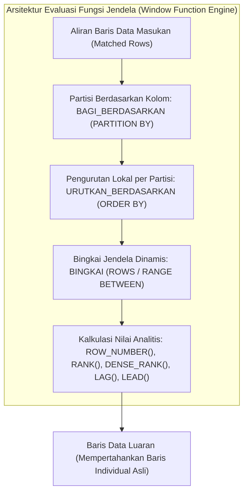

## Bab 14: Agregasi, Pengelompokan & Fungsi Jendela

### 14.1 Komputasi Agregasi: Hash vs Sort & Dimensi Jendela

Analisis data bisnis tingkat tinggi menuntut kapabilitas kalkulasi metrik agregat yang tangguh. WidyaBase menyediakan spektrum lengkap fungsi agregasi standar (`JUMLAH`/`SUM`, `RATA_RATA`/`AVG`, `HITUNG`/`COUNT`, `MINIMAL`/`MIN`, `MAKSIMAL`/`MAX`), klausa pengelompokan (`KELOMPOKKAN_BERDASARKAN`/`GROUP BY`), serta **Fungsi Jendela** (*Window Functions*) analitis tingkat lanjut.

Dua strategi fisik untuk mengeksekusi pengelompokan `GROUP BY`:
1. **Hash Aggregation**: Membangun tabel hash di memori kerja RAM dengan kunci grup sebagai *hash key* dan akumulator agregat sebagai nilai. Berkecepatan tinggi $O(N)$ jika jumlah grup unik muat di RAM.
2. **Sort Aggregation**: Mengurutkan data masukan berdasarkan kolom grup, lalu melakukan pemindaian sekuensial sederhana untuk mengagregasi baris-baris bertetangga dengan nilai kunci yang sama.



Perbedaan filosofis antara `GROUP BY` dan Fungsi Jendela:
- **Agregasi Standar (`GROUP BY`)**: Mengompresi banyak baris menjadi satu baris rangkuman per grup (mereduksi kardinalitas baris).
- **Fungsi Jendela (`OVER (...)` / `LEWAT (...)`)**: Menghitung kalkulasi metrik grup di atas bingkai jendela dinamis, tetapi **tetap mempertahankan setiap baris individual asli** tanpa mereduksi jumlah baris.

### 14.2 Implementasi Kode Program Utuh

Berikut implementasi eksekusi kueri agregasi dan fungsi jendela analitis dwibahasa pada WidyaBase menggunakan Widya-Lang:

```widya
// Modul Agregasi dan Fungsi Jendela Analitis WidyaBase
modul fungsi_jendela_analitis {
    impor ekosistem::widyabase::{WidyaBase, HasilKueri, BarisData};

    fungsi jalankan_analisis_keuangan(mesin: &mut WidyaBase) -> Hasil<Boolean, Teks> {
        cetak("==================================================================");
        cetak(">>> [ANALITIS] Mengeksekusi Kueri Agregasi dan Fungsi Jendela...");

        // 1. Eksekusi GROUP BY Standar Menggunakan Dialek Nusantara
        biar sql_agregasi = "
            PILIH divisi, 
                  HITUNG(*) SEBAGAI total_karyawan,
                  RATA_RATA(gaji) SEBAGAI rata_gaji,
                  MAKSIMAL(gaji) SEBAGAI gaji_tertinggi
            DARI pegawai_bumn
            KELOMPOKKAN_BERDASARKAN divisi
            MEMILIKI RATA_RATA(gaji) > 10000000.0;
        ";
        cetak(">>> [SQL] Menjalankan pengelompokan divisi...");
        biar hasil_group: HasilKueri = mesin.kueri_sql(sql_agregasi)?;
        untuk baris di hasil_group.baris_data() {
            cetak("  - Divisi: " + baris.ambil_teks("divisi") + 
                  " | Staf: " + teks(baris.ambil_bulat("total_karyawan")) + 
                  " | Rata-rata: Rp " + teks(baris.ambil_desimal("rata_gaji")));
        }

        // 2. Eksekusi Fungsi Jendela Analitis (Ranking & Running Total)
        biar sql_window = "
            PILIH nama, divisi, gaji,
                  NOMOR_BARIS() LEWAT (
                      BAGI_BERDASARKAN divisi 
                      URUTKAN_BERDASARKAN gaji MENURUN
                  ) SEBAGAI peringkat_divisi,
                  JUMLAH(gaji) LEWAT (
                      BAGI_BERDASARKAN divisi 
                      URUTKAN_BERDASARKAN id 
                      BINGKAI BARIS ANTARA TAK_TERBATAS_SEBELUMNYA DAN SAAT_INI
                  ) SEBAGAI akumulasi_gaji_divisi
            DARI pegawai_bumn;
        ";
        cetak(">>> [SQL] Menjalankan fungsi jendela analitis...");
        biar hasil_window: HasilKueri = mesin.kueri_sql(sql_window)?;
        cetak(">>> [HASIL WINDOW] Ditemukan " + teks(hasil_window.jumlah_baris()) + " baris detail:");
        untuk baris di hasil_window.baris_data() {
            cetak("  - " + baris.ambil_teks("nama") + 
                  " [" + baris.ambil_teks("divisi") + "] Gaji: Rp " + teks(baris.ambil_desimal("gaji")) +
                  " | Ranking Divisi: #" + teks(baris.ambil_bulat("peringkat_divisi")) +
                  " | Total Berjalan: Rp " + teks(baris.ambil_desimal("akumulasi_gaji_divisi")));
        }

        cetak(">>> [SUKSES] Seluruh kalkulasi jendela terhitung secara presisi!");
        cetak("==================================================================");
        kembalikan Ok(benar);
    }
}
```

### 14.3 Analisis Arsitektur, Metrik & Tabel Spesifikasi

Tabel perbandingan ragam fungsi jendela analitis pada WidyaBase:

| Kategori Fungsi Jendela | Fungsi Dialek Nusantara | Standar SQL Internasional | Kegunaan Bisnis Utama |
| :--- | :--- | :--- | :--- |
| **Pemeringkatan Urutan**| `NOMOR_BARIS()`, `PERINGKAT()` | `ROW_NUMBER()`, `RANK()` | Penentuan peringkat staf, leaderboards |
| **Pemeringkatan Rapat** | `PERINGKAT_RAPAT()` | `DENSE_RANK()` | Peringkat tanpa lompatan nomor saat seri |
| **Navigasi Baris** | `SEBELUMNYA(kolom, n)` | `LAG(column, offset)` | Perbandingan performa terhadap bulan lalu |
| **Navigasi Maju** | `BERIKUTNYA(kolom, n)` | `LEAD(column, offset)` | Prediksi tren dan perubahan status |
| **Agregasi Berjalan** | `JUMLAH(...) LEWAT (...)` | `SUM(...) OVER (...)` | Saldo berjalan akun (*running balance*) |

### 14.4 Latihan Soal Esai

1. Terangkan perbedaan mendasar antara klausa penyaring baris mentah `DIMANA` (*WHERE*) dengan klausa penyaring hasil agregasi kelompok `MEMILIKI` (*HAVING*)!
2. Jelaskan perbedaan operasional antara fungsi pemeringkatan `RANK()` dan `DENSE_RANK()` ketika ditemukan dua atau lebih baris data yang memiliki nilai kunci pengurutan kembar!
3. Bagaimana mesin eksekusi WidyaBase mengoptimalkan kalkulasi *Running Total* pada bingkai jendela dinamis agar tidak melakukan perhitungan ulang $O(N^2)$ untuk setiap baris?

### 14.5 Soal Pilihan Ganda

1. Klausa yang digunakan untuk menyaring kelompok data hasil agregasi pada SQL adalah...
   A. `WHERE`
   B. `HAVING` (atau `MEMILIKI` pada Dialek Nusantara)
   C. `ORDER BY`
   D. `LIMIT`

2. Karakteristik utama dari Fungsi Jendela (*Window Function*) dibandingkan `GROUP BY` standar adalah...
   A. Menghitung kalkulasi analitis di atas kelompok partisi tanpa mengurangi atau mengompresi jumlah baris individual
   B. Menghapus baris ganda secara otomatis
   C. Mengunci seluruh database
   D. Hanya bekerja pada tabel berukuran nol

3. Kata kunci Dialek Nusantara yang digunakan untuk mendefinisikan pembagian kelompok pada fungsi jendela (`PARTITION BY`) adalah...
   A. `PISAH_DATA`
   B. `BAGI_BERDASARKAN`
   C. `KELOMPOK_SUB`
   D. `IRIS_TABEL`

4. Fungsi jendela yang menghasilkan nomor urut monoton bertambah mulai dari 1 untuk setiap baris di dalam partisinya dinamakan...
   A. `ROW_NUMBER()` (atau `NOMOR_BARIS()`)
   B. `COUNT()`
   C. `SUM()`
   D. `AVG()`

5. Jika ada 3 data bernilai sama di peringkat 1, fungsi `RANK()` akan memberikan nilai 1, 1, 1, dan data berikutnya akan mendapat nomor...
   A. 2
   B. 4 (karena melompati peringkat yang seri)
   C. 3
   D. 0

6. Jika ada 3 data bernilai sama di peringkat 1, fungsi `DENSE_RANK()` akan memberikan nilai 1, 1, 1, dan data berikutnya akan mendapat nomor...
   A. 2 (tanpa lompatan peringkat)
   B. 4
   C. 5
   D. 10

7. Fungsi jendela analitis yang digunakan untuk mengakses nilai kolom dari baris sebelumnya (misalnya pendapatan bulan lalu) adalah...
   A. `LAG()` (atau `SEBELUMNYA()`)
   B. `LEAD()`
   C. `FIRST_VALUE()`
   D. `LAST_VALUE()`

8. Fungsi jendela analitis yang digunakan untuk mengintip nilai kolom dari baris sesudahnya adalah...
   A. `LEAD()` (atau `BERIKUTNYA()`)
   B. `LAG()`
   C. `MIN()`
   D. `MAX()`

9. Algoritma eksekusi pengelompokan yang paling efisien ketika data masukan telah diurutkan oleh indeks B+Tree adalah...
   A. Sort Aggregation
   B. Random Aggregation
   C. Cartesian Join
   D. Bubble Aggregation

10. Mengapa bingkai jendela dinamis (*Window Frame*) seperti `ROWS BETWEEN UNBOUNDED PRECEDING AND CURRENT ROW` sangat vital dalam komputasi perbankan?
    A. Memungkinkan kalkulasi saldo tabungan berjalan (*running balance*) secara kronologis dari awal pembukaan rekening hingga setiap mutasi
    B. Menghapus saldo nasabah secara berkala
    C. Mengganti nomor rekening otomatis
    D. Menghindari verifikasi PIN ATM
