## Bab 15: Tampilan Virtual, CTE Rekursif & Savepoint Transaksional

### 15.1 Abstraksi Modular: View, CTE & Titik Simpan Bertingkat

Pengembangan aplikasi berskala enterprise membutuhkan kemampuan modularisasi kueri yang bersih serta mekanisme penanganan galat transaksional yang luwes. Menulis kueri monolitik berukuran ratusan baris kode tidak hanya sulit dibaca, tetapi juga rawan menimbulkan kesalahan logika.

WidyaBase menyediakan tiga pilar modularisasi logika dan kontrol transaksi:
1. **Tampilan Virtual (*Views*)**: Lapisan abstraksi kueri tersimpan yang bertindak seolah-olah sebagai tabel nyata, tanpa menduplikasi data fisik di disk.
2. **Ekspresi Tabel Umum (*Common Table Expressions* / CTE)**: Klausa `DENGAN` (*WITH*) yang memungkinkan penguraian kueri rumit menjadi sub-tabel logis sementara, termasuk **CTE Rekursif** untuk menelusuri struktur pohon organisasi atau hierarki graf.
3. **Titik Simpan Transaksional (*Savepoints*)**: Penanda pos pemeriksaan bersarang di dalam satu transaksi aktif (`TITIK_SIMPAN` / `SAVEPOINT`), memungkinkan pembatalan parsial (*partial rollback*) ke titik tertentu tanpa harus menggugurkan seluruh transaksi dari awal.

```mermaid
flowchart TD
    subgraph TransaksiACID["Siklus Transaksi dengan Titik Simpan Bersarang (Savepoints)"]
        A["MULAI_TRANSAKSI (BEGIN)"] --> B["Eksekusi: Debit Rekening Nasabah Rp 5.000.000"]
        B --> C["TITIK_SIMPAN pos_pembayaran_1;"]
        C --> D["Eksekusi: Kirim Dana ke Bank Eksternal A (Gagal Jaringan / Galat)"]
        D -->|Terjadi Galat Operasional| E["KEMBALIKAN_KE_TITIK_SIMPAN pos_pembayaran_1;"]
        E -->|Debit Awal Tetap Utuh & Selamat| F["Eksekusi Jalur Alternatif: Kirim Dana ke Bank B (Sukses)"]
        F --> G["LEPASKAN_TITIK_SIMPAN pos_pembayaran_1;"]
        G --> H["KOMIT_TRANSAKSI (COMMIT)"]
    end
```



Karakteristik implementasi di WidyaBase:
- **Penggabungan Tampilan (*View Inlining*)**: Kueri terhadap *View* digabungkan (*flattened*) secara langsung ke dalam kueri induk oleh perencana logis, memungkinkan CBO menerapkan *Predicate Pushdown* menembus definisi view.
- **CTE Rekursif dengan Deteksi Siklus**: Memproses simpul hierarki anak-induk dengan aman, dilengkapi pelindung kedalaman maksimum (*max recursion depth*) untuk mencegah loop tak terbatas.
- **Manajemen Savepoint Tanpa Flushed LSN**: Savepoint dikelola secara efisien di memori transaksi dengan mencatat pointer status WAL saat itu, sehingga pembuatan savepoint berjalan dengan latensi nol tanpa disk I/O.

### 15.2 Implementasi Kode Program Utuh

Berikut implementasi CTE rekursif hierarki dan demonstrasi partial rollback savepoint pada WidyaBase menggunakan Widya-Lang:

```widya
// Modul Tampilan Virtual, CTE Rekursif dan Savepoint WidyaBase
modul modularitas_transaksi {
    impor ekosistem::widyabase::{WidyaBase, TransaksiACID, HasilKueri};

    fungsi demonstrasi_cte_dan_savepoint(mesin: &mut WidyaBase) -> Hasil<Boolean, Teks> {
        cetak("==================================================================");
        cetak(">>> [MODULARITAS] Memulai pengujian CTE Rekursif dan Savepoint...");

        // 1. Eksekusi CTE Rekursif untuk Menelusuri Struktur Hierarki Organisasi
        biar sql_cte_hierarki = "
            DENGAN REKURSIF pohon_organisasi SEBAGAI (
                // Anggota Jangkar (Anchor Member): Pimpinan Tertinggi
                PILIH id, nama, id_atasan, 1 SEBAGAI tingkat
                DARI pegawai_bumn
                DIMANA id_atasan ADALAH KOSONG
                
                GABUNG_SEMUA
                
                // Anggota Rekursif (Recursive Member): Bawahan
                PILIH p.id, p.nama, p.id_atasan, po.tingkat + 1
                DARI pegawai_bumn p
                GABUNG pohon_organisasi po PADA p.id_atasan = po.id
            )
            PILIH * DARI pohon_organisasi URUTKAN_BERDASARKAN tingkat MENAIK;
        ";
        cetak(">>> [CTE] Menjalankan CTE rekursif struktur hierarki...");
        biar hasil_cte: HasilKueri = mesin.kueri_sql(sql_cte_hierarki)?;
        untuk baris di hasil_cte.baris_data() {
            cetak("  Tingkat " + teks(baris.ambil_bulat("tingkat")) + ": " + 
                  baris.ambil_teks("nama") + " (ID: " + teks(baris.ambil_bulat("id")) + ")");
        }

        // 2. Eksekusi Transaksi Finansial dengan Mekanisme Titik Simpan (Savepoint)
        cetak(">>> [TRANSAKSI] Memulai transaksi transfer multi-kanal...");
        biar mut tx: TransaksiACID = mesin.mulai_transaksi()?;

        // Langkah A: Debit Rekening Pengirim
        tx.eksekusi_sql("PERBARUI rekening SET saldo = saldo - 2500000 WHERE no_rek = 'REK-001';")?;
        cetak(">>> [TX] Berhasil mendebit saldo pengirim.");

        // Buat Titik Simpan (Savepoint)
        tx.buat_titik_simpan("pos_kanal_mitra")?;
        cetak(">>> [TX] Titik simpan 'pos_kanal_mitra' berhasil ditancapkan.");

        // Langkah B: Coba pengiriman lewat Mitra X (Simulasi Galat)
        biar percobaan_mitra = tx.eksekusi_sql("SISIP_KE mutasi_mitra_x (no_rek, nominal) NILAI ('REK-002', 2500000);");
        
        jika percobaan_mitra.apakah_galat() {
            cetak(">>> [TX] Kanal Mitra X bermasalah! Melakukan pembatalan parsial...");
            // Rollback hanya ke savepoint, debit awal tetap selamat
            tx.kembalikan_ke_titik_simpan("pos_kanal_mitra")?;
            cetak(">>> [TX] Saldo pengirim aman pada titik simpan. Mengalihkan ke Mitra Y...");

            // Jalur Pengganti: Kirim lewat Mitra Y yang sehat
            tx.eksekusi_sql("SISIP_KE mutasi_mitra_y (no_rek, nominal) NILAI ('REK-002', 2500000);")?;
            cetak(">>> [TX] Berhasil dikirimkan via Mitra Y!");
        }

        // Lepaskan Savepoint dan Komit Transaksi Penuh
        tx.lepaskan_titik_simpan("pos_kanal_mitra")?;
        tx.komit()?;
        cetak(">>> [TX] Transaksi komit paripurna! Bebas dari kegagalan berantai.");
        cetak("==================================================================");
        kembalikan Ok(benar);
    }
}
```

### 15.3 Analisis Arsitektur, Metrik & Tabel Spesifikasi

Tabel perbandingan sintaksis modularitas dan kendali transaksi pada WidyaBase:

| Fitur / Mekanisme | Dialek Nusantara | Standar ANSI SQL | Dampak Terhadap Penyimpanan Disk |
| :--- | :--- | :--- | :--- |
| **Definisi Tampilan** | `BUAT TAMPILAN v_nama SEBAGAI PILIH ...` | `CREATE VIEW v_name AS SELECT ...` | Nol (Metadata skema logis saja) |
| **CTE Bersarang** | `DENGAN nama_tabel SEBAGAI (...)` | `WITH table_name AS (...)` | Nol (Dievaluasi in-line / memori kerja) |
| **CTE Rekursif** | `DENGAN REKURSIF nama SEBAGAI (...)` | `WITH RECURSIVE name AS (...)` | Ditampung di antrean memori kerja |
| **Pembuatan Savepoint** | `TITIK_SIMPAN nama_pos;` | `SAVEPOINT sp_name;` | Nol (Hanya penanda memori transaksi) |
| **Pembatalan Parsial** | `KEMBALIKAN_KE_TITIK_SIMPAN nama_pos;`| `ROLLBACK TO SAVEPOINT sp_name;` | Menulis pembatalan logis lokal |
| **Pelepasan Savepoint**| `LEPASKAN_TITIK_SIMPAN nama_pos;` | `RELEASE SAVEPOINT sp_name;` | Membebaskan penanda struktur data |

### 15.4 Latihan Soal Esai

1. Terangkan perbedaan mendasar antara *Standard View* (Tampilan Virtual) dan *Materialized View* dalam hal penggunaan ruang disk dan konsistensi data real-time!
2. Bagaimana cara kerja komponen *Anchor Member* dan *Recursive Member* dalam sintaksis CTE Rekursif? Mengapa kondisi pemberhentian rekursi mutlak diperlukan?
3. Jelaskan skenario bisnis perbankan di mana penggunaan `SAVEPOINT` jauh lebih unggul dan efisien daripada membiarkan transaksi langsung gagal total (*complete rollback*)!

### 15.5 Soal Pilihan Ganda

1. Objek basis data yang menyimpan definisi kueri logis tanpa menduplikasi data fisik di piringan disk dinamakan...
   A. View (Tampilan Virtual)
   B. Table Partition
   C. WAL Segment
   D. Root Page

2. Klausa SQL yang digunakan untuk mendefinisikan Common Table Expression (CTE) adalah...
   A. `WITH` (atau `DENGAN` pada Dialek Nusantara)
   B. `CREATE CLUSTER`
   C. `DECLARE CURSOR`
   D. `MERGE INTO`

3. Dua bagian wajib dalam konstruksi query CTE Rekursif adalah...
   A. Anchor Member (Anggota Jangkar) dan Recursive Member (Anggota Rekursif)
   B. Head dan Tail
   C. Header dan Footer
   D. Input dan Output

4. Perintah yang digunakan untuk menandai pos pemeriksaan bersarang di dalam satu transaksi aktif adalah...
   A. `SAVEPOINT` (atau `TITIK_SIMPAN`)
   B. `CHECKPOINT`
   C. `COMMIT`
   D. `FREEZE`

5. Tindakan yang terjadi ketika perintah `ROLLBACK TO SAVEPOINT sp1;` dieksekusi adalah...
   A. Seluruh perubahan yang terjadi setelah `sp1` dibatalkan, namun perubahan sebelum `sp1` tetap bertahan dalam transaksi aktif
   B. Seluruh database dihapus
   C. Transaksi otomatis dinyatakan komit
   D. Koneksi jaringan diputus seketika

6. Perintah yang digunakan untuk membebaskan penanda titik simpan tanpa membatalkan transaksi adalah...
   A. `RELEASE SAVEPOINT` (atau `LEPASKAN_TITIK_SIMPAN`)
   B. `DROP TABLE`
   C. `ABORT`
   D. `DELETE FROM`

7. Apa bahaya utama jika CTE Rekursif tidak memiliki kondisi batas pemberhentian (*termination condition*)?
   A. Terjadi perulangan tak berujung (*infinite loop*) yang menghabiskan memori peladen hingga batas rekursi terpicu
   B. Menjadikan warna layar terminal berubah
   C. Mempercepat koneksi internet
   D. Menghapus akun admin

8. Istilah teknik optimasi di mana pendefinisian View dilebur langsung ke dalam pohon rencana kueri induk dinamakan...
   A. View Inlining / View Flattening
   B. Page Split
   C. Vacuuming
   D. Buffer Thrashing

9. Berapakah overhead penulisan disk I/O yang ditimbulkan oleh pembuatan sebuah `SAVEPOINT`?
   A. Tepat nol (0 I/O disk) karena hanya memanipulasi penanda status di RAM memori transaksi
   B. 100 Megabyte
   C. 4 Kilobyte
   D. Bergantung pada ukuran harddisk

10. Mengapa View yang melibatkan agregasi grup (`GROUP BY`) atau banyak gabungan tabel (`JOIN`) umumnya berstatus *Read-Only* (tidak dapat langsung di-UPDATE)?
    A. Karena sistem tidak dapat memetakan secara ambigu satu baris hasil agregasi kembali ke satu baris fisik asal pada tabel dasar
    B. Karena sistem operasi melarang komputasi di malam hari
    C. Karena bahasa SQL tidak mendukung tombol simpan
    D. Supaya memori RAM tidak dingin
