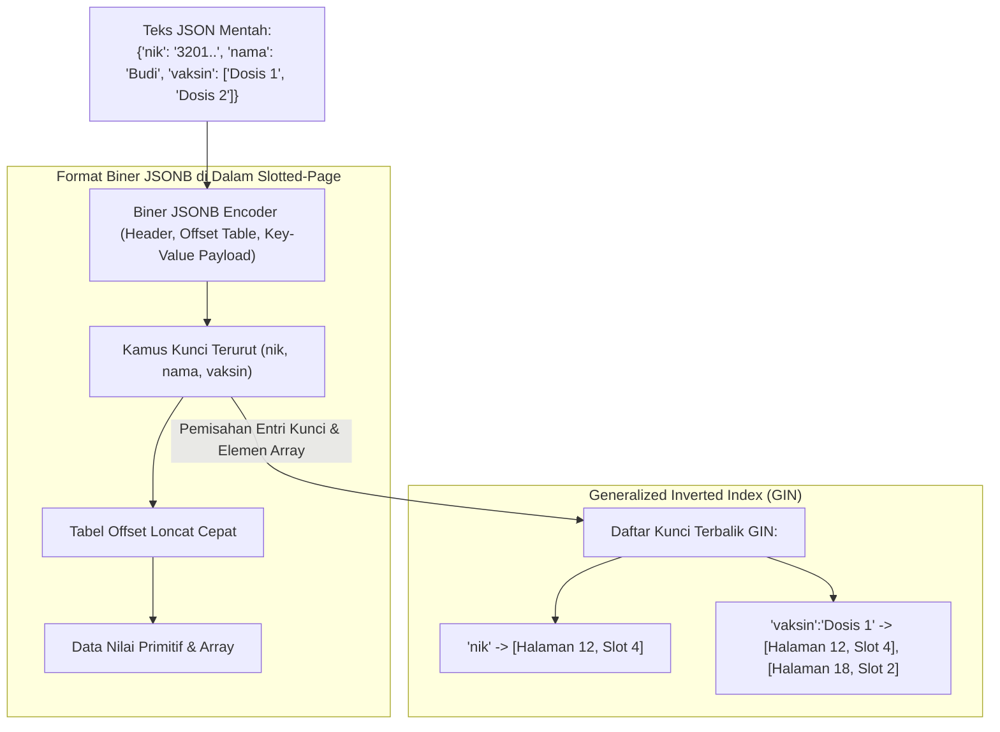

## Bab 17: Penyimpanan Dokumen Dinamis JSONB & Indeks GIN

### 17.1 Dokumen Tanpa Skema di Atas Fondasi Relasional ACID

Dalam lanskap komputasi modern, entitas bisnis sering kali memiliki atribut yang sangat dinamis, heterogen, dan berkembang cepat—seperti profil pengguna, konfigurasi sensor IoT, rekam medis poliklinik, atau keranjang belanja e-commerce. Memaksa entitas dinamis ini ke dalam skema tabel relasional kaku (*rigid relational schema*) akan memicu proliferasi kolom bernilai kosong (*NULL proliferation*) atau mengharuskan migrasi skema `ALTER TABLE` berulang kali.

WidyaBase mengatasi tantangan ini dengan mengintegrasikan tipe data dokumen biner **JSONB** (*Binary JSON*) yang didukung oleh struktur pengindeksan terbalik **GIN** (*Generalized Inverted Index*):
- **Format Biner Terkompresi**: Format teks JSON mentah diuraikan sekali saat penyisipan menjadi struktur hierarkis biner terurut kunci.
- **Ekstraksi Kunci Seketika ($O(1)$ / $O(\log K)$)**: Pengaksesan properti bersarang (`dokumen->'kontak'->>'email'`) dapat langsung melompat ke lokasi memori yang tepat tanpa perlu mem-parsing ulang seluruh berkas string JSON.
- **Dukungan Indeks GIN Universal**: Setiap kunci dan nilai di dalam dokumen JSONB diindeks ke dalam B+Tree terbalik, memungkinkan kueri pencarian keberadaan properti (`?`), ketercakupan himpunan (`@>`), dan jalur ekspresi (`@@`) berjalan dalam hitungan fraksi milidetik.



Fitur unggulan dokumen JSONB WidyaBase:
1. **Operator Operator Navigasi Dwibahasa**:
   - `->` : Mengambil objek atau elemen anak sebagai tipe JSONB.
   - `->>` : Mengambil nilai skalar sebagai tipe teks primitif.
   - `@>` (*BERISI*) : Memeriksa apakah dokumen kiri mencakup seluruh struktur dokumen kanan.
   - `?` (*MEMILIKI_KUNCI*) : Memeriksa keberadaan nama kunci tertentu.
2. **Kepatuhan ACID Penuh**: Berbeda dengan basis data NoSQL murni yang hanya menjamin konsistensi lambat (*Eventual Consistency*), mutasi dokumen JSONB di WidyaBase terlindungi 100% oleh transaksi ACID, MVCC, dan WAL logging.

### 17.2 Implementasi Kode Program Utuh

Berikut implementasi manipulasi data dokumen JSONB dan kueri operator penelusuran berindeks GIN pada WidyaBase menggunakan Widya-Lang:

```widya
// Modul Penyimpanan Dokumen JSONB dan Indeks GIN WidyaBase
modul dokumen_jsonb {
    impor ekosistem::widyabase::{WidyaBase, DokumenJSONB, HasilKueri, IndeksGIN};

    fungsi demonstrasi_dokumen_dinamis(mesin: &mut WidyaBase) -> Hasil<Boolean, Teks> {
        cetak("==================================================================");
        cetak(">>> [JSONB] Menguji Penyimpanan Dokumen Multi-Modal dan Indeks GIN...");

        // 1. Buat Tabel Pasien Medis dengan Kolom Relasional dan JSONB Fleksibel
        biar sql_tabel = "
            BUAT TABEL rekam_medis_pasien (
                id BULAT KUNCI_UTAMA_SERI,
                nomor_rm TEKS UNIK TIDAK_KOSONG,
                nama_pasien TEKS TIDAK_KOSONG,
                data_klinis DOKUMEN_JSONB
            );
        ";
        mesin.eksekusi_sql(sql_tabel)?;

        // 2. Bangun Indeks GIN pada Kolom Dokumen JSONB
        biar sql_indeks_gin = "
            BUAT INDEKS idx_rekam_medis_gin 
            PADA rekam_medis_pasien 
            MENGGUNAKAN GIN (data_klinis);
        ";
        mesin.eksekusi_sql(sql_indeks_gin)?;
        cetak(">>> [GIN] Indeks terbalik GIN berhasil diaktifkan pada kolom data_klinis.");

        // 3. Sisipkan Catatan dengan Struktur Dokumen Bersarang yang Bervariasi
        biar sql_sisip = "
            SISIP_KE rekam_medis_pasien (nomor_rm, nama_pasien, data_klinis)
            NILAI 
            ('RM-001', 'Ahmad Dahlan', '{
                \"golongan_darah\": \"O\",
                \"alergi\": [\"Penisilin\", \"Kacang\"],
                \"tanda_vital\": {\"tensi_sistol\": 120, \"nadi\": 78},
                \"diagnosa_terakhir\": \"Hipertensi Ringan\"
            }'),
            ('RM-002', 'Dewi Sartika', '{
                \"golongan_darah\": \"A\",
                \"alergi\": [],
                \"tanda_vital\": {\"tensi_sistol\": 110, \"nadi\": 82},
                \"asuransi\": {\"provider\": \"BPJS Kesehatan\", \"kelas\": 1}
            }');
        ";
        mesin.eksekusi_sql(sql_sisip)?;
        cetak(">>> [JSONB] Dokumen pasien berhasil diubah ke format biner dan disimpan.");

        // 4. Kueri Menggunakan Operator Ekstraksi Nilai Skalar (->>)
        biar sql_ekstraksi = "
            PILIH nama_pasien, 
                  data_klinis->'tanda_vital'->>'tensi_sistol' SEBAGAI sistol,
                  data_klinis->>'golongan_darah' SEBAGAI gol_darah
            DARI rekam_medis_pasien
            DIMANA data_klinis->>'golongan_darah' = 'O';
        ";
        cetak(">>> [SQL] Menjalankan kueri ekstraksi hierarkis...");
        biar hasil: HasilKueri = mesin.kueri_sql(sql_ekstraksi)?;
        untuk baris di hasil.baris_data() {
            cetak("  - Pasien: " + baris.ambil_teks("nama_pasien") + 
                  " | Gol Darah: " + baris.ambil_teks("gol_darah") + 
                  " | Sistol: " + baris.ambil_teks("sistol") + " mmHg");
        }

        // 5. Kueri Menggunakan Operator Ketercakupan GIN (@> / BERISI)
        biar sql_ketercakupan = "
            PILIH nama_pasien, data_klinis
            DARI rekam_medis_pasien
            DIMANA data_klinis @> '{\"alergi\": [\"Penisilin\"]}';
        ";
        cetak(">>> [GIN] Mencari pasien dengan riwayat alergi Penisilin...");
        biar hasil_alergi: HasilKueri = mesin.kueri_sql(sql_ketercakupan)?;
        untuk baris di hasil_alergi.baris_data() {
            cetak("  - Ditemukan: " + baris.ambil_teks("nama_pasien") + " (Indeks GIN memotong waktu pencarian)");
        }

        cetak("==================================================================");
        kembalikan Ok(benar);
    }
}
```

### 17.3 Analisis Arsitektur, Metrik & Tabel Spesifikasi

Tabel perbandingan antara tipe teks JSON konvensional dan JSONB terindeks GIN di WidyaBase:

| Karakteristik Evaluasi | Format JSON Teks Standar | Format JSONB Terkompresi | Format JSONB + Indeks GIN |
| :--- | :--- | :--- | :--- |
| **Waktu Penyisipan (*Insert*)** | Sangat Cepat (Tanpa konversi) | Sedang (Pembangunan biner) | Sedang (Pembaruan entri GIN) |
| **Waktu Pembacaan Seluruh Dokumen**| Cepat (Mengalirkan teks) | Sangat Cepat (Tanpa re-format) | Sangat Cepat |
| **Kecepatan Akses Properti Kunci** | Lambat ($O(N)$ parse karakter) | Sangat Cepat ($O(\log K)$ Offset)| Instan via Indeks |
| **Pencarian Nilai Larik (*Array*)**| Lambat ($O(N)$ full table scan)| Sedang ($O(N)$ baris scan) | Sangat Cepat ($O(\log N)$ GIN) |
| **Efisiensi Ruang Penyimpanan**| Boros (Menyimpan spasi/koma) | Hemat 30–45% (Kamus token)| Tambahan 15–20% untuk indeks |

### 17.4 Latihan Soal Esai

1. Terangkan perbedaan struktural antara representasi data format `JSON` teks mentah dan format biner `JSONB` di dalam halaman slotted-page WidyaBase!
2. Bagaimana struktur data *Generalized Inverted Index* (GIN) memecah elemen-elemen dokumen JSONB untuk mempercepat kueri ketercakupan (*containment query* `@>`)?
3. Jelaskan mengapa penggabungan data relasional tabel baku dengan kolom dokumen JSONB dalam satu basis data ACID memberikan fleksibilitas arsitektural yang jauh lebih unggul dibandingkan memelihara basis data NoSQL terpisah!

### 17.5 Soal Pilihan Ganda

1. Tipe data pada WidyaBase yang menyimpan dokumen JSON dalam format biner terurai dan terindeks dinamakan...
   A. JSONB
   B. XML_RAW
   C. VARCHAR_MAX
   D. CSV_BLOB

2. Operator yang digunakan untuk mengekstrak nilai bidang dari objek JSONB dan mengembalikannya sebagai teks biasa adalah...
   A. `->>`
   B. `->`
   C. `==`
   D. `&&`

3. Operator yang digunakan untuk memeriksa apakah suatu dokumen JSONB mencakup seluruh struktur atau elemen tertentu dari dokumen lain dinamakan operator ketercakupan...
   A. `@>` (atau klausa `BERISI`)
   B. `<@`
   C. `??`
   D. `||`

4. Jenis indeks yang paling optimal untuk mempercepat kueri pencarian kunci dan elemen larik (*array*) pada kolom JSONB adalah...
   A. GIN (Generalized Inverted Index)
   B. Hash Scan
   C. R-Tree
   D. Slotted Index

5. Keuntungan format biner JSONB saat mengekstrak properti yang berada di dalam struktur bersarang adalah...
   A. Mesin dapat langsung melompat ke lokasi offset memori properti tanpa perlu mengurai (*parsing*) ulang string dari awal
   B. Dokumen otomatis diubah menjadi file PDF
   C. Huruf kapital otomatis dihilangkan
   D. Menghapus koneksi jaringan yang lambat

6. Operator `?` pada tipe data JSONB di WidyaBase berfungsi untuk...
   A. Menguji apakah suatu nama kunci tertentu ada di dalam tingkat atas objek JSONB
   B. Menampilkan menu bantuan
   C. Menghapus seluruh tabel
   D. Membalik urutan huruf

7. Apa yang terjadi pada spasi kosong redundan (*whitespace*) dan urutan kunci saat teks JSON dikonversi menjadi JSONB?
   A. Spasi redundan dieliminasi dan kunci diurutkan secara kanonikal untuk pencarian biner cepat
   B. Spasi digandakan dua kali lipat
   C. Seluruh tanda koma diubah menjadi titik
   D. Dokumen ditolak oleh parser

8. Batasan integritas ACID pada kolom JSONB di WidyaBase menjamin bahwa...
   A. Seluruh mutasi dokumen dilindungi oleh protokol logging WAL, isolasi transaksi MVCC, dan pemulihan crash seketika
   B. Dokumen hanya bisa dibaca satu orang per hari
   C. Data otomatis hilang jika server mati lampu
   D. Kueri harus ditulis dalam bahasa assembly

9. Indeks GIN secara struktural terdiri atas...
   A. Pohon B+Tree dari entri kunci unik yang masing-masing menunjuk ke daftar posting (*posting list*) berisi pointer tupel (RID)
   B. Sebuah array satu dimensi tanpa pengurutan
   C. File gambar berformat PNG
   D. Rantai blok terdistribusi

10. Mengapa pemakaian kolom JSONB untuk data yang memiliki skema 100% statis dan sangat sering diagregasi (misalnya: kolom saldo, tanggal transaksi) kurang direkomendasikan dibandingkan kolom relasional biasa?
    A. Kolom relasional primitif memiliki overhead metadata yang lebih kecil dan dapat diproses lebih efisien oleh instruksi CPU SIMD
    B. Kolom JSONB tidak bisa disimpan di harddisk
    C. Bahasa Widya-Lang melarang tipe data angka
    D. JSONB hanya bisa menampung 10 karakter
