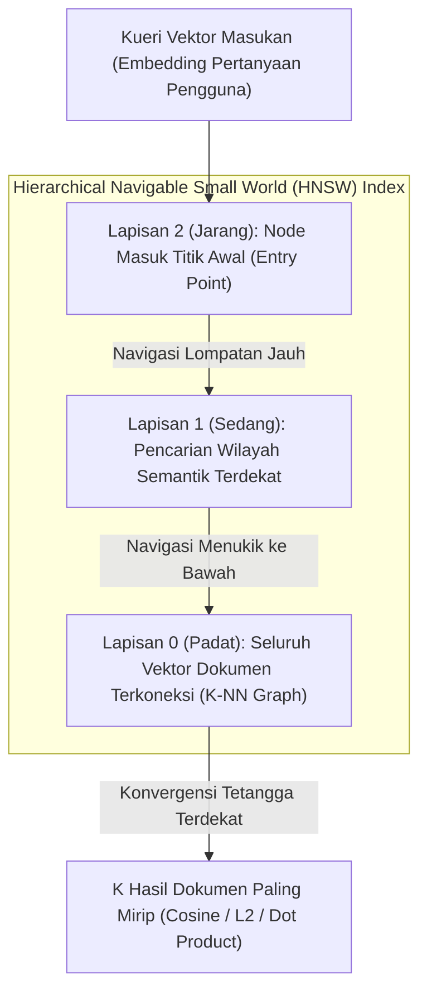

## Bab 18: Mesin Vektor Kecerdasan Buatan & Indeks Graf HNSW

### 18.1 Era AI: Basis Data Semantik Vektor untuk RAG & Agen Cerdas

Perkembangan pesat model kecerdasan buatan (*Large Language Models* / LLM) telah mengubah paradigma pencarian data: dari pencarian berbasis kecocokan kata kunci harfiah (*exact keyword match*) menjadi pencarian berbasis kedekatan makna dan semantik (*semantic similarity search*).

Untuk memberdayakan arsitektur *Retrieval-Augmented Generation* (RAG) dan memori jangka panjang agen kecerdasan buatan tanpa dependensi perangkat lunak asing, WidyaBase mengintegrasikan **Mesin Vektor AI In-Database** berbasis algoritma graf multi-lapis **Hierarchical Navigable Small World (HNSW)**:
- **Pencarian Tetangga Terdekat Hampiran (*Approximate Nearest Neighbors* / ANN)**: Menemukan $K$ dokumen paling mirip semantik dalam hitungan mikrodetik dengan kompleksitas logaritmik $O(\log N)$ di atas jutaan vektor embedding berdimensi tinggi (misal 384, 768, atau 1.536 dimensi).
- **Struktur Graf Berlapis (*Multi-Layered Skip-List Graph*)**: Lapisan atas (*top layers*) memiliki tautan jarak jauh (*long-range links*) untuk navigasi cepat, sedangkan lapisan dasar (*layer 0*) memiliki koneksi lokal padat untuk konvergensi presisi tinggi.
- **Penyaringan Metadata Terpadu (*In-Graph Metadata Filtering*)**: Memfilter kategori, rentang tanggal, atau hak akses dokumen secara langsung saat penelusuran graf berlangsung (*pre-filtering*), mencegah masalah keterbatasan recall.



Parameter kendali kualitas HNSW pada WidyaBase (`hnsw.rs`):
- `M`: Jumlah maksimum koneksi dua arah per node graf (biasanya 16–64). Nilai lebih tinggi meningkatkan akurasi *recall* dengan kompensasi konsumsi memori.
- `ef_construction`: Kedalaman antrean penelusuran prioritas saat membangun indeks (*index build time*).
- `ef_search`: Kedalaman penelusuran saat kueri pencarian berlangsung (*query time*). Dapat disetel secara dinamis per kueri untuk menyeimbangkan antara kecepatan latensi dan ketepatan recall.
- **Metrik Jarak**: Mendukung *Cosine Distance* ($\cos \theta$), *Euclidean L2 Distance* ($d^2$), dan *Dot Product* ($A \cdot B$).

### 18.2 Implementasi Kode Program Utuh

Berikut implementasi pembangunan indeks vektor HNSW dan pencarian semantik dokumen menggunakan Widya-Lang:

```widya
// Modul Mesin Vektor Kecerdasan Buatan HNSW WidyaBase
modul mesin_vektor_hnsw {
    impor ekosistem::widyabase::{
        WidyaBase, IndeksVektorHNSW, MetrikJarakVektor,
        KueriVektor, HasilTetanggaTerdekat, FilterMetadata
    };

    fungsi jalankan_pencarian_vektor_ai(mesin: &mut WidyaBase) -> Hasil<Boolean, Teks> {
        cetak("==================================================================");
        cetak(">>> [HNSW-AI] Memulai Demonstrasi Mesin Vektor In-Database...");

        // 1. Buat Tabel Basis Pengetahuan Berisi Teks dan Vektor Dense 384-Dimensi
        biar sql_tabel = "
            BUAT TABEL dokumen_pengetahuan_ai (
                id BULAT KUNCI_UTAMA_SERI,
                judul TEKS TIDAK_KOSONG,
                kategori TEKS,
                konten TEKS,
                vektor_makna VEKTOR(384)
            );
        ";
        mesin.eksekusi_sql(sql_tabel)?;

        // 2. Bangun Indeks HNSW Multi-Lapis dengan Metrik Cosine
        biar sql_indeks_hnsw = "
            BUAT INDEKS idx_dokumen_hnsw_vektor
            PADA dokumen_pengetahuan_ai
            MENGGUNAKAN HNSW (vektor_makna)
            DENGAN (
                metrik = 'COSINE',
                m = 16,
                ef_konstruksi = 64
            );
        ";
        mesin.eksekusi_sql(sql_indeks_hnsw)?;
        cetak(">>> [HNSW] Indeks graf vektor HNSW berhasil dikonfigurasi.");

        // 3. Simulasikan Sisipan Dokumen Berpengetahuan Regulasi & Teknologi
        biar sql_sisip = "
            SISIP_KE dokumen_pengetahuan_ai (judul, kategori, konten, vektor_makna)
            NILAI 
            ('Regulasi AI Berdaulat', 'Hukum', 'Aturan etika dan tata kelola AI nasional...', EMBED_TEKS('tata kelola dan regulasi kecerdasan buatan')),
            ('Optimasi Kernel Rust', 'Teknologi', 'Pola alokasi memori zero-cost pada kernel...', EMBED_TEKS('rekayasa sistem memori aman tanpa garbage collector')),
            ('Ekonomi Kerakyatan', 'Ekonomi', 'Koperasi modern berbasis platform data berdaulat...', EMBED_TEKS('sistem perekonomian dan ketahanan modal nasional'));
        ";
        mesin.eksekusi_sql(sql_sisip)?;
        cetak(">>> [EMBED] Teks otomatis diubah menjadi vektor dense via In-Database Embedder.");

        // 4. Kueri Kemiripan Semantik ANN dengan Penyaringan Metadata Kategori
        biar kueri_pengguna = "bagaimana hukum mengatur kepatuhan algoritma kecerdasan buatan?";
        biar sql_cari = "
            PILIH judul, kategori, konten,
                  JARAK_KOSINUS(vektor_makna, EMBED_TEKS('" + kueri_pengguna + "')) SEBAGAI skor_jarak
            DARI dokumen_pengetahuan_ai
            DIMANA kategori = 'Hukum'
            URUTKAN_BERDASARKAN skor_jarak MENAIK
            BATAS 1;
        ";

        cetak(">>> [HNSW] Menjalankan pencarian semantik untuk: '" + kueri_pengguna + "'");
        biar hasil = mesin.kueri_sql(sql_cari)?;
        untuk baris di hasil.baris_data() {
            cetak("  ★ Hasil Relevan Ditemukan:");
            cetak("    - Judul    : " + baris.ambil_teks("judul"));
            cetak("    - Kategori : " + baris.ambil_teks("kategori"));
            cetak("    - Skor Jarak Cosine: " + teks(baris.ambil_desimal("skor_jarak")) + " (Makin kecil makin mirip)");
        }

        cetak("==================================================================");
        kembalikan Ok(benar);
    }
}
```

### 18.3 Analisis Arsitektur, Metrik & Tabel Spesifikasi

Tabel perbandingan algoritma pencarian tetangga terdekat (Nearest Neighbors) pada WidyaBase:

| Metode Indeks Vektor | Kompleksitas Kueri | Akurasi *Recall* | Kecepatan Pembangunan Indeks | Konsumsi Memori RAM |
| :--- | :--- | :--- | :--- | :--- |
| **Flat / Brute-Force (Exact)** | $O(N \cdot D)$ (Sangat Lambat) | 100% Sempurna | $O(1)$ (Tanpa indeks) | Paling Rendah |
| **IVFFlat (Inverted File)** | $O(\sqrt{N} \cdot D)$ | 85–92% Tergantung nlist | Sedang (Perlu K-Means) | Rendah |
| **HNSW (Graf Multi-Lapis)** | $O(\log N \cdot D)$ (Ultra Cepat) | **96–99.5% Presisi Tinggi**| Lambat (Pencarian graf) | Tinggi ($N \cdot M \times \text{pointer}$) |
| **IVFPQ (Kuantisasi Vektor)**| $O(\text{probe} \cdot D)$ | 75–85% | Sedang (Kuantisasi byte)| Sangat Hemat (Kompresi 8x)|

### 18.4 Latihan Soal Esai

1. Terangkan prinsip kerja struktur graf multi-lapis pada algoritma HNSW! Mengapa konsep *Skip-List* pada penelusuran lapisan atas mampu memangkas waktu pencarian menjadi $O(\log N)$?
2. Bagaimana peranan parameter `M`, `ef_construction`, dan `ef_search` dalam menentukan keseimbangan antara waktu pembangunan indeks, konsumsi memori, dan kualitas *recall* pencarian semantik?
3. Mengapa teknik *In-Graph Filtering* (menyaring metadata saat menelusuri graf HNSW) jauh lebih unggul dibandingkan pendekatan *Post-Filtering* (mencari tetangga terdekat dahulu lalu membuang dokumen yang tidak cocok dengan kriteria)?

### 18.5 Soal Pilihan Ganda

1. Algoritma graf terkemuka yang digunakan oleh WidyaBase untuk mempercepat pencarian kemiripan vektor embedding berdimensi tinggi adalah...
   A. HNSW (Hierarchical Navigable Small World)
   B. Dijkstra Shortest Path
   C. Bubble Sort
   D. Depth First Search

2. Kompleksitas waktu pencarian tetangga terdekat hampiran (ANN) pada indeks HNSW adalah...
   A. $O(N)$
   B. $O(\log N)$
   C. $O(N^2)$
   D. $O(N!)$

3. Parameter `M` pada konfigurasi indeks HNSW menentukan...
   A. Jumlah maksimum koneksi tautan dua arah antar simpul node di setiap lapis graf
   B. Jumlah harddisk yang digunakan
   C. Batas memori swap
   D. Jumlah karakter dalam dokumen

4. Parameter `ef_search` pada saat kueri pencarian HNSW berfungsi untuk...
   A. Menentukan kedalaman daftar kandidat prioritas yang dievaluasi saat penelusuran graf
   B. Mengubah tipe data teks menjadi integer
   C. Mengatur waktu tidur server
   D. Mematikan indeks

5. Metrik jarak vektor yang mengukur sudut kosinus antara dua vektor tanpa memedulikan panjang magnitudonya adalah...
   A. Cosine Distance
   B. Manhattan Distance
   C. Hamming Distance
   D. Jaccard Index

6. Keuntungan utama dari pendekatan *In-Database Vector Engine* di WidyaBase dibandingkan menggunakan *Vector Database* eksternal terpisah adalah...
   A. Tidak memerlukan pipa ETL sinkronisasi data yang rawan desinkronisasi dan transaksi vektor terlindungi oleh ACID penuh
   B. Basis data tidak memerlukan listrik
   C. Vektor otomatis diubah menjadi suara
   D. Mengurangi kebutuhan prosesor grafis

7. Pada arsitektur RAG (*Retrieval-Augmented Generation*), peran utama mesin vektor adalah...
   A. Mengambil potongan dokumen pengetahuan (*context chunks*) yang paling relevan dengan semantik pertanyaan pengguna untuk dijadikan prompt LLM
   B. Menghapus pesan chat pengguna
   C. Memformat ulang sistem operasi
   D. Mengirimkan email promosi

8. Sifat dari pencarian ANN (*Approximate Nearest Neighbors*) adalah...
   A. Menemukan tetangga yang sangat mendekati optimal dengan kecepatan ribuan kali lebih cepat daripada membandingkan seluruh data satu per satu
   B. Memberikan hasil yang selalu salah
   C. Hanya berjalan di komputer mainframe
   D. Tidak mendukung matematika pecahan

9. Lapisan terbawah (*Layer 0*) pada struktur HNSW memuat...
   A. Seluruh simpul vektor dokumen yang ada di dalam koleksi data beserta koneksi lokal terpadatnya
   B. Hanya satu simpul titik awal
   C. Daftar kata kunci SQL
   D. Berkas log transaksi WAL

10. Mengapa normalisasi vektor menjadi panjang magnitudo satuan ($||v|| = 1$) sangat direkomendasikan sebelum diindeks dengan metrik Dot Product?
    A. Mengubah kalkulasi Dot Product menjadi ekuivalen persis dengan Cosine Similarity yang dapat dieksekusi lebih cepat dengan instruksi SIMD
    B. Menjadikan file berukuran nol byte
    C. Supaya kueri tidak perlu menggunakan kata kunci WHERE
    D. Menghapus batasan memori RAM
